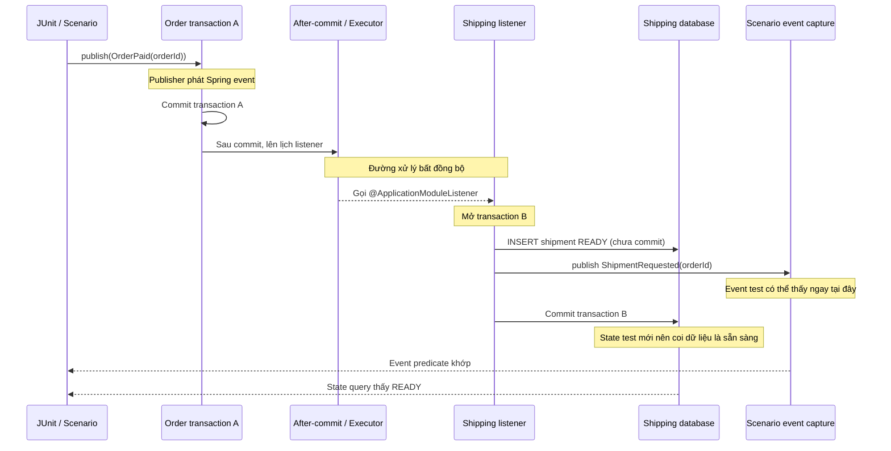
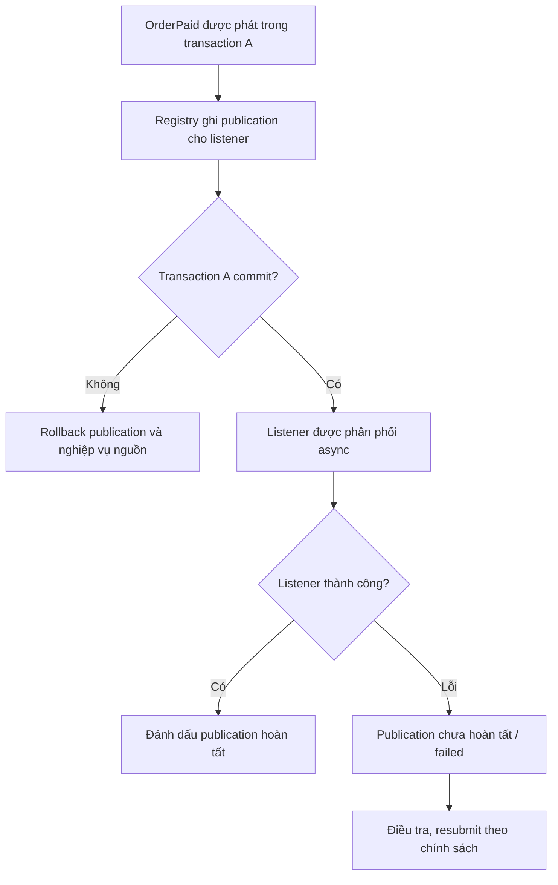

# Asynchronous event publication và thời điểm quan sát

## 1. Đặt vấn đề: một event được “phát” vào lúc nào?

Trong học phần **SPRING_MODULITH_VERIFICATION_TESTING**, người học kiểm chứng hai chiều của ứng dụng Spring Modulith: **ranh giới kiến trúc** bằng `ApplicationModules` và quy tắc phụ thuộc module; **hành vi tích hợp** bằng `@ApplicationModuleTest`, sự kiện, cơ sở dữ liệu và quality gate CI. Chương **Scenario** tập trung vào việc mô tả đầu vào, chờ kết quả quan sát được và xác nhận hệ thống đã đáp ứng hợp đồng.

Với giao tiếp bất đồng bộ, câu “event đã được phát” có thể đề cập đến những mốc rất khác nhau:

1. Publisher đã gọi `ApplicationEventPublisher.publishEvent(event)`.
2. Transaction nguồn đã **commit** thành công.
3. Event đã được **đưa tới executor** của listener bất đồng bộ.
4. Listener đã **bắt đầu** thực thi.
5. Listener đã **phát một event kết quả** như `ShipmentRequested`.
6. Transaction của listener đã **commit dữ liệu kết quả**.
7. Một module khác, broker ngoài hoặc hệ thống tích hợp đã **xử lý** kết quả.

**Không được đồng nhất các mốc trên.** Bài test nhận thấy `ShipmentRequested` xuất hiện chưa chắc đã chứng minh bản ghi shipment được commit, và việc gọi `publishEvent` thành công cũng chưa chắc chứng minh listener bất đồng bộ đã chạy.

> Trong Spring Framework, lời gọi `ApplicationEventPublisher.publishEvent(...)` được phân phối **đồng bộ theo mặc định**. Cụm “asynchronous event publication” trong bài này chủ yếu đề cập đến **việc chuyển giao và xử lý sự kiện bất đồng bộ** sau khi phát, chẳng hạn với `@Async` hoặc `@ApplicationModuleListener`; không phải có một phương thức bắt buộc tên `publishAsync(...)`.

Một kịch bản nghiệp vụ:

> **Given:** Đơn hàng `orderId` đã thanh toán, và module shipping sẵn sàng xử lý.
>
> **When:** Module order phát `OrderPaid(orderId)`.
>
> **Then:** Module shipping xử lý sau commit, phát `ShipmentRequested(orderId)` và cuối cùng ghi trạng thái shipment `READY`.

Trong bài test, **Then** phải trả lời cụ thể: ta muốn xác minh **event**, hay **trạng thái bền vững**, hay cả hai bằng hai phép kiểm có phạm vi rõ ràng?

## 2. Sơ đồ thời gian: ai làm gì và lúc nào?

Giả sử module `order` dùng transaction A để thanh toán. Module `shipping` xử lý `@ApplicationModuleListener` trong transaction B.



Đây là **một thứ tự khả dĩ** để làm rõ ranh giới quan sát: listener có thể phát event kết quả khi transaction B còn mở; sau đó transaction B mới commit. Lịch thread thực tế thay đổi theo executor và hệ thống. Hai phép kiểm cần chọn đúng loại dấu hiệu hoàn tất.

| Mốc | Sự kiện nào đã xảy ra? | Điều **chưa thể kết luận** |
| --- | --- | --- |
| `publishEvent(OrderPaid)` được gọi | Event đã được chuyển cho cơ chế phát sự kiện của Spring. | Listener async đã bắt đầu hoặc hoàn thành. |
| Transaction A commit | Dữ liệu nguồn đã commit; callback `AFTER_COMMIT` đủ điều kiện chạy. | Transaction B đã bắt đầu hoặc commit. |
| Listener bắt đầu | Module shipping đang xử lý. | Event kết quả đã phát hay DB đã commit. |
| `ShipmentRequested` được quan sát | Đã có một event tương ứng trong Spring context kiểm thử. | DB shipping chắc chắn đã commit. |
| DB query đọc được `READY` | Đã thấy trạng thái theo quy tắc cô lập/transaction của truy vấn. | Broker ngoài hoặc hệ thống vận chuyển đã xử lý. |
| Publication registry ghi “completed” | Listener được registry theo dõi đã thực thi thành công theo quy tắc hoàn tất của nó. | Mọi tác vụ bên ngoài listener, retry khác hoặc eventual consistency toàn hệ thống đã xong. |

## 3. Đồng bộ và bất đồng bộ trong Spring Modulith

Các annotation có ý nghĩa khác nhau:

| Listener | Thời điểm chạy | Transaction | Quan sát cần chọn |
| --- | --- | --- | --- |
| `@EventListener` mặc định | Khi Spring multicaster phân phối event, thường cùng thread publisher. | Có thể tham gia transaction hiện tại. | Gọi service và assert ngay **nếu** hợp đồng yêu cầu đồng bộ. |
| `@EventListener` kết hợp `@Async` | Khi executor nhận và thực thi task. | Không tự mang transaction của thread phát event. | Chờ event/state hoặc kết quả bất đồng bộ. |
| `@TransactionalEventListener` (mặc định `AFTER_COMMIT`) | Sau commit của transaction phát event. | Chạy theo ngữ cảnh callback giao dịch; không tự mở transaction mới để ghi dữ liệu. | Chờ kết quả; cân nhắc transaction mới nếu listener cần ghi DB. |
| `@ApplicationModuleListener` | Sau commit và bất đồng bộ. | Tự chạy với transaction `REQUIRES_NEW`. | `Scenario` chờ event hoặc trạng thái đã commit. |

`@ApplicationModuleListener` tương đương về mặt mục đích với tổ hợp `@Async`, `@TransactionalEventListener` và `@Transactional(propagation = REQUIRES_NEW)`. Nó thích hợp để **tích hợp giữa các application module bằng sự kiện**, giúp một chức năng thứ cấp không kéo dài transaction chính.

### Ví dụ khai báo listener

```java
@Component
class ShippingEventHandler {

    private final ShippingOperations shipping;

    ShippingEventHandler(ShippingOperations shipping) {
        this.shipping = shipping;
    }

    @ApplicationModuleListener
    public void on(OrderPaid event) {
        shipping.requestShipment(event.orderId());
    }
}
```

`ShippingOperations` là một cổng nghiệp vụ do dự án định nghĩa. Trong môi trường thực tế, phải có cấu hình Spring async và executor phù hợp để các phương thức `@Async` được thực thi bất đồng bộ. Đừng dùng thời gian chạy trên máy để suy đoán rằng annotation đang hoạt động; cần bảo đảm config của context test phản ánh config dự kiến.

**Điều cần tránh:** tự biến một lời gọi `publishEvent` bình thường thành “synchronous toàn hệ thống”. Nếu có listener async, kết quả sau commit không chịu ràng buộc thời điểm với dòng lệnh tiếp theo của publisher.

## 4. `Scenario` giải quyết việc chờ như thế nào?

Spring Modulith cung cấp `org.springframework.modulith.test.Scenario` dưới dạng tham số JUnit trong `@ApplicationModuleTest`.

Kịch bản thường được viết theo một chuỗi:

```java
scenario.publish(new OrderPaid(orderId))
        .andWaitForEventOfType(ShipmentRequested.class)
        .matching(event -> event.orderId().equals(orderId))
        .toArriveAndVerify(event ->
                assertThat(event.serviceLevel()).isEqualTo("STANDARD"));
```

- `scenario.publish(...)`: tạo **stimulus**, phát event trong transaction mà `Scenario` quản lý.
- `andWaitForEventOfType(...)`: khai báo loại event kết quả cần chờ.
- `matching(...)`: yêu cầu event thuộc đúng **giao dịch đang test**.
- `toArriveAndVerify(...)`: **terminal operation** thực thi kịch bản, chờ event phù hợp và chạy assertion trên payload.

Cách khác là kích hoạt qua service:

```java
scenario.stimulate(() -> orderService.markPaid(orderId))
        .andWaitForEventOfType(OrderPaid.class)
        .matchingMappedValue(OrderPaid::orderId, orderId)
        .toArrive();
```

`stimulate` kiểm thử luôn **cổng vào của module nguồn**; `publish` phù hợp để kiểm tra phản ứng của **module nhận** với một event mà module khác đã định nghĩa. Không dùng `publish` nếu yêu cầu thực sự là xác nhận service `markPaid` có phát event.

`Scenario` dùng cơ chế chờ/polling để tránh lỗi thời điểm của xử lý bất đồng bộ. Nhưng **không có terminal operation** (`toArrive...` hoặc `andVerify(...)`) thì chuỗi chỉ mới cấu hình, chưa hoàn tất thực thi test.

## 5. Ví dụ chính: listener async phát event kết quả

Để tập trung vào thời điểm **công bố event kết quả**, ví dụ đầu tiên chưa truy cập DB. Module `order` có hợp đồng event công khai `OrderPaid`, còn module `shipping` phát `ShipmentRequested`.

### 5.1. Event nguồn

`com/acme/order/OrderPaid.java`, đặt ở package gốc công khai mặc định của module `order`:

```java
package com.acme.order;

import java.util.UUID;

public record OrderPaid(UUID orderId) {}
```

Nếu đặt event trong một subpackage của module khác, cần công bố API đó qua cơ chế package/module interface (`@NamedInterface`) khi áp dụng các quy tắc ranh giới Spring Modulith.

### 5.2. Event đầu ra

`com/acme/shipping/ShipmentRequested.java`:

```java
package com.acme.shipping;

import java.util.UUID;

public record ShipmentRequested(UUID orderId, String serviceLevel) {}
```

### 5.3. Listener `@ApplicationModuleListener`

`com/acme/shipping/ShippingListener.java`:

```java
package com.acme.shipping;

import com.acme.order.OrderPaid;
import org.springframework.context.ApplicationEventPublisher;
import org.springframework.modulith.events.ApplicationModuleListener;
import org.springframework.stereotype.Component;

@Component
class ShippingListener {

    private final ApplicationEventPublisher events;

    ShippingListener(ApplicationEventPublisher events) {
        this.events = events;
    }

    @ApplicationModuleListener
    public void on(OrderPaid paid) {
        // Logic minh họa: hệ thống thật còn kiểm tra điều kiện nghiệp vụ.
        events.publishEvent(
                new ShipmentRequested(paid.orderId(), "STANDARD"));
    }
}
```

**Điều diễn ra:** `Scenario.publish(OrderPaid)` chạy trong transaction A; listener được lên lịch sau commit, ở transaction B và thread async, rồi công bố `ShipmentRequested`. Thời gian từ lúc phát `OrderPaid` đến lúc thấy `ShipmentRequested` phụ thuộc executor.

### 5.4. Test quan sát event

`src/test/java/com/acme/shipping/ShippingAsyncScenarioTests.java`:

```java
package com.acme.shipping;

import static org.assertj.core.api.Assertions.assertThat;

import java.time.Duration;
import java.util.UUID;

import com.acme.order.OrderPaid;
import org.junit.jupiter.api.Test;
import org.springframework.modulith.test.ApplicationModuleTest;
import org.springframework.modulith.test.Scenario;

@ApplicationModuleTest
class ShippingAsyncScenarioTests {

    @Test
    void eventuallyPublishesShipmentRequest(Scenario scenario) {
        UUID orderId = UUID.randomUUID();

        scenario.publish(new OrderPaid(orderId))
                .andWaitAtMost(Duration.ofSeconds(5))
                .forEventOfType(ShipmentRequested.class)
                .matchingMappedValue(ShipmentRequested::orderId, orderId)
                .toArriveAndVerify(event ->
                        assertThat(event.serviceLevel()).isEqualTo("STANDARD"));
    }
}
```

Các điểm quan trọng:

1. `@ApplicationModuleTest` mặc định khởi động module chứa lớp test: `shipping`. Module order chỉ cần cung cấp event thuộc API công khai; test không nhất thiết phải khởi động bean của order.
2. `UUID.randomUUID()` cô lập test, để không bắt nhầm event của order khác.
3. `Scenario.publish(...)` bảo đảm stimulus chạy trong transaction đủ điều kiện cho listener giao dịch được kích hoạt sau commit.
4. `andWaitAtMost(Duration.ofSeconds(5)).forEventOfType(...)` là cách cấu hình giới hạn chờ và loại event.
5. `matchingMappedValue(...)` yêu cầu ID đúng, còn `toArriveAndVerify(...)` khẳng định payload đúng.
6. Ví dụ listener này **không tạo dữ liệu** nên không cần cleanup DB; nếu thêm ghi DB hay gọi hệ thống khác, phải quản lý fixture và side effect.

Test sẽ thất bại nếu không có event phù hợp trước deadline, nhưng **không tự chứng minh listener đã commit một dữ liệu DB** hay message đã đến hệ thống vận chuyển bên ngoài.

### Những điều test này chứng minh và chưa chứng minh

| Chứng minh được | Chưa chứng minh được |
| --- | --- |
| Với `OrderPaid(orderId)`, context module shipping phát `ShipmentRequested` cùng ID trong thời gian chờ. | Listener phải chạy trong thời gian chính xác bao nhiêu mili giây. |
| Payload `serviceLevel` là `STANDARD`. | Có đúng một event duy nhất nếu retry hoặc nhiều listener cùng phát. |
| Listener được Spring context của bài test khởi động và đáp ứng hợp đồng event. | Shipment DB đã commit hay broker ngoài đã tiếp nhận sự kiện. |
| `Scenario` vượt qua chênh lệch thời điểm phát/quan sát bằng cơ chế chờ. | Sự kiện sẽ không mất sau sự cố tiến trình hay luôn được xử lý thành công ở production. |

## 6. “Thời điểm quan sát” phụ thuộc tín hiệu nào?

Giả sử thay listener trên bằng handler **vừa ghi DB vừa phát event kết quả**:

```java
@ApplicationModuleListener
public void on(OrderPaid paid) {
    shipmentRepository.insertReady(paid.orderId());
    events.publishEvent(
            new ShipmentRequested(paid.orderId(), "STANDARD"));
}
```

Đoạn mã là **biến thể** của listener ở mục 5, không đăng ký đồng thời hai listener cùng xử lý `OrderPaid` trong một demo. Trong transaction B, `insertReady(...)` có thể ghi SQL trước khi transaction commit. Lời gọi `publishEvent(ShipmentRequested)` diễn ra **trong khi transaction B vẫn còn mở**.

Kết quả:

- **Event test:** có thể thấy `ShipmentRequested` **trước commit của transaction B**.
- **State test:** cần truy vấn từ transaction phù hợp và chờ tới khi thấy bản ghi `READY` đã commit.
- **Test broker:** cần tín hiệu từ broker/consumer nếu hợp đồng đòi xác nhận việc chuyển sang hạ tầng ngoài.

Vì vậy, bài test như sau có thể **không ổn định**:

```java
scenario.publish(new OrderPaid(orderId))
        .andWaitForEventOfType(ShipmentRequested.class)
        .matching(event -> event.orderId().equals(orderId))
        .toArriveAndVerify(event -> {
            assertThat(repository.findStatus(orderId))
                    .contains("READY"); // Có thể đọc quá sớm!
        });
```

Assertion thứ hai chạy ngay sau khi quan sát event, trong khi transaction B có thể còn chưa commit. **Không nên dùng “đã nhận event” làm bằng chứng thay thế cho “DB đã commit”.**

## 7. Chờ trạng thái DB đã commit bằng `andWaitForStateChange`

Khi hợp đồng là “shipment phải ở trạng thái `READY`”, nên chờ chính trạng thái đó.

Ví dụ schema cho thử nghiệm:

```sql
CREATE TABLE shipments (
    order_id VARCHAR(36) PRIMARY KEY,
    status   VARCHAR(32) NOT NULL
);
```

Một repository JDBC tối giản (do dự án triển khai) có các phương thức:

```java
package com.acme.shipping;

import java.util.List;
import java.util.Optional;
import java.util.UUID;

import org.springframework.jdbc.core.JdbcTemplate;
import org.springframework.stereotype.Repository;

@Repository
class ShipmentRepository {

    private final JdbcTemplate jdbc;

    ShipmentRepository(JdbcTemplate jdbc) {
        this.jdbc = jdbc;
    }

    void insertReady(UUID orderId) {
        jdbc.update(
                "INSERT INTO shipments(order_id, status) VALUES (?, ?)",
                orderId.toString(), "READY");
    }

    Optional<String> findStatus(UUID orderId) {
        List<String> rows = jdbc.query(
                "SELECT status FROM shipments WHERE order_id = ?",
                (rs, n) -> rs.getString("status"),
                orderId.toString());
        return rows.stream().findFirst();
    }

    void delete(UUID orderId) {
        jdbc.update("DELETE FROM shipments WHERE order_id = ?",
                orderId.toString());
    }
}
```

Truy vấn trả `Optional.empty()` khi chưa có bản ghi, để trong lúc polling không phát sinh lỗi truy vấn chỉ vì dữ liệu chưa được commit.

**Scenario test chờ trạng thái:**

```java
@Test
void eventuallyPersistsReadyShipment(Scenario scenario) {
    UUID orderId = UUID.randomUUID();

    scenario.publish(new OrderPaid(orderId))
            .andCleanup(() -> transactions.executeWithoutResult(tx ->
                    repository.delete(orderId)))
            .andWaitForStateChange(
                    () -> repository.findStatus(orderId),
                    status -> status.filter("READY"::equals).isPresent())
            .andVerify(status ->
                    assertThat(status).contains("READY"));
}
```

Đoạn trên là phương thức bổ sung vào `@ApplicationModuleTest` có inject `ShipmentRepository repository` và `TransactionTemplate transactions`. Listener đang dùng **biến thể có `repository.insertReady(...)`** ở mục 6. Điều kiện chờ yêu cầu `Optional` **có phần tử và giá trị bằng `READY`**; nếu chưa commit hoặc giá trị `PENDING`, phép chờ tiếp tục.

- `andWaitForStateChange(Supplier, Predicate)` sẽ gọi supplier lặp lại.
- `andVerify(...)` là terminal operation, nhận trạng thái đã thỏa điều kiện.
- `andCleanup(...)` xóa dữ liệu do listener đã commit; transaction cleanup nên được bảo đảm rõ ràng.
- Với DB/test tích hợp, phải có datasource, transaction manager, schema và migration tương thích ứng dụng.

Một lựa chọn khác là:

```java
scenario.publish(new OrderPaid(orderId))
        .andWaitAtMost(Duration.ofSeconds(5))
        .forStateChange(
                () -> repository.findStatus(orderId),
                status -> status.filter("READY"::equals).isPresent())
        .andVerify(status -> assertThat(status).contains("READY"));
```

`forStateChange(...)` cho phép chuỗi đọc tự nhiên sau `andWaitAtMost(...)`. Ví dụ rút gọn này chưa hiện cleanup; nếu tạo bản ghi thật trong test, cần bổ sung cleanup như đoạn trước.

### Vì sao không chỉ dùng overload không có predicate?

`andWaitForStateChange(() -> repository.findStatus(orderId))` coi `Optional.of("PENDING")` là điều kiện hoàn tất, dù nghiệp vụ yêu cầu `READY`. Predicate `status.filter("READY"::equals).isPresent()` ngăn test đạt sai khi chỉ mới có trạng thái trung gian. Tương tự, `Integer` khác `null` hoặc danh sách rỗng chưa chứng minh điều kiện nghiệp vụ đã hoàn thành.

## 8. Kiểm soát timeout mà không dùng `Thread.sleep`

Cách viết dễ bị flaky:

```java
events.publishEvent(new OrderPaid(orderId));
Thread.sleep(1000);
assertThat(repository.findStatus(orderId)).contains("READY");
```

Có ba vấn đề: đoạn test tự phát event mà không bảo đảm transaction cho `@TransactionalEventListener`, chờ **thời gian cố định**, và phụ thuộc vào tốc độ CI. Một giây có thể quá ngắn ở máy bận hoặc lãng phí khi handler chạy nhanh.

Dùng `Scenario` với giới hạn chờ:

```java
scenario.publish(new OrderPaid(orderId))
        .customize(wait -> wait.atMost(Duration.ofSeconds(5)))
        .andWaitForEventOfType(ShipmentRequested.class)
        .matching(event -> event.orderId().equals(orderId))
        .toArriveAndVerify(event ->
                assertThat(event.serviceLevel()).isEqualTo("STANDARD"));
```

`customize(...)` sử dụng cấu hình chờ dựa trên Awaitility. Khi chỉ cần thời gian tối đa, `andWaitAtMost(...)` ngắn gọn hơn.

**Nguyên tắc timeout:**

1. Giới hạn đủ cho độ trễ có thể chấp nhận của transaction, executor và DB trong CI.
2. Có giới hạn hữu hạn để phát hiện listener bị treo, sai matcher hoặc không chạy.
3. Quan sát và phân tích các timeout lặp lại; không tăng deadline vô hạn để che lỗi nghiệp vụ.
4. Không dùng giả định “event đến trước/đến sau bao nhiêu mili giây” như một phần của hợp đồng nếu ứng dụng không có SLA thời gian cụ thể.

## 9. Đối chiếu `PublishedEvents` và `Scenario`

Spring Modulith cho phép truyền `PublishedEvents` vào test `@ApplicationModuleTest` để truy vấn các event đã được ghi nhận trong lần test:

```java
@Test
void publishesExpectedEvent(PublishedEvents events) {
    shippingService.requestShipment(orderId);

    assertThat(events.ofType(ShipmentRequested.class)
            .matching(ShipmentRequested::orderId, orderId))
            .hasSize(1);
}
```

Đây là đoạn minh họa, giả định đã có `shippingService` và `orderId` trong test. Nó phù hợp khi service và listener đều **đồng bộ**, và event được phát trước khi lời gọi trả về.

Với listener async, assertion ngay sau `shippingService.requestShipment(...)` có thể chạy trước handler. Do đó, **`PublishedEvents` không tự chờ** sự kiện của listener bất đồng bộ; có thể dẫn đến test pass/fail phụ thuộc thời điểm. `Scenario` giải quyết phần chờ:

```java
scenario.stimulate(() -> shippingService.requestShipment(orderId))
        .andWaitForEventOfType(ShipmentRequested.class)
        .matching(event -> event.orderId().equals(orderId))
        .toArrive();
```

| Tiêu chí | `PublishedEvents` | `Scenario` |
| --- | --- | --- |
| Mục tiêu | Truy vấn các Spring event đã được ghi nhận trong test. | Mô tả stimulus, chờ kết quả và assertion. |
| Chờ bất đồng bộ tự động? | Không, chỉ đọc các event được ghi nhận tại thời điểm truy vấn. | Có, khi có terminal operation chờ event/state. |
| Chạy stimulus trong transaction mới? | Không tự làm thay code được test. | Có qua `publish`/`stimulate`. |
| Kiểm tra số event trùng? | Có thể assert kích thước tập event phù hợp. | `toArrive()` chỉ cần ít nhất một event phù hợp. |
| Đọc DB state đã commit? | Cần mã truy vấn/assert riêng. | Dùng `andWaitForStateChange(...)`. |

**Lưu ý:** `Scenario.toArrive()` không xác minh event được phát **đúng một lần**. Nếu nghiệp vụ đòi idempotency, nên kiểm tra trạng thái bền vững hoặc dùng cơ chế tập hợp/đếm sự kiện được thiết kế cho concurrency.

## 10. Transaction của Given và những dữ liệu đã commit

`Scenario.publish(...)`/`stimulate(...)` chạy stimulus trong **transaction mới**. Nếu `@ApplicationModuleListener` xử lý trong transaction riêng, thay đổi đã commit ở cả hai phía **không tự rollback** khi phương thức JUnit kết thúc.

Do đó, cần dọn:

- **Given**: bản ghi tạo trước stimulus, ví dụ order test, customer test, hàng hóa thử nghiệm.
- **Side effect**: shipment, outbox, lịch xử lý hoặc projection do listener sinh ra.
- **Kết quả ngoài DB**: resource giả lập, stub state, message thử nghiệm nếu có.

Nếu Given cần được listener async đọc, nó phải **được commit trước khi listener bắt đầu**. Ví dụ:

```java
// GIVEN: tạo trạng thái nguồn trong transaction đã commit.
transactions.executeWithoutResult(tx ->
        orders.insertPaidOrder(orderId));

// WHEN: phát event trong transaction do Scenario quản lý.
scenario.publish(new OrderPaid(orderId))
        .andCleanup(() -> transactions.executeWithoutResult(tx -> {
            shipments.delete(orderId);
            orders.delete(orderId);
        }))
        .andWaitForStateChange(
                () -> shipments.findStatus(orderId),
                status -> status.filter("READY"::equals).isPresent())
        .andVerify(status -> assertThat(status).contains("READY"));
```

`orders` và `shipments` là repository minh họa; cần triển khai phương thức tương ứng theo schema thực. Nếu khóa ngoại tồn tại, xóa bản ghi con trước bản ghi cha.

**Đừng phụ thuộc vào `@Transactional` trên test** để rollback mọi thứ: transaction mới của stimulus và listener có thể đã commit độc lập. Nếu test bao ngoài một transaction chưa commit, listener ở transaction khác cũng có thể **không nhìn thấy dữ liệu Given**.

## 11. Bất đồng bộ thất bại: event registry giải quyết vấn đề nào?

Bất đồng bộ tạo ra một khoảng cách giữa **transaction nguồn đã commit** và **listener xử lý thành công**. Nếu tiến trình dừng, executor lỗi hoặc listener ném exception trong khoảng này, event có nguy cơ không được xử lý như mong đợi.

Spring Modulith cung cấp **Event Publication Registry** để theo dõi việc chuyển sự kiện cho **transactional event listeners** khi đã cấu hình persistence phù hợp (ví dụ JDBC/JPA hoặc datastore được hỗ trợ). Các publication entry được ghi cùng transaction nguồn; framework theo dõi thành công của listener để đánh dấu hoàn tất. Nếu listener lỗi, publication có thể còn ở trạng thái chưa hoàn tất hoặc failed tùy phiên bản/cấu hình và được xử lý lại bằng cơ chế resubmission.



Một số điểm cần phân biệt:

- **Không có registry được cấu hình**: `@ApplicationModuleListener` vẫn có thể hoạt động, nhưng không mặc nhiên có cơ chế ghi publication bền vững để phục hồi.
- **Có registry**: publication được theo dõi cho mỗi listener thuộc phạm vi cấu hình; cơ chế này không biến một Java method thành message broker và không bảo đảm mọi side effect bên ngoài transaction có thể rollback.
- **Spring Modulith 2.0+** có vòng đời publication rõ hơn, ví dụ `PUBLISHED`, `PROCESSING`, `COMPLETED`, `FAILED`, `RESUBMITTED`. Không áp dụng tên status của 2.x cho dự án chạy 1.x khi chưa kiểm tra phiên bản.
- **Resubmit/retry** có thể khiến listener được gọi lại. Vì vậy, idempotency theo `orderId` hoặc business key là yêu cầu thiết kế quan trọng.
- Cấu hình `spring.modulith.events.republish-outstanding-events-on-restart` có tồn tại, nhưng không nên bật tùy tiện cho nhiều instance nếu chưa thiết kế cách phối hợp xử lý và bản ghi publication.

### Event registry có thay thế Scenario test không?

Không. Registry theo dõi **vòng đời chuyển event tới listener**, còn `Scenario` xác nhận **hành vi được quan sát trong bài test**. Một publication `COMPLETED` không nhất thiết chứng minh đối tác bên ngoài đã nhận hàng hoặc các tác vụ được giao tiếp qua một hàng đợi khác đã hoàn tất. Khi cần bảo đảm kết quả bên ngoài, viết integration test tương ứng.

Trong CI, có thể bổ sung test liên quan retry/idempotency và event registry nếu module thực sự sử dụng nó; đừng ngầm coi mọi ứng dụng Modulith đều đã bật Event Publication Registry.

## 12. Những lỗi flaky điển hình và cách xử lý

| Dấu hiệu | Nguyên nhân thường gặp | Cách kiểm tra và xử lý |
| --- | --- | --- |
| Test pass máy dev, timeout CI. | Executor/DB chạy chậm hơn, timeout nhỏ. | Chờ bằng `Scenario`, chọn deadline có lý do, đọc log listener. |
| Test thấy event nhưng DB chưa có bản ghi. | Event kết quả phát trước commit của listener. | Chờ state sau commit bằng `andWaitForStateChange`. |
| Gọi `publishEvent` mà listener `@TransactionalEventListener` không chạy. | Không có transaction hợp lệ khi phát; mặc định không fallback. | Dùng `Scenario.publish` hoặc transaction được cấu hình đúng. |
| Đôi lúc test pass với event của đơn khác. | Chỉ lọc theo type, thiếu correlation ID. | Dùng `matchingMappedValue` hoặc predicate theo `orderId`. |
| Test thất bại trước khi handler kịp chạy. | Assertion ngay sau publisher đối với listener async. | Dùng terminal operation chờ kết quả. |
| Đôi khi handler cập nhật DB hai lần. | Retry/resubmit, event trùng, chưa có idempotency. | Dùng unique business key, deduplication, test state cuối cùng. |
| Sau suite có dữ liệu dư. | Transaction stimulus/listener đã commit độc lập. | `andCleanup`, seed cô lập và dọn cả fixture/side effect. |
| Listener bị thiếu trong context test. | `@ApplicationModuleTest` chạy `STANDALONE` nhưng listener nằm module khác. | Đặt test tại module nhận hoặc mở rộng bootstrap đúng nhu cầu. |
| Test event pass nhưng nghiệp vụ sai. | Chỉ assert “có event”, không kiểm tra payload hoặc trạng thái. | Assert ID, các trường nghiệp vụ và DB state quan trọng. |
| Sự kiện mất khi tiến trình khởi động lại. | Không theo dõi publication hoặc chính sách recovery chưa phù hợp. | Xem Event Publication Registry, idempotency, monitoring và resubmission. |

### Anti-pattern: dùng thread hoặc sleep để ép thứ tự

```java
// Không nên: thời gian cố định không bảo đảm listener đã hoàn thành.
publisher.publishEvent(new OrderPaid(orderId));
Thread.sleep(500);
assertThat(repository.findStatus(orderId)).contains("READY");
```

Tốt hơn, viết lại thành `Scenario.publish(...)` kết hợp `andWaitForStateChange(...)` với một predicate đúng nghiệp vụ. Nếu muốn kiểm tra listener **thật sự chạy async**, đừng kết luận chỉ bằng việc nhìn tên thread ở một lần test: cần xác định cấu hình `@Async`/executor và contract về thứ tự thực thi.

## 13. Thiết kế quality gate CI cho luồng bất đồng bộ

Ứng dụng Spring Modulith cần **cả** hai nhóm phép kiểm.

### A. Ranh giới kiến trúc

```java
import org.junit.jupiter.api.Test;
import org.springframework.modulith.core.ApplicationModules;

class ModuleArchitectureTests {

    @Test
    void modulesRespectBoundaries() {
        ApplicationModules.of(Application.class).verify();
    }
}
```

`Application.class` là lớp ứng dụng Spring Boot thực tế. `ApplicationModules.verify()` kiểm chứng phụ thuộc module, ranh giới package công khai/nội bộ và quy tắc phụ thuộc đã khai báo. Nó không chứng minh listener async xử lý thành công.

### B. Hành vi tích hợp

Dùng `@ApplicationModuleTest` và `Scenario` để kiểm chứng:

- Event kết quả phù hợp: `andWaitForEventOfType(...)`, matcher theo ID và assertion payload.
- Trạng thái DB sau commit: `andWaitForStateChange(supplier, predicate)`.
- Timeout hữu hạn theo độ trễ thực tế của CI; không `Thread.sleep` cố định.
- Dữ liệu đầu vào độc lập và cleanup cho side effect đã commit.
- Nếu có event registry: cân nhắc test thêm failure/retry/idempotency ở phạm vi tích hợp thích hợp.

Pipeline có thể chạy test thông qua `./mvnw test` hoặc `./gradlew test` tùy build tool của dự án và đánh dấu thất bại khi test kiến trúc/hành vi fail. DB kiểm thử nên được tạo từ migration chuẩn; Testcontainers là lựa chọn hữu ích khi transaction, lock hoặc dialect SQL cần giống môi trường production.

### Checklist kiểm tra thời điểm quan sát

- [ ] Đã xác định **event nguồn**, **listener**, **event kết quả** và **trạng thái cuối**.
- [ ] Biết listener là `@EventListener`, `@Async`, `@TransactionalEventListener` hay `@ApplicationModuleListener`.
- [ ] Biết transaction nguồn commit lúc nào; Given đã commit trước khi listener cần đọc.
- [ ] Chọn event test nếu hợp đồng là **sự kiện xuất hiện**; state test nếu hợp đồng là **dữ liệu đã sẵn sàng**.
- [ ] Event matcher lọc `orderId` hoặc correlation ID duy nhất.
- [ ] Có terminal operation `toArrive...` / `andVerify(...)`.
- [ ] Timeout hữu hạn và có lý do trên CI.
- [ ] Không dùng `Thread.sleep` để che race condition.
- [ ] Cleanup cả dữ liệu Given và side effect; lưu ý listener có thể còn chạy sau event.
- [ ] Khi có retry, kiểm chứng idempotency và không khẳng định “đúng một lần” chỉ bằng `toArrive()`.
- [ ] Có `ApplicationModules.verify()` độc lập để giữ ranh giới kiến trúc.

## 14. Bài tập thực hành

Dựa trên `OrderPaid` và `ShipmentRequested` trong bài:

1. **Vẽ timeline:** Đánh dấu transaction A commit, thread async bắt đầu, listener phát `ShipmentRequested` và transaction B commit. Giải thích test event có thể pass ở đâu.
2. **Event test:** Viết `Scenario.publish(new OrderPaid(orderId))` chờ `ShipmentRequested` đúng `orderId`. Thêm timeout 3 giây và kiểm tra `serviceLevel`.
3. **State test:** Sửa listener để ghi `shipments(order_id, status)`. Viết `andWaitForStateChange` chờ `READY` và cleanup.
4. **Race condition:** Cho listener `insertReady` rồi `publishEvent(ShipmentRequested)` nhưng transaction B chưa commit. Vì sao assert DB trong `toArriveAndVerify` có thể lỗi?
5. **So sánh API:** Khi nào dùng `scenario.stimulate(() -> service.markPaid(id))` thay vì `scenario.publish(new OrderPaid(id))`?
6. **Retry:** Giả sử event registry thử xử lý lại cùng `OrderPaid`. Thiết kế ràng buộc dữ liệu để không tạo hai shipment cho một `orderId`.
7. **Phạm vi module:** Test đặt ở module order trong `STANDALONE` và muốn chờ event do shipping phát. Vì sao có thể timeout dù production hoạt động đúng?
8. **Kiến trúc:** Module shipping import `com.acme.order.internal.OrderEntity`. Test gì kiểm chứng vi phạm này dù mọi event test đều pass?

**Gợi ý đáp án:** (1) event có thể đến trước commit B; (2) `andWaitAtMost(...).forEventOfType(...).matchingMappedValue(...).toArriveAndVerify(...)`; (3) supplier DB + predicate `READY`; (4) event đã phát bên trong transaction B nhưng dữ liệu chưa bền vững; (5) `stimulate` kiểm tra cả service nguồn; (6) idempotency theo ID và unique constraint; (7) listener shipping chưa được boot trong context; (8) `ApplicationModules.verify()`.

## Tài liệu tham khảo

- [Spring Modulith — Integration Testing Application Modules](https://docs.spring.io/spring-modulith/reference/testing.html): `Scenario.publish`, `stimulate`, transaction của stimulus, event/state polling, timeout và cleanup.
- [Spring Modulith — Working with Application Events](https://docs.spring.io/spring-modulith/reference/events.html): phát sự kiện, `@ApplicationModuleListener`, event registry và quá trình hoàn tất publication.
- [Spring Modulith — ApplicationModuleListener Javadoc](https://docs.spring.io/spring-modulith/docs/current/api/org/springframework/modulith/events/ApplicationModuleListener.html): liên hệ với `@Async`, `@TransactionalEventListener` và `REQUIRES_NEW`.
- [Spring Modulith — Scenario Javadoc](https://docs.spring.io/spring-modulith/docs/current/api/org/springframework/modulith/test/Scenario.html): stimulus `publish`/`stimulate`.
- [Spring Modulith — Scenario.When Javadoc](https://docs.spring.io/spring-modulith/docs/current/api/org/springframework/modulith/test/Scenario.When.html): `andWaitForEventOfType`, `andWaitForStateChange`, timeout và cleanup.
- [Spring Framework — Transaction-bound Events](https://docs.spring.io/spring-framework/reference/data-access/transaction/event.html): thời điểm của `@TransactionalEventListener` so với commit.
- [Spring Framework — Task Execution and Scheduling](https://docs.spring.io/spring-framework/reference/integration/scheduling.html): `@Async`, task executor và xử lý exception bất đồng bộ.
- [Spring Modulith — Verifying Application Module Structure](https://docs.spring.io/spring-modulith/reference/verification.html): `ApplicationModules.verify()` kiểm soát ranh giới module.
