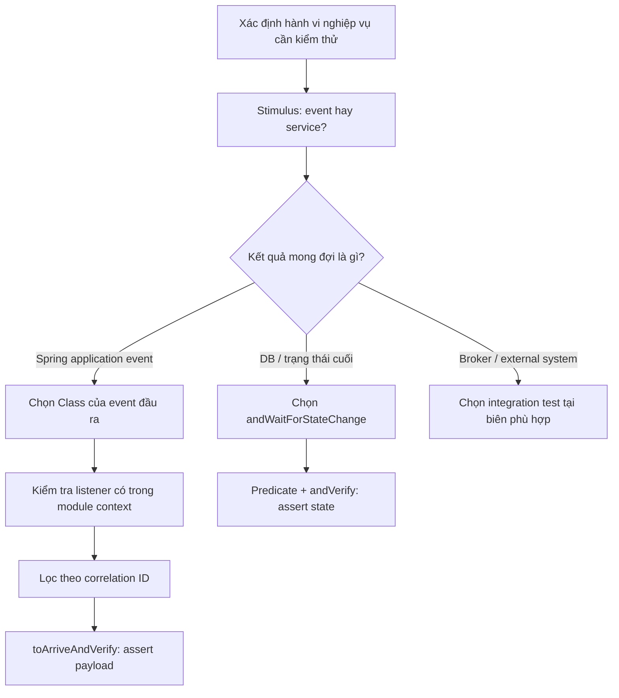
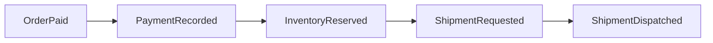

# Xác định event type cần chờ

## 1. Vì sao chọn đúng event type là bước quyết định?

Trong học phần **SPRING_MODULITH_VERIFICATION_TESTING**, chúng ta kiểm chứng **ranh giới kiến trúc** của ứng dụng Spring Modulith bằng `ApplicationModules` và quy tắc phụ thuộc giữa module, đồng thời kiểm thử **hành vi tích hợp** bằng `@ApplicationModuleTest`, sự kiện, cơ sở dữ liệu và quality gate CI.

Ở chương **Scenario**, câu hỏi “Xác định event type cần chờ” được hiểu là:

> **Sau khi kích hoạt một hành vi của module, sự kiện đầu ra nào là bằng chứng trực tiếp nhất rằng hợp đồng nghiệp vụ cần kiểm thử đã xảy ra?**

Ví dụ module `shipping` nhận `OrderPaid` rồi phát `ShipmentRequested`. Nếu test tự phát `OrderPaid` và lại chờ `OrderPaid.class`, bài test có thể thành công chỉ vì **sự kiện đầu vào do chính test gửi đi**, trong khi logic `shipping` không hề hoạt động. Type đúng phải là `ShipmentRequested.class`, đồng thời event nhận được phải khớp `orderId`.

Chọn sai event type gây ba kiểu lỗi:

- **Pass giả:** chờ một event vốn luôn xuất hiện khi stimulus được thực thi, không chứng minh module mục tiêu xử lý thành công.
- **Timeout khó hiểu:** handler phát một event hợp lệ nhưng test đợi sai class hoặc một bước không thuộc phạm vi module đã khởi động.
- **Phạm vi kiểm thử lệch:** quan sát một event trung gian nhưng kết luận sai rằng trạng thái DB, hệ thống ngoài hoặc toàn bộ workflow đã hoàn tất.

Mục tiêu của bài là có một phương pháp **xác định event type từ hợp đồng nghiệp vụ**, triển khai `Scenario.andWaitForEventOfType(...)` đúng cách và phân biệt giữa **kiểu event**, **nội dung event** và **trạng thái cuối cùng**.

## 2. API nào biểu diễn event type cần chờ?

API chính của Spring Modulith:

```java
scenario.publish(new InputEvent(...))
        .andWaitForEventOfType(ExpectedOutputEvent.class)
        .matching(event -> /* điều kiện của event */)
        .toArriveAndVerify(event -> /* assertion */);
```

`andWaitForEventOfType(Class<E>)` nhận một đối tượng `Class<E>` để mô tả **kiểu Spring application event cần quan sát** và trả `Scenario.When<T>.EventResult<E>`. Sau bước này, Java biết `event` trong các callback `matching` và `toArriveAndVerify` có kiểu `E`.

Đây là các thành phần khác nhau:

| Thành phần | Trả lời câu hỏi | Ví dụ |
| --- | --- | --- |
| **Stimulus**: `publish(...)` hoặc `stimulate(...)` | Hệ thống được kích hoạt bằng gì? | `OrderPaid(orderId)`. |
| **Event type**: `andWaitForEventOfType(...)` | Chờ một loại kết quả sự kiện nào? | `ShipmentRequested.class`. |
| **Matcher**: `matching(...)` | Event nào thuộc đúng tình huống đang test? | `event.orderId().equals(orderId)`. |
| **Assertion**: `toArriveAndVerify(...)` | Thuộc tính nghiệp vụ của kết quả có đúng không? | `event.carrier().equals("STANDARD")`. |
| **Terminal operation** | Khi nào chạy kịch bản và xác nhận kết quả? | `toArrive()` / `toArriveAndVerify(...)`. |

Ví dụ với timeout:

```java
scenario.publish(new OrderPaid(orderId, "SKU-42", 2))
        .andWaitAtMost(Duration.ofSeconds(5))
        .forEventOfType(ShipmentRequested.class)
        .matchingMappedValue(ShipmentRequested::orderId, orderId)
        .toArriveAndVerify(event ->
                assertThat(event.carrier()).isEqualTo("STANDARD"));
```

`forEventOfType(Class<E>)` là dạng thay thế `andWaitForEventOfType(Class<E>)` cho chuỗi đã cấu hình `andWaitAtMost(...)` hoặc `customize(...)` trước đó. Hai cách đều xác định **cùng kiểu event cần chờ**.

**Quan trọng:** `andWaitForEventOfType(...)` mới xác lập điều kiện, chưa hoàn tất Scenario. Cần terminal operation `toArrive()`, `toArriveAndVerify(...)` hoặc API terminal tương ứng để thực thi kịch bản.

## 3. Một quy trình chọn event type đúng

Khi chuẩn bị test, hãy trả lời theo thứ tự:

1. **Xác định module đang kiểm thử:** ví dụ `shipping`, không phải toàn bộ hệ thống.
2. **Chọn điểm vào (stimulus):** event `OrderPaid` từ module khác, hay một method của `ShippingService`?
3. **Đọc hợp đồng kết quả:** shipping có hứa phát `ShipmentRequested`, `ShipmentRejected`, lưu `Shipment`, hay tất cả ở những nhánh khác nhau?
4. **Chọn một bằng chứng phù hợp mục tiêu:** nếu mục tiêu là “yêu cầu tạo vận đơn được phát” thì chọn `ShipmentRequested.class`; nếu mục tiêu là “DB chuyển READY” thì chọn truy vấn state.
5. **Chọn mã tương quan:** `orderId`, `paymentId` hoặc ID của aggregate để không nhận nhầm event đồng loại.
6. **Kiểm tra phạm vi context:** listener tạo kết quả có thực sự được `@ApplicationModuleTest` khởi động không?
7. **Kết thúc bằng assertion:** xác nhận payload và, nếu cần, có test riêng cho trạng thái bền vững.



**Điểm mấu chốt:** event được chọn phải là **kết quả có ý nghĩa nghiệp vụ**, không đơn thuần là class dễ import nhất hoặc event đã được test phát ra.

## 4. Một luồng có thể có nhiều event type

Giả sử module `order` công bố `OrderPaid`. Module `shipping` xử lý với hai nhánh:

| Given / When | Event đầu ra theo hợp đồng | Type nên chờ | Vì sao |
| --- | --- | --- | --- |
| Đơn thanh toán, số lượng 2 hợp lệ | Shipping yêu cầu tạo vận đơn. | `ShipmentRequested.class` | Chứng minh nhánh thành công. |
| Đơn thanh toán, số lượng 9 vượt giới hạn chính sách thử nghiệm | Shipping từ chối yêu cầu. | `ShipmentRejected.class` | Chứng minh nhánh từ chối. |
| Service tạo đơn thành công | Module order công bố việc đặt đơn. | `OrderPlaced.class` | Chứng minh **module order** đã phát event của chính nó. |
| Handler ghi trạng thái shipment `READY` | DB có bản ghi đúng trạng thái. | **Không chờ event thay thế DB** | Dùng `andWaitForStateChange(...)` với predicate. |
| Message đã đến Kafka hoặc RabbitMQ | Broker đã tiếp nhận hoặc consumer hoàn tất. | **Không suy diễn từ Spring event nội bộ** | Dùng test tích hợp broker / consumer và tín hiệu biên phù hợp. |

Nếu một workflow phát nhiều event `OrderValidated` → `ShipmentRequested` → `ShipmentCreated` thì type cần chờ phụ thuộc câu hỏi test:

- **“Đã xác thực đơn?”** Chờ `OrderValidated.class`.
- **“Đã yêu cầu giao hàng?”** Chờ `ShipmentRequested.class`.
- **“Đã tạo vận đơn thành công?”** Chờ `ShipmentCreated.class` hoặc trạng thái repository tương ứng.

Chờ `OrderValidated` rồi kết luận vận đơn đã được tạo là **vượt quá bằng chứng mà test cung cấp**.

## 5. Ví dụ xuyên suốt: chọn đúng event type của module shipping

Giả sử ứng dụng có hai application module: `com.acme.order` và `com.acme.shipping`. Các ví dụ Java dưới đây tập trung vào API kiểm thử; để chạy trong dự án thật cần Spring Boot application, starter kiểm thử Spring Modulith và hạ tầng transaction tương ứng.

### 5.1. Contract event công khai của module order

File `com/acme/order/OrderPaid.java`:

```java
package com.acme.order;

import java.util.UUID;

public record OrderPaid(UUID orderId, String sku, int quantity) {}
```

Event thuộc package gốc của module `order`, tức API module theo cách phân vùng package mặc định. Nếu event nằm trong subpackage `com.acme.order.api`, dự án nên khai báo `@NamedInterface` để công bố API cần thiết. Không import class nội bộ của module khác chỉ để test chạy được.

### 5.2. Hai event đầu ra của module shipping

File `com/acme/shipping/ShipmentRequested.java`:

```java
package com.acme.shipping;

import java.util.UUID;

public record ShipmentRequested(
        UUID orderId, String sku, int quantity, String carrier) {}
```

File `com/acme/shipping/ShipmentRejected.java`:

```java
package com.acme.shipping;

import java.util.UUID;

public record ShipmentRejected(UUID orderId, String reason) {}
```

Hai class là **hai kiểu event nghiệp vụ khác nhau**. Không dùng một `Object.class` hoặc `ApplicationEvent.class` quá rộng chỉ để “bắt được bất kỳ sự kiện nào”.

### 5.3. Listener phát đúng nhánh

File `com/acme/shipping/ShippingHandler.java`:

```java
package com.acme.shipping;

import com.acme.order.OrderPaid;
import org.springframework.context.ApplicationEventPublisher;
import org.springframework.modulith.events.ApplicationModuleListener;
import org.springframework.stereotype.Component;

@Component
class ShippingHandler {

    private final ApplicationEventPublisher events;

    ShippingHandler(ApplicationEventPublisher events) {
        this.events = events;
    }

    @ApplicationModuleListener
    public void on(OrderPaid paid) {
        // Chính sách minh họa để làm rõ hai nhánh kiểm thử.
        if (paid.quantity() <= 0 || paid.quantity() > 5) {
            events.publishEvent(
                    new ShipmentRejected(paid.orderId(), "INVALID_QUANTITY"));
            return;
        }

        events.publishEvent(new ShipmentRequested(
                paid.orderId(), paid.sku(), paid.quantity(), "STANDARD"));
    }
}
```

`@ApplicationModuleListener` xử lý sau commit và bất đồng bộ trong transaction riêng. Bài test **không thể** dựa vào việc gọi `publishEvent(OrderPaid)` rồi assert ngay trên handler. `Scenario` tạo transaction cho stimulus và chờ event kết quả phù hợp.

Đây là một ví dụ đơn giản hóa. Quy tắc tồn kho, tồn tại SKU và tích hợp thực tế cần được viết riêng nếu thuộc hợp đồng của ứng dụng.

### 5.4. Test nhánh thành công: chờ `ShipmentRequested.class`

File `src/test/java/com/acme/shipping/ShippingEventTypeTests.java`:

```java
package com.acme.shipping;

import static org.assertj.core.api.Assertions.assertThat;

import java.time.Duration;
import java.util.UUID;

import com.acme.order.OrderPaid;
import org.junit.jupiter.api.Test;
import org.springframework.modulith.test.ApplicationModuleTest;
import org.springframework.modulith.test.Scenario;

@ApplicationModuleTest
class ShippingEventTypeTests {

    @Test
    void requestsShipmentWhenQuantityIsValid(Scenario scenario) {
        UUID orderId = UUID.randomUUID();

        scenario.publish(new OrderPaid(orderId, "SKU-42", 2))
                .andWaitAtMost(Duration.ofSeconds(5))
                .forEventOfType(ShipmentRequested.class)
                .matchingMappedValue(ShipmentRequested::orderId, orderId)
                .toArriveAndVerify(event -> {
                    assertThat(event.sku()).isEqualTo("SKU-42");
                    assertThat(event.quantity()).isEqualTo(2);
                    assertThat(event.carrier()).isEqualTo("STANDARD");
                });
    }
}
```

Trong bài test:

- `OrderPaid` là **input type**, do test chủ động phát.
- `ShipmentRequested` là **expected output type**, do handler của shipping phải phát.
- `matchingMappedValue(ShipmentRequested::orderId, orderId)` là điều kiện **chọn instance cụ thể** trong các event cùng class.
- `toArriveAndVerify(...)` khẳng định payload đúng. Type đúng nhưng `carrier` sai vẫn khiến test thất bại.
- Test **chỉ** yêu cầu sự kiện được phát trong giới hạn 5 giây; nó chưa chứng minh hệ thống vận chuyển bên ngoài đã nhận đơn.

`@ApplicationModuleTest` mặc định dùng `STANDALONE` và khởi động module `shipping` vì test được đặt trong package này. Event type `OrderPaid` nằm trên classpath qua API công khai của `order`; test không cần khởi động business service của module order để phát event mẫu.

### 5.5. Test nhánh từ chối: chờ `ShipmentRejected.class`

Trong cùng lớp:

```java
@Test
void rejectsShipmentWhenQuantityExceedsPolicy(Scenario scenario) {
    UUID orderId = UUID.randomUUID();

    scenario.publish(new OrderPaid(orderId, "SKU-42", 9))
            .andWaitForEventOfType(ShipmentRejected.class)
            .matching(event -> event.orderId().equals(orderId))
            .toArriveAndVerify(event ->
                    assertThat(event.reason()).isEqualTo("INVALID_QUANTITY"));
}
```

Dù input vẫn là `OrderPaid`, output type của nhánh thất bại là **`ShipmentRejected`**. Nếu test cố chờ `ShipmentRequested.class`, nó sẽ timeout khi code xử lý đúng nhánh từ chối. Điều này cho thấy **event type cần chờ được quyết định bởi hợp đồng của kịch bản và dữ liệu Given**, không chỉ bởi tên phương thức handler.

Khi có nhiều loại kết quả hợp lệ tùy bối cảnh, nên viết các test có Given riêng để mỗi test diễn đạt đúng một nhánh rõ ràng.

## 6. Vì sao chờ lại input type là sai?

Ví dụ sau biên dịch được nếu các class tồn tại, nhưng gần như không có giá trị xác minh shipping:

```java
UUID orderId = UUID.randomUUID();

scenario.publish(new OrderPaid(orderId, "SKU-42", 2))
        .andWaitForEventOfType(OrderPaid.class)
        .matching(event -> event.orderId().equals(orderId))
        .toArrive();
```

**Lỗi logic:** `Scenario.publish` đã phát chính `OrderPaid` mà test đang chờ. Handler `ShippingHandler` có thể không hoạt động, nhưng điều kiện `OrderPaid` vẫn có khả năng được thỏa mãn.

Dạng đúng:

```java
scenario.publish(new OrderPaid(orderId, "SKU-42", 2))
        .andWaitForEventOfType(ShipmentRequested.class)
        .matching(event -> event.orderId().equals(orderId))
        .toArriveAndVerify(event ->
                assertThat(event.quantity()).isEqualTo(2));
```

Một số tình huống **hợp lệ** khi chờ loại event giống nhau vẫn có thể tồn tại (chẳng hạn một service nhận yêu cầu và chủ đích phát **một instance mới cùng class**), nhưng khi ấy bắt buộc cần matcher phân biệt ID, phase hoặc thuộc tính để chứng minh đó là **output mới**, thay vì event stimulus. Với đa số bài kiểm thử phản ứng qua module, ưu tiên event class đầu ra khác class đầu vào.

## 7. Class chọn kiểu, matcher chọn đối tượng

`andWaitForEventOfType(ShipmentRequested.class)` chỉ xác định **loại sự kiện**. Khi hệ thống xử lý nhiều đơn hàng, cần tiếp tục lọc theo dữ liệu nghiệp vụ.

### 7.1. `matching(Predicate<E>)`

```java
scenario.publish(new OrderPaid(orderId, "SKU-42", 2))
        .andWaitForEventOfType(ShipmentRequested.class)
        .matching(event -> event.orderId().equals(orderId))
        .toArriveAndVerify(event ->
                assertThat(event.sku()).isEqualTo("SKU-42"));
```

Loại event được lọc trước; sau đó predicate phân biệt event thuộc `orderId` của test.

### 7.2. `matchingMappedValue(Function<E, S>, S)`

```java
scenario.publish(new OrderPaid(orderId, "SKU-42", 2))
        .andWaitForEventOfType(ShipmentRequested.class)
        .matchingMappedValue(ShipmentRequested::orderId, orderId)
        .toArrive();
```

Cách viết ngắn gọn khi chỉ cần so sánh bằng một khóa tương quan.

### 7.3. `matchingMapped(Function<E, S>, Predicate<S>)`

```java
scenario.publish(new OrderPaid(orderId, "SKU-42", 2))
        .andWaitForEventOfType(ShipmentRequested.class)
        .matchingMapped(
                ShipmentRequested::orderId,
                observed -> observed.equals(orderId))
        .toArrive();
```

Hữu ích khi cần trích một trường rồi áp dụng điều kiện riêng. Với so sánh bằng đơn giản, `matchingMappedValue` dễ đọc hơn.

### 7.4. Tách lọc và khẳng định

Thay vì đợi một event có đồng thời đúng `orderId`, `sku` và `carrier`, thường nên:

1. **Lọc** theo `orderId` để lấy đúng event.
2. **Assert** `sku`, `quantity`, `carrier` trong `toArriveAndVerify`.

Ví dụ:

```java
scenario.publish(new OrderPaid(orderId, "SKU-42", 2))
        .andWaitForEventOfType(ShipmentRequested.class)
        .matchingMappedValue(ShipmentRequested::orderId, orderId)
        .toArriveAndVerify(event -> {
            assertThat(event.sku()).isEqualTo("SKU-42");
            assertThat(event.carrier()).isEqualTo("STANDARD");
        });
```

Nếu carrier sai, assert cho biết trực tiếp **giá trị thực tế** khác `STANDARD`. Nếu đưa luôn `carrier == "STANDARD"` vào matcher, bài test chỉ chờ hết timeout và có thể khó phân biệt “không có event” với “event có nhưng payload sai”.

## 8. Chờ event type sau khi kích hoạt service bằng `stimulate`

Nếu mục tiêu là kiểm thử **service nguồn tạo ra sự kiện**, bắt đầu từ service bằng `Scenario.stimulate(...)`.

Giả sử `ShippingRequestService.requestShipment(orderId)` là API trong module shipping, trả về `UUID` và phát `ShipmentRequested`. Một test có thể viết:

```java
@Test
void servicePublishesShipmentRequested(Scenario scenario) {
    UUID orderId = UUID.randomUUID();

    scenario.stimulate(() -> {
                return shippingRequestService.requestShipment(orderId);
            })
            .andWaitForEventOfType(ShipmentRequested.class)
            .matchingMappedValue(ShipmentRequested::orderId, orderId)
            .toArriveAndVerify((event, returnedId) -> {
                assertThat(returnedId).isEqualTo(orderId);
                assertThat(event.orderId()).isEqualTo(returnedId);
            });
}
```

Ví dụ giả định `shippingRequestService` là bean đã inject và có implementation thực. `stimulate(Supplier<UUID>)` giữ kết quả trả về; `toArriveAndVerify((event, returnedId) -> ...)` nhận **event trước, kết quả stimulus sau**.

So sánh:

| Điểm bắt đầu | Test chứng minh |
| --- | --- |
| `publish(new OrderPaid(...))` trong module shipping | Shipping **phản ứng** với event từ order đúng cách. |
| `stimulate(() -> shippingRequestService.requestShipment(...))` | API shipping **tự gọi nghiệp vụ và phát** event đúng. |

Không nên thay service cần kiểm chứng bằng `publish` của event đầu ra. Nếu service quên phát event, test dùng event nhân tạo vẫn có thể pass.

## 9. Nhiều loại event liên tiếp: chờ bước nào?

Trong workflow thực tế:



Một test bắt đầu từ `OrderPaid` nhưng chờ `InventoryReserved.class` chỉ xác minh tới bước giữ hàng. Nó không chứng minh đã yêu cầu giao vận.

**Chọn type theo câu hỏi:**

| Điều cần chứng minh | Event nên chờ | Không nên kết luận thêm |
| --- | --- | --- |
| Thanh toán đã được ghi nhận trong luồng. | `PaymentRecorded.class` | Tồn kho đã được giữ. |
| Tồn kho đã được đặt trước. | `InventoryReserved.class` | Đã bàn giao cho đơn vị vận chuyển. |
| Yêu cầu tạo vận đơn đã phát. | `ShipmentRequested.class` | Đã giao hàng. |
| Đơn đã được giao cho hãng vận chuyển theo hợp đồng sự kiện. | `ShipmentDispatched.class` | Khách hàng đã nhận hàng nếu chưa có bằng chứng khác. |

**Lưu ý về `@ApplicationModuleTest`:** các event trung gian có thể do listener ở những module khác tạo ra. Nếu test chỉ khởi động một module, chuỗi đa module có thể dừng tại ranh giới của context. Chọn test đặt tại module chủ sở hữu kết quả hoặc mở rộng phạm vi test có chủ đích. `DIRECT_DEPENDENCIES` và `ALL_DEPENDENCIES` thêm **các module mà module được test phụ thuộc**; chúng không tự động khởi động mọi module tiêu thụ event ở chiều ngược lại.

Với luồng end-to-end cần nhiều module thực, có thể cần integration test ở mức application rộng hơn.

## 10. Event type trong Java và những nhầm lẫn thường gặp

### 10.1. Domain event có thể là một Java record

Spring application event không bắt buộc kế thừa `ApplicationEvent`. Một record bình thường như:

```java
public record ShipmentRequested(UUID orderId, String carrier) {}
```

có thể được gửi qua `ApplicationEventPublisher.publishEvent(...)` và được listener `@EventListener` nhận. `Scenario.andWaitForEventOfType(ShipmentRequested.class)` diễn đạt rõ payload type của bài test.

Tránh dùng `ApplicationEvent.class` hoặc `Object.class` khi chỉ cần một event cụ thể: lựa chọn quá rộng làm suy yếu ý nghĩa test và có thể khiến kết quả khó phân tích.

### 10.2. Chọn interface hoặc superclass quá rộng

Nếu ứng dụng có một interface marker `ShippingEvent` với hai implementation `ShipmentRequested` và `ShipmentRejected`, việc chỉ chờ `ShippingEvent.class` là mơ hồ về nghiệp vụ. Hãy chọn **concrete event class** gắn với nhánh đang kiểm thử.

Nếu hệ thống sử dụng generic wrapper hoặc phân cấp kiểu phức tạp, cần xem version và cách Spring Modulith capture/filter event thực tế. `Class<E>` mô tả kiểu runtime; **generic parameter như `Envelope<ShipmentRequested>` không được phân biệt đơn giản qua `Envelope.class`** do Java type erasure. Khi đó nên thiết kế event DTO rõ ràng hoặc có matcher kiểm tra payload bên trong wrapper.

### 10.3. Spring event khác message ở broker

`ShipmentRequested.class` trong `Scenario` là **Spring application event type**. Nếu application externalize event tới Kafka/RabbitMQ, message trên broker có thể được serialize thành JSON, có topic/routing key và consumer riêng. Chờ event trong Spring context không tự chứng minh broker đã nhận message.

Nếu mục tiêu là **broker integration**, bài test cần quan sát broker hoặc effect của consumer, dùng infrastructure thử nghiệm phù hợp.

### 10.4. Event nằm trong package nội bộ của module khác

Không nên import `com.acme.order.internal.OrderEntityChanged` làm event contract chỉ vì thấy nó trong mã nguồn. Theo mô hình module thông thường, package gốc là API công khai; subpackage bên dưới mặc định là nội bộ trừ khi khai báo named interface. Phép kiểm `ApplicationModules.verify()` giúp phát hiện phụ thuộc sai.

Sự kiện giao tiếp giữa module nên được định nghĩa trong **API được công bố**, ổn định và có ngữ nghĩa nghiệp vụ, chẳng hạn `OrderPaid`; tránh đưa entity hoặc lớp triển khai nội bộ vào public event payload.

## 11. Khi không có event type phù hợp, hãy chờ state

Có những yêu cầu mà **kết quả quan trọng nằm trong DB**, không phải một event:

> “Sau `OrderPaid`, bản ghi shipment phải có `status = READY`.”

Nếu listener phát `ShipmentRequested` trước khi commit transaction cập nhật DB, test chờ event có thể pass khi DB chưa đạt trạng thái mong muốn.

Giả sử `shipmentQuery.findByOrderId(orderId)` trả về `Optional<ShipmentView>`. Chọn `andWaitForStateChange(...)`:

```java
scenario.publish(new OrderPaid(orderId, "SKU-42", 2))
        .andWaitForStateChange(
                () -> shipmentQuery.findByOrderId(orderId),
                result -> result.isPresent()
                        && "READY".equals(result.orElseThrow().status()))
        .andVerify(result ->
                assertThat(result.orElseThrow().status()).isEqualTo("READY"));
```

Đây là ví dụ cho hệ thống **có listener thực sự ghi DB**; `ShippingHandler` trong mục 5 chỉ minh họa phát event và chưa triển khai lưu shipment. Repository/query cần được cung cấp bởi ứng dụng.

`andWaitForStateChange` dùng polling với predicate để chờ trạng thái **đã quan sát được qua truy vấn**. Với DB, bảo đảm query đọc dữ liệu đã commit và fixture được cleanup. Không suy ra DB state chỉ từ sự hiện diện của event.

## 12. Timeout và cách chẩn đoán khi không thấy event đã chọn

Khi `Scenario` chờ sai type, bài test có thể timeout giống như trường hợp listener không chạy. Nên phân tích theo thứ tự:

| Hiện tượng | Nguyên nhân có thể | Cách kiểm tra |
| --- | --- | --- |
| Timeout nhưng test vẫn phát event đầu vào. | Chờ nhầm `OrderPaid` / `ShipmentRequested` / `ShipmentRejected`. | Đối chiếu contract nhánh nghiệp vụ; chọn output type đúng. |
| Đúng class nhưng timeout. | Matcher lọc sai `orderId`, field null, event thuộc giao dịch khác. | Kiểm tra correlation ID đầu vào và payload đầu ra. |
| Không thấy listener. | `@ApplicationModuleTest` thiếu module hoặc bean listener. | Xem phạm vi bootstrap và vị trí lớp test. |
| Listener giao dịch không chạy. | Không có transaction phù hợp hoặc stimulus không commit. | Dùng `Scenario.publish`/`stimulate` và kiểm tra transaction. |
| Event xuất hiện rất trễ. | Listener `@ApplicationModuleListener` xử lý async, CI bận. | Chọn timeout thực tế, kiểm tra lỗi handler/executor. |
| Type đúng, payload sai. | Code nghiệp vụ phát giá trị không đúng. | Lọc theo ID rồi assert các trường riêng. |
| Có event nhưng DB cuối chưa đúng. | Event phát trước commit của listener. | Viết thêm test `andWaitForStateChange`. |
| Event từ broker không xuất hiện trong test. | Test đang quan sát Spring context, không phải broker. | Thiết lập test ở biên broker/integration. |

Ví dụ đặt thời gian chờ có giới hạn:

```java
scenario.publish(new OrderPaid(orderId, "SKU-42", 2))
        .andWaitAtMost(Duration.ofSeconds(5))
        .forEventOfType(ShipmentRequested.class)
        .matching(event -> event.orderId().equals(orderId))
        .toArriveAndVerify(event ->
                assertThat(event.carrier()).isEqualTo("STANDARD"));
```

Không thay `Scenario` bằng `Thread.sleep(...)` cố định: `sleep` không biết event đúng type đã đến hay chưa và làm test chậm, không ổn định trên CI.

### Chẩn đoán bằng `PublishedEvents` khi hợp lý

`PublishedEvents` cho phép truy vấn event đã ghi nhận trong `@ApplicationModuleTest`:

```java
@Test
void recordsShipmentEvent(PublishedEvents events) {
    // Phần setup và lời gọi nghiệp vụ đồng bộ của module.
    var matching = events.ofType(ShipmentRequested.class)
            .matching(ShipmentRequested::orderId, orderId);

    assertThat(matching).hasSize(1);
}
```

Đây là **đoạn minh họa ngắn**: `orderId` và stimulus thực tế phải được khai báo trong test. `PublishedEvents` phù hợp để kiểm tra các event đã phát, đặc biệt với luồng đồng bộ. Với listener bất đồng bộ, assertion ngay lập tức có thể đọc quá sớm; `Scenario` cung cấp cơ chế chờ rõ ràng hơn.

Ngoài ra, `toArrive()` chỉ yêu cầu **có ít nhất một event phù hợp**, không chứng minh event được phát đúng một lần. Nếu contract đòi exactly-once effect, cần kiểm chứng idempotency/dữ liệu bền vững hoặc số event phù hợp bằng cơ chế riêng.

## 13. Test phủ định và sự kiện từ chối

Có trường hợp nghiệp vụ diễn đạt bằng **sự vắng mặt** của một loại event:

> “Nếu số lượng không hợp lệ thì không được có `ShipmentRequested`.”

Một test chờ `ShipmentRejected` thường hữu ích hơn nếu **contract quy định event từ chối**, vì nó kiểm tra được cả lý do:

```java
scenario.publish(new OrderPaid(orderId, "SKU-42", 9))
        .andWaitForEventOfType(ShipmentRejected.class)
        .matching(event -> event.orderId().equals(orderId))
        .toArriveAndVerify(event ->
                assertThat(event.reason()).isEqualTo("INVALID_QUANTITY"));
```

Nếu yêu cầu thật sự là “không phát event X”, Spring Modulith **ở các phiên bản có `EventResult.notToArrive()`** hỗ trợ kiểm chứng trong **khoảng thời gian hữu hạn**:

```java
scenario.publish(new OrderPaid(orderId, "SKU-42", 9))
        .andWaitAtMost(Duration.ofSeconds(1))
        .forEventOfType(ShipmentRequested.class)
        .matching(event -> event.orderId().equals(orderId))
        .notToArrive();
```

Cần kiểm tra phiên bản Spring Modulith đang dùng có hỗ trợ `notToArrive()`. Kết quả pass chỉ có nghĩa **không thấy event phù hợp trong cửa sổ chờ**, không chứng minh sẽ không bao giờ có event đến muộn. Với hợp đồng từ chối rõ ràng, có thể kết hợp test event từ chối với kiểm tra DB không tạo shipment ngoài ý muốn.

## 14. Đưa việc chọn đúng event type vào quality gate CI

Test chờ event type đúng là phép kiểm **hành vi**. Nó không thể tự xác nhận ranh giới package hay phụ thuộc của module. Nên có một test kiến trúc độc lập:

```java
import org.junit.jupiter.api.Test;
import org.springframework.modulith.core.ApplicationModules;

class ModuleArchitectureTests {

    @Test
    void verifiesModuleDependencies() {
        ApplicationModules.of(Application.class).verify();
    }
}
```

Thay `Application.class` bằng lớp Spring Boot application của dự án. `ApplicationModules.verify()` giúp phát hiện phụ thuộc vòng, truy cập nội bộ sai và ràng buộc phụ thuộc module không hợp lệ.

Đối với test hành vi, dùng `@ApplicationModuleTest` + `Scenario` với:

- **Event type cụ thể** thuộc hợp đồng đầu ra.
- **Matcher theo correlation ID** và assertion payload.
- **Timeout hữu hạn**, phù hợp listener đồng bộ/bất đồng bộ.
- **Fixture độc lập**, transaction đúng và cleanup khi xử lý ghi DB.
- **Phạm vi module đủ để chạy listener**, không vô tình mock thành phần cần kiểm tra.
- **Test state riêng** khi kết quả cần được xác nhận qua database.

Có thể chạy bằng `./mvnw test` hoặc `./gradlew test`, tùy build tool. Quality gate CI phải thất bại khi test kiến trúc hoặc test hành vi fail; không nên sửa test bằng cách đổi sang chờ một event dễ xuất hiện hơn nhưng không còn đại diện cho hợp đồng.

## 15. Bài tập thực hành

Dựa vào `OrderPaid`, `ShipmentRequested` và `ShipmentRejected` trong mục 5:

1. **Chọn event type:** Given `quantity = 2`, When phát `OrderPaid`, Then có yêu cầu tạo vận đơn. Giải thích vì sao `ShipmentRequested.class` phù hợp và `OrderPaid.class` không phù hợp.
2. **Nhánh từ chối:** Given `quantity = 9`, chọn type cần chờ. Viết matcher theo `orderId` và assert lý do từ chối.
3. **Sai payload:** Thay `carrier = "STANDARD"` trong listener thành `"EXPRESS"`. Test nào phát hiện thay đổi nếu chỉ `toArrive()`? Cần bổ sung assertion nào?
4. **Hai đơn cùng lúc:** Có `orderId` A và B cùng phát `ShipmentRequested`. Viết `matchingMappedValue(...)` để test A không nhận nhầm event của B.
5. **Đổi điểm vào:** Chuyển từ `scenario.publish(new OrderPaid(...))` sang `scenario.stimulate(() -> service.markPaid(...))`. Kiểm tra thêm hành vi gì và phải đặt test ở phạm vi module nào?
6. **Event trung gian:** Workflow phát `InventoryReserved` rồi mới phát `ShipmentCreated`. Nếu mục tiêu là “vận đơn đã được tạo”, type nào mang ý nghĩa đúng hơn?
7. **DB state:** Listener phát `ShipmentRequested` trước khi ghi DB `READY`. Tại sao chờ event chưa đủ? Hãy viết test `andWaitForStateChange(...)`.
8. **API module:** Event contract đặt trong `com.acme.order.internal` và shipping import trực tiếp. Phép kiểm nào phát hiện vi phạm ranh giới? Nên tổ chức event public như thế nào?
9. **CI:** Tắt listener shipping nhưng giữ stimulus `OrderPaid`. So sánh test chờ `OrderPaid.class` và test chờ `ShipmentRequested.class`.
10. **External broker:** Nếu event `ShipmentRequested` được chuyển ra Kafka, cần bổ sung loại test nào để xác nhận consumer đã xử lý?

**Gợi ý:** (1) event đầu ra mang bằng chứng phản ứng của module; (2) `ShipmentRejected.class`; (3) `toArriveAndVerify` với `carrier`; (4) matcher theo `orderId`; (5) `stimulate` kiểm tra service nguồn; (6) `ShipmentCreated` hoặc trạng thái tương ứng; (7) state query + predicate; (8) `ApplicationModules.verify()` và API/named interface; (9) chờ event input có thể pass giả; (10) integration test tại biên broker/consumer.

## Tài liệu tham khảo

- [Spring Modulith — Integration Testing Application Modules](https://docs.spring.io/spring-modulith/reference/testing.html): `Scenario`, `andWaitForEventOfType`, matcher, timeout và kiểm thử state.
- [Spring Modulith — Scenario.When API](https://docs.spring.io/spring-modulith/docs/current/api/org/springframework/modulith/test/Scenario.When.html): chữ ký `andWaitForEventOfType(Class<E>)` và `forEventOfType(Class<E>)`.
- [Spring Modulith — Scenario.When.EventResult API](https://docs.spring.io/spring-modulith/docs/current/api/org/springframework/modulith/test/Scenario.When.EventResult.html): `matching`, `matchingMapped`, `matchingMappedValue` và các terminal operation.
- [Spring Modulith — Scenario API](https://docs.spring.io/spring-modulith/docs/current/api/org/springframework/modulith/test/Scenario.html): `publish`, `stimulate` và cách dùng trong `@ApplicationModuleTest`.
- [Spring Modulith — Working with Application Events](https://docs.spring.io/spring-modulith/reference/events.html): event giữa module, `@ApplicationModuleListener` và `PublishedEvents`.
- [Spring Modulith — Fundamentals](https://docs.spring.io/spring-modulith/reference/fundamentals.html): package API của module, ranh giới package nội bộ và `@NamedInterface`.
- [Spring Modulith — Verifying Application Module Structure](https://docs.spring.io/spring-modulith/reference/verification.html): kiểm tra phụ thuộc kiến trúc bằng `ApplicationModules.verify()`.
