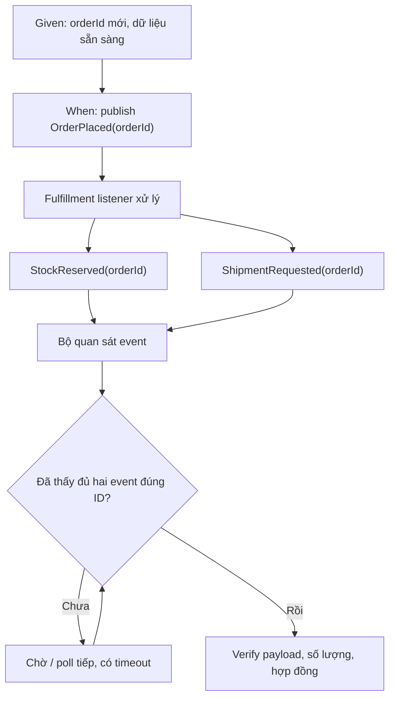

# Chờ nhiều event trong cùng một luồng

## 1. Bài toán: một stimulus, nhiều kết quả sự kiện

Trong học phần **SPRING_MODULITH_VERIFICATION_TESTING**, việc kiểm chứng Spring Modulith gồm hai lớp bổ sung cho nhau:

- **Kiến trúc:** `ApplicationModules.verify()` phát hiện phụ thuộc sai, truy cập package nội bộ module khác hoặc vi phạm quy tắc phụ thuộc.
- **Hành vi:** `@ApplicationModuleTest` và `Scenario` xác nhận những sự kiện, trạng thái cơ sở dữ liệu và tương tác tích hợp thực sự xảy ra đúng hợp đồng.

Ở chương **Scenario**, yêu cầu **“Chờ nhiều event trong cùng một luồng”** phát sinh khi một hành động nghiệp vụ dẫn tới **hai hoặc nhiều sự kiện đầu ra**.

Ví dụ: module `fulfillment` nhận `OrderPlaced(orderId)` rồi phát cả:

1. `StockReserved(orderId, sku, quantity)` — kho đã dành hàng cho đơn.
2. `ShipmentRequested(orderId, carrier)` — yêu cầu giao vận đã được tạo.

Một test chỉ chờ `StockReserved` **chưa chứng minh** `ShipmentRequested` đã xuất hiện. Ngược lại, test chỉ chờ `ShipmentRequested` cũng không tự kiểm chứng một event giữ hàng tồn tại, trừ khi hợp đồng thiết kế buộc sự kiện cuối chỉ được phát sau khi mọi bước trước hoàn tất.

Mục tiêu là có **một lần kích hoạt `OrderPlaced`**, sau đó đợi và kiểm chứng **tập kết quả** cùng `orderId`, thay vì kích hoạt lại nghiệp vụ cho từng loại event.



**Ba mức yêu cầu khác nhau cần phân biệt:**

| Mức kiểm chứng | Câu hỏi |
| --- | --- |
| **Cùng xuất hiện** | Đã nhìn thấy event A **và** event B cho đúng `orderId` chưa? |
| **Số lượng** | Mỗi loại event có xuất hiện **đúng một lần** trong phạm vi quan sát không? |
| **Thứ tự và nhân quả** | A có thực sự hoàn tất trước khi B bắt đầu hay được phát không? |

Kiểm chứng mức thứ nhất **không tự suy ra** hai mức còn lại. Với các listener bất đồng bộ độc lập, việc hai event cùng xuất hiện cũng không đảm bảo thứ tự xử lý.

## 2. Giới hạn thực tế của DSL `Scenario`

API chuẩn thường gặp:

```java
scenario.publish(new OrderPlaced(orderId, "SKU-42", 2))
        .andWaitForEventOfType(StockReserved.class)
        .matching(event -> event.orderId().equals(orderId))
        .toArriveAndVerify(event ->
                assertThat(event.quantity()).isEqualTo(2));
```

`Scenario.When<T>.andWaitForEventOfType(Class<E>)` chọn **một event type** làm điều kiện hoàn tất. Phần trả về là `Scenario.When<T>.EventResult<E>`, với các phương thức `matching(...)`, `matchingMapped(...)`, `toArrive()` và `toArriveAndVerify(...)`.

**`EventResult` không có một phương thức `andWaitForEventOfType(...)` thứ hai để nối tiếp ngay trong chuỗi.** Vì vậy, đừng tự suy đoán có API kiểu:

```text
// Pseudocode KHÔNG PHẢI API Java của Spring Modulith:
scenario.publish(input)
        .andWaitForEventOfType(EventA.class)
        .andWaitForEventOfType(EventB.class)
        .toArrive();
```

Cũng không nên viết hai lần `scenario.publish(input)` chỉ để chờ hai type:

```java
// SAI VỀ Ý ĐỊNH: hai stimulus độc lập, không phải một luồng duy nhất.
scenario.publish(new OrderPlaced(orderId, "SKU-42", 2))
        .andWaitForEventOfType(StockReserved.class)
        .toArrive();

scenario.publish(new OrderPlaced(orderId, "SKU-42", 2))
        .andWaitForEventOfType(ShipmentRequested.class)
        .toArrive();
```

Cách này có thể tạo **hai đơn hàng, hai lần trừ kho, retry/idempotency issue hoặc hai tập sự kiện khác nhau**. Nó không chứng minh cả hai kết quả được tạo từ **cùng một lần xử lý**.

Thay vào đó, có ba chiến lược phù hợp:

| Chiến lược | Khi nên dùng |
| --- | --- |
| **Chờ điều kiện tổng hợp** bằng `andWaitForStateChange(...)` và đọc `PublishedEvents` | Muốn cả hai event xuất hiện, không phụ thuộc event nào đến trước. |
| **Chờ dấu mốc hoàn tất cuối luồng** rồi kiểm tra những event trước đó | Có event kết thúc có ý nghĩa nghiệp vụ và được phát **sau** các bước cần kiểm chứng. |
| **Chờ trạng thái bền vững** rồi gọi `andVerifyEvents(...)` | Có DB/read model phản ánh luồng đã hoàn tất; cần kiểm tra thêm những event từng được phát. |

Các mẫu ở những mục tiếp theo tập trung vào một kích hoạt duy nhất và không phát minh thêm DSL không tồn tại.

## 3. Hợp đồng ví dụ: một đơn hàng tạo hai event

Giả sử Spring Boot application được phân thành module `order` và `fulfillment`.

**Event đầu vào** — `com/acme/order/OrderPlaced.java`:

```java
package com.acme.order;

import java.util.UUID;

public record OrderPlaced(UUID orderId, String sku, int quantity) {}
```

**Event đầu ra thứ nhất** — `com/acme/fulfillment/StockReserved.java`:

```java
package com.acme.fulfillment;

import java.util.UUID;

public record StockReserved(UUID orderId, String sku, int quantity) {}
```

**Event đầu ra thứ hai** — `com/acme/fulfillment/ShipmentRequested.java`:

```java
package com.acme.fulfillment;

import java.util.UUID;

public record ShipmentRequested(UUID orderId, String carrier) {}
```

Chúng ta đặt `OrderPlaced` ở **package gốc** của module `order`, vốn là API công khai theo mô hình package mặc định. Nếu contract được đưa vào subpackage `com.acme.order.api`, nên dùng `@NamedInterface` để công bố rõ phạm vi truy cập; module khác không nên import loại event từ `com.acme.order.internal`.

**Listener của module fulfillment**:

```java
package com.acme.fulfillment;

import com.acme.order.OrderPlaced;
import org.springframework.context.ApplicationEventPublisher;
import org.springframework.modulith.events.ApplicationModuleListener;
import org.springframework.stereotype.Component;

@Component
class FulfillmentHandler {

    private final ApplicationEventPublisher publisher;

    FulfillmentHandler(ApplicationEventPublisher publisher) {
        this.publisher = publisher;
    }

    @ApplicationModuleListener
    public void on(OrderPlaced order) {
        if (order.quantity() <= 0) {
            throw new IllegalArgumentException("quantity must be positive");
        }

        publisher.publishEvent(
                new StockReserved(
                        order.orderId(), order.sku(), order.quantity()));
        publisher.publishEvent(
                new ShipmentRequested(order.orderId(), "STANDARD"));
    }
}
```

Trong phiên bản demo này, **cùng một listener phát hai event tuần tự**, nhằm minh họa một hành động tạo nhiều đầu ra. `@ApplicationModuleListener` xử lý sự kiện sau commit và bất đồng bộ trong transaction riêng. Khi chương trình thật có DB và các listener độc lập, thứ tự hoàn tất/commit có thể khác; không mặc định áp dụng trình tự đơn giản này cho mọi hệ thống.

Test phải chứng minh rằng **cả `StockReserved` lẫn `ShipmentRequested`** có cùng `orderId` và payload hợp lệ. Nếu chỉ kiểm tra tên class mà không lọc ID, event của đơn khác có thể khiến test pass sai.

## 4. Cách 1: chờ hai event bằng `PublishedEvents` và state predicate tổng hợp

Spring Modulith cung cấp `PublishedEvents`, một đối tượng ghi nhận **Spring application events xảy ra trong test**. Nó có API:

```java
events.ofType(StockReserved.class)
        .matching(e -> e.orderId().equals(orderId));
```

Kết quả là `PublishedEvents.TypedPublishedEvents<StockReserved>` và triển khai `Iterable<StockReserved>`. Ta có thể kiểm tra tập kết quả đã có phần tử hay chưa bằng `iterator().hasNext()`.

Kết hợp với `Scenario.andWaitForStateChange(Supplier<S>, Predicate<S>)`, test **đọc lại** những event đã được ghi nhận và chỉ kết thúc khi **cả hai** loại đều xuất hiện.

### 4.1. Test hoàn chỉnh

```java
package com.acme.fulfillment;

import static org.assertj.core.api.Assertions.assertThat;

import java.time.Duration;
import java.util.UUID;

import com.acme.order.OrderPlaced;
import org.junit.jupiter.api.Test;
import org.springframework.modulith.test.ApplicationModuleTest;
import org.springframework.modulith.test.PublishedEvents;
import org.springframework.modulith.test.Scenario;

@ApplicationModuleTest
class FulfillmentMultipleEventsTests {

    private record Seen(boolean stock, boolean shipment) {
        boolean complete() {
            return stock && shipment;
        }
    }

    @Test
    void observesBothEventsForTheSameOrder(
            Scenario scenario, PublishedEvents events) {

        UUID orderId = UUID.randomUUID();

        scenario.publish(new OrderPlaced(orderId, "SKU-42", 2))
                .andWaitAtMost(Duration.ofSeconds(5))
                .forStateChange(
                        () -> new Seen(
                                events.ofType(StockReserved.class)
                                        .matching(e -> e.orderId().equals(orderId))
                                        .iterator().hasNext(),
                                events.ofType(ShipmentRequested.class)
                                        .matching(e -> e.orderId().equals(orderId))
                                        .iterator().hasNext()),
                        Seen::complete)
                .andVerify(seen -> {
                    assertThat(seen.complete()).isTrue();

                    assertThat(events.ofType(StockReserved.class)
                            .matching(e -> e.orderId().equals(orderId)))
                            .hasSize(1);

                    assertThat(events.ofType(ShipmentRequested.class)
                            .matching(e -> e.orderId().equals(orderId)))
                            .hasSize(1);
                });
    }
}
```

**Giải thích:**

1. `OrderPlaced` được phát **đúng một lần** bằng `scenario.publish(...)`.
2. `PublishedEvents` ghi nhận những sự kiện đã được phát trong context test, kể cả những event có thể đến sau do listener async.
3. Supplier trong `forStateChange(...)` trả về bản ghi `Seen(stock, shipment)` mô tả **tình hình quan sát hiện tại**.
4. `Seen::complete` là predicate, chỉ đúng nếu **cả hai** cờ đều là `true`. Nếu mới có `StockReserved`, test vẫn chờ `ShipmentRequested`.
5. `andVerify(...)` là terminal operation thực thi Scenario, sau đó assert số lần xuất hiện của từng type với đúng `orderId`.

Không cần đoán event nào đến trước. `andWaitAtMost(Duration.ofSeconds(5))` là giới hạn chờ, không phải `Thread.sleep` cố định.

### 4.2. Vì sao cần predicate?

Nếu chỉ viết:

```java
scenario.publish(new OrderPlaced(orderId, "SKU-42", 2))
        .andWaitForStateChange(() -> new Seen(
                hasStockEvent(), hasShipmentEvent()))
        .andVerify(seen -> assertThat(seen.complete()).isTrue());
```

thì **sai về điều kiện chờ**: một instance `Seen(false, false)` vẫn là **object khác `null`**, khiến overload mặc định xem điều kiện đã đạt quá sớm. `hasStockEvent()` và `hasShipmentEvent()` ở snippet này chỉ là helper giả định để minh họa lỗi.

Với kiểu record/DTO, luôn cung cấp predicate diễn đạt **“đủ các event bắt buộc”**, ví dụ `Seen::complete`. Cách khác là supplier trả trực tiếp `boolean`:

```java
scenario.publish(new OrderPlaced(orderId, "SKU-42", 2))
        .andWaitForStateChange(
                () -> events.ofType(StockReserved.class)
                            .matching(e -> e.orderId().equals(orderId))
                            .iterator().hasNext()
                   && events.ofType(ShipmentRequested.class)
                            .matching(e -> e.orderId().equals(orderId))
                            .iterator().hasNext())
        .andVerify(completed -> assertThat(completed).isTrue());
```

Đoạn này dùng overload không có predicate vì supplier trả `boolean`; Spring Modulith chỉ xem `true` là hoàn tất. Mỗi lần polling, hai tập event đều được **đọc lại** từ `PublishedEvents` (đã inject vào test), không dùng hai boolean chụp một lần trước khi listener chạy.

### 4.3. Hạn chế của việc đếm event trong thời điểm quan sát

`hasSize(1)` trong test nghĩa là: **tại thời điểm assertion, bộ ghi nhận có đúng một event phù hợp**. Nó không chứng minh rằng sau đó một retry sẽ không phát thêm event. Nếu yêu cầu nghiệp vụ là idempotency hoặc exactly-once *effect*, cần kiểm tra ràng buộc ở DB và vòng đời retry thực tế.

Ngoài ra, việc đếm không khẳng định hai event xuất hiện theo thứ tự nào. Bài test này cố ý chỉ kiểm tra **tập event**.

## 5. Cách 2: chờ event hoàn tất cuối luồng rồi kiểm tra các event trước đó

Nếu module định nghĩa một **dấu mốc nghiệp vụ cuối cùng** — ví dụ `FulfillmentCompleted(orderId)` — và bảo đảm event này chỉ được phát **sau** hai event trước, có thể chọn nó làm điều kiện hoàn tất của `Scenario`.

Bổ sung event:

```java
package com.acme.fulfillment;

import java.util.UUID;

public record FulfillmentCompleted(UUID orderId) {}
```

Sau hai lần `publisher.publishEvent(...)` trong `FulfillmentHandler.on(...)`, thêm:

```java
publisher.publishEvent(new FulfillmentCompleted(order.orderId()));
```

Đây là **biến thể mở rộng** của handler ở mục 3, không phải listener khác. Trong ví dụ một callback phát tuần tự ba event, `FulfillmentCompleted` là dấu mốc cuối **sau** `StockReserved` và `ShipmentRequested`.

Test:

```java
@Test
void observesRequiredEventsBeforeCompletion(
        Scenario scenario, PublishedEvents events) {

    UUID orderId = UUID.randomUUID();

    scenario.publish(new OrderPlaced(orderId, "SKU-42", 2))
            .andWaitAtMost(Duration.ofSeconds(5))
            .forEventOfType(FulfillmentCompleted.class)
            .matching(e -> e.orderId().equals(orderId))
            .toArriveAndVerify(done -> {
                assertThat(done.orderId()).isEqualTo(orderId);

                assertThat(events.ofType(StockReserved.class)
                        .matching(e -> e.orderId().equals(orderId)))
                        .hasSize(1);

                assertThat(events.ofType(ShipmentRequested.class)
                        .matching(e -> e.orderId().equals(orderId)))
                        .hasSize(1);
            });
}
```

**Khi nào mẫu này đáng tin?** Khi `FulfillmentCompleted` là một **hợp đồng hoàn tất thực sự**, không phải event tùy ý được phát cùng lúc với các công việc chưa xong. Trong ví dụ một callback tuần tự, hai event được `ApplicationEventPublisher` công bố trước event cuối.

**Khi nào không đủ?** Nếu `StockReserved` và `ShipmentRequested` được sản xuất từ **hai nhánh async độc lập**, một event `FulfillmentCompleted` do nhánh A phát không chứng minh nhánh B đã hoàn thành. Khi đó, cần thiết kế **barrier/aggregator** dựa trên cả hai kết quả hoặc trạng thái bền vững, không chỉ dựa vào tên “Completed”.

**Lưu ý giao dịch:** nếu event cuối được phát *bên trong* transaction của listener, việc quan sát nó không tự chứng minh mọi ghi DB trong transaction đó đã commit. Muốn chứng minh state bền vững, chọn cách thứ ba.

## 6. Cách 3: chờ trạng thái cuối rồi dùng `andVerifyEvents`

Có luồng mà mục tiêu chính là **trạng thái dữ liệu đã hoàn tất**, đồng thời cần kiểm tra các event đã công bố trong quá trình xử lý.

Giả sử module có `FulfillmentQuery.findPhase(orderId)` trả về `Optional<FulfillmentPhase>`, với enum `FulfillmentPhase.COMPLETED`. **Hợp đồng ứng dụng phải bảo đảm** chỉ ghi phase `COMPLETED` sau khi xử lý hai bước bắt buộc, và dữ liệu có thể được đọc từ transaction khác sau commit.

`Scenario.When.StateChangeResult<S>` có terminal operation:

```java
andVerifyEvents(Consumer<AssertablePublishedEvents> events)
```

Một ví dụ:

```java
@Test
void verifiesEventsOnceDurableStateIsComplete(Scenario scenario) {
    UUID orderId = UUID.randomUUID();

    scenario.publish(new OrderPlaced(orderId, "SKU-42", 2))
            .andWaitForStateChange(
                    () -> fulfillmentQuery.findPhase(orderId),
                    phase -> phase.filter(
                            value -> value == FulfillmentPhase.COMPLETED)
                            .isPresent())
            .andVerifyEvents(events -> {
                assertThat(events.ofType(StockReserved.class)
                        .matching(e -> e.orderId().equals(orderId)))
                        .hasSize(1);

                assertThat(events.ofType(ShipmentRequested.class)
                        .matching(e -> e.orderId().equals(orderId)))
                        .hasSize(1);
            });
}
```

Đây là một mẫu **cho dự án đã có** `fulfillmentQuery` và repository/transaction ghi `COMPLETED`. Đoạn `FulfillmentHandler` ở mục 3 chưa triển khai DB nên không thể chạy nguyên xi test này nếu chưa bổ sung persistence. Cần inject `FulfillmentQuery`, migration và các thành phần ứng dụng thực tế.

Điểm hay của `andVerifyEvents` là không cần tạo thêm event `FulfillmentCompleted` chỉ để làm tín hiệu kiểm tra. Scenario chờ **trạng thái DB** trước, rồi xác nhận **hai loại event đã được quan sát trong test**.

### So sánh ba cách

| Mẫu | Điều kiện kết thúc | Điểm mạnh | Giới hạn |
| --- | --- | --- | --- |
| `PublishedEvents` + predicate tổng hợp | A và B đều đã được ghi nhận. | Độc lập thứ tự, phù hợp hai sự kiện khác type. | Không tự chứng minh DB commit hoặc không có retry sau này. |
| Chờ `FulfillmentCompleted` | Dấu mốc kết thúc xuất hiện. | Diễn đạt hợp đồng luồng rõ ràng nếu dấu mốc đáng tin. | Có thể pass sớm nếu event “completed” không thực sự đợi mọi nhánh. |
| State `COMPLETED` + `andVerifyEvents` | Trạng thái bền vững đạt yêu cầu. | Kiểm chứng DB/state và các event liên quan. | Cần read model, transaction và dữ liệu fixture phù hợp. |

## 7. `andExpect(Class<E>)` có dùng được để chờ hai event không?

Javadoc `Scenario.When.StateChangeResult<S>` có thêm phương thức:

```java
<E> Scenario.When<T>.EventResult<E> andExpect(Class<E> eventType)
```

Nó cho phép **sau một kỳ vọng về state**, tiếp tục kỳ vọng **một event type**. Ví dụ với một module có phase `COMPLETED` và event `FulfillmentCompleted`:

```java
scenario.publish(new OrderPlaced(orderId, "SKU-42", 2))
        .andWaitForStateChange(
                () -> fulfillmentQuery.findPhase(orderId),
                phase -> phase.filter(
                        value -> value == FulfillmentPhase.COMPLETED)
                        .isPresent())
        .andExpect(FulfillmentCompleted.class)
        .matching(e -> e.orderId().equals(orderId))
        .toArrive();
```

Đây là chuỗi **state → event**, **không phải** cách thêm event B vào sau `EventResult<EventA>`; `EventResult` không cung cấp `andExpect(...)` dạng tương ứng.

Nếu muốn xác minh **A và B** mà không có state nghiệp vụ nào phù hợp, ưu tiên **cách 1**. Nếu đã có state hoàn tất, `andVerifyEvents` có thể đọc được cả hai event trong một terminal operation.

Luôn kiểm tra Javadoc đúng phiên bản Spring Modulith được dự án sử dụng trước khi dựa vào những overload nâng cao.

## 8. Nhiều event cùng loại nhưng khác phần tử

Không phải mọi luồng nhiều event đều gồm các **class khác nhau**.

Ví dụ một đơn hàng cần giao hai kiện riêng:

- `PackageLabeled(orderId, packageId = "P1")`.
- `PackageLabeled(orderId, packageId = "P2")`.

Cả hai cùng type `PackageLabeled.class` nhưng khác `packageId`. `andWaitForEventOfType(PackageLabeled.class).toArrive()` **chỉ bảo đảm có ít nhất một event** phù hợp, không chứng minh cả P1 và P2.

Nếu dùng `PublishedEvents`, cần kiểm tra **tập business key** đã xuất hiện:

```java
scenario.publish(new PackingStarted(orderId))
        .andWaitForStateChange(
                () -> {
                    var labels = events.ofType(PackageLabeled.class)
                            .matching(e -> e.orderId().equals(orderId));

                    java.util.Set<String> ids = new java.util.HashSet<>();
                    labels.forEach(e -> ids.add(e.packageId()));

                    return ids;
                },
                ids -> ids.containsAll(java.util.Set.of("P1", "P2")))
        .andVerify(ids ->
                assertThat(ids).contains("P1", "P2"));
```

Trong snippet này, `PackingStarted` và `PackageLabeled` là **các record minh họa** do dự án định nghĩa; biến `events` là `PublishedEvents` inject vào test. Việc dùng `Set` xác nhận **đủ hai ID khác nhau** nhưng không phát hiện phát trùng cùng ID. Nếu yêu cầu chính xác hai publication, cần kiểm tra thêm số lượng event và ràng buộc idempotency.

**Lưu ý về concurrency:** không nên giữ một `Iterator` và dùng lại qua các lần polling khi bộ sự kiện còn thay đổi. Mỗi lần gọi supplier nên tạo **kết quả snapshot mới** từ các event đang quan sát.

## 9. Có bắt buộc event A phải xuất hiện trước event B không?

**Không**, trừ khi kiến trúc và hợp đồng nghiệp vụ quy định rõ.

Ở ví dụ một listener trong mục 3, code phát `StockReserved` rồi mới phát `ShipmentRequested`. Nhưng trong ứng dụng rộng hơn, hai event có thể do **hai listener async khác nhau** phát, nên thời điểm quan sát có thể đảo ngược.

Một test chỉ xác nhận:

```text
{StockReserved(orderId), ShipmentRequested(orderId)} đều đã xuất hiện
```

không chứng minh:

```text
StockReserved hoàn tất giao dịch trước ShipmentRequested bắt đầu
```

Nếu thứ tự là **quy tắc nghiệp vụ**, hãy thiết kế bảo đảm nhân quả, chẳng hạn:

1. Chỉ phát `ShipmentRequested` từ handler xử lý `StockReserved` sau khi kiểm chứng thành công việc giữ hàng.
2. Ghi trạng thái bước `RESERVED` trước khi cho phép bước `SHIPMENT_REQUESTED`, dùng transaction/ràng buộc rõ ràng.
3. Mang `sequence`/`version` theo aggregate khi yêu cầu consumer xử lý đúng phiên bản.
4. Kiểm chứng **kết quả bền vững** của mỗi pha, thay vì so sánh thời điểm wall clock hoặc thứ tự callback trong hai thread.

**Không nên** dùng `Thread.sleep(...)` rồi khẳng định event A phải “đến trước”. Timestamps ở hai thread cũng không đủ để chứng minh quan hệ commit hoặc quan hệ happens-before theo hợp đồng.

Khi test chỉ yêu cầu **cả hai kết quả** xuất hiện trong một khoảng thời gian, predicate tổng hợp không phụ thuộc thứ tự là đúng mức kiểm chứng.

## 10. Giới hạn thời gian và transaction

`Scenario` sử dụng cơ chế chờ dựa trên Awaitility. Với listener `@ApplicationModuleListener`, việc xử lý có thể diễn ra **sau commit** và ở thread khác. Vì vậy:

```java
scenario.publish(new OrderPlaced(orderId, "SKU-42", 2))
        .andWaitAtMost(Duration.ofSeconds(5))
        .forStateChange(
                () -> events.ofType(StockReserved.class)
                            .matching(e -> e.orderId().equals(orderId))
                            .iterator().hasNext()
                   && events.ofType(ShipmentRequested.class)
                            .matching(e -> e.orderId().equals(orderId))
                            .iterator().hasNext())
        .andVerify(complete -> assertThat(complete).isTrue());
```

Trong đoạn này, `events` là tham số `PublishedEvents` của test ở mục 4; hai lần kiểm tra được đọc lại trong mỗi lượt polling.

**Timeout cần có giới hạn**, đủ cho độ trễ thường gặp ở CI nhưng không che lỗi listener:

- `StockReserved` có nhưng `ShipmentRequested` không có → predicate vẫn false, test timeout.
- `ShipmentRequested` có trước `StockReserved` → predicate vẫn false đến khi event còn lại xuất hiện.
- Cả hai xuất hiện đúng ID → test hoàn tất, không ngủ thêm một khoảng cố định.
- Event có `orderId` khác → không được tính vào kết quả của test.

### Transaction nguồn và transaction listener

`Scenario.publish(...)` / `stimulate(...)` thực thi stimulus trong transaction mới để hỗ trợ transactional event listener. `@ApplicationModuleListener` xử lý sau commit, bất đồng bộ và trong transaction riêng.

**Sự kiện được quan sát không nhất thiết tương đương dữ liệu DB đã commit.** Listener có thể phát `ShipmentRequested` trước khi transaction của listener commit dữ liệu shipment. Nếu yêu cầu cuối là có bản ghi DB, chọn cách kiểm chứng dựa trên `andWaitForStateChange(...)` với query DB đọc trạng thái đã commit.

Vì stimulus và listener có thể commit độc lập, test không nên dựa vào rollback của `@Transactional` bao quanh JUnit để dọn toàn bộ dữ liệu.

## 11. Fixture và cleanup khi có nhiều event

Dữ liệu thử nghiệm cần độc lập và có thể tái lập:

- Tạo `orderId` riêng cho mỗi test bằng `UUID.randomUUID()`.
- Nếu cần seed order/product/customer, commit fixture trước khi listener ở transaction khác đọc.
- Nếu listener ghi `stock_reservations` và `shipments`, cleanup **cả hai** loại side effect và dữ liệu Given.
- Nếu transaction hoặc retry có thể hoàn thành **sau** điều kiện quan sát, chọn tín hiệu hoàn tất mạnh hơn hoặc dùng test database cô lập.
- Không xóa dữ liệu của một test khác khi chạy song song; lọc theo ID riêng.

Ví dụ với module thật có repository và `TransactionTemplate`:

```java
scenario.publish(new OrderPlaced(orderId, "SKU-42", 2))
        .andCleanup(() -> transactions.executeWithoutResult(tx -> {
            shipments.deleteByOrderId(orderId);
            stockReservations.deleteByOrderId(orderId);
            orders.deleteById(orderId);
        }))
        .andWaitForStateChange(
                () -> fulfillmentQuery.isCompleted(orderId),
                Boolean.TRUE::equals)
        .andVerify(done -> assertThat(done).isTrue());
```

Các bean `shipments`, `stockReservations`, `orders`, `fulfillmentQuery` và `transactions` trong ví dụ là **thành phần được dự án cung cấp**, không phải API dựng sẵn của Spring Modulith. Thứ tự xóa phụ thuộc khóa ngoại trong schema thật.

Nếu muốn kiểm tra thêm hai event sau khi state hoàn tất, thay `andVerify(...)` bằng `andVerifyEvents(...)` như ở mục 6.

**Cảnh báo:** `andCleanup(...)` được đăng ký để thực hiện sau kịch bản cả khi thất bại. Nếu lỗi xảy ra **trước khi** Scenario bắt đầu hoặc fixture được tạo nhưng Scenario chưa đăng ký cleanup, cần cơ chế dọn bổ sung như `@AfterEach` hoặc reset DB.

## 12. Những lỗi thường gặp

| Biểu hiện | Nguyên nhân | Cách sửa |
| --- | --- | --- |
| Test pass dù chỉ có một trong hai event. | Chỉ dùng `andWaitForEventOfType(A.class).toArrive()`. | Chờ điều kiện tổng hợp A **và** B. |
| Test tạo hai bản ghi cùng order. | Gọi `scenario.publish(input)` hai lần để chờ hai event khác nhau. | Phát input một lần, dùng bộ quan sát nhiều event. |
| Test không biên dịch khi nối hai `andWaitForEventOfType`. | `EventResult` không có overload để thêm kỳ vọng thứ hai. | Dùng `PublishedEvents` + `andWaitForStateChange` hoặc state + `andVerifyEvents`. |
| Test lấy nhầm event từ đơn khác. | Không lọc `orderId` trên từng event type. | Dùng matcher theo correlation ID cho **mọi** loại event. |
| Test hoàn tất trước khi có hai event. | Supplier trả một DTO khác `null` nhưng không có predicate. | Thêm `Seen::complete` hoặc predicate boolean. |
| Event cuối xuất hiện nhưng một nhánh khác chưa xong. | Dấu mốc “completed” phát trước khi mọi nhánh hoàn thành. | Thiết kế barrier/aggregate state thực sự. |
| Test chờ đúng hai event nhưng kết luận có thứ tự. | Predicate chỉ kiểm tra tập sự kiện. | Kiểm chứng nhân quả/trạng thái nghiệp vụ riêng. |
| Assert số lượng pass nhưng sau đó có thêm event. | Retry hoặc publication bất đồng bộ tiếp tục chạy. | Kiểm chứng idempotency bền vững, bổ sung test retry. |
| Test pass máy dev, timeout CI. | Executor, DB hoặc listener chậm khác nhau; timeout quá ngắn. | Chọn timeout có cơ sở, theo dõi lỗi handler. |
| Test nhận event nhưng DB chưa có bản ghi. | Event phát trước commit listener. | Chờ query DB sau commit. |
| Listener không được gọi trong test. | `@ApplicationModuleTest` chỉ khởi động module hiện tại. | Đặt test trong module nhận hoặc mở rộng bootstrap phù hợp. |

## 13. Kiểm chứng kiến trúc và quality gate CI

Một bộ test ứng dụng Spring Modulith tốt phải có **phép kiểm cấu trúc** song song với kiểm thử luồng sự kiện.

Ví dụ:

```java
import org.junit.jupiter.api.Test;
import org.springframework.modulith.core.ApplicationModules;

class ModuleArchitectureTests {

    @Test
    void verifiesDependencies() {
        ApplicationModules.of(Application.class).verify();
    }
}
```

Thay `Application.class` bằng Spring Boot application class của dự án. `ApplicationModules.verify()` kiểm tra phụ thuộc vòng, truy cập package không công khai và các luật module đã khai báo. Nó không xác minh `StockReserved` hay `ShipmentRequested` đã được phát.

Ngược lại, test `FulfillmentMultipleEventsTests` chỉ kiểm chứng **hành vi công bố event**. Nó không tự bảo vệ kiến trúc khỏi việc fulfillment import lớp nội bộ `com.acme.order.internal.*`.

### Quality gate CI nên yêu cầu

- Test `ApplicationModules.verify()` đạt.
- Test `@ApplicationModuleTest` cho nhánh phát nhiều event đạt với **một stimulus**.
- Mỗi event bắt buộc có **matcher đúng correlation ID** và assertion payload hợp đồng.
- Các điều kiện chờ có deadline hữu hạn, không `Thread.sleep` cố định.
- DB fixture và cleanup đáng tin cậy nếu có persistence.
- Nếu có retry/idempotency, có test riêng cho trạng thái cuối và ràng buộc trùng lặp.
- Với Kafka/RabbitMQ hoặc hệ thống ngoài, có integration test tại đúng biên, không suy luận từ Spring application event nội bộ.

Chạy các test trong pipeline theo build tool của dự án (ví dụ `./mvnw test` hoặc `./gradlew test`). Build cần thất bại nếu phép kiểm kiến trúc hoặc kịch bản bắt buộc thất bại.

### Checklist trước khi chấp nhận bài kiểm thử

- [ ] Đã nêu rõ các event bắt buộc A, B, C và ý nghĩa nghiệp vụ của từng type.
- [ ] Chỉ **một lần** tạo stimulus cho luồng cần kiểm tra.
- [ ] Có correlation ID duy nhất và matcher trên **từng** loại event.
- [ ] Có điều kiện chờ tổng hợp, dấu mốc cuối đáng tin hoặc state bền vững đã hoàn tất.
- [ ] Nếu dùng supplier trả DTO/record, có predicate hoàn tất rõ ràng.
- [ ] Chỉ kết luận đúng mức đã kiểm chứng: **cùng xuất hiện**, **đếm** hoặc **thứ tự**.
- [ ] Đã tính đến transaction, listener async và thời điểm commit.
- [ ] Có timeout, cleanup và tính độc lập khi chạy song song trên CI.
- [ ] Có test `ApplicationModules.verify()` riêng.

## 14. Bài tập thực hành

Dùng `OrderPlaced` → `StockReserved` và `ShipmentRequested` ở mục 3:

1. **Sai phương pháp:** Viết hai test gọi `scenario.publish(new OrderPlaced(...))` riêng rồi chờ lần lượt A và B. Giải thích tại sao không chứng minh cả hai thuộc một luồng, và rủi ro phát sinh khi module không idempotent.
2. **Chờ tập event:** Tạo record `Seen(boolean stock, boolean shipment)`. Dùng `PublishedEvents` và `andWaitForStateChange(..., Seen::complete)` để test chỉ đạt khi có cả hai event đúng `orderId`.
3. **Event đến ngược thứ tự:** Sửa listener để `ShipmentRequested` được phát trước `StockReserved`. Test chờ tập event có nên fail không nếu nghiệp vụ không bắt buộc thứ tự?
4. **Payload sai:** Thay carrier từ `STANDARD` thành `EXPRESS`. Bổ sung assertion để phát hiện sai payload mà không chỉ chờ type.
5. **Dấu mốc cuối:** Thêm `FulfillmentCompleted` sau cả hai event. Chờ dấu mốc rồi assert hai event trước. Nếu hai nhánh chạy trên hai thread độc lập, cần thay đổi thiết kế dấu mốc thế nào?
6. **Số lượng:** Cho handler phát `StockReserved` hai lần. Vì sao `hasNext()` vẫn trả true? Bổ sung kiểm tra số lượng và giải thích giới hạn của assertion tại một thời điểm.
7. **Hai event cùng class:** Một đơn tạo hai `PackageLabeled` với `packageId = P1` và `P2`. Viết predicate chờ tập package ID chứa cả hai.
8. **DB commit:** Nếu listener phát hai event trước khi ghi `fulfillment_status = COMPLETED` được commit, phương pháp nào xác nhận DB đã hoàn tất? Đặt `andVerifyEvents` ở đâu?
9. **Ranh giới module:** Nếu fulfillment dùng trực tiếp `com.acme.order.internal.OrderRepositoryImpl`, test nào bắt vi phạm dù hai event xuất hiện đúng?
10. **CI:** Test thường timeout khi chạy song song. Hãy đề xuất tối thiểu ba bước phân tích về correlation ID, executor, transaction và fixture.

**Định hướng:** (1) một stimulus duy nhất; (2) boolean tổng hợp với predicate; (3) không fail nếu contract không yêu cầu thứ tự; (4) assert carrier trên event cùng ID; (5) completed chỉ được phát sau khi nhận đủ kết quả; (6) kiểm tra kích thước và idempotency; (7) tập ID; (8) `andWaitForStateChange` + `andVerifyEvents`; (9) `ApplicationModules.verify()`; (10) cô lập ID/DB, kiểm tra timeout và lỗi listener.

## Tài liệu tham khảo

- [Spring Modulith — Integration Testing Application Modules](https://docs.spring.io/spring-modulith/reference/testing.html): `Scenario`, stimulus, chờ event/state và timeout.
- [Spring Modulith — Scenario.When API](https://docs.spring.io/spring-modulith/docs/current/api/org/springframework/modulith/test/Scenario.When.html): `andWaitForEventOfType`, `andWaitForStateChange`, `andWaitAtMost` và cleanup.
- [Spring Modulith — Scenario.When.EventResult API](https://docs.spring.io/spring-modulith/docs/current/api/org/springframework/modulith/test/Scenario.When.EventResult.html): matcher và terminal operations chờ event.
- [Spring Modulith — Scenario.When.StateChangeResult API](https://docs.spring.io/spring-modulith/docs/current/api/org/springframework/modulith/test/Scenario.When.StateChangeResult.html): `andVerify`, `andVerifyEvents` và `andExpect`.
- [Spring Modulith — PublishedEvents API](https://docs.spring.io/spring-modulith/docs/current/api/org/springframework/modulith/test/PublishedEvents.html): cách đọc sự kiện đã ghi nhận trong test.
- [Spring Modulith — PublishedEvents.TypedPublishedEvents API](https://docs.spring.io/spring-modulith/docs/current/api/org/springframework/modulith/test/PublishedEvents.TypedPublishedEvents.html): `ofType`, `matching` và `Iterable`.
- [Spring Modulith — Working with Application Events](https://docs.spring.io/spring-modulith/reference/events.html): giao tiếp giữa module qua event và `@ApplicationModuleListener`.
- [Spring Modulith — Verifying Application Module Structure](https://docs.spring.io/spring-modulith/reference/verification.html): kiểm chứng ranh giới phụ thuộc bằng `ApplicationModules.verify()`.
