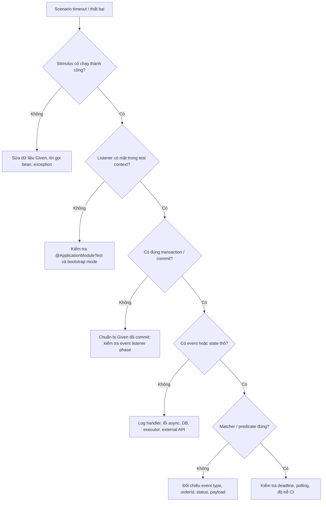

# Timeout và nguyên nhân scenario thất bại

## 1. Timeout trong `Scenario` thực sự cho biết điều gì?

Học phần **SPRING_MODULITH_VERIFICATION_TESTING** rèn kỹ năng xác minh ranh giới kiến trúc với `ApplicationModules`, các quy tắc phụ thuộc giữa module và kiểm thử hành vi bằng `@ApplicationModuleTest`. Trong chương **Scenario**, một nhiệm vụ quan trọng là phân biệt **hành vi ứng dụng sai** với **bài kiểm thử quan sát sai hoặc quan sát quá sớm**, nhất là khi có sự kiện bất đồng bộ và cơ sở dữ liệu.

Ví dụ, test đợi `ShipmentBooked(orderId)` trong 3 giây nhưng không nhận được. Kết quả này chỉ cho biết:

> **Trong khoảng thời gian quan sát, test không tìm thấy sự kiện đáp ứng đúng tất cả điều kiện đã khai báo.**

Nó **không tự chứng minh** rằng ứng dụng chưa từng phát event. Một số khả năng khác cũng dẫn đến cùng triệu chứng:

- Listener không được khởi động trong Spring context của `@ApplicationModuleTest`.
- Listener chỉ chạy sau commit nhưng transaction phát event chưa commit hoặc không tồn tại.
- Listener chạy và phát event **khác class** với class đang chờ.
- Event đúng type nhưng `matching(...)` lọc sai `orderId` hoặc một trường payload.
- Listener ném exception trên thread bất đồng bộ, nên kịch bản không nhận được kết quả.
- Event có thật nhưng đến **sau deadline** vì database/executor chậm.
- Test dùng kết quả event để suy ra DB state đã commit trong khi transaction vẫn chưa hoàn thành.

Chẩn đoán timeout phải đi từ **stimulus → transaction → listener → event/state → matcher → assertion**, chứ không bắt đầu bằng việc tăng timeout.



## 2. Xác định thất bại xảy ra ở pha nào

Một test `Scenario` thường trải qua các pha:

1. **Given:** tạo dữ liệu hoặc trạng thái đầu vào.
2. **When / stimulus:** `scenario.publish(...)` hoặc `scenario.stimulate(...)`.
3. **Wait:** chờ event bằng `andWaitForEventOfType(...)` hoặc chờ trạng thái bằng `andWaitForStateChange(...)`.
4. **Then / verify:** thực thi terminal operation như `toArriveAndVerify(...)` hoặc `andVerify(...)`.
5. **Cleanup:** xóa dữ liệu thử nghiệm và side effect.

| Vị trí lỗi | Triệu chứng thường gặp | Ý nghĩa |
| --- | --- | --- |
| **Given** | Lỗi SQL, thiếu khóa ngoại, fixture bị trùng, bean setup lỗi. | Chưa có điều kiện đầu vào hợp lệ. |
| **Stimulus** | `IllegalArgumentException`, `DataIntegrityViolationException`, exception của service. | Hành vi khởi đầu đã thất bại; không nhất thiết là timeout. |
| **Wait for event** | Hết thời gian mà không có event **đúng type và matcher**. | Có thể lỗi phát event, đăng ký listener, transaction, matcher hoặc deadline. |
| **Wait for state** | Supplier chưa bao giờ trả giá trị đạt predicate. | Có thể chưa ghi DB, chưa commit, đọc snapshot cũ hoặc predicate sai. |
| **Verify** | AssertJ/JUnit báo giá trị thực tế khác kỳ vọng. | Tín hiệu hoàn tất đã được quan sát nhưng nội dung nghiệp vụ không đúng. |
| **Cleanup** | Delete lỗi, khóa ngoại, dữ liệu đến muộn, transaction cleanup sai. | Kịch bản có thể xử lý đúng, nhưng dọn dữ liệu gây lỗi hoặc làm các test sau không ổn định. |

Các exception cụ thể phụ thuộc phiên bản Spring Modulith, Awaitility, Spring Framework và cách framework bao lỗi. Khi chờ quá hạn, stack trace có thể cho thấy lỗi timeout của Awaitility; **không nên phụ thuộc vào chính xác tên exception** để suy luận nguyên nhân. Hãy tìm lỗi gốc trong stack trace và log của handler.

## 3. Cấu hình timeout đúng API, đúng mục đích

Spring Modulith hỗ trợ tùy biến thời gian chờ trong `Scenario.When<T>`. Hai dạng thường dùng:

### 3.1. `andWaitAtMost(Duration)`

```java
import java.time.Duration;

scenario.publish(new OrderPaid(orderId))
        .andWaitAtMost(Duration.ofSeconds(5))
        .forEventOfType(ShipmentBooked.class)
        .matching(event -> event.orderId().equals(orderId))
        .toArriveAndVerify(event ->
                assertThat(event.carrier()).isEqualTo("STANDARD"));
```

`andWaitAtMost(...)` đặt giới hạn thời gian chờ **có thể quan sát kết quả**. `forEventOfType(...)` xác định event type sau bước timeout. Chuỗi này cần một terminal operation như `toArriveAndVerify(...)` để thực thi.

### 3.2. `customize(...)`

```java
scenario.publish(new OrderPaid(orderId))
        .customize(wait -> wait.atMost(Duration.ofSeconds(5)))
        .andWaitForEventOfType(ShipmentBooked.class)
        .matching(event -> event.orderId().equals(orderId))
        .toArrive();
```

`customize(...)` nhận một hàm cấu hình `org.awaitility.core.ConditionFactory` và hữu ích khi cần nhiều tùy chọn chờ. Với yêu cầu chỉ đặt thời gian tối đa, `andWaitAtMost(...)` dễ đọc hơn.

**Nguyên tắc:** timeout là **giới hạn kiểm chứng**, không phải một lệnh bảo đảm event sẽ đến trong thời gian đó và cũng không phải SLA production. Một listener luôn thất bại sẽ không được sửa bằng `Duration.ofSeconds(30)`.

### 3.3. Với bài kiểm tra state

```java
scenario.publish(new OrderPaid(orderId))
        .andWaitAtMost(Duration.ofSeconds(5))
        .forStateChange(
                () -> shipmentQuery.statusOf(orderId),
                state -> state.filter("READY"::equals).isPresent())
        .andVerify(state ->
                assertThat(state).contains("READY"));
```

`shipmentQuery.statusOf(...)` trong đoạn này là query bean minh họa trả `Optional<String>`. Nếu chưa có record, nó trả `Optional.empty()`; nếu có nhưng còn `PENDING`, predicate chưa đạt nên Scenario tiếp tục poll. Dùng `andWaitForStateChange(...)` trực tiếp nếu không cần cấu hình `andWaitAtMost(...)`.

## 4. Ví dụ đầy đủ: một event đầu vào, một event kết quả

Ta dùng hệ thống hai module:

- `order` công bố `OrderPaid` khi thanh toán xong.
- `shipping` nhận `OrderPaid`, ghi bản ghi shipment và phát `ShipmentBooked`.

Các đoạn mã là một **mô hình học tập có thể tích hợp vào dự án**; muốn chạy thật cần Spring Boot application, Spring Modulith test starter, datasource, migration và transaction manager thích hợp.

### 4.1. Event từ module order

`com/acme/order/OrderPaid.java`:

```java
package com.acme.order;

import java.util.UUID;

public record OrderPaid(UUID orderId) {}
```

`OrderPaid` ở package gốc là một contract công khai theo mô hình module mặc định. Nếu event đặt trong subpackage, cần dùng API công khai hoặc `@NamedInterface` phù hợp; không import package nội bộ của module khác.

### 4.2. Event kết quả của shipping

`com/acme/shipping/ShipmentBooked.java`:

```java
package com.acme.shipping;

import java.util.UUID;

public record ShipmentBooked(UUID orderId, String carrier) {}
```

### 4.3. Repository lưu dữ liệu

Schema minh họa:

```sql
CREATE TABLE shipments (
    order_id VARCHAR(36) PRIMARY KEY,
    status   VARCHAR(32) NOT NULL
);
```

Repository đơn giản với Spring JDBC:

```java
package com.acme.shipping;

import java.util.List;
import java.util.Optional;
import java.util.UUID;

import org.springframework.jdbc.core.JdbcTemplate;
import org.springframework.stereotype.Repository;

@Repository
class ShipmentRepository {

    private final JdbcTemplate jdbc;

    ShipmentRepository(JdbcTemplate jdbc) {
        this.jdbc = jdbc;
    }

    void insertReady(UUID orderId) {
        jdbc.update(
                "INSERT INTO shipments(order_id, status) VALUES (?, ?)",
                orderId.toString(), "READY");
    }

    Optional<String> findStatus(UUID orderId) {
        List<String> rows = jdbc.query(
                "SELECT status FROM shipments WHERE order_id = ?",
                (rs, index) -> rs.getString("status"),
                orderId.toString());

        return rows.stream().findFirst();
    }

    void delete(UUID orderId) {
        jdbc.update(
                "DELETE FROM shipments WHERE order_id = ?",
                orderId.toString());
    }
}
```

`findStatus` trả `Optional.empty()` nếu chưa có bản ghi, tránh ném `EmptyResultDataAccessException` trong từng lần polling.

### 4.4. Listener xử lý sau commit

`com/acme/shipping/ShippingListener.java`:

```java
package com.acme.shipping;

import com.acme.order.OrderPaid;
import org.springframework.context.ApplicationEventPublisher;
import org.springframework.modulith.events.ApplicationModuleListener;
import org.springframework.stereotype.Component;

@Component
class ShippingListener {

    private final ShipmentRepository shipments;
    private final ApplicationEventPublisher events;

    ShippingListener(ShipmentRepository shipments,
                     ApplicationEventPublisher events) {
        this.shipments = shipments;
        this.events = events;
    }

    @ApplicationModuleListener
    public void on(OrderPaid paid) {
        shipments.insertReady(paid.orderId());
        events.publishEvent(
                new ShipmentBooked(paid.orderId(), "STANDARD"));
    }
}
```

`@ApplicationModuleListener` là dạng rút gọn của xử lý **bất đồng bộ, transactional, sau commit và trong transaction riêng**. Với Spring event publisher, `ShipmentBooked` có thể được phát **trước khi transaction ghi shipment commit**. Đó là lý do cần xác định rõ test đang chờ **event** hay **state đã commit**.

### 4.5. Test chờ event

`src/test/java/com/acme/shipping/ShippingScenarioTests.java`:

```java
package com.acme.shipping;

import static org.assertj.core.api.Assertions.assertThat;

import java.time.Duration;
import java.util.UUID;

import com.acme.order.OrderPaid;
import org.junit.jupiter.api.Test;
import org.springframework.beans.factory.annotation.Autowired;
import org.springframework.modulith.test.ApplicationModuleTest;
import org.springframework.modulith.test.Scenario;
import org.springframework.transaction.support.TransactionTemplate;

@ApplicationModuleTest
class ShippingScenarioTests {

    @Autowired ShipmentRepository shipments;
    @Autowired TransactionTemplate transactions;

    @Test
    void publishesBookedEvent(Scenario scenario) {
        UUID orderId = UUID.randomUUID();

        scenario.publish(new OrderPaid(orderId))
                .andCleanup(() -> transactions.executeWithoutResult(tx ->
                        shipments.delete(orderId)))
                .andWaitAtMost(Duration.ofSeconds(5))
                .forEventOfType(ShipmentBooked.class)
                .matchingMappedValue(ShipmentBooked::orderId, orderId)
                .toArriveAndVerify(event ->
                        assertThat(event.carrier()).isEqualTo("STANDARD"));
    }
}
```

**Được kiểm chứng:** module shipping nhận event đầu vào và phát `ShipmentBooked` đúng `orderId`, `carrier` trong giới hạn chờ.

**Chưa được kiểm chứng:** DB chắc chắn đã commit tại thời điểm `toArriveAndVerify`. Trong ví dụ listener công bố event bên trong transaction của nó; test có thể quan sát event khi transaction còn mở. Vì vậy, nếu contract cần dữ liệu đã commit, hãy dùng test state riêng.

**Lưu ý cleanup:** nếu transaction listener chưa commit khi test thấy event, callback xóa bản ghi có thể đua với transaction đang chạy. Với dự án thật, nên dùng điều kiện hoàn tất mạnh hơn (xem mục 5) hoặc chiến lược test database cô lập khi cần bảo đảm cleanup không chạy trước listener.

## 5. Test chờ state: tránh timeout do điều kiện sai

Dựa trên repository ở mục 4, bài test có thể đợi trạng thái `READY`:

```java
@Test
void persistsReadyShipment(Scenario scenario) {
    UUID orderId = UUID.randomUUID();

    scenario.publish(new OrderPaid(orderId))
            .andCleanup(() -> transactions.executeWithoutResult(tx ->
                    shipments.delete(orderId)))
            .andWaitForStateChange(
                    () -> shipments.findStatus(orderId),
                    status -> status.filter("READY"::equals).isPresent())
            .andVerify(status ->
                    assertThat(status).contains("READY"));
}
```

Lợi ích của cách này:

- Không phụ thuộc event `ShipmentBooked` phát trước hay sau commit.
- Supplier gọi query nhiều lần và chỉ đạt khi nhìn thấy `READY`.
- `andVerify(...)` kiểm tra đúng giá trị đã khiến phép chờ thành công.
- Có thể mở rộng thêm assertion trên `orderId` và các trường DB khác.

**Vì sao dùng predicate?** Nếu repository đã có record `PENDING`, overload `andWaitForStateChange(() -> shipments.findStatus(orderId))` chỉ cần `Optional.of("PENDING")` là kết thúc chờ. Khi test lại assert `READY`, lỗi assertion xuất hiện ngay, không phải timeout. Predicate cụ thể sẽ chờ đúng trạng thái nghiệp vụ đích.

Khi supplier trả `String`, `Integer`, `List` hoặc DTO, đừng giả định framework biết trạng thái nào là “hoàn tất”. Đối tượng khác `null` có thể đáp ứng tiêu chí mặc định ngay cả khi nghiệp vụ chưa đạt.

## 6. Nhóm lỗi thứ nhất: event type và matcher không khớp

### 6.1. Chờ sai event đầu ra

Sai mục tiêu:

```java
scenario.publish(new OrderPaid(orderId))
        .andWaitForEventOfType(OrderPaid.class)
        .toArrive();
```

Test chỉ cần thấy **event do chính nó phát**, không chứng minh `ShippingListener` xử lý thành công. Đây có thể là **pass giả**, không phải timeout.

Một lỗi khác:

```java
scenario.publish(new OrderPaid(orderId))
        .andWaitForEventOfType(ShipmentDispatched.class)
        .toArrive();
```

Trong ví dụ ở mục 4, listener chỉ phát `ShipmentBooked`, không hề phát `ShipmentDispatched`. Đoạn này sẽ chờ sai contract và timeout; `ShipmentDispatched` là loại minh họa **chưa được triển khai**.

Đúng:

```java
scenario.publish(new OrderPaid(orderId))
        .andWaitForEventOfType(ShipmentBooked.class)
        .matching(event -> event.orderId().equals(orderId))
        .toArrive();
```

### 6.2. Event có nhưng matcher sai

Giả sử listener phát `ShipmentBooked(UUID_A, "STANDARD")` mà test đang lọc `UUID_B`:

```java
scenario.publish(new OrderPaid(orderId))
        .andWaitForEventOfType(ShipmentBooked.class)
        .matching(event -> event.orderId().equals(otherOrderId))
        .toArrive();
```

Kịch bản có thể timeout **dù listener đã phát event**, vì event không thỏa điều kiện.

**Cách chẩn đoán:**

1. Kiểm tra ID được đưa vào stimulus.
2. Kiểm tra ID listener nhận và ID trong event phát ra.
3. Kiểm tra matcher dùng đúng biến, không phải ID cố định từ fixture khác.
4. Khi cần, tạm tách **match theo ID** và **assert payload**, để thông báo lỗi rõ ràng.

Ví dụ tốt:

```java
scenario.publish(new OrderPaid(orderId))
        .andWaitForEventOfType(ShipmentBooked.class)
        .matchingMappedValue(ShipmentBooked::orderId, orderId)
        .toArriveAndVerify(event ->
                assertThat(event.carrier()).isEqualTo("STANDARD"));
```

Nếu `carrier` sai, test thất bại ở assertion cụ thể. Nếu đưa cả `carrier == "STANDARD"` vào matcher, test có thể chỉ báo timeout và che mất thông tin payload.

### 6.3. Chờ event từ module chưa được khởi động

`@ApplicationModuleTest` mặc định khởi động module chứa lớp test ở chế độ `STANDALONE`. Nếu test đặt trong `order` mà event đầu ra chỉ được listener của `shipping` tạo ra, Spring context hiện tại có thể **không có listener shipping**.

Kiểm tra:

- Test nằm ở package module nào?
- Event output do bean ở module nào phát?
- Chế độ bootstrap là `STANDALONE`, `DIRECT_DEPENDENCIES` hay `ALL_DEPENDENCIES`?
- Module nhận event có được bật thật sự trong context không?

`ALL_DEPENDENCIES` chỉ mở rộng cây **module mà module đang test phụ thuộc**, không tự động bật mọi module tiêu thụ event ngược chiều. Nên đặt test reaction ở **module nhận** với `Scenario.publish(inputEvent)`, hoặc chọn integration scope đủ rộng nếu yêu cầu một workflow nhiều module.

## 7. Nhóm lỗi thứ hai: transaction và listener sau commit

Một timeout đặc trưng:

```java
@Test
void fragileTest() {
    publisher.publishEvent(new OrderPaid(orderId));
    // Handler @ApplicationModuleListener có thể chưa được gọi.
}
```

`@ApplicationModuleListener` tương đương một listener giao dịch, chạy bất đồng bộ sau commit và có transaction riêng. Nếu code thử nghiệm phát `OrderPaid` **không nằm trong transaction**, listener theo `@TransactionalEventListener` mặc định có thể không được kích hoạt.

**`Scenario.publish(...)` giải quyết điều này** bằng cách thực thi stimulus trong transaction mới để callback transactional có thời điểm commit phù hợp. Tuy nhiên, nó không tự sửa được:

- Transaction nguồn bị rollback do service ném exception.
- Listener bị cấu hình sai hoặc bean không được đăng ký.
- Listener ném exception trong transaction của chính nó.
- Hạ tầng datasource hoặc transaction manager không khả dụng.

### 7.1. Given chưa commit

Giả sử test chuẩn bị dữ liệu:

```java
@Transactional
@Test
void canTimeoutIfGivenIsInvisible(Scenario scenario) {
    orders.insertPaidOrder(orderId); // Trong transaction của JUnit, chưa commit.

    scenario.publish(new OrderPaid(orderId))
            .andWaitForEventOfType(ShipmentBooked.class)
            .toArrive();
}
```

Đoạn này là ví dụ về lỗi: listener ở transaction khác có thể **không thấy order** đang nằm trong transaction JUnit chưa commit. Test có thể timeout hoặc handler lỗi tùy logic ứng dụng.

Cách chuẩn bị fixture rõ ràng hơn:

```java
transactions.executeWithoutResult(tx ->
        orders.insertPaidOrder(orderId));

scenario.publish(new OrderPaid(orderId))
        .andWaitForEventOfType(ShipmentBooked.class)
        .matching(event -> event.orderId().equals(orderId))
        .toArrive();
```

`orders` là repository thử nghiệm do dự án định nghĩa. Giả sử đoạn `executeWithoutResult` chạy **bên ngoài một transaction bao ngoài**, transaction mới của `TransactionTemplate` được commit khi callback kết thúc. Nếu test đang có `@Transactional` và `TransactionTemplate` dùng propagation mặc định `REQUIRED`, nó có thể **tham gia transaction chưa commit**. Khi cần độc lập, dùng `PROPAGATION_REQUIRES_NEW` hoặc tổ chức setup không có transaction bao ngoài.

**Phân biệt:** dữ liệu Given **đã commit** là điều kiện để listener async đọc được; không phải mọi test đều cần SQL seed. Với `ShippingListener` chỉ dựa trên `OrderPaid.orderId`, không phải tạo bảng `orders` trước khi test.

### 7.2. Event xuất hiện trước khi DB commit

Trong listener:

```java
shipments.insertReady(paid.orderId());
events.publishEvent(new ShipmentBooked(paid.orderId(), "STANDARD"));
```

Lời gọi `publishEvent` có thể diễn ra **trong transaction đang mở**. Vì vậy:

- `andWaitForEventOfType(ShipmentBooked.class)` có thể thành công.
- Query DB từ transaction khác có thể chưa thấy `READY`.
- Nếu transaction listener rollback sau khi phát event, event đã được quan sát nhưng DB không có trạng thái cuối.

Nếu hợp đồng là “dữ liệu đã commit”, kiểm tra bằng `andWaitForStateChange(...)`, không dùng sự xuất hiện của event làm bằng chứng thay thế.

## 8. Nhóm lỗi thứ ba: supplier và predicate khi chờ state

Không phải mọi “timeout chờ state” đều do listener chậm.

### 8.1. Query không bao giờ đọc dữ liệu mới

Supplier phải **đọc trạng thái mới** tại mỗi lần polling:

```java
scenario.publish(new OrderPaid(orderId))
        .andWaitForStateChange(
                () -> shipments.findStatus(orderId),
                value -> value.filter("READY"::equals).isPresent())
        .andVerify(value -> assertThat(value).contains("READY"));
```

Ví dụ sai:

```java
Optional<String> captured = shipments.findStatus(orderId);

scenario.publish(new OrderPaid(orderId))
        .andWaitForStateChange(
                () -> captured,
                value -> value.filter("READY"::equals).isPresent())
        .andVerify(value -> assertThat(value).contains("READY"));
```

`captured` chỉ được đọc **một lần trước stimulus**; mọi lần polling đều nhận cùng giá trị. Thời gian chờ dài đến đâu cũng không giúp đọc được bản ghi mới.

### 8.2. Predicate quá chặt hoặc sai kiểu dữ liệu

```java
// DB lưu READY nhưng predicate chờ SHIPPED.
.andWaitForStateChange(
        () -> shipments.findStatus(orderId),
        value -> value.filter("SHIPPED"::equals).isPresent())
```

Nếu handler chỉ chuyển state đến `READY`, kịch bản timeout đúng theo predicate nhưng **kỳ vọng test không đúng contract**.

Tương tự, kiểm tra `count == 2` khi listener chỉ tạo một bản ghi, hoặc dùng ID khác với `orderId`, đều khiến bài chờ quá hạn dù hệ thống xử lý đúng.

### 8.3. Predicate quá lỏng gây pass giả

```java
// Chỉ cần record tồn tại; PENDING cũng làm kịch bản kết thúc.
scenario.publish(new OrderPaid(orderId))
        .andWaitForStateChange(
                () -> shipments.findStatus(orderId))
        .andVerify(status -> assertThat(status).isPresent());
```

Nếu mục tiêu là `READY`, phải có predicate chờ `READY`. `Optional.of("PENDING")` là giá trị không rỗng và được coi là điều kiện hoàn tất mặc định.

### 8.4. Supplier có side effect

Không nên để supplier **phát event, insert entity hoặc gọi lại nghiệp vụ** trên mỗi lượt polling. Nó có thể vô tình tạo nhiều đơn, nhiều shipment, thay đổi DB và tự gây lỗi duplicate key.

Tốt:

```java
() -> shipments.findStatus(orderId)
```

Không tốt:

```java
() -> {
    shippingService.requestShipment(orderId); // Lặp hành vi mỗi lần poll!
    return shipments.findStatus(orderId);
}
```

Supplier nên là phép quan sát nhanh, ít side effect và có transaction/DB isolation phù hợp để nhìn thấy kết quả đã commit.

## 9. Nhóm lỗi thứ tư: exception của listener bất đồng bộ

Với `@ApplicationModuleListener`, lỗi trong handler có thể xảy ra **trên thread khác**, sau khi transaction nguồn đã commit. Khi đó:

- Test có thể chỉ báo **timeout** vì event kết quả không được phát.
- Stack trace của JUnit có thể không trực tiếp chứa exception trong handler.
- Log của executor, transaction manager hoặc event publication registry có thể có nguyên nhân gốc.
- Một số event đã được ghi trước khi handler thất bại vẫn có thể xuất hiện, nhưng kết quả cuối chưa đạt.

Ví dụ:

```java
@ApplicationModuleListener
public void on(OrderPaid paid) {
    carrierGateway.reserve(paid.orderId()); // API ngoài bị lỗi.
    events.publishEvent(
            new ShipmentBooked(paid.orderId(), "STANDARD"));
}
```

Nếu `carrierGateway.reserve` ném exception, code không tới dòng phát `ShipmentBooked`. Tăng timeout từ 5 lên 30 giây không sửa được lỗi API ngoài.

**Quy trình điều tra:**

1. Quan sát log với `orderId` tại đầu và cuối listener.
2. Xác định exception gốc, không chỉ đọc thông báo timeout của Scenario.
3. Phân biệt timeout do listener không chạy với listener đã chạy nhưng throw.
4. Nếu dùng Event Publication Registry, kiểm tra publication của listener bị pending/failed hay đã completed theo phiên bản đang chạy.
5. Xem contract: khi tích hợp ngoài lỗi, hệ thống cần retry, event từ chối hay rollback? Viết test đúng nhánh đó.

Event Publication Registry giúp theo dõi và phục hồi việc phân phối tới transactional listener khi **đã được cấu hình persistence**. Nó không tự đảm bảo mọi API ngoài đã thành công hoặc mọi side effect là exactly-once. Nếu có retry/resubmission, handler cần idempotency theo business key.

## 10. Nhóm lỗi thứ năm: timeout có thật do môi trường CI

Có những test đúng về logic nhưng timeout chỉ xuất hiện khi chạy trên CI:

| Nguyên nhân hạ tầng | Dấu hiệu gợi ý | Cách xử lý |
| --- | --- | --- |
| Executor xử lý event bị nghẽn | Event đến rất trễ khi chạy cả suite, chạy đơn lẻ thì nhanh. | Kiểm tra thread pool, queue, scheduling và test song song. |
| DB connection pool cạn | Thread chờ kết nối, log timeout datasource. | Kiểm tra pool size, lock, transaction treo và isolation. |
| Database/container khởi động chậm | Lỗi tập trung đầu suite hoặc lúc bootstrap context. | Chờ readiness của hạ tầng, migration và datasource test. |
| Fixture dùng chung | Test order A bị nhiễu bởi order B. | Dùng ID riêng, cleanup, tách dữ liệu khi chạy song song. |
| External service giả lập đáp ứng không ổn định | Một số request treo hoặc trả lỗi ngẫu nhiên. | Dùng test double có hành vi xác định ở module test; test tích hợp riêng. |
| Polling quá dày / query đắt | CPU/DB tăng cao trong suite. | Dùng supplier nhẹ, timeout/poll interval có chủ đích. |
| Machine CI giới hạn CPU/I/O | Độ trễ cao hơn rõ rệt so với local. | Đo thời gian thực, tối ưu fixture và chọn deadline hợp lý. |

**Không mặc định “đổi 3 giây thành 60 giây”**. Hãy đo độ trễ, kiểm tra sự kiện/trạng thái có thật và nguyên nhân chậm. Sau đó mới chọn timeout có dư địa hợp lý.

### Tùy biến polling một cách có chủ đích

```java
scenario.publish(new OrderPaid(orderId))
        .customize(wait -> wait
                .atMost(Duration.ofSeconds(8))
                .pollInterval(Duration.ofMillis(150)))
        .andWaitForStateChange(
                () -> shipments.findStatus(orderId),
                value -> value.filter("READY"::equals).isPresent())
        .andVerify(value -> assertThat(value).contains("READY"));
```

`customize` cho phép dùng cấu hình của Awaitility. Không đặt poll interval quá nhỏ nếu supplier chạy truy vấn DB nặng; cũng không đặt quá lớn khiến test chậm phát hiện kết quả đã sẵn sàng.

Với nhiều test cùng yêu cầu cấu hình chờ, có thể dùng `ScenarioCustomizer` theo hướng dẫn Spring Modulith để thiết lập mặc định nhất quán. Tuy nhiên, mọi test vẫn cần mô tả điều kiện nghiệp vụ chính xác; customizer không sửa được matcher sai hoặc listener bị thiếu.

## 11. Phân biệt timeout, lỗi assertion và lỗi cleanup

Ba trường hợp sau **không tương đương**:

### A. Không có event phù hợp

```java
scenario.publish(new OrderPaid(orderId))
        .andWaitForEventOfType(ShipmentBooked.class)
        .matching(event -> event.orderId().equals(orderId))
        .toArrive();
```

Nếu không thấy event đúng điều kiện trong thời gian cho phép, Scenario thất bại ở **pha chờ**.

### B. Có event nhưng payload sai

```java
scenario.publish(new OrderPaid(orderId))
        .andWaitForEventOfType(ShipmentBooked.class)
        .matching(event -> event.orderId().equals(orderId))
        .toArriveAndVerify(event ->
                assertThat(event.carrier()).isEqualTo("EXPRESS"));
```

Nếu handler phát `STANDARD` như mục 4, event vẫn tới và matcher vẫn đúng, nhưng assertion sẽ thất bại. Đây là lỗi **nội dung mong đợi**, không phải timeout.

### C. Kết quả đúng nhưng cleanup lỗi

```java
scenario.publish(new OrderPaid(orderId))
        .andCleanup(() -> {
            // Ví dụ: xóa shipment có khóa ngoại chưa được dọn.
            shipments.delete(orderId);
        })
        .andWaitForEventOfType(ShipmentBooked.class)
        .matching(event -> event.orderId().equals(orderId))
        .toArrive();
```

Nếu cleanup ném lỗi SQL, test có thể bị đánh dấu thất bại **sau khi điều kiện chờ đã đạt**. Xem stack trace, transaction cleanup và quan hệ khóa ngoại; không thay event matcher để chữa lỗi này.

Spring Modulith đăng ký cleanup để chạy sau khi kịch bản hoàn tất, kể cả trường hợp có lỗi. Tuy nhiên, không nên dựa vào cleanup của Scenario để dọn dữ liệu được tạo **trước khi Scenario bắt đầu** nếu đoạn Given tự ném exception; khi đó cần `@AfterEach` hoặc cơ chế reset test database riêng.

## 12. Ghi log và quan sát đúng điểm, tránh che lỗi

Khi điều tra một Scenario thất bại, ghi cùng một **correlation ID** xuyên suốt:

```java
@ApplicationModuleListener
public void on(OrderPaid paid) {
    log.info("shipping listener started: orderId={}", paid.orderId());

    shipments.insertReady(paid.orderId());

    events.publishEvent(
            new ShipmentBooked(paid.orderId(), "STANDARD"));

    log.info("shipping listener returned: orderId={}", paid.orderId());
}
```

Đây là cách minh họa logging; lớp cần thêm `Logger` hoặc annotation logging phù hợp của dự án. Hai log “started” và “returned” chứng minh **phương thức đã được gọi và trả về**, nhưng log cuối phương thức **không nhất thiết đồng nghĩa transaction đã commit** vì transaction interceptor có thể commit sau khi callback kết thúc.

Nên quan sát có mục đích:

| Dữ liệu cần thu thập | Giúp trả lời |
| --- | --- |
| `orderId` trong stimulus và handler | Có xử lý đúng bản ghi không? |
| Event class/payload thực tế | Test đang đợi nhầm type hoặc field nào? |
| Log lỗi listener / thread executor | Handler có throw exception hoặc bị trì hoãn không? |
| Transaction commit/rollback | Tại sao listener sau commit không chạy hoặc DB chưa thấy state? |
| Query DB sau khi chờ | Record hiện có, trạng thái nào, đọc qua transaction nào? |
| Event publication registry (nếu bật) | Listener được theo dõi đã xử lý thành công, thất bại hay còn chờ? |
| Thời gian từ stimulus đến event/state | Timeout là bất hợp lý hay hạ tầng thực sự chậm? |

**Không nên** bật log DEBUG cho cả hệ thống vô thời hạn trong CI. Chọn logger/package liên quan, chặn dữ liệu nhạy cảm, và đưa correlation ID vào các thông điệp chẩn đoán quan trọng.

### Khi dùng `PublishedEvents`

`PublishedEvents` có thể giúp kiểm tra các Spring event đã được ghi nhận trong test:

```java
@Test
void inspectEvents(PublishedEvents events) {
    // Kích hoạt hành vi của module đồng bộ trong phạm vi test.
    var booked = events.ofType(ShipmentBooked.class)
            .matching(e -> e.orderId().equals(orderId));

    assertThat(booked).hasSize(1);
}
```

Đoạn mã là **minh họa**, phải có `orderId`, stimulus và bean được cung cấp trong lớp test. `PublishedEvents` chỉ cho biết các event đã ghi nhận **tại thời điểm truy vấn**; với listener async, assertion ngay có thể đọc quá sớm. Dùng `Scenario` để chờ kết quả bất đồng bộ và dùng `PublishedEvents` hỗ trợ khi cần quan sát tập event/phân biệt matcher.

## 13. Bảng runbook: từ triệu chứng đến nguyên nhân

| Triệu chứng quan sát | Kiểm tra đầu tiên | Nguyên nhân thường gặp | Hướng sửa |
| --- | --- | --- | --- |
| Timeout chờ `ShipmentBooked` nhưng không thấy log handler | Spring context của test | Listener ngoài scope, component scan/module bootstrap sai | Đặt test ở module nhận hoặc mở rộng context có chủ đích |
| Có log handler nhưng không thấy log hoàn tất | Exception trong handler | DB lỗi, client ngoài lỗi, logic throw | Xem root cause, mock cổng ngoài đúng phạm vi, sửa nghiệp vụ |
| Handler xong nhưng matcher vẫn timeout | Payload, `orderId` | Sai correlation ID, type khác, matcher quá chặt | Lọc đúng ID, assert phần payload riêng |
| Event test pass, state test timeout | Thời điểm commit | Event phát trong transaction chưa commit / rollback | Chờ DB state, xem transaction listener |
| State test pass ngay dù dữ liệu còn `PENDING` | Default state criterion | Chỉ kiểm tra non-null/Optional có giá trị | Thêm predicate `READY` |
| Test cứ timeout dù DB đã có `READY` | Supplier/transaction đọc | Cached value, query giữ snapshot, ID sai | Đọc mới mỗi lượt, kiểm tra isolation và data source |
| Timeout chỉ khi chạy nhiều test | Hạ tầng và fixture | Executor nghẽn, pool cạn, ID bị chia sẻ | Tối ưu suite, cô lập fixture, kiểm tra thread/pool |
| Test fail sau khi event hợp lệ đến | Stack trace cleanup | FK constraint hoặc cleanup chạy trước listener commit | Dọn theo thứ tự, chờ tín hiệu hoàn tất, transaction cleanup |
| Test chờ vô hạn trong thiết kế | Thiếu timeout hữu hạn hoặc polling sai | Chỉ dùng sleep, không dùng terminal condition | Dùng Scenario với deadline và predicate |
| Test đột ngột lỗi khi thay build/version | API hoặc config khác | Đổi Spring Modulith/Spring Boot hoặc test context | Kiểm tra Javadoc đúng phiên bản và cấu hình |

Đây là danh sách **giả thuyết ưu tiên**, không phải bộ chẩn đoán tự động. Quan sát thực tế của một bài test cụ thể quyết định nguyên nhân gốc.

## 14. Thiết kế một test để chẩn đoán được lỗi

Một test tốt không chỉ pass khi mọi thứ ổn, mà còn **cho biết điều gì đã sai**.

### 14.1. Chọn một kết quả nghiệp vụ làm tiêu chí chính

Nếu test kiểm chứng “module shipping phát `ShipmentBooked`”, dùng event type + ID rồi assert payload:

```java
scenario.publish(new OrderPaid(orderId))
        .andWaitForEventOfType(ShipmentBooked.class)
        .matchingMappedValue(ShipmentBooked::orderId, orderId)
        .toArriveAndVerify(event ->
                assertThat(event.carrier()).isEqualTo("STANDARD"));
```

Nếu test kiểm chứng “DB shipment `READY` đã commit”, dùng state query:

```java
scenario.publish(new OrderPaid(orderId))
        .andWaitForStateChange(
                () -> shipments.findStatus(orderId),
                status -> status.filter("READY"::equals).isPresent())
        .andVerify(status ->
                assertThat(status).contains("READY"));
```

**Đừng dùng event làm bằng chứng cho DB commit** nếu listener phát event trước khi transaction hoàn tất.

### 14.2. Tách test dương tính và test phủ định

Nhánh thành công: chờ `ShipmentBooked`.

Nhánh thất bại có nghiệp vụ: có thể chờ event `ShipmentRejected` nếu đó là contract thực tế, thay vì chỉ chờ `ShipmentBooked` rồi coi timeout là “từ chối thành công”. Timeout không diễn giải được nguyên nhân từ chối.

Với Spring Modulith ở phiên bản có `EventResult.notToArrive()`, có thể xác nhận **không xuất hiện event** trong cửa sổ thời gian giới hạn:

```java
scenario.publish(new OrderRejected(orderId))
        .andWaitAtMost(Duration.ofSeconds(1))
        .forEventOfType(ShipmentBooked.class)
        .matching(event -> event.orderId().equals(orderId))
        .notToArrive();
```

`OrderRejected` trong ví dụ là event giả định của ứng dụng. `notToArrive()` chỉ chứng minh **không nhận event phù hợp trong một khoảng chờ**, không thể khẳng định sẽ không bao giờ có event đến muộn. Cần kiểm tra API của phiên bản Spring Modulith đang dùng.

### 14.3. Nếu hệ thống có retry

Khi event registry hoặc công việc bất đồng bộ hỗ trợ retry, cùng `orderId` có thể được xử lý lại. `toArrive()` thường chỉ xác minh **ít nhất một** event đã đến, không chứng minh đúng một lần hay đúng thứ tự.

Nếu hợp đồng yêu cầu không tạo trùng shipment:

- Đặt unique constraint theo `order_id` hoặc business key tương ứng.
- Thiết kế handler idempotent.
- Viết integration test xác nhận DB chỉ có một hiệu lực cuối cùng khi nhận lại event.
- Phân tích retry trong context riêng thay vì chỉ tăng timeout.

## 15. Quality gate CI: chặn hồi quy thay vì che timeout

Trong Spring Modulith, test hành vi cần đi cùng test kiến trúc:

```java
import org.junit.jupiter.api.Test;
import org.springframework.modulith.core.ApplicationModules;

class ArchitectureTests {

    @Test
    void noInvalidModuleDependencies() {
        ApplicationModules.of(Application.class).verify();
    }
}
```

`Application.class` là lớp Spring Boot application thực của dự án. `ApplicationModules.verify()` kiểm tra ranh giới module và các quy tắc phụ thuộc, **không** phát hiện event timeout. Ngược lại, `Scenario` không phát hiện tự động việc một module import package nội bộ của module khác. Hai nhóm test bổ sung cho nhau.

### Các điều kiện nên có trong pipeline

- Test kiến trúc và `@ApplicationModuleTest` đều chạy, ví dụ bằng `./mvnw test` hoặc `./gradlew test` tùy dự án.
- DB test có migration và fixture lặp lại được; dùng Testcontainers khi cần database engine gần production.
- Timeout chờ event/state có giới hạn rõ ràng và matcher theo correlation ID.
- Không có `Thread.sleep` cố định để “vá” race condition.
- Không có test phụ thuộc thứ tự chạy suite hoặc dữ liệu còn sót trong DB.
- Khi test timeout, CI giữ log/stack trace cần thiết để tìm root cause.
- Không tự động retry test vô hạn để đạt pipeline xanh; retry CI chỉ nên là công cụ chẩn đoán, không che lỗi.
- Nếu test liên quan broker ngoài, kiểm thử biên broker/consumer riêng; Spring application event test không đủ chứng minh external message đã được xử lý.

### Checklist trước khi kết luận “đây là lỗi timeout thật”

- [ ] Đã xác định pha lỗi: Given, stimulus, wait, verify hay cleanup.
- [ ] Event đầu ra và `Class<E>` đúng contract.
- [ ] Matcher/predicate dùng đúng `orderId` và trạng thái đích.
- [ ] Listener nằm trong Spring context của test.
- [ ] Transaction nguồn commit đúng thời điểm; Given cần thiết đã commit.
- [ ] Log listener không có lỗi gốc bị bỏ qua trên thread async.
- [ ] State supplier đọc **dữ liệu mới**, không đọc giá trị đã capture trước.
- [ ] Đã phân biệt event xuất hiện với DB commit.
- [ ] Timeout được chọn dựa trên độ trễ thực tế, không tăng vô căn cứ.
- [ ] Cleanup không gây lỗi hoặc đua với handler còn chạy.
- [ ] CI có test `ApplicationModules.verify()` song song với test hành vi.

## 16. Bài tập thực hành và phân tích lỗi

Dựa trên `OrderPaid`, `ShippingListener` và `ShipmentBooked`:

1. **Sai matcher:** Listener phát `ShipmentBooked(orderIdA, "STANDARD")`, test lọc `orderIdB`. Dự đoán biểu hiện và cách sửa.
2. **Sai event type:** Test chờ `ShipmentDispatched.class` nhưng handler chỉ phát `ShipmentBooked`. Đây là lỗi ở handler hay yêu cầu test? Khi nào cần đổi handler?
3. **Given chưa commit:** Tạo `OrderEntity` trong transaction JUnit và cho listener `@ApplicationModuleListener` đọc record đó. Giải thích lý do listener có thể không thấy dữ liệu và cách seed độc lập.
4. **Event có nhưng DB chưa commit:** Listener insert shipment rồi phát `ShipmentBooked` trong cùng transaction. Hãy viết test `andWaitForStateChange(...)` chờ `READY` thay vì assert DB trong callback event.
5. **Predicate sai:** Database có `PENDING`, test dùng `andWaitForStateChange(() -> repository.findStatus(id))`. Tại sao test có thể kết thúc sớm? Cần sửa predicate thế nào?
6. **Captured snapshot:** Supplier luôn trả biến `captured` đọc trước stimulus. Dù handler đã ghi DB, test có thể timeout. Sửa supplier để đọc mới ở mỗi lượt polling.
7. **Async exception:** `carrierGateway.reserve` ném exception khiến listener không phát event kết quả. Tại sao tăng timeout không giải quyết? Nêu ba nơi cần kiểm tra.
8. **CI only:** Local pass trong 0,2 giây, CI đôi lúc mất 4 giây. Bạn sẽ đo thời gian/điểm nghẽn nào trước khi đổi deadline?
9. **Cleanup:** Callback xóa shipment thất bại do khóa ngoại. Tại sao đây không phải bằng chứng `andWaitForEventOfType` sai?
10. **Ranh giới kiến trúc:** Module shipping truy cập `com.acme.order.internal.OrderRepositoryImpl` nhưng Scenario vẫn pass. Phép kiểm nào phát hiện lỗi?
11. **Test phủ định:** Khi `OrderRejected` xảy ra, không được đặt vận đơn. Nên chờ event từ chối hay dùng `notToArrive()`? Nêu giới hạn của mỗi cách.
12. **Idempotency:** Event `OrderPaid` được xử lý lại. Viết tiêu chí DB để xác nhận chỉ có một shipment theo `orderId` dù listener chạy nhiều lần.

**Gợi ý đáp án:** (1) timeout vì ID không khớp; (2) đối chiếu contract; (3) commit Given trước khi listener khác transaction đọc; (4) state supplier + predicate `READY`; (5) `Optional.of(PENDING)` đã đủ điều kiện mặc định; (6) query lại DB mỗi lần poll; (7) log handler, executor, registry nếu bật; (8) executor, pool DB, fixture, latency; (9) lỗi sau wait; (10) `ApplicationModules.verify()`; (11) event từ chối cho bằng chứng rõ hơn, phủ định có cửa sổ hữu hạn; (12) unique key và xử lý idempotent.

## Tài liệu tham khảo

- [Spring Modulith — Integration Testing Application Modules](https://docs.spring.io/spring-modulith/reference/testing.html): `Scenario`, transaction của stimulus, điều kiện event/state, timeout và customizer.
- [Spring Modulith — Scenario.When API](https://docs.spring.io/spring-modulith/docs/current/api/org/springframework/modulith/test/Scenario.When.html): `andWaitAtMost`, `customize`, `andWaitForEventOfType`, `andWaitForStateChange` và `andCleanup`.
- [Spring Modulith — Scenario.When.EventResult API](https://docs.spring.io/spring-modulith/docs/current/api/org/springframework/modulith/test/Scenario.When.EventResult.html): matcher, `toArrive`, `toArriveAndVerify`.
- [Spring Modulith — Scenario.When.StateChangeResult API](https://docs.spring.io/spring-modulith/docs/current/api/org/springframework/modulith/test/Scenario.When.StateChangeResult.html): state predicate và `andVerify`.
- [Spring Modulith — Working with Application Events](https://docs.spring.io/spring-modulith/reference/events.html): `@ApplicationModuleListener`, transaction, Event Publication Registry và lỗi listener.
- [Spring Framework — Transaction-bound Events](https://docs.spring.io/spring-framework/reference/data-access/transaction/event.html): `@TransactionalEventListener` và thời điểm commit.
- [Spring Modulith — Verifying Application Module Structure](https://docs.spring.io/spring-modulith/reference/verification.html): `ApplicationModules.verify()` bảo vệ ranh giới kiến trúc.
