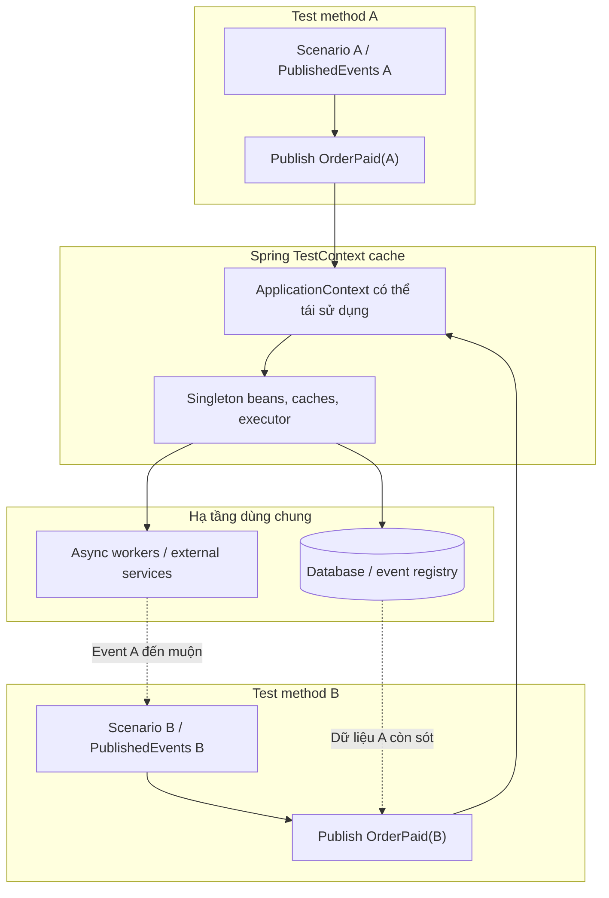
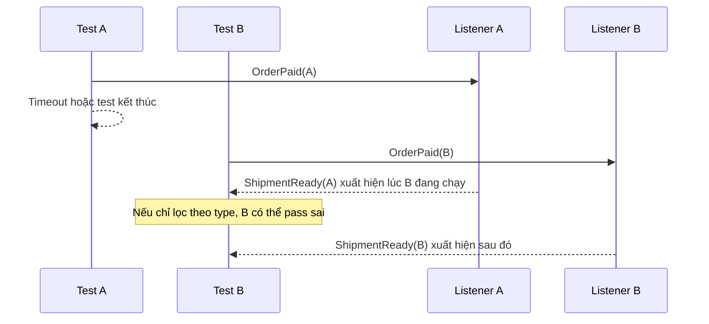

# Scenario state và phạm vi giữa các test

## 1. “State của Scenario” gồm những gì?

Trong học phần **SPRING_MODULITH_VERIFICATION_TESTING**, người học dùng `ApplicationModules.verify()` để bảo vệ ranh giới kiến trúc và sử dụng `@ApplicationModuleTest`, `Scenario`, kiểm thử sự kiện, database và tích hợp để phát hiện hồi quy trong CI.

Ở chương **Scenario**, đề bài **“Scenario state và phạm vi giữa các test”** đặt ra một câu hỏi rất thực tế:

> Khi test A đã phát event, cập nhật database hoặc thay đổi một Spring bean, test B có bắt đầu từ một hệ thống hoàn toàn mới không?

**Không nhất thiết.** Cần phân biệt nhiều lớp trạng thái có **vòng đời khác nhau**. Một phương thức test JUnit kết thúc không đồng nghĩa mọi thành phần Spring, DB, thread pool, event registry hoặc hệ thống ngoài đều được khởi tạo lại.

Ví dụ hai test đều kiểm tra `OrderPaid` dẫn tới `ShipmentReady`. Test A tạo shipment cho `orderId = A`. Nếu dữ liệu chưa dọn sạch, test B có thể:

- Đọc nhầm shipment của A, nhất là khi truy vấn không lọc ID;
- Bị lỗi unique constraint do dùng lại cùng ID;
- Quan sát sự kiện của A đến muộn từ một listener bất đồng bộ;
- Pass giả vì singleton bean vẫn giữ một cờ `ready = true`;
- Timeout do test A còn giữ DB connection, lock hoặc task chưa hoàn tất.

Đây là **test-state leakage**: trạng thái của một bài kiểm thử vô tình ảnh hưởng bài khác. Để nhận diện và khắc phục, ta cần xác định **trạng thái nằm ở đâu** và **ai sở hữu quyền dọn nó**.

## 2. Bốn lớp state cần phân biệt

| Lớp trạng thái | Ví dụ | Vòng đời cần hiểu | Cách cô lập |
| --- | --- | --- | --- |
| **1. Scenario / event observation** | Stimulus, predicate, matcher, `PublishedEvents` được inject vào phương thức test | Được sử dụng để xác định kết quả trong phạm vi phép thử; có thể quan sát event bất đồng bộ, kể cả từ thread khác tùy cấu hình | Khởi tạo kịch bản trong từng test; dùng correlation ID; kiểm soát test song song |
| **2. Spring `ApplicationContext`** | Singleton repository, cache, service, in-memory map, mock, executor | TestContext có thể **cache và tái sử dụng context** giữa phương thức/lớp test có cùng cấu hình | Dọn bean state, reset fixture; chỉ dùng `@DirtiesContext` khi thực sự cần |
| **3. Database / transaction** | Bảng `shipments`, `orders`, outbox, event publication registry | Dữ liệu đã commit tồn tại độc lập với vòng đời phương thức test và Spring context | ID riêng, commit Given đúng cách, cleanup theo khóa, schema/database test độc lập |
| **4. Tác vụ và hệ thống ngoài** | Listener `@ApplicationModuleListener`, thread pool, broker, HTTP stub, file, cache ngoài | Có thể tiếp tục xử lý sau lúc JUnit trả về hoặc nằm ngoài transaction của test | Chờ điều kiện hoàn tất thực sự, reset stub, kiểm thử tích hợp riêng, hạn chế chạy song song khi cần |

**Quy tắc cần nhớ:** giải quyết state leakage **ở đúng lớp**. Làm mới `ApplicationContext` không tự xóa database bên ngoài. Xóa một record DB không tự hủy task async đang chạy. Tạo một `UUID` mới không reset một singleton counter toàn cục.



Sơ đồ minh họa nguy cơ, **không có nghĩa mọi test đều chắc chắn chia sẻ một context**. Spring xác định cache key từ cấu hình context; những test khác cấu hình có thể có context khác, nhưng vẫn có khả năng dùng **cùng database hay broker**.

## 3. `Scenario` là DSL của một test, không phải nơi lưu business state lâu dài

Spring Modulith cho phép nhận `Scenario` qua **tham số phương thức test**:

```java
@ApplicationModuleTest
class ShippingTests {

    @Test
    void preparesFirstShipment(Scenario scenario) {
        UUID orderId = UUID.randomUUID();

        scenario.publish(new OrderPaid(orderId))
                .andWaitForEventOfType(ShipmentReady.class)
                .matching(event -> event.orderId().equals(orderId))
                .toArrive();
    }

    @Test
    void preparesAnotherShipment(Scenario scenario) {
        UUID orderId = UUID.randomUUID();

        scenario.publish(new OrderPaid(orderId))
                .andWaitForEventOfType(ShipmentReady.class)
                .matching(event -> event.orderId().equals(orderId))
                .toArrive();
    }
}
```

Đây là ví dụ hình thức; các event và listener được định nghĩa ở phần sau. Mỗi method thiết lập **stimulus, matcher và terminal operation riêng**. Không giữ một `Scenario.When<?>` dưới dạng field `static` rồi dùng lại giữa test: nó chứa cấu hình cho một lần kích hoạt cụ thể, không phải một state machine dùng chung cả suite.

Trong `Scenario`:

- `publish(...)` hoặc `stimulate(...)` là **stimulus**.
- `andWaitForEventOfType(...)` và `andWaitForStateChange(...)` là **điều kiện quan sát**.
- `matching(...)` và state predicate lọc **kết quả của tình huống hiện tại**.
- `toArrive...()` hoặc `andVerify(...)` là **terminal operation** thực thi và xác minh kịch bản.
- `andCleanup(...)` đăng ký tác vụ dọn sau kịch bản khi có side effect.

**Đừng hiểu nhầm** việc inject một `Scenario` ở test B là cơ chế xóa mọi dữ liệu do test A tạo. `Scenario` chỉ hỗ trợ định nghĩa và thực thi tình huống; database hoặc singleton bean vẫn phải được dọn/cô lập theo trách nhiệm của test.

## 4. `PublishedEvents` và phạm vi quan sát event

`@ApplicationModuleTest` cũng cho phép inject `PublishedEvents` hay `AssertablePublishedEvents` vào phương thức test để xác nhận những **Spring application events được ghi nhận trong quá trình kiểm thử**:

```java
@Test
void observesEvent(PublishedEvents events) {
    // Kích hoạt nghiệp vụ trong bài test này.
    var matching = events.ofType(ShipmentReady.class)
            .matching(ShipmentReady::orderId, orderId);

    assertThat(matching).hasSize(1);
}
```

Đây là **mẫu ngắn**: biến `orderId` và stimulus phải được định nghĩa trong method thực tế. `PublishedEvents` trả tập event phù hợp **tại thời điểm đọc**, không phải phương thức đợi bất đồng bộ. Với `@ApplicationModuleListener`, dùng `Scenario` chờ event hoặc trạng thái trước khi khẳng định.

### 4.1. Đừng coi event type là khóa cách ly

Hai bài test có thể cùng phát `ShipmentReady`. Nếu chỉ dùng:

```java
scenario.publish(new OrderPaid(orderId))
        .andWaitForEventOfType(ShipmentReady.class)
        .toArrive();
```

test có thể nhận **một event cùng type không thuộc đơn đang kiểm tra**, đặc biệt nếu task của bài khác hoàn thành muộn hoặc nhiều test chạy song song.

Hãy luôn lọc theo khóa nghiệp vụ:

```java
scenario.publish(new OrderPaid(orderId))
        .andWaitForEventOfType(ShipmentReady.class)
        .matchingMappedValue(ShipmentReady::orderId, orderId)
        .toArriveAndVerify(event ->
                assertThat(event.status()).isEqualTo("READY"));
```

`UUID.randomUUID()` giúp tránh trùng khóa; matcher theo ID mới là điều **chứng minh event quan sát thuộc stimulus của test**. Việc chỉ đặt ID mới nhưng không lọc event có thể vẫn dẫn đến pass giả.

### 4.2. Cấu hình `thread-bound-published-events`

Spring Modulith công bố thuộc tính:

```properties
spring.modulith.test.thread-bound-published-events=true
```

Theo tài liệu cấu hình, **giá trị mặc định là `false`**. Khi bật `true`, `Scenario` và `PublishedEvents` được giới hạn quan sát các event từ **thread đang chạy test và các thread con do thread đó tạo ra**.

Cần cân nhắc kỹ:

- **Khi `false`:** việc quan sát không bị ràng buộc bởi quan hệ thread cha/con theo tùy chọn này. Test chạy song song cần correlation ID để tránh bắt nhầm sự kiện.
- **Khi `true`:** có thể hạn chế event của thread không liên quan, nhưng một `@Async` listener chạy trong **thread pool đã tồn tại từ trước** không nhất thiết là “thread con được tạo từ test thread”. Test có thể không quan sát được event hợp lệ và timeout.
- Thuộc tính này **không thay thế matcher theo `orderId`** và không phải công tắc bảo đảm mọi luồng async đều được cách ly tự động.
- Tùy phiên bản Spring Modulith và cách cấu hình executor, nên xác minh bằng một test nhỏ trước khi bật cho cả suite.

**Khuyến nghị cơ bản:** giữ bài test độc lập bằng correlation ID và dữ liệu riêng trước; chỉ thay đổi ràng buộc thread khi hiểu rõ mô hình executor của ứng dụng. Không dùng thuộc tính này để che nhiễu do fixture hoặc state dùng chung.

## 5. Context caching: vì sao singleton vẫn còn giữa hai test?

Spring TestContext framework **cache `ApplicationContext`** theo cấu hình. Các test với cùng cache key có thể sử dụng **cùng bean singleton**, dù mặc định JUnit Jupiter tạo test class instance mới cho từng phương thức.

Ví dụ bean có state trong bộ nhớ:

```java
package com.acme.shipping;

import java.util.UUID;
import java.util.concurrent.ConcurrentHashMap;
import java.util.concurrent.ConcurrentMap;

import org.springframework.stereotype.Component;

@Component
class InMemoryShipmentView {

    private final ConcurrentMap<UUID, String> statuses =
            new ConcurrentHashMap<>();

    void markReady(UUID orderId) {
        statuses.put(orderId, "READY");
    }

    boolean isReady(UUID orderId) {
        return "READY".equals(statuses.get(orderId));
    }

    void clear(UUID orderId) {
        statuses.remove(orderId);
    }
}
```

Nếu test A gọi `markReady(idA)` và không dọn, test B có thể nhìn thấy dữ liệu đó qua cùng singleton trong context cache. Việc khởi tạo lại **JUnit test instance** không khởi tạo lại singleton map.

### 5.1. Dọn theo khóa, không xóa toàn bộ map đang dùng chung

```java
@Test
void checksInMemoryState(Scenario scenario) {
    UUID orderId = UUID.randomUUID();

    scenario.publish(new OrderPaid(orderId))
            .andCleanup(() -> shipmentView.clear(orderId))
            .andWaitForStateChange(() -> shipmentView.isReady(orderId))
            .andVerify(ready -> assertThat(ready).isTrue());
}
```

Đoạn này giả định listener trong **cùng context** cập nhật `shipmentView`, thay vì repository JDBC. `shipmentView` cần inject vào test. Dọn đúng `orderId` cho phép tránh xóa dữ liệu mà test khác đang dùng.

**Không nên** viết `shipmentView.clearAll()` trong `@AfterEach` khi suite có nhiều bài test chạy song song trên cùng context: một test có thể xóa dữ liệu của test khác ngay trong lúc nó đang chờ.

### 5.2. Khi nào dùng `@DirtiesContext`?

Spring có `@DirtiesContext` để đánh dấu context đã bị sửa theo cách **không còn an toàn để tái sử dụng**:

```java
@DirtiesContext(methodMode = DirtiesContext.MethodMode.AFTER_METHOD)
@Test
void changesGlobalBeanConfiguration() {
    // Test cố ý thay đổi state singleton không có reset API an toàn.
}
```

Context đó sẽ bị loại khỏi cache và được xây dựng lại khi cần. **Không nên dùng `@DirtiesContext` cho mọi bài test** vì bootstrap Spring Boot/Modulith, migration và kết nối hạ tầng có thể tốn thời gian.

Và quan trọng hơn: **`@DirtiesContext` không phải lệnh `TRUNCATE` database**. Nó cũng không tự xóa message đã gửi tới broker hoặc trạng thái ở hệ thống ngoài. Ưu tiên cleanup có mục tiêu; `@DirtiesContext` là công cụ dành cho context thực sự bị làm bẩn.

## 6. Transaction của `Scenario` không tuân theo rollback test như nhiều người tưởng

Đây là nguồn state leakage lớn nhất trong kiểm thử module có database.

Spring Modulith mô tả `Scenario.publish(...)` và `Scenario.stimulate(...)` chạy stimulus trong **transaction mới**, kể cả khi phương thức test đang có transaction. Điều đó nhằm kích hoạt đúng `@TransactionalEventListener` và `@ApplicationModuleListener` sau commit.

Hệ quả:

> **Dữ liệu do stimulus commit không tự rollback theo transaction bao ngoài của JUnit.** Những thay đổi của listener chạy trong transaction khác cũng cần quản lý riêng.

Ví dụ có thể gây hiểu lầm:

```java
@Transactional
@Test
void assumesEverythingRollsBack(Scenario scenario) {
    scenario.publish(new OrderPaid(orderId))
            .andWaitForStateChange(() -> shipmentQuery.findByOrderId(orderId))
            .andVerify(found -> assertThat(found).isPresent());
}
```

`@Transactional` trên test chỉ quản lý **test-managed transaction** theo quy tắc Spring TestContext, thường rollback sau test. Nó **không** phủ nhận commit đã xảy ra trong transaction độc lập của `Scenario` hay listener. Test trên cũng chỉ kiểm tra có bản ghi, không đảm bảo status đích hay cleanup.

### 6.1. Given có thể không nhìn thấy từ listener async

Nếu fixture được tạo trong transaction test chưa commit, listener chạy ở thread/transaction khác có thể đọc `Optional.empty()`:

```java
@Transactional
@Test
void fixtureMayBeInvisible(Scenario scenario) {
    orders.insert(new OrderRow(orderId, "PAID"));

    scenario.publish(new OrderPaid(orderId))
            .andWaitForEventOfType(ShipmentReady.class)
            .toArrive();
}
```

Đây là một **anti-pattern minh họa**; `orders` và `OrderRow` là phần tử nghiệp vụ giả định. Listener không nhìn thấy dữ liệu chưa commit theo isolation thông thường, từ đó có thể lỗi hoặc timeout.

Khi cần Given đã commit, tạo fixture trong transaction độc lập trước stimulus:

```java
transactions.executeWithoutResult(tx ->
        orders.insert(new OrderRow(orderId, "PAID")));

scenario.publish(new OrderPaid(orderId))
        .andWaitForEventOfType(ShipmentReady.class)
        .matching(e -> e.orderId().equals(orderId))
        .toArrive();
```

Lưu ý `TransactionTemplate` với propagation mặc định `REQUIRED` có thể **tham gia transaction bao ngoài nếu đã có**. Ví dụ trên giả định không có `@Transactional` bao quanh. Nếu bắt buộc đang ở một transaction, cần cấu hình `REQUIRES_NEW` phù hợp hoặc sắp xếp setup để commit trước. Sau đó phải dọn cả fixture đã commit.

## 7. Ví dụ hoàn chỉnh: hai test độc lập dùng cùng module shipping

Ví dụ dưới đây kiểm tra cùng một contract qua **hai test khác nhau**: sau `OrderPaid(orderId)`, listener tạo một bản ghi shipment `READY`. Cách tổ chức phải bảo đảm cả hai test chạy **theo thứ tự bất kỳ** và chạy lại nhiều lần đều cho kết quả đúng.

### 7.1. Dependency test và schema

Test starter của Spring Modulith (Maven):

```xml
<dependency>
    <groupId>org.springframework.modulith</groupId>
    <artifactId>spring-modulith-starter-test</artifactId>
    <scope>test</scope>
</dependency>
```

Schema minh họa do migration tạo:

```sql
CREATE TABLE shipments (
    order_id VARCHAR(36) PRIMARY KEY,
    status   VARCHAR(32) NOT NULL
);
```

Trong dự án thật, Spring Boot cần datasource, JDBC/JPA và transaction manager phù hợp. Database test nên được khởi tạo từ migration để không phụ thuộc dữ liệu của máy cá nhân.

### 7.2. Event đầu vào — API công khai module order

`com/acme/order/OrderPaid.java`:

```java
package com.acme.order;

import java.util.UUID;

public record OrderPaid(UUID orderId) {}
```

Event đặt ở package gốc module `order` (API công khai theo mô hình Spring Modulith mặc định). Nếu contract nằm trong subpackage, dùng named interface/công bố API thích hợp; tránh import lớp nội bộ không được phép.

### 7.3. Read model shipping

`com/acme/shipping/ShipmentView.java`:

```java
package com.acme.shipping;

import java.util.UUID;

public record ShipmentView(UUID orderId, String status) {}
```

`com/acme/shipping/ShippingReadModel.java`:

```java
package com.acme.shipping;

import java.util.List;
import java.util.Optional;
import java.util.UUID;

import org.springframework.jdbc.core.JdbcTemplate;
import org.springframework.stereotype.Repository;

@Repository
class ShippingReadModel {

    private final JdbcTemplate jdbc;

    ShippingReadModel(JdbcTemplate jdbc) {
        this.jdbc = jdbc;
    }

    void insertReady(UUID orderId) {
        jdbc.update(
                "INSERT INTO shipments (order_id, status) VALUES (?, ?)",
                orderId.toString(), "READY");
    }

    Optional<ShipmentView> findByOrderId(UUID orderId) {
        List<ShipmentView> found = jdbc.query(
                "SELECT order_id, status FROM shipments WHERE order_id = ?",
                (rs, index) -> new ShipmentView(
                        UUID.fromString(rs.getString("order_id")),
                        rs.getString("status")),
                orderId.toString());

        return found.stream().findFirst();
    }

    void deleteByOrderId(UUID orderId) {
        jdbc.update(
                "DELETE FROM shipments WHERE order_id = ?",
                orderId.toString());
    }
}
```

`findByOrderId` trả `Optional.empty()` khi chưa có bản ghi. Điều này phù hợp với polling; mỗi lần gọi đọc trạng thái hiện tại, không giữ một snapshot bất biến trước stimulus.

### 7.4. Listener async sau commit

`com/acme/shipping/ShippingHandler.java`:

```java
package com.acme.shipping;

import com.acme.order.OrderPaid;
import org.springframework.modulith.events.ApplicationModuleListener;
import org.springframework.stereotype.Component;

@Component
class ShippingHandler {

    private final ShippingReadModel shipments;

    ShippingHandler(ShippingReadModel shipments) {
        this.shipments = shipments;
    }

    @ApplicationModuleListener
    public void on(OrderPaid paid) {
        shipments.insertReady(paid.orderId());
    }
}
```

`@ApplicationModuleListener` xử lý sự kiện sau commit, bất đồng bộ và trong transaction mới. Test **phải chờ trạng thái DB quan sát được**, chứ không assume gọi `publish` xong là listener đã commit.

### 7.5. Lớp test có hai method độc lập

`src/test/java/com/acme/shipping/ShippingIsolationTests.java`:

```java
package com.acme.shipping;

import static org.assertj.core.api.Assertions.assertThat;

import java.time.Duration;
import java.util.UUID;

import com.acme.order.OrderPaid;
import org.junit.jupiter.api.Test;
import org.springframework.beans.factory.annotation.Autowired;
import org.springframework.modulith.test.ApplicationModuleTest;
import org.springframework.modulith.test.Scenario;
import org.springframework.transaction.support.TransactionTemplate;

@ApplicationModuleTest
class ShippingIsolationTests {

    @Autowired ShippingReadModel shipments;
    @Autowired TransactionTemplate transactions;

    @Test
    void createsReadyShipmentForFirstIndependentOrder(Scenario scenario) {
        verifyReadyShipment(UUID.randomUUID(), scenario);
    }

    @Test
    void createsReadyShipmentForAnotherIndependentOrder(Scenario scenario) {
        verifyReadyShipment(UUID.randomUUID(), scenario);
    }

    private void verifyReadyShipment(UUID orderId, Scenario scenario) {

        // GIVEN: không có dữ liệu trước của ID hiện tại.
        assertThat(shipments.findByOrderId(orderId)).isEmpty();

        // WHEN: phát đúng một stimulus cho ID hiện tại.
        scenario.publish(new OrderPaid(orderId))
                .andCleanup(() -> transactions.executeWithoutResult(tx ->
                        shipments.deleteByOrderId(orderId)))
                .andWaitAtMost(Duration.ofSeconds(5))
                .forStateChange(
                        () -> shipments.findByOrderId(orderId),
                        found -> found.isPresent()
                                && "READY".equals(
                                        found.orElseThrow().status()))
                .andVerify(found -> {
                    ShipmentView shipment = found.orElseThrow();
                    assertThat(shipment.orderId()).isEqualTo(orderId);
                    assertThat(shipment.status()).isEqualTo("READY");
                });
    }
}
```

**Vì sao hai test độc lập?**

1. Mỗi test nhận tham số `Scenario` ở method của mình, không dùng field `static` để giữ DSL.
2. Mỗi test tạo `UUID.randomUUID()` độc lập, không dùng ID hoặc entity do test khác tạo.
3. `assertThat(...).isEmpty()` kiểm tra **tiền điều kiện cho ID hiện tại**, phát hiện sớm dữ liệu cũ/trùng ID.
4. `Scenario.publish(...)` phát event đầu vào **đúng một lần**.
5. Predicate đợi bản ghi thực sự đạt `READY`, giúp phân biệt “đã insert” và “đã hoàn tất”.
6. `andCleanup(...)` chỉ xóa record của **orderId hiện tại**, thông qua transaction phù hợp.
7. Không test nào cần chạy trước test còn lại. Có thể đổi thứ tự, lặp lại hoặc chạy một test độc lập.

**Giới hạn:** listener trong ví dụ chỉ ghi một bảng, và query `READY` là tín hiệu đủ mạnh để dọn record sau commit. Nếu handler còn làm các tác vụ async **sau** khi ghi `READY`, cần thay tín hiệu hoàn tất hoặc chờ các tác vụ đó trước cleanup. Khi có nhiều bảng/khóa ngoại, cleanup phải dọn tất cả side effect theo thứ tự phù hợp.

## 8. Cleanup phải bao phủ đúng dữ liệu đã commit

`Scenario.andCleanup(...)` cho phép đăng ký dọn sau kịch bản, kể cả khi điều kiện chờ hoặc assertion thất bại. Tuy nhiên, cần nhận biết ba loại dữ liệu:

| Loại | Ví dụ | Gợi ý dọn |
| --- | --- | --- |
| **Given đã commit** | `OrderRow` hoặc `ProductRow` test tạo trước stimulus | `@AfterEach`, helper cleanup có transaction hoặc database fixture reset |
| **Stimulus đã commit** | Service `placeOrder` ghi order và phát event | `andCleanup(...)` theo result/ID hoặc helper dọn sau test |
| **Listener đã commit** | Shipment, stock reservation, projection, event publication entry | Chờ tín hiệu hoàn tất rồi dọn theo aggregate ID hoặc reset DB test |

Một ví dụ cleanup nhiều bảng:

```java
scenario.publish(new OrderPaid(orderId))
        .andCleanup(() -> transactions.executeWithoutResult(tx -> {
            shipmentItems.deleteByOrderId(orderId);
            shipments.deleteByOrderId(orderId);
            orders.deleteById(orderId);
        }))
        .andWaitForStateChange(
                () -> shipmentQuery.isReady(orderId))
        .andVerify(ready -> assertThat(ready).isTrue());
```

`shipmentItems`, `shipments`, `orders` và `shipmentQuery` trong đoạn này là các bean do dự án định nghĩa. Thứ tự xóa tùy ràng buộc khóa ngoại; không xóa cả bảng khi có test chạy song song.

### 8.1. Trường hợp cleanup cũng có thể thất bại

- Listener chưa commit khi event kết quả đã xuất hiện; cleanup xóa quá sớm hoặc bị khóa.
- Thao tác `DELETE` vi phạm foreign key do dọn sai thứ tự.
- Cleanup dùng transaction ngoài đã bị rollback-only.
- Fixture Given được tạo **trước Scenario** nhưng lỗi xảy ra trước khi đăng ký `andCleanup`, nên helper không được gọi.
- Listener retry sau khi cleanup, tái tạo dữ liệu đã xóa.

Cách xử lý phụ thuộc phạm vi: chờ state cuối đủ mạnh, dùng `TransactionTemplate` thích hợp, tách test database, hoặc có `@AfterEach`/reset hạ tầng.

### 8.2. Đừng xóa cả event publication registry một cách tùy tiện

Nếu ứng dụng dùng **Event Publication Registry** của Spring Modulith, các publication record có thể được lưu trong database, có trạng thái completed/failed/pending tùy phiên bản và cấu hình. Chúng không tự biến mất chỉ vì test method kết thúc.

Trong test cô lập, cân nhắc database/schema riêng và cơ chế reset có kiểm soát. Không xóa bừa toàn bộ bảng publication của môi trường chia sẻ với test khác; điều này có thể làm mất thông tin retry của những task còn chạy.

## 9. Event trễ và test chạy song song: nguồn nhiễu khó thấy

Giả sử:

- Test A phát `OrderPaid(A)` và chờ `ShipmentReady(A)`.
- Listener A bận nên event của A đến muộn.
- Test B bắt đầu trong khi listener A vẫn đang chạy.
- Test B phát `OrderPaid(B)`, và cả hai event đều có cùng class `ShipmentReady`.



`@ApplicationModuleTest` **không mặc nhiên tạo một executor/DB mới cho mỗi test**. Spring context được cache theo cấu hình và các task đã lên lịch có thể tiếp tục chạy trong lúc test khác đang thực thi.

Biện pháp:

1. **Matcher theo ID**: `matchingMappedValue(ShipmentReady::orderId, orderId)`.
2. **Dữ liệu riêng**: ID ngẫu nhiên, fixture tên duy nhất, không dùng khóa cố định như `orderId = 1`.
3. **Điều kiện hoàn tất có ý nghĩa**: nếu có DB, chờ `READY` đã commit thay vì chỉ một event trước commit.
4. **Cleanup theo ID**: không gọi `deleteAll()` trên dữ liệu được chia sẻ với test chạy song song.
5. **Không mặc định song song** cho các test dùng tài nguyên toàn cục không thể cô lập; cân nhắc `@ResourceLock` của JUnit cho tài nguyên thật sự chia sẻ.
6. **Kiểm tra thread/executor** và cấu hình `spring.modulith.test.thread-bound-published-events` khi có vấn đề giao thoa event.

### `@ResourceLock` khi thật sự không thể cô lập resource

Ví dụ hai test bắt buộc thay đổi cùng một cấu hình global:

```java
@ResourceLock(value = "shared-carrier-stub",
              mode = ResourceAccessMode.READ_WRITE)
@Test
void usesSharedStub(Scenario scenario) {
    // Không chạy đồng thời với test giữ cùng resource lock.
}
```

Đây là annotation của **JUnit Jupiter**, không phải Spring Modulith. Dùng lock cùng tên cho tất cả test tranh chấp resource đó. Lock giảm concurrency, vì vậy ưu tiên fixture/instance riêng nếu có thể.

**Lưu ý:** `@ResourceLock` chỉ đồng bộ những test tuân thủ cùng lock trong một test engine. Nó không ngăn một ứng dụng ngoài hoặc một process CI khác truy cập broker/DB dùng chung.

## 10. Tại sao `@DirtiesContext` không phải giải pháp mặc định?

Nếu singleton bean có state không thể reset, `@DirtiesContext` có thể giúp xây lại Spring context. Nhưng nó có chi phí:

- Bootstrap lại Spring context, tạo bean, migration và kết nối hạ tầng.
- Làm giảm hiệu quả TestContext cache.
- Có thể khiến cả suite chậm đáng kể.
- **Không** hoàn tác dữ liệu đã commit trong database hay side effect ngoài.
- Có thể gây thêm race nếu task async cũ vẫn đang xử lý khi context được đóng.

Ưu tiên phân cấp:

1. **Dùng stateless service** hoặc scope phù hợp nếu thiết kế production cho phép.
2. **Dùng ID riêng**, reset cache/fixture theo business key.
3. **Dùng cleanup** trong transaction phù hợp.
4. **Dùng database/schema/container test cô lập** khi cần reset toàn bộ state bền vững.
5. **Chỉ cuối cùng** đánh dấu `@DirtiesContext` khi Spring singleton/context thực sự bị thay đổi không thể phục hồi an toàn.

Một test **có thể pass khi chạy riêng nhưng fail khi chạy cả suite** là dấu hiệu mạnh cần kiểm tra state leakage. Tuy nhiên, lỗi cũng có thể đến từ thứ tự database migration, timeout CI hoặc khác biệt cấu hình; không mặc định quy mọi flaky test cho context cache.

## 11. `@Transactional`, `TestTransaction` và fixture: cần đúng ranh giới

Spring TestContext thường rollback transaction của một test gắn `@Transactional` sau khi method kết thúc. Điều đó rất hữu ích với các lệnh repository **tham gia cùng test-managed transaction**.

Nhưng có ba ranh giới khác:

1. **Test-managed transaction:** do Spring TestContext quản lý cho `@Transactional` test.
2. **Spring/application transaction:** do service hoặc `Scenario` mở, có thể dùng `REQUIRES_NEW`.
3. **Async listener transaction:** do `@ApplicationModuleListener` xử lý sau commit, thường trên thread khác.

Chúng không tự hợp nhất thành một transaction bao trùm mọi tác vụ.

Khi muốn chủ động commit phần Given của `@Transactional` test, Spring TestContext có API `TestTransaction`:

```java
// Chỉ minh họa cho test thực sự đang chạy trong test-managed transaction.
orders.insert(new OrderRow(orderId, "PAID"));

TestTransaction.flagForCommit();
TestTransaction.end();

// Từ đây, phần Given đã commit trước khi phát event.
scenario.publish(new OrderPaid(orderId))
        .andWaitForEventOfType(ShipmentReady.class)
        .matching(e -> e.orderId().equals(orderId))
        .toArrive();
```

Đoạn này yêu cầu đúng import của `TestTransaction` và ứng dụng đã cấu hình `PlatformTransactionManager`. Sau khi `end()`, test-managed transaction kết thúc; muốn mở lại phải dùng `TestTransaction.start()` nếu quy trình test cần. Khi không có `@Transactional` bao ngoài, `TransactionTemplate` đơn giản và dễ hiểu hơn.

**Lựa chọn tốt nhất:** xác định rõ *Given phải commit hay không*, rồi dùng ít transaction lồng nhau nhất có thể. Đừng thêm `@Transactional` theo thói quen cho một test vốn phải quan sát listener chạy trong transaction khác.

## 12. Mock, clock, cache và state ngoài database

Không phải mọi state leakage đều liên quan SQL.

### 12.1. Mock được dùng qua context

`@MockitoBean` hoặc cơ chế mock tương ứng phiên bản Spring Boot/Spring Framework cho phép thay dependency ngoài của module trong `@ApplicationModuleTest`. Test framework có cơ chế quản lý vòng đời mock, nhưng bài test vẫn cần:

- Không dựa vào **stubbing của test khác**.
- Thiết lập stub trong chính test hoặc setup phù hợp.
- Xác nhận số lần gọi theo `orderId`/argument của test hiện tại.
- Tránh chia sẻ một mock mutable giữa các test chạy song song mà không có chiến lược cô lập.

Chỉ mock **biên ngoài**; đừng mock luôn listener hoặc repository nội bộ mà kịch bản định kiểm, vì test có thể pass mà không chạy code nghiệp vụ thật.

### 12.2. Clock và dữ liệu thời gian

`Clock.systemUTC()` phụ thuộc thời gian thực; test gần nửa đêm hoặc DST có thể cho kết quả khác nhau. Nếu logic module phụ thuộc thời gian, inject một `Clock` kiểm soát được trong context test. Tuy nhiên, **đổi một mutable singleton Clock trong test A** có thể ảnh hưởng test B nếu context được cache. Ưu tiên cấu hình clock cố định theo test context hoặc reset có kiểm soát.

### 12.3. Static field và external cache

Một `static Map`, Redis test, file hệ thống, queue hoặc test HTTP stub có state **nằm ngoài vòng đời `Scenario` và có thể ngoài Spring context**. `@DirtiesContext` không giải quyết chúng. Dùng namespace/key riêng hoặc reset resource rõ ràng.

### 12.4. Event registry và retry

Với `@ApplicationModuleListener`, event có thể được resubmit khi ứng dụng dùng event publication registry và cơ chế retry/recovery phù hợp. Một listener của test A có thể tạo side effect sau khi test A kết thúc nếu xử lý chưa được cô lập.

Dùng business key idempotent, unique constraint và test recovery riêng. `Scenario.toArrive()` thường chỉ xác nhận **ít nhất một** event phù hợp, không chứng minh không còn retry hoặc exactly-once effect.

## 13. Bảng chẩn đoán state leakage

| Triệu chứng | State có thể bị rò rỉ | Cách xác minh | Hướng sửa |
| --- | --- | --- | --- |
| Test B pass dù listener đã tắt. | Event của A đến muộn hoặc map global còn `READY`. | Matcher theo ID; kiểm tra event payload và bean state. | ID riêng, điều kiện chờ đúng, cleanup map. |
| Test A pass, B lỗi duplicate key. | Database còn record với khóa cố định. | Query `order_id` trước B. | UUID riêng, delete theo ID, database test độc lập. |
| Test pass riêng, fail khi chạy cả suite. | Context cache, DB fixture, static cache hoặc executor. | Đổi thứ tự test, chạy lặp lại, bật log tương ứng. | Giảm shared state, cleanup, kiểm soát parallel. |
| DB vẫn còn shipment sau test `@Transactional`. | `Scenario`/listener commit transaction riêng. | Kiểm tra propagation và query DB sau test. | `andCleanup(...)` hoặc reset DB. |
| Listener không tìm thấy Given. | Given chưa commit trong test-managed transaction. | Đọc Given từ transaction độc lập. | Commit fixture trước stimulus. |
| Test state timeout dù DB đã có `READY`. | Supplier giữ snapshot/cached value. | Log query mỗi lần poll, kiểm tra isolation. | Đọc lại bằng supplier mới, transaction phù hợp. |
| Test B thấy giá trị singleton từ A. | Spring context được tái sử dụng. | In/log bean identity hoặc đọc state trước B. | Reset bean theo khóa; `@DirtiesContext` khi bắt buộc. |
| Dọn dữ liệu làm test song song khác fail. | Cleanup quá rộng, `deleteAll()`. | Chạy suite song song, kiểm tra khóa bị xóa. | Cleanup theo ID, test isolation hoặc lock. |
| Event test pass nhưng DB chưa commit. | Listener phát event trước commit. | Quan sát transaction và query DB độc lập. | Chờ state bền vững sau commit. |
| Bật thread-bound rồi mất event async. | Listener dùng executor thread pool không phải descendant thread. | Kiểm tra cách tạo thread và cấu hình property. | Giữ ID matcher; điều chỉnh config có kiểm chứng. |

## 14. Quality gate CI cần kiểm soát state theo phạm vi

Một pipeline Spring Modulith nên có cả **kiểm tra kiến trúc** và **kiểm tra hành vi**:

```java
import org.junit.jupiter.api.Test;
import org.springframework.modulith.core.ApplicationModules;

class ArchitectureVerificationTests {

    @Test
    void verifiesModuleBoundaries() {
        ApplicationModules.of(Application.class).verify();
    }
}
```

`Application.class` là lớp Spring Boot application của dự án. `ApplicationModules.verify()` giúp phát hiện truy cập vào package nội bộ, phụ thuộc vòng và vi phạm ràng buộc module. Nó không kiểm tra được dữ liệu DB bị rò giữa các test.

Ngược lại, `Scenario` chứng minh hành vi theo stimulus và điều kiện chờ, nhưng không tự phát hiện import nội bộ sai.

**Đề xuất quality gate:**

- Chạy test bằng `./mvnw test` hoặc `./gradlew test`, tùy build tool.
- Kiểm tra test qua **một lần chạy cả suite**, không chỉ từng test riêng.
- Có phép chạy lặp lại và chạy song song **khi hạ tầng/fixture được thiết kế để hỗ trợ**.
- Dùng migration/test database rõ ràng; cân nhắc Testcontainers để gần engine production.
- Dùng `UUID`/business key riêng, không mặc định ID cố định.
- Với async listener, chờ điều kiện cuối có nghĩa nghiệp vụ, không dùng `Thread.sleep` cố định.
- Cleanup theo khóa, dọn cả Given lẫn side effect đã commit.
- Chỉ bật `@DirtiesContext` ở những test làm bẩn context thật sự.
- Có log correlation ID và thông tin lỗi listener để chẩn đoán timeout.
- Không che flaky test bằng việc tăng timeout vô hạn hoặc retry build cho tới khi xanh.

### Checklist phân biệt các phạm vi

- [ ] Có nêu rõ scope của `Scenario` và `PublishedEvents` trong từng method.
- [ ] Không dùng lại DSL hay fixture mutable `static` giữa test.
- [ ] Biết context có thể được cache và singleton không tự reset.
- [ ] Mỗi test có `orderId` độc lập; event matcher lọc theo đúng ID.
- [ ] Given mà listener cần đọc đã commit trước stimulus.
- [ ] Đã xác định transaction nào commit và vì sao rollback JUnit chưa đủ.
- [ ] Có `andCleanup(...)` hoặc chiến lược dọn DB/test container đúng phạm vi.
- [ ] Supplier của state query đọc dữ liệu mới, predicate kiểm tra trạng thái đích.
- [ ] Tác vụ async không thể sửa dữ liệu sau khi cleanup hoàn tất, hoặc đã có biện pháp cô lập.
- [ ] Nếu test chạy song song, không dùng cleanup toàn cục trên resource chia sẻ.
- [ ] Cấu hình `thread-bound-published-events` được lựa chọn dựa trên executor thực tế.
- [ ] Có test `ApplicationModules.verify()` song song với test hành vi.

## 15. Bài tập thực hành

Sử dụng module `shipping` và test ở mục 7.

1. **Hai test cùng khóa:** Thay `UUID.randomUUID()` bằng `UUID.fromString("00000000-0000-0000-0000-000000000001")` ở cả hai method và bỏ cleanup. Dự đoán test nào lỗi khi chạy lần đầu và khi chạy lại suite.
2. **Singleton rò state:** Viết một `InMemoryShipmentView` lưu `Map<UUID,String>` rồi cho test A ghi `READY` mà không dọn. Giải thích vì sao test B thấy state A dù JUnit tạo instance test class mới.
3. **Rollback tưởng tượng:** Đặt `@Transactional` lên lớp test shipping. Giải thích vì sao bản ghi do `@ApplicationModuleListener` tạo vẫn có thể tồn tại sau test.
4. **Given chưa commit:** Listener đọc bảng `orders` sau commit, còn Given được insert trong transaction của JUnit. Hãy thay bằng cách chuẩn bị fixture đã commit để listener nhìn thấy.
5. **Event đến muộn:** Test A tạo `ShipmentReady(A)` trễ, test B đợi `ShipmentReady(B)`. Viết matcher để B không pass nhầm vì A.
6. **Dọn theo khóa:** Viết `andCleanup(...)` xóa shipment, reservation và order của một `orderId` cụ thể, theo thứ tự khóa ngoại.
7. **DirtiesContext:** Phân tích trường hợp nào cần `@DirtiesContext` và tại sao nó không xóa record DB đã commit hoặc message ở Kafka.
8. **Thread-bound:** Theo mô hình listener dùng thread pool đã tạo trước, bật `spring.modulith.test.thread-bound-published-events=true` có thể tác động ra sao đến test chờ event? Vì sao vẫn cần correlation ID?
9. **State predicate:** Một query trả `Optional.of(ShipmentView(orderId, "PENDING"))`. Tại sao overload `andWaitForStateChange(supplier)` chưa đủ để chờ `READY`?
10. **Song song:** Hai test cùng gọi `deleteAll()` trong `@AfterEach` trên chung database. Chỉ ra race condition và đề xuất thiết kế an toàn hơn.
11. **Event registry:** Khi listener retry sau timeout, giải thích khả năng dữ liệu test A quay trở lại dù cleanup đã chạy; đề xuất điều kiện hoàn tất hoặc cách cô lập database.
12. **CI và kiến trúc:** Module shipping import `com.acme.order.internal.OrderRepositoryImpl`. Bài `Scenario` có thể pass nhưng phép kiểm nào phát hiện sai kiến trúc?

**Định hướng đáp án:** (1) duplicate key hoặc false-positive phụ thuộc thứ tự; (2) singleton thuộc context cache; (3) Scenario và listener có transaction commit riêng; (4) commit Given trước stimulus; (5) `matchingMappedValue(ShipmentReady::orderId, orderId)`; (6) cleanup theo aggregate ID và FK; (7) chỉ làm mới Spring context; (8) pool có thể ngoài cây thread test; (9) cần predicate `status == READY`; (10) tránh cleanup toàn bảng, dùng ID/namespace riêng; (11) chờ kết quả thực và idempotency; (12) `ApplicationModules.verify()`.

## Tài liệu tham khảo

- [Spring Modulith — Integration Testing Application Modules](https://docs.spring.io/spring-modulith/reference/testing.html): `Scenario`, transaction mới, cleanup, `@ApplicationModuleTest` và bootstrap mode.
- [Spring Modulith — Working with Application Events](https://docs.spring.io/spring-modulith/reference/events.html): `PublishedEvents`, `@ApplicationModuleListener` và Event Publication Registry.
- [Spring Modulith — Appendix / Configuration Properties](https://docs.spring.io/spring-modulith/reference/appendix.html): `spring.modulith.test.thread-bound-published-events` và các tùy chọn test.
- [Spring Modulith — Scenario API](https://docs.spring.io/spring-modulith/docs/current/api/org/springframework/modulith/test/Scenario.html): `publish` và `stimulate`.
- [Spring Modulith — Scenario.When API](https://docs.spring.io/spring-modulith/docs/current/api/org/springframework/modulith/test/Scenario.When.html): `andWaitForStateChange`, `andWaitForEventOfType` và `andCleanup`.
- [Spring Framework — TestContext Context Caching](https://docs.spring.io/spring-framework/reference/testing/testcontext-framework/ctx-management/caching.html): context cache và cơ chế tái sử dụng singleton bean.
- [Spring Framework — TestContext Transaction Management](https://docs.spring.io/spring-framework/reference/testing/testcontext-framework/tx.html): rollback test, transaction propagation và `TestTransaction`.
- [Spring Framework — @DirtiesContext](https://docs.spring.io/spring-framework/reference/testing/annotations/integration-spring/annotation-dirtiescontext.html): làm mới context đã bị thay đổi.
- [JUnit Jupiter — Parallel Execution](https://junit.org/junit5/docs/current/user-guide/#writing-tests-parallel-execution): `@ResourceLock` và các cơ chế bảo vệ tài nguyên dùng chung.
- [Spring Modulith — Verifying Application Module Structure](https://docs.spring.io/spring-modulith/reference/verification.html): `ApplicationModules.verify()` kiểm soát ranh giới module.
