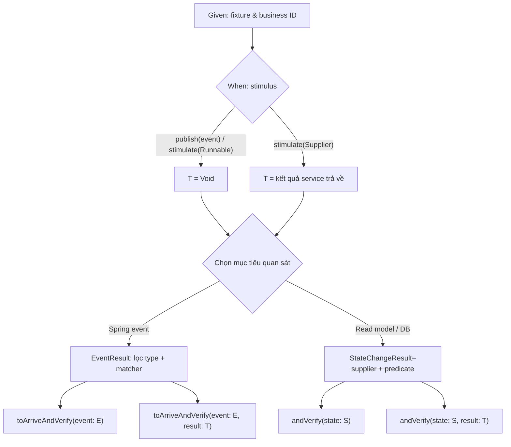

# Đọc kết quả scenario để viết assertion

## 1. Kết quả của một Scenario là gì?

Trong học phần **SPRING_MODULITH_VERIFICATION_TESTING**, chúng ta rèn kỹ năng kiểm chứng **ranh giới kiến trúc** của Spring Modulith bằng `ApplicationModules` và các quy tắc phụ thuộc module, đồng thời xác minh **hành vi** qua `@ApplicationModuleTest`, sự kiện, database, tích hợp và quality gate CI.

Ở chương **Scenario**, đề bài **“Đọc kết quả scenario để viết assertion”** yêu cầu hiểu chính xác **giá trị nào được chuyển vào callback cuối cùng** của một bài kiểm thử:

- **Event result (`E`):** một Spring application event đã được quan sát, ví dụ `ShipmentPrepared`.
- **State result (`S`):** kết quả đọc trạng thái khi điều kiện chờ thành công, ví dụ `Optional<ShipmentView>`.
- **Stimulus result (`T`):** giá trị phương thức nghiệp vụ được `Scenario.stimulate(Supplier<T>)` trả về, ví dụ `UUID requestId`.

`Scenario` không chỉ là một cơ chế đợi. Nó giúp kết nối **kích hoạt nghiệp vụ → quan sát kết quả → assertion trên đúng dữ liệu**. Nếu hiểu sai kiểu giá trị, thứ tự tham số hoặc thời điểm kết quả được đọc, test có thể biên dịch sai, pass giả hoặc timeout dù code production hoạt động đúng.

Ví dụ đơn giản:

```java
scenario.publish(new OrderPaid(orderId))
        .andWaitForEventOfType(ShipmentPrepared.class)
        .matching(event -> event.orderId().equals(orderId))
        .toArriveAndVerify(event -> {
            assertThat(event.orderId()).isEqualTo(orderId);
            assertThat(event.serviceLevel()).isEqualTo("STANDARD");
        });
```

Trong callback cuối, `event` là **đối tượng `ShipmentPrepared` được quan sát**, không phải event `OrderPaid` do test phát, không phải `Scenario` và không phải một wrapper cần ép kiểu.

> **Điểm quan trọng:** các terminal operation như `toArrive()`, `toArriveAndVerify(...)`, `andVerify(...)` trả về `void`. Muốn kiểm tra giá trị, hãy viết assertion **trong callback** do API cung cấp; không cố gán kết quả của cả chuỗi DSL cho một biến.

## 2. Bản đồ ba luồng dữ liệu: `T`, `E` và `S`



| Giá trị | Được tạo từ đâu? | Type Java | Callback đọc ở đâu? |
| --- | --- | --- | --- |
| `T` — stimulus result | `stimulate(Supplier<T>)` hoặc overload trả về kết quả | `UUID`, `OrderReceipt`, `String`... | Đối số **thứ hai** của `toArriveAndVerify((event, result) -> ...)` hoặc `andVerify((state, result) -> ...)`. |
| `E` — event result | Event Spring đã xuất hiện theo `andWaitForEventOfType(Class<E>)` và matcher | `ShipmentPrepared` | Đối số **thứ nhất** của `toArriveAndVerify(...)`. |
| `S` — state result | `Supplier<S>` được poll tới khi thỏa acceptance predicate | `Optional<ShipmentView>`, `Boolean`, DTO, enum... | Đối số **thứ nhất** của `andVerify(...)`. |

**Khi `publish(Object)` hoặc `stimulate(Runnable)` được dùng**, `T` là `Void`: không có kết quả nghiệp vụ từ stimulus để so sánh. Thông thường, hãy chọn callback **một đối số**.

**Khi `stimulate(Supplier<T>)` được dùng**, có thể chọn callback **hai đối số** để đối chiếu giá trị service trả về với event/state được quan sát.

## 3. Những terminal operation cần nhớ

Đây là các chữ ký rút gọn từ Spring Modulith `Scenario.When<T>.EventResult<E>` và `StateChangeResult<S>`. Chúng giúp phân biệt kiểu callback, không phải phương thức cần khai báo lại trong lớp test.

| Terminal operation | Callback nhận gì? | Dùng khi nào? |
| --- | --- | --- |
| `EventResult<E>.toArrive()` | Không có callback | Chỉ cần kiểm chứng có ít nhất một event phù hợp đến đúng hạn. |
| `EventResult<E>.toArriveAndVerify(Consumer<E>)` | `event: E` | Cần assert payload của event được bắt. |
| `EventResult<E>.toArriveAndVerify(BiConsumer<E,T>)` | `event: E`, `stimulusResult: T` | Cần so sánh event với giá trị trả về từ service. |
| `EventResult<E>.toArriveAndAssert(Consumer<PublishedEventAssert<? super E>>)` | Một đối tượng AssertJ assertion cho event | Muốn dùng fluent API assertion của Spring Modulith; kiểm tra phiên bản API. |
| `StateChangeResult<S>.andVerify(Consumer<S>)` | `state: S` | Cần assert trạng thái đã được supplier quan sát. |
| `StateChangeResult<S>.andVerify(BiConsumer<S,T>)` | `state: S`, `stimulusResult: T` | Cần đối chiếu trạng thái cuối với kết quả service. |
| `StateChangeResult<S>.andVerifyEvents(Consumer<AssertablePublishedEvents>)` | Một tập Spring events đã được ghi nhận | Sau khi state đạt, cần kiểm chứng thêm sự kiện được phát. |

`toArriveAndAssert(...)` còn có overload hai đối số với stimulus result, tương tự `toArriveAndVerify(...)`. **Không nhầm `PublishedEventAssert` với event domain**: callback này nhận đối tượng assertion, không phải trực tiếp `ShipmentPrepared`.

**Quy tắc chọn mặc định:** với bài test vừa học về `Scenario`, thường bắt đầu bằng `toArriveAndVerify` (event) hoặc `andVerify` (state) để thấy trực tiếp giá trị thật; dùng `toArriveAndAssert` khi đã quen fluent API.

## 4. Chuỗi DSL không phải lời gọi trả về event

Đoạn sau **không hợp lệ về kiểu trả về**:

```java
// SAI: toArriveAndVerify trả về void.
ShipmentPrepared prepared = scenario.publish(new OrderPaid(orderId))
        .andWaitForEventOfType(ShipmentPrepared.class)
        .toArriveAndVerify(event -> assertThat(event).isNotNull());
```

Tương tự:

```java
// SAI: andVerify không trả về Optional<ShipmentView>.
Optional<ShipmentView> result =
        scenario.publish(new OrderPaid(orderId))
                .andWaitForStateChange(
                        () -> shipments.findByOrderId(orderId))
                .andVerify(state -> assertThat(state).isPresent());
```

Viết đúng:

```java
scenario.publish(new OrderPaid(orderId))
        .andWaitForEventOfType(ShipmentPrepared.class)
        .matchingMappedValue(ShipmentPrepared::orderId, orderId)
        .toArriveAndVerify(prepared -> {
            assertThat(prepared.orderId()).isEqualTo(orderId);
            assertThat(prepared.serviceLevel()).isEqualTo("STANDARD");
        });
```

Nếu cần dùng event ở bước assert bổ sung, hãy viết các assertion đó trong cùng callback. Không lưu event vào `static AtomicReference` chỉ để đọc lại ở test khác; như vậy làm mất tính cô lập và dễ gặp race condition khi chạy song song.

## 5. Ví dụ xuyên suốt: order và shipping

Giả sử ứng dụng Spring Boot được chia thành hai application module:

- `order` công bố `OrderPaid` ở API của module.
- `shipping` nhận `OrderPaid` và phát `ShipmentPrepared`, có dữ liệu `orderId`, `shipmentId`, `serviceLevel`.

Các đoạn Java dưới đây mô tả một ví dụ học tập. Dự án thực tế cần Spring Boot application, dependency Spring Modulith, transaction manager và các bean phù hợp.

### 5.1. Event đầu vào

File `com/acme/order/OrderPaid.java`:

```java
package com.acme.order;

import java.util.UUID;

public record OrderPaid(UUID orderId) {}
```

`OrderPaid` ở package gốc của module `order` được xem là API công khai theo cách tổ chức module mặc định. Nếu công bố event trong subpackage, dùng `@NamedInterface` hoặc hợp đồng module công khai phù hợp; không cho shipping phụ thuộc trực tiếp vào `com.acme.order.internal.*`.

### 5.2. Event đầu ra

File `com/acme/shipping/ShipmentPrepared.java`:

```java
package com.acme.shipping;

import java.util.UUID;

public record ShipmentPrepared(
        UUID orderId, UUID shipmentId, String serviceLevel) {}
```

### 5.3. Listener nhận event và phát kết quả

File `com/acme/shipping/ShippingHandler.java`:

```java
package com.acme.shipping;

import java.util.UUID;

import com.acme.order.OrderPaid;
import org.springframework.context.ApplicationEventPublisher;
import org.springframework.modulith.events.ApplicationModuleListener;
import org.springframework.stereotype.Component;

@Component
class ShippingHandler {

    private final ApplicationEventPublisher events;

    ShippingHandler(ApplicationEventPublisher events) {
        this.events = events;
    }

    @ApplicationModuleListener
    public void on(OrderPaid paid) {
        UUID shipmentId = UUID.randomUUID();

        events.publishEvent(new ShipmentPrepared(
                paid.orderId(), shipmentId, "STANDARD"));
    }
}
```

Ở ví dụ này, listener chỉ tạo một event kết quả, **không ghi DB**; vì vậy bài test event không có side effect DB cần cleanup. `@ApplicationModuleListener` xử lý sau commit, bất đồng bộ và trong transaction riêng.

### 5.4. Test đọc event result rồi assert

File `src/test/java/com/acme/shipping/ShippingScenarioTests.java`:

```java
package com.acme.shipping;

import static org.assertj.core.api.Assertions.assertThat;

import java.time.Duration;
import java.util.UUID;

import com.acme.order.OrderPaid;
import org.junit.jupiter.api.Test;
import org.springframework.modulith.test.ApplicationModuleTest;
import org.springframework.modulith.test.Scenario;

@ApplicationModuleTest
class ShippingScenarioTests {

    @Test
    void receivesPreparedEventWithCorrectPayload(Scenario scenario) {
        UUID orderId = UUID.randomUUID();

        scenario.publish(new OrderPaid(orderId))
                .andWaitAtMost(Duration.ofSeconds(5))
                .forEventOfType(ShipmentPrepared.class)
                .matchingMappedValue(ShipmentPrepared::orderId, orderId)
                .toArriveAndVerify(prepared -> {
                    assertThat(prepared.orderId()).isEqualTo(orderId);
                    assertThat(prepared.shipmentId()).isNotNull();
                    assertThat(prepared.serviceLevel()).isEqualTo("STANDARD");
                });
    }
}
```

Trong callback:

- `prepared` có **kiểu tĩnh `ShipmentPrepared`** do `forEventOfType(ShipmentPrepared.class)` quyết định.
- `orderId` được giữ trong biến local của test để so sánh.
- `matchingMappedValue(...)` giúp đợi đúng sự kiện của order hiện tại, không nhầm event từ test khác.
- `shipmentId()` được khẳng định không null nhưng **không so với một ID do test tự tạo ra**, vì handler mới là bên cấp ID đó.
- `serviceLevel()` được so với hợp đồng nghiệp vụ.

Đây là test chứng minh **sự kiện đầu ra xuất hiện với payload đúng**. Nó không chứng minh message đến Kafka/RabbitMQ hay shipment đã được lưu DB.

## 6. Lọc event rồi assert payload: hai việc khác nhau

`matching(...)` là **điều kiện lựa chọn kết quả**, còn `toArriveAndVerify(...)` là **assertion sau khi kết quả đã được chọn**.

### Cách viết khó chẩn đoán

```java
scenario.publish(new OrderPaid(orderId))
        .andWaitForEventOfType(ShipmentPrepared.class)
        .matching(e -> e.orderId().equals(orderId)
                && "STANDARD".equals(e.serviceLevel()))
        .toArrive();
```

Nếu handler phát `ShipmentPrepared(orderId, shipmentId, "EXPRESS")`, điều kiện matcher không khớp nên Scenario **timeout**. Test không chỉ ra trực tiếp service level thực tế là gì.

### Cách viết dễ chẩn đoán

```java
scenario.publish(new OrderPaid(orderId))
        .andWaitForEventOfType(ShipmentPrepared.class)
        .matchingMappedValue(ShipmentPrepared::orderId, orderId)
        .toArriveAndVerify(e -> {
            assertThat(e.shipmentId()).isNotNull();
            assertThat(e.serviceLevel()).isEqualTo("STANDARD");
        });
```

Nếu có event cùng `orderId` nhưng `serviceLevel` sai, test thất bại ở **assertion giá trị**, cho thông báo hữu ích hơn. Tách matcher và assertion đặc biệt quan trọng trong CI khi chỉ có log và stack trace để điều tra.

**Không loại bỏ matcher theo ID**: nếu chỉ chờ `ShipmentPrepared.class`, event của order khác có thể làm test pass giả trong các bài chạy song song.

## 7. `stimulate(Supplier<T>)`: so sánh event với kết quả service

Trường hợp mạnh hơn là test bắt đầu từ **cổng nghiệp vụ** của module, thay vì phát event đầu vào nhân tạo.

Giả sử `ShippingRequestService.createRequest(UUID orderId)` tạo một `requestId`, phát `ShipmentRequested(orderId, requestId)` và trả về đúng ID đó.

### 7.1. Service và event

File `com/acme/shipping/ShipmentRequested.java`:

```java
package com.acme.shipping;

import java.util.UUID;

public record ShipmentRequested(UUID orderId, UUID requestId) {}
```

File `com/acme/shipping/ShippingRequestService.java`:

```java
package com.acme.shipping;

import java.util.UUID;

import org.springframework.context.ApplicationEventPublisher;
import org.springframework.stereotype.Service;

@Service
public class ShippingRequestService {

    private final ApplicationEventPublisher publisher;

    public ShippingRequestService(ApplicationEventPublisher publisher) {
        this.publisher = publisher;
    }

    public UUID createRequest(UUID orderId) {
        UUID requestId = UUID.randomUUID();

        publisher.publishEvent(
                new ShipmentRequested(orderId, requestId));

        return requestId;
    }
}
```

`publishEvent(...)` phân phối Spring application event trong context; nó không phải thao tác gửi message ngoài qua broker. Ở đây service tự tạo UUID và công bố event đồng bộ theo cấu hình Spring mặc định.

### 7.2. Đọc hai kết quả của event callback

Trong test ở package `com.acme.shipping`:

```java
@Autowired ShippingRequestService shippingRequests;

@Test
void returnedRequestIdMatchesPublishedEvent(Scenario scenario) {
    UUID orderId = UUID.randomUUID();

    scenario.stimulate(() -> shippingRequests.createRequest(orderId))
            .andWaitForEventOfType(ShipmentRequested.class)
            .matchingMappedValue(ShipmentRequested::orderId, orderId)
            .toArriveAndVerify((event, returnedRequestId) -> {
                assertThat(returnedRequestId).isNotNull();
                assertThat(event.orderId()).isEqualTo(orderId);
                assertThat(event.requestId()).isEqualTo(returnedRequestId);
            });
}
```

**Thứ tự callback là `(event: E, stimulusResult: T)`.**

- Đối số thứ nhất `event` có kiểu `ShipmentRequested`.
- Đối số thứ hai `returnedRequestId` có kiểu `UUID` do `createRequest(...)` trả về.
- `Scenario.stimulate(Supplier<UUID>)` **giữ giá trị trả về** để callback đối chiếu với event đã được phát.

Nếu service trả `requestIdA` nhưng event chứa `requestIdB`, test thất bại trực tiếp, kể cả khi event đã đến đúng type.

### 7.3. Khi service không trả về gì

`stimulate(Runnable)` thích hợp với phương thức `void`:

```java
scenario.stimulate(() -> shippingRequestsVoid.request(orderId))
        .andWaitForEventOfType(ShipmentRequested.class)
        .matchingMappedValue(ShipmentRequested::orderId, orderId)
        .toArriveAndVerify(event -> {
            assertThat(event.requestId()).isNotNull();
        });
```

`shippingRequestsVoid` là một cổng nghiệp vụ **giả định** trong ứng dụng, có phương thức `void request(UUID)`. Với `Runnable`, `T = Void`; callback hai đối số không có một giá trị nghiệp vụ hữu ích để kiểm tra.

**Không làm sai nghĩa test** bằng cách đổi từ `stimulate(() -> service.createRequest(...))` sang `publish(new ShipmentRequested(...))`: cách sau tự phát event kết quả, nên không kiểm chứng được service đã công bố event hay chưa.

## 8. `andWaitForStateChange(...)`: đọc giá trị state để assert

Kết quả của state scenario khác event scenario: nó là **giá trị do supplier trả về tại một lần quan sát thỏa điều kiện**, không phải bản thân event.

Giả sử shipping có read model lưu `ShipmentView(orderId, status, carrier)`:

```java
package com.acme.shipping;

import java.util.UUID;

public record ShipmentView(
        UUID orderId, String status, String carrier) {}
```

Một repository trả `Optional<ShipmentView>`:

```java
Optional<ShipmentView> findByOrderId(UUID orderId);
```

Đó là chữ ký của repository **do ứng dụng triển khai**, không phải API dựng sẵn của Spring Modulith. Trong một test có repository `shipments` được inject:

```java
scenario.publish(new OrderPaid(orderId))
        .andWaitForStateChange(
                () -> shipments.findByOrderId(orderId),
                found -> found.filter(
                        view -> "READY".equals(view.status()))
                        .isPresent())
        .andVerify(found -> {
            ShipmentView ready = found.orElseThrow();

            assertThat(ready.orderId()).isEqualTo(orderId);
            assertThat(ready.status()).isEqualTo("READY");
            assertThat(ready.carrier()).isEqualTo("STANDARD");
        });
```

**Điều callback nhận:** `found` là `Optional<ShipmentView>` đã thỏa predicate `isPresent && status == READY`.

Nhờ đó, `found.orElseThrow()` có ý nghĩa sau khi điều kiện chờ thành công. Nếu vẫn đang `Optional.empty()`, Scenario phải tiếp tục chờ, không gọi `andVerify(...)` với giá trị chưa đạt.

### 8.1. Giá trị `S` có thể là boolean, Optional, enum hoặc DTO

| Supplier trả về `S` | Tiêu chí hoàn tất mặc định | Assertion phù hợp |
| --- | --- | --- |
| `Boolean` / `boolean` | `true` | `assertThat(ready).isTrue()` |
| `Optional<ShipmentView>` | Optional có giá trị | `assertThat(found).isPresent()`, sau đó assert các trường |
| `String` / enum | khác `null` | Thêm predicate `status == READY` nếu có trạng thái trung gian |
| `Integer` | khác `null`, kể cả 0 | Thêm predicate `count >= expected` hoặc so sánh chính xác |
| `List<ShipmentView>` | khác `null`, kể cả danh sách rỗng | Thêm predicate kiểm tra đúng phần tử/số lượng |
| `ShipmentView` (DTO) | khác `null` | Thêm predicate status/ID nếu chỉ có DTO chưa đủ |

**Điểm dễ sai:** `andWaitForStateChange(() -> repository.findByOrderId(id))` mặc định kết thúc khi tìm thấy **bất kỳ record nào**. Nếu record có `status=PENDING`, test không tự đợi tới `READY`. Dùng overload nhận thêm `Predicate<? super S>` để định nghĩa **trạng thái cuối cùng**.

### 8.2. Phải đọc trạng thái mới mỗi lần poll

Đúng:

```java
.andWaitForStateChange(
        () -> shipments.findByOrderId(orderId),
        found -> found.filter(v -> "READY".equals(v.status()))
                .isPresent())
```

Sai:

```java
Optional<ShipmentView> captured = shipments.findByOrderId(orderId);

scenario.publish(new OrderPaid(orderId))
        .andWaitForStateChange(
                () -> captured, // Luôn trả cùng snapshot cũ!
                found -> found.filter(v -> "READY".equals(v.status()))
                        .isPresent())
        .andVerify(found -> assertThat(found).isPresent());
```

Supplier phải có khả năng được gọi **nhiều lần** và quan sát dữ liệu mới. Không gọi lại nghiệp vụ insert/phát event bên trong supplier vì mỗi lần polling có thể tạo side effect và gây kết quả sai.

## 9. `andVerify((state, stimulusResult) -> ...)`: hai kết quả của state scenario

Giả sử một service `ShippingReservationService.reserve(orderId)` trả về `UUID reservationId` và một listener cập nhật read model `ReservationView(orderId, reservationId, status)`.

Type minh họa:

```java
package com.acme.shipping;

import java.util.UUID;

public record ReservationView(
        UUID orderId, UUID reservationId, String status) {}
```

Trong test có hai bean `reservationService` và `reservationQuery`:

```java
UUID orderId = UUID.randomUUID();

scenario.stimulate(() -> reservationService.reserve(orderId))
        .andWaitForStateChange(
                () -> reservationQuery.findByOrderId(orderId),
                found -> found.filter(
                        view -> "READY".equals(view.status()))
                        .isPresent())
        .andVerify((found, returnedReservationId) -> {
            ReservationView ready = found.orElseThrow();

            assertThat(ready.orderId()).isEqualTo(orderId);
            assertThat(ready.reservationId())
                    .isEqualTo(returnedReservationId);
            assertThat(ready.status()).isEqualTo("READY");
        });
```

**Thứ tự callback là `(state: S, stimulusResult: T)`.**

Ở đây:

- `S = Optional<ReservationView>`: giá trị trả về của `reservationQuery.findByOrderId(...)` lúc predicate hoàn tất.
- `T = UUID`: giá trị trả về của `reservationService.reserve(orderId)`.
- `returnedReservationId` là ID được service tạo ra ở đầu luồng, **không phải ID lấy từ event**.
- `found` là kết quả trạng thái cuối được đọc từ repository.

**Khác biệt quan trọng:** type tham số đầu tiên trong event callback là `E`, nhưng trong state callback là `S`. Tên biến nên phản ánh ý nghĩa, ví dụ `(preparedEvent, returnedId)` hoặc `(readyState, returnedId)`, tránh tên mơ hồ `(a, b)`.

Vì ví dụ dùng DB và transaction listener bất đồng bộ, cần có data source, migration và cleanup cho side effect đã commit. Mục 12 mô tả cách xử lý.

## 10. `andVerifyEvents(...)`: assert event sau khi state đã đạt

Một luồng đôi khi cần cả hai điều kiện:

> Shipment được lưu ở trạng thái `READY` **và** module đã phát `ShipmentPrepared`.

Nếu chỉ chờ event, có thể quan sát event trước khi transaction ghi DB commit. Nếu chỉ chờ state, không chắc module đã phát event cần thiết cho module khác.

Spring Modulith có `StateChangeResult<S>.andVerifyEvents(Consumer<AssertablePublishedEvents>)`, cho phép **sau khi chờ state** kiểm tra các Spring event đã ghi nhận.

```java
scenario.publish(new OrderPaid(orderId))
        .andWaitForStateChange(
                () -> shipments.findByOrderId(orderId),
                found -> found.filter(
                        view -> "READY".equals(view.status()))
                        .isPresent())
        .andVerifyEvents(events -> {
            assertThat(events.ofType(ShipmentPrepared.class)
                    .matching(ShipmentPrepared::orderId, orderId))
                    .hasSize(1);
        });
```

Trong callback `andVerifyEvents`:

- `events` có kiểu **`AssertablePublishedEvents`**, không phải `ShipmentPrepared` và không phải `Optional<ShipmentView>`.
- `events.ofType(...).matching(...)` tạo tập các event được ghi nhận có type và `orderId` đúng.
- `assertThat(...).hasSize(1)` kiểm tra số lượng event phù hợp **tại thời điểm assertion**.

**Cần một hợp đồng hoàn tất đúng:** state `READY` phải được xem là dấu mốc phản ánh các thao tác cần thiết đã hoàn tất. Nếu một event được phát *sau* khi DB chuyển READY trong một task độc lập, state đạt trước chưa đảm bảo event đã xuất hiện ngay tại thời điểm `andVerifyEvents`; có thể cần một barrier/luồng hoàn tất rõ ràng hơn hoặc kiểm tra event riêng với `Scenario`.

**Không nhầm phạm vi:** `AssertablePublishedEvents` ghi nhận Spring application events trong test; nó không chứng minh Kafka/RabbitMQ đã nhận message hoặc consumer bên ngoài đã xử lý.

## 11. `andExpect(Class<E>)`: từ state sang một event result

Ngoài `andVerifyEvents(...)`, `StateChangeResult<S>` còn có `andExpect(Class<E>)` để tiếp tục xác định **một event type** cần chờ:

```java
scenario.publish(new OrderPaid(orderId))
        .andWaitForStateChange(
                () -> shipments.findByOrderId(orderId),
                found -> found.filter(
                        view -> "READY".equals(view.status()))
                        .isPresent())
        .andExpect(ShipmentPrepared.class)
        .matchingMappedValue(ShipmentPrepared::orderId, orderId)
        .toArriveAndVerify(prepared -> {
            assertThat(prepared.serviceLevel())
                    .isEqualTo("STANDARD");
        });
```

Đoạn trên minh họa **state → event**, không tạo thêm `Scenario.publish(...)`.

Khác với `andVerifyEvents(...)`, `andExpect(...)` trả về `EventResult<E>`, nên phải kết thúc bằng terminal operation như `toArrive()` hoặc `toArriveAndVerify(...)`.

Cần chú ý mối quan hệ thời gian:

- Nếu event được phát trước/sau khi state thay đổi, cơ chế ghi nhận event của Scenario có thể quan sát event trong khoảng chờ.
- Nếu hai nhánh bất đồng bộ độc lập, có thể có race condition hoặc timeout do contract chưa bảo đảm kết quả cần thiết.
- Chọn state/result cuối phản ánh đúng nghiệp vụ, không dùng `andExpect` như cách “vá” một quy trình thiếu quan hệ nhân quả.

## 12. `toArriveAndAssert(...)` và fluent assertions của Spring Modulith

Bên cạnh nhận event domain trực tiếp bằng `toArriveAndVerify(...)`, `EventResult<E>` còn có `toArriveAndAssert(...)`.

Sự khác biệt ở **kiểu tham số callback**:

```java
// Callback nhận domain event E.
scenario.publish(new OrderPaid(orderId))
        .andWaitForEventOfType(ShipmentPrepared.class)
        .matchingMappedValue(ShipmentPrepared::orderId, orderId)
        .toArriveAndVerify(prepared ->
                assertThat(prepared.serviceLevel()).isEqualTo("STANDARD"));
```

Còn với `toArriveAndAssert`:

```java
// Callback nhận PublishedEventAssert<? super ShipmentPrepared>.
scenario.publish(new OrderPaid(orderId))
        .andWaitForEventOfType(ShipmentPrepared.class)
        .matchingMappedValue(ShipmentPrepared::orderId, orderId)
        .toArriveAndAssert(assertion ->
                assertion.matching(event ->
                        event instanceof ShipmentPrepared prepared
                                && "STANDARD".equals(
                                        prepared.serviceLevel())));
```

Đây là cách dùng predicate tương thích với việc callback chứa **wrapper assertion**, không phải event domain. Trong Spring Modulith hiện đại, `PublishedEventAssert` cung cấp `matching(Predicate)` và `matchingValue(Function, value)`. Một số overload mang tên `matching(Function, value)` đã bị đánh dấu deprecated ở các phiên bản mới; hãy kiểm tra Javadoc phiên bản dự án trước khi dùng.

**Nên chọn API nào?**

| Mong muốn | Gợi ý |
| --- | --- |
| Muốn đọc trực tiếp record event và gọi `event.orderId()`, `event.status()` | `toArriveAndVerify(event -> ...)` |
| Muốn kết hợp event và giá trị service đã trả | `toArriveAndVerify((event, result) -> ...)` |
| Muốn dùng assertion DSL của Spring Modulith | `toArriveAndAssert(assertion -> ...)` |
| Muốn khẳng định tập event và số lượng trong test | `PublishedEvents` / `AssertablePublishedEvents` hoặc `andVerifyEvents(...)` sau state |

**Không phải lúc nào dùng nhiều assertion DSL cũng tốt hơn.** Ưu tiên kết quả dễ đọc và thông báo lỗi cụ thể khi CI thất bại.

## 13. Matcher là lọc, assertion là bằng chứng

Một test có thể “đạt điều kiện chờ” nhưng vẫn chưa chứng minh hợp đồng nghiệp vụ.

Ví dụ quá yếu:

```java
scenario.publish(new OrderPaid(orderId))
        .andWaitForEventOfType(ShipmentPrepared.class)
        .toArrive();
```

Nó chỉ xác nhận **có ít nhất một event cùng type xuất hiện** trong thời gian chờ, không đảm bảo đúng `orderId`, không kiểm tra `serviceLevel` và không kiểm tra có bị phát trùng không.

Ví dụ mạnh hơn:

```java
scenario.publish(new OrderPaid(orderId))
        .andWaitForEventOfType(ShipmentPrepared.class)
        .matchingMappedValue(ShipmentPrepared::orderId, orderId)
        .toArriveAndVerify(prepared -> {
            assertThat(prepared.shipmentId()).isNotNull();
            assertThat(prepared.serviceLevel()).isEqualTo("STANDARD");
        });
```

### Phân ranh một cách có chủ đích

| Đặt ở matcher/predicate | Đặt ở assertion cuối |
| --- | --- |
| Correlation ID để xác định event của test | Đầy đủ payload, enum, amount, service level |
| Điều kiện trạng thái **tối thiểu** để biết đã hoàn tất | ID, thuộc tính dữ liệu, bất biến nghiệp vụ |
| Chọn một record đúng aggregate | So sánh result của service với event/state |
| Tránh bắt event của test song song | Kiểm tra business rule và phát hiện lỗi payload |

Nếu matcher bao gồm mọi thuộc tính của event, khi payload sai bài test thường **timeout**, khó biết giá trị thực tế. Nếu matcher quá rộng, bài test có thể nhận nhầm event và pass giả.

## 14. Khi nào cần assertion số lượng event?

`EventResult<E>.toArrive()` và `toArriveAndVerify(...)` bảo đảm **có một event phù hợp được quan sát**, không chứng minh không có event trùng.

Nếu hợp đồng là “chỉ phát **một** `ShipmentPrepared` cho một order”, có thể dùng `PublishedEvents` hoặc `AssertablePublishedEvents`:

```java
@Test
void emitsOnePreparedEvent(Scenario scenario, PublishedEvents events) {
    UUID orderId = UUID.randomUUID();

    scenario.publish(new OrderPaid(orderId))
            .andWaitForEventOfType(ShipmentPrepared.class)
            .matchingMappedValue(ShipmentPrepared::orderId, orderId)
            .toArrive();

    assertThat(events.ofType(ShipmentPrepared.class)
            .matching(ShipmentPrepared::orderId, orderId))
            .hasSize(1);
}
```

Đây là assertion **số lượng tại thời điểm đọc**. Nếu listener retry về sau và phát event trùng, test trên vẫn có thể pass tại thời điểm trước retry. Cần thêm test idempotency, constraint dữ liệu và cơ chế recovery nếu contract là exactly-once *effect*.

Với `@ApplicationModuleTest`, `PublishedEvents` được inject làm tham số test. Nếu test chỉ dùng `PublishedEvents` mà không có cơ chế chờ, assertion ngay sau một stimulus có listener `@ApplicationModuleListener` có thể đọc **quá sớm**. Hãy để `Scenario` đợi tín hiệu có ý nghĩa trước.

## 15. Assertion với database và transaction đã commit

Nếu kết quả nghiệp vụ cần chứng minh là **dữ liệu đã commit**, hãy dùng state query thay vì suy ra chỉ từ event.

Giả sử schema thử nghiệm:

```sql
CREATE TABLE shipments (
    order_id VARCHAR(36) PRIMARY KEY,
    status VARCHAR(32) NOT NULL,
    carrier VARCHAR(32) NOT NULL
);
```

Một repository JDBC tối giản:

```java
package com.acme.shipping;

import java.util.List;
import java.util.Optional;
import java.util.UUID;

import org.springframework.jdbc.core.JdbcTemplate;
import org.springframework.stereotype.Repository;

@Repository
class ShipmentRepository {

    private final JdbcTemplate jdbc;

    ShipmentRepository(JdbcTemplate jdbc) {
        this.jdbc = jdbc;
    }

    void insertReady(UUID orderId) {
        jdbc.update("""
                INSERT INTO shipments(order_id, status, carrier)
                VALUES (?, ?, ?)
                """, orderId.toString(), "READY", "STANDARD");
    }

    Optional<ShipmentView> findByOrderId(UUID orderId) {
        List<ShipmentView> rows = jdbc.query("""
                SELECT order_id, status, carrier
                FROM shipments WHERE order_id = ?
                """,
                (rs, n) -> new ShipmentView(
                        UUID.fromString(rs.getString("order_id")),
                        rs.getString("status"),
                        rs.getString("carrier")),
                orderId.toString());

        return rows.stream().findFirst();
    }

    void delete(UUID orderId) {
        jdbc.update(
                "DELETE FROM shipments WHERE order_id = ?",
                orderId.toString());
    }
}
```

Test với một **listener triển khai ghi DB** (biến thể của ví dụ event-only ở mục 5):

```java
@ApplicationModuleTest
class ShippingPersistenceScenarioTests {

    @Autowired ShipmentRepository shipments;
    @Autowired TransactionTemplate transactions;

    @Test
    void readsCommittedStateAndVerifiesIt(Scenario scenario) {
        UUID orderId = UUID.randomUUID();

        scenario.publish(new OrderPaid(orderId))
                .andCleanup(() -> transactions.executeWithoutResult(tx ->
                        shipments.delete(orderId)))
                .andWaitAtMost(Duration.ofSeconds(5))
                .forStateChange(
                        () -> shipments.findByOrderId(orderId),
                        found -> found.filter(
                                view -> "READY".equals(view.status()))
                                .isPresent())
                .andVerify(found -> {
                    ShipmentView ready = found.orElseThrow();

                    assertThat(ready.orderId()).isEqualTo(orderId);
                    assertThat(ready.status()).isEqualTo("READY");
                    assertThat(ready.carrier()).isEqualTo("STANDARD");
                });
    }
}
```

Đoạn test này cần các import `UUID`, `Duration`, `@Autowired`, `@Test`, `@ApplicationModuleTest`, `Scenario`, `TransactionTemplate` và AssertJ như ở các ví dụ trước. `ShipmentView` ở đây là record có ba trường như mục 8; `ShipmentRepository` dùng JDBC/schema nêu trên.

**Điều kiện chạy:** ứng dụng thực phải có listener nhận `OrderPaid` rồi gọi `shipments.insertReady(...)`, test datasource và transaction manager. Ví dụ `ShippingHandler` ở mục 5 chỉ phát event, **chưa viết DB**; không được hiểu rằng nó tự làm insert.

### Vì sao cleanup quan trọng?

`Scenario.publish(...)` thực thi stimulus trong transaction mới để transactional listener được kích hoạt; `@ApplicationModuleListener` xử lý trong transaction riêng. Record đã commit **không tự bị rollback** bởi transaction của phương thức JUnit. `andCleanup(...)` dọn record theo `orderId` sau kịch bản.

Với nhiều bảng/khóa ngoại, cleanup phải dọn toàn bộ side effect phù hợp. Nếu listener còn thực thi sau khi điều kiện chờ đạt, cleanup có nguy cơ chạy quá sớm. Khi đó cần tín hiệu hoàn tất mạnh hơn hoặc test database cô lập.

## 16. Exception ở đâu: phân biệt wait và verify

| Dấu hiệu | Pha có vấn đề | Ví dụ |
| --- | --- | --- |
| Timeout chờ event | Không có event đúng type và matcher trong deadline | Listener chưa chạy, event sai class, `orderId` sai |
| Timeout chờ state | Supplier không đạt predicate | DB còn `PENDING` hoặc query đọc snapshot cũ |
| Assertion thất bại trong callback | Event/state **đã đạt điều kiện chờ**, nhưng payload sai | `serviceLevel = EXPRESS` thay vì `STANDARD` |
| Exception trong stimulus | Service gọi ban đầu ném lỗi | Invalid input, duplicate key, vi phạm rule |
| Exception trong cleanup | Dữ liệu đã xử lý nhưng dọn lỗi | FK constraint, transaction cleanup sai |

Để thông báo lỗi rõ, đừng đưa tất cả điều kiện vào matcher:

```java
// Khó chẩn đoán: serviceLevel sai có thể biến thành timeout.
.matching(e -> e.orderId().equals(orderId)
        && e.serviceLevel().equals("STANDARD"))
.toArrive();
```

Tốt hơn:

```java
.matchingMappedValue(ShipmentPrepared::orderId, orderId)
.toArriveAndVerify(e -> {
    assertThat(e.serviceLevel())
            .as("Service level của shipment cho order %s", orderId)
            .isEqualTo("STANDARD");
});
```

AssertJ `as(...)` thêm ngữ cảnh cho thông báo. Trường hợp event sai ID vẫn là lỗi matcher/timeout, đúng với mục đích chọn kết quả thuộc test.

**Không dùng `Thread.sleep(...)` để “đợi trước khi assert”.** `Scenario` đã cung cấp các terminal operations có điều kiện chờ phù hợp. Với môi trường CI, có thể điều chỉnh `andWaitAtMost(Duration)` sau khi đo và phân tích độ trễ thực tế.

## 17. Tránh assertion phụ thuộc timing, test khác hoặc broker

### 17.1. Correlation ID

Nếu nhiều test đồng thời phát `ShipmentPrepared`, dùng `orderId` duy nhất và matcher. `@ApplicationModuleTest` không có nghĩa mọi task async của test A đã dừng trước khi test B chạy.

### 17.2. Trạng thái DB chưa commit

Một listener có thể thực hiện:

```java
shipments.insertReady(orderId);
events.publishEvent(new ShipmentPrepared(orderId, shipmentId, "STANDARD"));
// Transaction của listener chưa nhất thiết commit tại dòng này.
```

Test chờ `ShipmentPrepared` có thể nhìn thấy event **trước khi DB commit**. Nếu callback event lập tức query từ transaction khác và assert DB, test có thể flaky. Chọn `andWaitForStateChange(...)` để chờ dữ liệu đã quan sát được qua DB khi đó là yêu cầu.

### 17.3. External message và consumer

`ShipmentPrepared.class` trong `Scenario` là **Spring application event**. Nếu ứng dụng externalize event sang Kafka/RabbitMQ, event assertion **không chứng minh** broker đã nhận message hay consumer đã xử lý. Viết integration test ở biên broker/consumer nếu đó là hợp đồng.

### 17.4. Assertion không tự bảo vệ kiến trúc

Một test `Scenario` có thể pass ngay cả khi module `shipping` import `com.acme.order.internal.OrderRepositoryImpl`. Phải có test `ApplicationModules.verify()` độc lập để chặn vi phạm ranh giới.

## 18. Quality gate CI: assertion phải gắn với contract

Một bộ kiểm chứng Spring Modulith đáng tin nên có **ít nhất hai nhóm test**.

**Kiến trúc:**

```java
import org.junit.jupiter.api.Test;
import org.springframework.modulith.core.ApplicationModules;

class ArchitectureVerificationTests {

    @Test
    void modulesRespectDependencies() {
        ApplicationModules.of(Application.class).verify();
    }
}
```

`Application.class` là lớp Spring Boot application thật của dự án. `ApplicationModules.verify()` phát hiện phụ thuộc vòng, truy cập API module sai và vi phạm quy tắc phụ thuộc đã khai báo; nó không biết payload của `ShipmentPrepared` có đúng hay không.

**Hành vi:**

- `@ApplicationModuleTest` với `Scenario.publish` hoặc `Scenario.stimulate`.
- Event result `E`: lọc type và `orderId`; assertion payload trong `toArriveAndVerify`.
- State result `S`: supplier đọc dữ liệu mới, predicate đạt trạng thái đích; assertion trong `andVerify`.
- Stimulus result `T`: so sánh với event/state khi service trả một ID hoặc DTO.
- Dữ liệu Given có thể tái lập, transaction commit phù hợp và cleanup của side effect.
- Timeout hữu hạn cho listener async, không `Thread.sleep` cố định.
- Khi hợp đồng đòi idempotency, test thêm ràng buộc DB và retry.

CI có thể chạy bằng `./mvnw test` hoặc `./gradlew test` tùy build tool. Chạy test trên một database chuẩn bị từ migration, có thể dùng Testcontainers nếu cần engine gần production.

### Checklist trước khi hoàn tất một Scenario assertion

- [ ] Xác định rõ kết quả cần kiểm chứng là **event (`E`)**, **state (`S`)** hay cả hai.
- [ ] Khi có `stimulate(Supplier<T>)`, biết **`T` là giá trị trả về của service**.
- [ ] Viết đúng thứ tự `(event, result)` hoặc `(state, result)`.
- [ ] Không cố gán giá trị từ terminal operation `void`.
- [ ] Event matcher lọc đúng correlation ID; không dựa vào type trống.
- [ ] State supplier đọc mới ở mỗi lần poll và có predicate đúng nghiệp vụ.
- [ ] Assertion payload có giá trị mong đợi cụ thể, không chỉ `isNotNull()` khi chưa đủ.
- [ ] Phân biệt timeout không thấy kết quả với lỗi assertion sau khi thấy kết quả.
- [ ] Không suy luận DB commit hoặc broker delivery chỉ từ Spring event xuất hiện.
- [ ] Có cleanup cho dữ liệu đã commit và cơ chế cô lập test.
- [ ] Có test `ApplicationModules.verify()` trong quality gate CI.

## 19. Bài tập thực hành

1. **Đọc event result:** Viết test `scenario.publish(new OrderPaid(orderId))` chờ `ShipmentPrepared.class` và assert `serviceLevel = STANDARD`.
2. **Lọc vs assertion:** Handler phát `serviceLevel = EXPRESS`. Nếu đưa `STANDARD` vào matcher thì biểu hiện lỗi khác gì so với assert trong `toArriveAndVerify`?
3. **Stimulus result:** `ShippingRequestService.createRequest` trả `UUID`. Dùng `stimulate(Supplier<UUID>)` và `toArriveAndVerify((event, result) -> ...)` để chứng minh ID trong event đúng ID service trả.
4. **Thứ tự tham số:** Với `andVerify((state, result) -> ...)`, biến nào là kết quả của supplier, biến nào của service? Đổi tên biến để code tự giải thích.
5. **Void terminal:** Tại sao không thể viết `ShipmentPrepared e = ...toArriveAndVerify(...)`? Cách hợp lệ để assert trường event là gì?
6. **Optional state:** Repository trả `Optional.of(ShipmentView(orderId, "PENDING", "STANDARD"))` trước khi listener cập nhật `READY`. Vì sao cần predicate trong `andWaitForStateChange`?
7. **Đọc mới state:** Nếu supplier luôn trả một `Optional` được chụp trước stimulus, chuyện gì xảy ra khi listener ghi DB đúng?
8. **State và event:** Một listener phát `ShipmentPrepared` trước khi transaction DB commit. Nếu contract là DB `READY`, nên chờ điều kiện nào?
9. **AssertablePublishedEvents:** Sau khi DB đạt `READY`, dùng `andVerifyEvents(...)` để xác nhận có đúng một `ShipmentPrepared` với cùng `orderId`.
10. **Count và retry:** Vì sao `toArrive()` không đủ để chứng minh “event được phát đúng một lần” khi có retry? Thiết kế một phép kiểm bổ sung.
11. **Module boundary:** Event được đặt trong `com.acme.order.internal` mà shipping import trực tiếp. Phép kiểm nào bắt vi phạm kiến trúc dù event assertion pass?
12. **CI:** Một test pass local nhưng timeout CI vì listener async đến muộn. Bạn sẽ kiểm tra điều gì trước khi tăng `andWaitAtMost`?

**Gợi ý đáp án:** (1) `toArriveAndVerify(event -> ...)`; (2) matcher sai dễ timeout, assertion cho biết giá trị thực; (3) `(event, returnedId)`; (4) `S` trước, `T` sau; (5) terminal là `void`; (6) `Optional.of(PENDING)` đã thỏa mặc định; (7) supplier không thấy trạng thái mới; (8) state predicate sau commit; (9) `events.ofType(...).matching(...)` và `hasSize(1)`; (10) kiểm tra idempotency bền vững; (11) `ApplicationModules.verify()`; (12) matcher, context, transaction, exception handler, executor và độ trễ DB.

## Tài liệu tham khảo

- [Spring Modulith — Integration Testing Application Modules](https://docs.spring.io/spring-modulith/reference/testing.html): `Scenario`, terminal operations, event/state assertion, transaction và timeout.
- [Spring Modulith — Scenario Javadoc](https://docs.spring.io/spring-modulith/docs/current/api/org/springframework/modulith/test/Scenario.html): `publish`, `stimulate(Runnable)`, `stimulate(Supplier<T>)` và kiểu kết quả stimulus.
- [Spring Modulith — Scenario.When Javadoc](https://docs.spring.io/spring-modulith/docs/current/api/org/springframework/modulith/test/Scenario.When.html): `andWaitForEventOfType`, `andWaitForStateChange`, matcher và customizer.
- [Spring Modulith — Scenario.When.EventResult Javadoc](https://docs.spring.io/spring-modulith/docs/current/api/org/springframework/modulith/test/Scenario.When.EventResult.html): `toArrive`, `toArriveAndVerify`, `toArriveAndAssert`.
- [Spring Modulith — Scenario.When.StateChangeResult Javadoc](https://docs.spring.io/spring-modulith/docs/current/api/org/springframework/modulith/test/Scenario.When.StateChangeResult.html): `andVerify`, `andVerifyEvents` và `andExpect`.
- [Spring Modulith — PublishedEvents Javadoc](https://docs.spring.io/spring-modulith/docs/current/api/org/springframework/modulith/test/PublishedEvents.html): truy vấn các Spring events đã ghi nhận.
- [Spring Modulith — PublishedEventsAssert.PublishedEventAssert Javadoc](https://docs.spring.io/spring-modulith/docs/current/api/org/springframework/modulith/test/PublishedEventsAssert.PublishedEventAssert.html): fluent assertions và `matchingValue`.
- [Spring Modulith — Working with Application Events](https://docs.spring.io/spring-modulith/reference/events.html): `@ApplicationModuleListener` và quan sát event trong module test.
- [Spring Modulith — Verifying Application Module Structure](https://docs.spring.io/spring-modulith/reference/verification.html): `ApplicationModules.verify()` bảo vệ ranh giới kiến trúc.
