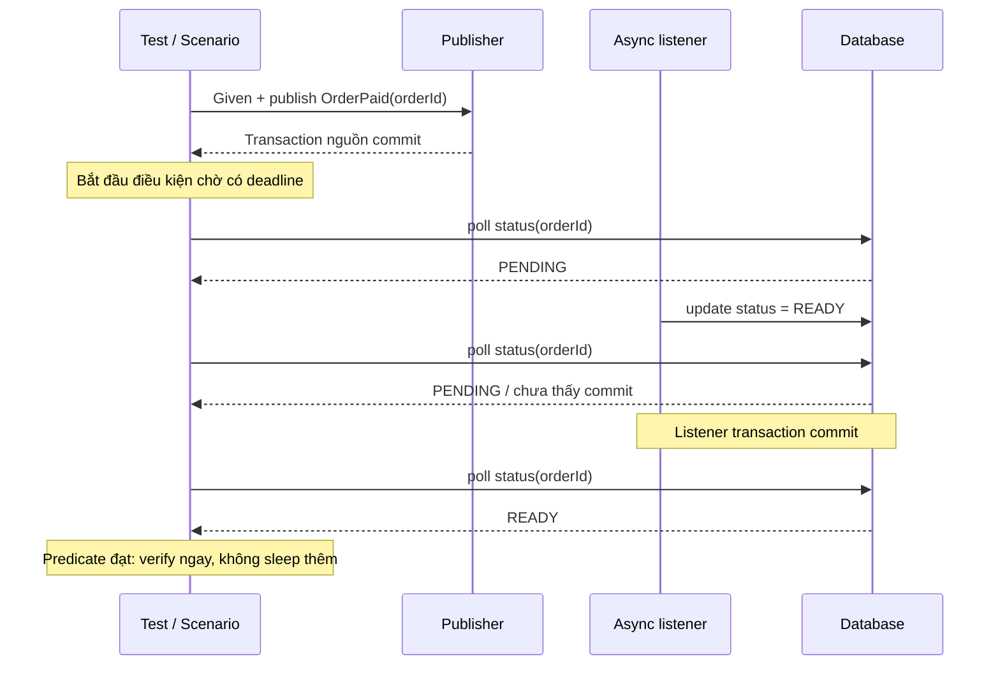

# Thiết kế scenario không phụ thuộc delay tùy ý

## 1. Mục tiêu: chờ điều kiện, không chờ đồng hồ

Trong học phần **SPRING_MODULITH_VERIFICATION_TESTING**, chúng ta dùng `ApplicationModules` và các quy tắc phụ thuộc để kiểm chứng **ranh giới kiến trúc** Spring Modulith; dùng `@ApplicationModuleTest`, `Scenario`, kiểm thử sự kiện, database và tích hợp để bảo vệ **hành vi** trước hồi quy trong CI.

Ở chương **Scenario**, một lỗi rất phổ biến là viết:

```java
publisher.publishEvent(new OrderPaid(orderId));
Thread.sleep(2_000);
assertThat(shipments.findStatus(orderId)).contains("READY");
```

Bài test đang giả định: **“Sau 2 giây, hệ thống hẳn đã xử lý xong.”** Nhưng không có quan hệ nhân quả nào bảo đảm điều đó:

- Nếu handler hoàn tất trong 20 ms, test lãng phí gần 2 giây.
- Nếu CI, DB hoặc executor bận hơn dự tính, 2 giây vẫn có thể **chưa đủ**.
- Nếu listener ném exception, chờ 20 giây cũng không làm dữ liệu chuyển `READY`.
- Nếu `@ApplicationModuleListener` yêu cầu transaction nguồn commit mà test phát event ngoài transaction, listener có thể **không chạy**, bất kể chờ lâu đến đâu.
- Nếu record `PENDING` tồn tại sẵn nhưng test chỉ kiểm tra “có record”, test có thể **pass giả**.

**Nguyên tắc cốt lõi:**

> Chỉ kết thúc việc chờ khi **điều kiện hoàn tất được quan sát**; dùng timeout như **giới hạn trên** để báo lỗi, không dùng thời lượng trôi qua làm bằng chứng nghiệp vụ.

Spring Modulith cung cấp hai con đường chính:

- **Event-based:** `andWaitForEventOfType(...)` chờ Spring application event phù hợp.
- **State-based:** `andWaitForStateChange(...)` kiểm tra lại kết quả của supplier cho đến khi predicate đạt.

Bài này hướng dẫn chọn điều kiện, áp dụng DSL và thiết kế test ổn định trên máy cá nhân lẫn CI — không “vá” bằng delay tùy ý.

## 2. Phân biệt ba khái niệm thời gian

| Khái niệm | Định nghĩa | Ví dụ đúng / sai |
| --- | --- | --- |
| **Delay cố định** | Ngủ một thời lượng rồi mới kiểm tra. | `Thread.sleep(2000)`: *sai* khi chỉ muốn chờ handler hoàn tất. |
| **Polling theo điều kiện** | Đọc lại event/state cho đến khi tiêu chí thành công. | `andWaitForStateChange(() -> repo.find(...), predicate)`. |
| **Deadline/timeout** | Thời gian tối đa được phép chờ kết quả. | `andWaitAtMost(Duration.ofSeconds(5))`. |

Polling và timeout phối hợp với nhau: hệ thống **hoàn tất sớm thì test kết thúc sớm**, chưa hoàn tất thì tiếp tục kiểm tra trong giới hạn. Timeout giúp suite không treo vô hạn; nó **không thay thế** điều kiện thành công.



Điều kiện phải mô tả **thứ có thể quan sát bằng API ổn định**, ví dụ event `ShipmentRequested(orderId)` hoặc database trả status `READY`. Không nên coi “listener đã bắt đầu” là tương đương “nghiệp vụ đã hoàn tất”.

## 3. Given – When – Wait – Then không có sleep

Thiết kế một Scenario gồm bốn câu hỏi:

1. **Given:** dữ liệu cần thiết đã có và đủ điều kiện để module xử lý chưa?
2. **When:** một stimulus cụ thể sẽ kích hoạt nghiệp vụ gì?
3. **Wait:** tín hiệu **nào** chứng minh bước cần kiểm chứng đã hoàn tất?
4. **Then:** payload event hoặc trạng thái cuối có thỏa **quy tắc nghiệp vụ** không?

Ví dụ:

```java
scenario.publish(new OrderPaid(orderId))
        .andWaitForEventOfType(ShipmentRequested.class)
        .matching(event -> event.orderId().equals(orderId))
        .toArriveAndVerify(event ->
                assertThat(event.carrier()).isEqualTo("STANDARD"));
```

Không có `Thread.sleep`. `Scenario` chờ **đúng event và đúng ID**, rồi khẳng định payload.

Với cơ sở dữ liệu:

```java
scenario.publish(new OrderPaid(orderId))
        .andWaitForStateChange(
                () -> shipments.findStatus(orderId),
                status -> status.filter("READY"::equals).isPresent())
        .andVerify(status ->
                assertThat(status).contains("READY"));
```

Ở đây, supplier `shipments.findStatus(orderId)` được gọi lại để quan sát state. Predicate chỉ chấp nhận `Optional.of("READY")`, không chấp nhận `Optional.empty()` hay `Optional.of("PENDING")`.

**Quan trọng:** phải có terminal operation `toArrive...()` hoặc `andVerify(...)` để thực thi và xác minh kịch bản. Việc chỉ khai báo `andWaitForEventOfType(...)` mà bỏ terminal operation chưa hoàn thành bài test.

## 4. Chọn tín hiệu hoàn tất theo hợp đồng

Không phải mọi ứng dụng đều nên chờ cùng một loại tín hiệu:

| Hợp đồng cần chứng minh | Tín hiệu phù hợp | Điều chưa được bảo đảm |
| --- | --- | --- |
| “Module shipping đã công bố yêu cầu tạo vận đơn.” | `ShipmentRequested` đúng `orderId`. | Shipment DB đã commit, broker ngoài đã nhận message. |
| “Shipment ở trạng thái READY và được truy vấn thấy.” | `shipments.findStatus(orderId) == READY`. | Carrier bên ngoài đã tạo mã vận đơn. |
| “Đã thực hiện được yêu cầu qua API service.” | `stimulate(() -> service.action(...))` và chờ event/state đầu ra. | Các bước bên ngoài contract của service. |
| “Đơn bị từ chối và có giải thích.” | `ShipmentRejected` cùng ID, assert `reason`. | Không có event nào đến muộn trong tương lai. |
| “Không được phát `ShipmentRequested` trong cửa sổ chờ.” | `notToArrive()` với cửa sổ hữu hạn, nếu phù hợp. | Sự vắng mặt vĩnh viễn của event. |
| “Broker đã nhận message và consumer xử lý.” | Test tích hợp broker/consumer, nhận ack/effect phù hợp. | Không thể suy ra chỉ từ Spring application event. |

**Không dùng event type đầu vào làm điều kiện hoàn tất của module nhận.** Nếu test tự `publish(new OrderPaid(...))` rồi chờ `OrderPaid.class`, nó có thể pass ngay vì event do test phát, dù listener shipping chưa làm gì. Hãy chờ **event đầu ra có ý nghĩa nghiệp vụ**.

**Không dùng thời điểm ấn định (“sau 500 ms”) làm tín hiệu:** thời gian chạy không phải một giá trị nghiệp vụ. Nếu yêu cầu thật sự là SLA xử lý tối đa 500 ms, hãy đo thời gian bằng phép kiểm hiệu năng chuyên dụng, có môi trường kiểm soát và ngưỡng được định nghĩa, thay vì trộn vào mọi unit/integration test.

## 5. Ví dụ A: chờ event output bất đồng bộ

Giả sử có hai application module: `com.acme.order` phát event khi thanh toán, còn `com.acme.shipping` tiếp nhận rồi phát yêu cầu giao vận.

### 5.1. Event ở API công khai

`com/acme/order/OrderPaid.java`:

```java
package com.acme.order;

import java.util.UUID;

public record OrderPaid(UUID orderId) {}
```

`com/acme/shipping/ShipmentRequested.java`:

```java
package com.acme.shipping;

import java.util.UUID;

public record ShipmentRequested(UUID orderId, String carrier) {}
```

`OrderPaid` ở package gốc của module `order` là một API công khai theo mô hình package mặc định. Nếu đặt event contract vào subpackage, hãy xuất qua named interface phù hợp thay vì cho module nhận import lớp `internal` của module phát.

### 5.2. Listener bất đồng bộ

`com/acme/shipping/ShippingEventHandler.java`:

```java
package com.acme.shipping;

import com.acme.order.OrderPaid;
import org.springframework.context.ApplicationEventPublisher;
import org.springframework.modulith.events.ApplicationModuleListener;
import org.springframework.stereotype.Component;

@Component
class ShippingEventHandler {

    private final ApplicationEventPublisher publisher;

    ShippingEventHandler(ApplicationEventPublisher publisher) {
        this.publisher = publisher;
    }

    @ApplicationModuleListener
    public void on(OrderPaid paid) {
        // Ví dụ event-only: chưa ghi DB hoặc gọi external service.
        publisher.publishEvent(
                new ShipmentRequested(paid.orderId(), "STANDARD"));
    }
}
```

`@ApplicationModuleListener` là listener theo transaction, chạy **sau commit**, **bất đồng bộ** và trong transaction riêng (`REQUIRES_NEW`). Lời gọi `Scenario.publish(...)` tạo transaction thích hợp cho stimulus. Dù handler chạy nhanh, test không được giả định `publisher.publishEvent(...)` đã trả về thì kết quả cuối đã xuất hiện.

### 5.3. Test không có delay cố định

`src/test/java/com/acme/shipping/ShippingEventScenarioTests.java`:

```java
package com.acme.shipping;

import static org.assertj.core.api.Assertions.assertThat;

import java.time.Duration;
import java.util.UUID;

import com.acme.order.OrderPaid;
import org.junit.jupiter.api.Test;
import org.springframework.modulith.test.ApplicationModuleTest;
import org.springframework.modulith.test.Scenario;

@ApplicationModuleTest
class ShippingEventScenarioTests {

    @Test
    void publishesShipmentRequestEventually(Scenario scenario) {
        UUID orderId = UUID.randomUUID();

        scenario.publish(new OrderPaid(orderId))
                .andWaitAtMost(Duration.ofSeconds(5))
                .forEventOfType(ShipmentRequested.class)
                .matchingMappedValue(
                        ShipmentRequested::orderId, orderId)
                .toArriveAndVerify(event -> {
                    assertThat(event.orderId()).isEqualTo(orderId);
                    assertThat(event.carrier()).isEqualTo("STANDARD");
                });
    }
}
```

**Cách đọc test:**

- `@ApplicationModuleTest` khởi động module chứa test, ở đây là `shipping`.
- `Scenario.publish` tạo stimulus `OrderPaid` **một lần**.
- `andWaitAtMost(...)` đặt **deadline**.
- `forEventOfType(...)` chỉ định loại event đầu ra.
- `matchingMappedValue(...)` lọc đúng event của `orderId` hiện tại, tránh nhận nhầm từ test khác.
- `toArriveAndVerify(...)` thực thi chuỗi và khẳng định event payload.

Không có sleep dù listener thực thi trên thread khác. Khi event đến sớm, test có thể hoàn tất sớm. Khi event không đến trước deadline, test fail để ta điều tra lý do.

**Giới hạn:** ví dụ listener chỉ phát Spring event trong context. Bài test này không chứng minh Kafka/RabbitMQ đã nhận message hoặc DB được cập nhật. Nếu handler có side effect bền vững, cần chiến lược cleanup và/hoặc chờ state đã commit như ví dụ B.

## 6. Ví dụ B: chờ trạng thái DB đạt điều kiện cuối

Một ứng dụng thực tế có thể cần kiểm tra:

> Khi `OrderPaid(orderId)` được tiếp nhận, shipment projection chuyển từ `PENDING` sang `READY` và transaction listener đã commit.

Để phân biệt **event được phát** với **DB đã sẵn sàng**, dùng predicate đọc repository.

Đây là **biến thể thay thế** cho listener event-only ở mục 5. Không đăng ký cả hai bean nhận cùng `OrderPaid` trong một demo nếu không có yêu cầu nghiệp vụ phát triển rõ ràng.

### 6.1. Schema minh họa

```sql
CREATE TABLE shipment_projection (
    order_id VARCHAR(36) PRIMARY KEY,
    status   VARCHAR(32) NOT NULL
);
```

Schema được tạo bởi migration/test database. `PENDING` và `READY` là hai trạng thái của ứng dụng minh họa.

### 6.2. Repository JDBC

`com/acme/shipping/ShipmentProjectionRepository.java`:

```java
package com.acme.shipping;

import java.util.List;
import java.util.Optional;
import java.util.UUID;

import org.springframework.jdbc.core.JdbcTemplate;
import org.springframework.stereotype.Repository;

@Repository
class ShipmentProjectionRepository {

    private final JdbcTemplate jdbc;

    ShipmentProjectionRepository(JdbcTemplate jdbc) {
        this.jdbc = jdbc;
    }

    void insertPending(UUID orderId) {
        jdbc.update(
                "INSERT INTO shipment_projection(order_id, status) "
                + "VALUES (?, ?)",
                orderId.toString(), "PENDING");
    }

    void markReady(UUID orderId) {
        int updated = jdbc.update(
                "UPDATE shipment_projection SET status = ? "
                + "WHERE order_id = ?",
                "READY", orderId.toString());

        if (updated != 1) {
            throw new IllegalStateException(
                    "Missing shipment for order " + orderId);
        }
    }

    Optional<String> findStatus(UUID orderId) {
        List<String> rows = jdbc.query(
                "SELECT status FROM shipment_projection "
                + "WHERE order_id = ?",
                (rs, rowNum) -> rs.getString("status"),
                orderId.toString());

        return rows.stream().findFirst();
    }

    void delete(UUID orderId) {
        jdbc.update(
                "DELETE FROM shipment_projection WHERE order_id = ?",
                orderId.toString());
    }
}
```

`findStatus` trả `Optional.empty()` nếu chưa có bản ghi. Trong mỗi lần polling, query đọc trạng thái hiện tại thay vì sử dụng một giá trị đã chụp trước stimulus.

### 6.3. Listener ghi state

`com/acme/shipping/ShippingStateHandler.java`:

```java
package com.acme.shipping;

import com.acme.order.OrderPaid;
import org.springframework.modulith.events.ApplicationModuleListener;
import org.springframework.stereotype.Component;

@Component
class ShippingStateHandler {

    private final ShipmentProjectionRepository projections;

    ShippingStateHandler(ShipmentProjectionRepository projections) {
        this.projections = projections;
    }

    @ApplicationModuleListener
    public void on(OrderPaid paid) {
        projections.markReady(paid.orderId());
    }
}
```

Khi chạy qua `@ApplicationModuleListener`, việc cập nhật nằm trong transaction của listener. **Dấu mốc quan sát mong đợi** không phải “listener đã bắt đầu” mà là query của test có thể đọc `READY` sau commit.

### 6.4. Test Given–When–Wait–Then

`src/test/java/com/acme/shipping/ShippingStateScenarioTests.java`:

```java
package com.acme.shipping;

import static org.assertj.core.api.Assertions.assertThat;

import java.time.Duration;
import java.util.UUID;

import com.acme.order.OrderPaid;
import org.junit.jupiter.api.Test;
import org.springframework.beans.factory.annotation.Autowired;
import org.springframework.modulith.test.ApplicationModuleTest;
import org.springframework.modulith.test.Scenario;
import org.springframework.transaction.support.TransactionTemplate;

@ApplicationModuleTest
class ShippingStateScenarioTests {

    @Autowired ShipmentProjectionRepository projections;
    @Autowired TransactionTemplate transactions;

    @Test
    void waitsForReadyStateInsteadOfSleeping(Scenario scenario) {
        UUID orderId = UUID.randomUUID();

        // GIVEN: fixture đã commit, listener có thể đọc được.
        transactions.executeWithoutResult(tx ->
                projections.insertPending(orderId));

        // WHEN / WAIT / THEN:
        scenario.publish(new OrderPaid(orderId))
                .andCleanup(() ->
                        transactions.executeWithoutResult(tx ->
                                projections.delete(orderId)))
                .andWaitAtMost(Duration.ofSeconds(5))
                .forStateChange(
                        () -> projections.findStatus(orderId),
                        status -> status.filter("READY"::equals)
                                .isPresent())
                .andVerify(status ->
                        assertThat(status).contains("READY"));
    }
}
```

Test này minh họa đầy đủ việc loại bỏ delay:

1. **Given:** tạo `PENDING` trong một transaction được commit trước stimulus.
2. **When:** `Scenario.publish` phát `OrderPaid` trong transaction mới.
3. **Wait:** supplier query DB mỗi lượt; predicate chỉ đạt ở `READY`.
4. **Then:** assert đúng giá trị đã thỏa predicate.
5. **Cleanup:** xóa projection **theo đúng orderId** trong transaction riêng.

**Lưu ý về transaction:** ví dụ giả định test **không có `@Transactional` bao ngoài**. `TransactionTemplate` với propagation mặc định `REQUIRED` sẽ commit khi callback kết thúc trong trường hợp đó. Nếu test có transaction bao ngoài, cần tổ chức Given theo transaction đã commit thực sự (hoặc dùng `REQUIRES_NEW` có chủ đích) để listener chạy ở transaction khác nhìn thấy dữ liệu.

Bài test cần `JdbcTemplate`, datasource và transaction manager của ứng dụng; migration phải có trong test environment. Nó không tự chạy nếu chỉ copy lớp Java mà thiếu cấu hình Spring Boot.

## 7. Vì sao chỉ “chờ record tồn tại” chưa đủ?

Giả sử database đã có:

```text
order_id = A, status = PENDING
```

Nếu viết:

```java
scenario.publish(new OrderPaid(orderId))
        .andWaitForStateChange(
                () -> projections.findStatus(orderId))
        .andVerify(status ->
                assertThat(status).isPresent());
```

thì `Optional.of("PENDING")` được xem là một thay đổi trạng thái **đủ kết luận theo tiêu chí mặc định**, dù listener chưa cập nhật thành `READY`.

Do đó, **chọn predicate dựa trên hợp đồng nghiệp vụ**:

```java
scenario.publish(new OrderPaid(orderId))
        .andWaitForStateChange(
                () -> projections.findStatus(orderId),
                value -> value.filter("READY"::equals).isPresent())
        .andVerify(value -> assertThat(value).contains("READY"));
```

### Những kiểu dữ liệu dễ gây pass giả

| Supplier trả về | Tiêu chí chờ mặc định | Tiêu chí có thể cần cho nghiệp vụ |
| --- | --- | --- |
| `Optional<String>` | Optional có giá trị | Có giá trị **và** bằng `READY`. |
| `String` / enum | Khác `null` | Chính xác `READY` hoặc `COMPLETED`. |
| `Integer` | Khác `null`, kể cả `0` | `count >= expected`. |
| `List<Shipment>` | Khác `null`, kể cả empty list | Chứa đúng shipment hoặc đủ số lượng. |
| `Boolean` / `boolean` | `true` | Thường phù hợp nếu ý nghĩa boolean rõ ràng. |
| DTO / record | Khác `null` | Có đúng aggregate ID và trạng thái cuối. |

Với record:

```java
record ShipmentSnapshot(UUID orderId, String status) {}

scenario.publish(new OrderPaid(orderId))
        .andWaitForStateChange(
                () -> projectionQuery.snapshot(orderId),
                value -> value != null
                        && value.orderId().equals(orderId)
                        && "READY".equals(value.status()))
        .andVerify(value ->
                assertThat(value.status()).isEqualTo("READY"));
```

`projectionQuery.snapshot(...)` là bean/query do ứng dụng cung cấp, không phải API dựng sẵn của Spring Modulith. Supplier phải **đọc mới** mỗi lượt và nên tránh side effect.

## 8. Hai anti-pattern khác: snapshot cũ và polling gây side effect

### 8.1. Snapshot chỉ đọc một lần

Sai:

```java
Optional<String> captured = projections.findStatus(orderId);

scenario.publish(new OrderPaid(orderId))
        .andWaitForStateChange(
                () -> captured,
                status -> status.filter("READY"::equals).isPresent())
        .andVerify(status ->
                assertThat(status).contains("READY"));
```

Dù DB được cập nhật, supplier luôn trả **cùng biến captured**. Polling không thể nhìn thấy trạng thái mới, cuối cùng timeout.

Đúng:

```java
scenario.publish(new OrderPaid(orderId))
        .andWaitForStateChange(
                () -> projections.findStatus(orderId),
                status -> status.filter("READY"::equals).isPresent())
        .andVerify(status ->
                assertThat(status).contains("READY"));
```

### 8.2. Mỗi lần poll lại kích hoạt nghiệp vụ

Sai:

```java
scenario.publish(new OrderPaid(orderId))
        .andWaitForStateChange(() -> {
            shippingService.requestShipment(orderId); // Lặp nhiều lần!
            return projections.findStatus(orderId);
        })
        .andVerify(status -> assertThat(status).isPresent());
```

`shippingService` là cổng giả định của ứng dụng. Code này có thể tạo nhiều shipment, gửi nhiều event và gây lỗi unique constraint vì supplier được thực thi **nhiều lần**.

**Supplier nên là phép quan sát**: query nhanh, ít tốn tài nguyên và không tạo side effect nghiệp vụ. Stimulus được kích hoạt **một lần** bằng `publish(...)` hoặc `stimulate(...)`; không giấu kích hoạt đó trong điều kiện chờ.

### 8.3. Busy loop thay cho sleep cũng không tốt

```java
// Không nên: vòng lặp chủ động, không deadline, tiêu hao CPU.
while (!"READY".equals(projections.findStatus(orderId)
        .orElse(null))) {
    // spin
}
```

Dù không dùng `Thread.sleep`, vòng lặp này vẫn sai: không có deadline, có thể chiếm CPU, làm quá tải DB và không cho tín hiệu lỗi hữu ích.

**`Scenario` đã cung cấp polling theo điều kiện và timeout**, không cần tự viết vòng lặp chờ thủ công.

## 9. Tùy chỉnh timeout và polling interval có mục đích

### 9.1. `andWaitAtMost(...)`

```java
scenario.publish(new OrderPaid(orderId))
        .andWaitAtMost(Duration.ofSeconds(5))
        .forStateChange(
                () -> projections.findStatus(orderId),
                value -> value.filter("READY"::equals).isPresent())
        .andVerify(value -> assertThat(value).contains("READY"));
```

`andWaitAtMost` đặt giới hạn, không ép test ngủ trọn 5 giây. Nếu trạng thái đến nhanh hơn, phép chờ hoàn thành sớm.

### 9.2. `customize(...)` với Awaitility

```java
scenario.publish(new OrderPaid(orderId))
        .customize(wait -> wait
                .atMost(Duration.ofSeconds(6))
                .pollInterval(Duration.ofMillis(150)))
        .andWaitForStateChange(
                () -> projections.findStatus(orderId),
                value -> value.filter("READY"::equals).isPresent())
        .andVerify(value -> assertThat(value).contains("READY"));
```

`customize(Function<ConditionFactory, ConditionFactory>)` cho phép cấu hình Awaitility `ConditionFactory` của một Scenario cụ thể.

**Lưu ý:**

- `pollInterval` quy định **khoảng cách giữa các lần kiểm tra**, không phải khoảng chờ cố định **trước khi test assert**.
- Poll quá dày với query SQL nặng làm tăng tải DB và tạo test khó dự đoán.
- Poll quá thưa làm tăng độ trễ phát hiện trạng thái đã sẵn sàng.
- Nếu không có lý do rõ, ưu tiên cấu hình mặc định của framework và chỉ chỉnh deadline.
- Timeout/bước poll không sửa được matcher sai, listener không được đăng ký hoặc thiếu commit.

### 9.3. Dùng `ScenarioCustomizer` cho suite khi cần thống nhất

Nếu hàng loạt test có cùng đặc tính môi trường, Spring Modulith hỗ trợ `ScenarioCustomizer` (JUnit extension) để đặt chính sách chờ theo test class hoặc method. Điều này hữu ích hơn việc copy cùng một duration khắp suite.

Tuy nhiên, **chính sách chung không nên làm mờ sự khác biệt của hợp đồng**. Ví dụ test DB trong môi trường container có thể cần deadline dài hơn event-only test; một cấu hình chung quá rộng sẽ khiến regression được phát hiện muộn.

## 10. Deadline là budget, không phải bảo đảm tốc độ

Khi quyết định `Duration.ofSeconds(5)` hay `Duration.ofSeconds(10)`, nên trả lời:

1. **Điều kiện hoàn tất cần bao gồm những bước nào?** Commit của transaction nguồn, hàng đợi executor, listener, transaction DB, query snapshot...
2. **Hệ thống xử lý thông thường mất bao lâu trên CI?** Có số đo latency hoặc log thời điểm thực tế không?
3. **Sự chậm trễ này là hợp lệ hay báo hiệu lỗi?** Một external API chậm không phải lúc nào cũng phù hợp với test của riêng application module.
4. **Nếu hết hạn, bài test cung cấp đủ thông tin chẩn đoán chưa?** Correlation ID, root cause của handler, status DB và lỗi transaction.
5. **Suite có bị nhân số lần chờ không?** Nhiều test chờ đủ 10 giây khi lỗi xảy ra khiến pipeline chậm; lựa chọn tín hiệu mạnh và deadline hợp lý sẽ giảm thời gian debug.

Một rule of thumb thực tế (không phải chuẩn Spring Modulith) là: dùng deadline được suy ra từ **độ trễ quan sát được và độ biến thiên CI**, có khoảng đệm hợp lý và được xem xét khi môi trường thay đổi. **Không có giá trị 1 s, 5 s hay 30 s đúng cho mọi dự án.**

Phân biệt **test correctness** với **performance test**:

- Scenario có timeout kiểm tra “event/state có đạt hợp đồng trong một khoảng hữu hạn không?”.
- Benchmark có môi trường kiểm soát đo latency/SLA riêng. Không nên đánh giá performance tuyệt đối chỉ từ một máy CI chia sẻ tài nguyên.

## 11. Trạng thái DB, transaction và “đã thấy event” không đồng nghĩa nhau

Trên Spring Modulith:

- `Scenario.publish(...)` và `stimulate(...)` chạy stimulus trong transaction mới để hỗ trợ transactional event listener.
- `@ApplicationModuleListener` thực hiện sau commit và bất đồng bộ trong transaction riêng.
- Listener có thể **phát event đầu ra trước khi transaction cập nhật DB của nó commit**.

Vì vậy:

```java
// Listener đang ở trong transaction riêng:
projectionRepository.markReady(orderId);
publisher.publishEvent(new ShipmentRequested(orderId, "STANDARD"));
// Transaction listener có thể chưa commit tại thời điểm publish.
```

Nếu test chờ `ShipmentRequested` rồi **ngay lập tức** query DB trong `toArriveAndVerify(...)`, có thể thấy event nhưng DB vẫn `PENDING` do transaction B chưa commit. Đó không phải bằng chứng polling bị lỗi; **tín hiệu kiểm thử chưa đại diện cho state mong muốn**.

Để test:

- **Event contract:** `andWaitForEventOfType(ShipmentRequested.class)`.
- **Database readiness:** `andWaitForStateChange(() -> findStatus(...), predicate READY)`.
- **Broker integration:** kiểm tra broker/consumer qua hạ tầng test riêng nếu cần.

### Given phải commit trước khi listener đọc

Không dựng fixture trong test `@Transactional` rồi giả định listener async ở transaction khác thấy dữ liệu chưa commit.

```java
// GIVEN trong transaction đã hoàn tất trước stimulus:
transactions.executeWithoutResult(tx ->
        projections.insertPending(orderId));

// WHEN / WAIT do Scenario quản lý:
scenario.publish(new OrderPaid(orderId))
        .andWaitForStateChange(
                () -> projections.findStatus(orderId),
                status -> status.filter("READY"::equals).isPresent())
        .andVerify(status -> assertThat(status).contains("READY"));
```

`TransactionTemplate` trong ví dụ cần chạy ngoài một transaction bao ngoài, như ở mục 6. Khi test có transaction đang mở, propagation `REQUIRED` có thể tham gia transaction đó thay vì commit ngay. Nếu cần tách biệt, cấu hình transaction riêng phù hợp.

**Cleanup là bắt buộc khi đã commit fixture và side effect.** Test method `@Transactional` thường rollback transaction do test framework quản lý, nhưng không tự rollback transaction mới của `Scenario` hoặc listener.

## 12. Cleanup đúng thời điểm, không tạo race condition khác

Một test chờ event có thể kết thúc trước khi listener commit DB. Nếu đăng ký cleanup ngay sau khi event đến, việc xóa bản ghi có thể cạnh tranh với transaction listener.

Bảng quyết định:

| Tình huống | Dấu mốc phù hợp để bắt đầu cleanup |
| --- | --- |
| Handler chỉ phát Spring event, không lưu DB | Sau khi event phù hợp được assert. |
| Handler lưu DB rồi phát event trong transaction chưa commit | Sau khi **trạng thái DB đã được quan sát** hoặc có tín hiệu hoàn tất sau commit đáng tin. |
| Handler còn task async thứ cấp | Sau khi đủ các bước cần dọn hoặc dùng test DB/resource cô lập. |
| Handler ghi nhiều bảng phụ thuộc khóa ngoại | Sau khi toàn bộ transaction liên quan commit và xóa theo thứ tự FK. |
| Hệ thống có retry/event registry | Xem xét idempotency, khả năng xử lý lại và cơ chế làm sạch đúng phạm vi. |

Ví dụ:

```java
scenario.publish(new OrderPaid(orderId))
        .andCleanup(() -> transactions.executeWithoutResult(tx ->
                projections.delete(orderId)))
        .andWaitForStateChange(
                () -> projections.findStatus(orderId),
                status -> status.filter("READY"::equals).isPresent())
        .andVerify(status ->
                assertThat(status).contains("READY"));
```

`andCleanup(...)` đăng ký callback chạy khi Scenario kết thúc (kể cả thất bại). Nó **không bảo đảm** tự xóa hết dữ liệu tạo bên ngoài Scenario. Nếu Given được tạo trước nhưng setup ném exception trước khi đăng ký cleanup, cần cơ chế bổ sung như `@AfterEach`/test database reset.

Không dùng `deleteAll()` trên database dùng chung khi các test chạy song song. Xóa theo đúng `orderId` hoặc cấp database/schema riêng cho từng test suite.

## 13. Không phụ thuộc thứ tự chạy hay test khác

Một Scenario không dùng sleep vẫn có thể flaky nếu điều kiện quan sát không được cô lập.

Ví dụ test A và B đều phát `ShipmentRequested`, nhưng B chỉ chờ type:

```java
scenario.publish(new OrderPaid(orderIdB))
        .andWaitForEventOfType(ShipmentRequested.class)
        .toArrive();
```

Nếu event của A đến muộn, B có thể pass mà B chưa xử lý xong.

Sửa:

```java
scenario.publish(new OrderPaid(orderIdB))
        .andWaitForEventOfType(ShipmentRequested.class)
        .matchingMappedValue(ShipmentRequested::orderId, orderIdB)
        .toArrive();
```

**Đầu vào phải độc lập** (`UUID.randomUUID()`, fixture theo business key riêng), **điều kiện chờ phải lọc đúng instance** và **cleanup không làm ảnh hưởng dữ liệu test khác**.

`@ApplicationModuleTest` sử dụng Spring TestContext nên context có thể được cache. Singleton bean/cache, DB và executor không nhất thiết được tạo lại cho mỗi method. Không cất mutable test state vào `static` field hoặc một singleton không có chiến lược reset.

Nếu ứng dụng dùng `spring.modulith.test.thread-bound-published-events` để giới hạn phạm vi bắt event theo thread, cần cân nhắc executor có thể tái sử dụng thread pool; cấu hình đó **không thay thế** correlation ID và tính độc lập của fixture.

## 14. Các biểu hiện flaky và nguyên nhân gốc

| Biểu hiện | Delay gây hiểu nhầm thế nào? | Cách xử lý theo điều kiện |
| --- | --- | --- |
| Test pass local, fail CI khi DB chậm | `sleep(500)` quá ngắn ở CI. | Chờ query trả trạng thái cuối, đặt timeout phù hợp. |
| Mọi test đều chậm dù handler nhanh | `sleep(3000)` luôn tiêu tốn 3 giây. | Chờ event/state; kết thúc ngay khi điều kiện đạt. |
| Listener không chạy do thiếu transaction | Tăng sleep vô ích. | Dùng `Scenario.publish`/`stimulate` và transaction hợp lệ. |
| Event type đúng nhưng ID sai | Sleep dài vẫn đợi một kết quả không khớp. | Lọc correlation ID và kiểm tra payload. |
| Test chờ record tồn tại, pass khi `PENDING` | Sleep có thể che khoảng chuyển trạng thái. | Predicate đợi `READY`. |
| DB đã commit nhưng test timeout | Supplier giữ snapshot cũ hoặc transaction đọc không thấy commit mới. | Query mới mỗi lượt, kiểm tra transaction/isolation. |
| Chờ event pass nhưng DB assertion fail | Event đã đến trước commit. | Chờ state DB làm tiêu chí hoàn tất. |
| Chạy song song bị pass nhầm | Event từ test khác đến trong cửa sổ sleep. | Match theo ID riêng, cleanup an toàn. |
| Listener bị exception trên thread async | Sleep chỉ che root cause và kéo dài timeout. | Xem log/executor/registry và sửa handler. |
| Một test không trả về | Busy loop không có timeout. | Scenario polling với deadline hữu hạn. |
| External API được mock nhưng chậm ngẫu nhiên | Timing phụ thuộc hệ thống ngoài. | Mock biên có kiểm soát, test tích hợp riêng. |
| Cleanup tạo lỗi khóa ngoại/race | Chờ một delay không xác định commit. | Chờ tín hiệu hoàn tất đúng, cleanup trong transaction. |

### Quy trình điều tra khi timeout

1. **Có stimulus thực sự không?** `publish` hay `stimulate` đã được thực thi bởi terminal operation?
2. **Listener có trong Spring context không?** `@ApplicationModuleTest` mặc định khởi động module chứa test.
3. **Transaction nguồn commit chưa?** `@TransactionalEventListener` mặc định chỉ chạy sau commit khi có transaction.
4. **Listener có exception không?** Kiểm tra log thread async, DB error và event registry nếu bật.
5. **Tín hiệu đang chờ có đúng không?** Event output type, `orderId`, predicate status.
6. **Supplier đọc lại trạng thái chưa?** Không capture snapshot, không cache stale.
7. **Deadline có hợp lý không?** Dựa trên đo latency, không tăng trước khi sửa các lỗi trên.
8. **Cleanup đã bao phủ side effect chưa?** Đừng để task đến muộn làm bẩn test tiếp theo.

## 15. Test phủ định: ngoại lệ cần một cửa sổ chờ hữu hạn

Không phải yêu cầu nào cũng có event/state dương tính. Ví dụ:

> Khi đơn bị từ chối, **không được phát `ShipmentRequested`** trong cửa sổ xử lý đã quy định.

Spring Modulith có `EventResult.notToArrive()` để kiểm tra **sự vắng mặt của event phù hợp trong một khoảng thời gian hữu hạn**:

```java
scenario.publish(new OrderRejected(orderId))
        .andWaitAtMost(Duration.ofSeconds(1))
        .forEventOfType(ShipmentRequested.class)
        .matchingMappedValue(ShipmentRequested::orderId, orderId)
        .notToArrive();
```

`OrderRejected` là event giả định khác do ứng dụng định nghĩa; test chỉ có nghĩa khi đó là stimulus thật của contract.

Với bài test phủ định, **việc chờ hết cửa sổ là có chủ đích**: không thể khẳng định “không xuất hiện trong 1 giây” trước khi 1 giây kết thúc. Nhưng đây **không phải** `Thread.sleep(1000)` để hy vọng nghiệp vụ chạy xong — nó là một điều kiện phủ định được framework quan sát trong khoảng thời gian đã xác định.

Giới hạn của test phủ định:

- Pass nghĩa là **không thấy event phù hợp trong cửa sổ**, không chứng minh event sẽ không đến ở mọi thời điểm sau này.
- Nếu business contract có event từ chối `ShipmentRejected` hoặc một state `REJECTED`, kiểm chứng dương tính đó thường cung cấp bằng chứng rõ hơn.
- Khi có retry/asynchronous backlog, cần quyết định cửa sổ phủ định dựa trên contract và thiết kế xử lý, không tùy tiện chọn một giây.

## 16. Kiểm chứng cả event lẫn DB state mà không cố định thứ tự

Giả sử handler tạo record rồi phát `ShipmentRequested`. Nếu hợp đồng yêu cầu **trạng thái đã commit và event đã công bố**, có thể:

1. **Chờ state DB `READY`** để xác nhận dữ liệu bền vững;
2. **Sau đó xác minh event đã được ghi nhận** bằng `StateChangeResult.andVerifyEvents(...)`, khi thứ tự nghiệp vụ bảo đảm event đã phát trước/sát mốc hoàn tất.

```java
scenario.publish(new OrderPaid(orderId))
        .andWaitForStateChange(
                () -> projections.findStatus(orderId),
                status -> status.filter("READY"::equals).isPresent())
        .andVerifyEvents(events -> {
            assertThat(events.ofType(ShipmentRequested.class)
                    .matching(ShipmentRequested::orderId, orderId))
                    .hasSize(1);
        });
```

Đoạn này yêu cầu **biến thể listener thực sự phát `ShipmentRequested` và cập nhật DB**. Listener state-only ở mục 6 chỉ cập nhật DB, **không** phát event, nên không thể dùng nguyên đoạn trên với implementation đó nếu chưa bổ sung contract.

Cần hiểu hạn chế: nếu event được công bố bởi **một nhánh async độc lập sau khi state đạt**, `andVerifyEvents` có thể chạy quá sớm. Hãy thiết kế event hoàn tất hoặc một predicate tổng hợp có thể quan sát cả state và các event, hoặc tách thành test tích hợp phù hợp. Không dùng `sleep` để thay cho việc thiết kế ranh giới hoàn tất.

Đối với event registry có retry, assertion `hasSize(1)` phản ánh số event quan sát **tại thời điểm assert**, không chứng minh không có retry sau đó. Hợp đồng exactly-once *effect* cần ràng buộc idempotency và kiểm thử bền vững riêng.

## 17. Công thức refactor một test có `Thread.sleep`

Giả sử code cũ:

```java
@Test
void shipmentTest() throws Exception {
    UUID orderId = UUID.randomUUID();

    publisher.publishEvent(new OrderPaid(orderId));
    Thread.sleep(2_000);
    assertThat(projections.findStatus(orderId))
            .contains("READY");
}
```

Hãy refactor theo sáu bước:

**Bước 1 — Ghi rõ hợp đồng:** “`OrderPaid(id)` dẫn tới projection `READY` sau commit”, chứ không phải “handler cần 2 giây”.

**Bước 2 — Xác định setup:** nếu handler cần record `PENDING`, tạo fixture và commit trước stimulus.

**Bước 3 — Chuyển stimulus sang `Scenario`:** `scenario.publish(new OrderPaid(id))` thay cho việc tự phát event ngoài transaction.

**Bước 4 — Chuyển assertion thời điểm thành predicate:** query `findStatus(id)` mỗi lượt, kiểm tra đúng `READY`.

**Bước 5 — Đặt deadline và cleanup:** chỉ dọn record của ID test, không dựa vào rollback bao ngoài.

**Bước 6 — Thử các ca khó:** listener chậm, phát event khác ID, state kẹt ở `PENDING`, handler ném exception. Test phải fail **đúng lý do**, không pass giả.

Phiên bản refactor:

```java
@Test
void shipmentReachesReadyState(Scenario scenario) {
    UUID orderId = UUID.randomUUID();

    transactions.executeWithoutResult(tx ->
            projections.insertPending(orderId));

    scenario.publish(new OrderPaid(orderId))
            .andCleanup(() -> transactions.executeWithoutResult(tx ->
                    projections.delete(orderId)))
            .andWaitAtMost(Duration.ofSeconds(5))
            .forStateChange(
                    () -> projections.findStatus(orderId),
                    s -> s.filter("READY"::equals).isPresent())
            .andVerify(s -> assertThat(s).contains("READY"));
}
```

Test mới vẫn có **thời gian tối đa**, nhưng nó không phụ thuộc một khoảng ngủ tùy ý. Khi handler chạy nhanh, test nhanh. Khi handler không thể hoàn thành, timeout chỉ ra điều kiện nghiệp vụ chưa đạt và cho phép điều tra.

## 18. Quality gate CI: đo độ ổn định bằng kết quả có nghĩa

Trong Spring Modulith, test hành vi cần đi cùng test **ranh giới kiến trúc**:

```java
import org.junit.jupiter.api.Test;
import org.springframework.modulith.core.ApplicationModules;

class ModuleArchitectureTests {

    @Test
    void verifiesModuleBoundaries() {
        ApplicationModules.of(Application.class).verify();
    }
}
```

`Application.class` là lớp ứng dụng Spring Boot thực tế, cần thay bằng class của dự án. `ApplicationModules.verify()` kiểm tra phụ thuộc module, package công khai/nội bộ và luật kiến trúc; nó không biết một `ShipmentRequested` có xuất hiện đúng deadline hay không.

Ngược lại, `Scenario` kiểm tra hành vi nhưng không tự phát hiện việc module shipping import `com.acme.order.internal.*` sai ranh giới.

### Checklist áp dụng trong CI

- [ ] Không dùng `Thread.sleep`/`TimeUnit.sleep` như điều kiện “chờ nghiệp vụ xong”.
- [ ] Có một tín hiệu cuối phù hợp: **event cụ thể** hoặc **state predicate**.
- [ ] Không chờ event input do chính test phát rồi kết luận module nhận đã xử lý.
- [ ] Matcher lọc đúng correlation ID (orderId/requestId).
- [ ] State supplier đọc trạng thái mới, không gọi lại nghiệp vụ trong mỗi lần poll.
- [ ] Predicate phản ánh **đúng giá trị đích**, không chỉ “record tồn tại”.
- [ ] Timeout hữu hạn, có căn cứ từ độ trễ hệ thống thử nghiệm.
- [ ] Polling không gây tải quá mức trên database hoặc external resource.
- [ ] Given cần cho listener async đã commit trước khi listener đọc.
- [ ] Cleanup bao phủ dữ liệu đã commit, không ảnh hưởng test song song.
- [ ] Có log và lỗi gốc của listener để phân biệt timeout với exception.
- [ ] Đã kiểm chứng cả ca event đến sớm và event/state không bao giờ hoàn tất.
- [ ] Test `ApplicationModules.verify()` chạy trong quality gate cùng test `@ApplicationModuleTest`.

Có thể chạy test bằng `./mvnw test` hoặc `./gradlew test` tùy build tool. Nếu behavior phụ thuộc DB thật, migration/test database nên nhất quán; Testcontainers là lựa chọn thích hợp để gần engine production khi cần kiểm thử transaction, isolation hoặc SQL dialect.

**Không che flaky test bằng retry build vô hạn.** Test chạy lặp lại có thể được dùng để **chẩn đoán**, nhưng mục tiêu cuối là loại bỏ shared state, matcher sai, tín hiệu hoàn tất thiếu và dependency không kiểm soát.

## 19. Bài tập thực hành

Dựa trên `OrderPaid` → `ShipmentRequested` và projection `PENDING → READY` ở bài:

1. **Phát hiện anti-pattern:** Test gọi `Thread.sleep(3000)` sau khi phát `OrderPaid`. Nêu ba lý do vì sao nó vừa chậm vừa flaky và cách thay.
2. **Event-based:** Viết `Scenario.publish` chờ `ShipmentRequested` đúng `orderId`, assert `carrier = STANDARD`, không dùng sleep.
3. **State-based:** Viết `andWaitForStateChange(...)` với supplier query DB và predicate `status = READY`. Giải thích vì sao test kết thúc sớm khi DB đã đạt state.
4. **Given commit:** Test có `@Transactional` tạo record `PENDING` nhưng listener async không nhìn thấy. Đề xuất cách setup fixture đã commit.
5. **Sai predicate:** Repository trả `Optional.of("PENDING")`. Vì sao overload không có predicate có thể kết thúc sớm? Hãy sửa.
6. **Captured snapshot:** Supplier trả biến `captured` đọc trước stimulus. Vì sao có thể timeout mãi dù DB chuyển READY?
7. **Supplier side effect:** Một test gọi `shippingService.requestShipment(id)` trong supplier polling. Có thể gây vấn đề gì khi handler chậm?
8. **Khác biệt event và DB commit:** Listener insert/update DB rồi phát `ShipmentRequested` trước khi transaction commit. Test cần chọn tín hiệu nào nếu hợp đồng là “DB đã sẵn sàng”?
9. **Poll interval:** Với query SQL đắt, việc đặt `pollInterval(Duration.ofMillis(1))` có rủi ro gì? Khi nào nên dùng mặc định?
10. **Flaky CI:** Local hoàn thành 50 ms, CI đôi khi 2 s. Trình bày cách đo/phân tích trước khi đổi timeout.
11. **Phủ định:** Nếu nghiệp vụ yêu cầu không phát `ShipmentRequested` khi `OrderRejected` xảy ra, `notToArrive()` chứng minh điều gì và không chứng minh điều gì?
12. **Isolation:** Hai test phát cùng event type, test A hoàn tất muộn. Làm sao đảm bảo B không nhận nhầm event của A?
13. **Cleanup:** Test chờ event trước commit rồi xóa record, gây race. Làm sao thay đổi dấu mốc và cleanup để an toàn?
14. **Kiến trúc:** Module shipping import một class `internal` của order, nhưng các Scenario vẫn pass. Phép kiểm nào phải thêm vào CI?

**Gợi ý:** (1) lãng phí/không đủ/che lỗi; (2) `andWaitForEventOfType` hoặc `forEventOfType` + matcher; (3) predicate chờ READY; (4) `TransactionTemplate` hoặc transaction setup đã commit; (5) Optional có giá trị không đồng nghĩa READY; (6) không query lại; (7) gửi nhiều event/tạo trùng DB; (8) state query sau commit; (9) tăng tải DB; (10) log latency, executor, DB, transaction, matcher; (11) chỉ trong cửa sổ hữu hạn; (12) correlation ID; (13) chờ state bền vững; (14) `ApplicationModules.verify()`.

## Tài liệu tham khảo

- [Spring Modulith — Integration Testing Application Modules](https://docs.spring.io/spring-modulith/reference/testing.html): `Scenario`, event/state wait, transaction, timeout và customize.
- [Spring Modulith — Scenario Javadoc](https://docs.spring.io/spring-modulith/docs/current/api/org/springframework/modulith/test/Scenario.html): stimulus `publish`/`stimulate`.
- [Spring Modulith — Scenario.When Javadoc](https://docs.spring.io/spring-modulith/docs/current/api/org/springframework/modulith/test/Scenario.When.html): `andWaitForEventOfType`, `andWaitForStateChange`, `andWaitAtMost`, `customize` và `andCleanup`.
- [Spring Modulith — Scenario.When.EventResult Javadoc](https://docs.spring.io/spring-modulith/docs/current/api/org/springframework/modulith/test/Scenario.When.EventResult.html): matcher, `toArrive`, `toArriveAndVerify` và `notToArrive`.
- [Spring Modulith — Scenario.When.StateChangeResult Javadoc](https://docs.spring.io/spring-modulith/docs/current/api/org/springframework/modulith/test/Scenario.When.StateChangeResult.html): `andVerify` và `andVerifyEvents`.
- [Spring Modulith — ApplicationModuleListener Javadoc](https://docs.spring.io/spring-modulith/docs/current/api/org/springframework/modulith/events/ApplicationModuleListener.html): `@Async`, transactional listener và `REQUIRES_NEW`.
- [Spring Modulith — Working with Application Events](https://docs.spring.io/spring-modulith/reference/events.html): event handling, commit, publication registry và retry.
- [Spring Modulith — Verifying Application Module Structure](https://docs.spring.io/spring-modulith/reference/verification.html): bảo vệ ranh giới module bằng `ApplicationModules.verify()`.
