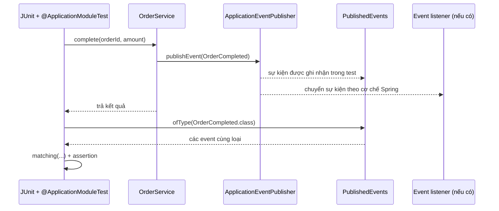

# PublishedEvents ghi nhận event đã phát như thế nào?

## Mục tiêu học tập

Sau bài này, bạn có thể:

- Giải thích vì sao việc kiểm tra **event đã được phát** là một phần quan trọng của kiểm thử ranh giới module trong Spring Modulith.
- Mô tả phạm vi quan sát và cơ chế ghi nhận sự kiện của `PublishedEvents` trong một bài `@ApplicationModuleTest`.
- Viết assertion kiểm tra loại sự kiện, dữ liệu của sự kiện, số lần xuất hiện và trường hợp không được phát sự kiện.
- Phân biệt việc **publish event** với việc listener đã xử lý thành công, và lựa chọn `Scenario` khi cần đợi kết quả bất đồng bộ hoặc sau commit.

## 1. Bối cảnh: Vì sao cần kiểm chứng sự kiện?

Trong một ứng dụng Spring Modulith, mỗi application module có trách nhiệm nghiệp vụ và giao diện công khai riêng. Ví dụ, module `orders` xử lý đơn hàng, còn `billing` xử lý thanh toán. Thay vì `orders` gọi trực tiếp các bean nội bộ của `billing`, nó có thể công bố sự kiện `OrderCompleted` để module khác tự phản ứng.

Một bài kiểm thử chỉ xác nhận trạng thái đơn hàng đã thay đổi vẫn có thể bỏ sót lỗi: đơn hàng được hoàn tất nhưng `OrderCompleted` không hề được phát, hoặc được phát với sai `orderId`. Lỗi này ảnh hưởng hợp đồng giao tiếp giữa các module dù logic bên trong `orders` vẫn chạy.

`PublishedEvents` thuộc gói `org.springframework.modulith.test` giúp kiểm tra **các Spring application event đã phát trong lúc chạy test**. Nhờ đó, bài kiểm thử có thể khẳng định hành vi công bố event ở ranh giới module mà không phụ thuộc vào việc mock hoặc gọi trực tiếp bean của module nhận.

> Phạm vi của `PublishedEvents` là quan sát sự kiện trong test. Nó không phải message broker, không phải bảng lưu lịch sử event và không chứng minh listener của module khác đã xử lý event thành công.

## 2. PublishedEvents ghi nhận event như thế nào?

Với bài kiểm thử tích hợp có `@ApplicationModuleTest`, Spring Modulith cung cấp khả năng ghi nhận các Spring application event được phát trong quá trình thực thi bài test. Tham số phương thức kiểu `PublishedEvents` được framework cung cấp qua cơ chế hỗ trợ JUnit. Khi mã nghiệp vụ gọi `ApplicationEventPublisher.publishEvent(…)`, sự kiện đi qua cơ chế application event của Spring và trở thành đối tượng mà bộ ghi nhận trong test có thể quan sát.

`PublishedEvents` cho phép truy vấn danh sách sự kiện đã quan sát, chủ yếu qua `ofType(Class<T>)`. Kết quả là một `PublishedEvents.TypedPublishedEvents<T>` có thể duyệt như `Iterable<T>` và tiếp tục lọc bằng các phương thức `matching(…)`.



Điểm quan trọng trong trình tự này:

1. **Test kích hoạt nghiệp vụ thật** trong application context của module, chẳng hạn gọi `OrderService.complete(…)`.
2. **Nghiệp vụ phát event** bằng cơ chế của Spring. Dữ liệu event thường mang định danh và thông tin cần thiết cho module nhận.
3. **Bộ ghi nhận lưu lại các event quan sát được trong phạm vi thực thi test**. Assertion đọc tập sự kiện này sau khi hành động đã xảy ra.
4. **Test chọn và kiểm tra event** theo loại, thuộc tính và số lượng. Việc một listener xử lý xong không phải điều kiện để event xuất hiện trong `PublishedEvents`.

Không nên hiểu `PublishedEvents` là “bộ đếm toàn cục” dùng chung giữa mọi test. Khi dùng qua tham số test do framework cung cấp, nó phục vụ việc kiểm tra sự kiện của quá trình chạy test hiện tại. Hãy giữ hành động cần kiểm thử và assertion trong cùng một phương thức test, tránh phụ thuộc vào thứ tự thực thi giữa các bài test.

## 3. Chuẩn bị môi trường kiểm thử

Cần có Spring Modulith test starter trong phạm vi test. Ví dụ với Maven (phiên bản artifact nên được quản lý nhất quán với Spring Modulith BOM của dự án):

```xml
<dependency>
    <groupId>org.springframework.modulith</groupId>
    <artifactId>spring-modulith-starter-test</artifactId>
    <scope>test</scope>
</dependency>
```

Với Gradle:

```groovy
dependencies {
    testImplementation 'org.springframework.modulith:spring-modulith-starter-test'
}
```

Ví dụ bên dưới giả định dự án đã có cấu hình Spring Boot, JUnit Jupiter và AssertJ trong test classpath. Đặt bài kiểm thử bên trong package của application module cần thử, ví dụ `com.example.shop.orders`, để `@ApplicationModuleTest` nhận diện module cần khởi động.

Theo mặc định, `@ApplicationModuleTest` chỉ khởi động module hiện tại (`STANDALONE`). Nếu module phụ thuộc trực tiếp vào bean từ module khác, cần xử lý phụ thuộc đó cho phù hợp hoặc cấu hình bootstrap mode có chủ đích; không cần khởi động toàn bộ ứng dụng chỉ để kiểm tra một event.

## 4. Ví dụ xuyên suốt: Module orders phát OrderCompleted

Giả sử module `orders` có sự kiện bất biến biểu diễn một đơn hàng hoàn tất. Các đoạn mã sau là ví dụ tối giản; trong dự án thật, phương thức `complete` thường còn cập nhật repository và kiểm tra trạng thái đơn hàng.

**Event nghiệp vụ:**

```java
package com.example.shop.orders;

import java.math.BigDecimal;
import java.util.UUID;

public record OrderCompleted(UUID orderId, BigDecimal amount) {}
```

**Service phát event:**

```java
package com.example.shop.orders;

import java.math.BigDecimal;
import java.util.UUID;
import org.springframework.context.ApplicationEventPublisher;
import org.springframework.stereotype.Service;

@Service
public class OrderService {

    private final ApplicationEventPublisher eventPublisher;

    public OrderService(ApplicationEventPublisher eventPublisher) {
        this.eventPublisher = eventPublisher;
    }

    public void complete(UUID orderId, BigDecimal amount) {
        if (amount.signum() <= 0) {
            throw new IllegalArgumentException("Amount must be positive");
        }

        // Nghiệp vụ hoàn tất đơn hàng thành công.
        eventPublisher.publishEvent(new OrderCompleted(orderId, amount));
    }
}
```

Ở đây, `OrderService` không cần biết module nào lắng nghe `OrderCompleted`. Hợp đồng có thể kiểm thử độc lập là: khi hoàn tất đơn hợp lệ, service phải phát đúng event tương ứng với đơn hàng đó.

### 4.1. Ghi nhận và kiểm tra đúng một event

```java
package com.example.shop.orders;

import static org.assertj.core.api.Assertions.assertThat;
import static org.assertj.core.api.Assertions.assertThatThrownBy;

import java.math.BigDecimal;
import java.util.UUID;
import org.junit.jupiter.api.Test;
import org.springframework.beans.factory.annotation.Autowired;
import org.springframework.modulith.test.ApplicationModuleTest;
import org.springframework.modulith.test.PublishedEvents;

@ApplicationModuleTest
class OrderServiceEventTests {

    @Autowired
    OrderService orderService;

    @Test
    void publishesOrderCompletedOnce(PublishedEvents events) {
        // Given
        UUID orderId = UUID.randomUUID();
        BigDecimal amount = new BigDecimal("125000.00");

        // When
        orderService.complete(orderId, amount);

        // Then: lọc đúng event và đúng dữ liệu nghiệp vụ
        var matching = events.ofType(OrderCompleted.class)
                .matching(event ->
                        orderId.equals(event.orderId())
                        && amount.compareTo(event.amount()) == 0);

        assertThat(matching).hasSize(1);
    }
}
```

Đọc assertion từ trái sang phải:

- `events.ofType(OrderCompleted.class)` lấy các event có loại `OrderCompleted` đã được test ghi nhận.
- `matching(event -> …)` giữ lại event có `orderId` và `amount` khớp với đơn đang xét.
- `assertThat(matching).hasSize(1)` đòi hỏi **chính xác một** event phù hợp. Nếu không có hoặc có từ hai event giống điều kiện trở lên, test thất bại.

Với trường hợp này, `BigDecimal.compareTo(…)` được dùng để so sánh giá trị tiền tệ mà không vướng khác biệt về scale, chẳng hạn `125000.0` và `125000.00`.

Lưu ý về phạm vi kết luận: `hasSize(1)` ở trên đếm **event khớp bộ lọc**. Nó không khẳng định toàn bộ test chỉ phát đúng một Spring event. Nếu cần cấm phát thêm `OrderCompleted` cho đơn hàng khác, hãy kiểm tra số lượng của toàn bộ `events.ofType(OrderCompleted.class)`.

### 4.2. Lọc theo thuộc tính thay vì kiểm tra toàn bộ object

`TypedPublishedEvents` hỗ trợ hai cách viết thường dùng:

```java
// Cách 1: predicate trực tiếp trên object event.
var byPredicate = events.ofType(OrderCompleted.class)
        .matching(event -> expectedOrderId.equals(event.orderId()));

// Cách 2: trích một thuộc tính, sau đó dùng predicate trên thuộc tính đó.
var byOrderId = events.ofType(OrderCompleted.class)
        .matching(OrderCompleted::orderId, expectedOrderId::equals);

assertThat(byPredicate).hasSize(1);
assertThat(byOrderId).hasSize(1);
```

Hai cách phù hợp khi chỉ quan tâm một phần payload. Cách thứ nhất dễ kết hợp nhiều điều kiện; cách thứ hai làm nổi bật “trường nào” của event đang được xác nhận. Biến `expectedOrderId` trong đoạn mã này được giả định đã có từ bước Given.

Ở Spring Modulith 2.x, API còn có `matchingValue(OrderCompleted::orderId, expectedOrderId)` để so sánh giá trị được trích. Tên và overload có thể thay đổi giữa các nhánh phiên bản, vì vậy hãy kiểm tra Javadoc đúng phiên bản dependency khi áp dụng vào dự án. Hai dạng `matching` bên trên là lựa chọn dễ đọc và phổ biến.

### 4.3. Kiểm tra trường hợp không được phát event

Một hợp đồng nghiệp vụ thường bao gồm cả điều kiện **không phát event khi thao tác thất bại**. Bổ sung phương thức sau vào lớp `OrderServiceEventTests`:

```java
@Test
void doesNotPublishOnInvalidAmount(PublishedEvents events) {
    UUID orderId = UUID.randomUUID();

    assertThatThrownBy(() -> orderService.complete(orderId, BigDecimal.ZERO))
            .isInstanceOf(IllegalArgumentException.class);

    var forThisOrder = events.ofType(OrderCompleted.class)
            .matching(event -> orderId.equals(event.orderId()));

    assertThat(forThisOrder).isEmpty();
}
```

Thêm `import static org.assertj.core.api.Assertions.assertThatThrownBy;` vào phần import của lớp kiểm thử ở mục 4.1 nếu chưa có.

`isEmpty()` ở đây chỉ áp dụng cho các `OrderCompleted` có cùng `orderId`. Khi yêu cầu nghiệp vụ là “tuyệt đối không được phát bất kỳ `OrderCompleted` nào trong test”, có thể dùng `assertThat(events.ofType(OrderCompleted.class)).isEmpty()`.

## 5. Assertion dạng fluent với AssertablePublishedEvents

Nếu muốn diễn đạt “phải có ít nhất một event đúng tiêu chí”, có thể khai báo tham số là `AssertablePublishedEvents`. Đây là biến thể tích hợp với AssertJ:

```java
import static org.assertj.core.api.Assertions.assertThat;

import java.math.BigDecimal;
import java.util.UUID;
import org.junit.jupiter.api.Test;
import org.springframework.beans.factory.annotation.Autowired;
import org.springframework.modulith.test.ApplicationModuleTest;
import org.springframework.modulith.test.AssertablePublishedEvents;

@ApplicationModuleTest
class OrderEventAssertionTests {

    @Autowired OrderService orderService;

    @Test
    void publishesEventWithExpectedOrderId(AssertablePublishedEvents events) {
        UUID orderId = UUID.randomUUID();
        orderService.complete(orderId, new BigDecimal("99000"));

        assertThat(events)
                .contains(OrderCompleted.class)
                .matching(event -> orderId.equals(event.orderId()));
    }
}
```

Điểm khác biệt:

| Cách kiểm tra | Diễn đạt | Thích hợp khi |
| --- | --- | --- |
| `PublishedEvents` + `ofType` + `hasSize(1)` | Có **đúng một** event thỏa điều kiện | Muốn bắt lỗi phát trùng event |
| `PublishedEvents` + `ofType` + `isEmpty()` | **Không có** event thỏa điều kiện | Nhánh nghiệp vụ phải dừng trước khi publish |
| `AssertablePublishedEvents` + `contains` + `matching` | Có **ít nhất một** event thuộc loại và thỏa điều kiện | Muốn biểu diễn hợp đồng tồn tại event ngắn gọn |

Đừng nhầm lẫn “tồn tại ít nhất một event” với “chính xác một event”. Phép kiểm tra fluent `contains(…)` không tự đảm bảo số lượng là một; khi yêu cầu loại bỏ duplicate, hãy dùng phép kiểm đếm.

## 6. Giới hạn: Publish, xử lý listener, transaction và bất đồng bộ

`PublishedEvents` trả lời câu hỏi: **Trong quá trình test, ứng dụng đã phát những Spring application event nào mà bộ ghi nhận quan sát được?** Nó không tự trả lời tất cả câu hỏi tích hợp tiếp theo.

| Muốn xác minh | Công cụ/cách làm phù hợp |
| --- | --- |
| Service phát đúng loại event và payload | `PublishedEvents` và bộ lọc `ofType`, `matching` |
| Không phát sự kiện khi dữ liệu không hợp lệ | `PublishedEvents` + `isEmpty()` |
| Phát đúng một lần, không phát trùng | `PublishedEvents` + assertion về số lượng |
| Listener bất đồng bộ hoặc listener `AFTER_COMMIT` đã thực hiện hành vi mong đợi | `Scenario`, chờ event/trạng thái và kiểm tra kết quả |
| Trạng thái đã lưu trong cơ sở dữ liệu | Repository assertion hoặc integration test có thiết lập transaction thích hợp |
| Module chỉ phụ thuộc vào API được phép của module khác | `ApplicationModules.verify()`, tức kiểm chứng kiến trúc tĩnh |
| Event được lưu bền vững và hoàn tất xử lý qua Event Publication Registry | Kiểm tra cơ chế registry và trạng thái publication tương ứng |

### 6.1. Tại sao thấy event chưa đủ để kết luận listener chạy thành công?

Khi `OrderService` gọi `publishEvent`, sự kiện đã được công bố. Nhưng listener sử dụng `@TransactionalEventListener(phase = AFTER_COMMIT)` còn phụ thuộc vào thời điểm commit; listener bất đồng bộ còn phụ thuộc lịch thực thi. Vì thế một bài kiểm tra `PublishedEvents` có thể pass trong khi listener chưa chạy, chạy thất bại, hoặc chưa cập nhật database.

Đặc biệt, nếu một test đang được bao bởi transaction rồi rollback, callback `AFTER_COMMIT` có thể không chạy như luồng production. Để kiểm thử hành vi sau commit, hãy chọn ranh giới transaction rõ ràng và dùng `Scenario` khi cần chờ kết quả.

### 6.2. Dùng Scenario khi cần chờ sự kiện

`Scenario` cũng được Spring Modulith hỗ trợ như tham số của test `@ApplicationModuleTest`. Ví dụ sau khởi phát nghiệp vụ và chờ một `OrderCompleted` phù hợp, hữu ích khi event dự kiến đến theo luồng bất đồng bộ:

```java
import static org.assertj.core.api.Assertions.assertThat;

import java.math.BigDecimal;
import java.util.UUID;
import org.junit.jupiter.api.Test;
import org.springframework.beans.factory.annotation.Autowired;
import org.springframework.modulith.test.ApplicationModuleTest;
import org.springframework.modulith.test.Scenario;

@ApplicationModuleTest
class OrderScenarioTests {

    @Autowired OrderService orderService;

    @Test
    void waitsForMatchingOrderCompleted(Scenario scenario) {
        UUID orderId = UUID.randomUUID();

        scenario.stimulate(() ->
                        orderService.complete(orderId, new BigDecimal("150000")))
                .andWaitForEventOfType(OrderCompleted.class)
                .matching(event -> orderId.equals(event.orderId()))
                .toArriveAndVerify(event ->
                        assertThat(event.amount()).isEqualByComparingTo("150000"));
    }
}
```

Phương thức `scenario.stimulate(…)` thiết lập việc chạy hành động trong callback transaction của `Scenario`; chuỗi `andWaitForEventOfType(…)` đợi event thỏa điều kiện, sau đó `toArriveAndVerify(…)` kiểm tra payload.

Chú ý: `Scenario` mở transaction riêng cho stimulus và tài liệu Spring Modulith lưu ý các thay đổi database của stimulus **không tự rollback theo transaction của test bên ngoài**; cần dọn dữ liệu phù hợp (chẳng hạn `andCleanup(…)`) trong bài test ghi dữ liệu thật. Khi yêu cầu kiểm tra **side effect sau listener**, hãy chờ chính side effect đó thay vì chỉ chờ event gốc được phát.

## 7. Các lỗi thường gặp khi dùng PublishedEvents

| Triệu chứng | Nguyên nhân nên kiểm tra | Hướng xử lý |
| --- | --- | --- |
| `ofType(…).isEmpty()` dù nghiệp vụ được gọi | Không gọi `publishEvent`, nhánh điều kiện không đi tới bước publish, hoặc gọi đối tượng ngoài Spring context | Kiểm tra đường đi nghiệp vụ, dùng bean được Spring quản lý |
| Assertion pass nhưng dữ liệu event sai | Chỉ kiểm tra tồn tại loại event mà chưa lọc payload | Bổ sung `matching` theo ID, giá trị và điều kiện nghiệp vụ |
| Có nhiều event giống nhau | Nghiệp vụ bị gọi lặp hoặc publish trùng trong một luồng | Dùng `hasSize(1)` trên tập đúng điều kiện để phát hiện |
| Assertion đếm thừa event không liên quan | Chỉ lọc theo loại mà test còn phát nhiều event cùng lớp | Lọc thêm khóa tương quan như `orderId` |
| Event được ghi nhận nhưng database chưa đổi | Listener chưa hoàn tất, đang chờ commit hoặc xử lý bất đồng bộ | Kiểm tra transaction, dùng `Scenario` để đợi kết quả |
| `@ApplicationModuleTest` không bootstrap được | Module yêu cầu bean nằm ngoài phạm vi khởi động | Xem lại ranh giới phụ thuộc, dùng mock hoặc bootstrap mode phù hợp |

Không nên khắc phục test bất đồng bộ bằng `Thread.sleep(…)` tùy ý: cách này làm test chậm và dễ dao động trên CI. Cơ chế chờ có điều kiện và timeout của `Scenario` thể hiện chính xác điều cần quan sát hơn.

## 8. Bài thực hành

Hãy mở rộng ví dụ đơn hàng để tạo một hợp đồng có thể bảo vệ trong CI:

1. Thêm trường `customerId` vào `OrderCompleted` và sửa `OrderService.complete(…)` phát đúng giá trị đó.
2. Viết test khẳng định đơn hàng hợp lệ phát **đúng một** `OrderCompleted` với `orderId`, `customerId` và `amount` mong đợi.
3. Viết test khẳng định số tiền bằng 0 hoặc âm gây lỗi và **không phát** `OrderCompleted` cho đơn hàng đang xét.
4. Cố ý gọi `publishEvent` hai lần trong mã demo; kiểm tra rằng test số lượng chuyển sang thất bại. Hoàn tác lỗi và xác nhận test pass.
5. Nếu dự án có listener xử lý dữ liệu sau commit, viết thêm bài `Scenario` chờ kết quả do listener tạo ra, rồi dọn dữ liệu test.

Tiêu chí hoàn thành là test phát hiện được **thiếu event**, **sai dữ liệu** và **phát trùng**. Khi đưa bộ test vào quy trình build, bước `mvn test` hoặc `./gradlew test` có thể trở thành quality gate: thay đổi phá hợp đồng event sẽ làm build thất bại trước khi hợp nhất mã. Có thể kết hợp với một test gọi `ApplicationModules.verify()` để bảo vệ đồng thời ranh giới phụ thuộc kiến trúc và hợp đồng phát sự kiện.

## 9. Tự kiểm tra kiến thức

**Câu 1.** Một test gọi `orders.complete(id, amount)`, sau đó `assertThat(events.ofType(OrderCompleted.class)).hasSize(1)` pass. Có đủ kết luận event chứa đúng `id` không?

**Trả lời:** Chưa. Assertion chỉ xác nhận số lượng event thuộc loại đó; cần lọc hoặc assert payload theo `id`.

**Câu 2.** Vì sao `assertThat(events).contains(OrderCompleted.class)` chưa đủ để bắt lỗi publish trùng?

**Trả lời:** `contains` khẳng định có ít nhất một event đúng loại, còn yêu cầu “đúng một lần” phải kiểm tra số lượng sau khi lọc đúng nghiệp vụ.

**Câu 3.** Listener `AFTER_COMMIT` chưa cập nhật bảng thống kê, nhưng `PublishedEvents` đã thấy `OrderCompleted`. Đây có phải mâu thuẫn?

**Trả lời:** Không. Sự kiện được publish và kết quả xử lý sau commit là hai mốc khác nhau. Cần kiểm tra giao dịch và dùng `Scenario` hoặc assertion kết quả tích hợp thích hợp.

## Tóm tắt

`PublishedEvents` là công cụ quan sát Spring application event trong bài kiểm thử của Spring Modulith. Sử dụng `@ApplicationModuleTest`, kích hoạt một thao tác nghiệp vụ, truy vấn `events.ofType(…)`, lọc bằng `matching(…)` và đặt assertion về sự tồn tại, payload hoặc số lượng. Cách kiểm chứng này giúp bảo vệ hợp đồng giao tiếp giữa các application module. Với hành vi bất đồng bộ, side effect sau commit, dữ liệu bền vững và phụ thuộc kiến trúc, cần kết hợp thêm `Scenario`, kiểm thử repository và `ApplicationModules.verify()` theo đúng mục tiêu.

## Tài liệu tham khảo

- [Spring Modulith — Working with Application Events: Testing published events](https://docs.spring.io/spring-modulith/reference/events.html)
- [Spring Modulith — Integration Testing Application Modules](https://docs.spring.io/spring-modulith/reference/testing.html)
- [Javadoc — PublishedEvents](https://docs.spring.io/spring-modulith/docs/current/api/org/springframework/modulith/test/PublishedEvents.html)
- [Javadoc — PublishedEvents.TypedPublishedEvents](https://docs.spring.io/spring-modulith/docs/current/api/org/springframework/modulith/test/PublishedEvents.TypedPublishedEvents.html)
- [Javadoc — PublishedEventsAssert](https://docs.spring.io/spring-modulith/docs/current/api/org/springframework/modulith/test/PublishedEventsAssert.html)
