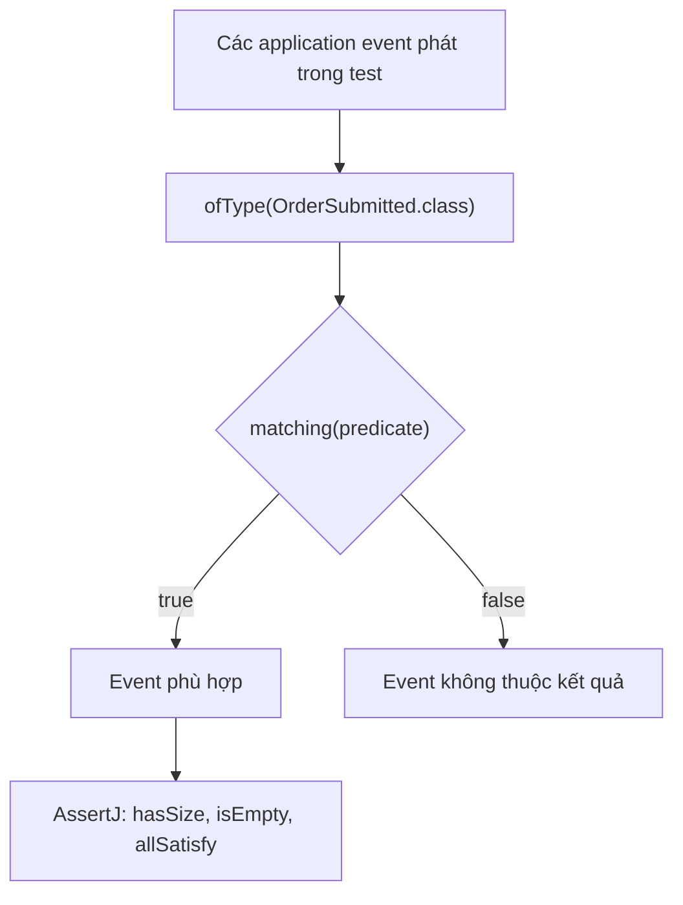

# Lấy event theo kiểu hoặc predicate

## Mục tiêu học tập

Sau bài này, bạn có thể:

- Phân biệt truy vấn event **theo kiểu** với truy vấn event **theo điều kiện (predicate)** trong kiểm thử Spring Modulith.
- Sử dụng `PublishedEvents.ofType(…)` để lấy những event thuộc một lớp nghiệp vụ cụ thể.
- Kết hợp `TypedPublishedEvents.matching(…)` với `orderId`, trạng thái, kênh bán hoặc giá trị giao dịch để chỉ chọn những event liên quan.
- Viết assertion bảo vệ hợp đồng phát sự kiện: **có event**, **không có event**, **đúng một event**, đúng payload và không bị phát trùng.
- Tránh nhầm lẫn giữa việc event được publish và việc listener đã xử lý xong.

## 1. Tình huống: Một luồng nghiệp vụ có nhiều event

Trong ứng dụng Spring Modulith, các module nên giao tiếp thông qua API công khai hoặc application event thay vì phụ thuộc trực tiếp vào lớp nội bộ của nhau. Chẳng hạn, module `checkout` có thể phát:

- `OrderSubmitted` khi khách gửi đơn hợp lệ, để module thanh toán và vận chuyển tiếp tục xử lý.
- `OrderRejected` khi đơn không hợp lệ, để module theo dõi lỗi hoặc thông báo phản hồi.

Một bài kiểm thử gọi `CheckoutService.submit(…)` có thể ghi nhận nhiều Spring application event, nhưng thường chỉ cần kiểm chứng **một hợp đồng cụ thể**. Nếu chỉ hỏi “test có event hay không?”, ta không biết sự kiện nào đã phát. Nếu chỉ kiểm tra có `OrderSubmitted`, ta vẫn chưa biết event có thuộc đơn hàng cần kiểm tra hay không.

`PublishedEvents` thuộc `org.springframework.modulith.test` giải quyết vấn đề đó bằng hai thao tác chính: **chọn loại event** rồi **lọc các instance thỏa điều kiện**. Đây là một phần của kiểm thử hành vi tại ranh giới module trong chủ đề Spring Modulith Verification & Testing.

## 2. Hai mức lọc: Kiểu và predicate

| Truy vấn | Câu hỏi cần trả lời | Ví dụ |
| --- | --- | --- |
| `events.ofType(OrderSubmitted.class)` | Có những event `OrderSubmitted` nào đã được publish? | Đếm mọi đơn được gửi trong test |
| `events.ofType(OrderSubmitted.class).matching(event -> …)` | Trong nhóm `OrderSubmitted`, event nào đáp ứng điều kiện? | Chọn đơn có `orderId` đang kiểm thử |
| `events.ofType(OrderRejected.class)` | Có event từ chối đơn hàng hay không? | Kiểm tra nhánh xử lý dữ liệu sai |

### 2.1. Lọc theo kiểu với ofType

Trong bài `@ApplicationModuleTest`, Spring Modulith có thể cung cấp `PublishedEvents` làm tham số của phương thức test:

```java
@Test
void checksPublishedEvents(PublishedEvents events) {
    // events do hạ tầng test cung cấp
}
```

Giả sử bước thực thi nghiệp vụ đã phát `OrderSubmitted` và `OrderRejected`. Ta chọn riêng từng nhóm:

```java
var submitted = events.ofType(OrderSubmitted.class);
var rejected = events.ofType(OrderRejected.class);

assertThat(submitted).hasSize(1);
assertThat(rejected).hasSize(1);
```

`ofType(Class<T>)` trả về `PublishedEvents.TypedPublishedEvents<T>`, là tập các event thuộc kiểu yêu cầu và có thể dùng với assertion của AssertJ như một `Iterable<T>`. Truy vấn không đòi hỏi phải tự cast từng event từ `Object` sang `OrderSubmitted`.

Lưu ý: chọn **kiểu event** mới chỉ thu hẹp theo lớp Java. Nếu có ba event `OrderSubmitted` của ba đơn khác nhau, kết quả vẫn chứa cả ba. Khi cần ràng buộc dữ liệu, hãy dùng predicate.

### 2.2. Lọc theo điều kiện với matching

`matching(…)` nhận một predicate: hàm kiểm tra từng event và trả về `true` nếu event cần giữ lại.

```java
UUID expectedOrderId = UUID.randomUUID();

var forThisOrder = events.ofType(OrderSubmitted.class)
        .matching(event -> expectedOrderId.equals(event.orderId()));

assertThat(forThisOrder).hasSize(1);
```

Trong biểu thức trên:

1. `ofType(OrderSubmitted.class)` chọn event đã phát có kiểu `OrderSubmitted`.
2. `matching(event -> …)` giữ lại những event có `orderId` đúng với `expectedOrderId`.
3. `hasSize(1)` yêu cầu **đúng một** event thuộc kiểu đó và thỏa predicate.

Predicate có thể kết hợp nhiều điều kiện:

```java
var mobileOrdersOver100k = events.ofType(OrderSubmitted.class)
        .matching(event ->
                "MOBILE".equals(event.channel())
                && event.total().compareTo(new BigDecimal("100000")) > 0);
```

Ở đây, kết quả chỉ có những `OrderSubmitted` phát từ kênh `MOBILE` với tổng tiền **lớn hơn** 100.000. Toán tử `> 0` của `BigDecimal.compareTo` nghĩa là lớn hơn; dùng `>= 0` khi yêu cầu bao gồm cả giá trị 100.000.



**Mối quan hệ:** `ofType` xác định tập đối tượng có kiểu phù hợp, còn `matching` kiểm tra thuộc tính của từng đối tượng trong tập đó. Predicate không thay thế việc chọn kiểu event.

## 3. Ví dụ hoàn chỉnh: Kiểm thử event của module checkout

Ví dụ dùng Java 17+, Spring Boot, JUnit Jupiter, AssertJ và `spring-modulith-starter-test`. Phần test nằm cùng package với module `checkout` để `@ApplicationModuleTest` khởi động đúng module cần kiểm chứng. Khi ứng dụng thật có lưu đơn vào database, bạn có thể bổ sung repository assertion ở lớp kiểm thử tích hợp; ở đây chỉ xét hợp đồng phát event.

### 3.1. Khai báo event bất biến

Tạo tệp `OrderSubmitted.java`:

```java
package com.example.shop.checkout;

import java.math.BigDecimal;
import java.util.UUID;

public record OrderSubmitted(
        UUID orderId,
        String channel,
        BigDecimal total) {
}
```

Tạo tệp `OrderRejected.java`:

```java
package com.example.shop.checkout;

import java.util.UUID;

public record OrderRejected(
        UUID orderId,
        String reasonCode) {
}
```

Hai `record` này biểu diễn những dữ liệu bên ngoài module cần biết. Trong ví dụ này, event là POJO được phát trực tiếp qua `ApplicationEventPublisher`; không bắt buộc kế thừa `ApplicationEvent`.

### 3.2. Service phát event theo kết quả nghiệp vụ

Tạo tệp `CheckoutService.java`:

```java
package com.example.shop.checkout;

import java.math.BigDecimal;
import java.util.UUID;
import org.springframework.context.ApplicationEventPublisher;
import org.springframework.stereotype.Service;

@Service
public class CheckoutService {

    private final ApplicationEventPublisher events;

    public CheckoutService(ApplicationEventPublisher events) {
        this.events = events;
    }

    public void submit(UUID orderId, String channel, BigDecimal total) {
        if (total.signum() <= 0) {
            events.publishEvent(
                    new OrderRejected(orderId, "INVALID_TOTAL"));
            return;
        }

        events.publishEvent(
                new OrderSubmitted(orderId, channel, total));
    }
}
```

Service đơn giản hóa việc xử lý nghiệp vụ để minh họa event. Một đơn có tổng tiền dương phát `OrderSubmitted`; một đơn có tổng tiền không dương phát `OrderRejected`. Không có thành phần nào trong `CheckoutService` phải gọi trực tiếp module nhận sự kiện.

### 3.3. Bộ test: Chọn theo kiểu, lọc bằng predicate

Tạo tệp `CheckoutEventTests.java` trong `src/test/java/com/example/shop/checkout`:

```java
package com.example.shop.checkout;

import static org.assertj.core.api.Assertions.assertThat;

import java.math.BigDecimal;
import java.util.UUID;
import org.junit.jupiter.api.Test;
import org.springframework.beans.factory.annotation.Autowired;
import org.springframework.modulith.test.ApplicationModuleTest;
import org.springframework.modulith.test.PublishedEvents;

@ApplicationModuleTest
class CheckoutEventTests {

    @Autowired
    CheckoutService checkoutService;

    @Test
    void selectsEventsByType(PublishedEvents events) {
        UUID acceptedId = UUID.randomUUID();
        UUID rejectedId = UUID.randomUUID();

        checkoutService.submit(
                acceptedId, "WEB", new BigDecimal("250000"));
        checkoutService.submit(
                rejectedId, "WEB", BigDecimal.ZERO);

        assertThat(events.ofType(OrderSubmitted.class)).hasSize(1);
        assertThat(events.ofType(OrderRejected.class)).hasSize(1);
    }

    @Test
    void selectsEventByOrderIdPredicate(PublishedEvents events) {
        UUID firstId = UUID.randomUUID();
        UUID secondId = UUID.randomUUID();

        checkoutService.submit(
                firstId, "WEB", new BigDecimal("50000"));
        checkoutService.submit(
                secondId, "MOBILE", new BigDecimal("320000"));

        var submittedForSecondOrder =
                events.ofType(OrderSubmitted.class)
                        .matching(event ->
                                secondId.equals(event.orderId()));

        assertThat(events.ofType(OrderSubmitted.class)).hasSize(2);
        assertThat(submittedForSecondOrder).hasSize(1);
        assertThat(submittedForSecondOrder)
                .allSatisfy(event -> {
                    assertThat(event.channel()).isEqualTo("MOBILE");
                    assertThat(event.total())
                            .isEqualByComparingTo("320000");
                });
    }

    @Test
    void selectsEventsWithCompositePredicate(PublishedEvents events) {
        UUID webOrderId = UUID.randomUUID();
        UUID mobileOrderId = UUID.randomUUID();

        checkoutService.submit(
                webOrderId, "WEB", new BigDecimal("150000"));
        checkoutService.submit(
                mobileOrderId, "MOBILE", new BigDecimal("230000"));

        var mobileOrdersAbove200k =
                events.ofType(OrderSubmitted.class)
                        .matching(event ->
                                "MOBILE".equals(event.channel())
                                && event.total()
                                        .compareTo(new BigDecimal("200000")) > 0);

        assertThat(mobileOrdersAbove200k).hasSize(1);
        assertThat(mobileOrdersAbove200k)
                .allSatisfy(event ->
                        assertThat(event.orderId())
                                .isEqualTo(mobileOrderId));
    }

    @Test
    void rejectedOrderHasNoSubmittedEvent(PublishedEvents events) {
        UUID invalidId = UUID.randomUUID();
        checkoutService.submit(invalidId, "WEB", BigDecimal.ZERO);

        var submittedForInvalidOrder =
                events.ofType(OrderSubmitted.class)
                        .matching(event ->
                                invalidId.equals(event.orderId()));

        var rejectedForInvalidOrder =
                events.ofType(OrderRejected.class)
                        .matching(event ->
                                invalidId.equals(event.orderId()));

        assertThat(submittedForInvalidOrder).isEmpty();
        assertThat(rejectedForInvalidOrder).hasSize(1);
        assertThat(rejectedForInvalidOrder)
                .allSatisfy(event ->
                        assertThat(event.reasonCode())
                                .isEqualTo("INVALID_TOTAL"));
    }
}
```

Mỗi phương thức test có một `PublishedEvents` được hạ tầng Spring Modulith cung cấp và chỉ kiểm tra các hành động của chính bài test đó. Các test không dùng chung biến `events` tĩnh và không dựa vào thứ tự chạy của JUnit.

## 4. Cách chọn assertion cho từng mục tiêu

Việc “lấy được event” mới là một nửa bài toán. Assertion phải nói đúng điều kiện nghiệp vụ.

| Mục tiêu | Ví dụ assertion | Kết luận khi pass |
| --- | --- | --- |
| Có ít nhất một `OrderSubmitted` | `assertThat(events.ofType(OrderSubmitted.class)).isNotEmpty()` | Có event cùng kiểu |
| Không có `OrderRejected` | `assertThat(events.ofType(OrderRejected.class)).isEmpty()` | Không quan sát được event từ chối trong test |
| Có đúng một event cho đơn cụ thể | `assertThat(forOrder).hasSize(1)` | Đúng một event thỏa predicate |
| Có đúng hai event toàn loại | `assertThat(events.ofType(OrderSubmitted.class)).hasSize(2)` | Quan sát được đúng hai event thuộc kiểu này |
| Payload của mọi event đã lọc đúng | `assertThat(forOrder).allSatisfy(event -> …)` | Tất cả event trong kết quả thỏa những assertion bổ sung |

Chú ý: `allSatisfy` trên một tập **rỗng** có thể vẫn pass vì không có phần tử nào vi phạm điều kiện. Nếu hợp đồng yêu cầu **phải có một event đúng payload**, hãy kết hợp `hasSize(1)` với `allSatisfy` hoặc một assertion tương đương để tránh false positive.

### 4.1. Đếm sau khi lọc và đếm trước khi lọc là hai mệnh đề khác nhau

Giả sử test phát hai `OrderSubmitted`:

```java
var allSubmitted = events.ofType(OrderSubmitted.class);
var forOrderA = allSubmitted.matching(event ->
        orderA.equals(event.orderId()));

assertThat(allSubmitted).hasSize(2);
assertThat(forOrderA).hasSize(1);
```

`hasSize(2)` đầu tiên nói có hai event cùng kiểu trong test. `hasSize(1)` thứ hai nói có đúng một event cho `orderA`. Nếu bạn chỉ lọc theo `orderA`, test không biết có thêm event cho đơn khác hay không. Đây là lựa chọn có chủ đích theo hợp đồng nghiệp vụ, không phải lỗi của bộ lọc.

Khi một thao tác **chỉ được phát đúng một** `OrderSubmitted` trong toàn bộ test, assertion nên dùng tập chưa lọc. Khi cả một luồng có nhiều đơn cùng phát event, hãy lọc theo khóa tương quan như `orderId` rồi assert số lượng.

### 4.2. Phát hiện event trùng lặp

Nếu một thay đổi mã vô tình gọi `publishEvent(new OrderSubmitted(…))` hai lần với cùng `orderId`, assertion chỉ kiểm tra `isNotEmpty()` vẫn pass. Ngược lại:

```java
var forOrder = events.ofType(OrderSubmitted.class)
        .matching(event -> orderId.equals(event.orderId()));

assertThat(forOrder).hasSize(1);
```

Assertion trên thất bại khi tìm được 0 hoặc 2 event phù hợp. Vì vậy, chọn `hasSize(1)` là quyết định có giá trị nếu nghiệp vụ yêu cầu phát event đúng một lần.

Tuy nhiên, việc chỉ kiểm tra event đã phát không đảm bảo xử lý downstream có tính *exactly once*. Đó còn là câu chuyện về listener, transaction, idempotency và hạ tầng lưu/truyền event.

## 5. Thiết kế predicate dễ đọc và đáng tin cậy

Predicate thường được viết trực tiếp dưới dạng lambda, nhưng có vài nguyên tắc giúp test rõ ràng hơn.

**Sử dụng khóa tương quan cụ thể.** `orderId`, `paymentId` hoặc `customerId` giúp phân biệt event thuộc nhiều giao dịch. Chỉ lọc theo `channel == "WEB"` là quá rộng nếu test có nhiều đơn hàng cùng kênh.

**So sánh tiền tệ đúng cách.** Với `BigDecimal`, `equals` so sánh cả scale: `new BigDecimal("10.0")` không bằng `new BigDecimal("10.00")` theo `equals`. Nếu hợp đồng chỉ quan tâm giá trị số, dùng `compareTo(…) == 0`. Nếu scale là một phần hợp đồng dữ liệu, dùng `equals` và giải thích kỳ vọng đó.

**Tránh so sánh bằng tham chiếu.** Hai `UUID` hoặc `String` có thể bằng nhau về giá trị nhưng không phải cùng instance. Dùng `expectedId.equals(event.orderId())`, không dùng `==`.

**Giữ điều kiện bám sát hành vi nghiệp vụ.** Ví dụ:

```java
UUID expectedOrderId = UUID.randomUUID();
BigDecimal expectedTotal = new BigDecimal("125000.00");

var matchingOrder = events.ofType(OrderSubmitted.class)
        .matching(event ->
                expectedOrderId.equals(event.orderId())
                && expectedTotal.compareTo(event.total()) == 0);
```

Đoạn trên minh họa cách viết predicate, với giả định nghiệp vụ đã được gọi bằng cùng `expectedOrderId` và `expectedTotal` trước khi thực hiện assertion.

**Không đưa side effect vào predicate.** Predicate nên là phép kiểm tra thuần: không sửa dữ liệu, không ghi repository, không gọi API mạng. Điều này giúp kết quả lọc ổn định và dễ tìm nguyên nhân khi test thất bại.

**Giữ thông điệp lỗi dễ đọc.** Khi có nhiều điều kiện, có thể kiểm tra số lượng trước, rồi dùng `allSatisfy` để AssertJ báo rõ field nào sai. Điều đó dễ chẩn đoán hơn một predicate dài vừa tìm event vừa cố gắng biểu diễn toàn bộ hợp đồng.

## 6. Khi nào PublishedEvents không đủ?

`PublishedEvents` quan sát **Spring application event được phát trong phạm vi thực thi test**. Nó không xác nhận rằng listener, đặc biệt listener bất đồng bộ hoặc `@TransactionalEventListener` ở pha `AFTER_COMMIT`, đã xử lý thành công.

Ví dụ, một `OrderSubmitted` có mặt trong `PublishedEvents` nhưng bảng `shipment` vẫn chưa có bản ghi tương ứng. Điều này có thể hoàn toàn bình thường nếu listener chạy sau commit hoặc trên luồng khác. Khi cần xác minh **event sẽ đến** hoặc **side effect của listener đã xuất hiện**, hãy dùng tiện ích `Scenario` của Spring Modulith kết hợp điều kiện chờ phù hợp. Khi cần kiểm tra dữ liệu thực, hãy assert repository hoặc database sau đúng ranh giới transaction.

Để kiểm chứng **quy tắc phụ thuộc giữa các application module** (không dùng API nội bộ của module khác, không có vòng phụ thuộc), sử dụng `ApplicationModules.verify()`. Đây là bước kiểm chứng kiến trúc, bổ sung cho bài test event; bản thân `PublishedEvents.ofType(…)` không phân tích đồ thị phụ thuộc mã nguồn.

Trong CI, có thể đặt hai loại test vào quality gate:

1. **Architecture verification:** test `ApplicationModules.verify()` ngăn phụ thuộc sai giữa module.
2. **Behavior verification:** test `@ApplicationModuleTest` với `PublishedEvents` phát hiện sự kiện thiếu, dư, sai loại hoặc sai payload.

Như vậy, một thay đổi làm hỏng ranh giới kiến trúc hoặc hợp đồng sự kiện đều có cơ hội bị phát hiện trước khi mã được hợp nhất.

## 7. Lỗi thường gặp và cách sửa

| Dấu hiệu | Nguyên nhân thường gặp | Cách xử lý |
| --- | --- | --- |
| `ofType(…)` trả tập rỗng | Mã nghiệp vụ chưa publish event, đi sai nhánh hoặc event được phát ngoài thời điểm test quan sát | Xác minh hành động kích hoạt publish, dùng bean do Spring quản lý |
| Test pass dù event sai đơn | Chỉ assert `ofType`, chưa lọc `orderId` | Thêm `matching(event -> expectedId.equals(event.orderId()))` |
| Test pass dù publish hai lần | Chỉ dùng `isNotEmpty()` | Đổi sang `hasSize(1)` trên tập event đúng hợp đồng |
| Test pass dù không có event | Chỉ dùng `allSatisfy` trên kết quả có thể rỗng | Thêm `hasSize(1)` hoặc `isNotEmpty()` |
| Predicate giá trị tiền không khớp dù số tiền bằng nhau | `BigDecimal.equals` phân biệt scale | Dùng `compareTo(…) == 0` khi phù hợp |
| Test event pass nhưng listener chưa cập nhật DB | Listener chạy bất đồng bộ/chờ commit | Dùng `Scenario` và assertion cho side effect |
| Test bị lẫn event của giao dịch khác | Predicate quá rộng | Lọc theo khóa tương quan riêng của thao tác đang kiểm thử |

## 8. Bài thực hành

Hãy sử dụng bộ ví dụ `CheckoutService` ở trên:

1. Thêm `customerId` vào `OrderSubmitted` và cập nhật `submit(…)`. Viết predicate chọn đúng `orderId` **và** `customerId`.
2. Gọi `submit(…)` cho ba đơn: hai đơn hợp lệ (một `WEB`, một `MOBILE`) và một đơn không hợp lệ. Viết assertion đếm từng kiểu event và lọc một đơn theo `orderId`.
3. Tạm thời sửa service để phát lặp một `OrderSubmitted`. So sánh kết quả khi dùng `isNotEmpty()` và `hasSize(1)`. Hoàn tác lỗi sau khi quan sát test thất bại.
4. Viết test cho đơn có `total = BigDecimal.ZERO`. Kiểm tra không có `OrderSubmitted` cho đơn đó và có đúng một `OrderRejected` với `reasonCode = "INVALID_TOTAL"`.
5. Thử thay `compareTo(…) == 0` bằng `equals(…)` khi so sánh `125000.0` với `125000.00`; giải thích vì sao kết quả khác.

**Tiêu chí đạt:** Người học chủ động chọn được kiểu event, predicate có khóa tương quan, và phép assert số lượng phù hợp. Bài kiểm thử phải thất bại khi mất event, sai payload hoặc phát trùng. Khi các test này được chạy qua `mvn test` hoặc `./gradlew test` trong CI, chúng góp phần ngăn hồi quy về hợp đồng phát sự kiện giữa các module.

## 9. Câu hỏi tự kiểm tra

**Câu 1.** `events.ofType(OrderSubmitted.class)` đã đảm bảo tất cả event trả về thuộc cùng một đơn hàng hay chưa?

**Đáp án:** Chưa. Truy vấn chỉ thu hẹp theo kiểu; cần `matching(…)` theo `orderId` để chọn đúng đơn.

**Câu 2.** Trong test có hai event cùng `orderId` do publish lặp. Assertion nào có khả năng phát hiện?

**Đáp án:** `assertThat(events.ofType(OrderSubmitted.class).matching(e -> id.equals(e.orderId()))).hasSize(1)` sẽ thất bại vì có hai event phù hợp. `isNotEmpty()` vẫn pass.

**Câu 3.** Vì sao `allSatisfy` nên đi kèm assertion số lượng khi cần một event?

**Đáp án:** Với tập rỗng, không có phần tử nào vi phạm điều kiện của `allSatisfy`; phải có assertion về việc event tồn tại.

**Câu 4.** Một event đã nằm trong `PublishedEvents` có nghĩa là `@TransactionalEventListener(AFTER_COMMIT)` đã hoàn tất hay không?

**Đáp án:** Không. Việc publish và việc listener xử lý sau commit là hai mốc khác nhau. Dùng `Scenario` hoặc kiểm tra kết quả tích hợp tại thời điểm thích hợp.

## Kết luận

Trong kiểm thử Spring Modulith, `ofType(…)` trả lời **“event thuộc loại nào đã được phát?”**, còn `matching(…)` trả lời **“trong loại đó, event nào liên quan đến điều kiện nghiệp vụ cụ thể?”**. Dùng thêm `hasSize(1)`, `isEmpty()` và assertion payload để biến truy vấn thành kiểm chứng hợp đồng rõ ràng. Kết hợp chúng với kiểm tra kiến trúc qua `ApplicationModules.verify()` và các test tích hợp khi cần giúp quality gate trong CI bao phủ cả phụ thuộc giữa module lẫn hành vi phát sự kiện.

## Tài liệu tham khảo

- [Spring Modulith Reference — Testing application modules](https://docs.spring.io/spring-modulith/reference/testing.html)
- [Spring Modulith Reference — Working with application events](https://docs.spring.io/spring-modulith/reference/events.html)
- [Spring Modulith API — PublishedEvents](https://docs.spring.io/spring-modulith/docs/current/api/org/springframework/modulith/test/PublishedEvents.html)
- [Spring Modulith API — PublishedEvents.TypedPublishedEvents](https://docs.spring.io/spring-modulith/docs/current/api/org/springframework/modulith/test/PublishedEvents.TypedPublishedEvents.html)
