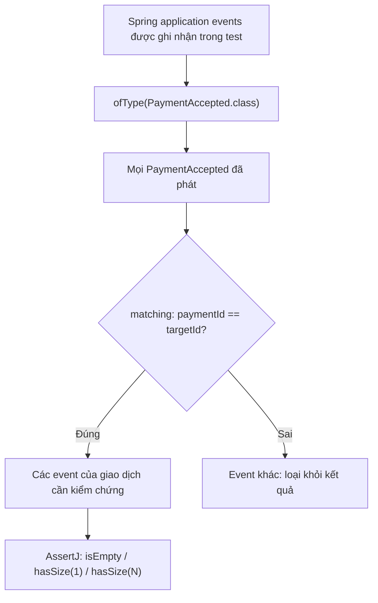
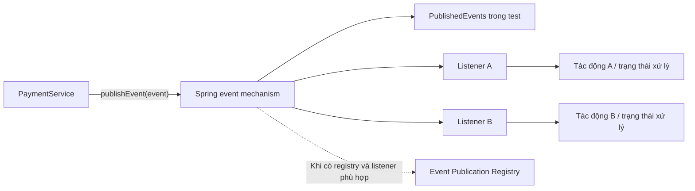

# Xác minh số lần publication

## Mục tiêu học tập

Trong chương **Event assertions** của lộ trình **Spring Modulith Verification & Testing**, bài này hướng dẫn kiểm tra **số lần một sự kiện nghiệp vụ được phát** khi ứng dụng thực hiện một hành động. Đây là một kiểm chứng quan trọng đối với hợp đồng giao tiếp giữa các application module: nghiệp vụ hoàn tất nhưng không phát event, hoặc phát event hai lần, đều có thể gây lỗi ở module tiêu thụ.

Sau bài học, bạn có thể:

- Phân biệt ba hợp đồng: **không phát (0)**, **phát đúng một lần (1)** và **phát đúng N lần**.
- Dùng `PublishedEvents` trong `@ApplicationModuleTest` để đếm các event đã phát theo loại và theo khóa tương quan nghiệp vụ.
- Viết assertion với AssertJ nhằm phát hiện sự kiện bị thiếu hoặc phát trùng.
- Chọn phạm vi đếm chính xác khi một bài test kích hoạt nhiều giao dịch hoặc nhiều loại event.
- Phân biệt **số event được publish** với **số lần listener nhận/xử lý**, **số bản ghi trong Event Publication Registry** và kết quả đã commit vào cơ sở dữ liệu.
- Đưa kiểm thử số lần publication vào quality gate của CI cùng các kiểm chứng kiến trúc của Spring Modulith.

## 1. Vì sao cần kiểm tra số lần phát event?

Giả sử module `payments` xử lý thanh toán, sau đó công bố `PaymentAccepted`. Các module `invoicing`, `notifications` hoặc `shipping` có thể lắng nghe event này. Có ít nhất ba loại lỗi cần phát hiện:

| Tình huống | Mong đợi | Sai lệch nguy hiểm |
| --- | --- | --- |
| Thanh toán hợp lệ được chấp nhận | Phát **1** `PaymentAccepted` cho giao dịch | Phát **0**: module khác không được thông báo |
| Yêu cầu thanh toán không hợp lệ bị từ chối | Phát **0** `PaymentAccepted` | Phát **1**: downstream tưởng giao dịch đã thành công |
| Xử lý hai thanh toán độc lập | Phát **2** `PaymentAccepted`, mỗi giao dịch một event | Phát **1**: mất một event; phát **3**: có thể trùng |

Một assertion chỉ kiểm tra “có event” chưa đủ để bảo vệ yêu cầu “phát đúng một lần”. Ví dụ, `isNotEmpty()` vẫn pass nếu cùng một event bị phát hai lần. Vì vậy, khi thiết kế test, cần xác định **đếm loại event nào**, **thuộc thao tác nào**, và **số lượng mong đợi là bao nhiêu**.

> Trong bài này, **publication** được hiểu là hành động mã nghiệp vụ công bố một Spring application event qua `ApplicationEventPublisher.publishEvent(…)`. Đây không phải khẳng định hệ thống bên ngoài đã nhận event đúng một lần.

## 2. Công cụ đếm: PublishedEvents kết hợp AssertJ

Thư viện `org.springframework.modulith.test` có `PublishedEvents` để quan sát Spring application event được phát trong bài kiểm thử. Trong lớp `@ApplicationModuleTest`, có thể nhận đối tượng này qua tham số của phương thức JUnit:

```java
import org.junit.jupiter.api.Test;
import org.springframework.modulith.test.ApplicationModuleTest;
import org.springframework.modulith.test.PublishedEvents;

@ApplicationModuleTest
class PublicationCountTests {

    @Test
    void sample(PublishedEvents events) {
        // Kích hoạt nghiệp vụ, sau đó kiểm tra events.
    }
}
```

Sau khi gọi mã nghiệp vụ, `events.ofType(PaymentAccepted.class)` lấy các event thuộc loại `PaymentAccepted`. Kết quả là `PublishedEvents.TypedPublishedEvents<PaymentAccepted>`, có thể dùng như một `Iterable` trong assertion của AssertJ:

```java
// Không có event cùng loại:
assertThat(events.ofType(PaymentAccepted.class)).isEmpty();

// Có đúng một event cùng loại:
assertThat(events.ofType(PaymentAccepted.class)).hasSize(1);

// Có đúng hai event cùng loại:
assertThat(events.ofType(PaymentAccepted.class)).hasSize(2);
```

Đoạn trên giả định có import `import static org.assertj.core.api.Assertions.assertThat;` và kiểu `PaymentAccepted` đã được khai báo. Đây là những phép kiểm về **số lượng đối tượng đã được quan sát** trong tập trả về; `PublishedEvents` không yêu cầu gọi một phương thức `countPublications()` riêng.

### 2.1. Đếm theo loại event

```java
var allAccepted = events.ofType(PaymentAccepted.class);
assertThat(allAccepted).hasSize(2);
```

Assertion này có nghĩa: trong phạm vi test, có đúng **hai event kiểu `PaymentAccepted`**. Nó không khẳng định cả hai event đều ứng với đúng giao dịch mong đợi.

### 2.2. Đếm theo loại **và** khóa tương quan

```java
UUID paymentId = UUID.randomUUID();

var acceptedForPayment = events.ofType(PaymentAccepted.class)
        .matching(event -> paymentId.equals(event.paymentId()));

assertThat(acceptedForPayment).hasSize(1);
```

Predicate `matching(…)` lọc tiếp theo `paymentId`. Kết quả của phép đếm giờ có nghĩa: có đúng **một `PaymentAccepted` cho mã thanh toán này**. Khóa tương quan có thể là `orderId`, `invoiceId`, `paymentId` hoặc một ID ổn định khác.

Trong một phương thức test có nhiều hành động, kiểm đếm theo ID giúp không nhầm event của giao dịch A với event của giao dịch B. Trong test đơn giản chỉ gọi một thao tác, vẫn nên ghi rõ khóa tương quan khi payload quan trọng.

### 2.3. Sơ đồ phạm vi đếm



Với sơ đồ trên, `ofType` giới hạn **kiểu Java**, còn `matching` giới hạn **ý nghĩa nghiệp vụ**. Assertion số lượng đặt ở cuối chuỗi để khẳng định hợp đồng cụ thể.

## 3. Ví dụ thực tế: PaymentAccepted được phát đúng một lần

Giả sử ứng dụng bán hàng sử dụng Java 17+, Spring Boot và Spring Modulith. Module `payments` chịu trách nhiệm chấp nhận thanh toán và phát event, còn module hóa đơn có thể nhận event qua listener. Để tập trung vào số lần publication, service demo chưa lưu database; trong dự án thực tế cần thêm kiểm thử repository và transaction riêng.

### 3.1. Khai báo event nghiệp vụ

Tệp `src/main/java/com/example/shop/payments/PaymentAccepted.java`:

```java
package com.example.shop.payments;

import java.math.BigDecimal;
import java.util.UUID;

public record PaymentAccepted(
        UUID paymentId,
        UUID invoiceId,
        BigDecimal amount) {
}
```

Kiểu `record` là đối tượng bất biến, dễ tạo và dễ kiểm tra payload. Mỗi event mang theo `paymentId` để test xác định event thuộc giao dịch nào.

### 3.2. Service công bố event

Tệp `src/main/java/com/example/shop/payments/PaymentService.java`:

```java
package com.example.shop.payments;

import java.math.BigDecimal;
import java.util.UUID;
import org.springframework.context.ApplicationEventPublisher;
import org.springframework.stereotype.Service;

@Service
public class PaymentService {

    private final ApplicationEventPublisher publisher;

    public PaymentService(ApplicationEventPublisher publisher) {
        this.publisher = publisher;
    }

    public void accept(
            UUID paymentId,
            UUID invoiceId,
            BigDecimal amount) {

        if (amount.signum() <= 0) {
            throw new IllegalArgumentException(
                    "Amount must be greater than zero");
        }

        // Một lần thành công tương ứng một sự kiện nghiệp vụ.
        publisher.publishEvent(
                new PaymentAccepted(paymentId, invoiceId, amount));
    }
}
```

Quy tắc của demo:

- `amount > 0`: phát đúng một `PaymentAccepted` với ID và số tiền đã truyền.
- `amount <= 0`: ném `IllegalArgumentException` và không phát `PaymentAccepted`.

Đây là hợp đồng của **một lần gọi service thành công**. Mã mẫu không cài đặt idempotency nếu client lặp lại cùng yêu cầu qua nhiều lần gọi; trường hợp retry được phân tích ở phần sau.

### 3.3. Ba bài test cho 0, 1 và N publication

Đặt lớp sau tại `src/test/java/com/example/shop/payments/PaymentPublicationTests.java`:

```java
package com.example.shop.payments;

import static org.assertj.core.api.Assertions.assertThat;
import static org.assertj.core.api.Assertions.assertThatThrownBy;

import java.math.BigDecimal;
import java.util.UUID;
import org.junit.jupiter.api.Test;
import org.springframework.beans.factory.annotation.Autowired;
import org.springframework.modulith.test.ApplicationModuleTest;
import org.springframework.modulith.test.PublishedEvents;

@ApplicationModuleTest
class PaymentPublicationTests {

    @Autowired
    PaymentService paymentService;

    @Test
    void publishesExactlyOnceForAcceptedPayment(PublishedEvents events) {
        UUID paymentId = UUID.randomUUID();
        UUID invoiceId = UUID.randomUUID();
        BigDecimal amount = new BigDecimal("250000.00");

        // When
        paymentService.accept(paymentId, invoiceId, amount);

        // Then: đúng một event của giao dịch cần kiểm tra.
        var forPayment = events.ofType(PaymentAccepted.class)
                .matching(event ->
                        paymentId.equals(event.paymentId()));

        assertThat(forPayment)
                .hasSize(1)
                .allSatisfy(event -> {
                    assertThat(event.invoiceId()).isEqualTo(invoiceId);
                    assertThat(event.amount())
                            .isEqualByComparingTo(amount);
                });
    }

    @Test
    void publishesNothingWhenPaymentIsInvalid(PublishedEvents events) {
        UUID paymentId = UUID.randomUUID();
        UUID invoiceId = UUID.randomUUID();

        assertThatThrownBy(() ->
                paymentService.accept(paymentId, invoiceId, BigDecimal.ZERO))
                .isInstanceOf(IllegalArgumentException.class);

        var forPayment = events.ofType(PaymentAccepted.class)
                .matching(event ->
                        paymentId.equals(event.paymentId()));

        assertThat(forPayment).isEmpty();
    }

    @Test
    void publishesTwiceForTwoDifferentPayments(PublishedEvents events) {
        UUID firstPaymentId = UUID.randomUUID();
        UUID secondPaymentId = UUID.randomUUID();
        UUID invoiceId = UUID.randomUUID();

        paymentService.accept(
                firstPaymentId, invoiceId, new BigDecimal("150000"));
        paymentService.accept(
                secondPaymentId, invoiceId, new BigDecimal("350000"));

        var allAccepted = events.ofType(PaymentAccepted.class);
        var first = allAccepted.matching(event ->
                firstPaymentId.equals(event.paymentId()));
        var second = allAccepted.matching(event ->
                secondPaymentId.equals(event.paymentId()));

        assertThat(allAccepted).hasSize(2);
        assertThat(first).hasSize(1);
        assertThat(second).hasSize(1);
    }
}
```

Các test minh họa ba ý nghĩa khác nhau:

1. **Đúng 1:** thanh toán thành công có chính xác một event mang `paymentId` cần kiểm tra và payload đúng.
2. **Đúng 0:** nhánh lỗi không được phép phát `PaymentAccepted` cho thanh toán bị từ chối.
3. **Đúng N:** với hai thao tác chấp nhận độc lập, tổng số `PaymentAccepted` bằng 2, đồng thời từng giao dịch đều có đúng một event.

Ở test thứ ba, chỉ kiểm tra tổng bằng 2 là chưa đủ. Một lỗi có thể phát hai event cho `firstPaymentId` nhưng không phát cho `secondPaymentId`; tổng số vẫn bằng 2. Hai assertion `hasSize(1)` theo từng ID khép kín lỗ hổng này.

> Khi dùng `@ApplicationModuleTest`, kiểm thử số event được ghi nhận từ hành động do test kích hoạt. Tránh biến `PublishedEvents` thành biến chia sẻ tĩnh giữa các test hoặc làm cho bài test phụ thuộc thứ tự chạy.

## 4. Phát hiện lỗi publish trùng

Giả sử một lập trình viên vô tình sửa nhánh thành công của `PaymentService.accept(…)` thành:

```java
var event = new PaymentAccepted(paymentId, invoiceId, amount);
publisher.publishEvent(event);
publisher.publishEvent(event); // Lỗi: publish lặp cùng nghiệp vụ.
```

Khi đó:

```java
var forPayment = events.ofType(PaymentAccepted.class)
        .matching(event -> paymentId.equals(event.paymentId()));

assertThat(forPayment).isNotEmpty();  // Vẫn pass vì tìm thấy event.
assertThat(forPayment).hasSize(1);    // Thất bại vì tìm thấy 2 event.
```

Test dùng `hasSize(1)` phát hiện lỗi mà `isNotEmpty()` bỏ qua. Đây là lý do assertion về số lượng cần được viết cụ thể khi “đúng một lần” là yêu cầu.

Ngoài lỗi gọi `publishEvent` hai lần, việc phát trùng còn có thể đến từ:

- Có hai nhánh logic đều công bố cùng một loại event cho một thao tác.
- Một thao tác được gọi lặp do luồng điều khiển hoặc retry.
- Mã xử lý cố công bố event ở cả tầng domain và application service mà không có quy ước chủ sở hữu rõ ràng.

Để xác định nguồn lỗi, hãy đặt assertion tại test nhỏ nhất bao phủ service phát event, sau đó kiểm tra đường gọi và điều kiện publish. Không nên viết assertion theo số lượng tùy ý chỉ để test pass.

## 5. Chọn đúng phạm vi: Kiểm tra toàn bộ event hay chỉ một giao dịch?

Một ứng dụng thực tế có nhiều loại event, nhiều hành động trong cùng một test và cả các event mang cùng loại nhưng khác ID. Vì vậy, câu “phải có đúng một publication” luôn cần đủ **đối tượng đếm**.

| Assertion | Phạm vi được xác minh | Điều không thể kết luận |
| --- | --- | --- |
| `assertThat(events.ofType(PaymentAccepted.class)).hasSize(1)` | Tổng cộng đúng một `PaymentAccepted` trong tập quan sát | Payload có đúng giao dịch mong đợi hay không |
| `assertThat(events.ofType(PaymentAccepted.class).matching(e -> id.equals(e.paymentId()))).hasSize(1)` | Đúng một `PaymentAccepted` có `paymentId == id` | Có `PaymentAccepted` cho ID khác hay không |
| `assertThat(events.ofType(PaymentAccepted.class)).isEmpty()` | Không quan sát `PaymentAccepted` nào | Có thể vẫn có các event thuộc loại khác |
| `assertThat(events.ofType(PaymentAccepted.class).matching(e -> id.equals(e.paymentId()))).isEmpty()` | Không quan sát `PaymentAccepted` cho ID được chọn | Event cùng loại cho ID khác vẫn có thể tồn tại |

Nếu hợp đồng là “một lần chấp nhận thanh toán **chỉ** được phát đúng một `PaymentAccepted`, bất kể ID nào”, hãy kiểm tra **cả** tổng số lẫn nội dung:

```java
var allAccepted = events.ofType(PaymentAccepted.class);
var forPayment = allAccepted.matching(event ->
        paymentId.equals(event.paymentId()));

assertThat(allAccepted).hasSize(1);
assertThat(forPayment).hasSize(1);
```

Nếu test chủ đích xử lý nhiều thanh toán, dùng tổng số kết hợp số lượng trên từng `paymentId` để tránh bỏ sót hoặc trùng. Đừng ngầm giả định test chỉ quan sát một event nghiệp vụ khi nó thực thi nhiều hành động.

### 5.1. Tránh false positive với assertion chỉ kiểm tra thuộc tính

Ví dụ:

```java
assertThat(events.ofType(PaymentAccepted.class))
        .allSatisfy(event ->
                assertThat(event.amount()).isPositive());
```

`allSatisfy` có thể pass khi tập event rỗng, vì không có phần tử nào vi phạm điều kiện. Nếu hợp đồng yêu cầu có event, thêm `hasSize(1)` hoặc `isNotEmpty()`:

```java
assertThat(events.ofType(PaymentAccepted.class))
        .hasSize(1)
        .allSatisfy(event ->
                assertThat(event.amount()).isPositive());
```

Điểm cốt lõi là **kiểm tra số lượng trước**, sau đó kiểm tra nội dung theo từng event. Một assertion về payload không tự tạo ra cam kết về cardinality.

### 5.2. Có cần dựa vào thứ tự event?

Thông thường, bài test hợp đồng publish nên gắn kỳ vọng với `paymentId` và số lượng, thay vì kỳ vọng event ở vị trí thứ nhất/thứ hai trong tập. Với event listener bất đồng bộ hoặc nhiều publisher, thứ tự nhận có thể thay đổi và không phản ánh hợp đồng nghiệp vụ. Khi thứ tự là yêu cầu thật, hãy thiết kế hợp đồng thứ tự rõ ràng và kiểm thử cơ chế thực thi phù hợp.

## 6. Publication count, listener count và Event Publication Registry

Tên gọi *publication* có thể gây nhầm lẫn vì Spring Modulith có cả cơ chế **công bố event trong Spring** và **theo dõi các publication cần xử lý bởi listener**. Chúng liên quan với nhau nhưng không đồng nhất.



| Khái niệm | Cần kiểm chứng điều gì? | Cách kiểm thử phù hợp |
| --- | --- | --- |
| **Số event được publish trong test** | Service gọi luồng phát event đúng 0/1/N lần theo hợp đồng | `PublishedEvents`, `ofType`, `matching`, `hasSize` |
| **Số lần listener xử lý** | Listener nào đã chạy, có retry hay thực thi bất đồng bộ hay không | Test listener và kiểm tra side effect |
| **Publication được theo dõi bền vững** | Hệ thống đã đăng ký/hoàn tất các publication cần xử lý ra sao | Kiểm tra Event Publication Registry và transaction theo cấu hình thực tế |
| **Số bản ghi nghiệp vụ trong DB** | Giao dịch đã ghi thành công bao nhiêu bản ghi | Repository/database integration test |

Spring Modulith hỗ trợ Event Publication Registry để theo dõi các event publication liên quan đến quá trình xử lý bằng transactional event listener. Một **event nghiệp vụ** có thể được tiêu thụ bởi **nhiều listener** và tương ứng với nhiều công việc xử lý. Vì thế không thể lấy số lượng bản ghi registry rồi mặc nhiên coi đó là số lần `publishEvent(…)` được gọi; cấu hình listener, transaction và vòng đời publication đều ảnh hưởng cách dữ liệu registry được ghi nhận.

Tương tự, một event được ghi nhận trong `PublishedEvents` **không chứng minh** listener đã commit thành công. Listener `@TransactionalEventListener(phase = AFTER_COMMIT)` chỉ chạy theo pha phù hợp của transaction; một test rollback giao dịch có thể không kích hoạt xử lý sau commit như môi trường thật.

**Quy tắc thực hành:** Dùng `PublishedEvents` để đếm **event mà mã nguồn công bố**, dùng kiểm thử listener hoặc `Scenario` để chờ **sự kiện/side effect bất đồng bộ**, và dùng kiểm thử cơ sở dữ liệu/registry để xác nhận trạng thái bền vững.

## 7. Publication đúng một lần khác gì xử lý exactly once?

Assertion `hasSize(1)` chỉ chứng minh một sự kiện phù hợp đã được quan sát **một lần trong phạm vi test đó**. Nó không chứng minh toàn hệ thống sẽ xử lý chính xác một lần khi có lỗi mạng, timeout, retry, nhiều instance hay phục hồi từ hàng đợi.

Ví dụ, client gửi yêu cầu thanh toán lần đầu và không nhận được phản hồi, sau đó gửi lại cùng `paymentId`. Với `PaymentService` minh họa ở trên, mỗi lời gọi hợp lệ sẽ publish một event; hai lời gọi phát hai event. Đây không phải lỗi của `PublishedEvents` mà là do service chưa có hợp đồng **idempotency** ở cấp yêu cầu.

Nếu yêu cầu thực tế là “một `paymentId` chỉ được chấp nhận một lần dù retry”, hệ thống cần cơ chế như:

- Ràng buộc duy nhất theo `paymentId` hoặc idempotency key trong database.
- Transaction bao trùm việc kiểm tra trạng thái, ghi nhận thanh toán và phát/đăng ký event theo cơ chế thích hợp.
- Xử lý lặp an toàn ở consumer, nếu hạ tầng phân phối có thể gửi lại thông điệp.

Bài test publication count có thể là một phần của bộ test đó, nhưng không thay thế các kiểm thử retry, concurrent request, transaction và listener.

### 7.1. Ví dụ test idempotency cần những gì?

Giả sử service production đã bổ sung cơ chế “một `paymentId` chỉ chấp nhận một lần”. Bài test nên:

1. Gọi `accept(…)` lần đầu với `paymentId` A.
2. Gọi lại với cùng `paymentId` A; kỳ vọng có thể là trả cùng kết quả, hoặc ném một ngoại lệ nghiệp vụ đã định nghĩa.
3. Kiểm tra trong tập sự kiện đã ghi nhận có **đúng một** `PaymentAccepted` cho A.
4. Kiểm tra trong database chỉ có một thanh toán A và các side effect không bị nhân đôi.

Test này **không áp dụng nguyên xi** cho service demo ở mục 3, vì demo cố tình chưa thực hiện idempotency. Việc nêu rõ khác biệt giúp tránh hiểu nhầm rằng `hasSize(1)` tự làm cho production có tính chống trùng.

## 8. Số lần publication trong CI và kiểm chứng ranh giới module

Phạm vi của chương Spring Modulith Verification & Testing bao gồm cả kiểm tra ranh giới kiến trúc lẫn hành vi module. Hai lớp bảo vệ bổ sung cho nhau:

**Kiểm chứng kiến trúc.** Dùng `ApplicationModules.verify()` để phát hiện vi phạm phụ thuộc module, truy cập vào API không được công khai hoặc vòng phụ thuộc. Bước này không kiểm tra service đã phát bao nhiêu event.

**Kiểm chứng hành vi.** Dùng `@ApplicationModuleTest` và `PublishedEvents` để phát hiện thiếu event, phát trùng, phát sai loại hoặc sai payload. Bài test này không tự phân tích đồ thị phụ thuộc giữa các module.

Trong pipeline CI, đưa test architecture và các bài `@ApplicationModuleTest` vào bước chạy test tự động (ví dụ `mvn test` hoặc `./gradlew test`, tùy cấu hình project). Khi một thay đổi vô ý thêm lần gọi `publishEvent` thứ hai, assertion `hasSize(1)` phải làm build thất bại. Đây là một quality gate ngăn hồi quy hợp đồng giao tiếp trước khi đưa mã vào môi trường cao hơn.

## 9. Các lỗi thường gặp

| Dấu hiệu | Nguyên nhân khả dĩ | Cách khắc phục |
| --- | --- | --- |
| `isNotEmpty()` pass dù bị publish trùng | Assertion chỉ chứng minh tồn tại event | Dùng `hasSize(1)` trên tập đã lọc đúng giao dịch |
| `hasSize(2)` pass dù một giao dịch mất event | Tổng có 2 nhưng cả 2 thuộc một `paymentId` | Kết hợp tổng số với assertion theo từng ID |
| Đếm cả event ngoài phạm vi nghiệp vụ | Chỉ lọc theo kiểu, không lọc ID | Dùng `matching(e -> id.equals(e.paymentId()))` |
| Test fail do mong đợi “0” trên mọi event | Trong test còn phát các loại event khác | Chọn đúng loại với `ofType` và khóa tương quan |
| Test pass khi chưa phát event nào | Chỉ dùng `allSatisfy` trên tập rỗng | Thêm `hasSize(1)` hoặc `isNotEmpty()` |
| `PublishedEvents` thấy event nhưng listener chưa tạo dữ liệu | Xử lý sau commit hoặc bất đồng bộ | Dùng `Scenario`/integration test chờ side effect |
| Đếm bản ghi registry khác đếm event | Registry theo dõi vòng đời xử lý của các listener | Xác định rõ đơn vị đếm: event, target listener hay bản ghi bền vững |
| Test bị ảnh hưởng bởi retry không chủ đích | Cùng yêu cầu bị gọi nhiều lần | Xây dựng idempotency trong nghiệp vụ và test riêng |

## 10. Bài thực hành có tiêu chí kiểm chứng

Sử dụng `PaymentService` và `PaymentPublicationTests`:

1. **Phát đúng một lần:** chạy test `publishesExactlyOnceForAcceptedPayment`. Sửa service để publish hai lần, kiểm tra test thất bại, rồi hoàn tác lỗi.
2. **Không phát ở nhánh từ chối:** thử `BigDecimal.ZERO` và một số âm. Chứng minh không có `PaymentAccepted` tương ứng.
3. **Phát đúng N lần:** chấp nhận ba thanh toán với ba `paymentId` khác nhau. Kiểm tra tổng bằng 3 và mỗi ID có đúng một event.
4. **Bắt lỗi tổng số giả:** cố ý publish hai event cho ID A mà không publish cho ID B. Quan sát `hasSize(2)` trên toàn loại vẫn có thể pass, nhưng bộ assertion theo từng ID phải thất bại.
5. **Đánh giá giới hạn:** giải thích vì sao test có đúng một `PaymentAccepted` chưa chứng minh listener sau commit đã ghi thành công một hóa đơn.

**Tiêu chí hoàn thành:** mọi test chuyển sang thất bại có chủ đích khi có lỗi thiếu/phát trùng/sai ID; sau khi hoàn tác lỗi, test pass. Người học nêu được chính xác “1 publication của cái gì, trong phạm vi nào” trước khi chọn phép đếm.

## 11. Tự kiểm tra kiến thức

**Câu 1.** `assertThat(events.ofType(PaymentAccepted.class)).isNotEmpty()` có bắt được việc `PaymentAccepted` bị phát hai lần không?

**Trả lời:** Không. Nó chỉ khẳng định có ít nhất một event. Khi hợp đồng yêu cầu đúng một lần, dùng `hasSize(1)`.

**Câu 2.** Một test xử lý hai thanh toán A và B, `hasSize(2)` trên toàn bộ `PaymentAccepted` pass. Có chắc mỗi thanh toán phát đúng một event chưa?

**Trả lời:** Chưa. Hai event có thể cùng thuộc A. Cần thêm hai phép đếm theo `paymentId` A và B.

**Câu 3.** Vì sao không nên coi số dòng Event Publication Registry bằng số lần gọi `publishEvent(…)`?

**Trả lời:** Registry theo dõi quá trình xử lý publication đối với các listener mục tiêu, còn một event có thể liên quan nhiều listener và có trạng thái hoàn thành khác nhau.

**Câu 4.** Một test xác nhận đúng một `PaymentAccepted` nhưng downstream xử lý hai lần do retry. Test `PublishedEvents` có sai không?

**Trả lời:** Không nhất thiết. Test chỉ chứng minh số event được ghi nhận trong hành động đang kiểm tra. Xử lý trùng ở consumer và retry cần hợp đồng idempotency cùng kiểm thử riêng.

## Kết luận

Để xác minh số lần publication trong Spring Modulith, hãy kích hoạt nghiệp vụ trong `@ApplicationModuleTest`, lấy event bằng `PublishedEvents.ofType(…)`, lọc theo khóa tương quan với `matching(…)` và đặt assertion về số lượng bằng AssertJ. Ba phép kiểm cơ bản là `isEmpty()` cho **0**, `hasSize(1)` cho **đúng 1**, và `hasSize(N)` cho **đúng N**. Kết hợp phép đếm tổng với phép đếm theo từng giao dịch để tránh trường hợp tổng đúng nhưng phân phối event sai. Tách riêng kiểm thử publication, xử lý listener, dữ liệu bền vững và ranh giới kiến trúc để quality gate trong CI có ý nghĩa chính xác.

## Tài liệu tham khảo

- [Spring Modulith — Integration Testing Application Modules](https://docs.spring.io/spring-modulith/reference/testing.html)
- [Spring Modulith — Working with Application Events](https://docs.spring.io/spring-modulith/reference/events.html)
- [Spring Modulith — Event Publication Registry](https://docs.spring.io/spring-modulith/reference/events.html#event-publication-registry)
- [Javadoc — PublishedEvents](https://docs.spring.io/spring-modulith/docs/current/api/org/springframework/modulith/test/PublishedEvents.html)
- [Javadoc — PublishedEvents.TypedPublishedEvents](https://docs.spring.io/spring-modulith/docs/current/api/org/springframework/modulith/test/PublishedEvents.TypedPublishedEvents.html)
