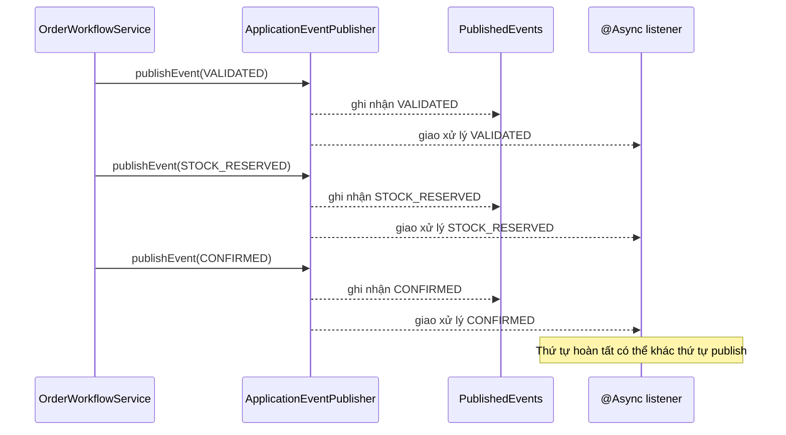

# Xác minh thứ tự event khi hợp đồng yêu cầu

## Mục tiêu học tập

Trong chương **Event assertions** của học phần **Spring Modulith Verification & Testing**, ngoài việc xác nhận event đã được phát và số lần phát, đôi khi chúng ta phải kiểm tra **thứ tự các event**. Bài học này gắn với mục tiêu kiểm chứng ranh giới kiến trúc, hành vi module và xây dựng quality gate trong CI nhằm ngăn hồi quy hợp đồng giao tiếp.

Sau bài học, bạn có thể:

- Nhận diện khi nào thứ tự phát event là một **hợp đồng nghiệp vụ cần kiểm thử**.
- Phân biệt **thứ tự gọi `publishEvent`**, **thứ tự event được ghi nhận**, **thứ tự listener bắt đầu** và **thứ tự side effect hoàn tất**.
- Lọc các event theo loại và khóa tương quan với `PublishedEvents` trong `@ApplicationModuleTest`, rồi xác minh chuỗi bằng AssertJ.
- Chọn `containsExactly` hoặc `containsSubsequence` theo mức độ nghiêm ngặt của yêu cầu.
- Viết test thất bại khi event bị đảo thứ tự, bị thiếu hoặc phát lặp.
- Nhận biết các giới hạn khi luồng xử lý có `@Async`, `@TransactionalEventListener`, nhiều transaction hoặc message broker.

## 1. Khi nào thứ tự event thực sự quan trọng?

Giả sử module `orders` tiếp nhận đơn hàng, đặt chỗ tồn kho rồi xác nhận đơn. Nó công bố các event về tiến trình:

1. `VALIDATED`: đơn hàng đã qua kiểm tra.
2. `STOCK_RESERVED`: hàng đã được giữ.
3. `CONFIRMED`: đơn đã được xác nhận.

Nếu hợp đồng của module quy định **trong một lần xử lý đồng bộ, event `CONFIRMED` chỉ được phát sau `STOCK_RESERVED`**, test cần bảo vệ cả sự hiện diện và thứ tự.

Một lỗi điển hình:

```text
Thứ tự đúng: VALIDATED → STOCK_RESERVED → CONFIRMED
Thứ tự lỗi:  VALIDATED → CONFIRMED → STOCK_RESERVED
```

Cả hai luồng đều phát ba event, nên phép đếm `hasSize(3)` không phân biệt được. Việc xác minh thứ tự sẽ phát hiện lỗi.

Tuy vậy, **không phải mọi hệ thống event đều cần cam kết thứ tự**. Nếu hai event độc lập, ví dụ `AuditLogged` và `MetricsUpdated`, có thể chỉ cần kiểm tra chúng cùng xuất hiện. Viết test thứ tự cho các event không có yêu cầu thứ tự sẽ khiến bộ test dễ hỏng khi thay đổi cách thực thi mà không làm sai nghiệp vụ.

| Loại hợp đồng | Điều nên kiểm tra | Điều không cần giả định |
| --- | --- | --- |
| Có sự kiện thành công | Event tồn tại, đúng payload | Vị trí của event trong toàn bộ stream |
| Một thao tác phát đúng một event | Số lượng bằng 1, khóa tương quan khớp | Thứ tự với event không liên quan |
| Một tiến trình phát nhiều trạng thái theo quy định | Thứ tự trạng thái của **cùng một aggregate** | Thứ tự toàn cục giữa nhiều đơn khác nhau |
| Listener bất đồng bộ làm việc độc lập | Kết quả cuối cùng và các ràng buộc dữ liệu | Thứ tự hoàn tất dựa trên thứ tự publish |

## 2. Phân biệt bốn loại thứ tự

Khái niệm “event A trước event B” chưa đủ chính xác nếu không nói rõ **trước ở giai đoạn nào**:

| Thứ tự | Ý nghĩa | Ví dụ kiểm chứng |
| --- | --- | --- |
| **Publish order** | Mã nghiệp vụ gọi `publishEvent(A)` trước `publishEvent(B)` | Test service đồng bộ và chuỗi event được quan sát |
| **Observation order** | Bộ ghi nhận trong test thấy A trước B | Duyệt chuỗi event mà `PublishedEvents` cung cấp trong test có điều kiện phù hợp |
| **Listener invocation order** | Hàm listener A được gọi trước listener B | Test lớp điều phối/listener và cấu hình event multicaster |
| **Completion order** | Side effect của A hoàn thành trước side effect của B | Test tích hợp với transaction, trạng thái bền vững, cơ chế đồng bộ/chờ |

Hai thứ tự đầu có thể trùng nhau khi publisher phát **tuần tự trên một luồng đồng bộ**. Nhưng không được từ đó suy ra listener bất đồng bộ đã hoàn tất theo cùng thứ tự.



Trong bài này, assertion thứ tự dùng cho **chuỗi event được ghi nhận từ mã publish đồng bộ trong một test**. Để bảo vệ thứ tự side effect khi xử lý song song, hệ thống còn cần thiết kế lưu trữ/điều phối phù hợp; một assertion trên `PublishedEvents` là chưa đủ.

## 3. Thiết lập bài kiểm thử Spring Modulith

Spring Modulith có công cụ `PublishedEvents` thuộc gói `org.springframework.modulith.test`. Một test sử dụng `@ApplicationModuleTest` có thể nhận đối tượng này làm tham số để quan sát những Spring application event được phát trong lúc thực thi:

```java
import org.junit.jupiter.api.Test;
import org.springframework.modulith.test.ApplicationModuleTest;
import org.springframework.modulith.test.PublishedEvents;

@ApplicationModuleTest
class OrderEventOrderTests {

    @Test
    void sample(PublishedEvents events) {
        // Kích hoạt nghiệp vụ, rồi truy vấn các event đã ghi nhận.
    }
}
```

Phụ thuộc test cần thiết (Maven):

```xml
<dependency>
    <groupId>org.springframework.modulith</groupId>
    <artifactId>spring-modulith-starter-test</artifactId>
    <scope>test</scope>
</dependency>
```

Trong dự án sử dụng Spring Boot, hãy quản lý phiên bản Spring Modulith phù hợp bằng BOM. Ví dụ dưới đây dùng Java 17+, JUnit Jupiter và AssertJ. Đặt test trong package của application module đang kiểm chứng, chẳng hạn `com.example.shop.orders`, để `@ApplicationModuleTest` định vị đúng module.

> Một kiểm thử `@ApplicationModuleTest` thường bootstrap module hiện tại theo chế độ `STANDALONE`. Nếu service phụ thuộc bean từ module khác, hãy thiết kế test fixture hoặc cấu hình bootstrap mode phù hợp. Không cần khởi động toàn ứng dụng khi chỉ kiểm chứng thứ tự publish nội bộ module.

## 4. Ví dụ hoàn chỉnh: Thứ tự VALIDATED → STOCK_RESERVED → CONFIRMED

### 4.1. Kiểu event và các giai đoạn nghiệp vụ

Tạo tệp `OrderStage.java`:

```java
package com.example.shop.orders;

public enum OrderStage {
    VALIDATED,
    STOCK_RESERVED,
    CONFIRMED
}
```

Tạo tệp `OrderStageChanged.java`:

```java
package com.example.shop.orders;

import java.util.UUID;

public record OrderStageChanged(UUID orderId, OrderStage stage) {
}
```

Việc dùng cùng một lớp event giúp chúng ta kiểm chứng toàn bộ chuỗi trạng thái với `ofType(OrderStageChanged.class)`. `orderId` là **khóa tương quan**: chỉ so sánh thứ tự các trạng thái của cùng một đơn hàng.

### 4.2. Service phát event theo trình tự

Tạo tệp `OrderWorkflowService.java`:

```java
package com.example.shop.orders;

import java.util.UUID;
import org.springframework.context.ApplicationEventPublisher;
import org.springframework.stereotype.Service;

@Service
public class OrderWorkflowService {

    private final ApplicationEventPublisher publisher;

    public OrderWorkflowService(ApplicationEventPublisher publisher) {
        this.publisher = publisher;
    }

    public void process(UUID orderId) {
        // Mô phỏng lần lượt ba bước nghiệp vụ thành công.
        publisher.publishEvent(
                new OrderStageChanged(orderId, OrderStage.VALIDATED));

        publisher.publishEvent(
                new OrderStageChanged(orderId, OrderStage.STOCK_RESERVED));

        publisher.publishEvent(
                new OrderStageChanged(orderId, OrderStage.CONFIRMED));
    }
}
```

Đây là ví dụ cô lập cơ chế event; trong ứng dụng thật, mỗi event phải được phát **sau khi bước nghiệp vụ mà nó mô tả thực sự hoàn thành** (kiểm tra đơn, giữ tồn kho, xác nhận). Mã minh họa chưa tích hợp database, không đại diện cho transaction hoặc cơ chế đảm bảo tồn kho của production.

### 4.3. Test thứ tự bằng PublishedEvents và containsExactly

Tạo `src/test/java/com/example/shop/orders/OrderWorkflowEventOrderTests.java`:

```java
package com.example.shop.orders;

import static org.assertj.core.api.Assertions.assertThat;

import java.util.UUID;
import org.junit.jupiter.api.Test;
import org.springframework.beans.factory.annotation.Autowired;
import org.springframework.modulith.test.ApplicationModuleTest;
import org.springframework.modulith.test.PublishedEvents;

@ApplicationModuleTest
class OrderWorkflowEventOrderTests {

    @Autowired
    OrderWorkflowService workflowService;

    @Test
    void publishesOrderStagesInRequiredOrder(PublishedEvents events) {
        // Given
        UUID orderId = UUID.randomUUID();

        // When
        workflowService.process(orderId);

        // Then: chỉ xét các event thuộc đơn đang kiểm chứng.
        var stagesForOrder = events.ofType(OrderStageChanged.class)
                .matching(event -> orderId.equals(event.orderId()));

        assertThat(stagesForOrder)
                .extracting(OrderStageChanged::stage)
                .containsExactly(
                        OrderStage.VALIDATED,
                        OrderStage.STOCK_RESERVED,
                        OrderStage.CONFIRMED);
    }
}
```

Đọc assertion theo từng bước:

1. `events.ofType(OrderStageChanged.class)` lấy các event thuộc đúng loại đang quan tâm.
2. `matching(event -> orderId.equals(event.orderId()))` giữ lại event của một đơn, không trộn nhiều aggregate.
3. `extracting(OrderStageChanged::stage)` biến chuỗi event thành chuỗi giá trị `OrderStage`.
4. `containsExactly(…)` xác nhận **đúng ba phần tử, đúng giá trị và đúng thứ tự**.

Với luồng publish tuần tự, đồng bộ như ví dụ, test này kiểm chứng thứ tự **được quan sát** trong bài test. Khả năng quan sát thứ tự nên được xác minh theo phiên bản framework và event multicaster của dự án nếu ứng dụng thay đổi mô hình dispatch; khi event được phát đồng thời, không suy diễn có một thứ tự toàn cục được bảo đảm.

### 4.4. Điều gì khiến test thất bại?

Thử cố tình đảo vị trí hai lần gọi cuối trong `process(…)`:

```java
publisher.publishEvent(
        new OrderStageChanged(orderId, OrderStage.VALIDATED));
publisher.publishEvent(
        new OrderStageChanged(orderId, OrderStage.CONFIRMED));      // Sai thứ tự.
publisher.publishEvent(
        new OrderStageChanged(orderId, OrderStage.STOCK_RESERVED));
```

Khi chạy test, AssertJ so sánh:

```text
Expected: [VALIDATED, STOCK_RESERVED, CONFIRMED]
Actual:   [VALIDATED, CONFIRMED, STOCK_RESERVED]
```

Test phải thất bại dù `hasSize(3)` vẫn pass. Cũng với `containsExactly`, việc bỏ mất `STOCK_RESERVED` hoặc phát trùng `CONFIRMED` đều làm test thất bại vì số lượng và chuỗi kỳ vọng không còn khớp.

## 5. Chọn containsExactly, containsSequence hay containsSubsequence?

Không phải hợp đồng nào cũng yêu cầu chuỗi quan sát phải khớp tuyệt đối. Với AssertJ, các phép kiểm sau mang ý nghĩa khác nhau:

| Phép assertion | Ý nghĩa | Hợp đồng thích hợp |
| --- | --- | --- |
| `containsExactly(A, B, C)` | Chuỗi chỉ gồm A, B, C theo đúng thứ tự | Phải phát chính xác ba trạng thái, không dư/thiếu/trùng |
| `containsSequence(A, B)` | A và B xuất hiện **liền kề**, đúng thứ tự | Hai mốc cần đứng cạnh nhau trong chuỗi |
| `containsSubsequence(A, C)` | A xuất hiện trước C, cho phép có phần tử xen giữa | Chỉ cần đảm bảo quan hệ trước/sau |
| `containsExactlyInAnyOrder(A, B, C)` | Đúng các phần tử nhưng bỏ qua thứ tự | Không dùng khi thứ tự là hợp đồng |

Ví dụ sau chỉ yêu cầu `VALIDATED` xuất hiện trước `CONFIRMED`; không cấm thêm bước trung gian:

```java
var stages = events.ofType(OrderStageChanged.class)
        .matching(event -> orderId.equals(event.orderId()));

assertThat(stages)
        .extracting(OrderStageChanged::stage)
        .containsSubsequence(
                OrderStage.VALIDATED,
                OrderStage.CONFIRMED);
```

Nếu hợp đồng còn yêu cầu **chỉ có một lần xác nhận**, hãy bổ sung assertion số lượng cho `CONFIRMED`, hoặc dùng `containsExactly` khi toàn bộ chuỗi đã được quy định.

Ngược lại, `containsExactlyInAnyOrder` chỉ phù hợp khi không có ràng buộc thứ tự: một refactor làm đảo chuỗi sẽ vẫn pass. Chọn assertion theo **ý nghĩa hợp đồng**, không theo mức độ dễ pass của test.

## 6. Tránh trộn thứ tự giữa các đơn hàng

Giả sử service xử lý hai đơn A và B trong cùng bài kiểm thử:

```java
UUID orderA = UUID.randomUUID();
UUID orderB = UUID.randomUUID();

workflowService.process(orderA);
workflowService.process(orderB);

var allStages = events.ofType(OrderStageChanged.class);
var stagesA = allStages.matching(
        event -> orderA.equals(event.orderId()));
var stagesB = allStages.matching(
        event -> orderB.equals(event.orderId()));

assertThat(allStages).hasSize(6);
assertThat(stagesA)
        .extracting(OrderStageChanged::stage)
        .containsExactly(
                OrderStage.VALIDATED,
                OrderStage.STOCK_RESERVED,
                OrderStage.CONFIRMED);
assertThat(stagesB)
        .extracting(OrderStageChanged::stage)
        .containsExactly(
                OrderStage.VALIDATED,
                OrderStage.STOCK_RESERVED,
                OrderStage.CONFIRMED);
```

Đoạn này minh họa phần thân một phương thức test có sẵn `workflowService` và `events`. Chúng ta đòi hỏi thứ tự của **mỗi đơn hàng**, đồng thời kiểm tra tổng có sáu event cùng loại.

Trong tình huống hai đơn được xử lý đồng thời, thứ tự sự kiện có thể xen kẽ:

```text
A: VALIDATED
B: VALIDATED
B: STOCK_RESERVED
A: STOCK_RESERVED
A: CONFIRMED
B: CONFIRMED
```

Thứ tự giữa A và B có thể thay đổi, nhưng chuỗi của **từng ID** vẫn tuân thủ hợp đồng. Vì vậy, tránh kiểm tra một thứ tự toàn cục cho các giao dịch độc lập trừ khi toàn bộ hệ thống thực sự bảo đảm điều đó.

## 7. Nếu hợp đồng liên quan đến nhiều loại event

Đôi khi thứ tự được định nghĩa giữa **các lớp event khác nhau**, chẳng hạn `StockReserved` phải được phát trước `OrderConfirmed`.

Một phép kiểm riêng lẻ:

```java
assertThat(events.ofType(StockReserved.class)).hasSize(1);
assertThat(events.ofType(OrderConfirmed.class)).hasSize(1);
```

chỉ chứng minh rằng cả hai event có mặt. Nó **không chứng minh `StockReserved` xuất hiện trước `OrderConfirmed`**. Thứ tự đã bị bỏ qua khi tách thành hai tập riêng.

Có hai cách xây dựng test tùy thiết kế ứng dụng:

1. **Dùng một sự kiện tiến trình chung** như `OrderStageChanged` với `stage` khi tất cả các mốc thực chất là cùng một chuỗi trạng thái nghiệp vụ. Khi đó, `ofType` và `containsExactly` có thể kiểm chứng trực tiếp chuỗi.
2. **Dùng một bộ ghi nhận chuỗi có thứ tự trong test** để thu thập nhiều loại event cùng khóa tương quan. Ví dụ, tạo một listener quan sát cả `StockReserved` và `OrderConfirmed`, ghi lại nhãn vào danh sách riêng khi chạy theo cơ chế đồng bộ, rồi kiểm tra `containsExactly("RESERVED", "CONFIRMED")`.

Trong cách thứ hai, bộ ghi nhận phải được đăng ký đúng phạm vi application context và reset cho mỗi test. Nếu listener hoạt động trên executor bất đồng bộ, danh sách này chỉ phản ánh thứ tự callback **được thực thi**, không chắc phản ánh thứ tự gọi publish. Không giả định hai lần gọi `ofType` độc lập có thể ghép lại để suy ra thứ tự liên loại.

### 7.1. Minh họa bộ ghi nhận thứ tự liên loại

Ví dụ rút gọn dưới đây sử dụng một listener đồng bộ trong test, nhận các event có chung interface `OrderMilestone`:

```java
interface OrderMilestone {
    UUID orderId();
}

record StockReserved(UUID orderId) implements OrderMilestone {}
record OrderConfirmed(UUID orderId) implements OrderMilestone {}

final class MilestoneRecorder {

    private final List<OrderMilestone> observed =
            new CopyOnWriteArrayList<>();

    @EventListener
    void on(OrderMilestone event) {
        observed.add(event);
    }

    List<String> stagesFor(UUID orderId) {
        return observed.stream()
                .filter(e -> orderId.equals(e.orderId()))
                .map(e -> e instanceof StockReserved
                        ? "RESERVED" : "CONFIRMED")
                .toList();
    }
}
```

Các `import` của ví dụ: `java.util.UUID`, `java.util.List`, `java.util.concurrent.CopyOnWriteArrayList` và `org.springframework.context.event.EventListener`. Bộ ghi nhận phải được cấu hình thành Spring bean trong test, ví dụ qua `@TestConfiguration` và `@Import`. Nếu nguồn phát và listener đều đồng bộ, sau khi gọi nghiệp vụ:

```java
assertThat(milestoneRecorder.stagesFor(orderId))
        .containsExactly("RESERVED", "CONFIRMED");
```

Trong ví dụ này `milestoneRecorder` là bean test đã được inject, và phương thức nghiệp vụ phải được gọi trước assertion. Cách tổ chức này hữu ích khi domain đã có hai kiểu event độc lập và bạn không muốn thay đổi contract event chỉ để test dễ viết.

Với một ứng dụng có nhiều listener hoặc có khả năng publish lồng nhau trong listener, cần phân tích thứ tự callback thực tế của `ApplicationEventMulticaster`. Không suy ra từ danh sách đã ghi rằng listener khác đã thực hiện nghiệp vụ theo cùng thứ tự.

## 8. Giới hạn với @Async, AFTER_COMMIT và phân phối qua broker

### 8.1. @Async: phát trước không đồng nghĩa hoàn thành trước

Giả sử service lần lượt phát `StockReserved` rồi `OrderConfirmed`, nhưng cả hai được tiêu thụ bởi listener bất đồng bộ. Listener xử lý `OrderConfirmed` có thể hoàn thành sớm hơn listener xử lý `StockReserved` do lịch thread hoặc độ trễ truy cập database.

Do đó:

- `PublishedEvents` có thể giúp xác nhận thứ tự **event được quan sát** ở phía publish trong một luồng xác định.
- Nó không bảo đảm **thứ tự hoàn tất** của `@Async` listener.
- `@Order` trên listener chỉ điều khiển thứ tự gọi listener trong phạm vi các cơ chế hỗ trợ ordering, không biến xử lý bất đồng bộ thành một chuỗi side effect tuần tự được cam kết.

Nếu side effect thực sự phải được xử lý tuần tự, hãy thiết kế serialization theo `orderId`, transaction hoặc cơ chế điều phối tương ứng. Có thể cần một consumer duy nhất cho mỗi khóa, state machine, hoặc đảm bảo ordering theo partition của broker tùy kiến trúc.

### 8.2. @TransactionalEventListener: thời điểm commit có ý nghĩa

Với `@TransactionalEventListener(phase = AFTER_COMMIT)`, listener phản ứng sau khi transaction phát sự kiện đã commit. Một test `@Transactional` tự rollback khi kết thúc có thể không kích hoạt listener `AFTER_COMMIT` như trong production.

Vì vậy, để kiểm chứng kết quả sau commit:

- Xác định rõ transaction chứa hành động nghiệp vụ và thời điểm commit.
- Dùng `Scenario` của Spring Modulith hoặc integration test có điều kiện chờ phù hợp để kiểm tra event/side effect sau commit.
- Kiểm tra dữ liệu bền vững qua repository hoặc database nếu hợp đồng liên quan trạng thái thực.

`Scenario` có các tiện ích đợi event và trạng thái bất đồng bộ; tuy nhiên **đợi nhận đủ hai event** cũng chưa mặc nhiên chứng minh chúng được xử lý theo đúng thứ tự. Khi thứ tự completion là yêu cầu, assertion phải dựa vào một dấu vết bền vững, có khóa tương quan và biểu diễn rõ trình tự mà bên tiêu thụ tạo ra.

### 8.3. Broker và hệ thống phân tán

Một publish order trong JVM không tự bảo đảm các thông điệp đến consumer qua broker đúng cùng thứ tự. Những yếu tố thường liên quan gồm:

| Yếu tố | Vì sao có thể ảnh hưởng |
| --- | --- |
| Nhiều producer hoặc nhiều instance | Các yêu cầu có thể phát song song |
| Nhiều partition | Không có thứ tự toàn cục giữa các partition |
| Retry, redelivery hoặc rebalancing | Consumer có thể thấy lại thông điệp hoặc bị đổi thứ tự xử lý |
| Nhiều listener và executor | Callback có thể chạy và hoàn tất ở thời điểm khác nhau |
| Transaction và outbox | Thời điểm ghi, commit và relay có thể khác thứ tự gọi API |

Khi hợp đồng thật sự phụ thuộc thứ tự xử lý bên ngoài JVM, hãy đưa điều kiện ordering vào thiết kế hạ tầng và kiểm thử tích hợp tương ứng. `PublishedEvents` chỉ là một lớp kiểm chứng ở phía ứng dụng.

## 9. Kỹ thuật viết assertion thứ tự đáng tin cậy

### 9.1. Dùng khóa tương quan trước khi so sánh

Đối với event có `orderId`, lọc trước bằng `matching`. Không lấy toàn bộ `OrderStageChanged` rồi so thứ tự giữa nhiều đơn độc lập. Cách đó sẽ tạo test giòn và khó chẩn đoán.

### 9.2. So sánh nội dung thay vì dựa vào reference identity

Không dùng `==` để so sánh `UUID`, `String` hoặc object trong predicate. Dùng `expectedOrderId.equals(event.orderId())`. Với enum `OrderStage`, so sánh bằng `==` hoặc phương thức AssertJ trên enum là phù hợp.

### 9.3. Kết hợp kiểm tra số lượng và thứ tự

`containsExactly` là assertion mạnh: nó kiểm tra số lượng, phần tử và thứ tự của **chuỗi đã được lọc**. Nếu hợp đồng còn yêu cầu **không có event cùng loại cho ID khác**, hãy kiểm tra số lượng trên `events.ofType(OrderStageChanged.class)` trước khi lọc.

### 9.4. Tránh Thread.sleep để “ổn định” kết quả

Chờ một khoảng cố định bằng `Thread.sleep(…)` không biến xử lý song song thành tuần tự. Test có thể pass trên máy nhanh và fail trên CI. Khi quan sát side effect bất đồng bộ, dùng cơ chế chờ có điều kiện và timeout (chẳng hạn `Scenario`) rồi assert trạng thái thực.

### 9.5. Không bắt thứ tự nếu hợp đồng không quy định

Nếu hai event độc lập được phát từ những module khác nhau, hãy kiểm tra từng event về kiểu, số lượng và payload. Một assertion `containsExactly` cho thứ tự không được cam kết sẽ khiến đội phát triển khó refactor dù hành vi nghiệp vụ vẫn đúng.

## 10. Bảng xử lý lỗi thường gặp

| Hiện tượng | Nguyên nhân thường gặp | Cách xử lý |
| --- | --- | --- |
| `hasSize(3)` pass dù thứ tự sai | Chỉ kiểm tra số lượng | Dùng `extracting(…::stage).containsExactly(…)` |
| Test thứ tự fail khi xử lý hai đơn song song | Đang so thứ tự toàn cục, không lọc `orderId` | Kiểm chứng riêng từng aggregate |
| `containsExactlyInAnyOrder` pass dù chuỗi bị đảo | Assertion cố ý bỏ qua thứ tự | Dùng `containsExactly` hoặc `containsSubsequence` |
| Test fail vì event phụ không liên quan | So toàn bộ chuỗi dù hợp đồng chỉ yêu cầu mốc chính | Lọc event hoặc dùng assertion thứ tự một phần |
| Test publish pass nhưng listener xử lý sai thứ tự | Listener bất đồng bộ hoặc chạy sau commit | Kiểm tra side effect và thiết kế ordering ở tầng xử lý |
| Test phụ thuộc thứ tự JUnit chạy | Chia các bước của một luồng qua nhiều phương thức test | Đưa toàn bộ stimulus và assertion vào một test độc lập |
| Dùng `@Order` rồi mặc định có ordering end-to-end | `@Order` không bảo đảm completion trong môi trường async/phân tán | Kiểm chứng cơ chế xử lý thực tế |
| Test kiểm tra event loại A và B riêng, rồi kết luận A trước B | Hai assertion tồn tại không chứa thông tin thứ tự | Ghi một timeline chung hoặc dùng sự kiện tiến trình chung |

## 11. Bài thực hành

Hãy thực hiện các bước sau với `OrderWorkflowService`:

1. **Chuỗi chuẩn:** chạy test `publishesOrderStagesInRequiredOrder` và xác nhận thứ tự `VALIDATED → STOCK_RESERVED → CONFIRMED`.
2. **Đảo thứ tự:** đổi vị trí hai lần gọi `publishEvent` cuối. So sánh kết quả của `hasSize(3)` và `containsExactly(…)`; hoàn tác sau khi test thất bại có chủ đích.
3. **Thiếu và trùng:** bỏ phát `STOCK_RESERVED`, sau đó thử phát `CONFIRMED` hai lần. Đảm bảo test thứ tự đều thất bại.
4. **Hai đơn xen kẽ:** viết một luồng xử lý hai `orderId` và assert thứ tự riêng cho mỗi đơn; đừng bắt một thứ tự toàn cục không được yêu cầu.
5. **Hợp đồng thứ tự một phần:** đổi assertion để chỉ yêu cầu `VALIDATED` xuất hiện trước `CONFIRMED`. Giải thích khác biệt giữa `containsSubsequence` và `containsExactly`.
6. **Tích hợp listener:** nếu dự án có `@Async` hoặc `AFTER_COMMIT`, thiết kế thêm một bài test quan sát side effect theo `orderId`. Chỉ kết luận thứ tự hoàn tất khi kết quả thực tế chứng minh điều đó.

**Tiêu chí hoàn thành:** test phát hiện đúng tình huống đảo mốc, thiếu mốc và trùng mốc; các event không liên quan không khiến test sai nếu hợp đồng không đòi hỏi thứ tự của chúng. Người học nêu được **thứ tự của sự kiện nào, cho aggregate nào và ở giai đoạn xử lý nào**.

## 12. Câu hỏi tự kiểm tra

**Câu 1.** Một luồng phát đủ `VALIDATED`, `STOCK_RESERVED` và `CONFIRMED` nhưng đảo hai mốc cuối. `hasSize(3)` có phát hiện không?

**Trả lời:** Không. Cần assertion theo thứ tự như `containsExactly(VALIDATED, STOCK_RESERVED, CONFIRMED)` trên chuỗi trạng thái đã lọc.

**Câu 2.** Tại sao cần lọc theo `orderId` trước khi kiểm tra thứ tự trong test có nhiều đơn hàng?

**Trả lời:** Vì thứ tự nội bộ của từng đơn có thể là hợp đồng, trong khi thứ tự toàn cục giữa các đơn độc lập thường không được bảo đảm.

**Câu 3.** `containsSubsequence(VALIDATED, CONFIRMED)` bảo đảm điều gì và không bảo đảm điều gì?

**Trả lời:** Nó bảo đảm có ít nhất một `VALIDATED` xuất hiện trước một `CONFIRMED` theo thứ tự trong tập quan sát; nó không cấm mốc xen giữa, không bảo đảm đúng số lần xuất hiện của từng mốc.

**Câu 4.** `PublishedEvents` cho thấy `StockReserved` trước `OrderConfirmed`. Điều này có chứng minh hai listener `@Async` hoàn tất cùng thứ tự không?

**Trả lời:** Không. Thứ tự publish/quan sát và thứ tự hoàn tất của listener là hai hợp đồng khác nhau.

**Câu 5.** `ApplicationModules.verify()` có thay thế test kiểm chứng thứ tự event không?

**Trả lời:** Không. `ApplicationModules.verify()` kiểm tra ranh giới kiến trúc và quan hệ phụ thuộc giữa các module. `@ApplicationModuleTest` cùng event assertions bảo vệ hành vi phát event ở thời gian chạy. Hai loại test có thể cùng là quality gate trong CI.

## Kết luận

Khi thứ tự là một phần của hợp đồng nghiệp vụ, hãy định nghĩa **chuỗi kỳ vọng theo một khóa tương quan**, kích hoạt hành động trong `@ApplicationModuleTest`, chọn event với `PublishedEvents.ofType(…)` và `matching(…)`, sau đó so chuỗi bằng `extracting(…)` cùng `containsExactly(…)` hoặc `containsSubsequence(…)`. Chỉ áp dụng kết luận về thứ tự cho phạm vi mà test thực sự quan sát và hệ thống có cơ chế bảo đảm. Với listener bất đồng bộ, xử lý sau commit hoặc message broker, cần bổ sung kiểm thử tích hợp và quy tắc ordering riêng. Kết hợp test hành vi này với `ApplicationModules.verify()` giúp CI phát hiện cả vi phạm ranh giới kiến trúc lẫn hồi quy về hợp đồng sự kiện.

## Tài liệu tham khảo

- [Spring Modulith Reference — Integration Testing Application Modules](https://docs.spring.io/spring-modulith/reference/testing.html)
- [Spring Modulith Reference — Working with Application Events](https://docs.spring.io/spring-modulith/reference/events.html)
- [Javadoc — PublishedEvents](https://docs.spring.io/spring-modulith/docs/current/api/org/springframework/modulith/test/PublishedEvents.html)
- [Javadoc — PublishedEvents.TypedPublishedEvents](https://docs.spring.io/spring-modulith/docs/current/api/org/springframework/modulith/test/PublishedEvents.TypedPublishedEvents.html)
- [AssertJ Core — Iterable assertions](https://assertj.github.io/doc/#assertj-core-group-assertions)
