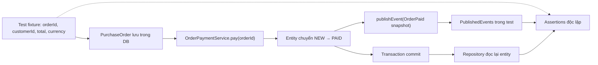

# Kiểm tra payload và dữ liệu nguồn

## Mục tiêu học tập

Trong chương **Event assertions** của học phần **Spring Modulith Verification & Testing**, chúng ta kiểm chứng hợp đồng giao tiếp giữa các application module bằng sự kiện. Kiểm tra một event đã được phát mới trả lời được câu hỏi **“có event hay không?”**; để ngăn hồi quy nghiệp vụ, cần hỏi tiếp **“payload có đúng dữ liệu nguồn hay không?”**.

Sau bài này, bạn có thể:

- Phân biệt dữ liệu đầu vào, trạng thái domain sau xử lý, trạng thái đã lưu trong database và payload của event.
- Dùng `@ApplicationModuleTest`, `PublishedEvents.ofType(…)` và `matching(…)` để tìm đúng event của giao dịch cần kiểm tra.
- Xác minh đồng thời **sự tồn tại, số lượng, khóa tương quan, nội dung từng trường** và **tính nhất quán với dữ liệu nguồn**.
- Viết kiểm thử với Spring Data JPA để đối chiếu payload `OrderPaid` với entity `PurchaseOrder` sau transaction.
- Phát hiện event có ID của thực thể khác, tiền tệ sai, trạng thái cũ, dữ liệu bị làm tròn sai hoặc trường lấy nhầm từ request.
- Hiểu giới hạn của assertion payload khi xử lý bất đồng bộ, transaction rollback và Event Publication Registry.

## 1. Vì sao kiểm tra loại event là chưa đủ?

Giả sử module `orders` ghi nhận thanh toán thành công của một đơn hàng và phát `OrderPaid` cho module hóa đơn và thông báo. Test sau trông có vẻ hợp lý:

```java
orderPaymentService.pay(orderId);
assertThat(events.ofType(OrderPaid.class)).hasSize(1);
```

Nó xác minh có đúng một `OrderPaid` trong tập sự kiện đã quan sát, nhưng **không phát hiện** một số lỗi rất thực tế:

| Lỗi payload | Vì sao nguy hiểm? |
| --- | --- |
| `event.orderId()` là ID đơn khác | Module nhận xử lý sai giao dịch |
| `event.customerId()` lấy từ tham số request thay vì đơn đã lưu | Có thể ghi hóa đơn cho sai khách |
| `event.amount()` bị làm tròn hoặc nhân sai hệ số | Sai doanh thu, hóa đơn và đối soát |
| `event.currency()` là `USD` trong khi đơn là `VND` | Giá trị tiền bị diễn giải sai |
| `event.status()` vẫn là `NEW` dù đơn đã thanh toán | Consumer nhận thông tin trạng thái cũ |
| Event giữ tham chiếu tới JPA entity mutable | Payload có thể đổi sau publish, phụ thuộc lazy loading hoặc vòng đời persistence context |

Một event được coi là đúng hợp đồng khi nó mang **đúng loại, đúng giao dịch, đúng số lần và đúng dữ liệu có ý nghĩa nghiệp vụ**.

> Trong bài này, “dữ liệu nguồn” là dữ liệu đáng tin cậy để quyết định payload phải có giá trị gì: fixture đầu vào đã được kiểm soát, trạng thái domain sau khi thực thi quy tắc nghiệp vụ, và dữ liệu đọc từ repository sau ranh giới transaction phù hợp. Không mặc định mọi giá trị do client gửi lên đều là nguồn sự thật.

## 2. Mô hình đối chiếu: từ nguồn đến event

Một phép kiểm payload vững cần xác định **nguồn chuẩn của từng trường**.



Test nên kiểm tra hai quan hệ bổ sung:

1. **Payload ↔ fixture kỳ vọng:** Event phải khớp những giá trị nghiệp vụ do test chủ động thiết lập, chẳng hạn `expectedCustomerId`, `expectedAmount` và `expectedCurrency`.
2. **Payload ↔ dữ liệu đã lưu:** Event phải khớp entity đọc lại từ repository, với trạng thái sau nghiệp vụ (`PAID`), không phải trạng thái trước đó (`NEW`).

Chỉ so payload với entity có thể bỏ sót một **lỗi chung**: nếu cả database và event cùng chứa sai `customerId` do một phép gán lỗi, hai đối tượng vẫn “khớp nhau”. Vì vậy, cần thêm một **oracle độc lập** từ fixture hoặc quy tắc nghiệp vụ.

### 2.1. Bảng nguồn chân lý cho từng trường

| Trường của `OrderPaid` | Nguồn kỳ vọng | Assertion chính |
| --- | --- | --- |
| `orderId` | Định danh đơn do test tạo và dùng để gọi `pay` | Bằng `expectedOrderId` và ID của entity |
| `customerId` | Chủ sở hữu đơn đã lưu, không lấy trực tiếp từ client ở bước thanh toán | Bằng `expectedCustomerId` và `persisted.customerId` |
| `amount` | Tổng tiền của đơn đã được xác thực | So sánh giá trị số với `expectedAmount` và `persisted.total` |
| `currency` | Đồng tiền được chấp nhận của đơn | Bằng `expectedCurrency` và `persisted.currency` |
| `status` | Trạng thái **sau** khi trả tiền thành công | Bằng `OrderStatus.PAID` và `persisted.status` |

Nếu hệ thống có khuyến mãi, thuế, phí hoặc quy đổi tiền tệ, nguồn kỳ vọng phải phản ánh **quy tắc tính giá đã được xác nhận**, không đơn thuần copy lại các trường trong request.

## 3. Chuẩn bị môi trường kiểm thử

Ví dụ dùng Java 17+, Spring Boot, Spring Data JPA, Spring Modulith, JUnit Jupiter và AssertJ. Bộ phụ thuộc liên quan (Maven; phiên bản quản lý qua Spring Boot/Spring Modulith BOM của dự án):

```xml
<dependency>
    <groupId>org.springframework.boot</groupId>
    <artifactId>spring-boot-starter-data-jpa</artifactId>
</dependency>

<dependency>
    <groupId>org.springframework.modulith</groupId>
    <artifactId>spring-modulith-starter-test</artifactId>
    <scope>test</scope>
</dependency>

<dependency>
    <groupId>com.h2database</groupId>
    <artifactId>h2</artifactId>
    <scope>test</scope>
</dependency>
```

Ví dụ giả định ứng dụng Spring Boot được cấu hình để quét package `com.example.shop` và test dùng một datasource H2 có schema chứa bảng `purchase_orders`. Trong dự án thật, hãy áp dụng migration (Flyway/Liquibase) hoặc cấu hình tạo schema phù hợp với profile test; đoạn mã không giả định rằng H2 luôn có thể thay thế database production.

Đặt test trong package `com.example.shop.orders`, tương ứng với application module cần kiểm chứng. `@ApplicationModuleTest` mặc định chỉ khởi động module được chọn, nên các repository/service của module phải có trong phạm vi bootstrap hoặc được cấu hình bằng test fixture thích hợp.

## 4. Xây dựng ví dụ: nguồn dữ liệu PurchaseOrder và event OrderPaid

### 4.1. Trạng thái nghiệp vụ và entity

Tệp `OrderStatus.java`:

```java
package com.example.shop.orders;

public enum OrderStatus {
    NEW,
    PAID
}
```

Tệp `PurchaseOrder.java`:

```java
package com.example.shop.orders;

import jakarta.persistence.Column;
import jakarta.persistence.Entity;
import jakarta.persistence.EnumType;
import jakarta.persistence.Enumerated;
import jakarta.persistence.Id;
import jakarta.persistence.Table;
import java.math.BigDecimal;
import java.util.Objects;
import java.util.UUID;

@Entity
@Table(name = "purchase_orders")
public class PurchaseOrder {

    @Id
    private UUID id;

    @Column(nullable = false)
    private UUID customerId;

    @Column(nullable = false, precision = 19, scale = 2)
    private BigDecimal total;

    @Column(nullable = false, length = 3)
    private String currency;

    @Enumerated(EnumType.STRING)
    @Column(nullable = false)
    private OrderStatus status = OrderStatus.NEW;

    protected PurchaseOrder() {
        // JPA yêu cầu constructor không tham số.
    }

    public PurchaseOrder(
            UUID id,
            UUID customerId,
            BigDecimal total,
            String currency) {
        this.id = Objects.requireNonNull(id);
        this.customerId = Objects.requireNonNull(customerId);
        this.total = Objects.requireNonNull(total);
        this.currency = Objects.requireNonNull(currency);
    }

    public void markPaid() {
        if (status != OrderStatus.NEW) {
            throw new IllegalStateException("Order is not NEW");
        }
        if (total.signum() <= 0) {
            throw new IllegalStateException("Order total must be positive");
        }
        status = OrderStatus.PAID;
    }

    public UUID getId() { return id; }
    public UUID getCustomerId() { return customerId; }
    public BigDecimal getTotal() { return total; }
    public String getCurrency() { return currency; }
    public OrderStatus getStatus() { return status; }
}
```

Entity này chứa dữ liệu **đã được chấp nhận và lưu cho đơn hàng**. API thanh toán trong ví dụ chỉ nhận `orderId`, sau đó tải entity; nó không cho client tùy ý chỉ định lại `customerId` hoặc `total`.

### 4.2. Event là snapshot của dữ liệu tại thời điểm phát

Tệp `OrderPaid.java`:

```java
package com.example.shop.orders;

import java.math.BigDecimal;
import java.util.UUID;

public record OrderPaid(
        UUID orderId,
        UUID customerId,
        BigDecimal amount,
        String currency,
        OrderStatus status) {
}
```

`OrderPaid` dùng `record` với các giá trị có thể so sánh độc lập. Không đưa toàn bộ `PurchaseOrder` (JPA entity có trạng thái thay đổi và quan hệ lazy) vào payload. Event nên là **snapshot** các trường cần thiết, đồng thời không lộ thông tin không thuộc hợp đồng công khai giữa module.

Tệp `OrderRepository.java`:

```java
package com.example.shop.orders;

import java.util.UUID;
import org.springframework.data.jpa.repository.JpaRepository;

public interface OrderRepository
        extends JpaRepository<PurchaseOrder, UUID> {
}
```

### 4.3. Service tải dữ liệu nguồn, thay đổi trạng thái, rồi publish

Tệp `OrderPaymentService.java`:

```java
package com.example.shop.orders;

import java.util.NoSuchElementException;
import java.util.UUID;
import org.springframework.context.ApplicationEventPublisher;
import org.springframework.stereotype.Service;
import org.springframework.transaction.annotation.Transactional;

@Service
public class OrderPaymentService {

    private final OrderRepository orders;
    private final ApplicationEventPublisher publisher;

    public OrderPaymentService(
            OrderRepository orders,
            ApplicationEventPublisher publisher) {
        this.orders = orders;
        this.publisher = publisher;
    }

    @Transactional
    public void pay(UUID orderId) {
        PurchaseOrder order = orders.findById(orderId)
                .orElseThrow(() -> new NoSuchElementException(
                        "Order not found: " + orderId));

        order.markPaid();

        // Snapshot được tạo từ entity sau thay đổi trạng thái.
        publisher.publishEvent(new OrderPaid(
                order.getId(),
                order.getCustomerId(),
                order.getTotal(),
                order.getCurrency(),
                order.getStatus()));
    }
}
```

`@Transactional` đặt thay đổi trạng thái vào transaction. Khi phương thức kết thúc bình thường, JPA flush và commit dữ liệu theo cấu hình transaction thực tế. Đối với entity đang managed, JPA dirty checking ghi thay đổi `status` mà không nhất thiết cần gọi `save` lần nữa.

Lưu ý về thời điểm: `publishEvent(…)` trong ví dụ chạy **trước commit**. `PublishedEvents` có thể quan sát một event ngay cả khi transaction sau đó bị rollback. Vì vậy, kết luận “event đã phát” và “dữ liệu nguồn đã commit thành công” cần hai phép kiểm khác nhau.

## 5. Test đối chiếu payload với dữ liệu nguồn

Đặt lớp `OrderPayloadAssertionsTests.java` trong `src/test/java/com/example/shop/orders`:

```java
package com.example.shop.orders;

import static org.assertj.core.api.Assertions.assertThat;
import static org.assertj.core.api.Assertions.assertThatThrownBy;

import java.math.BigDecimal;
import java.util.NoSuchElementException;
import java.util.UUID;
import org.junit.jupiter.api.Test;
import org.springframework.beans.factory.annotation.Autowired;
import org.springframework.modulith.test.ApplicationModuleTest;
import org.springframework.modulith.test.PublishedEvents;

@ApplicationModuleTest
class OrderPayloadAssertionsTests {

    @Autowired
    OrderRepository orders;

    @Autowired
    OrderPaymentService orderPaymentService;

    @Test
    void eventPayloadMatchesFixtureAndPersistedOrder(
            PublishedEvents events) {

        // Given: tạo nguồn dữ liệu độc lập với service.
        UUID expectedOrderId = UUID.randomUUID();
        UUID expectedCustomerId = UUID.randomUUID();
        BigDecimal expectedAmount = new BigDecimal("125000.00");
        String expectedCurrency = "VND";

        orders.saveAndFlush(new PurchaseOrder(
                expectedOrderId,
                expectedCustomerId,
                expectedAmount,
                expectedCurrency));

        // When: service tải entity và chuyển sang PAID.
        orderPaymentService.pay(expectedOrderId);

        // Then (1): dữ liệu đã lưu đúng với fixture và nghiệp vụ.
        PurchaseOrder persisted = orders.findById(expectedOrderId)
                .orElseThrow();
        assertThat(persisted.getId()).isEqualTo(expectedOrderId);
        assertThat(persisted.getCustomerId())
                .isEqualTo(expectedCustomerId);
        assertThat(persisted.getTotal())
                .isEqualByComparingTo(expectedAmount);
        assertThat(persisted.getCurrency())
                .isEqualTo(expectedCurrency);
        assertThat(persisted.getStatus())
                .isEqualTo(OrderStatus.PAID);

        // Then (2): tìm đúng event bằng khóa tương quan.
        var matchingEvents = events.ofType(OrderPaid.class)
                .matching(event ->
                        expectedOrderId.equals(event.orderId()));

        // Then (3): payload khớp fixture VÀ entity sau xử lý.
        assertThat(matchingEvents)
                .hasSize(1)
                .allSatisfy(event -> {
                    assertThat(event.orderId())
                            .isEqualTo(expectedOrderId)
                            .isEqualTo(persisted.getId());

                    assertThat(event.customerId())
                            .isEqualTo(expectedCustomerId)
                            .isEqualTo(persisted.getCustomerId());

                    assertThat(event.amount())
                            .isEqualByComparingTo(expectedAmount)
                            .isEqualByComparingTo(persisted.getTotal());

                    assertThat(event.currency())
                            .isEqualTo(expectedCurrency)
                            .isEqualTo(persisted.getCurrency());

                    assertThat(event.status())
                            .isEqualTo(OrderStatus.PAID)
                            .isEqualTo(persisted.getStatus());
                });
    }

    @Test
    void missingOrderMustNotPublishOrderPaid(
            PublishedEvents events) {

        UUID unknownOrderId = UUID.randomUUID();

        assertThatThrownBy(() ->
                orderPaymentService.pay(unknownOrderId))
                .isInstanceOf(NoSuchElementException.class);

        assertThat(events.ofType(OrderPaid.class)
                .matching(event ->
                        unknownOrderId.equals(event.orderId())))
                .isEmpty();
    }

    @Test
    void invalidTotalMustNotPublishOrChangeOrder(
            PublishedEvents events) {

        UUID orderId = UUID.randomUUID();
        UUID customerId = UUID.randomUUID();
        orders.saveAndFlush(new PurchaseOrder(
                orderId, customerId, BigDecimal.ZERO, "VND"));

        assertThatThrownBy(() -> orderPaymentService.pay(orderId))
                .isInstanceOf(IllegalStateException.class);

        PurchaseOrder persisted = orders.findById(orderId)
                .orElseThrow();
        assertThat(persisted.getStatus()).isEqualTo(OrderStatus.NEW);
        assertThat(persisted.getTotal())
                .isEqualByComparingTo(BigDecimal.ZERO);

        assertThat(events.ofType(OrderPaid.class)
                .matching(event -> orderId.equals(event.orderId())))
                .isEmpty();
    }
}
```

### 5.1. Vì sao cần cả `hasSize(1)` và `allSatisfy(…)`?

- `hasSize(1)` khẳng định **đúng một** `OrderPaid` với `orderId` mong đợi. Nếu event bị thiếu hoặc bị phát trùng, test fail.
- `allSatisfy(…)` kiểm tra mọi trường của từng event đã lọc. Nếu phát đúng một event nhưng `amount`, `currency` hoặc `customerId` sai, test fail.
- Nếu **chỉ** dùng `allSatisfy(…)` trên tập rỗng, phép kiểm có thể pass do không có phần tử nào vi phạm. Do đó không bỏ assertion về sự hiện diện hoặc số lượng.

### 5.2. Vì sao cần đọc lại repository?

`PublishedEvents` chỉ cho biết dữ liệu mà event mang theo. Nó không tự khẳng định transaction đã commit hoặc entity đã đổi sang trạng thái `PAID`. Đọc lại `OrderRepository` sau khi lời gọi service hoàn tất giúp xác minh tầng persistence.

Test đang dùng service `@Transactional` và không đặt `@Transactional` ở toàn bộ phương thức test. Điều này giúp khi `pay(…)` trả về thành công, transaction của service thông thường đã commit, rồi repository được đọc trong một lời gọi mới. Nếu dự án cấu hình transaction bao ngoài test, rollback tự động hoặc xử lý bất đồng bộ, cần chủ động xác định ranh giới commit và cách kiểm tra dữ liệu.

Một phép so sánh payload với repository chỉ có giá trị khi hiểu rõ **thời điểm đọc**. Event mô tả một thay đổi đã xảy ra ở thời điểm T, còn entity có thể tiếp tục thay đổi tại T+1. Không nên giả định event lịch sử luôn bằng trạng thái mới nhất của entity.

### 5.3. Vì sao test giữ fixture kỳ vọng độc lập?

Giả sử một lập trình viên vô tình sửa cả logic lưu trữ và logic phát event để cùng lấy `customerId` của một đơn khác. Nếu chỉ so `event.customerId()` với `persisted.customerId`, test vẫn pass. Assertion thứ ba với `expectedCustomerId` từ fixture khiến test phát hiện lỗi.

Việc kiểm tra theo **hai nguồn kỳ vọng độc lập** đặc biệt hữu ích với dữ liệu tài chính, danh tính khách hàng, trạng thái bảo mật và các trường đã trải qua biến đổi nghiệp vụ.

## 6. Lọc đúng event trước khi so payload

Nếu một test phát nhiều event, đừng chọn event đầu tiên một cách tùy ý. `PublishedEvents` có thể chứa các event từ những hành động khác nhau trong cùng phương thức test.

Ví dụ, test kích hoạt thanh toán cho đơn A và B:

```java
orderPaymentService.pay(orderA);
orderPaymentService.pay(orderB);

var eventsForA = events.ofType(OrderPaid.class)
        .matching(event -> orderA.equals(event.orderId()));
var eventsForB = events.ofType(OrderPaid.class)
        .matching(event -> orderB.equals(event.orderId()));

assertThat(eventsForA).hasSize(1);
assertThat(eventsForB).hasSize(1);
assertThat(events.ofType(OrderPaid.class)).hasSize(2);
```

Đoạn mã giả định cả hai đơn đã được chuẩn bị trong repository và các biến `orderA`, `orderB`, `orderPaymentService`, `events` có sẵn trong test. Hai assertion riêng theo ID đảm bảo không xảy ra trường hợp “đơn A phát hai event, đơn B không có event” nhưng tổng số vẫn bằng 2.

Không lọc bằng một trường quá rộng như `currency == "VND"` khi có nhiều đơn cùng tiền tệ. Trường có tính phân biệt cao như `orderId` giúp assertion gắn với chính giao dịch mà test đã kích hoạt.

## 7. Kỹ thuật kiểm tra từng kiểu dữ liệu payload

| Kiểu dữ liệu | Cách so sánh gợi ý | Lưu ý |
| --- | --- | --- |
| `UUID` / `String` | `isEqualTo(expected)` hoặc `expected.equals(actual)` | Không dùng `==` với object |
| `enum` | `isEqualTo(OrderStatus.PAID)` | So đúng trạng thái nghiệp vụ |
| `BigDecimal` | `isEqualByComparingTo(expected)` | So giá trị số, không ép bằng scale |
| `Instant` / `OffsetDateTime` | So với `Clock` cố định hoặc khoảng thời gian hợp lý | Tránh kỳ vọng chính xác theo đồng hồ máy |
| Danh sách item | So nội dung theo khóa hoặc theo thứ tự nếu hợp đồng có quy định | Không giả định ordering nếu nguồn không bảo đảm |
| DTO lồng nhau | `extracting(…)`, `satisfies(…)` hoặc `usingRecursiveComparison()` | Chỉ so những trường thuộc hợp đồng |
| Dữ liệu đã chuẩn hóa | So với kết quả áp dụng quy tắc nghiệp vụ độc lập | Ví dụ chuẩn hóa mã tiền, mã vùng, thuế suất |

### 7.1. BigDecimal: giá trị và scale

`new BigDecimal("125000.0").equals(new BigDecimal("125000.00"))` là `false` vì scale khác nhau. Nhưng:

```java
assertThat(new BigDecimal("125000.0"))
        .isEqualByComparingTo(new BigDecimal("125000.00"));
```

Assertion trên pass vì so giá trị số. Khi scale cũng là một phần hợp đồng serialization hoặc định dạng kế toán, cần assert riêng scale hoặc cách chuẩn hóa được quy định; không tự bỏ qua scale trong mọi tình huống.

### 7.2. Thời gian và dữ liệu biến đổi

Nếu `OrderPaid` có `occurredAt`, đừng kiểm tra bằng `Instant.now()` gọi sau khi event đã phát: việc hai lần đọc đồng hồ khác nhau khiến test dao động. Hướng tốt hơn là inject `java.time.Clock` vào publisher, dùng `Clock.fixed(…)` trong test và so với `Instant` cố định.

Với các biến đổi như giảm giá, thuế hoặc quy đổi tiền tệ, hãy viết expectation dựa trên **quy tắc đã định nghĩa**. Nếu service và test cùng gọi một hàm tính sai mà không có kỳ vọng độc lập, test có thể bỏ lọt lỗi logic.

### 7.3. Giá trị `null` và thông tin nhạy cảm

Không mặc định mọi field `null` là hợp lệ. Nếu hợp đồng quy định `customerId` luôn tồn tại, hãy assert `isNotNull()` hoặc `isEqualTo(expectedCustomerId)`. Ngược lại, không đưa mật khẩu, token, thông tin thanh toán nhạy cảm hay toàn bộ entity vào event chỉ để test tiện; payload nên chứa dữ liệu tối thiểu mà module tiêu thụ cần.

## 8. Payload là snapshot, không phải tham chiếu tới entity có thể thay đổi

Hãy xem hai cách công bố sau:

```java
// Không nên: event mang thẳng entity mutable/JPA proxy.
publisher.publishEvent(new OrderPaidEntityEvent(order));

// Nên: event mang snapshot của các trường hợp đồng.
publisher.publishEvent(new OrderPaid(
        order.getId(),
        order.getCustomerId(),
        order.getTotal(),
        order.getCurrency(),
        order.getStatus()));
```

Khi event giữ nguyên tham chiếu đến entity và entity bị sửa sau publish, listener có thể đọc một phiên bản dữ liệu khác so với thời điểm event được tạo. Điều này còn tạo coupling qua các entity/lazy relationship giữa module. Snapshot giúp việc đối chiếu payload rõ ràng, dễ serialize và thuận tiện cho consumer độc lập.

Một snapshot phù hợp nên:

1. Gồm các trường nghiệp vụ có ý nghĩa với consumer, có quy ước tên và đơn vị đo rõ ràng.
2. Dùng kiểu dữ liệu ổn định và có thể kiểm tra độc lập.
3. Chỉ phản ánh những thay đổi đã được xác định bởi nghiệp vụ tại thời điểm phát.
4. Được version hóa hoặc có chiến lược tương thích khi hợp đồng payload cần thay đổi.

Tính bất biến của `record` ngăn gán lại tham chiếu field, nhưng nếu field tham chiếu đến đối tượng mutable (ví dụ `List` có thể sửa), vẫn cần defensive copy. `UUID`, `String`, `BigDecimal` và `enum` trong `OrderPaid` là lựa chọn ổn định cho ví dụ này.

## 9. Phân biệt kiểm thử payload với listener và transaction

`PublishedEvents` được dùng để xác minh **event đã được phát và dữ liệu event mang theo**. Nó không khẳng định một listener khác đã xử lý xong event hoặc rằng Event Publication Registry đã đánh dấu publication hoàn tất.

| Câu hỏi | Cách kiểm chứng phù hợp |
| --- | --- |
| `OrderPaymentService` có phát đúng `OrderPaid`? | `PublishedEvents.ofType(OrderPaid.class)` |
| Payload có đúng ID, tiền, trạng thái? | `matching(…)`, `hasSize(1)`, `allSatisfy(…)` |
| Đơn đã lưu `PAID` sau nghiệp vụ? | Đọc lại `OrderRepository` ở ranh giới transaction phù hợp |
| Listener `AFTER_COMMIT` đã lập hóa đơn? | Test tích hợp, kiểm tra invoice sau commit |
| Listener bất đồng bộ đã hoàn tất? | `Scenario` hoặc điều kiện chờ side effect |
| Publication đã được registry theo dõi/hoàn tất? | Kiểm thử Event Publication Registry và cấu hình listener liên quan |
| Module có phụ thuộc sai vào nội bộ module khác? | `ApplicationModules.verify()` |

Đặc biệt, khi `@TransactionalEventListener(phase = AFTER_COMMIT)` được sử dụng, việc listener chạy phụ thuộc vào commit. Một test mặc định rollback transaction có thể vẫn thấy event trong `PublishedEvents` nhưng listener `AFTER_COMMIT` chưa chạy. Muốn kiểm chứng kết quả listener, hãy dùng transaction thật có commit và test trạng thái sau đó.

### 9.1. Published event trước rollback

Giả sử service phát `OrderPaid` rồi có lỗi khiến transaction rollback. Một event vẫn có thể được bộ ghi nhận trong test quan sát vì `publishEvent(…)` đã được gọi, trong khi database không lưu trạng thái `PAID`. Không nên suy ra transaction thành công chỉ vì `PublishedEvents` chứa event.

Nếu yêu cầu hệ thống là **chỉ công bố sự kiện có ý nghĩa cho consumer sau khi commit**, cần thiết kế cơ chế event theo transaction, listener phase phù hợp hoặc publication registry/outbox theo kiến trúc. Kiểm thử payload và kiểm thử giao dịch phải được tổ chức để phát hiện hai lớp lỗi này.

### 9.2. Payload qua message broker

Một Spring application event cũng chưa chắc là message đã được gửi thành công qua Kafka/RabbitMQ hay transport khác. Nếu downstream sử dụng bản serialized, cần kiểm thử thêm mapping từ domain event sang message DTO, schema compatibility, key, header và định dạng số/ thời gian; các assertion trên `PublishedEvents` chỉ xem object Java tại phía phát.

## 10. Lỗi thường gặp và cách chẩn đoán

| Hiện tượng | Nguyên nhân khả dĩ | Cách sửa |
| --- | --- | --- |
| Test pass dù event mang sai `customerId` | Chỉ kiểm tra `ofType` và số lượng | Assert field với fixture kỳ vọng và repository |
| Event sai tiền nhưng so event với entity vẫn pass | Cùng một lỗi biến đổi xuất hiện ở cả hai nơi | Bổ sung oracle độc lập từ quy tắc/fixture |
| Test pass dù không có event | Chỉ gọi `allSatisfy` trên tập rỗng | Thêm `hasSize(1)` |
| Test đọc event của đơn khác | Không lọc theo khóa tương quan | Dùng `matching(e -> expectedOrderId.equals(e.orderId()))` |
| So `BigDecimal` cho kết quả không mong đợi | Dùng `equals` với scale khác nhau | Dùng `isEqualByComparingTo` khi hợp đồng chỉ so giá trị số |
| Payload đúng nhưng DB vẫn `NEW` | Transaction rollback/chưa commit, hoặc logic persistence sai | Xác định ranh giới transaction, đọc repository lại |
| Payload thay đổi khi sửa entity | Event giữ tham chiếu tới entity mutable | Phát record/DTO snapshot |
| Test dao động vì timestamp | So với `Instant.now()` trong thời điểm khác | Inject `Clock` có thể điều khiển |
| Test event pass nhưng hóa đơn chưa tạo | Listener async hoặc `AFTER_COMMIT` chưa xong | Dùng `Scenario` và assertion kết quả của listener |

## 11. Bài thực hành

Từ bộ ví dụ `PurchaseOrder` / `OrderPaid` ở trên:

1. **Đúng payload:** tạo đơn VND có `total = 125000.00`, chuyển sang `PAID`, khẳng định duy nhất một `OrderPaid` khớp với fixture và repository.
2. **Sai customer:** cố ý sửa publisher để dùng một `UUID.randomUUID()` thay cho `order.getCustomerId()`. Xác minh test fail, rồi hoàn tác.
3. **Sai tiền:** cố ý thêm `BigDecimal.ONE` vào `amount` của event, nhưng giữ database đúng. Test phải chỉ ra trường `amount` sai.
4. **Sai trạng thái:** chuyển dòng tạo snapshot lên trước `order.markPaid()`. Test phải phát hiện `event.status() == NEW` trong khi expected và database là `PAID`.
5. **Nhánh lỗi:** dùng đơn có `total = 0`; kiểm tra transaction không đổi trạng thái và không phát `OrderPaid`.
6. **Hai đơn:** gọi thanh toán cho hai đơn khác ID, assert đúng một event cho mỗi ID, không nhầm khách hàng hoặc tiền giữa hai đơn.
7. **Giao dịch và listener:** nếu dự án có listener `AFTER_COMMIT`, thêm test tích hợp xác minh hóa đơn được tạo sau commit, dùng điều kiện chờ khi listener chạy bất đồng bộ.

**Tiêu chí hoàn thành:** mọi lỗi cố ý ở ID, customer, amount, status hoặc số lần phát đều làm ít nhất một test thất bại. Sau khi hoàn tác mã lỗi, bộ test pass với dữ liệu nguồn đúng.

## 12. Câu hỏi tự kiểm tra

**Câu 1.** `assertThat(events.ofType(OrderPaid.class)).hasSize(1)` đã chứng minh payload đúng chưa?

**Trả lời:** Chưa. Nó chỉ kiểm tra số event thuộc loại `OrderPaid`. Cần lọc theo `orderId` và assert các trường trong event.

**Câu 2.** Vì sao chỉ so `event.amount()` với `persisted.total` vẫn có thể bỏ sót lỗi?

**Trả lời:** Nếu cả hai cùng bị tính sai từ một lỗi chung, chúng vẫn bằng nhau. Nên xác minh thêm giá trị kỳ vọng độc lập từ fixture hoặc quy tắc giá.

**Câu 3.** Sau lời gọi service, `PublishedEvents` có `OrderPaid` nhưng database không lưu `PAID`. Có thể kết luận transaction đã commit không?

**Trả lời:** Không. Event có thể đã được phát trước khi transaction rollback. Cần kiểm tra trạng thái persistence sau ranh giới commit.

**Câu 4.** Đưa thẳng JPA entity vào event có rủi ro gì?

**Trả lời:** Event giữ dữ liệu mutable và có thể phụ thuộc persistence context/lazy relationship. Snapshot bất biến giúp hợp đồng rõ ràng, ổn định, ít coupling.

**Câu 5.** `ApplicationModules.verify()` thay thế test payload được không?

**Trả lời:** Không. Nó kiểm tra quy tắc phụ thuộc giữa các module ở cấp kiến trúc. Kiểm tra payload là kiểm thử hành vi runtime trong `@ApplicationModuleTest`. Hai loại test bổ sung cho nhau trong CI.

## Kết luận

Để kiểm tra payload và dữ liệu nguồn trong Spring Modulith, hãy chuẩn bị dữ liệu kỳ vọng rõ ràng, kích hoạt nghiệp vụ trong `@ApplicationModuleTest`, dùng `PublishedEvents` chọn đúng event theo loại và `orderId`, rồi kiểm tra **đúng một event** với các trường khớp fixture và trạng thái domain đã lưu. Đặt các assertion ở ranh giới transaction phù hợp và phân biệt publish event với xử lý listener. Kết hợp test payload với kiểm tra database, `Scenario` (khi cần chờ side effect) và `ApplicationModules.verify()` giúp quality gate CI ngăn đồng thời sai hợp đồng event, sai dữ liệu và vi phạm kiến trúc.

## Tài liệu tham khảo

- [Spring Modulith — Integration Testing Application Modules](https://docs.spring.io/spring-modulith/reference/testing.html)
- [Spring Modulith — Working with Application Events](https://docs.spring.io/spring-modulith/reference/events.html)
- [Spring Modulith — PublishedEvents Javadoc](https://docs.spring.io/spring-modulith/docs/current/api/org/springframework/modulith/test/PublishedEvents.html)
- [Spring Modulith — PublishedEvents.TypedPublishedEvents Javadoc](https://docs.spring.io/spring-modulith/docs/current/api/org/springframework/modulith/test/PublishedEvents.TypedPublishedEvents.html)
- [AssertJ — Core assertions](https://assertj.github.io/doc/#assertj-core-assertions-guide)
