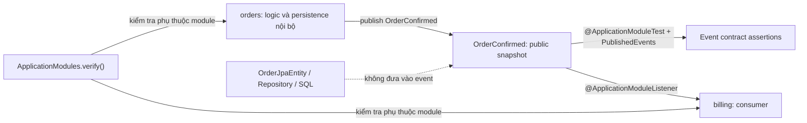

# Kiểm tra event không chứa implementation detail

## Mục tiêu học tập

Trong chương **Event assertions** của học phần **Spring Modulith Verification & Testing**, việc xác nhận một event đã được phát là chưa đủ. Nếu event mang theo entity JPA, repository, đối tượng của package `internal` hoặc chi tiết kỹ thuật của cơ sở dữ liệu, module tiêu thụ sẽ vô tình phụ thuộc vào cách module phát được triển khai. Khi đó, chỉ một lần refactor nội bộ cũng có thể phá vỡ hợp đồng giao tiếp giữa các module.

Sau bài này, bạn có thể:

- Phân biệt **business event** (thông tin nghiệp vụ công khai) với **implementation detail** (chi tiết triển khai riêng của module).
- Thiết kế event dạng snapshot bất biến, chỉ chứa các trường mà module tiêu thụ thực sự cần.
- Sử dụng `@ApplicationModuleTest` và `PublishedEvents` để xác minh **đúng event, đúng payload và đúng số lần**.
- Kiểm tra cấu trúc event bằng Java Reflection, nhằm ngăn trường hoặc kiểu dữ liệu nội bộ bị bổ sung vào public contract.
- Hiểu vai trò khác nhau của `ApplicationModules.verify()`, kiểm thử payload, kiểm thử serialization và kiểm thử listener.
- Đưa các phép kiểm bảo vệ hợp đồng event vào quality gate của CI để ngăn hồi quy.

## 1. Implementation detail là gì trong một event?

Một application module trong Spring Modulith sở hữu mô hình domain và cách triển khai của nó. Ví dụ, module `orders` có thể dùng `OrderJpaEntity`, `OrderRepository`, `EntityManager`, cache hoặc một số bảng nội bộ. Module `billing` chỉ cần biết một đơn hàng đã được xác nhận để tạo hóa đơn; nó thường **không cần biết** bảng dữ liệu nào đã được cập nhật hoặc service nội bộ nào thực hiện thao tác đó.

Giả sử có event `OrderConfirmed`. Phân biệt hai nhóm dữ liệu:

| Nội dung event | Đánh giá | Lý do |
| --- | --- | --- |
| `orderId` | Thường phù hợp | Khóa tương quan để consumer xác định đơn |
| `customerId` | Phù hợp nếu consumer được phép dùng | Dữ liệu nghiệp vụ phục vụ hóa đơn/thông báo |
| `totalAmount` và `currency` | Phù hợp nếu là một phần hợp đồng | Giá trị nghiệp vụ mà consumer cần |
| `OrderJpaEntity` hoặc Hibernate proxy | Không phù hợp cho event liên module | Ràng buộc consumer vào persistence model và lazy loading |
| `OrderRepository`, `EntityManager` | Không phù hợp | Là dependency kỹ thuật, không phải trạng thái nghiệp vụ |
| Tên bảng, SQL, connection string | Không phù hợp | Thay đổi theo công nghệ lưu trữ, có thể tiết lộ cấu hình |
| Tên lớp service, tên bean, stack trace | Thường không phù hợp | Phục vụ chẩn đoán nội bộ, không phải hợp đồng domain |
| Access token, mật khẩu, thông tin thanh toán đầy đủ | Cần loại khỏi event trừ trường hợp có yêu cầu rất đặc biệt và kiểm soát rõ | Tăng rủi ro lộ dữ liệu và phạm vi truy cập |
| `correlationId` hoặc phiên bản schema | Có thể phù hợp | Được chấp nhận nếu là metadata có chủ đích trong hợp đồng giao tiếp |

**Quy tắc thiết kế:** Một event công khai nên mô tả **điều gì vừa xảy ra trong nghiệp vụ**, với thông tin tối thiểu để consumer phản ứng; nó không cần giải thích **mã nguồn đã thực hiện điều đó như thế nào**.

Điều này liên quan trực tiếp đến mục tiêu của Spring Modulith: giảm phụ thuộc giữa các application module, giữ ổn định public API và cho phép thay đổi cơ chế lưu trữ hoặc thuật toán mà không kéo theo sửa code ở các module khác.

## 2. Event “rò rỉ” implementation detail gây ra vấn đề gì?

Hãy xem thiết kế cần tránh sau; `OrderJpaEntity` đại diện cho một entity nằm trong package nội bộ của module:

```java
// Ví dụ phản diện: KHÔNG nên dùng làm event công khai.
package com.example.shop.orders;

import com.example.shop.orders.internal.persistence.OrderJpaEntity;

public record OrderConfirmedUnsafe(
        OrderJpaEntity entity,
        String tableName,
        String repositoryBeanName) {
}
```

Nếu module `billing` đọc `event.entity().getTotal()`, nó bị ràng buộc với JPA entity của `orders`. Về sau, khi `orders` chuyển sang JDBC, đổi quan hệ lazy hoặc tách entity thành nhiều bảng, consumer có thể phải sửa dù ý nghĩa nghiệp vụ **đơn hàng đã xác nhận** không thay đổi.

Các rủi ro cụ thể gồm:

1. **Phụ thuộc ngược vào package nội bộ:** consumer phải import kiểu mà kiến trúc module muốn che giấu.
2. **Vòng đời đối tượng không rõ ràng:** JPA entity có thể là proxy hoặc bị truy cập sau khi persistence context đóng.
3. **Payload thay đổi theo trạng thái mutable:** event giữ tham chiếu tới object; sửa object sau publish có thể làm dữ liệu consumer quan sát khác thời điểm event xuất hiện.
4. **Khó serialize và tiến hóa schema:** serialization có thể kéo theo quan hệ entity, trường lazy, thuộc tính kỹ thuật và vòng tham chiếu.
5. **Lộ thông tin dư thừa:** một event lưu hoặc gửi đi nhiều dữ liệu hơn nhu cầu của consumer.

Giải pháp là định nghĩa một **public business contract** độc lập với cơ chế triển khai:

```java
package com.example.shop.orders;

import java.math.BigDecimal;
import java.util.UUID;

public record OrderConfirmed(
        UUID orderId,
        UUID customerId,
        BigDecimal totalAmount,
        String currency) {
}
```

`OrderConfirmed` là snapshot gồm các giá trị nghiệp vụ. Nó không chứa `OrderJpaEntity`, `OrderRepository` hoặc đường dẫn kết nối database. Việc dùng `record` làm cấu trúc rõ ràng và tránh sửa tham chiếu field sau khi tạo; các kiểu `UUID`, `String` và `BigDecimal` trong ví dụ cũng là immutable.

> `record` **không tự làm mọi object lồng nhau bất biến**. Nếu event chứa `List<LineItem>` hoặc một object mutable, cần dùng kiểu giá trị bất biến và defensive copy. Đồng thời, không có quy tắc bắt buộc mọi event phải là record; điều quan trọng là hợp đồng và dữ liệu mà nó phơi bày.

## 3. Đặt event ở đúng ranh giới module

Spring Modulith nhìn package gốc của application module như một phần của public API theo quy ước. Các subpackage như `orders.internal` thường là implementation detail và bị giới hạn truy cập liên module; có thể công khai các package được chọn qua named interfaces khi thật sự cần.

Ví dụ bố cục ý tưởng:

```text
com.example.shop
├── orders
│   ├── OrderConfirmed.java        <-- public business event
│   ├── OrderConfirmationService.java
│   └── internal
│       ├── persistence
│       │   ├── OrderJpaEntity.java
│       │   └── OrderRepository.java
│       └── pricing
│           └── TotalCalculator.java
└── billing
    └── BillingOnOrderConfirmed.java
```

`billing` có thể phụ thuộc vào `com.example.shop.orders.OrderConfirmed`. Nó không cần tham chiếu `orders.internal.persistence.OrderJpaEntity`. Khi cần tổ chức public event ở một subpackage riêng, hãy định nghĩa named interface tương ứng theo cơ chế Spring Modulith và kiểm chứng quy tắc exposure.



**Ranh giới cần bảo vệ gồm hai lớp:**

- **Kiến trúc:** module `billing` không truy cập các package nội bộ của `orders`. Việc này được kiểm chứng bằng `ApplicationModules.verify()`.
- **Hợp đồng event:** kiểu `OrderConfirmed` chỉ công bố dữ liệu phù hợp, có payload chính xác và không bị thay đổi tùy tiện. Việc này được kiểm chứng bằng event assertions và test cấu trúc event.

Kiểm tra đồ thị phụ thuộc **không tự chứng minh** rằng event không chứa chuỗi connection string, trường dữ liệu nhạy cảm hoặc thuộc tính kỹ thuật kiểu `String`. Do đó phải kiểm tra cả cấu trúc lẫn nội dung payload.

## 4. Ví dụ phát event không phơi bày chi tiết triển khai

Ví dụ dùng Java 17+, Spring Boot, Spring Modulith, JUnit Jupiter và AssertJ. Trong hệ thống thực tế, service xác nhận đơn thường tải entity từ repository rồi tính ra dữ liệu nghiệp vụ. Để các ví dụ dưới đây ngắn gọn và tập trung vào hợp đồng event, chúng ta truyền các **giá trị đầu vào đã được xác thực** trực tiếp cho service.

### 4.1. Service phát snapshot

Tạo `OrderConfirmationService.java` trong package `com.example.shop.orders`:

```java
package com.example.shop.orders;

import java.math.BigDecimal;
import java.util.Objects;
import java.util.UUID;
import org.springframework.context.ApplicationEventPublisher;
import org.springframework.stereotype.Service;

@Service
public class OrderConfirmationService {

    private final ApplicationEventPublisher publisher;

    public OrderConfirmationService(ApplicationEventPublisher publisher) {
        this.publisher = publisher;
    }

    public void confirm(
            UUID orderId,
            UUID customerId,
            BigDecimal totalAmount,
            String currency) {

        Objects.requireNonNull(orderId, "orderId");
        Objects.requireNonNull(customerId, "customerId");
        Objects.requireNonNull(totalAmount, "totalAmount");
        Objects.requireNonNull(currency, "currency");

        if (totalAmount.signum() <= 0) {
            throw new IllegalArgumentException(
                    "totalAmount must be positive");
        }
        if (currency.isBlank()) {
            throw new IllegalArgumentException(
                    "currency must not be blank");
        }

        publisher.publishEvent(new OrderConfirmed(
                orderId,
                customerId,
                totalAmount,
                currency));
    }
}
```

Khi áp dụng vào production, thay việc lấy trực tiếp `customerId`, `totalAmount` và `currency` từ phía gọi bằng việc đọc **trạng thái domain đã được kiểm chứng** trong module `orders`; tránh để caller giả mạo dữ liệu của đơn khác. Sau bước xử lý thành công, ánh xạ giá trị từ domain object sang `OrderConfirmed`. Bước ánh xạ nằm bên trong module, nên module nhận không biết chi tiết lưu trữ.

### 4.2. Kiểm tra event đã phát với PublishedEvents

Đặt bài test vào package `com.example.shop.orders`. Phụ thuộc Maven cần có trong phạm vi test:

```xml
<dependency>
    <groupId>org.springframework.modulith</groupId>
    <artifactId>spring-modulith-starter-test</artifactId>
    <scope>test</scope>
</dependency>
```

Tệp `src/test/java/com/example/shop/orders/OrderConfirmedEventTests.java`:

```java
package com.example.shop.orders;

import static org.assertj.core.api.Assertions.assertThat;
import static org.assertj.core.api.Assertions.assertThatThrownBy;

import java.math.BigDecimal;
import java.util.UUID;
import org.junit.jupiter.api.Test;
import org.springframework.beans.factory.annotation.Autowired;
import org.springframework.modulith.test.ApplicationModuleTest;
import org.springframework.modulith.test.PublishedEvents;

@ApplicationModuleTest
class OrderConfirmedEventTests {

    @Autowired
    OrderConfirmationService confirmationService;

    @Test
    void publishesOnlyExpectedBusinessPayload(PublishedEvents events) {
        UUID orderId = UUID.randomUUID();
        UUID customerId = UUID.randomUUID();
        BigDecimal totalAmount = new BigDecimal("125000.00");

        confirmationService.confirm(
                orderId, customerId, totalAmount, "VND");

        var forOrder = events.ofType(OrderConfirmed.class)
                .matching(event -> orderId.equals(event.orderId()));

        assertThat(forOrder)
                .hasSize(1)
                .allSatisfy(event -> {
                    assertThat(event.orderId())
                            .isEqualTo(orderId);
                    assertThat(event.customerId())
                            .isEqualTo(customerId);
                    assertThat(event.totalAmount())
                            .isEqualByComparingTo(totalAmount);
                    assertThat(event.currency())
                            .isEqualTo("VND");
                });
    }

    @Test
    void rejectsInvalidAmountWithoutPublishing(PublishedEvents events) {
        UUID orderId = UUID.randomUUID();
        UUID customerId = UUID.randomUUID();

        assertThatThrownBy(() ->
                confirmationService.confirm(
                        orderId, customerId, BigDecimal.ZERO, "VND"))
                .isInstanceOf(IllegalArgumentException.class);

        assertThat(events.ofType(OrderConfirmed.class)
                .matching(event -> orderId.equals(event.orderId())))
                .isEmpty();
    }
}
```

Test này bảo vệ **giá trị nghiệp vụ**:

1. `ofType(OrderConfirmed.class)` chọn event thuộc hợp đồng công khai cần thử.
2. `matching(…)` lọc theo `orderId` để không nhầm sang event của đơn hàng khác.
3. `hasSize(1)` bảo đảm đúng một event thuộc đơn cần kiểm chứng.
4. `allSatisfy(…)` kiểm tra các field mà consumer được phép dựa vào.
5. Test nhánh lỗi xác nhận service không phát `OrderConfirmed` khi tổng tiền không hợp lệ.

Tuy nhiên, nếu ai đó bổ sung một trường mới `String sqlQuery` vào record mà vẫn giữ các trường cũ, bài test giá trị có thể chưa phát hiện việc mở rộng hợp đồng. Để bảo vệ **cấu trúc**, cần một assertion khác.

## 5. Kiểm tra cấu trúc record bằng Reflection

Giả sử public contract đã thống nhất chính xác bốn field:

| Field | Java type | Ý nghĩa |
| --- | --- | --- |
| `orderId` | `UUID` | Định danh đơn hàng |
| `customerId` | `UUID` | Định danh khách hàng |
| `totalAmount` | `BigDecimal` | Số tiền theo đơn vị tiền của `currency` |
| `currency` | `String` | Mã tiền tệ |

Ta có thể dùng Reflection để kiểm tra **danh sách field và kiểu dữ liệu**. Với Java record, `Class.getRecordComponents()` trả về các record component được khai báo công khai qua accessor.

Tệp `src/test/java/com/example/shop/orders/OrderConfirmedContractTests.java`:

```java
package com.example.shop.orders;

import static org.assertj.core.api.Assertions.assertThat;

import java.lang.reflect.RecordComponent;
import java.math.BigDecimal;
import java.util.Arrays;
import java.util.Map;
import java.util.UUID;
import java.util.stream.Collectors;
import org.junit.jupiter.api.Test;

class OrderConfirmedContractTests {

    @Test
    void exposesOnlyTheAgreedBusinessFields() {
        assertThat(OrderConfirmed.class.isRecord()).isTrue();

        Map<String, Class<?>> actual = Arrays.stream(
                        OrderConfirmed.class.getRecordComponents())
                .collect(Collectors.toMap(
                        RecordComponent::getName,
                        RecordComponent::getType));

        Map<String, Class<?>> expected = Map.of(
                "orderId", UUID.class,
                "customerId", UUID.class,
                "totalAmount", BigDecimal.class,
                "currency", String.class);

        assertThat(actual).isEqualTo(expected);
    }

    @Test
    void eventLivesInThePublicModuleApi() {
        assertThat(OrderConfirmed.class.getPackageName())
                .isEqualTo("com.example.shop.orders");
    }
}
```

Điều mà test cấu trúc phát hiện:

- Bổ sung một component `OrderJpaEntity entity` → **fail** vì danh sách component khác kỳ vọng.
- Bổ sung một component `String tableName` → **fail** dù đó chỉ là `String` và kiểm tra loại package không thể phát hiện.
- Đổi `BigDecimal totalAmount` thành `double totalAmount` → **fail** vì đổi kiểu hợp đồng.
- Chuyển event vào package `com.example.shop.orders.internal` → **fail** ở phép kiểm vị trí API.

Assertion dùng **allowlist** (chỉ chấp nhận field đã thỏa thuận). Nó mạnh hơn một danh sách cấm như `doesNotContain("password")`, bởi implementation detail có thể xuất hiện với tên mới (`entityManager`, `jdbcUrl`, `hibernateProxy`, v.v.). Mỗi khi cần mở rộng hợp đồng thật sự, đội phát triển chủ động rà soát, cập nhật tài liệu và điều chỉnh allowlist cùng test.

### 5.1. Khi nào không nên đóng băng toàn bộ field?

Kiểm tra chính xác bốn trường phù hợp với event có **public contract ổn định** và yêu cầu review mọi thay đổi schema. Nhưng nếu sản phẩm có cơ chế mở rộng payload có kiểm soát, việc khóa toàn bộ field sẽ khiến test fail cả với thay đổi tương thích.

Có thể thay bằng hai tầng kiểm thử:

- **Các field bắt buộc:** xác minh mọi field consumer phải hiểu vẫn tồn tại và đúng kiểu.
- **Các loại dữ liệu bị cấm:** chặn class thuộc package `internal`, JPA proxy, framework persistence và các dữ liệu nhạy cảm ngoài hợp đồng.

Với hệ thống xuất event qua JSON/Avro/Protobuf, cần bổ sung cơ chế quản lý phiên bản schema và kiểm tra tương thích consumer; test Reflection chỉ xem cấu trúc Java đang biên dịch.

### 5.2. Kiểm tra generic và kiểu lồng nhau

Chỉ đọc `RecordComponent.getType()` là **chưa đủ** nếu có generic. Ví dụ:

```java
public record OrderConfirmedItems(
        UUID orderId,
        List<InternalOrderLine> lines) {
}
```

Khi dùng `getType()` cho `lines`, kết quả chỉ là `List.class`; kiểu `InternalOrderLine` ẩn trong generic. Kiểm tra thêm `getGenericType()` hoặc sử dụng công cụ phân tích kiến trúc ở mức bytecode để xét cả generic signature.

Ví dụ phát hiện tham chiếu rõ ràng tới package nội bộ trong **chữ ký component**:

```java
@Test
void doesNotReferToInternalTypesInRecordComponents() {
    for (RecordComponent component
            : OrderConfirmed.class.getRecordComponents()) {

        String signature =
                component.getGenericType().getTypeName();

        assertThat(signature)
                .doesNotContain(
                        ".internal.",
                        "org.hibernate.",
                        "jakarta.persistence.");
    }
}
```

Đặt phương thức trên trong `OrderConfirmedContractTests` và tái sử dụng `import` đã có. Phép kiểm theo chuỗi chữ ký này là một **guardrail bổ sung**, không phải bộ phân tích type graph toàn diện: nó không đi sâu vào field của từng DTO lồng nhau và có thể cần điều chỉnh theo thư viện/kiến trúc dự án. Một kiểm tra kiến trúc chuyên dụng (ví dụ ArchUnit) phù hợp hơn khi cần áp dụng quy tắc đệ quy cho nhiều event.

## 6. Ngăn lộ chi tiết trong giá trị payload

Một event vẫn có thể rò rỉ implementation detail dù **kiểu field trông vô hại**. Ví dụ:

```java
public record OrderConfirmedMetadata(
        UUID orderId,
        String details) {
}
```

Kiểu `String` không nói `details` đang chứa gì. Một publisher có thể vô tình gán:

```java
String details = "Order persisted to table order_v2 by OrderJpaRepository";
```

Một test chỉ kiểm tra kiểu `String` sẽ không phát hiện rò rỉ ngữ nghĩa đó. Cách bền vững hơn là **không đưa trường mơ hồ vào contract**, chỉ cho phép những field cụ thể với ý nghĩa nghiệp vụ đã thống nhất.

Nếu event bắt buộc có một trường metadata mở rộng, hãy xác định:

1. **Ai có quyền sử dụng** trường đó và phục vụ mục đích gì?
2. **Định dạng/giá trị hợp lệ** là gì? Có dùng enum hoặc value object thay cho chuỗi tự do được không?
3. **Giới hạn dữ liệu**: không chứa token, mật khẩu, kết nối database, chi tiết triển khai hoặc dữ liệu cá nhân dư thừa.
4. **Cơ chế kiểm tra**: validator, serialization test và assertion giá trị trên những tình huống có rủi ro.

Một test payload nên kiểm tra giá trị nghiệp vụ **độc lập** với cách service tính ra giá trị. Nếu cả service và test cùng lấy kỳ vọng từ một object sai, phép so sánh có thể pass dù dữ liệu event sai nghiệp vụ. Hãy tạo fixture rõ ràng cho các giá trị được phép phát và đối chiếu với dữ liệu nguồn đã xác thực.

### 6.1. Metadata kỹ thuật có luôn bị cấm?

Không. `correlationId`, `occurredAt` hoặc `schemaVersion` có thể là một phần hợp đồng có chủ đích. Chúng giúp correlation, audit hoặc hỗ trợ tiến hóa message schema. Điều cần tránh là rò rỉ implementation detail **không được consumer cần và không được quản lý như contract**.

Ví dụ, `occurredAt` là thời điểm nghiệp vụ xảy ra và có thể là dữ liệu domain hợp lệ. Trái lại, tên method Java `OrderServiceImpl.confirmInternal` không nên trở thành một field mà consumer phải hiểu.

## 7. Nếu event được serialize hoặc gửi ra bên ngoài JVM

`PublishedEvents` quan sát đối tượng Spring application event được publish trong application context. Khi một listener chuyển event sang Kafka, RabbitMQ, HTTP hoặc outbox, cấu trúc **message cuối cùng** còn phụ thuộc bước mapping và serialization.

Đối với message JSON, có thể thêm test ở tầng chuyển đổi bằng Jackson, nếu `jackson-databind` có trên test classpath:

```java
import static org.assertj.core.api.Assertions.assertThat;

import com.fasterxml.jackson.databind.JsonNode;
import com.fasterxml.jackson.databind.ObjectMapper;
import java.math.BigDecimal;
import java.util.UUID;
import org.junit.jupiter.api.Test;

class OrderConfirmedJsonTests {

    private final ObjectMapper mapper = new ObjectMapper();

    @Test
    void serializesOnlyPublicContractFields() {
        var event = new OrderConfirmed(
                UUID.fromString("11111111-1111-1111-1111-111111111111"),
                UUID.fromString("22222222-2222-2222-2222-222222222222"),
                new BigDecimal("125000.00"),
                "VND");

        JsonNode json = mapper.valueToTree(event);

        assertThat(json.isObject()).isTrue();
        assertThat(json.size()).isEqualTo(4);
        assertThat(json.has("orderId")).isTrue();
        assertThat(json.has("customerId")).isTrue();
        assertThat(json.has("totalAmount")).isTrue();
        assertThat(json.has("currency")).isTrue();

        assertThat(json.has("entityManager")).isFalse();
        assertThat(json.has("repositoryBeanName")).isFalse();
        assertThat(json.has("databaseUrl")).isFalse();
    }
}
```

Test trên kiểm tra **JSON mà Jackson tạo từ object Java**, phù hợp cho một bước kiểm tra serialization đơn giản. Nếu production sử dụng cấu hình `ObjectMapper` riêng, custom serializer, annotation, hoặc message wrapper, hãy test bằng **cùng mapper và cùng đường chuyển đổi** mà ứng dụng thật sử dụng. Đối với payload có versioning, cần đánh giá cả tương thích ngược/tương thích tiến của schema, không chỉ số trường.

**Lưu ý:** `PublishedEvents` pass không chứng minh message đã gửi qua broker thành công, listener nhận được message, hoặc JSON đúng schema của consumer. Đây là các tầng kiểm thử tích hợp bổ sung.

## 8. Không để test phụ thuộc implementation detail của publisher

Mục tiêu “không chứa implementation detail” áp dụng cả vào cách **viết test**. Test hành vi cần gọi API nghiệp vụ ổn định và quan sát event; không nên phải biết phương thức private, tên repository bean hoặc số lần gọi `save()` của một implementation cụ thể chỉ để chứng minh hợp đồng event.

Ví dụ:

```java
confirmationService.confirm(
        orderId, customerId, new BigDecimal("125000"), "VND");

var eventForOrder = events.ofType(OrderConfirmed.class)
        .matching(event -> orderId.equals(event.orderId()));

assertThat(eventForOrder).hasSize(1);
```

Đây là kiểm tra hợp đồng từ bên ngoài service. Một test chỉ dựa vào `verify(internalRepository, times(1)).save(…)` có thể giòn khi repository được thay bằng bulk update hoặc domain event khác, dù hợp đồng công khai vẫn đúng.

Tuy nhiên, test repository hoặc integration test vẫn cần thiết nếu mục tiêu là xác minh **trạng thái đã lưu**; chỉ là nên tách mục tiêu đó khỏi phép kiểm “các field của public event có phù hợp không?”.

## 9. Vai trò của ApplicationModules.verify()

Để chống phụ thuộc vào implementation detail ở **cấp module**, Spring Modulith cung cấp `ApplicationModules.verify()`. Ví dụ minh họa trong một test kiến trúc:

```java
import org.junit.jupiter.api.Test;
import org.springframework.modulith.core.ApplicationModules;

class ModularityTests {

    @Test
    void obeysModuleBoundaries() {
        ApplicationModules.of(ShopApplication.class).verify();
    }
}
```

`ShopApplication` trong ví dụ là lớp ứng dụng Spring Boot gốc của dự án, cần thay bằng lớp thực tế. Kiểm tra này có thể phát hiện các vi phạm quy tắc phụ thuộc giữa module, ví dụ consumer truy cập kiểu thuộc package không được module kia công khai.

Tuy nhiên, cần phân biệt rõ phạm vi:

| Câu hỏi cần xác minh | Công cụ chính | Giới hạn |
| --- | --- | --- |
| Module tiêu thụ có phụ thuộc vào package nội bộ của module phát không? | `ApplicationModules.verify()` | Không kiểm tra giá trị field của event |
| `OrderConfirmed` có đúng public schema đã thỏa thuận không? | Reflection/architecture rule | Không chứng minh event có được phát khi chạy nghiệp vụ |
| Khi xác nhận đơn, event có đúng ID, tiền và đơn vị không? | `@ApplicationModuleTest` + `PublishedEvents` | Không chứng minh listener đã xử lý xong |
| JSON message có lộ field kỹ thuật không? | Serialization/schema test | Không bảo đảm giao message qua broker thành công |
| Listener bất đồng bộ/`AFTER_COMMIT` có tác động mong đợi không? | `Scenario` hoặc integration test theo transaction | Không thay thế kiểm tra ranh giới module |

Vì vậy, một bài `ApplicationModules.verify()` pass không phải bằng chứng rằng mọi event đều tránh dữ liệu nhạy cảm hoặc không có một field kỹ thuật kiểu `String`. Các assertion được thiết kế theo từng tầng để bảo vệ cả kiến trúc lẫn hợp đồng runtime.

## 10. Các lỗi thường gặp và cách xử lý

| Triệu chứng | Nguyên nhân có thể | Cách sửa |
| --- | --- | --- |
| Consumer import `orders.internal.persistence.OrderJpaEntity` | Event phơi bày entity nội bộ | Đổi sang snapshot/value object ở public API |
| Event mang `Repository` hoặc `EntityManager` | Trộn dependency runtime vào message | Chỉ giữ dữ liệu nghiệp vụ cần thiết |
| Test payload pass dù thêm field `String sqlQuery` | Chỉ kiểm giá trị các field cũ | Bổ sung kiểm tra cấu trúc bằng allowlist |
| Kiểm tra class trực tiếp pass nhưng `List<InternalType>` lọt qua | Chỉ xét kiểu raw của generic | Kiểm tra generic signature và DTO lồng nhau |
| Serialization chứa thêm quan hệ entity | Serialize entity JPA/lazy proxy | Dùng record DTO snapshot; test mapper thật |
| Event sai customer nhưng test vẫn pass | Lấy kỳ vọng từ cùng nguồn dữ liệu sai | Dùng fixture độc lập và đối chiếu với domain source |
| `PublishedEvents` pass nhưng listener chưa xử lý | Listener async hoặc chạy `AFTER_COMMIT` | Dùng `Scenario`/integration test chờ side effect |
| Một lần thay đổi schema khiến nhiều module phải sửa | Consumer phụ thuộc kiểu/field nội bộ | Công khai contract ổn định và quản lý version |
| Test thất bại khi thêm field nghiệp vụ hợp lệ | Allowlist cố ý bảo vệ schema chính xác | Review thay đổi, cập nhật contract và test có chủ đích |

## 11. Bài thực hành

Hãy mở rộng ví dụ `OrderConfirmed` theo từng bước:

1. **Đúng hợp đồng:** chạy bài `OrderConfirmedEventTests` và `OrderConfirmedContractTests`. Giải thích phép kiểm nào bảo vệ giá trị event, phép kiểm nào bảo vệ hình dạng schema.
2. **Thêm implementation detail:** thêm `String repositoryBeanName` vào `OrderConfirmed` và cập nhật lời gọi constructor cho biên dịch. Kiểm tra test schema thất bại, rồi hoàn tác.
3. **Đưa kiểu nội bộ vào event:** tạo một kiểu `OrderJpaEntity` trong `orders.internal.persistence` và thử dùng làm component event. Xác định vì sao test schema và/hoặc quy tắc kiến trúc cần phát hiện thay đổi này.
4. **Thêm field nghiệp vụ hợp lệ:** đề xuất `Instant occurredAt`. Mô tả consumer nào cần trường này, nguồn thời gian nào đáng tin cậy và cách cập nhật contract/test sau review.
5. **Thêm generic:** tạo biến thể event có `List<InternalOrderLine>`. Giải thích giới hạn của `getType()` và cách kiểm tra `getGenericType()`.
6. **Serialization:** nếu dự án có Jackson, kiểm tra JSON chỉ chứa những field công khai được phê duyệt. Thử gắn entity mutable và quan sát vấn đề hoặc nguy cơ phát sinh.
7. **Quality gate:** đưa kiểm tra kiến trúc, contract schema và event assertions vào quy trình `mvn test` hoặc `./gradlew test` trong CI.

**Tiêu chí hoàn thành:** phép kiểm cấu trúc thất bại khi event thêm một field kỹ thuật không nằm trong public contract; phép kiểm runtime thất bại khi event sai ID, số tiền, currency hoặc số lần phát. Người học giải thích được tại sao một bài kiểm tra không thể thay thế toàn bộ các lớp kiểm chứng còn lại.

## 12. Tự kiểm tra kiến thức

**Câu 1.** `OrderConfirmed` chứa một field `String sqlQuery`. Kiểm tra `ApplicationModules.verify()` có chắc phát hiện không?

**Trả lời:** Không. `sqlQuery` có kiểu `String` nên không nhất thiết tạo vi phạm phụ thuộc module. Cần kiểm tra public schema hoặc validator giá trị để cấm field không thuộc hợp đồng.

**Câu 2.** Event chứa `List<InternalOrderLine>`, nhưng Reflection chỉ thấy `List.class`. Vì sao?

**Trả lời:** `getType()` trả kiểu raw; kiểu phần tử nằm trong generic signature. Dùng `getGenericType()` hoặc phân tích bytecode để kiểm tra sâu hơn.

**Câu 3.** Test thấy đúng một `OrderConfirmed`, payload đúng, có thể kết luận consumer bất đồng bộ đã tạo hóa đơn không?

**Trả lời:** Không. `PublishedEvents` quan sát event ở phía publish. Xác minh hoàn tất listener cần `Scenario` hoặc integration test kiểm tra side effect.

**Câu 4.** Có nên cấm mọi metadata kỹ thuật trong event không?

**Trả lời:** Không nhất thiết. `correlationId` hoặc `schemaVersion` có thể là một phần của contract nếu được quản lý và có nhu cầu rõ ràng. Cần tránh các chi tiết triển khai không ổn định hoặc dữ liệu dư thừa.

**Câu 5.** Vì sao không nên đưa nguyên JPA entity vào event liên module?

**Trả lời:** Consumer bị phụ thuộc vào persistence model và lazy loading, payload mutable khó kiểm soát, dễ gây lỗi serialization và rò rỉ thông tin. Dùng snapshot bất biến giúp bảo vệ ranh giới.

## Kết luận

Một business event tốt trong Spring Modulith phải truyền đạt **thông tin nghiệp vụ cần thiết** qua một public contract ổn định. Để ngăn event chứa implementation detail, hãy thiết kế payload dạng snapshot, đặt kiểu event tại API được module công khai, dùng `PublishedEvents` xác minh event thật và dữ liệu của nó, đồng thời kiểm tra cấu trúc record bằng allowlist hoặc quy tắc kiến trúc. Khi event được serialize hoặc phân phối tới consumer bất đồng bộ, bổ sung test serialization và integration test ở tầng thích hợp. Kết hợp các phép kiểm với `ApplicationModules.verify()` trong CI giúp phát hiện cả vi phạm phụ thuộc và hồi quy hợp đồng sự kiện trước khi đưa mã lên môi trường cao hơn.

## Tài liệu tham khảo

- [Spring Modulith Reference — Fundamentals: Application modules and interfaces](https://docs.spring.io/spring-modulith/reference/fundamentals.html)
- [Spring Modulith Reference — Integration Testing Application Modules](https://docs.spring.io/spring-modulith/reference/testing.html)
- [Spring Modulith Reference — Working with Application Events](https://docs.spring.io/spring-modulith/reference/events.html)
- [Spring Modulith Javadoc — PublishedEvents](https://docs.spring.io/spring-modulith/docs/current/api/org/springframework/modulith/test/PublishedEvents.html)
- [Java SE — Class.getRecordComponents()](https://docs.oracle.com/en/java/javase/17/docs/api/java.base/java/lang/Class.html#getRecordComponents())
- [Java SE — RecordComponent](https://docs.oracle.com/en/java/javase/17/docs/api/java.base/java/lang/reflect/RecordComponent.html)
