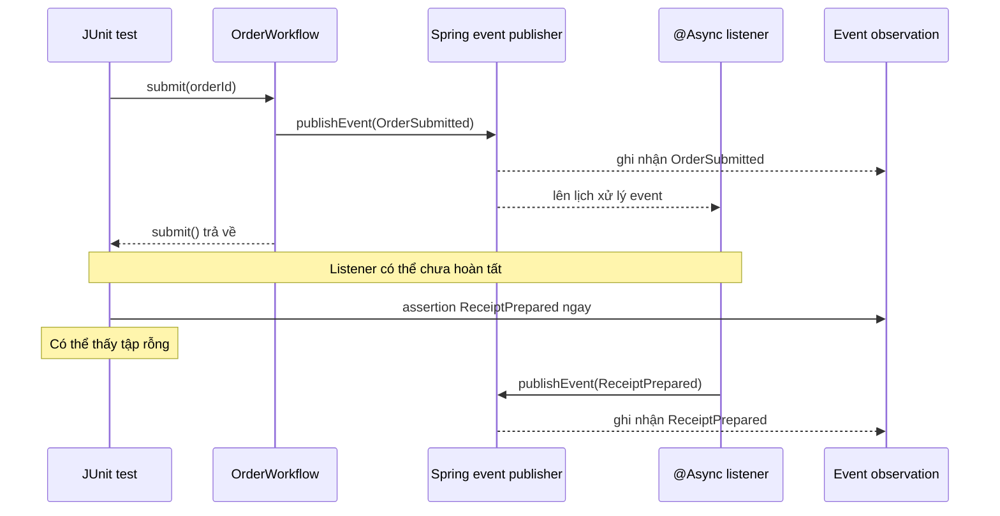
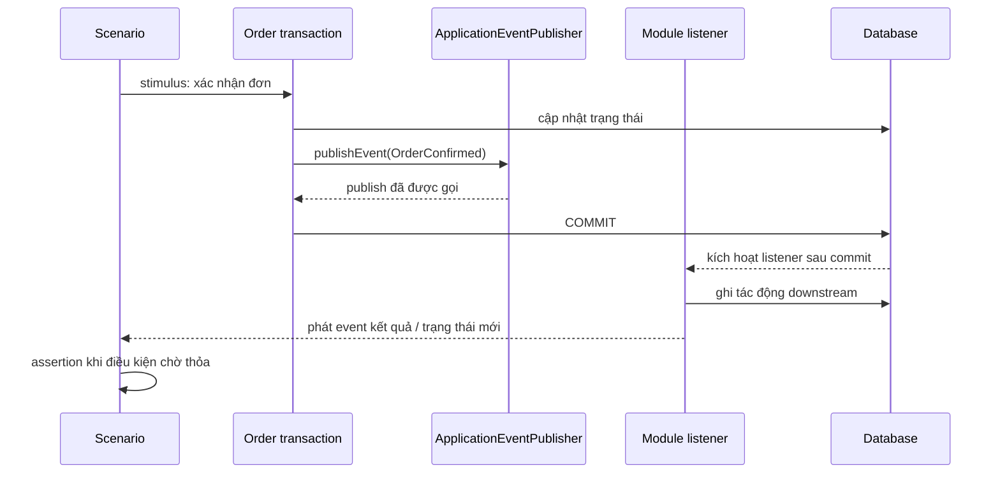

# Chờ event bất đồng bộ trước khi assertion

## Mục tiêu học tập

Trong chương **Event assertions** thuộc học phần **Spring Modulith Verification & Testing**, ta không chỉ kiểm tra ranh giới phụ thuộc giữa các application module mà còn kiểm tra hợp đồng tương tác của chúng qua event. Một khó khăn thường gặp là event hoặc kết quả từ listener được tạo **bất đồng bộ**: nếu test assert ngay sau khi gọi nghiệp vụ, thread xử lý có thể chưa hoàn thành và tạo ra kết quả thất bại không ổn định.

Sau bài này, bạn có thể:

- Phân biệt thời điểm **publish event**, **listener bắt đầu chạy**, **listener phát event tiếp theo** và **side effect đã hoàn tất**.
- Giải thích vì sao `PublishedEvents` phù hợp để assert sự kiện được phát trực tiếp, nhưng một assertion tức thì có thể quá sớm đối với event đến từ listener bất đồng bộ.
- Dùng `Scenario` trong `@ApplicationModuleTest` để kích hoạt nghiệp vụ, **chờ event thuộc kiểu mong đợi**, lọc theo khóa tương quan và kiểm tra payload khi event đến.
- Thiết kế timeout có giới hạn, tránh `Thread.sleep(…)` và nhận biết các nguyên nhân khiến việc chờ hết hạn.
- Kiểm thử listener `@Async`, listener sau commit và tác động lên database theo đúng mục tiêu của từng test.
- Kết hợp test event với `ApplicationModules.verify()` thành quality gate CI để chặn sai phụ thuộc module và hồi quy hành vi.

## 1. Vì sao assertion tức thì dễ thất bại?

Giả sử module `orders` tiếp nhận đơn, phát `OrderSubmitted`, sau đó listener bất đồng bộ chuẩn bị thông báo xác nhận và phát `ReceiptPrepared`.

Luồng thực tế có thể như sau:



Nếu test làm như sau thì có nguy cơ gặp *race condition*:

```java
workflow.submit(orderId);

// Có thể chạy trước khi listener bất đồng bộ phát ReceiptPrepared.
assertThat(events.ofType(ReceiptPrepared.class)).hasSize(1);
```

Lỗi không nhất thiết nằm ở mã nghiệp vụ. Test đang quan sát kết quả **trước khi điều kiện cần kiểm chứng có cơ hội xảy ra**. Khi máy CI bận, listener xử lý chậm hơn và test có thể fail; trên máy phát triển, listener kịp hoàn tất nên test pass.

Điều quan trọng là xác định test đang kiểm tra **mốc nào**:

| Mốc | Ý nghĩa | Cách kiểm chứng phù hợp |
| --- | --- | --- |
| `OrderSubmitted` được phát ngay trong `submit(…)` | Hợp đồng publish của service | `PublishedEvents` và assertion trực tiếp sau khi service trả về |
| Listener bất đồng bộ phát `ReceiptPrepared` | Kết quả event đến sau một khoảng thời gian không cố định | `Scenario` chờ event phù hợp rồi assert |
| Listener tạo xong một bản ghi receipt | Side effect bền vững trong database | Chờ trạng thái phù hợp và đọc repository |
| Consumer ở hệ thống khác đã nhận message | Tương tác qua broker/HTTP | Integration test với hạ tầng vận chuyển thực tế |

> **Publish event không đồng nghĩa với xử lý event thành công.** Một `OrderSubmitted` đã được ghi nhận không chứng minh listener đã phát `ReceiptPrepared`, ghi database hay gửi thông báo xong.

## 2. Công cụ chờ event: Scenario

Spring Modulith cung cấp `Scenario` trong gói `org.springframework.modulith.test`. Khi chạy `@ApplicationModuleTest`, framework có thể cung cấp đối tượng này qua tham số phương thức JUnit.

Mẫu sử dụng:

```java
@Test
void waitsForEvent(Scenario scenario) {
    scenario.stimulate(() -> performBusinessAction())
            .andWaitForEventOfType(ExpectedEvent.class)
            .matching(event -> expectedId.equals(event.id()))
            .toArriveAndVerify(event -> {
                assertThat(event.status()).isEqualTo("READY");
            });
}
```

Đây là **mẫu API**: `performBusinessAction`, `ExpectedEvent` và `expectedId` đại diện cho code của ứng dụng, được thay bằng lớp thật trong ví dụ đầy đủ ở phần tiếp theo.

Các bước có ý nghĩa rõ ràng:

1. `stimulate(…)` khai báo **hành động kích hoạt** hành vi cần kiểm chứng.
2. `andWaitForEventOfType(ExpectedEvent.class)` chỉ định **loại event cần đợi**.
3. `matching(…)` chọn event liên quan đến đúng giao dịch, ví dụ cùng `orderId`. Khi hệ thống có nhiều test hoặc giao dịch chạy gần nhau, điều kiện này rất quan trọng.
4. `toArriveAndVerify(…)` thực hiện assertion khi event thỏa điều kiện đã đến. Nếu điều kiện không được đáp ứng trong giới hạn chờ, test thất bại.

`Scenario` thiết kế việc kích hoạt và chờ thành **một quy trình test thống nhất**, giúp tránh tình huống đăng ký quan sát quá muộn sau khi event đã xảy ra. Trong khi đó, `Thread.sleep(…)` chỉ trì hoãn theo đồng hồ và không bảo đảm điều kiện nghiệp vụ đã thành công.

### 2.1. Chờ event nào?

Nếu `OrderWorkflow.submit(…)` tự gọi `publishEvent(new OrderSubmitted(…))` đồng bộ, sau khi hàm trả về ta có thể assert `OrderSubmitted` trực tiếp. Nhưng nếu cần xác minh listener đã chuẩn bị receipt, hãy chờ **`ReceiptPrepared`** — kết quả do listener phát ra.

Chờ lại `OrderSubmitted` chỉ chứng minh event ban đầu được phát; nó không cho biết listener đã hoàn thành bước chuẩn bị receipt.

## 3. Chuẩn bị ví dụ thực hành

Ví dụ sử dụng Java 17+, Spring Boot, JUnit Jupiter, AssertJ và Spring Modulith test starter. Phụ thuộc Maven (phiên bản cần được quản lý tương thích qua Spring Modulith BOM của dự án):

```xml
<dependency>
    <groupId>org.springframework.modulith</groupId>
    <artifactId>spring-modulith-starter-test</artifactId>
    <scope>test</scope>
</dependency>
```

Với Gradle:

```groovy
dependencies {
    testImplementation 'org.springframework.modulith:spring-modulith-starter-test'
}
```

Ví dụ này đặt service, event và listener **trong cùng application module `orders`**. Vì thế `@ApplicationModuleTest` có thể chạy một module độc lập mà vẫn chứa listener cần kiểm thử. Nếu listener thật nằm ở module khác (chẳng hạn `notifications`), phải chọn phạm vi bootstrap bao gồm module đó hoặc dùng integration test phù hợp; không được giả định `@ApplicationModuleTest` mặc định khởi động mọi module trong ứng dụng.

### 3.1. Event gốc và event kết quả

Tệp `OrderSubmitted.java` trong package `com.example.shop.orders`:

```java
package com.example.shop.orders;

import java.util.UUID;

public record OrderSubmitted(UUID orderId) {
}
```

Tệp `ReceiptPrepared.java`:

```java
package com.example.shop.orders;

import java.util.UUID;

public record ReceiptPrepared(
        UUID orderId,
        String templateCode) {
}
```

`OrderSubmitted` mô tả việc đơn hàng được tiếp nhận. `ReceiptPrepared` mô tả một bước xử lý tiếp theo: nội dung receipt đã được chuẩn bị để sử dụng. Hai event có cùng `orderId` để liên kết một hành động gốc với kết quả bất đồng bộ. Trong production, hãy đặt ranh giới event và tên gọi theo đúng ngữ nghĩa nghiệp vụ thực tế.

### 3.2. Service phát event gốc

Tệp `OrderWorkflow.java`:

```java
package com.example.shop.orders;

import java.util.Objects;
import java.util.UUID;
import org.springframework.context.ApplicationEventPublisher;
import org.springframework.stereotype.Service;

@Service
public class OrderWorkflow {

    private final ApplicationEventPublisher publisher;

    public OrderWorkflow(ApplicationEventPublisher publisher) {
        this.publisher = publisher;
    }

    public void submit(UUID orderId) {
        Objects.requireNonNull(orderId, "orderId");

        publisher.publishEvent(new OrderSubmitted(orderId));
    }
}
```

Đây là service tối giản để minh họa cơ chế phát event; nó chưa lưu trạng thái đơn hàng trong repository. Trong ứng dụng thật, hãy bổ sung xử lý, transaction và kiểm tra database đúng hợp đồng của module.

### 3.3. Listener chạy bất đồng bộ và phát event kết quả

Tệp `ReceiptPreparationListener.java`:

```java
package com.example.shop.orders;

import org.springframework.context.ApplicationEventPublisher;
import org.springframework.context.event.EventListener;
import org.springframework.scheduling.annotation.Async;
import org.springframework.stereotype.Component;

@Component
public class ReceiptPreparationListener {

    private final ApplicationEventPublisher publisher;

    public ReceiptPreparationListener(ApplicationEventPublisher publisher) {
        this.publisher = publisher;
    }

    @Async
    @EventListener
    public void on(OrderSubmitted event) {
        // Tượng trưng cho công việc chuẩn bị receipt.
        // Khi công việc hoàn tất, phát event kết quả.
        publisher.publishEvent(
                new ReceiptPrepared(event.orderId(), "ORDER_RECEIVED"));
    }
}
```

Để `@Async` có hiệu lực, cần bật cơ chế xử lý bất đồng bộ qua `@EnableAsync`. Ví dụ tệp `AsyncEventConfiguration.java` trong cùng package:

```java
package com.example.shop.orders;

import org.springframework.context.annotation.Configuration;
import org.springframework.scheduling.annotation.EnableAsync;

@Configuration(proxyBeanMethods = false)
@EnableAsync
class AsyncEventConfiguration {
}
```

Lớp cấu hình này được Spring quét cùng module `orders` trong ví dụ. Khi ứng dụng đã có `@EnableAsync` ở cấu hình chung, không cần khai báo lặp lại. Nếu dùng cấu hình riêng cho test, hãy import nó vào test context.

Lưu ý:

- `@Async` chỉ hoạt động trên phương thức bean được Spring quản lý, qua cơ chế proxy thích hợp; tự tạo listener bằng `new` hoặc tự gọi phương thức trong cùng instance có thể bỏ qua proxy.
- Listener trên đây **không** gửi email thật. Nó chỉ mô phỏng hoàn tất một bước và phát event kết quả. Điều này giúp bài test tập trung vào việc chờ event.
- Không dùng `Thread.sleep(…)` để giả lập công việc chậm trong ví dụ. Bản chất vấn đề là lịch thực thi của thread bất đồng bộ, vốn không bảo đảm thời điểm hoàn tất cố định.

## 4. Test đúng cách: Stimulate, wait, verify

Tạo `src/test/java/com/example/shop/orders/ReceiptAsyncEventTests.java`:

```java
package com.example.shop.orders;

import static org.assertj.core.api.Assertions.assertThat;

import java.util.UUID;
import org.junit.jupiter.api.Test;
import org.springframework.beans.factory.annotation.Autowired;
import org.springframework.modulith.test.ApplicationModuleTest;
import org.springframework.modulith.test.PublishedEvents;
import org.springframework.modulith.test.Scenario;

@ApplicationModuleTest
class ReceiptAsyncEventTests {

    @Autowired
    OrderWorkflow workflow;

    @Test
    void publishesOrderSubmittedSynchronously(PublishedEvents events) {
        UUID orderId = UUID.randomUUID();

        workflow.submit(orderId);

        var submitted = events.ofType(OrderSubmitted.class)
                .matching(event -> orderId.equals(event.orderId()));

        assertThat(submitted).hasSize(1);
    }

    @Test
    void waitsUntilAsyncListenerPublishesReceipt(Scenario scenario) {
        UUID orderId = UUID.randomUUID();

        scenario.stimulate(() -> workflow.submit(orderId))
                .andWaitForEventOfType(ReceiptPrepared.class)
                .matching(event -> orderId.equals(event.orderId()))
                .toArriveAndVerify(event -> {
                    assertThat(event.orderId()).isEqualTo(orderId);
                    assertThat(event.templateCode())
                            .isEqualTo("ORDER_RECEIVED");
                });
    }
}
```

Hai bài test cố ý tách hai hợp đồng:

| Test | Hành vi được chứng minh |
| --- | --- |
| `publishesOrderSubmittedSynchronously` | `OrderWorkflow.submit(…)` phát `OrderSubmitted` cho đúng `orderId` |
| `waitsUntilAsyncListenerPublishesReceipt` | Sau khi kích hoạt nghiệp vụ, **event `ReceiptPrepared` có cùng ID thực sự đến**, sau đó payload của event được kiểm tra |

Trong bài thứ hai, không gọi `workflow.submit(…)` **trước** chuỗi `scenario.stimulate(…)`. Hãy để `Scenario` điều phối cả hành động và bước chờ, tránh bỏ lỡ event do listener xử lý rất nhanh. Chỉ so loại event mà bỏ `matching` cũng nguy hiểm: một event cùng loại của giao dịch khác không chứng minh kết quả cho đơn đang kiểm tra.

### 4.1. Vì sao chờ event kết quả tốt hơn chờ một khoảng thời gian?

So sánh:

```java
// Cách dễ dao động: đợi theo một thời gian tùy ý.
workflow.submit(orderId);
Thread.sleep(300);
assertThat(events.ofType(ReceiptPrepared.class)).hasSize(1);
```

Vấn đề của `Thread.sleep(300)`:

- Listener có thể hoàn tất sau 301 ms hoặc vài giây nếu CI đang quá tải.
- Nếu listener hoàn tất sau 5 ms, test vẫn chờ hết 300 ms không cần thiết.
- Việc ngủ 300 ms không cho biết lỗi do listener ném exception, sai `orderId` hay chưa được khởi động.
- Một lần pass không chứng minh phương pháp ổn định trên các máy khác.

`Scenario` đợi **đúng loại event và điều kiện nghiệp vụ**, dừng khi điều kiện thỏa hoặc khi vượt quá giới hạn chờ. Bài test vừa rõ ý nghĩa, vừa có khả năng hoạt động ổn định hơn.

## 5. Chọn điều kiện matching chính xác

Trong ứng dụng có nhiều đơn hàng, listener có thể phát nhiều `ReceiptPrepared`. Hãy luôn gắn điều kiện chờ với khóa tương quan của thao tác mà test kích hoạt:

```java
UUID targetOrderId = UUID.randomUUID();

scenario.stimulate(() -> workflow.submit(targetOrderId))
        .andWaitForEventOfType(ReceiptPrepared.class)
        .matching(event ->
                targetOrderId.equals(event.orderId())
                && "ORDER_RECEIVED".equals(event.templateCode()))
        .toArriveAndVerify(event ->
                assertThat(event.orderId()).isEqualTo(targetOrderId));
```

Ở đây, predicate đảm bảo test chỉ hoàn tất khi **đúng receipt của đúng đơn hàng** xuất hiện. Nếu listener vô tình dùng ID khác, việc chờ sẽ hết hạn thay vì nhận nhầm một event không liên quan.

Có một lựa chọn thiết kế quan trọng:

- Nếu mục tiêu là **chờ theo ID rồi phát hiện payload sai với thông báo rõ**, chỉ đặt `orderId` trong `matching` và assert `templateCode` ở `toArriveAndVerify`.
- Nếu mục tiêu là **chỉ chấp nhận event đáp ứng toàn bộ điều kiện trước khi kết thúc chờ**, có thể đặt cả `orderId` và `templateCode` trong `matching`. Khi payload sai, test thường hết hạn chờ thay vì cho biết chính xác field nào sai.

Trong nhiều trường hợp, lọc theo **ID** và kiểm tra các field khác trong **assertion** giúp thông điệp lỗi dễ chẩn đoán hơn.

## 6. Timeout: Test phải thất bại có giới hạn

Không nên cho phép test chờ vô hạn. Khi event không xuất hiện, cần một timeout hữu hạn để CI báo lỗi và tiếp tục xử lý.

Các API và cơ chế cấu hình thời gian chờ có thể khác nhau giữa các phiên bản Spring Modulith. Hãy tham khảo Javadoc/reference của **phiên bản dependency đang dùng** để thiết lập giới hạn chờ thích hợp cho `Scenario`; tránh chép một lời gọi cấu hình timeout từ phiên bản khác mà không kiểm tra.

Đặt timeout dựa trên điều kiện thực tế:

- Ngắn và có giới hạn đối với công việc chỉ thực hiện trong JVM.
- Cho phép biên độ phù hợp với độ trễ database, transaction và worker trên CI.
- Tránh đặt quá lớn khiến một lỗi thật làm toàn bộ pipeline chậm đáng kể.
- Chỉ kéo dài timeout khi có bằng chứng hệ thống cần thêm thời gian; không dùng timeout dài để che giấu deadlock hoặc event bị mất.

**Timeout không phải bằng chứng rằng “event không bao giờ xảy ra”.** Nó chỉ chứng minh test **không quan sát event thỏa điều kiện trong khoảng chờ đã chọn**. Với hợp đồng **không được phát event**, nên thiết kế điểm hoàn tất nghiệp vụ rõ ràng và assertion phù hợp, thay vì chỉ ngủ một khoảng rồi kết luận vĩnh viễn không có event.

### 6.1. Khi bài test timeout, chẩn đoán như thế nào?

| Triệu chứng | Điều cần kiểm tra | Cách xác minh |
| --- | --- | --- |
| Không thấy `ReceiptPrepared` | Listener có được đăng ký trong test context không? | Kiểm tra package, bean, bootstrap mode |
| `@Async` không chạy như mong đợi | Đã bật `@EnableAsync` chưa? Bean có đi qua Spring proxy không? | Kiểm tra cấu hình async và đường gọi |
| Event đến nhưng không match | `orderId` có bị đổi hoặc map sai không? | Log correlation ID và assert payload khi cần |
| Listener dừng giữa chừng | Exception trong async method không truyền về thread gọi | Quan sát log, thiết lập handler và test riêng logic listener |
| Chờ listener `AFTER_COMMIT` nhưng không có event | Transaction đã commit hay test đang rollback? | Xác định ranh giới transaction và pha listener |
| Test pass cục bộ nhưng timeout trên CI | Executor hoặc database bị nghẽn, timeout quá chặt | Đo độ trễ thực tế, xem tài nguyên CI |
| Listener nằm ở module khác | Module đó có được bootstrap không? | Điều chỉnh phạm vi integration test |

Trong test bất đồng bộ, thông điệp timeout chỉ là **triệu chứng**. Bổ sung log theo `orderId` và tên event trong môi trường test giúp xác định event bị mất, bị sai ID hay listener thất bại.

## 7. @ApplicationModuleListener và xử lý sau commit

Spring Modulith có `@ApplicationModuleListener` cho các listener module mang ngữ nghĩa giao dịch và bất đồng bộ. Đây là trường hợp cần cẩn thận hơn ví dụ `@Async @EventListener` ở trên.

Về mặt nghiệp vụ:



Đối với listener ở pha `AFTER_COMMIT`, event ban đầu có thể đã được publish trong transaction, nhưng listener chỉ được kích hoạt khi transaction đó **commit**. Nếu một phương thức test được bao bởi transaction rồi tự động rollback, listener sau commit có thể không chạy. Kết quả là `PublishedEvents` thấy event ban đầu, còn `Scenario` chờ event kết quả bị timeout.

Khi kiểm thử dạng này:

1. Bảo đảm hành động nghiệp vụ chạy trong transaction thật và có commit phù hợp.
2. Dùng `Scenario` để tổ chức stimulus và bước chờ theo cơ chế transaction mà phiên bản Spring Modulith hỗ trợ.
3. Đặt điều kiện chờ trên **event kết quả hoặc trạng thái sau listener**, thay vì chỉ trên event ban đầu.
4. Làm sạch dữ liệu đã commit sau test bằng cơ chế phù hợp. Đừng mặc định mọi thay đổi do stimulus của `Scenario` sẽ được rollback cùng transaction của phương thức test bên ngoài.

Một listener dạng `@ApplicationModuleListener` là lựa chọn thực tế khi giao tiếp giữa các module cần xử lý sự kiện sau commit. Tuy nhiên, khi module nhận nằm ngoài phạm vi bootstrap của `@ApplicationModuleTest` hiện tại, listener sẽ không chạy dù annotation hoàn toàn hợp lệ.

### 7.1. Event đã đến có đủ chứng minh database đã cập nhật?

Chưa chắc. Nếu listener phát `ReceiptPrepared` **trước khi transaction ghi receipt commit**, test chờ event này có thể hoàn tất trong khi bản ghi vẫn chưa đọc được từ một transaction khác. Vì vậy phải định nghĩa rõ event kết quả đại diện cho mốc nào.

Nếu hợp đồng yêu cầu “receipt đã được lưu bền vững”, hãy kiểm tra **dữ liệu thực từ repository** sau transaction. Trong tình huống bất đồng bộ, có thể dùng tiện ích chờ thay đổi trạng thái của `Scenario` (theo API phiên bản đang dùng) hoặc cơ chế chờ điều kiện tương đương, rồi mới assert chi tiết bản ghi.

**Không suy ra commit của database chỉ từ việc Spring application event xuất hiện**.

## 8. Kiểm tra event đến khác với kiểm tra số lần xử lý

`Scenario` trong ví dụ chờ **một** `ReceiptPrepared` thỏa điều kiện. Khi test pass, điều được khẳng định là **ít nhất một event phù hợp đã đến trong giới hạn chờ**, cùng với payload đã được verify.

Nó chưa tự chứng minh:

- Listener chỉ được gọi đúng một lần trong toàn bộ vòng đời yêu cầu.
- Event không được phát trùng ngay sau khi assertion hoàn tất.
- Consumer khác chỉ xử lý đúng một lần khi có retry hoặc redelivery.
- Message đã được gửi thành công qua broker.

Nếu hợp đồng yêu cầu **không phát trùng**, cần bổ sung kiểm chứng số lượng tại một điểm kết thúc xử lý xác định, hoặc kiểm tra trạng thái/unique constraint/idempotency key trong database. Ví dụ, với tác vụ tạo receipt, đặt unique constraint theo `orderId` và xác minh chỉ có một receipt sau khi luồng xử lý hoàn tất.

Nếu cần kiểm chứng tính idempotent trong trường hợp retry, hãy viết một integration test riêng kích hoạt cùng `orderId` nhiều lần và kiểm tra dữ liệu cuối cùng cùng các event công khai theo hợp đồng. Việc đếm một event trong một cửa sổ test không bảo đảm cơ chế phân phối “exactly once” cho hệ thống phân tán.

## 9. Các anti-pattern khi kiểm thử event bất đồng bộ

### 9.1. Kích hoạt rồi sleep

`Thread.sleep(500)` không đợi một điều kiện nghiệp vụ; nó phụ thuộc tốc độ máy. Thay bằng `Scenario` hoặc một công cụ chờ có điều kiện, có timeout.

### 9.2. Chờ sai event

Chờ `OrderSubmitted` trong test cần chứng minh receipt đã chuẩn bị sẽ tạo false positive: event ban đầu xuất hiện dù listener bị lỗi. Hãy chờ `ReceiptPrepared` hoặc trạng thái receipt thực.

### 9.3. Không lọc theo khóa tương quan

Một event cùng loại từ giao dịch khác có thể đánh lừa test. Luôn dùng `orderId`, `paymentId` hay correlation ID phù hợp.

### 9.4. Chỉ kiểm tra event tồn tại mà bỏ qua payload

`toArriveAndVerify` nên xác minh dữ liệu thực sự có ý nghĩa như ID, loại kết quả hoặc số tiền. Nếu chỉ cần chờ, vẫn nên ghi rõ hợp đồng được chứng minh để tránh test quá rộng.

### 9.5. Giả định async exception được ném về thread test

Một `@Async` listener kiểu `void` có thể ném exception trên worker thread; thread gọi `submit(…)` vẫn trả về bình thường. Hãy kiểm tra log/handler của executor và có test riêng cho logic listener để lỗi hiển thị rõ.

### 9.6. Lạm dụng transaction rollback của test

Listener `AFTER_COMMIT` cần commit. Nếu test tự động rollback, assertion có thể timeout dù business code đúng. Hãy chọn giao dịch và cách dọn fixture có chủ đích.

### 9.7. Dùng mock thay listener thật trong test tích hợp

Mock listener có thể giúp unit test publisher, nhưng không chứng minh `@Async`, transaction và event dispatch trong ứng dụng thật hoạt động. Dành một integration test có listener thật và dữ liệu thích hợp để xác minh toàn bộ tuyến xử lý.

## 10. Test ở ranh giới module và quality gate CI

Mục tiêu rộng của **Spring Modulith Verification & Testing** là ngăn cả lỗi **kiến trúc** lẫn **hành vi**:

| Hợp đồng cần bảo vệ | Test phù hợp |
| --- | --- |
| Module không tham chiếu package nội bộ của module khác | `ApplicationModules.verify()` |
| Service công bố đúng loại và payload event gốc | `@ApplicationModuleTest` + `PublishedEvents` |
| Listener bất đồng bộ công bố event kết quả | `@ApplicationModuleTest` + `Scenario` |
| Listener cập nhật database sau commit | Integration test với transaction/điều kiện chờ và repository |
| Message đến một hệ thống khác qua broker | Integration/contract test với broker hoặc transport thực tế |

Kiểm chứng kiến trúc có thể được viết trong một bài JUnit độc lập:

```java
import org.junit.jupiter.api.Test;
import org.springframework.modulith.core.ApplicationModules;

class ArchitectureTests {

    @Test
    void verifiesModuleBoundaries() {
        ApplicationModules.of(ShopApplication.class).verify();
    }
}
```

Trong ví dụ, `ShopApplication` là lớp ứng dụng Spring Boot thực tế cần được thay đúng tên dự án. Test này kiểm tra các quy tắc ranh giới module, không xác minh listener đã xử lý xong.

Đặt các test vào bước chạy kiểm thử của pipeline (ví dụ `mvn test` hoặc `./gradlew test`). Một quality gate có ý nghĩa nên:

1. Chạy test kiến trúc để phát hiện phụ thuộc sai giữa các module.
2. Chạy test phát event gốc để bảo vệ hợp đồng của publisher.
3. Chạy test `Scenario` cho kết quả async và listener sau commit quan trọng.
4. Dùng timeout có giới hạn, fixture độc lập và cleanup dữ liệu sau các test có commit.

Test bất đồng bộ timeout trên CI cần được chẩn đoán, không đơn giản bỏ qua hoặc tăng thời gian chờ vô hạn.

## 11. Bài thực hành

Với `OrderWorkflow`, `ReceiptPreparationListener` và `ReceiptAsyncEventTests`:

1. **Đường đi thành công:** chạy test chờ `ReceiptPrepared`. Kiểm tra `orderId` và `templateCode` khớp với fixture.
2. **Cố ý bỏ event kết quả:** tạm xóa dòng `publishEvent(new ReceiptPrepared(…))` trong listener. Xác nhận test chờ không thể hoàn tất và thất bại trong giới hạn timeout, rồi hoàn tác.
3. **Sai correlation ID:** đổi listener để phát `ReceiptPrepared` bằng `UUID.randomUUID()`. Test lọc theo `orderId` của stimulus phải thất bại.
4. **Sai payload:** giữ ID đúng nhưng đổi `templateCode` sang giá trị khác. Test nên báo assertion field sai, không chỉ báo timeout; dùng `matching` chỉ theo ID rồi assert template.
5. **Thiếu @EnableAsync:** thử thay đổi cấu hình async trong môi trường demo. Phân tích vì sao test có thể vẫn pass nếu listener vô tình chạy đồng bộ, và xác định cần một phép kiểm cấu hình/luồng riêng nếu tính bất đồng bộ là yêu cầu kiến trúc.
6. **Transaction:** thay listener bằng một listener giao dịch chạy sau commit trong dự án thực tế. Viết test chờ side effect và chứng minh điều kiện commit cần được đáp ứng.
7. **Tách module:** chuyển listener sang module `notifications` rồi kiểm tra phạm vi bootstrap. Dùng một integration test khởi động đúng các module cần thiết để bảo vệ tuyến tương tác.

**Tiêu chí hoàn thành:** test phát hiện event kết quả bị mất, sai ID hoặc sai payload; không phụ thuộc `Thread.sleep`; dùng điều kiện chờ có giới hạn; và nêu rõ điều đã xác minh là event được phát hay side effect đã commit.

## 12. Câu hỏi tự kiểm tra

**Câu 1.** Vì sao `assertThat(events.ofType(ReceiptPrepared.class)).hasSize(1)` ngay sau `submit(…)` có thể thất bại?

**Trả lời:** `submit(…)` có thể trả về khi listener `@Async` vẫn đang chạy. Event kết quả chưa được publish tại thời điểm assertion.

**Câu 2.** Vì sao phải dùng `matching(event -> expectedId.equals(event.orderId()))` khi chờ event?

**Trả lời:** Để event cùng loại của giao dịch khác không làm test hoàn tất sai. Khóa tương quan gắn kết stimulus với kết quả thực sự cần kiểm tra.

**Câu 3.** Test cần chứng minh listener đã chuẩn bị receipt. Nên chờ `OrderSubmitted` hay `ReceiptPrepared`?

**Trả lời:** `ReceiptPrepared`, vì đó là kết quả do listener phát. `OrderSubmitted` chỉ cho biết hành động gốc đã công bố event.

**Câu 4.** Một listener `@TransactionalEventListener(phase = AFTER_COMMIT)` không chạy khi test rollback. Test timeout có chứng minh listener sai không?

**Trả lời:** Không. Phải kiểm tra ranh giới transaction và bảo đảm commit thực sự xảy ra trước khi kết luận listener có lỗi.

**Câu 5.** `Scenario` chờ được một `ReceiptPrepared`. Đã đủ chứng minh chỉ có duy nhất một receipt được lưu trong database chưa?

**Trả lời:** Chưa. Cần kiểm tra trạng thái database và ràng buộc idempotency/số lượng sau khi quá trình xử lý hoàn tất.

## Kết luận

Với event bất đồng bộ, test cần **chờ đúng điều kiện nghiệp vụ** trước khi assertion. `PublishedEvents` phù hợp với event được phát trực tiếp; `Scenario.stimulate(…).andWaitForEventOfType(…).matching(…).toArriveAndVerify(…)` giúp chờ event kết quả theo `orderId` và xác minh payload khi event đến. Hãy phân biệt event đã publish với listener đã hoàn tất hoặc transaction đã commit, thiết lập timeout hữu hạn, và bổ sung test side effect khi hợp đồng liên quan database. Kết hợp các bài test này với `ApplicationModules.verify()` để quality gate trong CI kiểm soát cả phụ thuộc kiến trúc lẫn hành vi runtime của Spring Modulith.

## Tài liệu tham khảo

- [Spring Modulith Reference — Integration Testing Application Modules](https://docs.spring.io/spring-modulith/reference/testing.html)
- [Spring Modulith Reference — Working with Application Events](https://docs.spring.io/spring-modulith/reference/events.html)
- [Spring Modulith API — Scenario](https://docs.spring.io/spring-modulith/docs/current/api/org/springframework/modulith/test/Scenario.html)
- [Spring Modulith API — PublishedEvents](https://docs.spring.io/spring-modulith/docs/current/api/org/springframework/modulith/test/PublishedEvents.html)
- [Spring Framework Reference — Annotation-driven event listeners](https://docs.spring.io/spring-framework/reference/core/beans/context-introduction.html#context-functionality-events-annotation)
- [Spring Framework Reference — Task Execution and Scheduling: @Async](https://docs.spring.io/spring-framework/reference/integration/scheduling.html#scheduling-annotation-support-async)
