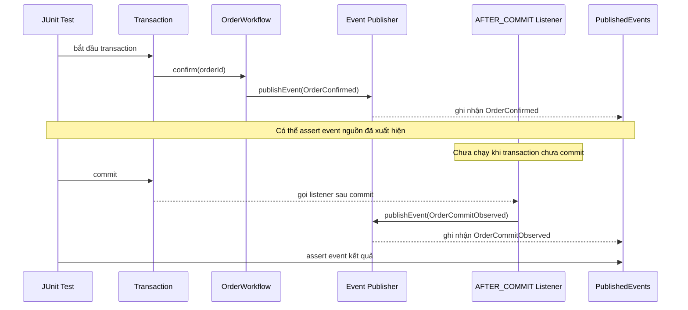

# Kiểm tra event được phát sau commit

## Mục tiêu học tập

Trong chương **Event assertions** của học phần **Spring Modulith Verification & Testing**, ta cần xác minh không chỉ event có đúng loại và payload, mà còn **thời điểm event được công bố** so với transaction. Đây là một hợp đồng quan trọng khi các application module giao tiếp bằng sự kiện: module nhận không nên hành động dựa trên dữ liệu mà transaction của module phát cuối cùng đã rollback.

Sau bài học, bạn có thể:

- Phân biệt **publish trong transaction**, **xử lý event sau commit** và **phát một event mới sau commit**.
- Giải thích cơ chế `@TransactionalEventListener(phase = AFTER_COMMIT)` và vì sao nó không tự thay đổi thời điểm gọi `ApplicationEventPublisher.publishEvent(…)` trong service.
- Viết `@ApplicationModuleTest` kết hợp `TransactionTemplate` và `PublishedEvents` để xác minh event kết quả **chưa có trước commit, có sau commit và không có sau rollback**.
- Dùng `Scenario` khi listener chạy bất đồng bộ sau commit.
- Nhận biết các vấn đề về rollback mặc định của test, `REQUIRES_NEW`, commit của cơ sở dữ liệu, timeout và event được giao bền vững.
- Kết hợp kiểm thử sự kiện với `ApplicationModules.verify()` và quality gate trong CI.

## 1. Làm rõ yêu cầu “event được phát sau commit”

Giả sử module `orders` xác nhận một đơn hàng và muốn module `billing` xử lý sau khi dữ liệu của đơn đã được commit. Có ba phát biểu khác nhau:

| Phát biểu | Điều thực sự xảy ra | Có đảm bảo event chỉ được phát sau commit không? |
| --- | --- | --- |
| Service gọi `publishEvent(new OrderConfirmed(…))` bên trong phương thức `@Transactional` | Spring nhận event trong khi transaction còn đang hoạt động | **Không** |
| Listener đánh dấu `@TransactionalEventListener(phase = AFTER_COMMIT)` nhận `OrderConfirmed` | Listener chỉ được gọi khi transaction nguồn đã commit thành công | **Event gốc vẫn có thể đã phát trước commit** |
| Listener `AFTER_COMMIT` công bố tiếp `OrderCommitObserved` | Event **thứ hai** được gọi publish sau khi transaction nguồn commit | **Có, đối với event thứ hai**, trong phạm vi cơ chế callback và cấu hình đã kiểm chứng |

Vì vậy, câu hỏi test phải rõ: ta muốn kiểm tra **listener chỉ hành động sau commit**, hay muốn kiểm tra **một public event chỉ được publish sau commit**?

Bài học dùng hai event khác nhau để không nhập nhằng:

- `OrderConfirmed`: event nguồn được phát **bên trong** transaction xác nhận đơn.
- `OrderCommitObserved`: event kết quả do listener `AFTER_COMMIT` công bố, chỉ xuất hiện sau khi transaction nguồn commit.

Điều kiện nghiệp vụ sẽ là: **Nếu transaction xác nhận đơn rollback thì không được có `OrderCommitObserved`; nếu commit thành công thì có đúng một event kết quả cho `orderId` tương ứng.**

> `PublishedEvents` ghi nhận event đã được publish trong quá trình test; nó không tự chứng minh database đã commit. Kết luận “sau commit” phải dựa thêm vào một ranh giới transaction xác định hoặc kết quả bền vững.

## 2. Dòng thời gian của transaction và event



Với đường đi rollback:

```text
BEGIN
  └─ publish OrderConfirmed (event nguồn có thể đã được ghi nhận)
      └─ ROLLBACK
          └─ AFTER_COMMIT listener không được kích hoạt
              └─ không phát OrderCommitObserved
```

Chú ý hai giới hạn:

1. `publishEvent(…)` thường xử lý việc công bố sự kiện theo cơ chế của `ApplicationEventMulticaster`. Với listener đồng bộ, một số listener thông thường có thể chạy ngay; listener giao dịch `AFTER_COMMIT` được trì hoãn đến pha phù hợp.
2. Chờ `OrderConfirmed` **không** kiểm tra commit. Khi test cần xác minh ranh giới commit, phải quan sát listener sau commit hoặc dữ liệu đã lưu ở một transaction khác.

## 3. Chuẩn bị project kiểm thử

Ví dụ dưới đây dùng Java 17+, Spring Boot, JUnit Jupiter, AssertJ, Spring Modulith test starter và một transaction manager do Spring quản lý.

Phụ thuộc Maven minh họa:

```xml
<dependency>
    <groupId>org.springframework.boot</groupId>
    <artifactId>spring-boot-starter-jdbc</artifactId>
</dependency>

<dependency>
    <groupId>org.springframework.modulith</groupId>
    <artifactId>spring-modulith-starter-test</artifactId>
    <scope>test</scope>
</dependency>

<dependency>
    <groupId>com.h2database</groupId>
    <artifactId>h2</artifactId>
    <scope>test</scope>
</dependency>
```

Ví dụ dùng transaction manager được Spring Boot auto-configure cho datasource H2. Mục tiêu của ví dụ là **kiểm chứng thời điểm event**, nên service chưa ghi SQL; trong ứng dụng thật, hãy bổ sung repository và xác minh trạng thái sau commit. Phiên bản Spring Modulith cần được quản lý thống nhất với Spring Boot qua BOM tương thích của dự án.

Lưu ý bố cục: đặt các lớp demo trong package `com.example.shop.orders`, thuộc application module `orders`; đặt test cùng package. Giả định ứng dụng có lớp `@SpringBootApplication` ở package gốc `com.example.shop` để Spring Boot xác định cấu hình. Nếu listener nằm ở module `billing` khác, test cần bootstrap đúng các module liên quan hoặc dùng integration test toàn ứng dụng; chế độ `STANDALONE` mặc định của `@ApplicationModuleTest` sẽ không tự khởi động mọi module.

## 4. Hai event thể hiện hai mốc khác nhau

Tệp `OrderConfirmed.java`:

```java
package com.example.shop.orders;

import java.util.UUID;

public record OrderConfirmed(UUID orderId) {
}
```

Tệp `OrderCommitObserved.java`:

```java
package com.example.shop.orders;

import java.util.UUID;

public record OrderCommitObserved(UUID orderId) {
}
```

Hai `record` chỉ có khóa tương quan `orderId`, đủ cho test thời điểm event. Trong production, event nên mang đúng payload nghiệp vụ cần thiết; tránh đưa entity JPA hoặc implementation detail vào public contract.

### 4.1. Service phát event nguồn trong transaction

Tệp `OrderWorkflow.java`:

```java
package com.example.shop.orders;

import java.util.Objects;
import java.util.UUID;
import org.springframework.context.ApplicationEventPublisher;
import org.springframework.stereotype.Service;
import org.springframework.transaction.annotation.Transactional;

@Service
public class OrderWorkflow {

    private final ApplicationEventPublisher publisher;

    public OrderWorkflow(ApplicationEventPublisher publisher) {
        this.publisher = publisher;
    }

    @Transactional
    public void confirm(UUID orderId) {
        Objects.requireNonNull(orderId, "orderId");

        // Trong ứng dụng thật: cập nhật dữ liệu đơn hàng ở đây.
        publisher.publishEvent(new OrderConfirmed(orderId));
    }
}
```

Nếu `confirm(…)` được gọi khi **chưa có transaction**, `@Transactional` sẽ mở transaction. Nếu gọi trong transaction đã hoạt động, propagation mặc định `REQUIRED` khiến phương thức **tham gia transaction hiện tại**; nó không tự commit khi method return nếu transaction bên ngoài chưa hoàn tất.

Đây là chi tiết rất quan trọng khi test muốn quan sát event **trước** và **sau** commit: cần một transaction bên ngoài có thể chủ động kiểm soát thời điểm kết thúc.

### 4.2. Listener chỉ phát event kết quả sau commit

Tệp `OrderAfterCommitListener.java`:

```java
package com.example.shop.orders;

import org.springframework.context.ApplicationEventPublisher;
import org.springframework.stereotype.Component;
import org.springframework.transaction.event.TransactionPhase;
import org.springframework.transaction.event.TransactionalEventListener;

@Component
public class OrderAfterCommitListener {

    private final ApplicationEventPublisher publisher;

    public OrderAfterCommitListener(
            ApplicationEventPublisher publisher) {
        this.publisher = publisher;
    }

    @TransactionalEventListener(
            phase = TransactionPhase.AFTER_COMMIT)
    public void on(OrderConfirmed event) {
        publisher.publishEvent(
                new OrderCommitObserved(event.orderId()));
    }
}
```

`@TransactionalEventListener` gắn việc gọi listener với pha của transaction chứa event nguồn. Ở `AFTER_COMMIT`, listener chỉ chạy khi transaction đó **commit thành công**. Khi rollback, callback `AFTER_COMMIT` sẽ không được gọi.

Trong trường hợp event nguồn được publish **ngoài transaction**, listener `@TransactionalEventListener` mặc định **không được kích hoạt** (`fallbackExecution = false`). Việc dùng một transaction thật trong test là điều kiện tiên quyết, không chỉ là chi tiết tối ưu.

Trong ví dụ, listener chạy **đồng bộ** sau commit và chỉ phát event mới; nó không ghi dữ liệu. Nếu listener thực sự cần ghi database, xem phần `REQUIRES_NEW` bên dưới về việc mở một transaction mới cho thao tác ghi.

## 5. Test chứng minh trước commit chưa có event kết quả

Phép thử mạnh nhất là giữ transaction mở, assert event kết quả chưa xuất hiện, sau đó commit và assert event kết quả xuất hiện. Ta dùng `TransactionTemplate` để xác định rõ thời điểm commit mà không dựa vào transaction rollback mặc định của test.

Tạo tệp `src/test/java/com/example/shop/orders/AfterCommitEventTests.java`:

```java
package com.example.shop.orders;

import static org.assertj.core.api.Assertions.assertThat;

import java.util.UUID;
import org.junit.jupiter.api.Test;
import org.springframework.beans.factory.annotation.Autowired;
import org.springframework.modulith.test.ApplicationModuleTest;
import org.springframework.modulith.test.PublishedEvents;
import org.springframework.transaction.PlatformTransactionManager;
import org.springframework.transaction.TransactionDefinition;
import org.springframework.transaction.annotation.Propagation;
import org.springframework.transaction.annotation.Transactional;
import org.springframework.transaction.support.TransactionTemplate;

@ApplicationModuleTest
class AfterCommitEventTests {

    @Autowired
    OrderWorkflow workflow;

    @Autowired
    PlatformTransactionManager transactionManager;

    @Test
    @Transactional(propagation = Propagation.NOT_SUPPORTED)
    void publishesFollowUpEventOnlyAfterCommit(PublishedEvents events) {
        UUID orderId = UUID.randomUUID();
        var template = new TransactionTemplate(transactionManager);
        template.setPropagationBehavior(
                TransactionDefinition.PROPAGATION_REQUIRED);

        // Bên trong transaction: chỉ thấy event nguồn.
        template.executeWithoutResult(status -> {
            workflow.confirm(orderId);

            assertThat(events.ofType(OrderConfirmed.class)
                    .matching(event ->
                            orderId.equals(event.orderId())))
                    .hasSize(1);

            assertThat(events.ofType(OrderCommitObserved.class)
                    .matching(event ->
                            orderId.equals(event.orderId())))
                    .isEmpty();
        });

        // TransactionTemplate đã commit trước khi trả về.
        assertThat(events.ofType(OrderCommitObserved.class)
                .matching(event -> orderId.equals(event.orderId())))
                .hasSize(1);
    }
}
```

Test minh họa ba assertion có mục tiêu riêng:

1. **Bên trong transaction**, `OrderConfirmed` xuất hiện: điều này chứng minh `publishEvent` được gọi, **chưa** chứng minh commit.
2. **Bên trong transaction**, `OrderCommitObserved` vẫn rỗng: listener `AFTER_COMMIT` chưa chạy.
3. **Sau khi `TransactionTemplate` kết thúc thành công**, event kết quả có đúng một instance với `orderId` mong đợi: callback sau commit đã phát event mới.

Annotation `@Transactional(propagation = NOT_SUPPORTED)` trên test giúp tránh việc test vô tình được bao bởi một transaction ngoài và rollback khi kết thúc. Nếu có transaction test bao ngoài, `TransactionTemplate` với propagation `REQUIRED` có thể chỉ tham gia transaction đó, khiến bước “sau template” vẫn **chưa phải sau commit**. Dùng ranh giới rõ ràng giữ phép chứng minh đúng với mục tiêu.

**Phạm vi kết luận:** bài test chứng minh thứ tự phát `OrderCommitObserved` **sau commit của transaction mà template kiểm soát**. Trong một hệ thống phân tán, nó không đồng nghĩa event đã được vận chuyển bền vững đến một consumer khác.

## 6. Test rollback: không được phát event sau commit

Thêm phương thức sau vào lớp `AfterCommitEventTests`:

```java
@Test
@Transactional(propagation = Propagation.NOT_SUPPORTED)
void neverPublishesFollowUpAfterRollback(PublishedEvents events) {
    UUID orderId = UUID.randomUUID();
    var template = new TransactionTemplate(transactionManager);

    template.executeWithoutResult(status -> {
        workflow.confirm(orderId);

        // Cố ý rollback thay vì commit.
        status.setRollbackOnly();
    });

    // Event nguồn đã publish trước khi transaction rollback.
    assertThat(events.ofType(OrderConfirmed.class)
            .matching(event -> orderId.equals(event.orderId())))
            .hasSize(1);

    // Listener AFTER_COMMIT không được gọi.
    assertThat(events.ofType(OrderCommitObserved.class)
            .matching(event -> orderId.equals(event.orderId())))
            .isEmpty();
}
```

Test này kiểm tra **negative case**, rất quan trọng vì test chỉ có commit thành công không thể phát hiện một listener vô tình đổi từ `AFTER_COMMIT` sang `@EventListener` thông thường. Khi đổi annotation như vậy, event kết quả có thể được phát trước commit, làm test ở phần 5 thất bại; test rollback cũng bắt được việc event được phát dù dữ liệu cuối cùng không được lưu.

| Kịch bản | `OrderConfirmed` (nguồn) | `OrderCommitObserved` (sau commit) |
| --- | --- | --- |
| Transaction đang mở, chưa commit | Có thể có | Chưa có |
| Commit thành công, listener đã thực thi | Có | Có |
| Rollback | Có thể vẫn có | Không có |
| Publish event ngoài transaction, dùng `fallbackExecution = false` | Có thể có | Không có |

Trong test rollback này không có thao tác ghi SQL. Khi ứng dụng thật có lưu đơn hàng, bổ sung assertion rằng thay đổi database cũng bị rollback để kiểm chứng toàn diện.

## 7. Khi nào nên dùng Scenario để chờ event sau commit?

Ví dụ trên có listener đồng bộ, vì vậy sau khi `TransactionTemplate` trả về, callback `AFTER_COMMIT` cũng đã chạy. Nhưng trong kiến trúc Spring Modulith thực tế, module nhận thường dùng `@ApplicationModuleListener`, kết hợp xử lý sau commit và bất đồng bộ.

Với listener bất đồng bộ, `TransactionTemplate` hoàn tất commit **không đồng nghĩa** event kết quả đã được phát. Assertion tức thì có thể là race condition. Lúc này dùng `Scenario` để kích hoạt nghiệp vụ và chờ event kết quả.

### 7.1. Listener bất đồng bộ sau commit

Ví dụ listener có thể nằm trong một module cùng bootstrap với test:

```java
package com.example.shop.orders;

import org.springframework.context.ApplicationEventPublisher;
import org.springframework.modulith.events.ApplicationModuleListener;
import org.springframework.stereotype.Component;

@Component
public class ReceiptModuleListener {

    private final ApplicationEventPublisher publisher;

    public ReceiptModuleListener(
            ApplicationEventPublisher publisher) {
        this.publisher = publisher;
    }

    @ApplicationModuleListener
    public void on(OrderConfirmed event) {
        // Ví dụ: công việc được thực hiện sau commit,
        // theo ngữ nghĩa của @ApplicationModuleListener.
        publisher.publishEvent(new ReceiptPrepared(event.orderId()));
    }
}
```

Và event kết quả:

```java
package com.example.shop.orders;

import java.util.UUID;

public record ReceiptPrepared(UUID orderId) {
}
```

`@ApplicationModuleListener` của Spring Modulith kết hợp ngữ nghĩa listener giao dịch và việc xử lý bất đồng bộ. Tùy phiên bản/cấu hình, listener được chạy trong transaction riêng; cần kiểm tra dependency và cấu hình executor của ứng dụng thực tế. Ví dụ này chỉ phát một event kết quả. Nếu listener còn ghi repository, việc phát `ReceiptPrepared` **bên trong transaction riêng của listener** chưa chắc chứng minh transaction đó đã commit; hãy xác minh dữ liệu bền vững riêng.

### 7.2. Test chờ event kết quả sau commit

Ví dụ sau đặt trong `@ApplicationModuleTest` có bean `ReceiptModuleListener` trong application context:

```java
package com.example.shop.orders;

import static org.assertj.core.api.Assertions.assertThat;

import java.util.UUID;
import org.junit.jupiter.api.Test;
import org.springframework.beans.factory.annotation.Autowired;
import org.springframework.modulith.test.ApplicationModuleTest;
import org.springframework.modulith.test.Scenario;

@ApplicationModuleTest
class ReceiptAfterCommitScenarioTests {

    @Autowired
    OrderWorkflow workflow;

    @Test
    void waitsForReceiptAfterOriginTransactionCommits(
            Scenario scenario) {
        UUID orderId = UUID.randomUUID();

        scenario.stimulate(() -> workflow.confirm(orderId))
                .andWaitForEventOfType(ReceiptPrepared.class)
                .matching(event -> orderId.equals(event.orderId()))
                .toArriveAndVerify(event ->
                        assertThat(event.orderId()).isEqualTo(orderId));
    }
}
```

`Scenario` thiết lập việc quan sát event và thực thi stimulus trong trình tự kiểm thử phù hợp. Điều kiện chờ chỉ hoàn tất khi `ReceiptPrepared` **cùng `orderId`** được quan sát, hoặc thất bại khi vượt giới hạn chờ. Điều này tốt hơn việc thêm `Thread.sleep(…)` rồi hy vọng listener đã chạy xong.

**Hai lưu ý quan trọng:**

- Nếu listener nằm ở module khác, bảo đảm module đó được khởi động trong integration test. Đừng chờ một listener không tồn tại trong test context.
- `Scenario` có thể thực hiện stimulus trong transaction được commit riêng, nên dữ liệu do stimulus ghi sẽ không nhất thiết được rollback theo transaction test bên ngoài. Với bài test ghi DB, hãy chuẩn bị cleanup và kiểm tra phạm vi transaction theo phiên bản Spring Modulith đang dùng.

## 8. Chờ sự kiện hay chờ dữ liệu đã commit?

Giả sử listener làm hai việc: tạo invoice trong database và phát `InvoiceCreated`. Nếu listener phát event **trước khi transaction ghi invoice commit**, test chờ `InvoiceCreated` có thể hoàn tất trong khi một transaction khác chưa đọc được bản ghi invoice.

Vì thế, hãy viết rõ điều muốn khẳng định:

| Hợp đồng | Điều cần chờ/kiểm tra |
| --- | --- |
| Sau commit đơn hàng, listener nhận được tín hiệu | Chờ event kết quả từ listener |
| Sau commit đơn hàng, listener đã bắt đầu xử lý | Chờ dấu hiệu bắt đầu nếu thực sự cần; không suy diễn hoàn tất |
| Sau commit đơn hàng, invoice được ghi bền vững | Chờ điều kiện repository/database thể hiện invoice tồn tại |
| Event công khai chỉ được phát sau khi chính invoice đã commit | Phát sự kiện ở một mốc sau commit của transaction invoice rồi kiểm tra mốc đó |
| Message đã được gửi tới Kafka/RabbitMQ | Integration test cho outbox/relay/broker |

Nếu cần kiểm tra **dữ liệu sau listener**, dùng phương thức chờ trạng thái của `Scenario` (theo API của phiên bản đang sử dụng) hoặc một cơ chế await condition với timeout hữu hạn, sau đó đọc lại repository bằng transaction thích hợp. Một phép assert trên `PublishedEvents` **không tự xác nhận database đã commit**.

### 8.1. Ghi database trong callback AFTER_COMMIT

Khi `AFTER_COMMIT` chạy, transaction nguồn đã commit nhưng tài nguyên transaction có thể vẫn còn gắn với thread trong giai đoạn callback. Việc gọi repository ghi dữ liệu ngay trong callback **không mặc nhiên tạo một transaction mới có commit riêng**.

Nếu listener phải ghi dữ liệu hậu xử lý, nên chuyển thao tác ghi sang một Spring bean khác có phương thức `@Transactional(propagation = REQUIRES_NEW)`, được gọi qua Spring proxy:

```java
@Service
class ReceiptWriter {

    private final ReceiptRepository receipts;

    ReceiptWriter(ReceiptRepository receipts) {
        this.receipts = receipts;
    }

    @Transactional(propagation = Propagation.REQUIRES_NEW)
    public void persistReceipt(UUID orderId) {
        receipts.save(new ReceiptEntity(orderId));
    }
}
```

Đoạn mã minh họa giả định `ReceiptRepository` và `ReceiptEntity` là các thành phần thực của dự án; cần thêm import cho `Service`, `Transactional`, `Propagation` và `UUID`. `REQUIRES_NEW` đảm bảo thao tác ghi có transaction riêng khi được gọi đúng qua bean do Spring quản lý. Không đặt annotation lên một lời gọi self-invocation rồi mặc định nó sẽ tạo transaction mới.

Trong hệ thống thật, có thể thay bằng `@ApplicationModuleListener` nếu phù hợp mô hình xử lý module. Quan trọng là phân biệt transaction **nguồn** và transaction **ghi kết quả downstream**.

## 9. Nếu yêu cầu event nguồn cũng phải chỉ được publish sau commit

Trong nhiều thiết kế, `OrderConfirmed` được publish **trong** transaction rồi listener `AFTER_COMMIT` mới tiêu thụ. Điều này là một mô hình hợp lệ, vì bản thân event nguồn đại diện cho thay đổi nghiệp vụ đang được thực hiện.

Nhưng nếu hợp đồng quy định **chính `OrderPubliclyAvailable` chỉ được publish sau khi commit** (không chỉ listener của nó chạy sau commit), có thể đăng ký callback transaction:

```java
@Transactional
public void confirmAndPublishAfterCommit(UUID orderId) {
    // Ghi thay đổi đơn hàng trong transaction ở đây.

    TransactionSynchronizationManager.registerSynchronization(
            new TransactionSynchronization() {
                @Override
                public void afterCommit() {
                    publisher.publishEvent(
                            new OrderPubliclyAvailable(orderId));
                }
            });
}
```

Ví dụ này giả định service có `publisher` và định nghĩa event `OrderPubliclyAvailable`. Các import liên quan: `org.springframework.transaction.annotation.Transactional`, `org.springframework.transaction.support.TransactionSynchronization`, `org.springframework.transaction.support.TransactionSynchronizationManager` và `java.util.UUID`.

Cần một transaction thực sự đang hoạt động khi đăng ký synchronization; trong mã production nên dùng cách tổ chức rõ ràng hoặc một domain event nội bộ + `@TransactionalEventListener(AFTER_COMMIT)` để giữ service ít phụ thuộc hạ tầng hơn. Cả hai hướng đều cần test **trước commit không có event công khai, sau commit có, rollback không có**.

**Cảnh báo về độ bền:** callback `afterCommit` chạy trong process. Nếu process sập ngay sau DB commit nhưng trước khi callback phát event, một message có thể bị mất. Khi cần giao sự kiện đáng tin cậy qua hệ thống bên ngoài, cân nhắc cơ chế **transactional outbox**, **Event Publication Registry** và retry theo thiết kế hệ thống. Kiểm tra thứ tự callback trong một test không thay thế kiểm thử phục hồi khi tiến trình gặp sự cố.

## 10. Các lỗi thường gặp

| Triệu chứng | Nguyên nhân thường gặp | Cách khắc phục |
| --- | --- | --- |
| `OrderCommitObserved` xuất hiện trước commit | Listener dùng `@EventListener` thông thường thay cho `@TransactionalEventListener(AFTER_COMMIT)` | Kiểm tra annotation và thêm assertion trước commit |
| `OrderConfirmed` đã xuất hiện nhưng listener không chạy | Event nguồn được publish ngoài transaction hoặc transaction rollback | Kiểm tra transaction thực và `fallbackExecution` |
| Test chờ `AFTER_COMMIT` bị timeout | Test có transaction tự rollback, không có commit | Dùng `TransactionTemplate` hoặc `Scenario` có ranh giới commit chủ động |
| Test pass cục bộ nhưng fail trên CI | Listener bất đồng bộ chưa chạy xong lúc assert | Dùng `Scenario` chờ event/trạng thái với timeout hữu hạn |
| Event sau commit đúng nhưng DB downstream chưa có dữ liệu | Listener đang trong transaction riêng hoặc chưa commit | Chờ repository state và kiểm tra transaction downstream |
| Listener `AFTER_COMMIT` ghi DB nhưng dữ liệu không bền vững | Tái sử dụng tài nguyên của transaction nguồn sau commit | Dùng bean ghi với `REQUIRES_NEW` phù hợp |
| Rollback vẫn thấy event nguồn | `publishEvent` đã được gọi trước rollback | Đừng dùng event nguồn để kết luận commit; kiểm tra event hậu commit |
| Test nhận nhầm event của yêu cầu khác | Chỉ lọc theo kiểu, không theo ID | Dùng `matching(…)` theo khóa tương quan |
| Event sau commit được ghi nhận nhưng consumer bên ngoài không nhận | Không có outbox/retry, process hoặc transport gặp sự cố | Kiểm thử cơ chế giao bền vững và trạng thái publication |

## 11. Quality gate trong CI và ranh giới kiến trúc

Bài kiểm thử hậu commit nằm trong mục tiêu lớn của **Spring Modulith Verification & Testing**: kiểm chứng đúng quan hệ phụ thuộc giữa module và đúng hành vi nghiệp vụ ở thời gian chạy.

| Mục tiêu | Công cụ kiểm chứng |
| --- | --- |
| Module không phụ thuộc sai vào package nội bộ của module khác | `ApplicationModules.verify()` |
| Service phát event nguồn đúng loại và payload | `@ApplicationModuleTest` + `PublishedEvents` |
| Listener chỉ phát event kết quả sau commit | `TransactionTemplate` + assertion trước/sau commit |
| Rollback không gây ra kết quả hậu commit | Test rollback chủ động |
| Listener hậu commit chạy bất đồng bộ | `Scenario` và điều kiện chờ event hoặc trạng thái |
| Đã lưu dữ liệu bền vững | Test repository/integration ở transaction thích hợp |

Ví dụ test kiểm chứng kiến trúc:

```java
import org.junit.jupiter.api.Test;
import org.springframework.modulith.core.ApplicationModules;

class ArchitectureTests {

    @Test
    void checksModuleBoundaries() {
        ApplicationModules.of(ShopApplication.class).verify();
    }
}
```

`ShopApplication` là lớp cấu hình Spring Boot gốc của dự án và phải thay bằng lớp thực tế. Phép kiểm này bảo vệ ranh giới module, nhưng **không** chứng minh event đã được phát sau commit; hai loại test phải tồn tại đồng thời khi hợp đồng đòi hỏi.

Trong CI, đưa test architecture, test commit, test rollback và test `Scenario` vào bước chạy JUnit (ví dụ `mvn test` hoặc `./gradlew test`). Thiết lập timeout có giới hạn, dữ liệu fixture độc lập và cleanup cho những test thực sự commit dữ liệu. Một thay đổi vô tình chuyển listener từ `AFTER_COMMIT` sang xử lý tức thì sẽ làm test trước commit/rollback thất bại, ngăn hồi quy trước khi merge.

## 12. Bài thực hành

Hãy dùng `OrderWorkflow`, `OrderAfterCommitListener` và `AfterCommitEventTests`:

1. **Commit thành công:** chứng minh `OrderConfirmed` có trong transaction nhưng `OrderCommitObserved` chỉ xuất hiện sau khi `TransactionTemplate` commit.
2. **Rollback:** dùng `status.setRollbackOnly()`; kiểm tra không có `OrderCommitObserved` cho `orderId` đang thử.
3. **Cố ý gây lỗi:** thay `@TransactionalEventListener(AFTER_COMMIT)` bằng `@EventListener`. Quan sát test trước commit/rollback thất bại; hoàn tác annotation.
4. **Không có transaction:** tạo một test phát `OrderConfirmed` qua `ApplicationEventPublisher` **ngoài transaction**, không gọi `OrderWorkflow.confirm(…)`. Giải thích vì sao listener giao dịch mặc định không được kích hoạt.
5. **Bất đồng bộ:** thử `@ApplicationModuleListener` và `Scenario`, bảo đảm event `ReceiptPrepared` khớp `orderId` được kích hoạt.
6. **Dữ liệu bền vững:** bổ sung repository và một test khẳng định bản ghi chỉ được thấy sau commit từ transaction mới; kiểm tra rollback thực sự không lưu thay đổi.
7. **Độ tin cậy:** giải thích tình huống process sập giữa commit và callback phát event, sau đó đề xuất dùng outbox hoặc registry nếu nghiệp vụ cần giao sự kiện đáng tin cậy.

**Tiêu chí hoàn thành:** test phát hiện được việc event kết quả xuất hiện trước commit, thiếu sau commit hoặc xuất hiện sau rollback; phân biệt được sự hiện diện của event nguồn với commit của dữ liệu và với kết quả listener downstream.

## 13. Câu hỏi tự kiểm tra

**Câu 1.** Một service `@Transactional` gọi `publishEvent(new OrderConfirmed(id))`. Có thể kết luận `OrderConfirmed` chỉ được publish sau commit không?

**Trả lời:** Không. `publishEvent` được gọi khi transaction còn hoạt động. Listener `@TransactionalEventListener(AFTER_COMMIT)` có thể đợi commit mới xử lý, nhưng không làm thay đổi thời điểm publish của event nguồn.

**Câu 2.** Tại sao test `@Transactional` mặc định rollback có thể không kích hoạt listener `AFTER_COMMIT`?

**Trả lời:** Vì transaction của test kết thúc bằng rollback, không có sự kiện commit thành công để gọi callback `AFTER_COMMIT`.

**Câu 3.** `PublishedEvents` quan sát được event nguồn dù transaction rollback. Có phải framework bị lỗi?

**Trả lời:** Không. Event nguồn được publish trước rollback nên bộ ghi nhận có thể thấy nó. Muốn kiểm tra kết quả hậu commit phải quan sát listener `AFTER_COMMIT` hoặc dữ liệu đã lưu.

**Câu 4.** Khi listener `AFTER_COMMIT` dùng `@Async`, có nên assert event kết quả ngay sau khi transaction commit?

**Trả lời:** Không nên dựa vào thời điểm đó. Việc commit chỉ kích hoạt hoặc lên lịch listener; dùng `Scenario` hoặc cơ chế chờ điều kiện hữu hạn để đợi kết quả.

**Câu 5.** Một event được publish trong callback `afterCommit` đã bảo đảm gửi thành công qua broker sau khi process crash chưa?

**Trả lời:** Chưa. Callback trong process có thể bị mất nếu ứng dụng sập đúng thời điểm. Cần cơ chế bền vững như outbox/registry và chiến lược retry khi hợp đồng yêu cầu.

## Kết luận

Để **kiểm tra event được phát sau commit**, trước hết cần phân biệt event nguồn được publish trong transaction và event kết quả chỉ được phát từ callback sau commit. Một bài `@ApplicationModuleTest` dùng `TransactionTemplate` và `PublishedEvents` có thể chứng minh **trước commit chưa có event kết quả, sau commit có đúng một, rollback không có**. Khi listener xử lý bất đồng bộ, dùng `Scenario` chờ event hoặc trạng thái phù hợp; khi cần kiểm chứng dữ liệu bền vững, phải đọc repository sau đúng ranh giới transaction. Kết hợp các test này với `ApplicationModules.verify()` giúp quality gate trong CI phát hiện cả vi phạm kiến trúc lẫn hồi quy tương tác giữa các module Spring Modulith.

## Tài liệu tham khảo

- [Spring Modulith Reference — Working with Application Events](https://docs.spring.io/spring-modulith/reference/events.html)
- [Spring Modulith Reference — Integration Testing Application Modules](https://docs.spring.io/spring-modulith/reference/testing.html)
- [Spring Modulith API — Scenario](https://docs.spring.io/spring-modulith/docs/current/api/org/springframework/modulith/test/Scenario.html)
- [Spring Modulith API — PublishedEvents](https://docs.spring.io/spring-modulith/docs/current/api/org/springframework/modulith/test/PublishedEvents.html)
- [Spring Framework Reference — Transaction-bound Events](https://docs.spring.io/spring-framework/reference/data-access/transaction/event.html)
- [Spring Framework Javadoc — TransactionalEventListener](https://docs.spring.io/spring-framework/docs/current/javadoc-api/org/springframework/transaction/event/TransactionalEventListener.html)
- [Spring Framework Javadoc — TransactionTemplate](https://docs.spring.io/spring-framework/docs/current/javadoc-api/org/springframework/transaction/support/TransactionTemplate.html)
