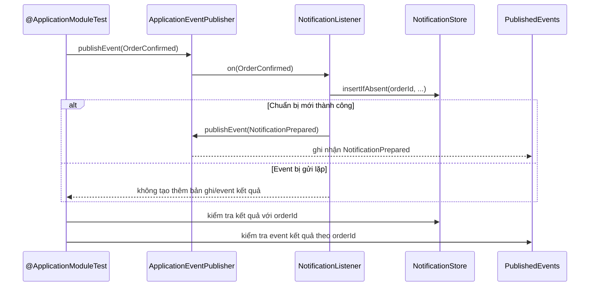

# Kiểm tra listener xử lý event

## Mục tiêu học tập

Trong chương **Event assertions** của học phần **Spring Modulith Verification & Testing**, một bài kiểm thử xác nhận event đã được phát mới bao phủ **phía phát (publisher)**. Nếu module nhận có listener xử lý event, cần kiểm tra tiếp **phía nhận (consumer)**: listener có được gọi đúng điều kiện, tạo ra kết quả nghiệp vụ nào, và có xử lý an toàn khi event đến lặp lại hay không.

Sau bài này, bạn có thể:

- Phân biệt hợp đồng **publish event** với hợp đồng **listener xử lý event**.
- Dùng `@ApplicationModuleTest` để kiểm thử listener trong phạm vi một application module, kích hoạt nó bằng một event từ API công khai của module khác.
- Xác minh **side effect** của listener, payload event kết quả và số lần xử lý có ý nghĩa nghiệp vụ.
- Dùng `PublishedEvents` cho hành vi đồng bộ, đồng thời nhận diện khi nào cần `Scenario` để chờ listener bất đồng bộ hoặc listener sau commit.
- Thiết kế test cho trường hợp event trùng, sai khóa tương quan, transaction rollback và lỗi từ listener.
- Kết hợp kiểm thử hành vi listener với `ApplicationModules.verify()` và quality gate trong CI để ngăn hồi quy và phụ thuộc sai giữa các module.

## 1. Vì sao kiểm tra publisher chưa đủ?

Giả sử ứng dụng có module `orders` và `notifications`:

1. `orders` hoàn tất xác nhận đơn và phát `OrderConfirmed`.
2. `notifications` nhận `OrderConfirmed` và chuẩn bị một bản ghi thông báo.
3. Sau khi chuẩn bị thành công, `notifications` phát `NotificationPrepared` để thông báo một mốc xử lý tiếp theo.

Nếu chỉ kiểm tra:

```java
assertThat(events.ofType(OrderConfirmed.class)).hasSize(1);
```

ta chỉ biết event nguồn đã được phát. Test đó **không chứng minh** listener của `notifications` tồn tại trong application context, được gọi, tạo dữ liệu đúng hay không tạo trùng dữ liệu khi nhận event lặp.

Ngược lại, một test kiểm tra trạng thái mà listener tạo ra có thể phát hiện các lỗi như:

- Listener không được đăng ký vì nằm ngoài phạm vi bootstrap hoặc có annotation sai.
- Listener nhận event nhưng dùng sai `orderId` hoặc `customerId`.
- Listener được gọi nhưng bỏ qua nhánh nghiệp vụ và không tạo bản ghi.
- Listener phát `NotificationPrepared` trước khi chuẩn bị thông báo thành công.
- Event được gửi lại dẫn đến bản ghi hoặc thông báo trùng lặp.
- Listener hậu commit không chạy vì transaction nguồn đã rollback hoặc chưa commit.

**Cách đặt câu hỏi đúng:** “Sau khi listener nhận event X của giao dịch A, trạng thái nghiệp vụ Y nào phải tồn tại, và event kết quả Z nào (nếu có) phải được phát?”

| Câu hỏi | Phép kiểm phù hợp |
| --- | --- |
| Publisher có phát `OrderConfirmed`? | `PublishedEvents.ofType(OrderConfirmed.class)` |
| Listener có chuẩn bị dữ liệu thông báo cho đúng đơn? | Kiểm tra trạng thái mà listener ghi vào store/repository |
| Listener có phát event kết quả sau khi xử lý? | `PublishedEvents.ofType(NotificationPrepared.class)`, lọc theo ID |
| Listener chạy bất đồng bộ đã hoàn tất chưa? | `Scenario` hoặc chờ side effect với timeout |
| Listener sau commit có chạy khi rollback không? | Test transaction commit/rollback rõ ràng |
| Consumer có phụ thuộc sai package nội bộ của publisher? | `ApplicationModules.verify()` |

## 2. Ba lớp bằng chứng trong kiểm thử listener

Khi xem listener như một đơn vị nghiệp vụ, nên phân biệt:

**Bằng chứng 1 — Có tín hiệu đầu vào.** Test phát một event có loại và payload được định nghĩa rõ. Đây là *stimulus* để kiểm tra listener; trong bài test tập trung vào consumer, không nhất thiết phải chạy toàn bộ module publisher.

**Bằng chứng 2 — Có kết quả do listener tạo.** Ví dụ, một notification record được tạo cho `orderId` chính xác. Đó mới là bằng chứng quan trọng rằng listener đã thực hiện công việc.

**Bằng chứng 3 — Có event kết quả, nếu hợp đồng yêu cầu.** Sau khi chuẩn bị thông báo, listener công bố `NotificationPrepared` với thông tin đúng. Event kết quả bổ sung tín hiệu quan sát, nhưng không thể thay thế hoàn toàn kiểm tra database nếu hợp đồng còn yêu cầu dữ liệu đã commit.



Trong phần ví dụ chính, listener dùng `@EventListener` **đồng bộ**, đồng thời lưu kết quả vào một store trong bộ nhớ để tách riêng mục tiêu kiểm tra event dispatch và xử lý listener. Phần sau sẽ bàn về JPA, commit và xử lý bất đồng bộ trong production.

## 3. Tổ chức code theo ranh giới application module

Ví dụ ứng dụng Java 17+, Spring Boot và Spring Modulith có hai module:

```text
com.example.shop
├── orders
│   └── OrderConfirmed.java          # Public event contract
└── notifications
    ├── NotificationListener.java    # Consumer
    ├── NotificationPrepared.java    # Event kết quả
    ├── NotificationRecord.java      # Dữ liệu trạng thái
    ├── NotificationStore.java       # Store demo trong bộ nhớ
    └── NotificationListenerTests.java
```

Đặt `OrderConfirmed` trong API công khai của module `orders`, để `notifications` chỉ cần import **kiểu event công khai**. Consumer không cần biết `orders.internal.OrderRepository`, JPA entity hoặc cách module `orders` xử lý transaction.

### 3.1. Event đầu vào: OrderConfirmed

Tệp `src/main/java/com/example/shop/orders/OrderConfirmed.java`:

```java
package com.example.shop.orders;

import java.util.UUID;

public record OrderConfirmed(
        UUID orderId,
        UUID customerId,
        String channel) {
}
```

`orderId` là khóa tương quan; `customerId` là định danh khách hàng, còn `channel` là kênh cần chuẩn bị thông báo. Ví dụ dùng kênh `EMAIL` nhưng **không gửi email thật**. Trong hệ thống thực tế, dữ liệu đưa vào event phải được nghiệp vụ xác thực và chỉ gồm thông tin consumer có quyền sử dụng.

### 3.2. Kết quả nghiệp vụ và event đầu ra

Tệp `NotificationRecord.java`:

```java
package com.example.shop.notifications;

import java.util.UUID;

public record NotificationRecord(
        UUID orderId,
        UUID customerId,
        String channel,
        String templateCode) {
}
```

Tệp `NotificationPrepared.java`:

```java
package com.example.shop.notifications;

import java.util.UUID;

public record NotificationPrepared(
        UUID orderId,
        String templateCode) {
}
```

Hai loại kết quả mang ý nghĩa khác nhau: `NotificationRecord` là dữ liệu mà listener đã tạo, còn `NotificationPrepared` là thông báo nghiệp vụ rằng bước chuẩn bị hoàn tất. Không nên dùng việc có event `NotificationPrepared` để kết luận một database bên ngoài đã commit, trừ khi quy ước phát event và test transaction thực sự bảo đảm điều đó.

### 3.3. Store demo có tính chống trùng

Tệp `NotificationStore.java`:

```java
package com.example.shop.notifications;

import java.util.Optional;
import java.util.UUID;
import java.util.concurrent.ConcurrentHashMap;
import java.util.concurrent.ConcurrentMap;
import org.springframework.stereotype.Component;

@Component
public class NotificationStore {

    private final ConcurrentMap<UUID, NotificationRecord> records =
            new ConcurrentHashMap<>();

    public boolean insertIfAbsent(NotificationRecord record) {
        return records.putIfAbsent(
                record.orderId(), record) == null;
    }

    public Optional<NotificationRecord> findByOrderId(UUID orderId) {
        return Optional.ofNullable(records.get(orderId));
    }

    public void remove(UUID orderId) {
        records.remove(orderId);
    }
}
```

`putIfAbsent` là thao tác nguyên tử trên `ConcurrentHashMap`; nếu nhận cùng `orderId` nhiều lần, store demo không ghi đè bản ghi đang có. Hợp đồng ví dụ là **một thông báo được chuẩn bị cho mỗi đơn**, do đó sự kiện kết quả chỉ nên phát khi `insertIfAbsent` trả về `true`.

Đây là **fake store trong bộ nhớ**, không tham gia transaction database, không bền vững khi ứng dụng khởi động lại và không đủ để bảo đảm idempotency giữa nhiều instance. Trong ứng dụng thật, dùng repository với ràng buộc duy nhất theo `orderId` và transaction thích hợp.

### 3.4. Listener đồng bộ thực hiện nghiệp vụ

Tệp `NotificationListener.java`:

```java
package com.example.shop.notifications;

import com.example.shop.orders.OrderConfirmed;
import org.springframework.context.ApplicationEventPublisher;
import org.springframework.context.event.EventListener;
import org.springframework.stereotype.Component;

@Component
public class NotificationListener {

    private final NotificationStore store;
    private final ApplicationEventPublisher publisher;

    public NotificationListener(
            NotificationStore store,
            ApplicationEventPublisher publisher) {
        this.store = store;
        this.publisher = publisher;
    }

    @EventListener
    public void on(OrderConfirmed event) {
        var record = new NotificationRecord(
                event.orderId(),
                event.customerId(),
                event.channel(),
                "ORDER_CONFIRMED");

        if (store.insertIfAbsent(record)) {
            publisher.publishEvent(new NotificationPrepared(
                    event.orderId(),
                    "ORDER_CONFIRMED"));
        }
    }
}
```

Ở cấu hình `ApplicationEventMulticaster` mặc định đồng bộ, khi `publishEvent(new OrderConfirmed(…))` hoàn tất, listener trên cũng đã chạy trên luồng xử lý hiện tại. Vì thế test có thể kiểm tra store và event kết quả **ngay sau lời gọi publish**.

Điều này phụ thuộc vào cấu hình dispatch thực tế: nếu ứng dụng tự cấu hình multicaster bất đồng bộ hoặc thêm `@Async`, kết luận về thời điểm hoàn tất sẽ thay đổi. Không suy diễn rằng mọi Spring event listener luôn đồng bộ.

## 4. Test listener bằng @ApplicationModuleTest

Thư viện `spring-modulith-starter-test` cung cấp `@ApplicationModuleTest` và `PublishedEvents`. Với Maven, thêm dependency test (quản lý version thông qua Spring Modulith BOM của dự án):

```xml
<dependency>
    <groupId>org.springframework.modulith</groupId>
    <artifactId>spring-modulith-starter-test</artifactId>
    <scope>test</scope>
</dependency>
```

Đặt lớp test trong package `com.example.shop.notifications` để `@ApplicationModuleTest` khởi động application module `notifications`. Test có thể **phát trực tiếp `OrderConfirmed`** bằng `ApplicationEventPublisher` để kích hoạt consumer, vì mục tiêu đang là xác minh listener; không cần gọi service nội bộ của module `orders`.

Tệp `src/test/java/com/example/shop/notifications/NotificationListenerTests.java`:

```java
package com.example.shop.notifications;

import static org.assertj.core.api.Assertions.assertThat;

import com.example.shop.orders.OrderConfirmed;
import java.util.ArrayList;
import java.util.List;
import java.util.UUID;
import org.junit.jupiter.api.AfterEach;
import org.junit.jupiter.api.Test;
import org.springframework.beans.factory.annotation.Autowired;
import org.springframework.context.ApplicationEventPublisher;
import org.springframework.modulith.test.ApplicationModuleTest;
import org.springframework.modulith.test.PublishedEvents;

@ApplicationModuleTest
class NotificationListenerTests {

    @Autowired
    ApplicationEventPublisher publisher;

    @Autowired
    NotificationStore store;

    private final List<UUID> testOrderIds = new ArrayList<>();

    private UUID testOrderId() {
        var orderId = UUID.randomUUID();
        testOrderIds.add(orderId);
        return orderId;
    }

    @AfterEach
    void cleanup() {
        testOrderIds.forEach(store::remove);
    }

    @Test
    void listenerPreparesNotificationAndPublishesResult(
            PublishedEvents events) {

        UUID orderId = testOrderId();
        UUID customerId = UUID.randomUUID();

        // Given + When: phát event công khai từ module orders.
        publisher.publishEvent(
                new OrderConfirmed(orderId, customerId, "EMAIL"));

        // Then (1): xác minh side effect của listener.
        assertThat(store.findByOrderId(orderId))
                .contains(new NotificationRecord(
                        orderId,
                        customerId,
                        "EMAIL",
                        "ORDER_CONFIRMED"));

        // Then (2): xác minh event kết quả, không chỉ event nguồn.
        var prepared = events.ofType(NotificationPrepared.class)
                .matching(event -> orderId.equals(event.orderId()));

        assertThat(prepared)
                .hasSize(1)
                .allSatisfy(event ->
                        assertThat(event.templateCode())
                                .isEqualTo("ORDER_CONFIRMED"));
    }

    @Test
    void duplicateInputDoesNotDuplicateBusinessResult(
            PublishedEvents events) {

        UUID orderId = testOrderId();
        UUID customerId = UUID.randomUUID();
        var input = new OrderConfirmed(
                orderId, customerId, "EMAIL");

        // Khi nguồn phát lại cùng một event.
        publisher.publishEvent(input);
        publisher.publishEvent(input);

        assertThat(store.findByOrderId(orderId))
                .contains(new NotificationRecord(
                        orderId,
                        customerId,
                        "EMAIL",
                        "ORDER_CONFIRMED"));

        // Event kết quả chỉ phát ở lần tạo mới thành công.
        assertThat(events.ofType(NotificationPrepared.class)
                .matching(event -> orderId.equals(event.orderId())))
                .hasSize(1);

        // Không lẫn số lượng event nguồn với số lần side effect.
        assertThat(events.ofType(OrderConfirmed.class)
                .matching(event -> orderId.equals(event.orderId())))
                .hasSize(2);
    }

    @Test
    void listenerKeepsResultsForSeparateOrders(
            PublishedEvents events) {

        UUID orderA = testOrderId();
        UUID orderB = testOrderId();
        UUID customerA = UUID.randomUUID();
        UUID customerB = UUID.randomUUID();

        publisher.publishEvent(
                new OrderConfirmed(orderA, customerA, "EMAIL"));
        publisher.publishEvent(
                new OrderConfirmed(orderB, customerB, "EMAIL"));

        assertThat(store.findByOrderId(orderA))
                .hasValueSatisfying(record ->
                        assertThat(record.customerId())
                                .isEqualTo(customerA));
        assertThat(store.findByOrderId(orderB))
                .hasValueSatisfying(record ->
                        assertThat(record.customerId())
                                .isEqualTo(customerB));

        assertThat(events.ofType(NotificationPrepared.class)
                .matching(event -> orderA.equals(event.orderId())))
                .hasSize(1);
        assertThat(events.ofType(NotificationPrepared.class)
                .matching(event -> orderB.equals(event.orderId())))
                .hasSize(1);
    }
}
```

### 4.1. Test chứng minh điều gì?

**Test thứ nhất:** listener được kích hoạt bằng event công khai; store có đúng bản ghi với `orderId`, `customerId` và kênh mong đợi; đồng thời có **đúng một** `NotificationPrepared` cho đơn. Nếu xóa `@EventListener` hoặc bỏ bước ghi store, assertion side effect sẽ fail.

**Test thứ hai:** nhận **hai event đầu vào** không được tạo **hai kết quả nghiệp vụ**. Đây là yêu cầu *idempotency* đã được mô hình hóa trong listener và store. Assertion đếm event nguồn bằng 2 để phân biệt rõ sự kiện đầu vào được gửi lặp với event kết quả chỉ phát một lần.

**Test thứ ba:** bảo đảm listener không trộn thông tin giữa các đơn. Chỉ kiểm tra tổng số bằng 2 là chưa đủ, vì có thể cả hai event kết quả thuộc cùng một `orderId`; cần lọc theo từng ID.

Các test dùng UUID mới và xóa record sau khi chạy để hạn chế nhiễu từ test khác trong cùng Spring context. Với test chạy song song, phải có fixture và store cô lập theo test; demo store chung không phải mô hình tối ưu để triển khai quy mô lớn.

### 4.2. Tại sao không dùng Mockito.verify(listener).on(…) làm kiểm chứng chính?

`verify(listener).on(event)` có thể hữu ích trong unit test của một component, nhưng nó mới xác minh **lời gọi phương thức**, chưa chứng minh kết quả nghiệp vụ có đúng. Test bên trên chủ đích quan sát:

- Dữ liệu mà listener thực sự tạo.
- Event kết quả phát ra sau khi công việc thành công.
- Sự an toàn khi event bị gửi trùng.

Điều này giúp test ít phụ thuộc vào cách triển khai nội bộ của listener. Nếu listener chuyển từ một service sang nhiều service hỗ trợ mà hợp đồng side effect không đổi, test vẫn có giá trị.

## 5. Tách unit test và module integration test

Cả hai tầng kiểm thử đều có ích, nhưng bảo vệ các rủi ro khác nhau:

| Tầng | Kích hoạt | Kiểm chứng được | Chưa kiểm chứng được |
| --- | --- | --- | --- |
| Unit test listener | Gọi trực tiếp `listener.on(event)` | Quy tắc rẽ nhánh, mapping, tương tác với dependency giả lập | Spring đăng ký listener, dispatch, transaction |
| `@ApplicationModuleTest` đồng bộ | `publisher.publishEvent(event)` | Listener được Spring quản lý và tạo side effect trong module | Listener sau commit/async ở module chưa bootstrap |
| Module/integration test với listener hậu commit | Kích hoạt transaction thật, commit rồi chờ trạng thái | Cơ chế transaction, xử lý async, persistence | Vận chuyển liên process nếu không dùng broker thật |
| End-to-end với hạ tầng ngoài | Request nghiệp vụ thật rồi quan sát consumer | Tuyến xử lý đã cấu hình end-to-end | Những chế độ lỗi không được dựng tình huống |

Khi chỉ muốn kiểm tra quy tắc của listener, unit test nhanh và dễ chẩn đoán. Khi muốn bảo vệ **sự tích hợp với Spring event mechanism**, cần ít nhất một bài test khởi tạo application context và phát event qua publisher.

## 6. Khi listener chạy bất đồng bộ

Nếu listener có `@Async`, hoặc sử dụng `@ApplicationModuleListener` của Spring Modulith, lời gọi phát event có thể trả về **trước** khi listener hoàn tất. Vì vậy, assertion tức thì có thể tạo lỗi không ổn định:

```java
publisher.publishEvent(new OrderConfirmed(orderId, customerId, "EMAIL"));

// Có thể quá sớm nếu listener chạy bất đồng bộ!
assertThat(store.findByOrderId(orderId)).isPresent();
```

Trường hợp này nên dùng `Scenario` để gắn **stimulus** với **điều kiện chờ**. Giả sử listener sau khi xử lý thành công phát `NotificationPrepared`, test có thể viết:

```java
package com.example.shop.notifications;

import static org.assertj.core.api.Assertions.assertThat;

import com.example.shop.orders.OrderConfirmed;
import java.util.UUID;
import org.junit.jupiter.api.Test;
import org.springframework.beans.factory.annotation.Autowired;
import org.springframework.context.ApplicationEventPublisher;
import org.springframework.modulith.test.ApplicationModuleTest;
import org.springframework.modulith.test.Scenario;

@ApplicationModuleTest
class AsyncNotificationListenerTests {

    @Autowired
    ApplicationEventPublisher publisher;

    @Test
    void waitsForListenerResult(Scenario scenario) {
        UUID orderId = UUID.randomUUID();
        UUID customerId = UUID.randomUUID();

        scenario.stimulate(() -> publisher.publishEvent(
                        new OrderConfirmed(orderId, customerId, "EMAIL")))
                .andWaitForEventOfType(NotificationPrepared.class)
                .matching(event -> orderId.equals(event.orderId()))
                .toArriveAndVerify(event ->
                        assertThat(event.templateCode())
                                .isEqualTo("ORDER_CONFIRMED"));
    }
}
```

Đây là **mẫu cho một listener bất đồng bộ** đã được cấu hình trong Spring context. Để thực sự kiểm tra hành vi async, listener phải có cơ chế thực thi async (`@Async` cần `@EnableAsync` phù hợp, còn `@ApplicationModuleListener` dùng ngữ nghĩa của Spring Modulith), và test phải bootstrap đúng bean đó. Nếu chạy với `NotificationListener` đồng bộ ở mục 3, test vẫn có thể pass nhưng chỉ chứng minh event kết quả đến, **không chứng minh công việc chạy ở thread khác**.

`Scenario` chờ đúng loại `NotificationPrepared` và khóa tương quan. Chờ `OrderConfirmed` sẽ là false positive nếu listener gặp lỗi vì event nguồn đã được publish trước khi consumer xử lý.

> Việc `Scenario` quan sát event kết quả không tự chứng minh một transaction ghi database bên trong listener đã commit. Nếu listener phát event trước commit, test có thể thấy event khi bản ghi vẫn chưa được đọc từ một transaction khác. Khi hợp đồng yêu cầu dữ liệu bền vững, hãy chờ trạng thái repository/database đã commit.

## 7. Listener sau commit và transaction

Khi `orders` phát `OrderConfirmed` bên trong transaction, listener có thể được cấu hình nhận sự kiện **sau commit**:

```java
@TransactionalEventListener(
        phase = TransactionPhase.AFTER_COMMIT)
public void on(OrderConfirmed event) {
    // Công việc sau khi transaction nguồn commit.
}
```

Đoạn trên là ví dụ phương thức listener; import cần có là `org.springframework.transaction.event.TransactionalEventListener` và `org.springframework.transaction.event.TransactionPhase`. Một event **được phát trong transaction** và việc listener **được gọi sau commit** là hai thời điểm khác nhau.

| Trường hợp | Event nguồn được publish? | Listener AFTER_COMMIT chạy? |
| --- | --- | --- |
| Đang trong transaction, chưa commit | Có thể đã publish | Chưa |
| Commit thành công | Có | Có, khi callback được thực thi |
| Transaction rollback | Có thể đã publish | Không |
| Publish ngoài transaction với `fallbackExecution = false` | Có | Không |

Nếu test nằm trong transaction được tự động rollback, listener `AFTER_COMMIT` có thể không chạy dù xử lý nghiệp vụ của service đã tới bước `publishEvent`. Khi test listener hậu commit:

1. Tạo một transaction thật và để nó **commit**; dùng `Scenario` hoặc `TransactionTemplate` có ranh giới rõ ràng.
2. Chờ listener hoàn tất nếu nó bất đồng bộ.
3. Kiểm tra **side effect thực tế**, không chỉ sự hiện diện của event nguồn.
4. Viết thêm test rollback để khẳng định **không có side effect hậu commit**.
5. Dọn dữ liệu đã commit bằng cơ chế phù hợp. Không mặc định mọi thay đổi của stimulus trong `Scenario` đều được rollback cùng test.

### 7.1. Ví dụ định hướng với @ApplicationModuleListener

Spring Modulith cung cấp `@ApplicationModuleListener` để tổ chức listener module xử lý event theo cơ chế transaction và bất đồng bộ. Một consumer trong module `notifications` có thể được tổ chức như sau:

```java
package com.example.shop.notifications;

import com.example.shop.orders.OrderConfirmed;
import org.springframework.modulith.events.ApplicationModuleListener;
import org.springframework.stereotype.Component;

@Component
class PersistentNotificationListener {

    private final NotificationRepository repository;

    PersistentNotificationListener(NotificationRepository repository) {
        this.repository = repository;
    }

    @ApplicationModuleListener
    void on(OrderConfirmed event) {
        repository.save(new NotificationEntity(
                event.orderId(),
                event.customerId(),
                "ORDER_CONFIRMED"));
    }
}
```

Đoạn mã này **minh họa cách tổ chức**, giả định dự án đã định nghĩa `NotificationRepository`, `NotificationEntity` và datasource/transaction manager phù hợp. Không ghép cả bean `NotificationListener` đồng bộ từ phần trước và `PersistentNotificationListener` vào cùng một test context rồi mặc định chỉ có một consumer; khi cả hai tồn tại, cả hai đều có thể nhận event.

Với listener JPA thật, assertion đáng tin cậy cần kiểm tra bản ghi trong database **sau khi transaction lưu của listener đã hoàn thành**. Nếu đã có `Scenario` hỗ trợ chờ thay đổi trạng thái trong phiên bản Spring Modulith của dự án, hãy dùng cơ chế đó để đợi repository trả về bản ghi đúng `orderId` và verify nội dung.

Khi cần chờ bằng thư viện chuyên dụng như Awaitility, có thể dùng mẫu sau **sau khi stimulus đã được commit**:

```java
await()
        .atMost(Duration.ofSeconds(5))
        .untilAsserted(() -> {
            var saved = repository.findById(orderId);
            assertThat(saved).isPresent();
            assertThat(saved.orElseThrow().getCustomerId())
                    .isEqualTo(expectedCustomerId);
        });
```

Đoạn này cần `org.awaitility.Awaitility.await` (static import), `java.time.Duration` và dependency Awaitility ở test scope; `repository`, `orderId`, `expectedCustomerId` là fixture của bài integration test có repository thật. Nó chỉ là **phần chờ assertion**, không thay thế bước kích hoạt transaction trong test. Không dùng `Thread.sleep(…)` tùy ý vì thời gian xử lý có thể thay đổi theo tải CI.

### 7.2. Test listener lỗi như thế nào?

Trong listener đồng bộ, exception có thể lan về phía `publishEvent(…)` theo cấu hình multicaster mặc định; một unit test nên xác minh tình huống dữ liệu sai, lỗi từ dependency hoặc rollback theo hợp đồng. Với `@Async` hoặc `@ApplicationModuleListener`, exception có thể xảy ra ở thread khác, sau khi stimulus đã trả về. Test lúc đó không thể chỉ dùng `assertThatThrownBy(() -> publisher.publishEvent(...))` để kết luận consumer đã thất bại.

Thay vào đó, hãy kiểm tra trạng thái xử lý lỗi, bản ghi retry/dead letter, event thất bại hoặc side effect theo cơ chế mà ứng dụng thật triển khai. Nếu có Event Publication Registry, việc publication được ghi nhận và đánh dấu hoàn tất là một quan sát bổ sung; **số lượng record trong registry không tự đồng nhất với số lần listener xử lý thành công**, vì registry theo dõi publication cho các listener mục tiêu.

## 8. Idempotency và event được giao lại

Một listener có thể nhận cùng event nhiều lần vì retry, redelivery hoặc client gửi lại yêu cầu. Kiểm tra `PublishedEvents` chỉ thấy event gốc đã phát bao nhiêu lần trong một test; nó không tự bảo đảm phía consumer tạo side effect đúng một lần.

Trong ví dụ dùng `NotificationStore.insertIfAbsent`, khóa `orderId` khiến lời gọi thứ hai không tạo record và không phát `NotificationPrepared` lần nữa. Nhưng khi triển khai với database, cần lưu ý:

- Đặt unique constraint thích hợp (`order_id` hoặc khóa idempotency nghiệp vụ).
- Thực hiện ghi và xác định “đã xử lý” trong transaction phù hợp.
- Xử lý trường hợp hai worker nhận cùng event đồng thời, không dùng mẫu `if (!exists) save(...)` thiếu ràng buộc database.
- Nếu gửi thông điệp/email bên ngoài DB, xác định rõ chiến lược outbox, trạng thái gửi và retry để giảm nguy cơ trùng.

**Bài test nên kiểm tra kết quả nghiệp vụ sau khi gửi event hai lần**, ví dụ chỉ có một bản ghi hoặc một lần chuyển trạng thái thành công. Mệnh đề “chỉ nhận đúng một callback” và “dù nhận nhiều callback vẫn chỉ có một kết quả” không giống nhau; hợp đồng idempotency thường quan tâm mệnh đề thứ hai.

## 9. Kiểm tra listener bằng dữ liệu nguồn độc lập

Trong test `listenerPreparesNotificationAndPublishesResult`, chúng ta tạo `orderId` và `customerId` độc lập trước khi publish. Assertion so `NotificationRecord` với những giá trị đó, thay vì chỉ so event kết quả với record được listener tạo.

Điều này giúp phát hiện lỗi **cùng sai ở nhiều vị trí**: nếu listener vô tình gán một `customerId` khác cho record và event kết quả cũng lấy từ record sai, việc so event với record vẫn có thể pass. Test cần một **oracle** từ fixture hoặc trạng thái nghiệp vụ nguồn đã xác thực.

Với hệ thống thật, chọn nguồn chân lý cho từng field:

| Field được listener dùng | Nguồn chuẩn nên kiểm tra |
| --- | --- |
| `orderId` | ID đơn từ stimulus và event hợp lệ |
| `customerId` | Chủ sở hữu đơn đã được nghiệp vụ xác thực |
| `channel` | Quy tắc chọn kênh đã áp dụng, không tin mù quáng input |
| `templateCode` | Quy tắc chọn template theo loại sự kiện |
| Thời gian xử lý | `Clock` có thể kiểm soát trong test, nếu thuộc hợp đồng |
| Trạng thái ghi DB | Repository sau ranh giới commit |

Nếu payload của event mang entity JPA mutable, listener có thể phụ thuộc persistence context của module khác và làm yếu ranh giới kiến trúc. Ưu tiên event công khai chứa snapshot dữ liệu nghiệp vụ được thỏa thuận.

## 10. Các lỗi thường gặp

| Dấu hiệu | Nguyên nhân có thể | Cách khắc phục |
| --- | --- | --- |
| `OrderConfirmed` xuất hiện nhưng store rỗng | Listener chưa được đăng ký, bootstrap sai module, hoặc xử lý thất bại | Kiểm tra bean listener và test side effect |
| Test chỉ xác minh `OrderConfirmed` rồi pass | Mới kiểm tra publisher | Assert dữ liệu do consumer tạo và event kết quả |
| Listener xử lý hai lần khi event trùng | Không có khóa idempotency hoặc thao tác insert thiếu tính nguyên tử | Dùng unique constraint/transaction, test gửi lại cùng event |
| Event kết quả đúng nhưng DB chưa có record | Listener phát event trước khi transaction lưu commit | Đợi repository state đã commit |
| Test async fail ngẫu nhiên | Assert ngay sau publish | Dùng `Scenario` hoặc await condition có timeout |
| Listener `AFTER_COMMIT` không chạy | Test rollback hoặc không có transaction nguồn | Kiểm tra ranh giới transaction, chủ động commit |
| Test thấy record của giao dịch khác | Lọc theo kiểu nhưng không theo `orderId` | Dùng khóa tương quan |
| Test pass dù sai customer | Kỳ vọng lấy lại từ cùng object lỗi | Dùng fixture/nguồn dữ liệu độc lập |
| Test gọi method listener trực tiếp rồi suy ra Spring wiring đúng | Unit test bỏ qua cơ chế dispatch | Bổ sung `@ApplicationModuleTest` phát event qua Spring |
| Một listener thật nằm ở module khác không được gọi | Module consumer không nằm trong phạm vi bootstrap | Chọn module test đúng hoặc integration test có đủ các module |

## 11. Quality gate trong CI và quy tắc phụ thuộc module

Học phần **Spring Modulith Verification & Testing** kết hợp kiểm chứng kiến trúc với kiểm thử hành vi. Hai loại bài test cần được đặt cùng quy trình kiểm thử:

```java
import org.junit.jupiter.api.Test;
import org.springframework.modulith.core.ApplicationModules;

class ArchitectureVerificationTests {

    @Test
    void respectsApplicationModuleBoundaries() {
        ApplicationModules.of(ShopApplication.class).verify();
    }
}
```

`ShopApplication` ở đây là tên minh họa cho lớp ứng dụng Spring Boot gốc; thay bằng lớp thực tế. `ApplicationModules.verify()` kiểm tra phụ thuộc giữa các module (bao gồm ranh giới API công khai và các quy tắc phụ thuộc), nhưng không xác minh listener đã tạo notification. Bài `@ApplicationModuleTest` kiểm tra hành vi event và side effect, nhưng không thay thế kiểm tra đồ thị phụ thuộc.

Trong CI, có thể chạy toàn bộ test bằng `mvn test` hoặc `./gradlew test` tùy dự án. Quality gate nên thất bại khi:

1. Một module tiêu thụ bắt đầu import kiểu nội bộ của module khác.
2. Listener không được đăng ký hoặc không tạo dữ liệu nghiệp vụ sau event.
3. Listener tạo sai payload, dùng sai khóa tương quan hoặc xử lý trùng.
4. Listener sau commit chạy không đúng điều kiện transaction hoặc không hoàn tất trong giới hạn chờ đã định.

Với test có ghi database hoặc chạy bất đồng bộ, chuẩn bị fixture, cleanup và timeout rõ ràng để kết quả CI ổn định.

## 12. Bài thực hành

Hãy phát triển từ `NotificationListener` và `NotificationListenerTests`:

1. **Mất listener:** bỏ `@EventListener` trong bản demo. Kiểm tra test side effect thất bại, rồi hoàn tác.
2. **Sai payload:** thay `event.customerId()` bằng một `UUID.randomUUID()` khi tạo record. Xác minh test phát hiện sai khách hàng.
3. **Bỏ event kết quả:** xóa `publisher.publishEvent(new NotificationPrepared(…))` nhưng giữ thao tác ghi store. Xác định assertion nào thất bại và vì sao.
4. **Event bị gửi lại:** publish cùng `OrderConfirmed` hai lần. Yêu cầu một record và một `NotificationPrepared`; giải thích vai trò của `putIfAbsent`.
5. **Hai giao dịch:** publish event cho hai `orderId` khác nhau, kiểm tra từng record và từng event kết quả, tránh chỉ đếm tổng.
6. **Bất đồng bộ:** đổi listener sang xử lý bằng `@Async` với `@EnableAsync` hoặc `@ApplicationModuleListener` phù hợp. Viết bài `Scenario` chờ `NotificationPrepared` theo `orderId`.
7. **Dữ liệu bền vững:** thay fake store bằng JPA repository với unique constraint. Thêm test hậu commit chờ repository có đúng một record, thử rollback transaction nguồn và kiểm tra listener `AFTER_COMMIT` không tạo dữ liệu.

**Tiêu chí đạt:** bài test phát hiện được listener không chạy, side effect sai, event kết quả sai và xử lý trùng; dùng điều kiện chờ với timeout khi cần; phân biệt rõ hợp đồng của publisher, listener và transaction.

## 13. Câu hỏi tự kiểm tra

**Câu 1.** Test xác nhận có đúng một `OrderConfirmed` trong `PublishedEvents`. Đã chứng minh `NotificationListener` chạy thành công chưa?

**Trả lời:** Chưa. Cần kiểm tra bản ghi thông báo hoặc event kết quả do listener tạo, vì `OrderConfirmed` mới là event nguồn.

**Câu 2.** Vì sao test listener trong module `notifications` có thể phát trực tiếp `OrderConfirmed` thay vì gọi service của module `orders`?

**Trả lời:** Bài test đang tập trung hợp đồng consumer. Phát một event công khai hợp lệ là stimulus đủ để kiểm tra listener, đồng thời giữ ranh giới module rõ ràng. Test end-to-end riêng sẽ kiểm tra toàn tuyến từ publisher thực.

**Câu 3.** Hai `OrderConfirmed` trùng nhau được gửi tới listener. Một event kết quả duy nhất chứng minh điều gì?

**Trả lời:** Trong phạm vi test và implementation demo, listener chỉ tạo một kết quả nghiệp vụ và phát một `NotificationPrepared`. Nó chưa chứng minh cơ chế distributed exactly-once hoặc giao message bên ngoài.

**Câu 4.** Tại sao không nên assert database ngay sau `publishEvent` nếu listener chạy `@Async`?

**Trả lời:** Vì listener có thể chưa hoàn tất. Dùng `Scenario` hoặc chờ điều kiện repository với timeout hữu hạn, rồi assert trạng thái đã commit.

**Câu 5.** `@TransactionalEventListener(AFTER_COMMIT)` không chạy trong test tự rollback. Có thể kết luận listener sai không?

**Trả lời:** Không. Listener được thiết kế chỉ chạy sau commit, nên test phải kích hoạt một transaction thực sự commit trước khi đánh giá kết quả.

## Kết luận

**Kiểm tra listener xử lý event** phải bắt đầu từ kết quả nghiệp vụ mà listener tạo ra. Trong Spring Modulith, `@ApplicationModuleTest` cho phép kiểm tra consumer theo từng module bằng cách phát một public event qua `ApplicationEventPublisher`; `PublishedEvents` hỗ trợ xác minh event kết quả khi listener chạy đồng bộ. Với listener bất đồng bộ hoặc sau commit, dùng `Scenario` và kiểm tra trạng thái repository ở đúng ranh giới transaction. Bổ sung tình huống event trùng và kiểm chứng idempotency, rồi kết hợp với `ApplicationModules.verify()` để quality gate CI bảo vệ cả hành vi consumer và ranh giới kiến trúc.

## Tài liệu tham khảo

- [Spring Modulith Reference — Integration Testing Application Modules](https://docs.spring.io/spring-modulith/reference/testing.html)
- [Spring Modulith Reference — Working with Application Events](https://docs.spring.io/spring-modulith/reference/events.html)
- [Spring Modulith API — PublishedEvents](https://docs.spring.io/spring-modulith/docs/current/api/org/springframework/modulith/test/PublishedEvents.html)
- [Spring Modulith API — Scenario](https://docs.spring.io/spring-modulith/docs/current/api/org/springframework/modulith/test/Scenario.html)
- [Spring Framework Reference — Application events and listeners](https://docs.spring.io/spring-framework/reference/core/beans/context-introduction.html#context-functionality-events-annotation)
- [Spring Framework Reference — Transaction-bound Events](https://docs.spring.io/spring-framework/reference/data-access/transaction/event.html)
