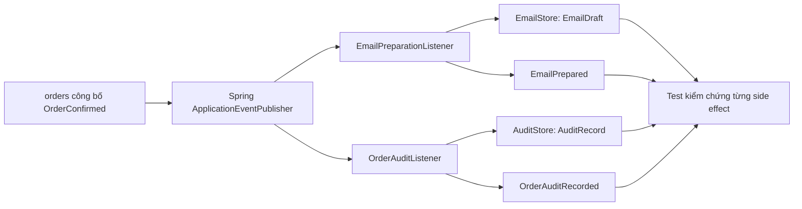
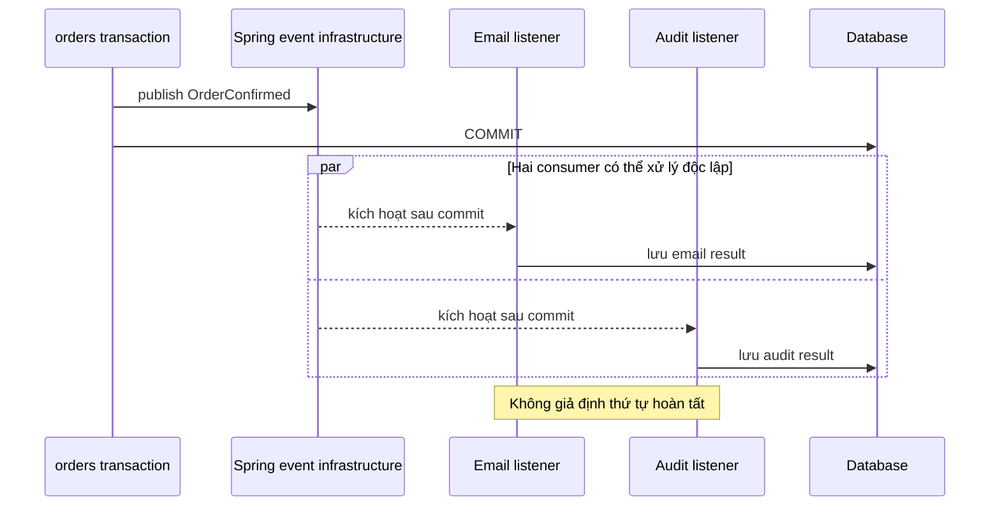

# Kiểm tra nhiều listener cho cùng event

## Mục tiêu học tập

Trong chương **Event assertions** thuộc học phần **Spring Modulith Verification & Testing**, một application event có thể được nhiều module hoặc nhiều listener tiếp nhận. Chẳng hạn, khi `orders` công bố `OrderConfirmed`, module thông báo chuẩn bị email, module kiểm toán ghi dấu vết và module hóa đơn lập chứng từ. Một test chỉ chứng minh `OrderConfirmed` đã được phát **không đủ** để khẳng định cả ba consumer đã xử lý đúng.

Sau bài học này, bạn có thể:

- Phân biệt **một lần publish event** với **nhiều lượt gọi listener** và **nhiều kết quả nghiệp vụ**.
- Viết `@ApplicationModuleTest` phát một event công khai để kiểm tra **từng listener** tiếp nhận cùng event.
- Assert đồng thời các side effect, event kết quả, payload và khóa tương quan của mỗi listener, không chỉ đếm event đầu vào.
- Kiểm chứng trường hợp event được gửi lặp mà mỗi consumer vẫn tạo kết quả đúng một lần theo quy tắc idempotency.
- Tránh giả định thứ tự listener khi hợp đồng không quy định; phân biệt đồng bộ, bất đồng bộ và `AFTER_COMMIT`.
- Hiểu vì sao số lượng bản ghi trong **Event Publication Registry** không thể đồng nhất máy móc với số lần gọi `publishEvent(…)`.
- Đặt test listener cùng `ApplicationModules.verify()` vào quality gate CI để ngăn hồi quy chức năng và phụ thuộc sai giữa module.

## 1. Một event, nhiều listener: chính xác điều gì cần kiểm tra?

Xét ứng dụng có các application module:

- `orders` công bố public event `OrderConfirmed(orderId, customerId)`.
- `notifications` có `EmailPreparationListener` tạo bản nháp email xác nhận.
- `notifications` cũng có `OrderAuditListener` tạo bản ghi kiểm toán.

Mục tiêu của bài là **kiểm tra nhiều listener cùng nhận `OrderConfirmed`**, không bắt buộc từng listener nằm ở module khác nhau. Đặt hai listener trong `notifications` giúp một `@ApplicationModuleTest` khởi động đúng consumer module mà không cần chạy toàn bộ ứng dụng. Trường hợp các listener nằm ở những module khác nhau được bàn ở phần sau.



Một event nguồn dẫn tới hai kết quả độc lập. Những câu hỏi cần được kiểm chứng là:

| Câu hỏi | Điều test phải quan sát |
| --- | --- |
| Publisher đã phát đúng `OrderConfirmed`? | Đúng loại, payload và số lượng event nguồn |
| Listener email đã chạy có kết quả? | Có `EmailDraft` của đúng `orderId`, `customerId` và template |
| Listener audit đã chạy có kết quả? | Có `AuditRecord` cho cùng giao dịch với hành động được ghi |
| Mỗi listener có phát event kết quả? | `EmailPrepared` và `OrderAuditRecorded`, mỗi loại đúng một event cho đơn |
| Event bị phát hai lần thì sao? | Mỗi consumer tuân thủ quy tắc xử lý lặp của riêng mình |
| Một listener thất bại thì listener kia có chạy? | Phụ thuộc cơ chế dispatch, transaction và chính sách xử lý lỗi; phải test riêng |

> **Một lần `publisher.publishEvent(event)` không có nghĩa chỉ một listener được gọi.** Nó cũng không bảo đảm mọi listener hoàn tất. Không lấy số lượng `OrderConfirmed` để suy ra số bản ghi email hoặc audit.

## 2. Các khái niệm đếm không nên trộn lẫn

Giả sử test gọi:

```java
publisher.publishEvent(
        new OrderConfirmed(orderId, customerId));
```

Với hai listener được đăng ký, có thể có:

1. **Một event nguồn** `OrderConfirmed` được publish.
2. **Hai listener** nhận event đó (mỗi listener là một handler khác nhau).
3. **Hai side effect** có ý nghĩa nghiệp vụ: bản nháp email và bản ghi audit.
4. **Hai event kết quả khác loại**: `EmailPrepared` và `OrderAuditRecorded`.

Các con số này **không có quan hệ luôn bằng nhau**. Một listener có thể bị vô hiệu hóa, bỏ qua event theo điều kiện, lỗi trước khi tạo kết quả hoặc nhận event lặp. Trong ứng dụng sử dụng listener giao dịch, việc đăng ký và hoàn tất từng publication còn có vòng đời riêng.

Ví dụ dưới đây chủ đích kiểm tra **một kết quả của mỗi loại cho cùng `orderId`**. Kết luận chỉ hợp lệ khi test kích hoạt chính xác các listener thuộc phạm vi application context đang chạy.

## 3. Chuẩn bị ứng dụng mẫu

Ví dụ sử dụng **Java 17+**, Spring Boot, JUnit Jupiter, AssertJ và Spring Modulith. Test nằm trong `com.example.shop.notifications`. Có thể thêm dependency Maven sau trong phạm vi test; phiên bản Spring Modulith được quản lý qua BOM tương thích với Spring Boot của dự án:

```xml
<dependency>
    <groupId>org.springframework.modulith</groupId>
    <artifactId>spring-modulith-starter-test</artifactId>
    <scope>test</scope>
</dependency>
```

Giả sử lớp ứng dụng Spring Boot nằm tại `com.example.shop`, package `orders` và `notifications` được nhận diện là hai application module. Cấu trúc mã:

```text
com.example.shop
├── orders
│   └── OrderConfirmed.java
└── notifications
    ├── EmailDraft.java
    ├── EmailPrepared.java
    ├── EmailStore.java
    ├── EmailPreparationListener.java
    ├── AuditRecord.java
    ├── OrderAuditRecorded.java
    ├── AuditStore.java
    ├── OrderAuditListener.java
    └── [test] OrderConfirmedFanoutTests.java
```

Trong bài mẫu, hai listener dùng `@EventListener` và `ApplicationEventMulticaster` đồng bộ mặc định. Side effect được lưu trong hai store **in-memory** để quan sát dễ dàng; chúng không đại diện cho database đã commit hoặc việc gửi email thật. Cách kiểm thử listener sau commit và dữ liệu bền vững nằm ở phần 7–8.

### 3.1. Public event từ module orders

Tệp `src/main/java/com/example/shop/orders/OrderConfirmed.java`:

```java
package com.example.shop.orders;

import java.util.UUID;

public record OrderConfirmed(
        UUID orderId,
        UUID customerId) {
}
```

`notifications` được phép import kiểu `OrderConfirmed` từ API công khai của module `orders`. Listener không được import `orders.internal.OrderRepository` hoặc entity JPA nội bộ: đó là một phần của ranh giới mà Spring Modulith có thể kiểm tra bằng `ApplicationModules.verify()`.

### 3.2. Kết quả của listener chuẩn bị email

Tệp `EmailDraft.java`:

```java
package com.example.shop.notifications;

import java.util.UUID;

public record EmailDraft(
        UUID orderId,
        UUID customerId,
        String templateCode) {
}
```

Tệp `EmailPrepared.java`:

```java
package com.example.shop.notifications;

import java.util.UUID;

public record EmailPrepared(
        UUID orderId,
        String templateCode) {
}
```

Store kết quả, tệp `EmailStore.java`:

```java
package com.example.shop.notifications;

import java.util.Optional;
import java.util.UUID;
import java.util.concurrent.ConcurrentHashMap;
import java.util.concurrent.ConcurrentMap;
import org.springframework.stereotype.Component;

@Component
public class EmailStore {

    private final ConcurrentMap<UUID, EmailDraft> drafts =
            new ConcurrentHashMap<>();

    public boolean insertIfAbsent(EmailDraft draft) {
        return drafts.putIfAbsent(
                draft.orderId(), draft) == null;
    }

    public Optional<EmailDraft> findByOrderId(UUID orderId) {
        return Optional.ofNullable(drafts.get(orderId));
    }

    public void remove(UUID orderId) {
        drafts.remove(orderId);
    }
}
```

Listener, tệp `EmailPreparationListener.java`:

```java
package com.example.shop.notifications;

import com.example.shop.orders.OrderConfirmed;
import org.springframework.context.ApplicationEventPublisher;
import org.springframework.context.event.EventListener;
import org.springframework.stereotype.Component;

@Component
public class EmailPreparationListener {

    private final EmailStore store;
    private final ApplicationEventPublisher publisher;

    public EmailPreparationListener(
            EmailStore store,
            ApplicationEventPublisher publisher) {
        this.store = store;
        this.publisher = publisher;
    }

    @EventListener
    public void on(OrderConfirmed event) {
        var draft = new EmailDraft(
                event.orderId(),
                event.customerId(),
                "ORDER_CONFIRMED");

        if (store.insertIfAbsent(draft)) {
            publisher.publishEvent(
                    new EmailPrepared(
                            event.orderId(),
                            draft.templateCode()));
        }
    }
}
```

Listener email chỉ phát `EmailPrepared` **khi tạo bản nháp lần đầu**. Nếu event nguồn được publish lại với cùng `orderId`, `insertIfAbsent` trả `false` và không phát event kết quả lần nữa.

### 3.3. Kết quả của listener audit

Tệp `AuditRecord.java`:

```java
package com.example.shop.notifications;

import java.util.UUID;

public record AuditRecord(
        UUID orderId,
        UUID customerId,
        String actionCode) {
}
```

Tệp `OrderAuditRecorded.java`:

```java
package com.example.shop.notifications;

import java.util.UUID;

public record OrderAuditRecorded(
        UUID orderId,
        String actionCode) {
}
```

Store kiểm toán, tệp `AuditStore.java`:

```java
package com.example.shop.notifications;

import java.util.Optional;
import java.util.UUID;
import java.util.concurrent.ConcurrentHashMap;
import java.util.concurrent.ConcurrentMap;
import org.springframework.stereotype.Component;

@Component
public class AuditStore {

    private final ConcurrentMap<UUID, AuditRecord> records =
            new ConcurrentHashMap<>();

    public boolean insertIfAbsent(AuditRecord record) {
        return records.putIfAbsent(
                record.orderId(), record) == null;
    }

    public Optional<AuditRecord> findByOrderId(UUID orderId) {
        return Optional.ofNullable(records.get(orderId));
    }

    public void remove(UUID orderId) {
        records.remove(orderId);
    }
}
```

Listener kiểm toán, tệp `OrderAuditListener.java`:

```java
package com.example.shop.notifications;

import com.example.shop.orders.OrderConfirmed;
import org.springframework.context.ApplicationEventPublisher;
import org.springframework.context.event.EventListener;
import org.springframework.stereotype.Component;

@Component
public class OrderAuditListener {

    private final AuditStore store;
    private final ApplicationEventPublisher publisher;

    public OrderAuditListener(
            AuditStore store,
            ApplicationEventPublisher publisher) {
        this.store = store;
        this.publisher = publisher;
    }

    @EventListener
    public void on(OrderConfirmed event) {
        var record = new AuditRecord(
                event.orderId(),
                event.customerId(),
                "ORDER_CONFIRMED");

        if (store.insertIfAbsent(record)) {
            publisher.publishEvent(
                    new OrderAuditRecorded(
                            event.orderId(),
                            record.actionCode()));
        }
    }
}
```

Hai listener nhận cùng `OrderConfirmed` nhưng **không gọi nhau** và **không dùng chung store kết quả**. Mỗi listener tự quyết định đã xử lý `orderId` hay chưa. Đây là ví dụ về *fan-out*: một event đầu vào kích hoạt nhiều phản ứng độc lập.

> `ConcurrentHashMap.putIfAbsent` chỉ giúp demo tránh ghi trùng trong **một JVM**. Nó không bền vững qua restart, không thay thế unique constraint của database và không bảo đảm gửi email thật đúng một lần trong hệ thống phân tán.

## 4. Test một event kích hoạt cả hai listener

Tạo `src/test/java/com/example/shop/notifications/OrderConfirmedFanoutTests.java`:

```java
package com.example.shop.notifications;

import static org.assertj.core.api.Assertions.assertThat;

import com.example.shop.orders.OrderConfirmed;
import java.util.ArrayList;
import java.util.List;
import java.util.UUID;
import org.junit.jupiter.api.AfterEach;
import org.junit.jupiter.api.Test;
import org.springframework.beans.factory.annotation.Autowired;
import org.springframework.context.ApplicationEventPublisher;
import org.springframework.modulith.test.ApplicationModuleTest;
import org.springframework.modulith.test.PublishedEvents;

@ApplicationModuleTest
class OrderConfirmedFanoutTests {

    @Autowired
    ApplicationEventPublisher publisher;

    @Autowired
    EmailStore emailStore;

    @Autowired
    AuditStore auditStore;

    private final List<UUID> usedOrderIds = new ArrayList<>();

    private UUID newOrderId() {
        UUID orderId = UUID.randomUUID();
        usedOrderIds.add(orderId);
        return orderId;
    }

    @AfterEach
    void cleanup() {
        for (UUID orderId : usedOrderIds) {
            emailStore.remove(orderId);
            auditStore.remove(orderId);
        }
    }

    @Test
    void oneInputProducesBothIndependentResults(
            PublishedEvents publishedEvents) {

        UUID orderId = newOrderId();
        UUID customerId = UUID.randomUUID();

        // When: chỉ publish một event công khai.
        publisher.publishEvent(
                new OrderConfirmed(orderId, customerId));

        // Then: đúng một event nguồn đã được ghi nhận.
        assertThat(publishedEvents.ofType(OrderConfirmed.class)
                .matching(e -> orderId.equals(e.orderId())))
                .hasSize(1);

        // Then: listener email đã thực hiện side effect.
        assertThat(emailStore.findByOrderId(orderId))
                .contains(new EmailDraft(
                        orderId, customerId, "ORDER_CONFIRMED"));

        // Then: listener audit cũng đã thực hiện side effect.
        assertThat(auditStore.findByOrderId(orderId))
                .contains(new AuditRecord(
                        orderId, customerId, "ORDER_CONFIRMED"));

        // Then: đúng một event kết quả của từng listener.
        assertThat(publishedEvents.ofType(EmailPrepared.class)
                .matching(e -> orderId.equals(e.orderId())))
                .hasSize(1)
                .allSatisfy(e ->
                        assertThat(e.templateCode())
                                .isEqualTo("ORDER_CONFIRMED"));

        assertThat(publishedEvents.ofType(OrderAuditRecorded.class)
                .matching(e -> orderId.equals(e.orderId())))
                .hasSize(1)
                .allSatisfy(e ->
                        assertThat(e.actionCode())
                                .isEqualTo("ORDER_CONFIRMED"));
    }

    @Test
    void repeatedInputDoesNotDuplicateEitherResult(
            PublishedEvents publishedEvents) {

        UUID orderId = newOrderId();
        UUID customerId = UUID.randomUUID();
        var input = new OrderConfirmed(orderId, customerId);

        publisher.publishEvent(input);
        publisher.publishEvent(input);

        // Hai lượt publish event nguồn là có chủ đích.
        assertThat(publishedEvents.ofType(OrderConfirmed.class)
                .matching(e -> orderId.equals(e.orderId())))
                .hasSize(2);

        // Mỗi listener vẫn chỉ tạo một kết quả nghiệp vụ.
        assertThat(emailStore.findByOrderId(orderId))
                .contains(new EmailDraft(
                        orderId, customerId, "ORDER_CONFIRMED"));
        assertThat(auditStore.findByOrderId(orderId))
                .contains(new AuditRecord(
                        orderId, customerId, "ORDER_CONFIRMED"));

        assertThat(publishedEvents.ofType(EmailPrepared.class)
                .matching(e -> orderId.equals(e.orderId())))
                .hasSize(1);
        assertThat(publishedEvents.ofType(OrderAuditRecorded.class)
                .matching(e -> orderId.equals(e.orderId())))
                .hasSize(1);
    }

    @Test
    void listenersDoNotMixResultsForDifferentOrders(
            PublishedEvents publishedEvents) {

        UUID orderA = newOrderId();
        UUID orderB = newOrderId();
        UUID customerA = UUID.randomUUID();
        UUID customerB = UUID.randomUUID();

        publisher.publishEvent(
                new OrderConfirmed(orderA, customerA));
        publisher.publishEvent(
                new OrderConfirmed(orderB, customerB));

        assertThat(emailStore.findByOrderId(orderA))
                .hasValueSatisfying(draft ->
                        assertThat(draft.customerId())
                                .isEqualTo(customerA));
        assertThat(emailStore.findByOrderId(orderB))
                .hasValueSatisfying(draft ->
                        assertThat(draft.customerId())
                                .isEqualTo(customerB));

        assertThat(auditStore.findByOrderId(orderA))
                .hasValueSatisfying(record ->
                        assertThat(record.customerId())
                                .isEqualTo(customerA));
        assertThat(auditStore.findByOrderId(orderB))
                .hasValueSatisfying(record ->
                        assertThat(record.customerId())
                                .isEqualTo(customerB));

        assertThat(publishedEvents.ofType(EmailPrepared.class)
                .matching(e -> orderA.equals(e.orderId())))
                .hasSize(1);
        assertThat(publishedEvents.ofType(EmailPrepared.class)
                .matching(e -> orderB.equals(e.orderId())))
                .hasSize(1);
        assertThat(publishedEvents.ofType(OrderAuditRecorded.class)
                .matching(e -> orderA.equals(e.orderId())))
                .hasSize(1);
        assertThat(publishedEvents.ofType(OrderAuditRecorded.class)
                .matching(e -> orderB.equals(e.orderId())))
                .hasSize(1);
    }
}
```

### 4.1. Vì sao các assertion phải tách theo listener?

Nếu chỉ kiểm tra:

```java
assertThat(publishedEvents.ofType(OrderConfirmed.class))
        .hasSize(1);
```

test vẫn pass dù listener email **hoàn toàn không hoạt động** hoặc listener audit ghi sai dữ liệu. Ngược lại, bài `oneInputProducesBothIndependentResults` kiểm tra **hai store khác nhau** và **hai loại event kết quả** cho cùng `orderId`.

Với test lặp event, nguồn có hai `OrderConfirmed` nhưng mỗi listener tạo một kết quả. Vì vậy, phép đếm phải nêu rõ **đếm event nguồn hay event kết quả của từng consumer**. Nếu hai event kết quả chỉ đúng tổng số nhưng đều do một listener tạo ra, kiểm tra theo loại và ID sẽ phát hiện sự không cân đối.

### 4.2. Kiểm tra kết quả, không chỉ xem listener được gọi

`Mockito.verify(emailListener).on(event)` có thể xác minh một lần gọi, nhưng chưa chứng minh bản nháp email được tạo đúng hoặc event kết quả được phát. Kiểm thử hành vi module nên ưu tiên:

1. **Đầu vào có thể kiểm soát:** event công khai với `orderId` và `customerId` của fixture.
2. **Side effect có thể quan sát:** `EmailDraft` và `AuditRecord` tồn tại với giá trị kỳ vọng.
3. **Kết quả công khai:** `EmailPrepared` và `OrderAuditRecorded` có payload đúng.

Khi chuyển từ fake store sang repository thật, cần bổ sung phép đọc dữ liệu tại ranh giới transaction phù hợp; bản thân `PublishedEvents` không chứng minh đã commit.

### 4.3. Vì sao test không kiểm tra thứ tự Email trước Audit?

Hai listener xử lý hai trách nhiệm độc lập. Spring có cơ chế ordering cho listener trong một số cấu hình đồng bộ, nhưng ví dụ **không định nghĩa** email bắt buộc chạy trước audit. Vì vậy test chỉ kiểm tra **cả hai kết quả**, không viết:

```text
EmailPrepared phải luôn đứng trước OrderAuditRecorded
```

Một assertion thứ tự như vậy dễ hỏng khi thứ tự dispatch thay đổi mà không hề vi phạm hợp đồng nghiệp vụ. Nếu thứ tự thật sự bắt buộc, cần định nghĩa rõ cơ chế điều phối, transaction và nơi xác minh thứ tự; không tự suy ra từ việc hai listener nhận cùng event.

## 5. Kiểm tra lỗi khi một listener gặp exception

Một câu hỏi quan trọng: **Nếu listener audit ném exception, listener email còn chạy không?**

Không có câu trả lời “luôn có” cho mọi cấu hình:

- Với multicaster **đồng bộ** và xử lý exception mặc định, exception của một listener có thể truyền ngược qua `publishEvent(…)` và ngăn các listener còn lại được gọi. Listener nào được chạy trước còn phụ thuộc cấu hình ordering.
- Với listener **bất đồng bộ**, các consumer có thể chạy trên executor khác nhau và lỗi của một listener không trực tiếp truyền về thread phát, nhưng vẫn cần kiểm chứng trạng thái và cơ chế retry.
- Với `@TransactionalEventListener` hoặc `@ApplicationModuleListener`, pha transaction và chiến lược xử lý lỗi quyết định thời điểm callback, trạng thái publication và khả năng chạy lại.

Do đó, **không viết một test mặc định rằng listener B luôn thành công sau khi listener A lỗi** nếu ứng dụng chưa có hợp đồng xử lý lỗi độc lập.

### 5.1. Ba nhóm test nên có

| Nhóm | Stimulus | Assertion |
| --- | --- | --- |
| Happy path của fan-out | Một `OrderConfirmed` hợp lệ | Cả email và audit tạo đúng kết quả |
| Lỗi riêng của email | Giả lập dependency email bị lỗi | Xác minh chính sách lỗi, trạng thái retry hoặc failure event của email |
| Lỗi riêng của audit | Giả lập dependency audit bị lỗi | Xác minh chính sách lỗi, trạng thái audit và ảnh hưởng đến các consumer khác theo thiết kế |

Nếu business yêu cầu **một listener thất bại không làm mất tác vụ của listener khác**, nên tổ chức các listener với cơ chế thực thi/phục hồi phù hợp và có integration test kiểm tra cả trường hợp lỗi thực tế. Không dùng `try/catch` rồi bỏ qua exception mà không lưu lại trạng thái thất bại; điều đó chỉ che giấu sự cố.

### 5.2. Test khác nhau cho hai listener

Khi hai listener có độ phức tạp cao, nên có test chuyên biệt cho từng listener (unit hoặc module integration), bên cạnh một bài fan-out:

- Test email: kiểm tra ánh xạ dữ liệu, chọn template, chống trùng, lỗi chuẩn bị email.
- Test audit: kiểm tra hành động audit, thông tin nguồn, retention và chính sách ghi trùng.
- Test fan-out: kiểm tra cả hai bean được Spring đăng ký, có thể cùng nhận public event và tạo đúng kết quả.

Cách tổ chức này giúp nhanh chóng xác định consumer nào bị lỗi thay vì chỉ thấy một assertion lớn báo thất bại.

## 6. Phạm vi @ApplicationModuleTest khi listener thuộc nhiều module

Ví dụ chính có hai listener trong `notifications`. Vì test nằm trong `com.example.shop.notifications`, `@ApplicationModuleTest` có thể khởi động module đó theo phạm vi kiểm thử module. Event `OrderConfirmed` là **kiểu dữ liệu công khai** của `orders`; test trực tiếp publish object này mà không cần khởi động service xử lý đơn hàng.

Nếu đổi thiết kế thành:

```text
orders → OrderConfirmed
          ├─ notifications.EmailPreparationListener
          ├─ auditing.OrderAuditListener
          └─ billing.InvoiceListener
```

thì một `@ApplicationModuleTest` tập trung vào `notifications` **không mặc nhiên khởi động** các listener nằm ở `auditing` và `billing`. Việc test chỉ thấy email được tạo **không có nghĩa** hai listener kia không tồn tại trong production; chúng có thể đơn giản đang ngoài phạm vi bootstrap.

Nên chia kiểm thử thành:

1. **Module test của từng consumer:** phát `OrderConfirmed` và kiểm chứng kết quả của listener tại đúng module đó.
2. **Integration test đa module hoặc toàn ứng dụng:** bootstrap các module cần thiết (ví dụ `@SpringBootTest`) để xác minh một event nguồn đi tới toàn bộ consumer dự kiến.
3. **Architecture verification:** `ApplicationModules.verify()` để đảm bảo các consumer chỉ phụ thuộc vào API công khai của `orders` và không tạo vòng phụ thuộc sai.

Không tăng phạm vi bootstrap chỉ để mọi test đơn lẻ pass; một suite kết hợp các test module nhỏ và một số integration test quan trọng thường dễ bảo trì hơn.

## 7. Khi cả hai listener chạy sau commit hoặc bất đồng bộ

Trong ứng dụng Spring Modulith thực tế, nhiều consumer được tổ chức bằng `@ApplicationModuleListener`, hoặc dùng `@TransactionalEventListener(phase = AFTER_COMMIT)` và `@Async`. Khi đó:

- `publishEvent(new OrderConfirmed(…))` có thể được gọi **trong transaction của module orders**.
- Listener hậu commit chỉ được kích hoạt nếu transaction nguồn **commit thành công**.
- Listener bất đồng bộ có thể hoàn tất ở những thời điểm khác nhau.
- Việc hai listener đã nhận được event nguồn **không** có nghĩa cả hai side effect đã commit.



### 7.1. Scenario chờ kết quả từ một listener

`Scenario` phù hợp khi test cần chờ event kết quả của listener bất đồng bộ. Với một workflow thật có transaction được commit và listener email phát `EmailPrepared`:

```java
@Test
void waitsForEmailListener(Scenario scenario) {
    UUID orderId = UUID.randomUUID();

    scenario.stimulate(() -> orderWorkflow.confirm(orderId))
            .andWaitForEventOfType(EmailPrepared.class)
            .matching(e -> orderId.equals(e.orderId()))
            .toArriveAndVerify(e ->
                    assertThat(e.templateCode())
                            .isEqualTo("ORDER_CONFIRMED"));
}
```

Đây là **mẫu phần thân test**, giả định `orderWorkflow` là bean của module phát event, `Scenario` được inject vào test và listener email có trong phạm vi bootstrap. Các import điển hình là `org.springframework.modulith.test.Scenario`, `java.util.UUID` và static AssertJ `assertThat`. Nếu stimulus gọi service `@Transactional`, bảo đảm transaction đã commit theo ngữ nghĩa của `Scenario` và phiên bản Spring Modulith đang dùng.

**Quan trọng:** Test này chỉ chờ **`EmailPrepared`**. Nó **không chứng minh** listener audit đã hoàn tất. Không lấy việc một consumer tạo event để suy ra các consumer khác đều thành công.

### 7.2. Chờ cả hai kết quả bằng điều kiện nghiệp vụ

Khi cần khẳng định cả email và audit đã ghi dữ liệu bền vững, hãy chờ **hai điều kiện độc lập** thay vì đợi một event rồi kiểm tra database bên còn lại quá sớm.

Ví dụ một phần của integration test sử dụng Awaitility, sau khi stimulus đã thực sự commit:

```java
await()
        .atMost(Duration.ofSeconds(5))
        .untilAsserted(() -> {
            assertThat(emailRepository.findByOrderId(orderId))
                    .isPresent();
            assertThat(auditRepository.findByOrderId(orderId))
                    .isPresent();
        });
```

Đoạn này minh họa **bước chờ và assertion**, không phải toàn bộ lớp test. Nó giả định `emailRepository` và `auditRepository` là repository thật, `findByOrderId` trả `Optional`, `orderId` đã được gán, transaction nguồn đã commit, và Awaitility có trong test classpath. Cần import static `org.awaitility.Awaitility.await`, `java.time.Duration` và AssertJ `assertThat`. Trong ứng dụng thật, sau khi hai record xuất hiện còn phải kiểm tra **nội dung** và, nếu cần, **số lượng** bằng query/unique constraint.

`Scenario` có thể hỗ trợ chờ trạng thái theo API của phiên bản đang sử dụng; chọn công cụ phù hợp với mục tiêu nhưng giữ nguyên nguyên tắc: **đợi cả hai side effect rồi mới kết luận cả hai listener đã hoàn thành**. Không dùng `Thread.sleep(500)` vì độ trễ executor/database thay đổi giữa máy phát triển và CI.

### 7.3. Transaction rollback

Với listener `AFTER_COMMIT`, một transaction rollback không được kích hoạt xử lý hậu commit. Test cần phân biệt:

| Tình huống | Event nguồn `OrderConfirmed` | Kết quả email/audit hậu commit |
| --- | --- | --- |
| Đã gọi `publishEvent` trong transaction đang mở | Có thể đã quan sát được | Chưa nên có |
| Transaction commit thành công, listener hoàn tất | Có | Có theo hợp đồng |
| Transaction rollback | Có thể vẫn được ghi nhận trong test | Không được tạo bởi listener `AFTER_COMMIT` |

Nếu bài test JUnit đang bọc trong transaction tự động rollback, listener hậu commit có thể không chạy và việc chờ hai kết quả sẽ timeout. Hãy xác định rõ ranh giới commit bằng `Scenario` hoặc `TransactionTemplate`; tránh coi việc event nguồn xuất hiện là bằng chứng database đã commit.

## 8. Event Publication Registry và nhiều listener

Spring Modulith có **Event Publication Registry** để theo dõi việc phân phối/xử lý application event đối với những transactional event listener phù hợp. Khi một event có nhiều listener mục tiêu, registry có thể theo dõi **các publication tới từng target listener**; vòng đời hoàn tất có thể khác nhau vì một listener thành công trong khi listener khác lỗi hoặc chờ retry.

Vì thế, không nên viết phép suy diễn:

```text
publishEvent() được gọi 1 lần
=> registry phải luôn có đúng 1 dòng
=> tất cả listener đã xử lý thành công
```

Các vế trên không tương đương. Số lượng bản ghi và trạng thái registry phụ thuộc cấu hình lưu trữ, danh sách listener mục tiêu, transaction, trạng thái hoàn tất và chính sách lưu/xóa publication theo phiên bản. `PublishedEvents` kiểm tra **event được phát trong bài test**, không đo toàn bộ vòng đời registry.

Muốn kiểm chứng cơ chế retry và độ bền, cần integration test với registry implementation của dự án và điều kiện lỗi được dựng có kiểm soát. Test happy path bằng `PublishedEvents` vẫn hữu ích, nhưng nó không thay thế kiểm thử phục hồi khi một consumer xử lý thất bại.

## 9. Idempotency phải được xét cho từng listener

Nếu `OrderConfirmed` được giao lại hai lần, listener email có thể cần bảo đảm chỉ chuẩn bị một email; listener audit có thể có yêu cầu khác, ví dụ ghi lại **mọi lần nhận** event phục vụ điều tra. Không mặc định mọi consumer đều áp dụng cùng chính sách deduplication.

Ở ví dụ chính, hợp đồng được chọn là:

| Consumer | Khóa idempotency | Kết quả mong đợi khi nhận 2 event giống nhau |
| --- | --- | --- |
| Email | `orderId` | Một `EmailDraft` và một `EmailPrepared` |
| Audit | `orderId` | Một `AuditRecord` và một `OrderAuditRecorded` |

Nếu nghiệp vụ audit cần lịch sử từng lần xử lý, hãy đổi contract và test tương ứng, ví dụ thêm `deliveryId` hoặc định danh sự kiện nguồn rồi lưu từng lần nhận. **Đừng ép audit chỉ ghi một lần** chỉ vì email có hợp đồng đó.

Trong production với database, mô hình `findById → nếu chưa có thì save` có thể gặp race condition giữa nhiều worker. Cần unique constraint, transaction và xử lý va chạm hợp lệ. Với tác động ra bên ngoài như gửi email, lập hóa đơn hoặc đẩy message, phải xét chiến lược retry/outbox và idempotency phía consumer; một `hasSize(1)` trong test không chứng minh *distributed exactly-once*.

## 10. Những lỗi thường gặp và cách chẩn đoán

| Dấu hiệu | Nguyên nhân khả dĩ | Cách xử lý |
| --- | --- | --- |
| `OrderConfirmed` có trong `PublishedEvents` nhưng thiếu email | Listener email chưa đăng ký, lỗi trong listener hoặc chưa hoàn tất | Kiểm tra bean, bootstrap, side effect và cơ chế chờ |
| Email có, audit không có | Listener audit nằm ngoài phạm vi test hoặc xử lý lỗi | Test audit module riêng và integration test đa module |
| Test pass khi chỉ một listener chạy | Chỉ assert event nguồn hoặc một kết quả | Assert kết quả của **từng** listener |
| Tổng hai event kết quả nhưng sai giao dịch | Chỉ đếm tổng, không lọc `orderId` | Assert từng loại và từng khóa tương quan |
| Test fail ngẫu nhiên | Hai listener async, assertion quá sớm | Dùng `Scenario` hoặc chờ hai điều kiện với timeout |
| Test kiểm tra Email trước Audit và bị flake | Thứ tự giữa listener không thuộc hợp đồng | Bỏ assertion thứ tự không cần thiết |
| Hai listener được gọi lại gây duplicate | Thiếu idempotency/unique constraint | Test redelivery, bổ sung khóa và transaction |
| Listener `AFTER_COMMIT` không chạy | Transaction nguồn rollback, test không commit | Kiểm tra pha giao dịch và ranh giới commit |
| Lỗi một listener khiến listener còn lại không chạy | Exception đồng bộ lan qua multicaster | Thiết kế chính sách lỗi và test đúng cấu hình |
| Đếm registry khác số event nguồn | Registry theo dõi publication cho listener mục tiêu | Phân biệt đơn vị đếm, trạng thái và cấu hình |

## 11. Quality gate trong CI và ranh giới Spring Modulith

Học phần **Spring Modulith Verification & Testing** tập trung vào cả **độ đúng kiến trúc** lẫn **hành vi runtime**. Bộ test của luồng fan-out nên có các tầng bổ sung:

**Kiến trúc:** chạy `ApplicationModules.verify()` để phát hiện vòng phụ thuộc và việc consumer truy cập package không công khai của module phát:

```java
import org.junit.jupiter.api.Test;
import org.springframework.modulith.core.ApplicationModules;

class ArchitectureVerificationTests {

    @Test
    void verifiesModuleBoundaries() {
        ApplicationModules.of(ShopApplication.class).verify();
    }
}
```

`ShopApplication` là tên minh họa cho lớp Spring Boot application thực tế. Test này không chứng minh listener email hay audit đã chạy; nó chỉ bảo vệ quy tắc kiến trúc.

**Hành vi module:** dùng `@ApplicationModuleTest` để kiểm tra từng listener với event công khai và side effect có thể quan sát.

**Tích hợp đa module:** chỉ thêm các test có phạm vi đủ rộng khi cần xác nhận `orders` phát event thật và toàn bộ consumer dự kiến được khởi động, đặc biệt khi xử lý sau commit, asynchronous hoặc dùng database.

Trong CI, đưa các test này vào bước chạy JUnit (ví dụ `mvn test` hoặc `./gradlew test`). Quality gate cần thất bại nếu một listener bị xóa, chuyển sai package, tạo payload sai, phát trùng hoặc vi phạm quy tắc phụ thuộc. Với test async, đặt timeout hữu hạn và chuẩn bị fixture/cleanup dữ liệu đã commit để giảm flakiness.

## 12. Bài thực hành

Thực hiện các thử nghiệm sau với `OrderConfirmedFanoutTests`:

1. **Happy path:** publish một `OrderConfirmed` rồi kiểm tra một `EmailDraft`, một `AuditRecord`, một `EmailPrepared` và một `OrderAuditRecorded` cùng `orderId`.
2. **Bỏ một listener:** tạm bỏ `@EventListener` trên `OrderAuditListener.on(…)`. Xác nhận test fan-out thất bại ở assertion audit, dù email vẫn có thể pass.
3. **Sai payload:** đổi `event.customerId()` trong `EmailPreparationListener` thành `UUID.randomUUID()`. Test fixture phải phát hiện email chứa sai khách.
4. **Event trùng:** publish cùng event hai lần. Kiểm chứng hai event nguồn nhưng chỉ một kết quả của từng listener theo hợp đồng demo.
5. **Hai đơn:** gửi event cho hai ID khác nhau. Kiểm tra từng kết quả theo ID, không chỉ đếm tổng.
6. **Thứ tự:** quan sát thứ tự callback trong môi trường đồng bộ rồi giải thích vì sao không nên biến quan sát ngẫu nhiên đó thành hợp đồng nếu không có yêu cầu nghiệp vụ.
7. **Bất đồng bộ:** chuyển một listener sang `@Async` với `@EnableAsync` hoặc tổ chức theo `@ApplicationModuleListener`. Thay assertion tức thì bằng chờ điều kiện kết quả; phân biệt event được publish với dữ liệu đã commit.
8. **Nhiều module:** chuyển audit listener sang module `auditing`. Viết module test riêng cho audit và integration test bootstrap đủ các consumer, đồng thời chạy `ApplicationModules.verify()`.

**Tiêu chí hoàn thành:** test thất bại khi thiếu một listener, sai payload, xử lý trùng trái hợp đồng hoặc nhầm ID; người học nêu được vì sao một event nguồn và hai listener không tạo ra cam kết tự động về thứ tự, transaction hoặc hoàn tất.

## 13. Câu hỏi tự kiểm tra

**Câu 1.** `assertThat(events.ofType(OrderConfirmed.class)).hasSize(1)` đã chứng minh cả email và audit listener chạy chưa?

**Trả lời:** Chưa. Assertion chỉ xác minh event nguồn; cần kiểm tra side effect và event kết quả của **từng listener**.

**Câu 2.** Vì sao không nên kiểm tra `EmailPrepared` luôn đứng trước `OrderAuditRecorded`?

**Trả lời:** Hai listener độc lập không có yêu cầu thứ tự. Thứ tự callback hoặc hoàn tất có thể thay đổi theo cấu hình và lịch thực thi; assertion đó chỉ phù hợp khi hợp đồng thực sự quy định thứ tự.

**Câu 3.** Test chạy ở module `notifications` không thấy listener trong `auditing`. Có chắc listener đó bị lỗi không?

**Trả lời:** Không. `@ApplicationModuleTest` có phạm vi bootstrap theo module; listener thuộc module khác có thể chưa được khởi động. Cần test đúng module hoặc integration test đa module.

**Câu 4.** Nếu event nguồn publish hai lần nhưng mỗi consumer chỉ tạo một kết quả, test chứng minh điều gì?

**Trả lời:** Trong phạm vi test, mỗi consumer đang tuân thủ quy tắc idempotency đã định nghĩa. Nó chưa chứng minh xử lý đúng một lần giữa nhiều JVM, khi process crash hoặc message broker redelivery.

**Câu 5.** Một listener `AFTER_COMMIT` phát event kết quả, có thể kết luận consumer khác cũng đã commit dữ liệu không?

**Trả lời:** Không. Mỗi listener có thể có transaction hoặc thời điểm hoàn tất riêng. Muốn khẳng định tất cả consumer đã hoàn tất phải kiểm tra trạng thái của từng consumer.

## Kết luận

Để **kiểm tra nhiều listener cho cùng event**, hãy phân biệt một event nguồn với từng phản ứng nghiệp vụ của các consumer. Trong Spring Modulith, `@ApplicationModuleTest` có thể phát một public event qua `ApplicationEventPublisher`, sau đó dùng `PublishedEvents` kết hợp kiểm tra store/repository để xác minh kết quả riêng của từng listener. Lọc bằng `orderId`, đặt assertion về số lượng và payload, thử event trùng và không áp đặt thứ tự khi hợp đồng không yêu cầu. Với consumer ở nhiều module, listener hậu commit hoặc bất đồng bộ, mở rộng phạm vi bootstrap và chờ trạng thái hoàn tất có giới hạn. Kết hợp các bài test hành vi với `ApplicationModules.verify()` để CI bảo vệ cả ranh giới kiến trúc lẫn tính đúng đắn của fan-out event.

## Tài liệu tham khảo

- [Spring Modulith Reference — Testing application modules](https://docs.spring.io/spring-modulith/reference/testing.html)
- [Spring Modulith Reference — Working with application events](https://docs.spring.io/spring-modulith/reference/events.html)
- [Spring Modulith Reference — Application module fundamentals](https://docs.spring.io/spring-modulith/reference/fundamentals.html)
- [Spring Modulith Javadoc — PublishedEvents](https://docs.spring.io/spring-modulith/docs/current/api/org/springframework/modulith/test/PublishedEvents.html)
- [Spring Modulith Javadoc — Scenario](https://docs.spring.io/spring-modulith/docs/current/api/org/springframework/modulith/test/Scenario.html)
- [Spring Framework Reference — Application events and listeners](https://docs.spring.io/spring-framework/reference/core/beans/context-introduction.html#context-functionality-events-annotation)
- [Spring Framework Reference — Transaction-bound events](https://docs.spring.io/spring-framework/reference/data-access/transaction/event.html)
