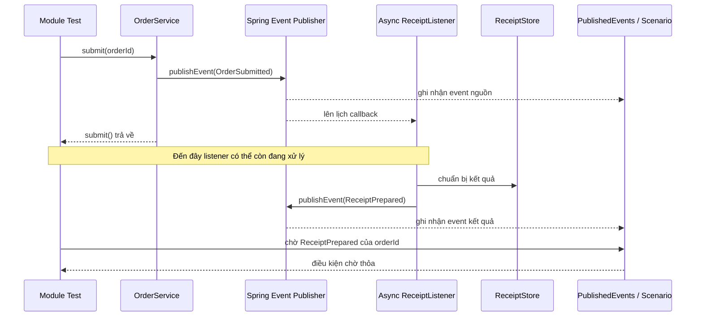
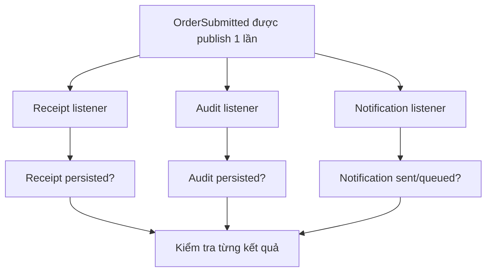

# Phân biệt event đã publish với listener đã hoàn thành

## Mục tiêu học tập

Trong chương **Event assertions** của học phần **Spring Modulith Verification & Testing**, một test có thể chứng minh service đã công bố event mà vẫn bỏ sót lỗi ở module nhận. Trường hợp này đặc biệt thường gặp với listener bất đồng bộ, listener chạy sau commit, thao tác cơ sở dữ liệu, retry và hệ thống gửi thông điệp bên ngoài ứng dụng.

Kết thúc bài học, bạn có thể:

- Giải thích sự khác nhau giữa **event đã publish**, **listener được kích hoạt**, **listener đã hoàn thành logic**, **side effect đã commit** và **consumer bên ngoài đã nhận message**.
- Dùng `PublishedEvents` trong `@ApplicationModuleTest` để xác minh trách nhiệm của **publisher**, không nhầm với sự hoàn tất của **listener**.
- Dùng `Scenario` để kích hoạt nghiệp vụ rồi chờ **event kết quả** do listener bất đồng bộ tạo ra; lọc đúng giao dịch bằng khóa tương quan.
- Kiểm tra trạng thái repository/database khi hợp đồng yêu cầu kết quả **bền vững**, thay vì chỉ nhìn thấy một event.
- Thiết kế test cho các tình huống listener bị lỗi, xử lý chậm, retry, rollback và phát trùng.
- Kết hợp các bài kiểm tra hành vi với `ApplicationModules.verify()` thành quality gate trong CI.

## 1. Năm mốc của một luồng xử lý sự kiện

Ví dụ, module `orders` phát `OrderSubmitted`. Module `receipts` lắng nghe và chuẩn bị biên nhận, sau đó phát `ReceiptPrepared`.

Các mốc cần phân biệt:

| Mốc | Phát biểu chính xác | Điều **chưa** được chứng minh |
| --- | --- | --- |
| **1. Publish** | Code gọi `ApplicationEventPublisher.publishEvent(OrderSubmitted)` và event được ghi nhận | Listener đã được gọi hoặc xử lý thành công |
| **2. Dispatch/đăng ký xử lý** | Event được chuyển đến listener, hoặc callback được lên lịch theo cấu hình | Công việc listener đã hoàn tất |
| **3. Listener hoàn thành logic** | Listener đã thực thi tới điểm kết thúc thành công của tác vụ được định nghĩa | Mọi thay đổi database đã commit, hoặc hệ thống ngoài đã nhận |
| **4. Side effect bền vững** | Transaction ghi biên nhận/hóa đơn đã commit và dữ liệu có thể quan sát phù hợp | Message đã được broker giao cho mọi consumer |
| **5. External delivery/consumption** | Một hệ thống ngoài thực sự nhận, xác nhận hoặc xử lý message | Không có retry/trùng lặp về sau, trừ khi giao thức có bảo đảm tương ứng |

Điểm then chốt: **mốc trước không tự động chứng minh mốc sau**. Một API event test quan sát mốc 1 không nên được đặt tên như thể đã xác minh mốc 4.

### 1.1. PublishedEvents quan sát điều gì?

`PublishedEvents` thuộc `org.springframework.modulith.test` giúp test truy vấn những Spring application event đã được phát trong phạm vi thực thi. Ví dụ:

```java
var sourceEvents = events.ofType(OrderSubmitted.class)
        .matching(e -> expectedOrderId.equals(e.orderId()));

assertThat(sourceEvents).hasSize(1);
```

Assertion này chỉ cho biết **đã quan sát đúng một `OrderSubmitted` cho đơn đang kiểm tra**. Nó **không** khẳng định:

- Listener `ReceiptListener` có hiện diện trong application context hay không.
- Listener có thoát ra do exception, timeout hoặc bị executor từ chối hay không.
- Biên nhận đã được ghi vào repository hay chưa.
- Transaction ghi biên nhận đã commit hay chưa.
- Message qua Kafka/RabbitMQ hoặc email đã đến người nhận hay chưa.

Nếu listener đồng bộ và Spring dùng multicaster đồng bộ mặc định, lời gọi `publishEvent(…)` có thể chỉ trở về sau khi các callback đồng bộ đã chạy. Nhưng đó là đặc điểm của **cấu hình cụ thể**, không phải bảo đảm tổng quát cho mọi listener `@Async`, `@ApplicationModuleListener` hoặc `@TransactionalEventListener`.

## 2. Dòng thời gian: publish trước, listener hoàn thành sau



Khi publisher và listener chạy trên những thread khác nhau, thứ tự quan sát giữa “`submit()` trả về” và “listener ghi xong dữ liệu” không được bảo đảm. Vì vậy, cách viết sau dễ sinh **flaky test**:

```java
workflow.submit(orderId);

// Sai mục tiêu nếu listener xử lý bất đồng bộ:
assertThat(events.ofType(ReceiptPrepared.class)).hasSize(1);
```

Test có thể pass trên máy phát triển nhưng fail trên CI do listener xử lý chậm. Không giải quyết vấn đề này bằng cách đổi sang `Thread.sleep(500)`: ngủ một khoảng không bảo đảm event đúng đã tới, lại khiến test chậm dù kết quả đã có.

**Cách đúng:** xác định một *điều kiện hoàn thành quan sát được* của listener và chờ có timeout hữu hạn. Điều kiện đó có thể là một event kết quả hoặc trạng thái database đã commit.

## 3. Chọn bằng chứng theo hợp đồng cần bảo vệ

Trước khi viết test, hãy chọn câu hỏi nghiệp vụ:

| Câu hỏi | Bằng chứng chính | Công cụ |
| --- | --- | --- |
| Service có phát `OrderSubmitted` đúng một lần không? | Event nguồn với `orderId` đúng | `PublishedEvents.ofType(…).matching(…).hasSize(1)` |
| Listener có xử lý đến bước “biên nhận đã chuẩn bị” không? | Event kết quả `ReceiptPrepared` với cùng `orderId` | `Scenario` chờ event rồi verify |
| Listener có ghi biên nhận vào DB thành công không? | Repository đọc được dữ liệu sau commit | Integration test + điều kiện chờ |
| Listener hậu commit có bị chạy khi transaction nguồn rollback không? | Không có kết quả hậu commit và không có bản ghi | Test commit/rollback chủ động |
| Consumer có nhận và xử lý thông điệp ngoài JVM không? | ACK, trạng thái message hoặc side effect ở consumer thật | Integration/contract test với transport |

### 3.1. Khi nào event kết quả đủ làm tín hiệu hoàn thành?

Nếu listener chạy:

```java
receiptStore.put(...);
publisher.publishEvent(new ReceiptPrepared(...));
```

thì `ReceiptPrepared` có thể chứng minh code đã đi qua bước `put` trong **cấu hình đồng bộ của store demo**. Nhưng nếu `receiptStore` là một JPA repository và transaction của listener còn đang mở, event có thể được phát **trước khi transaction ghi dữ liệu commit**.

Do đó, cần quy định rõ tên event:

- `ReceiptPreparationStarted`: listener bắt đầu.
- `ReceiptPrepared`: công việc chuẩn bị đã thành công ở mức nghiệp vụ được định nghĩa.
- `ReceiptPersisted`: chỉ nên mang ý nghĩa dữ liệu bền vững nếu được phát ở ranh giới và có test chứng minh commit tương ứng.

Tên event không tự tạo ra bảo đảm kỹ thuật; **thời điểm publish và kiểm thử side effect** mới làm rõ ý nghĩa của nó.

## 4. Ví dụ Spring Modulith: listener bất đồng bộ tạo event kết quả

Ta xây một ví dụ nhỏ với Java 17+, Spring Boot, Spring Modulith, JUnit Jupiter và AssertJ. Trong đó:

- Module `orders` sở hữu public event `OrderSubmitted`.
- Module `receipts` chứa `ReceiptListener`, `ReceiptStore` và event `ReceiptPrepared`.
- Listener chạy bằng `@Async @EventListener`, do đó test không giả định nó hoàn tất trước khi `publishEvent` trả về.
- `ReceiptStore` sử dụng bộ nhớ để minh họa quan sát kết quả; phần database được trình bày riêng.

Sơ đồ package:

```text
com.example.shop
├── ShopApplication.java
├── orders
│   └── OrderSubmitted.java
└── receipts
    ├── Receipt.java
    ├── ReceiptStore.java
    ├── ReceiptPrepared.java
    ├── ReceiptListener.java
    ├── ReceiptAsyncConfiguration.java
    └── [test] ReceiptListenerCompletionTests.java
```

Test đặt trong package `com.example.shop.receipts` để `@ApplicationModuleTest` khởi động module consumer. Nó có thể publish trực tiếp event công khai của `orders` mà không cần phụ thuộc service hoặc repository nội bộ của module `orders`.

### 4.1. Event nguồn và kết quả

Tệp `src/main/java/com/example/shop/orders/OrderSubmitted.java`:

```java
package com.example.shop.orders;

import java.util.UUID;

public record OrderSubmitted(
        UUID orderId,
        UUID customerId) {
}
```

Tệp `src/main/java/com/example/shop/receipts/ReceiptPrepared.java`:

```java
package com.example.shop.receipts;

import java.util.UUID;

public record ReceiptPrepared(
        UUID orderId,
        String templateCode) {
}
```

Hai event đều mang `orderId` làm **khóa tương quan**. Test cần biết event kết quả thuộc đúng đơn mà nó vừa kích hoạt, không chấp nhận event cùng loại của một giao dịch khác.

### 4.2. Dữ liệu mà listener tạo ra

Tệp `src/main/java/com/example/shop/receipts/Receipt.java`:

```java
package com.example.shop.receipts;

import java.util.UUID;

public record Receipt(
        UUID orderId,
        UUID customerId,
        String templateCode) {
}
```

Tệp `src/main/java/com/example/shop/receipts/ReceiptStore.java`:

```java
package com.example.shop.receipts;

import java.util.Optional;
import java.util.UUID;
import java.util.concurrent.ConcurrentHashMap;
import java.util.concurrent.ConcurrentMap;
import org.springframework.stereotype.Component;

@Component
public class ReceiptStore {

    private final ConcurrentMap<UUID, Receipt> receipts =
            new ConcurrentHashMap<>();

    public boolean putIfAbsent(Receipt receipt) {
        return receipts.putIfAbsent(
                receipt.orderId(), receipt) == null;
    }

    public Optional<Receipt> findByOrderId(UUID orderId) {
        return Optional.ofNullable(receipts.get(orderId));
    }

    public void remove(UUID orderId) {
        receipts.remove(orderId);
    }
}
```

`ConcurrentHashMap` cho phép thao tác trên các worker thread mà không dựa vào một `HashMap` không an toàn khi truy cập đồng thời. `putIfAbsent` giúp ví dụ tránh tạo kết quả trùng trong một JVM. Đây **không phải** giải pháp idempotency bền vững cho hệ thống nhiều instance.

### 4.3. Listener bất đồng bộ

Tệp `src/main/java/com/example/shop/receipts/ReceiptListener.java`:

```java
package com.example.shop.receipts;

import com.example.shop.orders.OrderSubmitted;
import org.springframework.context.ApplicationEventPublisher;
import org.springframework.context.event.EventListener;
import org.springframework.scheduling.annotation.Async;
import org.springframework.stereotype.Component;

@Component
public class ReceiptListener {

    private final ReceiptStore store;
    private final ApplicationEventPublisher publisher;

    public ReceiptListener(
            ReceiptStore store,
            ApplicationEventPublisher publisher) {
        this.store = store;
        this.publisher = publisher;
    }

    @Async
    @EventListener
    public void on(OrderSubmitted event) {
        var receipt = new Receipt(
                event.orderId(),
                event.customerId(),
                "ORDER_RECEIVED");

        if (store.putIfAbsent(receipt)) {
            // Event kết quả chỉ phát sau khi store đã chấp nhận receipt.
            publisher.publishEvent(
                    new ReceiptPrepared(
                            event.orderId(),
                            receipt.templateCode()));
        }
    }
}
```

Tệp `src/main/java/com/example/shop/receipts/ReceiptAsyncConfiguration.java`:

```java
package com.example.shop.receipts;

import org.springframework.context.annotation.Configuration;
import org.springframework.scheduling.annotation.EnableAsync;

@Configuration(proxyBeanMethods = false)
@EnableAsync
class ReceiptAsyncConfiguration {
}
```

`@EnableAsync` cho phép Spring áp dụng `@Async`. Listener phải là Spring bean và lời gọi phải đi qua proxy/cơ chế dispatch của Spring; tự tạo listener bằng `new` không tái hiện được việc dispatch qua application context. Trong production cần cấu hình executor, giới hạn hàng đợi và chính sách xử lý lỗi phù hợp.

**Một chi tiết quan trọng:** Trong ví dụ này, `ReceiptPrepared` chứng minh listener đã đưa dữ liệu vào **store trong bộ nhớ**, không chứng minh một transaction database đã commit. Đó là một hợp đồng nhỏ, được test rõ ràng; không nên diễn giải rộng hơn.

## 5. Test: kiểm tra event nguồn và chờ listener hoàn thành

Thêm dependency Maven trong phạm vi test (phiên bản Spring Modulith nên được quản lý bằng BOM tương thích với Spring Boot):

```xml
<dependency>
    <groupId>org.springframework.modulith</groupId>
    <artifactId>spring-modulith-starter-test</artifactId>
    <scope>test</scope>
</dependency>
```

Tệp `src/test/java/com/example/shop/receipts/ReceiptListenerCompletionTests.java`:

```java
package com.example.shop.receipts;

import static org.assertj.core.api.Assertions.assertThat;

import com.example.shop.orders.OrderSubmitted;
import java.util.UUID;
import org.junit.jupiter.api.Test;
import org.springframework.beans.factory.annotation.Autowired;
import org.springframework.context.ApplicationEventPublisher;
import org.springframework.modulith.test.ApplicationModuleTest;
import org.springframework.modulith.test.PublishedEvents;
import org.springframework.modulith.test.Scenario;

@ApplicationModuleTest
class ReceiptListenerCompletionTests {

    @Autowired
    ApplicationEventPublisher publisher;

    @Autowired
    ReceiptStore receiptStore;

    @Test
    void sourcePublishedAndAsyncListenerResultObserved(
            PublishedEvents publishedEvents,
            Scenario scenario) {

        UUID orderId = UUID.randomUUID();
        UUID customerId = UUID.randomUUID();

        try {
            // Stimulus + điều kiện chờ được tổ chức cùng một Scenario.
            scenario.stimulate(() -> publisher.publishEvent(
                            new OrderSubmitted(orderId, customerId)))
                    .andWaitForEventOfType(ReceiptPrepared.class)
                    .matching(e -> orderId.equals(e.orderId()))
                    .toArriveAndVerify(event -> {
                        assertThat(event.orderId())
                                .isEqualTo(orderId);
                        assertThat(event.templateCode())
                                .isEqualTo("ORDER_RECEIVED");
                    });

            // Kiểm tra riêng hợp đồng của publisher.
            assertThat(publishedEvents.ofType(OrderSubmitted.class)
                    .matching(e -> orderId.equals(e.orderId())))
                    .hasSize(1);

            // Kiểm tra side effect thực của listener sau điều kiện chờ.
            assertThat(receiptStore.findByOrderId(orderId))
                    .contains(new Receipt(
                            orderId,
                            customerId,
                            "ORDER_RECEIVED"));
        } finally {
            receiptStore.remove(orderId);
        }
    }
}
```

### 5.1. Ba phép kiểm độc lập, không thay thế nhau

1. `Scenario` chờ **`ReceiptPrepared` cho đúng `orderId`** rồi kiểm tra payload. Nó xác minh listener đã đạt đến bước phát event kết quả trong giới hạn thời gian chờ.
2. `PublishedEvents` xác minh **`OrderSubmitted` được phát đúng một lần**. Assertion này vẫn có ý nghĩa nếu logic xử lý receipt được thay đổi.
3. `ReceiptStore` xác minh **dữ liệu mà listener đã tạo**. Nếu listener vô tình phát `ReceiptPrepared` nhưng không đưa receipt vào store, test sẽ phát hiện.

Ba assertion cùng mô tả một hợp đồng nhiều bước, nhưng **khác nhau về loại bằng chứng**. Không xóa phép kiểm store chỉ vì event kết quả đã đến khi nghiệp vụ còn đòi hỏi dữ liệu được chuẩn bị đúng.

### 5.2. Vì sao không assert “chưa có receipt” ngay sau publish?

Với listener async chạy rất nhanh, nó **có thể hoàn tất trước cả khi thread test kiểm tra**. Vì vậy:

```java
publisher.publishEvent(new OrderSubmitted(orderId, customerId));

// Assertion âm này dễ dao động vì listener có thể chạy kịp:
assertThat(receiptStore.findByOrderId(orderId)).isEmpty();
```

Test trên **không chứng minh** rằng publish và completion là hai giai đoạn, mà chỉ đang đua với worker thread. Nếu yêu cầu kiểm tra “đang chờ thì chưa hoàn thành”, hãy dựng một test fixture có `CountDownLatch` hoặc barrier **được kiểm soát**: giữ listener ở một điểm xác định, kiểm tra event nguồn đã publish, rồi giải phóng barrier và chờ kết quả. Không dùng thời gian ngủ cố định thay cho đồng bộ hóa.

### 5.3. Vì sao không gọi publish trước rồi mới bắt đầu Scenario?

Để giảm nguy cơ test bỏ lỡ event được phát rất nhanh, hãy để `Scenario` điều phối cả **stimulus** và **bước chờ**. Việc gọi `publisher.publishEvent(…)` ở ngoài trước khi đăng ký điều kiện chờ có thể khiến test không quan sát đúng sự kiện trong những cấu hình nhất định.

Tương tự, chỉ viết `andWaitForEventOfType(ReceiptPrepared.class)` mà không lọc `orderId` có thể khiến test nhận nhầm event của một đơn khác. Luôn chọn khóa tương quan có ý nghĩa nghiệp vụ.

## 6. Nếu listener không phát event kết quả

Không phải listener nào cũng phát `ReceiptPrepared`. Nhiều listener chỉ cập nhật database hoặc gọi một dịch vụ bên ngoài. Khi đó cần chọn **điều kiện hoàn thành khác**:

- Một trạng thái bền vững trong repository, chẳng hạn `receipt.status = READY`.
- Một bản ghi audit hoặc lịch sử xử lý cho đúng `orderId`.
- Một kết quả trả về/ack ở hệ thống nhận, nếu hợp đồng là giao message.
- Một event kết quả công khai được bổ sung **có chủ đích**, nếu mô hình domain cần mốc đó.

Đừng tạo event `ListenerFinished` chỉ để test dễ viết nếu event đó không có ý nghĩa nghiệp vụ hoặc vận hành thực tế. Có thể dùng `Scenario` hỗ trợ chờ thay đổi trạng thái theo API của phiên bản Spring Modulith đang dùng, hoặc một công cụ chờ có điều kiện khác.

Ví dụ một integration test có repository thật, sau khi đã kích hoạt và **commit transaction nguồn**, có thể chờ repository bằng Awaitility:

```java
await()
        .atMost(Duration.ofSeconds(5))
        .untilAsserted(() -> {
            var persisted = receiptRepository.findByOrderId(orderId);
            assertThat(persisted).isPresent();
            assertThat(persisted.orElseThrow().getStatus())
                    .isEqualTo(ReceiptStatus.READY);
        });
```

Đây là **đoạn chờ của một integration test**, không phải lớp Java tự chứa. Nó giả định dự án có `receiptRepository` trả `Optional<ReceiptEntity>`, `ReceiptStatus` và `orderId`; import `org.awaitility.Awaitility.await`, `java.time.Duration` và AssertJ. Phụ thuộc Awaitility cần nằm trong test scope. Việc kích hoạt transaction và dữ liệu fixture phải được tổ chức trước đoạn này.

Kiểm tra repository trong một transaction đọc phù hợp quan trọng hơn kiểm tra biến trong bộ nhớ nếu hợp đồng là **dữ liệu đã commit và tồn tại sau restart**. Giữ timeout hữu hạn để pipeline CI không treo vô thời hạn.

## 7. Listener AFTER_COMMIT: event nguồn có thể có trước khi listener chạy

Spring hỗ trợ `@TransactionalEventListener(phase = AFTER_COMMIT)`. Spring Modulith cũng có `@ApplicationModuleListener` để tổ chức việc xử lý event giữa application module với ngữ nghĩa giao dịch và bất đồng bộ.

Hai tình huống thường bị nhầm:

### 7.1. Publisher công bố event trong transaction

```java
@Transactional
public void submit(UUID orderId) {
    // Ví dụ: lưu trạng thái đơn hàng trong transaction.
    publisher.publishEvent(new OrderSubmitted(orderId, customerId));
}
```

Đoạn trên minh họa **thân phương thức service** đã có `publisher` và `customerId` trong phạm vi sử dụng; cần import `Transactional` và `UUID` khi đặt vào lớp thật. Event nguồn được gọi publish **trong** transaction. `PublishedEvents` có thể quan sát nó ngay cả khi transaction sau đó rollback.

Nếu listener là:

```java
@TransactionalEventListener(phase = TransactionPhase.AFTER_COMMIT)
public void on(OrderSubmitted event) {
    // Chỉ xử lý sau khi transaction chứa event nguồn commit.
}
```

thì listener **không** chạy trong trường hợp transaction nguồn rollback; khi event được publish ngoài transaction và `fallbackExecution` vẫn là `false`, listener giao dịch mặc định cũng không chạy. Vì vậy, “event đã publish” và “listener đã hoàn thành” có thể khác nhau ngay cả khi listener không có `@Async`.

### 7.2. Bảng kết quả theo transaction

| Trạng thái transaction nguồn | Event nguồn trong PublishedEvents | Listener `AFTER_COMMIT` | Side effect hậu commit |
| --- | --- | --- | --- |
| Đang mở, chưa commit | Có thể đã ghi nhận | Chưa chạy | Chưa nên có |
| Commit thành công | Có thể đã ghi nhận | Được kích hoạt | Còn tùy listener có hoàn tất/commit hay chưa |
| Rollback | Có thể vẫn ghi nhận | Không chạy | Không được tạo từ callback `AFTER_COMMIT` |
| Publish ngoài transaction, `fallbackExecution = false` | Có thể ghi nhận | Không chạy | Không được tạo bởi listener này |

**Quy tắc test:** Với listener hậu commit, đừng dựa vào một phương thức test `@Transactional` tự động rollback rồi kết luận listener bị lỗi do thiếu side effect. Cần chủ động tạo transaction được commit, ví dụ bằng `TransactionTemplate` hoặc stimulus transaction của `Scenario` theo phiên bản framework được dùng.

### 7.3. Kiểm tra rõ commit và rollback bằng TransactionTemplate

Một mẫu kiểm chứng listener hậu commit đồng bộ:

```java
UUID orderId = UUID.randomUUID();
var transaction = new TransactionTemplate(transactionManager);

transaction.executeWithoutResult(status -> {
    publisher.publishEvent(new OrderSubmitted(orderId, customerId));

    // Ở đây event nguồn đã publish,
    // nhưng callback AFTER_COMMIT chưa được phép hoàn thành.
});

// TransactionTemplate đã kết thúc và commit (nếu không lỗi).
// Lúc này mới kiểm tra kết quả hậu commit.
assertThat(receiptRepository.findByOrderId(orderId)).isPresent();
```

Đây là **mẫu phần thân test**, giả định `transactionManager`, `publisher`, `customerId` và repository thật có sẵn; đặc biệt, repository phải được ghi bởi listener trong transaction hợp lệ. Với listener bất đồng bộ, không assert tức thì ở dòng cuối mà **chờ repository có bản ghi**. Không chạy đoạn này trong một transaction test bên ngoài rồi mặc định template đã commit: propagation mặc định `REQUIRED` có thể chỉ tham gia transaction đang có. Khi cần tự chủ ranh giới, sử dụng `@Transactional(propagation = NOT_SUPPORTED)` cho test hoặc cấu hình transaction phù hợp.

Test rollback nên dùng `status.setRollbackOnly()` rồi xác minh listener hậu commit **không tạo kết quả**. Khi muốn chứng minh “không tạo kết quả” với async, cần điểm kết thúc/chu kỳ quan sát phù hợp, không chỉ chờ vài mili-giây rồi kết luận không có event trong tương lai.

## 8. Hoàn thành logic listener khác với commit database

Một listener dùng `@ApplicationModuleListener` có thể chạy trong transaction riêng. Giả sử listener thực hiện:

```java
@ApplicationModuleListener
void on(OrderSubmitted event) {
    repository.save(new ReceiptEntity(event.orderId()));
    publisher.publishEvent(new ReceiptPrepared(event.orderId(), "READY"));
}
```

Đoạn này **minh họa**, giả định `ReceiptEntity`, `repository` và `publisher` đã có trong class thực tế. Nó cho thấy `ReceiptPrepared` được publish **trong thân listener**, có thể là **trước khi transaction của listener commit**. Test chờ `ReceiptPrepared` vì vậy chỉ chứng minh mã đã đến lời gọi publish event kết quả; nó chưa đủ để kết luận insert của JPA đã commit.

Cần phân biệt:

1. **Listener đã chạy tới cuối logic:** có thể được ghi nhận qua return, event kết quả hoặc callback ở điểm được định nghĩa rõ.
2. **Transaction của listener đã commit:** cần kiểm tra persistence sau transaction, hoặc event chỉ được phát ở pha sau commit của chính transaction đó.
3. **Đối tượng ở hệ thống ngoài đã nhận kết quả:** cần thêm hợp đồng và test vận chuyển/ACK ở hệ thống ngoài.

Khi cần ghi database từ một callback `AFTER_COMMIT` của transaction nguồn, phải chú ý tài nguyên transaction có thể còn gắn thread trong giai đoạn callback. Thao tác ghi downstream nên chạy trong một transaction mới khi thích hợp, ví dụ một Spring bean có phương thức `@Transactional(propagation = REQUIRES_NEW)` được gọi qua proxy của Spring.

Một công thức kiểm thử chính xác là: **chờ đúng trạng thái được hợp đồng công bố**, không biến “event đã tới” thành “dữ liệu đã bền vững” khi hai mốc chưa được đồng nhất bằng thiết kế.

## 9. Listener lỗi và retry: published vẫn có thể pass

### 9.1. Exception trong listener đồng bộ

Với cấu hình event multicaster đồng bộ mặc định, exception từ listener có thể lan ngược về `publisher.publishEvent(…)`. Vì thế test phải xác định chính sách lỗi: có rollback transaction nguồn không, có cho phép listener khác tiếp tục không, có ghi trạng thái lỗi hay không?

### 9.2. Exception trong listener bất đồng bộ

Với `@Async`, method `void` có thể ném exception trên worker thread. Thread gọi `publishEvent(…)` đã trở về, và `assertThatThrownBy(() -> publisher.publishEvent(...))` **không phải** cách đáng tin để phát hiện exception của worker.

Trong ví dụ, nếu listener ném lỗi trước khi tạo `ReceiptPrepared`:

- Assertion về `OrderSubmitted` có thể vẫn pass.
- Test `Scenario` chờ `ReceiptPrepared` sẽ hết hạn và thất bại.
- Test repository nếu có sẽ thấy trạng thái chưa hoàn tất.

Để dễ chẩn đoán, bổ sung log theo `orderId`, cấu hình `AsyncUncaughtExceptionHandler` hoặc cơ chế xử lý thất bại phù hợp. Với hệ thống có retry, có thể cần trạng thái `FAILED`, dead-letter, registry hoặc thông tin lần thử.

### 9.3. Event Publication Registry có đồng nghĩa listener hoàn tất không?

Không nên đánh đồng. **Event Publication Registry** của Spring Modulith theo dõi những publication thuộc nhóm listener được hỗ trợ, ví dụ publication cần xử lý qua transactional event listener. Với nhiều listener, có thể có nhiều publication target; từng publication có trạng thái và vòng đời hoàn tất riêng.

| Quan sát | Kết luận có thể rút ra |
| --- | --- |
| `PublishedEvents` ghi nhận event nguồn | Event đã publish trong phạm vi test |
| Registry có publication đang chờ | Hệ thống đang theo dõi công việc cần được listener xử lý/hoàn tất theo cơ chế cấu hình |
| Registry ghi nhận publication hoàn tất | Cơ chế listener đã đánh dấu hoàn tất theo quy ước registry |
| Repository có record sau commit | Một side effect bền vững đã xảy ra |
| Consumer ngoài hệ thống gửi ACK | Một bước giao/nhận bên ngoài được xác nhận theo giao thức |

Registry giúp kiểm chứng vòng đời và phục hồi nhưng **không thay thế** assertion nghiệp vụ của từng consumer. Việc registry đánh dấu hoàn tất cũng không tự chứng minh email đã đến hộp thư người nhận hoặc hệ thống bên ngoài sẽ không bao giờ xử lý lại message. Cách lưu/xóa publication hoàn tất phụ thuộc triển khai và cấu hình cụ thể.

### 9.4. Idempotency khi listener nhận event nhiều lần

Ngay cả khi publisher chỉ phát một event trong test, consumer có thể nhận thông điệp nhiều lần khi transport hỗ trợ redelivery hoặc hệ thống retry. Hãy xác định khóa idempotency (chẳng hạn `orderId` hoặc một `eventId` ổn định) và dùng constraint/transaction phù hợp.

Với demo `ReceiptStore`, `putIfAbsent` giữ một receipt cho một đơn trong một JVM. Với database production, cần ràng buộc unique, xử lý race condition và cleanup test. Phân biệt:

- **Đúng một event được publish trong test**.
- **Listener có thể được gọi nhiều lần nhưng chỉ tạo một kết quả nghiệp vụ**.
- **Giao thông điệp exactly once trên hệ thống phân tán**: yêu cầu bảo đảm hạ tầng và thiết kế riêng, không được suy ra từ `hasSize(1)`.

## 10. Trường hợp có nhiều listener cùng một event

Một `OrderSubmitted` có thể được cả `ReceiptListener`, `AuditListener` và `NotificationListener` tiếp nhận. Đúng một event nguồn vẫn không chứng minh **mọi listener** đã hoàn tất.



Khi contract yêu cầu ba consumer đều hoàn thành, test cần **ba bằng chứng độc lập**. Chờ một `ReceiptPrepared` rồi kết luận audit và notification đã hoàn tất là false positive.

Nếu các listener thuộc nhiều application module, `@ApplicationModuleTest` ở một module **không mặc nhiên khởi động tất cả**. Hãy có:

1. Test module của từng listener: công bố event công khai rồi xác minh side effect tương ứng.
2. Một số integration test đa module/toàn ứng dụng cho luồng fan-out quan trọng.
3. Test kiến trúc để bảo vệ phụ thuộc vào API công khai thay vì class nội bộ.

Không ép thứ tự hoàn tất giữa các listener độc lập nếu hợp đồng không yêu cầu, đặc biệt khi chúng chạy async hoặc trong các transaction khác nhau.

## 11. Các anti-pattern và cách sửa

| Anti-pattern | Vì sao sai hoặc thiếu | Cách thay thế |
| --- | --- | --- |
| `hasSize(1)` trên event nguồn rồi đặt tên test `listenerCompleted` | Chỉ quan sát publisher | Chờ event kết quả hoặc side effect |
| Assert ngay kết quả async sau `publishEvent` | Race condition với worker | Dùng `Scenario` hoặc chờ trạng thái |
| `Thread.sleep(500)` trước assertion | Không phụ thuộc điều kiện nghiệp vụ, dễ flaky | Điều kiện chờ có timeout hữu hạn |
| Chờ event kết quả nhưng không lọc `orderId` | Có thể nhận event của giao dịch khác | `matching(e -> orderId.equals(e.orderId()))` |
| Listener phát event trước commit rồi test kết luận DB bền vững | Event xuất hiện trước khi transaction hoàn tất | Chờ repository sau commit |
| Test `@Transactional` rollback rồi chờ listener `AFTER_COMMIT` | Callback hậu commit không được kích hoạt | Stimulus được commit có kiểm soát |
| Test chỉ kiểm tra listener A rồi khẳng định mọi listener đã xong | Nhiều consumer hoạt động độc lập | Kiểm tra kết quả của từng listener |
| `assertThatThrownBy(publishEvent)` để bắt exception của `@Async` | Exception xảy ra trên thread khác | Theo dõi trạng thái lỗi, event kết quả và exception handler |
| Đếm record registry như số lần gọi publisher | Registry có thể theo dõi nhiều listener/target | Phân biệt đơn vị đếm, trạng thái xử lý |
| Event kết quả sai dữ liệu nhưng test chỉ chờ tồn tại | Bỏ sót sai payload | Verify ID, giá trị và kết quả đã lưu |

## 12. Quality gate trong CI và kiểm chứng kiến trúc

Học phần **Spring Modulith Verification & Testing** có hai lớp bảo vệ bổ sung cho nhau.

**Kiểm chứng kiến trúc:** `ApplicationModules.verify()` giúp phát hiện các vi phạm phụ thuộc giữa application module, ví dụ module `receipts` truy cập trực tiếp repository nội bộ của `orders`:

```java
import org.junit.jupiter.api.Test;
import org.springframework.modulith.core.ApplicationModules;

class ModularityVerificationTests {

    @Test
    void moduleBoundariesAreRespected() {
        ApplicationModules.of(ShopApplication.class).verify();
    }
}
```

`ShopApplication` là lớp `@SpringBootApplication` gốc của dự án, cần thay bằng tên thực tế. Phép kiểm này **không** chứng minh listener đã chạy xong.

**Kiểm chứng hành vi:** `@ApplicationModuleTest` + `PublishedEvents` bảo vệ hợp đồng publisher; `Scenario` và test repository bảo vệ kết quả listener. Cần cả hai nếu hệ thống giao tiếp bằng event để tách trách nhiệm module.

Trong pipeline CI (ví dụ `mvn test` hoặc `./gradlew test`):

- Chạy test kiến trúc để chặn truy cập sai API giữa module.
- Chạy test event nguồn để bắt thiếu event, trùng event và payload sai.
- Chạy test listener để chờ kết quả có khóa tương quan, timeout hữu hạn.
- Chạy integration test cần thiết cho transaction, database, retry hoặc hạ tầng ngoài.
- Chuẩn bị fixture cô lập và cleanup sau các test có commit; không bỏ qua timeout thất bại mà không chẩn đoán.

Một quality gate hiệu quả phải **thất bại đúng lý do**: thiếu publish, listener không chạy, side effect chưa bền vững hoặc vi phạm ranh giới đều có cách kiểm chứng riêng.

## 13. Bài thực hành

Dùng `ReceiptListener`, `ReceiptStore` và `ReceiptListenerCompletionTests` ở phần 4–5:

1. **Happy path:** publish `OrderSubmitted` cho một `orderId`, chờ `ReceiptPrepared` và assert `Receipt` đúng `customerId`/`templateCode`.
2. **Ngắt listener:** tạm bỏ `@EventListener` hoặc ngăn listener đăng ký trong context. Kiểm tra `PublishedEvents` vẫn có event nguồn nhưng test chờ `ReceiptPrepared` thất bại; hoàn tác.
3. **Listener ném exception:** cố tình ném exception trước `store.putIfAbsent`. Giải thích vì sao `publishEvent` có thể trả về bình thường khi listener chạy `@Async`, trong khi test chờ kết quả timeout.
4. **Event kết quả sai payload:** đổi `templateCode` của `ReceiptPrepared` nhưng giữ `orderId` đúng. Test phải chỉ ra assertion payload sai, không chỉ kiểm tra event tồn tại.
5. **Kiểm tra race có kiểm soát:** thêm test fixture dùng `CountDownLatch` để giữ listener trước thao tác ghi; xác minh event nguồn đã publish, sau đó giải phóng latch và chờ kết quả. Không dùng `Thread.sleep`.
6. **Sau commit:** thay listener bằng listener giao dịch. Kiểm thử commit và rollback của transaction nguồn; chứng minh publish event nguồn không đồng nghĩa listener hậu commit được gọi.
7. **Kết quả bền vững:** thay `ReceiptStore` bằng JPA repository. Chờ record xuất hiện **sau commit**, kiểm tra unique constraint để tránh trùng khi event được gửi lại.
8. **Nhiều consumer:** thêm một `AuditListener` độc lập. Kiểm chứng receipt và audit bằng hai trạng thái riêng, không kết luận listener audit hoàn tất chỉ vì receipt đã sẵn sàng.

**Tiêu chí hoàn thành:** người học giải thích được mốc đang kiểm tra, test bắt được trường hợp event nguồn có nhưng listener không hoàn thành, không dùng sleep tùy ý, và không nhầm event kết quả với database đã commit.

## 14. Câu hỏi tự kiểm tra

**Câu 1.** `assertThat(events.ofType(OrderSubmitted.class)).hasSize(1)` có chứng minh `ReceiptListener` đã chuẩn bị biên nhận không?

**Trả lời:** Không. Nó xác minh event nguồn đã được publish; cần chờ event kết quả hoặc kiểm tra side effect của listener.

**Câu 2.** Vì sao `@Async` listener làm test assertion tức thì bị lỗi không ổn định?

**Trả lời:** Vì thread gọi publisher có thể tiếp tục khi listener còn xử lý. Kết quả phụ thuộc lịch thực thi và tải của máy.

**Câu 3.** `Scenario` quan sát `ReceiptPrepared`. Có chắc JPA transaction đã commit chưa?

**Trả lời:** Chưa chắc. Nếu event được phát trước commit của listener, transaction có thể vẫn đang hoạt động. Cần đọc dữ liệu sau commit hoặc dùng mốc sau commit được thiết kế rõ ràng.

**Câu 4.** Event nguồn được phát trong transaction rồi transaction rollback. Listener `AFTER_COMMIT` có chạy không?

**Trả lời:** Không, nếu listener theo cơ chế transaction thông thường và không có cấu hình đặc biệt. Bộ ghi nhận event vẫn có thể thấy event nguồn vì nó được publish trước rollback.

**Câu 5.** Một event có hai listener, test chờ kết quả của listener A pass. Có chứng minh listener B thành công chưa?

**Trả lời:** Không. Mỗi listener cần bằng chứng side effect hoặc event kết quả riêng theo hợp đồng của nó.

**Câu 6.** Event Publication Registry đánh dấu một publication hoàn tất. Có chứng minh email đã được người nhận đọc không?

**Trả lời:** Không. Registry theo dõi vòng đời xử lý của publication theo cấu hình, không thay thế xác nhận delivery/consumption từ dịch vụ email hoặc hệ thống bên ngoài.

## Kết luận

Trong Spring Modulith, **event đã publish** và **listener đã hoàn thành** là hai khẳng định khác nhau. Hãy dùng `PublishedEvents` cho hợp đồng của publisher, dùng `Scenario` chờ event kết quả khi listener bất đồng bộ, và kiểm tra repository sau commit nếu hợp đồng yêu cầu side effect bền vững. Với `@TransactionalEventListener`, `@ApplicationModuleListener`, retry và nhiều consumer, luôn xác định rõ ranh giới transaction, khóa tương quan và điều kiện hoàn tất. Kết hợp test hành vi với `ApplicationModules.verify()` để CI ngăn cả vi phạm kiến trúc lẫn hồi quy giao tiếp bằng sự kiện.

## Tài liệu tham khảo

- [Spring Modulith Reference — Testing application modules](https://docs.spring.io/spring-modulith/reference/testing.html)
- [Spring Modulith Reference — Working with application events](https://docs.spring.io/spring-modulith/reference/events.html)
- [Spring Modulith Javadoc — PublishedEvents](https://docs.spring.io/spring-modulith/docs/current/api/org/springframework/modulith/test/PublishedEvents.html)
- [Spring Modulith Javadoc — Scenario](https://docs.spring.io/spring-modulith/docs/current/api/org/springframework/modulith/test/Scenario.html)
- [Spring Framework Reference — Transaction-bound events](https://docs.spring.io/spring-framework/reference/data-access/transaction/event.html)
- [Spring Framework Reference — Annotation-driven event listeners](https://docs.spring.io/spring-framework/reference/core/beans/context-introduction.html#context-functionality-events-annotation)
- [Spring Framework Reference — Asynchronous method execution](https://docs.spring.io/spring-framework/reference/integration/scheduling.html#scheduling-annotation-support-async)
