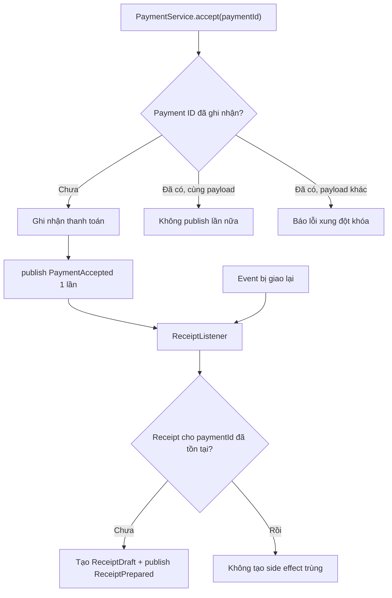

# Xử lý duplicate event trong assertion

## Mục tiêu học tập

Trong chương **Event assertions** của học phần **Spring Modulith Verification & Testing**, kiểm tra một event “đã tồn tại” không đủ để phát hiện **duplicate event** (event bị phát hoặc được xử lý nhiều lần ngoài hợp đồng). Đặc biệt, một lần thanh toán có thể bị gửi lại vì retry, một listener có thể được gọi lại sau lỗi và một event có thể được phân phối đến nhiều listener khác nhau. Mỗi tình huống có cách đếm và điều kiện đúng khác nhau.

Sau bài này, bạn có thể:

- Phân biệt **duplicate publish**, **duplicate delivery**, **listener xử lý lặp** và **side effect trùng**.
- Chọn khóa tương quan/khóa idempotency phù hợp, chẳng hạn `paymentId` hoặc `eventId`, thay vì chỉ nhìn loại event.
- Sử dụng `@ApplicationModuleTest`, `PublishedEvents.ofType(…)`, `matching(…)`, `hasSize(…)` và AssertJ để kiểm tra **0/1/N event**.
- Viết test bắt lỗi **một thanh toán bị publish hai lần**, nhưng **hai thanh toán độc lập** không bị coi là duplicate.
- Kiểm thử consumer nhận một event hai lần nhưng chỉ tạo **một kết quả nghiệp vụ**, không đồng nhất số callback với số side effect.
- Nhận biết giới hạn của assertion tức thì khi có `@Async`, `AFTER_COMMIT`, retry hoặc Event Publication Registry.
- Kết hợp kiểm thử event với `ApplicationModules.verify()` và quality gate trong CI để ngăn hồi quy hành vi và vi phạm ranh giới module.

## 1. “Duplicate event” phải được định nghĩa theo hợp đồng

Giả sử module `payments` xác nhận thanh toán và phát event `PaymentAccepted`. Có nhiều cách xuất hiện “hai lần”:

| Hiện tượng | Ví dụ | Có nhất thiết là lỗi? |
| --- | --- | --- |
| **Duplicate publish** | Service gọi `publishEvent` hai lần cho cùng một `paymentId` dù hợp đồng chỉ cho một | **Có**, nếu mỗi thanh toán phải chỉ được công bố một lần trong phạm vi test |
| **Hai event hợp lệ** | Hai `paymentId` khác nhau cùng có `amount = 100000` | **Không**, vì là hai giao dịch độc lập |
| **Redelivery** | Hệ thống giao lại cùng event cho listener sau retry | Không nhất thiết; consumer thường phải chịu được giao lại |
| **Duplicate side effect** | Listener tạo hai hóa đơn cho cùng `paymentId` | **Có**, nếu nghiệp vụ quy định chỉ một hóa đơn |
| **Fan-out** | Một event được hai listener khác nhau nhận | Không; nhiều listener không đồng nghĩa publisher phát trùng |
| **Registry ghi nhiều publication** | Event được theo dõi cho các listener đích khác nhau | Không nhất thiết; đơn vị đếm là publication tới từng listener |

**Câu hỏi đầu tiên của test** không phải “có mấy object cùng kiểu?”, mà là:

> Với **giao dịch nào**, trong **cửa sổ xử lý nào**, đang đếm **lần publish, lần listener nhận hay số kết quả nghiệp vụ**?

Trong bài này ta chọn hai hợp đồng độc lập:

1. **Publisher:** Một `paymentId` được chấp nhận thành công chỉ phát **đúng một** `PaymentAccepted`; retry với cùng ID và cùng dữ liệu không phát thêm event.
2. **Consumer:** Nếu cùng `PaymentAccepted` được giao hai lần, listener chỉ tạo **một bản ghi biên nhận** và chỉ phát một `ReceiptPrepared`.

Không dùng một phép đếm duy nhất để chứng minh cả hai hợp đồng.

## 2. Tại sao hasSize(1) quan trọng hơn chỉ kiểm tra tồn tại?

Với `PublishedEvents`, đoạn kiểm sau chỉ xác nhận ít nhất một event phù hợp:

```java
assertThat(events.ofType(PaymentAccepted.class)
        .matching(e -> paymentId.equals(e.paymentId())))
        .isNotEmpty();
```

Nếu service phát **hai** event với cùng `paymentId`, assertion trên vẫn pass. Khi hợp đồng yêu cầu đúng một event, hãy viết:

```java
var acceptedForPayment = events.ofType(PaymentAccepted.class)
        .matching(e -> paymentId.equals(e.paymentId()));

assertThat(acceptedForPayment).hasSize(1);
```

`hasSize(1)` bắt được cả hai dạng lỗi:

- **Thiếu event:** số lượng bằng 0.
- **Phát trùng:** số lượng lớn hơn 1.

Nên kiểm tra thêm **payload** để phát hiện một event có ID đúng nhưng số tiền hoặc ID đơn hàng sai:

```java
assertThat(acceptedForPayment)
        .hasSize(1)
        .allSatisfy(e -> {
            assertThat(e.paymentId()).isEqualTo(paymentId);
            assertThat(e.orderId()).isEqualTo(orderId);
            assertThat(e.amount())
                    .isEqualByComparingTo(expectedAmount);
        });
```

**Không chỉ dùng `allSatisfy(…)`:** với tập rỗng, phép kiểm “mọi phần tử đều thỏa” có thể pass mà không có event nào. Kết hợp `hasSize(1)` giúp xác nhận sự tồn tại **và** tính duy nhất.

### 2.1. Đếm đúng khóa nghiệp vụ

Ví dụ không phù hợp:

```java
assertThat(events.ofType(PaymentAccepted.class)).hasSize(1);
```

Nếu trong một test có hai thanh toán khác nhau, tổng số event hợp lệ là 2 và assertion trên sẽ fail sai mục tiêu. Ngược lại, chỉ kiểm tra `hasSize(2)` trên toàn tập có thể pass dù cả hai event đều thuộc cùng một `paymentId`, còn thanh toán khác không có event.

Hãy **lọc theo khóa tương quan trước khi assert số lượng**. Chỉ dùng assertion tổng số khi tổng cũng nằm trong hợp đồng của chính bài test.

## 3. Sơ đồ phân biệt phát lặp và xử lý lặp



Từ sơ đồ, có **hai nơi chống trùng**:

- **Phía phát:** kiểm tra idempotency của lệnh nhận thanh toán.
- **Phía nhận:** kiểm tra idempotency của hiệu ứng tạo receipt.

Ngay cả khi publisher đã cố gắng tránh duplicate publish, consumer **vẫn phải** có chính sách với việc nhận lại event vì retry hoặc redelivery có thể xảy ra ở các tầng khác.

## 4. Ví dụ thực hành Spring Modulith

Ví dụ dùng Java 17+, Spring Boot, Spring Modulith, JUnit Jupiter và AssertJ. Để tập trung vào event assertions, các store dùng `ConcurrentHashMap` thay vì database thật. Cuối bài sẽ phân biệt rõ giới hạn của cách này.

Dependency Maven trong phạm vi test (quản lý phiên bản Spring Modulith bằng BOM tương thích với Spring Boot của dự án):

```xml
<dependency>
    <groupId>org.springframework.modulith</groupId>
    <artifactId>spring-modulith-starter-test</artifactId>
    <scope>test</scope>
</dependency>
```

Ta đặt các lớp minh họa trong package `com.example.shop.payments` để `@ApplicationModuleTest` có thể bootstrap module hiện tại. Trong production, listener tạo receipt có thể ở module `receipts`; khi đó hãy tách module test của consumer hoặc dùng integration test khởi động đủ module.

### 4.1. Event PaymentAccepted và ReceiptPrepared

Tệp `src/main/java/com/example/shop/payments/PaymentAccepted.java`:

```java
package com.example.shop.payments;

import java.math.BigDecimal;
import java.util.UUID;

public record PaymentAccepted(
        UUID paymentId,
        UUID orderId,
        BigDecimal amount) {
}
```

Tệp `src/main/java/com/example/shop/payments/ReceiptPrepared.java`:

```java
package com.example.shop.payments;

import java.util.UUID;

public record ReceiptPrepared(
        UUID paymentId,
        UUID orderId,
        String templateCode) {
}
```

`paymentId` là khóa logic dùng để nhận diện **cùng một thanh toán qua các lần retry**. `orderId` xác định đơn hàng liên quan nhưng một đơn có thể có nhiều lần thử thanh toán, vì vậy **không tự động** dùng `orderId` thay cho `paymentId` làm khóa idempotency.

### 4.2. Store demo nhận diện lệnh thanh toán trùng

Tệp `PaymentStateStore.java`:

```java
package com.example.shop.payments;

import java.util.UUID;
import java.util.concurrent.ConcurrentHashMap;
import java.util.concurrent.ConcurrentMap;
import org.springframework.stereotype.Component;

@Component
public class PaymentStateStore {

    private final ConcurrentMap<UUID, PaymentAccepted> accepted =
            new ConcurrentHashMap<>();

    public boolean recordIfAbsent(PaymentAccepted candidate) {
        PaymentAccepted previous = accepted.putIfAbsent(
                candidate.paymentId(), candidate);

        if (previous != null && !previous.equals(candidate)) {
            throw new IllegalArgumentException(
                    "paymentId is already used with different data");
        }

        return previous == null;
    }

    public void remove(UUID paymentId) {
        accepted.remove(paymentId);
    }
}
```

Khi `paymentId` mới, `recordIfAbsent` trả `true`. Nếu event có cùng ID và cùng payload như trước, nó trả `false`. Nếu cùng ID nhưng dữ liệu khác, service báo lỗi thay vì coi hai lệnh không tương thích là một retry hợp lệ.

`ConcurrentHashMap.putIfAbsent` là thao tác nguyên tử **trong một process**. Tuy nhiên, lưu vào map rồi publish ở bước khác **không phải một transaction nguyên tử**: nếu process lỗi sau khi lưu map nhưng trước khi publish, event có thể bị mất. Đây là mô hình minh họa assertion, không phải giải pháp đảm bảo giao sự kiện ở production.

### 4.3. Service công bố event khi lần đầu chấp nhận thanh toán

Tệp `PaymentService.java`:

```java
package com.example.shop.payments;

import java.math.BigDecimal;
import java.util.Objects;
import java.util.UUID;
import org.springframework.context.ApplicationEventPublisher;
import org.springframework.stereotype.Service;

@Service
public class PaymentService {

    private final PaymentStateStore state;
    private final ApplicationEventPublisher publisher;

    public PaymentService(
            PaymentStateStore state,
            ApplicationEventPublisher publisher) {
        this.state = state;
        this.publisher = publisher;
    }

    public void accept(
            UUID paymentId,
            UUID orderId,
            BigDecimal amount) {

        Objects.requireNonNull(paymentId, "paymentId");
        Objects.requireNonNull(orderId, "orderId");
        Objects.requireNonNull(amount, "amount");

        if (amount.signum() <= 0) {
            throw new IllegalArgumentException(
                    "amount must be positive");
        }

        var event = new PaymentAccepted(
                paymentId, orderId, amount);

        if (state.recordIfAbsent(event)) {
            publisher.publishEvent(event);
        }
    }
}
```

Hợp đồng service:

1. Lần đầu gọi `accept(paymentId, orderId, amount)` hợp lệ: ghi nhận và phát **một** `PaymentAccepted`.
2. Gọi lại đúng `paymentId`, `orderId` và `amount`: không phát thêm event.
3. Gọi lại cùng ID nhưng thay số tiền/đơn hàng: từ chối vì xung đột.
4. Giá trị thanh toán không hợp lệ: không ghi nhận và không phát event.

Ví dụ dùng `record.equals` để so payload, do đó `BigDecimal` với scale khác nhau được xem là khác nhau. Nếu nghiệp vụ xem `100.0` và `100.00` là cùng một giá trị, phải có chính sách **chuẩn hóa amount trước khi lưu/so khóa**, không âm thầm đổi assertion để che giấu sai khác của dữ liệu lưu.

### 4.4. Listener nhận lại event nhưng không tạo side effect trùng

Tệp `ReceiptDraft.java`:

```java
package com.example.shop.payments;

import java.util.UUID;

public record ReceiptDraft(
        UUID paymentId,
        UUID orderId,
        String templateCode) {
}
```

Tệp `ReceiptStore.java`:

```java
package com.example.shop.payments;

import java.util.Optional;
import java.util.UUID;
import java.util.concurrent.ConcurrentHashMap;
import java.util.concurrent.ConcurrentMap;
import org.springframework.stereotype.Component;

@Component
public class ReceiptStore {

    private final ConcurrentMap<UUID, ReceiptDraft> receipts =
            new ConcurrentHashMap<>();

    public boolean insertIfAbsent(ReceiptDraft draft) {
        return receipts.putIfAbsent(
                draft.paymentId(), draft) == null;
    }

    public Optional<ReceiptDraft> findByPaymentId(UUID paymentId) {
        return Optional.ofNullable(receipts.get(paymentId));
    }

    public void remove(UUID paymentId) {
        receipts.remove(paymentId);
    }
}
```

Tệp `ReceiptListener.java`:

```java
package com.example.shop.payments;

import org.springframework.context.ApplicationEventPublisher;
import org.springframework.context.event.EventListener;
import org.springframework.stereotype.Component;

@Component
public class ReceiptListener {

    private final ReceiptStore receipts;
    private final ApplicationEventPublisher publisher;

    public ReceiptListener(
            ReceiptStore receipts,
            ApplicationEventPublisher publisher) {
        this.receipts = receipts;
        this.publisher = publisher;
    }

    @EventListener
    public void on(PaymentAccepted event) {
        var draft = new ReceiptDraft(
                event.paymentId(),
                event.orderId(),
                "PAYMENT_ACCEPTED");

        if (receipts.insertIfAbsent(draft)) {
            publisher.publishEvent(new ReceiptPrepared(
                    draft.paymentId(),
                    draft.orderId(),
                    draft.templateCode()));
        }
    }
}
```

Listener này dùng `@EventListener` **đồng bộ** với cấu hình event multicaster mặc định. Cùng một `PaymentAccepted` được publish hai lần sẽ gọi listener hai lần, nhưng `ReceiptStore` chỉ chấp nhận tạo một `ReceiptDraft`, vì vậy `ReceiptPrepared` chỉ được phát một lần. Không nên gọi đó là “listener chỉ chạy một lần”; listener đã có thể **chạy hai lần**, chỉ có **kết quả nghiệp vụ** là duy nhất.

Trong môi trường sử dụng `@Async`, `@TransactionalEventListener` hoặc `@ApplicationModuleListener`, thời điểm hoàn tất khác ví dụ này; cách chờ được trình bày ở phần sau.

## 5. Test hoàn chỉnh: bắt duplicate publish và duplicate side effect

Tạo `src/test/java/com/example/shop/payments/PaymentDuplicateEventTests.java`:

```java
package com.example.shop.payments;

import static org.assertj.core.api.Assertions.assertThat;
import static org.assertj.core.api.Assertions.assertThatThrownBy;

import java.math.BigDecimal;
import java.util.ArrayList;
import java.util.List;
import java.util.UUID;
import org.junit.jupiter.api.AfterEach;
import org.junit.jupiter.api.Test;
import org.springframework.beans.factory.annotation.Autowired;
import org.springframework.context.ApplicationEventPublisher;
import org.springframework.modulith.test.ApplicationModuleTest;
import org.springframework.modulith.test.PublishedEvents;

@ApplicationModuleTest
class PaymentDuplicateEventTests {

    @Autowired
    PaymentService payments;

    @Autowired
    PaymentStateStore state;

    @Autowired
    ReceiptStore receipts;

    @Autowired
    ApplicationEventPublisher publisher;

    private final List<UUID> paymentIds = new ArrayList<>();

    private UUID newPaymentId() {
        UUID paymentId = UUID.randomUUID();
        paymentIds.add(paymentId);
        return paymentId;
    }

    @AfterEach
    void cleanup() {
        for (UUID paymentId : paymentIds) {
            state.remove(paymentId);
            receipts.remove(paymentId);
        }
    }

    @Test
    void publisherEmitsOnceForRepeatedPaymentId(
            PublishedEvents events) {

        UUID paymentId = newPaymentId();
        UUID orderId = UUID.randomUUID();
        BigDecimal amount = new BigDecimal("125000.00");

        payments.accept(paymentId, orderId, amount);
        payments.accept(paymentId, orderId, amount);

        var accepted = events.ofType(PaymentAccepted.class)
                .matching(e -> paymentId.equals(e.paymentId()));

        assertThat(accepted)
                .hasSize(1)
                .allSatisfy(e -> {
                    assertThat(e.orderId()).isEqualTo(orderId);
                    assertThat(e.amount())
                            .isEqualByComparingTo(amount);
                });
    }

    @Test
    void twoIndependentPaymentsAreNotDuplicates(
            PublishedEvents events) {

        UUID paymentA = newPaymentId();
        UUID paymentB = newPaymentId();
        UUID orderId = UUID.randomUUID();
        BigDecimal amount = new BigDecimal("90000.00");

        // Cùng đơn và số tiền, nhưng khác paymentId.
        payments.accept(paymentA, orderId, amount);
        payments.accept(paymentB, orderId, amount);

        assertThat(events.ofType(PaymentAccepted.class)
                .matching(e -> paymentA.equals(e.paymentId())))
                .hasSize(1);
        assertThat(events.ofType(PaymentAccepted.class)
                .matching(e -> paymentB.equals(e.paymentId())))
                .hasSize(1);
        assertThat(events.ofType(PaymentAccepted.class))
                .hasSize(2);
    }

    @Test
    void duplicateDeliveryCreatesOneBusinessResult(
            PublishedEvents events) {

        UUID paymentId = newPaymentId();
        UUID orderId = UUID.randomUUID();
        var delivered = new PaymentAccepted(
                paymentId, orderId, new BigDecimal("125000.00"));

        // Cố tình mô phỏng giao lại event cho consumer.
        publisher.publishEvent(delivered);
        publisher.publishEvent(delivered);

        // Đầu vào thực sự được publish hai lần.
        assertThat(events.ofType(PaymentAccepted.class)
                .matching(e -> paymentId.equals(e.paymentId())))
                .hasSize(2);

        // Side effect của consumer chỉ được tạo một lần.
        assertThat(receipts.findByPaymentId(paymentId))
                .contains(new ReceiptDraft(
                        paymentId, orderId, "PAYMENT_ACCEPTED"));

        // Event kết quả chỉ được publish ở lần insert thành công.
        assertThat(events.ofType(ReceiptPrepared.class)
                .matching(e -> paymentId.equals(e.paymentId())))
                .hasSize(1)
                .allSatisfy(e -> {
                    assertThat(e.orderId()).isEqualTo(orderId);
                    assertThat(e.templateCode())
                            .isEqualTo("PAYMENT_ACCEPTED");
                });
    }

    @Test
    void conflictingRetryIsRejectedWithoutNewPublication(
            PublishedEvents events) {

        UUID paymentId = newPaymentId();
        UUID orderId = UUID.randomUUID();

        payments.accept(
                paymentId, orderId, new BigDecimal("100000.00"));

        assertThatThrownBy(() -> payments.accept(
                paymentId, orderId, new BigDecimal("200000.00")))
                .isInstanceOf(IllegalArgumentException.class);

        assertThat(events.ofType(PaymentAccepted.class)
                .matching(e -> paymentId.equals(e.paymentId())))
                .hasSize(1);
    }

    @Test
    void invalidAmountEmitsNoPaymentAccepted(
            PublishedEvents events) {

        UUID paymentId = newPaymentId();
        UUID orderId = UUID.randomUUID();

        assertThatThrownBy(() ->
                payments.accept(paymentId, orderId, BigDecimal.ZERO))
                .isInstanceOf(IllegalArgumentException.class);

        assertThat(events.ofType(PaymentAccepted.class)
                .matching(e -> paymentId.equals(e.paymentId())))
                .isEmpty();
        assertThat(receipts.findByPaymentId(paymentId)).isEmpty();
    }
}
```

### 5.1. Test nào bảo vệ điều gì?

| Phương thức test | Số event nguồn kỳ vọng | Số kết quả consumer kỳ vọng | Lỗi được phát hiện |
| --- | ---: | ---: | --- |
| `publisherEmitsOnceForRepeatedPaymentId` | 1 | Không cần assert trong test này | Publisher phát trùng khi retry |
| `twoIndependentPaymentsAreNotDuplicates` | 2, mỗi `paymentId` đúng 1 | Không phải mục tiêu | Lọc sai khóa, nhầm hai giao dịch |
| `duplicateDeliveryCreatesOneBusinessResult` | 2 | 1 `ReceiptDraft` và 1 `ReceiptPrepared` | Consumer tạo side effect trùng |
| `conflictingRetryIsRejectedWithoutNewPublication` | 1 | Không phải mục tiêu | Cho phép cùng ID nhưng dữ liệu khác |
| `invalidAmountEmitsNoPaymentAccepted` | 0 | 0 | Phát event cho lệnh không hợp lệ |

Phân biệt quan trọng: **test consumer cố tình publish event nguồn hai lần**. Vì vậy trong test đó `hasSize(2)` là đúng, còn `hasSize(1)` mới là kỳ vọng cho **event kết quả**. Không “sửa” test consumer bằng cách xóa một lần publish; làm vậy sẽ không còn kiểm tra redelivery.

### 5.2. Vì sao không assert toàn bộ event cùng kiểu đều bằng 1?

Trong một test có nhiều giao dịch, assertion tổng số dễ cho false positive/false negative. Ta cần xác minh:

```java
assertThat(events.ofType(PaymentAccepted.class)
        .matching(e -> paymentA.equals(e.paymentId())))
        .hasSize(1);

assertThat(events.ofType(PaymentAccepted.class)
        .matching(e -> paymentB.equals(e.paymentId())))
        .hasSize(1);
```

Nếu tổng số event là 2 nhưng cùng thuộc `paymentA`, assertion `hasSize(2)` trên toàn tập sẽ pass; các assertion riêng sẽ phát hiện `paymentA` bị trùng và `paymentB` bị thiếu.

### 5.3. Tại sao cleanup cần thiết?

`@ApplicationModuleTest` dùng Spring context có thể được tái sử dụng giữa nhiều phương thức test. Hai store demo chứa state trong singleton bean. Bài test vì vậy tạo `paymentId` mới và xóa dữ liệu theo các ID đã dùng trong `@AfterEach`.

Không giả định context được tạo lại hoàn toàn cho từng test. Khi chạy song song, cần fixture cô lập và tránh một test cleanup dữ liệu test khác; đối với database nên dùng khóa duy nhất và chiến lược rollback/cleanup theo ranh giới transaction thực tế.

## 6. Xác định duplicate bằng eventId hay business key?

“Hai event giống nhau” còn phụ thuộc **thế nào là cùng một event**.

| Khóa | Câu hỏi giải quyết được | Khi nào phù hợp? |
| --- | --- | --- |
| `eventId` | Đây có phải **cùng message** được giao lại? | Deduplicate transport redelivery, retry cùng message |
| `paymentId` | Đây có phải **cùng thanh toán logic**? | Ngăn xử lý thanh toán/hóa đơn lặp |
| `orderId` | Hai event có cùng đơn hàng? | Khóa tương quan; không mặc định là khóa chống trùng |
| `eventType + aggregateId + version` | Đây có phải cùng một chuyển trạng thái của aggregate? | Event sourcing hoặc state transitions có phiên bản rõ |
| Toàn bộ payload qua `equals` | Hai giá trị dữ liệu có bằng nhau không? | So payload, **không luôn đồng nghĩa duplicate nghiệp vụ** |

Ví dụ, hai lần thử thanh toán khác `paymentId` có thể cùng `orderId` và `amount`. Nếu dùng chỉ `orderId` để chặn duplicate, hệ thống có nguy cơ bỏ lỡ một lần xử lý hợp lệ (hoặc che giấu vấn đề cần định nghĩa bằng một quy tắc nghiệp vụ khác).

Ngược lại, một event được giao lại có thể có metadata delivery khác dù đại diện cùng `eventId`. Test xử lý idempotency phải dựa vào **định danh ổn định qua retry**, không tạo một UUID mới ở mỗi lần gửi lại rồi kỳ vọng cơ chế deduplication nhận ra.

### 6.1. Nhận diện xung đột payload với cùng idempotency key

Không nên âm thầm coi mọi dữ liệu mang cùng `paymentId` là duplicate vô hại. Nếu retry dùng ID cũ nhưng đổi `amount`, đó có thể là lỗi phía caller hoặc rủi ro nghiệp vụ.

Trong ví dụ, `PaymentStateStore.recordIfAbsent(…)` ném `IllegalArgumentException` khi cùng `paymentId` nhưng payload khác. Test `conflictingRetryIsRejectedWithoutNewPublication` bảo vệ hành vi này. Với production, có thể dùng lỗi nghiệp vụ riêng (ví dụ `IdempotencyConflictException`) để client hiểu rõ lý do từ chối.

## 7. Kiểm thử số lượng event khi có nhiều listener

Một event `PaymentAccepted` có thể được nhiều module lắng nghe: `receipts`, `audit` và `notifications`. Điều đó **không** đồng nghĩa publisher đã phát event ba lần.

```text
publishEvent(PaymentAccepted) × 1
    ├── ReceiptListener      → ReceiptPrepared
    ├── AuditListener        → AuditRecorded
    └── NotificationListener → NotificationQueued
```

Test cần kiểm tra riêng từng hợp đồng:

- `PublishedEvents.ofType(PaymentAccepted.class)`: số event nguồn được publish trong test.
- `PublishedEvents.ofType(ReceiptPrepared.class)`: số event kết quả của listener receipt.
- Repository/store audit và notification: kết quả tương ứng của các listener khác.

Không thể từ `hasSize(1)` của `PaymentAccepted` suy ra ba listener đều xử lý thành công. Ngược lại, số bản ghi được Event Publication Registry theo dõi có thể liên quan đến **nhiều target listener** và trạng thái publication riêng, không đơn giản bằng số lời gọi `publishEvent`.

Nếu listener thuộc các application module khác nhau, `@ApplicationModuleTest` mặc định có phạm vi module, không tự bootstrap tất cả. Kiểm thử từng listener trong module của nó; dùng integration test đa module khi cần kiểm tra tuyến fan-out thực.

## 8. Duplicate với @Async, AFTER_COMMIT và Scenario

Trong hệ thống thật, consumer có thể dùng `@Async`, `@TransactionalEventListener(phase = AFTER_COMMIT)` hoặc `@ApplicationModuleListener`. Ở các trường hợp này, một assertion **ngay sau publish** có thể chạy trước khi listener tạo side effect.

Ví dụ test sai thời điểm:

```java
publisher.publishEvent(paymentAccepted);

// Chưa đáng tin nếu ReceiptListener bất đồng bộ:
assertThat(receiptRepository.findByPaymentId(paymentId))
        .hasSize(1);
```

**Lưu ý:** ví dụ trên giả định `findByPaymentId` trả collection; với repository trả `Optional` cần đổi assertion cho phù hợp. Vấn đề chính là *thời điểm quan sát*, không phải cú pháp `hasSize(1)`.

### 8.1. Scenario chờ event kết quả

Trong `@ApplicationModuleTest` có listener bất đồng bộ thực tế, mẫu chờ có thể là:

```java
@Test
void waitsForReceiptResult(Scenario scenario) {
    UUID paymentId = UUID.randomUUID();
    UUID orderId = UUID.randomUUID();
    BigDecimal amount = new BigDecimal("125000.00");

    scenario.stimulate(() ->
                    payments.accept(paymentId, orderId, amount))
            .andWaitForEventOfType(ReceiptPrepared.class)
            .matching(e -> paymentId.equals(e.paymentId()))
            .toArriveAndVerify(e -> {
                assertThat(e.orderId()).isEqualTo(orderId);
                assertThat(e.templateCode())
                        .isEqualTo("PAYMENT_ACCEPTED");
            });
}
```

Đây là **mẫu trong lớp test có sẵn** bean `payments`, các import cần thiết (`Scenario`, `UUID`, `BigDecimal`, AssertJ). Cần cấu hình và bootstrap đúng listener bất đồng bộ; nếu event nguồn chỉ được publish trong transaction, phải bảo đảm stimulus commit theo mô hình đang dùng.

Quan trọng: `Scenario` chờ **ít nhất một** `ReceiptPrepared` phù hợp và kiểm tra payload. Việc chờ thành công **không tự chứng minh chỉ có một event**: một event kết quả thứ hai vẫn có thể xuất hiện sau khi test hoàn tất. Để khẳng định không có duplicate lâu dài, cần:

1. Xác định **điểm kết thúc xử lý** hoặc điều kiện hệ thống đã ổn định.
2. Kiểm tra số kết quả thực tế ở repository/store sau điểm đó.
3. Bảo vệ idempotency bằng unique constraint/transaction khi có concurrency.
4. Kiểm thử riêng retry hoặc redelivery trong điều kiện có kiểm soát.

Không dựa vào `Thread.sleep(500)` rồi kết luận “không bao giờ có event thứ hai”. Khoảng chờ chỉ giới hạn phạm vi quan sát, không chứng minh tính bất biến mãi mãi.

### 8.2. Listener chạy sau commit

Với `@TransactionalEventListener(AFTER_COMMIT)`, event nguồn có thể đã được publish **trong transaction**. Nếu transaction rollback, listener sau commit sẽ không được gọi theo cấu hình mặc định, nhưng `PublishedEvents` vẫn có thể ghi nhận event nguồn đã phát.

Vì vậy:

| Tình huống | Event nguồn trong PublishedEvents | Side effect của listener AFTER_COMMIT |
| --- | --- | --- |
| Transaction đang mở | Có thể đã ghi nhận | Chưa được kích hoạt |
| Commit thành công | Đã publish | Được xử lý sau commit, có thể async |
| Rollback | Có thể đã ghi nhận | Không được tạo bởi callback AFTER_COMMIT |

Test chống duplicate cho listener hậu commit phải thiết lập transaction **commit thực sự** (ví dụ `TransactionTemplate` hoặc stimulus phù hợp trong `Scenario`) rồi chờ kết quả. Một phương thức JUnit `@Transactional` mặc định rollback không phải môi trường phù hợp để chứng minh listener `AFTER_COMMIT` đã xử lý.

## 9. Chống trùng trong production: assertion không thay thế thiết kế

Ví dụ `ConcurrentHashMap` giúp hiểu logic nhưng không bảo đảm tính đúng khi ứng dụng chạy nhiều JVM, khi transaction rollback hoặc khi process sập.

### 9.1. Unique constraint và transaction database

Với consumer lưu biên nhận, thường cần ràng buộc duy nhất trên khóa idempotency:

```sql
CREATE TABLE payment_receipts (
    id BIGINT GENERATED BY DEFAULT AS IDENTITY PRIMARY KEY,
    payment_id UUID NOT NULL UNIQUE,
    order_id UUID NOT NULL,
    template_code VARCHAR(80) NOT NULL
);
```

Đây là DDL minh họa cho một database hỗ trợ cú pháp tương ứng; migration thật phải phù hợp PostgreSQL, H2 hoặc hệ quản trị mà dự án dùng.

Nếu hai worker cùng kiểm tra “chưa có receipt” rồi cùng insert, **cả hai đều có thể thấy chưa tồn tại**. Unique constraint trong database ngăn lưu trùng, còn code cần xử lý va chạm và retry đúng semantics. Một mẫu `if (!existsByPaymentId(id)) save(...)` đơn thuần **không đủ** để đảm bảo idempotency khi concurrent requests.

### 9.2. Transactional outbox và lỗ hổng giữa state với publish

Mô hình demo cập nhật state rồi publish event bằng hai bước không nguyên tử. Trong production, nếu DB commit thành công nhưng ứng dụng sập trước khi phát message, hệ thống có thể mất event. Một **transactional outbox** lưu thay đổi nghiệp vụ và bản ghi outbox trong cùng transaction, sau đó relay xử lý việc gửi với retry.

Relay có thể gửi lại bản ghi outbox, nên consumer vẫn cần deduplication/idempotency. **Outbox không đồng nghĩa với không bao giờ có duplicate delivery.**

### 9.3. Event Publication Registry

Spring Modulith có Event Publication Registry để theo dõi publication cho những listener thuộc cơ chế hỗ trợ. Một event có nhiều listener đích có thể dẫn đến nhiều publication được theo dõi. Registry có trạng thái hoàn tất hoặc chờ xử lý tùy cấu hình.

Đừng kết luận:

```text
PublishedEvents thấy 1 PaymentAccepted
=> registry luôn có đúng 1 record
=> mọi listener đã hoàn thành đúng một lần
```

Đây là ba khái niệm khác nhau: số lần publish trong test, số publication cho từng target listener và số side effect đã thành công. Muốn kiểm tra retry của registry cần integration test với storage implementation, transaction và chính sách hoàn tất thực tế.

### 9.4. Đúng một side effect không phải exactly-once delivery

Trong hệ thống phân tán, một message có thể đến nhiều lần. Thiết kế thường hướng tới **at-least-once delivery + idempotent processing**, tức là cho phép listener được gọi lại nhưng vẫn chỉ tạo **một kết quả nghiệp vụ hợp lệ**.

Các assertion quan trọng là:

- Sau khi xử lý lại cùng `paymentId`, database chỉ có **một receipt**.
- Dữ liệu receipt có giá trị đúng, không chỉ có số hàng đúng.
- Các sự kiện kết quả ra bên ngoài được phát theo quy ước và cơ chế outbox/retry.
- Xung đột cùng ID khác payload bị phát hiện, không bị âm thầm bỏ qua.

Khi tác động tới API ngoài như gửi email hoặc tạo hóa đơn, cần làm rõ khả năng hỗ trợ idempotency của dịch vụ đích. Một unique constraint cục bộ không tự ngăn mọi tác động bên ngoài bị gửi trùng nếu có crash hoặc retry ở thời điểm nhạy cảm.

## 10. Chiến lược kiểm thử duplicate đáng tin cậy

Thay vì chỉ có một test happy path, hãy lập **ma trận trường hợp**:

| Đầu vào | Kỳ vọng publish | Kỳ vọng side effect | Ý nghĩa |
| --- | --- | --- | --- |
| Một `paymentId` hợp lệ | 1 | 1 | Đường đi chuẩn |
| Cùng ID, cùng payload được gọi lại | 1 tổng cộng ở publisher idempotent | 1 | Retry không làm phát trùng |
| Cùng ID, payload khác | Không có event mới | Không có kết quả mới | Bảo vệ xung đột khóa |
| Hai ID khác nhau, payload giống nhau | 2, mỗi ID đúng 1 | 2 nếu hợp đồng áp dụng per payment | Không gộp nhầm giao dịch |
| Event nguồn bị giao trực tiếp hai lần tới listener | 2 event đầu vào | 1 kết quả nghiệp vụ | Consumer idempotent |
| Số tiền không hợp lệ | 0 | 0 | Nhánh từ chối |
| Listener async chậm | Phụ thuộc publisher | Kết quả cuối cùng đúng sau khi chờ | Tránh flaky test |
| Transaction nguồn rollback | Event nguồn có thể được quan sát | Listener AFTER_COMMIT không tạo kết quả | Tách publish khỏi commit |

**Không dùng một phép `hasSize(1)` trên toàn bộ stream để kết luận mọi trường hợp đều đúng**. Phép đếm phải gắn với đối tượng và trách nhiệm mà hợp đồng định nghĩa.

### 10.1. Kiểm tra thêm payload và thứ tự khi cần

Hai event có cùng `paymentId` có thể có số tiền khác nhau. Một test chỉ đếm `hasSize(2)` sẽ không phân biệt được duplicate nguyên trạng và xung đột dữ liệu. Có thể thu thập payload để chẩn đoán:

```java
var samePayment = events.ofType(PaymentAccepted.class)
        .matching(e -> paymentId.equals(e.paymentId()));

assertThat(samePayment).hasSize(2);
assertThat(samePayment)
        .allSatisfy(e ->
                assertThat(e.amount())
                        .isEqualByComparingTo(expectedAmount));
```

Đây là mẫu test **cố ý tạo hai event nguồn cùng ID** để kiểm tra consumer chịu được delivery lặp. Trong test publisher thông thường, chính cùng kết quả `hasSize(2)` phải làm thất bại kỳ vọng `hasSize(1)`.

Nếu hợp đồng còn yêu cầu thứ tự mốc nghiệp vụ, hãy kiểm tra riêng thứ tự event theo khóa tương quan. **Duplicate** và **out-of-order** là hai lỗi khác nhau, không nên dùng assertion thứ tự để thay thế kiểm tra số lượng.

### 10.2. Đừng dựa vào thứ tự JUnit hoặc state shared ngầm

Mỗi test phải chủ động tạo fixture và kỳ vọng riêng. Không viết kiểu: test A publish lần đầu, test B chạy sau đó mới publish lần hai. JUnit không bảo đảm thứ tự mặc định và Spring context có thể được cache.

Khi dùng database thật, cần dữ liệu độc lập và cleanup phù hợp, đặc biệt với `Scenario` hay listener hậu commit ghi dữ liệu ngoài transaction của phương thức test.

## 11. Chẩn đoán lỗi phổ biến

| Triệu chứng | Nguyên nhân thường gặp | Hướng xử lý |
| --- | --- | --- |
| Test pass dù publish hai lần | Chỉ dùng `isNotEmpty` hoặc `contains` | Lọc `paymentId` rồi `hasSize(1)` |
| Tổng event là 2 nhưng một payment mất event | Chỉ đếm toàn bộ loại event | Assert từng `paymentId` |
| Hai lần thử hợp lệ bị coi là trùng | Dùng `orderId` hoặc amount làm khóa dedupe | Chọn paymentId/eventId theo nghiệp vụ |
| Lệnh retry cùng ID khác số tiền vẫn được chấp nhận | Không kiểm tra xung đột payload | Assert lỗi và không phát event mới |
| Test consumer chỉ phát event một lần | Không thực sự kiểm tra redelivery | Cố ý publish cùng event hai lần |
| Có 2 event nguồn nhưng 1 receipt và test bị coi là fail | Nhầm số event vào với số kết quả | Assert 2 nguồn và 1 kết quả |
| Receipt bị tạo trùng trên hai instance | Dedupe chỉ ở map hoặc read-then-save | Dùng unique constraint và transaction |
| Test async fail thất thường | Assert quá sớm hoặc dùng sleep tùy ý | Dùng `Scenario`/chờ điều kiện có timeout |
| Registry có nhiều record dù publish một lần | Một publication cho mỗi target listener | Xác định đơn vị đếm và cấu hình registry |
| `PublishedEvents` có event nhưng DB không commit | Publish trước rollback hoặc listener vẫn xử lý | Tách assertion publish và side effect sau commit |

## 12. Quality gate trong CI và kiểm chứng ranh giới module

Trong **Spring Modulith Verification & Testing**, duplicate assertions bảo vệ hành vi runtime; chúng không thay thế kiểm tra kiến trúc. Ngược lại, `ApplicationModules.verify()` phát hiện phụ thuộc sai giữa module nhưng không thể biết service có publish trùng hay listener có tạo hai biên nhận.

Ví dụ test kiến trúc:

```java
import org.junit.jupiter.api.Test;
import org.springframework.modulith.core.ApplicationModules;

class ArchitectureVerificationTests {

    @Test
    void modulesRespectTheirBoundaries() {
        ApplicationModules.of(ShopApplication.class).verify();
    }
}
```

Trong đó `ShopApplication` là tên minh họa cho lớp ứng dụng Spring Boot gốc, cần thay đúng tên của dự án. Kết hợp:

1. **Architecture gate:** `ApplicationModules.verify()` phát hiện vòng phụ thuộc và truy cập package nội bộ của module khác.
2. **Publisher contract gate:** `@ApplicationModuleTest` + `PublishedEvents` kiểm tra đúng 0/1/N event, payload và khóa tương quan.
3. **Consumer idempotency gate:** phát lại event, kiểm tra duy nhất một side effect hoặc kết quả theo hợp đồng.
4. **Async/transaction gate:** `Scenario` và integration test chờ trạng thái đã commit, kiểm tra retry, rollback và concurrency khi cần.

Các test có thể chạy trong `mvn test` hoặc `./gradlew test` của CI. Với bài test sử dụng database hoặc listener hậu commit, chuẩn bị fixture/cleanup rõ ràng và timeout hữu hạn. Không khắc phục duplicate bằng việc xóa assertion mạnh hoặc tăng timeout vô hạn.

## 13. Bài thực hành

Hãy thực hiện trên `PaymentService` và `PaymentDuplicateEventTests`:

1. **Đường đi chuẩn:** gọi `payments.accept(…)` một lần, kiểm tra một `PaymentAccepted` theo `paymentId` và payload chính xác.
2. **Cố ý phát trùng:** tạm bỏ điều kiện `recordIfAbsent` để `publishEvent` luôn được gọi. Gọi `accept` hai lần cùng ID và xác minh test `publisherEmitsOnceForRepeatedPaymentId` thất bại; hoàn tác.
3. **Hai ID độc lập:** tạo hai `paymentId` khác nhau nhưng cùng `orderId` và amount; kiểm tra mỗi ID đúng một event, tổng hai.
4. **Xung đột idempotency:** gọi cùng ID với amount khác. Test phải bắt lỗi và xác nhận không có event mới.
5. **Redelivery:** dùng `publisher.publishEvent` trực tiếp hai lần cùng `PaymentAccepted`; bảo đảm một `ReceiptDraft` và một `ReceiptPrepared`.
6. **Lỗi ở consumer:** tạm xóa `if (receipts.insertIfAbsent(draft))` và luôn phát `ReceiptPrepared`. Test consumer phải fail vì event kết quả trùng.
7. **Bất đồng bộ:** chuyển listener sang `@Async` và cấu hình `@EnableAsync`; dùng `Scenario` chờ kết quả, sau đó kiểm tra repository/store tại điểm xử lý hoàn tất. Giải thích vì sao chờ một event không tự bảo đảm duy nhất.
8. **Database thật:** thay map bằng repository có unique constraint theo `paymentId`. Tạo hai yêu cầu đồng thời và xác minh chỉ có một record sau commit; thảo luận chỗ phải xử lý conflict.
9. **Nhiều listener:** bổ sung audit consumer độc lập. Giải thích vì sao một `PaymentAccepted` có thể dẫn đến nhiều publication tới các listener mà không phải publisher phát trùng.

**Tiêu chí hoàn thành:** bộ test phát hiện được thiếu event, duplicate publish, xung đột payload, side effect trùng và nhầm khóa tương quan. Người học phân biệt rõ số lần publish với số lần listener xử lý và số kết quả nghiệp vụ đã tạo.

## 14. Câu hỏi tự kiểm tra

**Câu 1.** `isNotEmpty()` trên các `PaymentAccepted` của một `paymentId` có phát hiện service publish hai lần không?

**Trả lời:** Không. Nó chỉ chứng minh có ít nhất một event. Nếu hợp đồng yêu cầu duy nhất, dùng `hasSize(1)` sau khi lọc theo ID.

**Câu 2.** Hai event cùng `orderId` và amount nhưng khác `paymentId` có chắc là duplicate không?

**Trả lời:** Không. Một đơn có thể có nhiều lần thử thanh toán. Phải chọn định danh giao dịch và quy tắc nghiệp vụ đúng trước khi dedupe.

**Câu 3.** Test consumer cố tình publish `PaymentAccepted` hai lần; kết quả nào là hợp lệ theo ví dụ?

**Trả lời:** Hai event nguồn được ghi nhận, nhưng chỉ một `ReceiptDraft` và một `ReceiptPrepared` cho `paymentId` vì consumer idempotent.

**Câu 4.** `Scenario` chờ được một `ReceiptPrepared`. Đã chứng minh không có event kết quả thứ hai trong tương lai chưa?

**Trả lời:** Chưa. Nó chứng minh event phù hợp đã đến trong giới hạn chờ; cần xác định điểm hoàn tất và kiểm tra kết quả/unique constraint cho tính duy nhất.

**Câu 5.** Một event được giao tới hai listener và Event Publication Registry có nhiều record. Có thể kết luận duplicate publish không?

**Trả lời:** Không. Registry có thể theo dõi publication theo từng listener đích. Cần phân biệt số lần publish event nguồn với số publication và vòng đời của từng listener.

**Câu 6.** Tại sao `ConcurrentHashMap.putIfAbsent` trong ví dụ không đủ để bảo đảm chống trùng ở production?

**Trả lời:** Map chỉ tồn tại trong một process, không tham gia transaction database và có khoảng trống giữa ghi state với publish. Production cần khóa duy nhất/transaction, chiến lược retry và có thể cần outbox.

## Kết luận

Để **xử lý duplicate event trong assertion** của Spring Modulith, trước hết xác định “duplicate” theo **khóa nghiệp vụ và đơn vị cần đếm**. Dùng `PublishedEvents.ofType(…).matching(…)` với `hasSize(1)` và assertion payload để ngăn publisher phát trùng, nhưng **cố ý giao lại event** để chứng minh consumer không tạo side effect trùng. Với async, transaction và Event Publication Registry, cần phân biệt event được publish với listener hoàn tất và dữ liệu đã commit. Kết hợp những kiểm thử hành vi này với `ApplicationModules.verify()` trong CI để bảo vệ cả hợp đồng sự kiện lẫn ranh giới kiến trúc.

## Tài liệu tham khảo

- [Spring Modulith Reference — Testing Application Modules](https://docs.spring.io/spring-modulith/reference/testing.html)
- [Spring Modulith Reference — Working with Application Events](https://docs.spring.io/spring-modulith/reference/events.html)
- [Spring Modulith API — PublishedEvents](https://docs.spring.io/spring-modulith/docs/current/api/org/springframework/modulith/test/PublishedEvents.html)
- [Spring Modulith API — Scenario](https://docs.spring.io/spring-modulith/docs/current/api/org/springframework/modulith/test/Scenario.html)
- [Spring Framework Reference — Transaction-bound Events](https://docs.spring.io/spring-framework/reference/data-access/transaction/event.html)
- [AssertJ Core — Assertions for Iterable types](https://assertj.github.io/doc/#assertj-core-assertions-guide)
