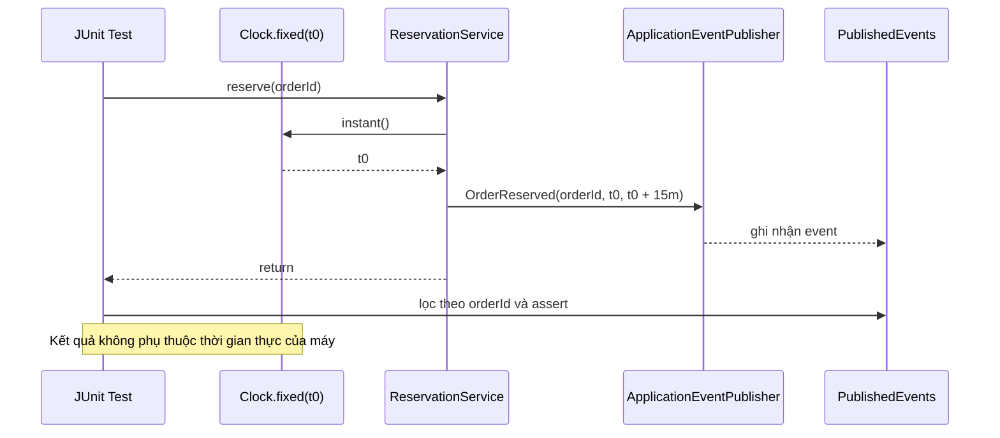

# Viết assertion ổn định không phụ thuộc thời gian hệ thống

## Mục tiêu học tập

Trong chương **Event assertions** của học phần **Spring Modulith Verification & Testing**, một sự kiện có thể chứa `occurredAt`, `reservedAt`, `expiresAt` hoặc một thời điểm lên lịch xử lý. Nếu test so những giá trị này trực tiếp với `Instant.now()`, kết quả dễ dao động theo tốc độ CPU, độ trễ CI, lịch chạy thread và thời điểm thực thi. Một test tốt cần kiểm tra **quy tắc nghiệp vụ về thời gian** mà không phụ thuộc việc đồng hồ máy đang chỉ mấy giờ.

Sau bài này, bạn có thể:

- Phân biệt **thời gian nghiệp vụ** trong event, **thời gian thực thi test**, **thời gian chờ async** và **thời gian do database tạo**.
- Dùng `java.time.Clock` làm dependency, cấu hình `Clock.fixed(…)` trong `@ApplicationModuleTest` và so timestamp với kỳ vọng chính xác.
- Kiểm chứng quan hệ giữa `reservedAt` và `expiresAt`, so ranh giới trước/đúng/sau hạn bằng clock điều khiển được.
- Dùng `PublishedEvents` để xác minh payload event, không gọi đồng hồ thực làm nguồn expected.
- Dùng `Scenario` để chờ một event bất đồng bộ theo khóa tương quan thay cho `Thread.sleep(…)`.
- Nhận biết các trường hợp `Clock.fixed` chưa điều khiển được: JPA auditing, SQL `CURRENT_TIMESTAMP`, `@Scheduled` và hệ thống bên ngoài.
- Đưa các assertion ổn định vào quality gate CI cùng `ApplicationModules.verify()` để phát hiện hồi quy nghiệp vụ và phụ thuộc sai giữa module.

## 1. Vì sao test phụ thuộc đồng hồ thật dễ thất bại?

Xét module `orders` giữ chỗ hàng trong 15 phút và phát event:

```java
public record OrderReserved(
        UUID orderId,
        Instant reservedAt,
        Instant expiresAt) {
}
```

Hợp đồng là **thời điểm hết hạn đúng 15 phút sau khi giữ chỗ**. Test sau có nhiều vấn đề:

```java
Instant expectedTime = Instant.now();

reservationService.reserve(orderId);

var reserved = events.ofType(OrderReserved.class)
        .matching(e -> orderId.equals(e.orderId()));

assertThat(reserved).hasSize(1)
        .allSatisfy(e ->
                assertThat(e.reservedAt()).isEqualTo(expectedTime));
```

`Instant.now()` trong test và `Instant.now()` trong service thường được gọi ở hai thời điểm **khác nhau**. Chỉ vài nanosecond chênh lệch cũng khiến `isEqualTo` fail. Dưới tải của CI, chênh lệch có thể lớn hơn, làm test khó dự đoán.

Một cách sửa tạm như sau lại không đủ mạnh:

```java
assertThat(event.reservedAt())
        .isCloseTo(Instant.now(), within(5, ChronoUnit.SECONDS));
```

Assertion gần đúng có thể pass dù code chọn sai thời điểm vài giây, hoặc fail khi CI quá tải. Nó cũng không chứng minh quan hệ **hết hạn sau đúng 15 phút**. Dung sai thời gian chỉ hợp lý khi đồng hồ thực sự là một phần nguồn dữ liệu **không thể kiểm soát** và hợp đồng đã định nghĩa sai số được chấp nhận.

### 1.1. Các nguồn khiến assertion không ổn định

| Nguồn bất ổn | Ví dụ | Cách tiếp cận |
| --- | --- | --- |
| Gọi đồng hồ ở hai thời điểm khác nhau | Test và service đều gọi `Instant.now()` | Inject một `Clock` điều khiển được |
| Thread bất đồng bộ | Listener tạo event sau khi test bắt đầu assert | Chờ điều kiện nghiệp vụ bằng `Scenario` |
| Transaction sau commit | Listener `AFTER_COMMIT` chưa chạy khi event nguồn vừa publish | Test commit thực và chờ kết quả |
| Độ chính xác timestamp của DB | Java lưu nanosecond, cột DB chỉ giữ millisecond | Chuẩn hóa precision theo hợp đồng |
| Múi giờ mặc định | Dùng `LocalDateTime.now()` trên máy CI khác vùng | Dùng `Instant` hoặc `ZoneId` được truyền rõ ràng |
| Scheduler chạy theo thời gian thật | `@Scheduled`/timer còn dùng executor thật | Điều khiển scheduler/test clock riêng |
| Đồng hồ hệ thống đổi/điều chỉnh | NTP, thay timezone hoặc clock skew | Không dùng wall clock làm oracle khi có thể tránh |

**Nguyên tắc:** Test cần kiểm tra *giá trị và quy tắc đã thỏa thuận*, không kiểm tra xem máy hiện tại chạy nhanh hay chậm.

## 2. Chọn đúng loại thời gian để kiểm chứng

Không phải mọi trường thời gian đều có cùng ý nghĩa:

| Khái niệm | Ví dụ | Assertion nên kiểm tra |
| --- | --- | --- |
| **Business occurrence time** | `OrderReserved.reservedAt` | Bằng `clock.instant()` tại lúc xử lý theo hợp đồng |
| **Business deadline** | `OrderReserved.expiresAt` | Bằng `reservedAt + 15 phút` |
| **Processing completion time** | `ReceiptPrepared.preparedAt` | Theo clock tại lúc listener thực sự hoàn tất; không mặc định bằng thời điểm event nguồn |
| **Database audit time** | `created_at` do DB sinh | Theo semantics của DB; không giả định chịu ảnh hưởng của `Clock` ứng dụng |
| **Wait timeout** | Test chờ listener 5 giây | Khoảng chờ thực của test, không phải timestamp nghiệp vụ |
| **Business local date** | Ngày giao hàng tại Việt Nam | Tính theo `ZoneId` nghiệp vụ xác định, không dùng timezone máy |

Một `Instant` là **mốc trên dòng thời gian UTC**, không mang múi giờ địa phương. Khi cần diễn giải ngày/giờ theo một vùng, chuyển đổi bằng `ZoneId` được xác định rõ. `Duration` biểu diễn khoảng thời gian đo theo giây/nanosecond, còn `Period` phù hợp hơn cho quy tắc theo ngày/tháng trên lịch. Không thay tùy tiện “15 phút” bằng “ngày mai cùng giờ” hoặc ngược lại.

### 2.1. Sơ đồ thời gian trong test



Khi clock cố định, dù test bắt đầu lúc 8 giờ sáng hay 11 giờ đêm, service vẫn quan sát cùng `t0` và event sẽ mang giá trị dự đoán được.

## 3. Quy tắc cốt lõi: inject java.time.Clock

Tránh gọi `Instant.now()` rải rác trong service cần kiểm thử. Thay bằng dependency `Clock`:

```java
// Khó kiểm soát trong test:
Instant reservedAt = Instant.now();

// Có thể thay thế nguồn thời gian ở test:
Instant reservedAt = clock.instant();
```

Trong production, tạo bean `Clock.systemUTC()`. Trong test, cấp một bean `Clock.fixed(…)` có ưu tiên cao hơn. Với cấu hình này, **cùng một code nghiệp vụ** được dùng trong production và test; chỉ nguồn thời gian thay đổi.

Lợi ích:

1. Assertion có thể dùng `isEqualTo(expectedInstant)`, không cần sai số mơ hồ.
2. Test ranh giới hạn dùng `Clock.fixed(expiry.minusNanos(1), …)` hoặc đúng `expiry`.
3. Không cần đợi 15 phút thực để kiểm chứng hết hạn.
4. Các thread cùng inject cùng clock có thể quan sát một mốc cố định, trong phạm vi bean được cấu hình.
5. Dễ xác định nguồn sai nếu service vô tình gọi `Instant.now()` trực tiếp ở một nơi khác.

**Chú ý:** Một `Clock.fixed` chỉ trả về thời điểm không đổi; nó **không tăng tốc hoặc kích hoạt timer**. Muốn kiểm thử job đến hạn hoặc `@Scheduled`, còn cần điều khiển scheduler/trigger hoặc gọi trực tiếp logic đánh giá hạn với clock tương ứng.

## 4. Xây dựng ứng dụng mẫu Spring Modulith

Ví dụ sử dụng Java 17+, Spring Boot, Spring Modulith, JUnit Jupiter và AssertJ. Các lớp được đặt trong package `com.example.shop.orders`, được giả định là một application module của ứng dụng Spring Boot ở package gốc `com.example.shop`.

Phụ thuộc Maven test:

```xml
<dependency>
    <groupId>org.springframework.modulith</groupId>
    <artifactId>spring-modulith-starter-test</artifactId>
    <scope>test</scope>
</dependency>
```

Phiên bản `spring-modulith-starter-test` nên được quản lý qua BOM tương thích với Spring Boot của dự án. `@ApplicationModuleTest` tập trung vào module chứa test; nếu listener thật nằm trong module khác, cần cấu hình phạm vi bootstrap phù hợp hoặc dùng integration test đa module.

### 4.1. Event snapshot chứa thời gian nghiệp vụ

Tệp `src/main/java/com/example/shop/orders/OrderReserved.java`:

```java
package com.example.shop.orders;

import java.time.Instant;
import java.util.UUID;

public record OrderReserved(
        UUID orderId,
        Instant reservedAt,
        Instant expiresAt) {
}
```

Event chỉ chứa dữ liệu giao tiếp nghiệp vụ, không chứa `Clock`, `ScheduledExecutorService`, repository hay JPA entity. Module tiêu thụ biết **đơn nào**, **được giữ lúc nào** và **hết hạn lúc nào**, nhưng không cần biết service tạo timestamp bằng cách nào.

### 4.2. Cấu hình Clock cho production

Tệp `src/main/java/com/example/shop/orders/TimeConfiguration.java`:

```java
package com.example.shop.orders;

import java.time.Clock;
import org.springframework.context.annotation.Bean;
import org.springframework.context.annotation.Configuration;

@Configuration(proxyBeanMethods = false)
class TimeConfiguration {

    @Bean
    Clock applicationClock() {
        return Clock.systemUTC();
    }
}
```

`Clock.systemUTC()` biểu diễn cùng một dòng thời gian UTC, không dựa vào timezone mặc định để chuyển `LocalDateTime`. Đây là **clock thực** cho runtime; trong test ta sẽ dùng `Clock.fixed`. Nếu dự án đã có một bean `Clock` dùng chung, không cần thêm một bean production thứ hai.

### 4.3. Service dùng Clock thay vì Instant.now()

Tệp `src/main/java/com/example/shop/orders/ReservationService.java`:

```java
package com.example.shop.orders;

import java.time.Clock;
import java.time.Duration;
import java.time.Instant;
import java.util.Objects;
import java.util.UUID;
import org.springframework.context.ApplicationEventPublisher;
import org.springframework.stereotype.Service;

@Service
public class ReservationService {

    private static final Duration HOLD_DURATION =
            Duration.ofMinutes(15);

    private final Clock clock;
    private final ApplicationEventPublisher publisher;

    public ReservationService(
            Clock clock,
            ApplicationEventPublisher publisher) {
        this.clock = clock;
        this.publisher = publisher;
    }

    public void reserve(UUID orderId) {
        Objects.requireNonNull(orderId, "orderId");

        Instant reservedAt = clock.instant();
        Instant expiresAt = reservedAt.plus(HOLD_DURATION);

        publisher.publishEvent(new OrderReserved(
                orderId,
                reservedAt,
                expiresAt));
    }
}
```

Đây là service minh họa hợp đồng event; nó chưa ghi dữ liệu giữ chỗ vào repository. Trong production, cần thêm validation, trạng thái đơn hàng, transaction và các quy tắc tồn kho. Nếu event được publish trong transaction, cần kiểm tra riêng chuyện commit hoặc rollback; việc có timestamp đúng không chứng minh dữ liệu đã commit.

Điểm đáng chú ý là service chỉ gọi `clock.instant()` **một lần**. Cùng một mốc `reservedAt` được dùng để tính `expiresAt`, tránh một khoảng chênh khó hiểu do đọc đồng hồ hai lần.

## 5. @ApplicationModuleTest với Clock.fixed

Tệp `src/test/java/com/example/shop/orders/ReservationEventTests.java`:

```java
package com.example.shop.orders;

import static org.assertj.core.api.Assertions.assertThat;

import java.time.Clock;
import java.time.Duration;
import java.time.Instant;
import java.time.ZoneOffset;
import java.util.UUID;
import org.junit.jupiter.api.Test;
import org.springframework.beans.factory.annotation.Autowired;
import org.springframework.boot.test.context.TestConfiguration;
import org.springframework.context.annotation.Bean;
import org.springframework.context.annotation.Import;
import org.springframework.context.annotation.Primary;
import org.springframework.modulith.test.ApplicationModuleTest;
import org.springframework.modulith.test.PublishedEvents;

@ApplicationModuleTest
@Import(ReservationEventTests.FixedClockConfiguration.class)
class ReservationEventTests {

    private static final Instant FIXED_NOW =
            Instant.parse("2030-05-14T10:15:30Z");

    @Autowired
    ReservationService reservationService;

    @TestConfiguration(proxyBeanMethods = false)
    static class FixedClockConfiguration {

        @Bean
        @Primary
        Clock fixedClock() {
            return Clock.fixed(FIXED_NOW, ZoneOffset.UTC);
        }
    }

    @Test
    void eventTimestampsAreDerivedFromControlledClock(
            PublishedEvents events) {

        UUID orderId = UUID.randomUUID();
        Instant expectedReservedAt = FIXED_NOW;
        Instant expectedExpiresAt =
                FIXED_NOW.plus(Duration.ofMinutes(15));

        reservationService.reserve(orderId);

        var forOrder = events.ofType(OrderReserved.class)
                .matching(e -> orderId.equals(e.orderId()));

        assertThat(forOrder)
                .hasSize(1)
                .allSatisfy(event -> {
                    assertThat(event.orderId()).isEqualTo(orderId);
                    assertThat(event.reservedAt())
                            .isEqualTo(expectedReservedAt);
                    assertThat(event.expiresAt())
                            .isEqualTo(expectedExpiresAt);
                    assertThat(Duration.between(
                            event.reservedAt(),
                            event.expiresAt()))
                            .isEqualTo(Duration.ofMinutes(15));
                });
    }

    @Test
    void twoOrdersAreCheckedIndependently(
            PublishedEvents events) {

        UUID orderA = UUID.randomUUID();
        UUID orderB = UUID.randomUUID();

        reservationService.reserve(orderA);
        reservationService.reserve(orderB);

        assertThat(events.ofType(OrderReserved.class)
                .matching(e -> orderA.equals(e.orderId())))
                .hasSize(1);

        assertThat(events.ofType(OrderReserved.class)
                .matching(e -> orderB.equals(e.orderId())))
                .hasSize(1);

        assertThat(events.ofType(OrderReserved.class)).hasSize(2);
    }
}
```

### 5.1. Vì sao kết quả test ổn định?

**Nguồn thời gian do test kiểm soát:** `Clock.fixed` luôn trả về `2030-05-14T10:15:30Z`. Dù máy CI có tải cao, timestamp event không thay đổi. Test không cần so với `Instant.now()` của máy.

**Kỳ vọng độc lập:** test viết trực tiếp quy tắc hợp đồng `15 phút`, không đọc lại một hằng số nội bộ của service để tạo expected. Nếu một lập trình viên vô tình đổi `HOLD_DURATION` từ 15 thành 10 phút, test fail.

**Định danh sự kiện đúng:** `matching(e -> orderId.equals(e.orderId()))` chỉ chọn event của giao dịch vừa kích hoạt. `hasSize(1)` phát hiện event bị thiếu hoặc được phát trùng. `allSatisfy` xác minh nội dung khi có đúng một event.

**Không lấy dữ liệu sai làm kỳ vọng:** chỉ kiểm tra `event.expiresAt() == event.reservedAt().plus(HOLD_DURATION)` bằng hằng số lấy từ implementation chưa chắc phát hiện lỗi nếu implementation và expected dùng cùng một giá trị sai. Do đó test giữ expectation của hợp đồng ở phía test.

### 5.2. @Primary và phạm vi Clock test

`FixedClockConfiguration` được nhập riêng vào context của bài test bằng `@Import`. Bean `Clock` đánh dấu `@Primary` sẽ được ưu tiên khi `ReservationService` cần inject `Clock`, trong khi bean `Clock` production vẫn tồn tại.

Một số dự án có nhiều bean Clock với qualifier riêng; khi đó test phải thay đúng bean mà service sử dụng, không mặc định `@Primary` thắng mọi `@Qualifier`. Nếu Spring Boot test đang có cấu hình Clock ở module khác, hãy kiểm tra phạm vi scan/bootstrap của `@ApplicationModuleTest` để test nhận đúng dependency.

**Tránh dùng `Clock.fixed` ở runtime production** trừ khi thật sự muốn một đồng hồ ngừng chạy; đây là test fixture, không phải cấu hình vận hành.

## 6. Kiểm tra ranh giới hết hạn mà không ngủ 15 phút

Một bài test thường phải chứng minh trạng thái **chưa hết hạn ngay trước deadline** và **đã hết hạn đúng tại deadline**. Không nên dùng `Thread.sleep(Duration.ofMinutes(15))` hoặc sửa đồng hồ máy.

Tách chính sách đánh giá hạn thành một class nhận `Clock`:

Tệp `src/main/java/com/example/shop/orders/ReservationExpiryPolicy.java`:

```java
package com.example.shop.orders;

import java.time.Clock;
import java.time.Instant;
import java.util.Objects;

public class ReservationExpiryPolicy {

    private final Clock clock;

    public ReservationExpiryPolicy(Clock clock) {
        this.clock = Objects.requireNonNull(clock);
    }

    public boolean isExpired(Instant expiresAt) {
        Objects.requireNonNull(expiresAt);

        // Hết hạn đúng tại expiresAt hoặc bất kỳ thời điểm nào sau đó.
        return !clock.instant().isBefore(expiresAt);
    }
}
```

Test ranh giới không cần Spring context:

```java
package com.example.shop.orders;

import static org.assertj.core.api.Assertions.assertThat;

import java.time.Clock;
import java.time.Instant;
import java.time.ZoneOffset;
import org.junit.jupiter.api.Test;

class ReservationExpiryPolicyTests {

    private static final Instant EXPIRES_AT =
            Instant.parse("2030-05-14T10:30:30Z");

    @Test
    void immediatelyBeforeDeadlineIsNotExpired() {
        Clock justBefore = Clock.fixed(
                EXPIRES_AT.minusNanos(1), ZoneOffset.UTC);

        assertThat(new ReservationExpiryPolicy(justBefore)
                .isExpired(EXPIRES_AT)).isFalse();
    }

    @Test
    void exactlyAtDeadlineIsExpired() {
        Clock atDeadline = Clock.fixed(
                EXPIRES_AT, ZoneOffset.UTC);

        assertThat(new ReservationExpiryPolicy(atDeadline)
                .isExpired(EXPIRES_AT)).isTrue();
    }

    @Test
    void afterDeadlineIsExpired() {
        Clock after = Clock.fixed(
                EXPIRES_AT.plusSeconds(1), ZoneOffset.UTC);

        assertThat(new ReservationExpiryPolicy(after)
                .isExpired(EXPIRES_AT)).isTrue();
    }
}
```

Kết quả hoàn toàn độc lập tốc độ máy. Test cũng bắt được lỗi dùng điều kiện `now.isAfter(expiresAt)` (chỉ đúng **sau** deadline, không đúng **tại** deadline) thay vì `!now.isBefore(expiresAt)`.

### 6.1. Khi cần kiểm tra việc **event hết hạn được phát**

Policy ở trên mới trả về kết quả true/false; nó chưa phát event. Nếu ứng dụng có job quét những reservation đã quá hạn, hãy tách:

1. **Bộ xác định hạn:** dùng `Clock` và dữ liệu nguồn để chọn các reservation đã hết hạn.
2. **Bộ phát event:** phát `ReservationExpired` cho những ID phù hợp và dùng `PublishedEvents` assert 0/1/N.
3. **Scheduler:** kích hoạt bộ xác định hạn tại các mốc thời gian thực tế.

Test unit/module có thể **gọi trực tiếp logic quét hạn** bằng `Clock.fixed` tại thời điểm muốn thử. Test `@Scheduled`/cron cần công cụ điều khiển scheduler hoặc một integration test riêng; `Clock.fixed` tự nó không kích hoạt cron job, không làm thời gian thực trôi nhanh.

## 7. Timezone và giờ mùa hè: tránh phụ thuộc cấu hình máy

`Instant` là lựa chọn tốt cho thời điểm tuyệt đối và event liên module. Nhưng không phải mọi hợp đồng đều là “sau 15 phút”: một nghiệp vụ có thể quy định “thông báo lúc 9 giờ sáng theo giờ địa phương của khách”.

Hãy inject hoặc truyền rõ `ZoneId` nghiệp vụ:

```java
Instant occurredAt = clock.instant();
ZoneId customerZone = ZoneId.of("Asia/Ho_Chi_Minh");

LocalDate businessDate = occurredAt
        .atZone(customerZone)
        .toLocalDate();
```

Cần import `Instant`, `ZoneId`, `LocalDate` và có biến `clock` được inject. Đoạn này không dùng `ZoneId.systemDefault()` nên cho cùng kết quả trên máy ở Việt Nam và một CI runner ở UTC.

| Quy tắc | Kiểu gợi ý | Cạm bẫy |
| --- | --- | --- |
| Giữ chỗ 15 phút kể từ lúc bắt đầu | `Instant + Duration` | Không đọc wall clock hai lần trong test |
| Đến ngày tiếp theo theo lịch địa phương | `ZonedDateTime + Period` hoặc `LocalDate` | Thời gian trôi có thể không đúng 24 giờ ở vùng có DST |
| Gửi email 09:00 theo vùng của người nhận | `LocalTime` + `ZoneId` | Có những thời điểm không tồn tại/không duy nhất khi DST chuyển mùa |
| Ghi dấu thời gian liên module | `Instant` | Không serialize `LocalDateTime` không kèm vùng rồi giả định đó là UTC |

Với lịch theo vùng có daylight saving time, nên thêm test quanh ngày chuyển DST, ví dụ `ZoneId.of("Europe/Berlin")`, nhưng test vẫn phải dùng **ngày cụ thể và zone cố định**, không phụ thuộc `ZoneId.systemDefault()`. Nếu nghiệp vụ chỉ dùng múi giờ Việt Nam, `Asia/Ho_Chi_Minh` là lựa chọn rõ ràng cho các phép hiển thị ngày địa phương.

## 8. Khi listener xử lý bất đồng bộ: chờ event, không chờ đồng hồ

Ngay cả khi mọi timestamp đều được tạo bằng `Clock.fixed`, listener `@Async` vẫn có thể kết thúc **sau** khi phương thức service trả về. Clock điều khiển **giá trị thời gian nghiệp vụ**, không điều khiển lịch thực thi thread.

Giả sử listener nhận `OrderReserved` và chuẩn bị lịch nhắc trước khi reservation hết hạn 5 phút. Nó phát `ReminderScheduled`:

```java
package com.example.shop.orders;

import java.time.Instant;
import java.util.UUID;

public record ReminderScheduled(
        UUID orderId,
        Instant scheduledFor) {
}
```

Listener ở cùng module (để `@ApplicationModuleTest` có thể bootstrap):

```java
package com.example.shop.orders;

import java.time.Duration;
import org.springframework.context.ApplicationEventPublisher;
import org.springframework.context.event.EventListener;
import org.springframework.scheduling.annotation.Async;
import org.springframework.stereotype.Component;

@Component
public class ReminderPreparationListener {

    private final ApplicationEventPublisher publisher;

    public ReminderPreparationListener(
            ApplicationEventPublisher publisher) {
        this.publisher = publisher;
    }

    @Async
    @EventListener
    public void on(OrderReserved event) {
        publisher.publishEvent(new ReminderScheduled(
                event.orderId(),
                event.expiresAt().minus(Duration.ofMinutes(5))));
    }
}
```

Để `@Async` có hiệu lực, cần bật `@EnableAsync` trong phạm vi ứng dụng hoặc test:

```java
package com.example.shop.orders;

import org.springframework.context.annotation.Configuration;
import org.springframework.scheduling.annotation.EnableAsync;

@Configuration(proxyBeanMethods = false)
@EnableAsync
class AsyncEventConfiguration {
}
```

Listener này **chỉ tính thời điểm phải gửi nhắc nhở và phát event lịch**. Nó không thực sự đợi đến `scheduledFor` hoặc gửi email. Vì vậy, chúng ta đang kiểm tra công thức tính thời gian trong một công việc async, không kiểm tra scheduler thật.

### 8.1. Dùng Scenario chờ đúng event kết quả

Trong một bài `@ApplicationModuleTest` có cùng cấu hình fixed clock ở phần 5, có thể thêm test:

```java
@Test
void awaitsAsyncReminderWithoutSleeping(Scenario scenario) {
    UUID orderId = UUID.randomUUID();
    Instant expectedReminderTime =
            FIXED_NOW.plus(Duration.ofMinutes(10));

    scenario.stimulate(() -> reservationService.reserve(orderId))
            .andWaitForEventOfType(ReminderScheduled.class)
            .matching(event -> orderId.equals(event.orderId()))
            .toArriveAndVerify(event -> {
                assertThat(event.orderId()).isEqualTo(orderId);
                assertThat(event.scheduledFor())
                        .isEqualTo(expectedReminderTime);
            });
}
```

Đoạn này được thêm **vào `ReservationEventTests`** cùng các import `org.springframework.modulith.test.Scenario`, `Instant`, `Duration`, `UUID` và AssertJ có sẵn. Test chờ event kết quả theo `orderId`; expected không dùng đồng hồ máy.

Nó chứng minh:

1. Listener đã tạo và publish một `ReminderScheduled` phù hợp trong giới hạn chờ.
2. `scheduledFor` bằng **10 phút sau lúc giữ chỗ**: hạn 15 phút, nhắc trước 5 phút.
3. Test không cần `Thread.sleep(…)` và không cần chờ 10 phút ngoài đời.

Nó **chưa** chứng minh reminder thực sự được gửi sau 10 phút, event không bao giờ bị phát trùng, hoặc database đã commit. Các mục tiêu đó cần test riêng ở tầng scheduler, idempotency hoặc persistence.

### 8.2. Vì sao không lọc theo thời gian hệ thống?

Tránh:

```java
.matching(event ->
        event.scheduledFor().isAfter(Instant.now()))
```

Điều kiện này phụ thuộc đồng hồ thật và không liên kết event với giao dịch đang test. Hãy lọc theo `orderId` trước, sau đó kiểm tra `scheduledFor` **bằng thời điểm kỳ vọng cố định** ở `toArriveAndVerify` để nhận thông báo lỗi rõ về payload.

### 8.3. Timeout là thời gian thực, khác business time

`Scenario` chờ đến khi event xuất hiện hoặc đạt giới hạn thời gian thực của test. Việc cố định `Clock` **không làm timeout tự ngừng hay tăng tốc**. Đây là hai khái niệm khác nhau:

- `Clock` tạo giá trị `reservedAt`, `expiresAt` và `scheduledFor`.
- Cơ chế chờ của test đo tiến trình xử lý thật để tránh treo vô hạn.

Nếu listener xử lý lâu hơn giới hạn chờ, test có thể timeout. Hãy cấu hình giới hạn hợp lý theo API của phiên bản Spring Modulith đang dùng; không tăng timeout vô hạn để che giấu lỗi. Khi timeout, kiểm tra listener có nằm trong test context, `@EnableAsync` đã bật chưa, executor có lỗi không và event có khớp `orderId` không.

## 9. Assertion trước/sau một thao tác: đừng áp đặt thời điểm không được bảo đảm

Một test có thể muốn chứng minh “listener chưa xử lý ngay sau khi publisher trả về”:

```java
reservationService.reserve(orderId);
assertThat(events.ofType(ReminderScheduled.class)).isEmpty();
```

Assertion này **không ổn định**: nếu listener rất nhanh, event kết quả có thể đã được publish trước khi thread test kiểm tra. Với async, không được mặc định “chưa” ở bất kỳ thời điểm tức thì nào.

Nếu hợp đồng thật sự yêu cầu kiểm tra **trạng thái trung gian**, hãy điều khiển thứ tự bằng `CountDownLatch`, barrier hoặc fake executor/test scheduler:

1. Đăng ký listener test được giữ lại ở một checkpoint có điều khiển.
2. Kích hoạt event nguồn và xác minh nó đã được publish.
3. Khi listener đang bị giữ, xác minh trạng thái trung gian.
4. Giải phóng checkpoint; chờ kết quả bằng một điều kiện hữu hạn.

Đây là **đồng bộ hóa chủ động theo sự kiện**, khác với `Thread.sleep(300)` cố gắng đoán lúc worker hoàn tất. Với các phép kiểm không đòi hỏi thứ tự, đơn giản hơn là chỉ assert trạng thái cuối cùng.

## 10. Database timestamps: Clock ứng dụng không kiểm soát mọi thứ

Trong ứng dụng Spring Data JPA, có những nguồn timestamp khác nhau:

| Nguồn | Ví dụ | `Clock.fixed` từ service có ảnh hưởng trực tiếp không? |
| --- | --- | --- |
| Service tự gọi `clock.instant()` | `OrderReserved.reservedAt` | **Có** |
| Service gán timestamp vào entity | `entity.setCreatedAt(clock.instant())` | **Có**, nếu JPA không ghi đè |
| JPA Auditing với `DateTimeProvider` | `@CreatedDate`/`@LastModifiedDate` | **Chỉ khi** auditing provider dùng clock được kiểm soát |
| Hibernate timestamp generation | `@CreationTimestamp`/`@UpdateTimestamp` | **Không mặc định**; phụ thuộc cơ chế tạo timestamp |
| Database default/trigger | `DEFAULT CURRENT_TIMESTAMP`, trigger | **Không**; database có clock riêng |
| Kafka/broker timestamp | Timestamp do producer/broker tạo | **Không mặc định** |

Ví dụ, test cố định `Clock` ứng dụng ở `2030-05-14T10:15:30Z` nhưng database lưu `created_at` bằng `CURRENT_TIMESTAMP` thực của máy DB. So trực tiếp hai giá trị sẽ fail dù code hoạt động đúng theo hai nguồn thời gian khác nhau.

**Có ba cách tiếp cận hợp lệ tùy hợp đồng:**

1. **Ứng dụng sở hữu timestamp:** dùng `Clock` ứng dụng để gán giá trị vào entity, rồi assert chính xác sau khi đọc lại repository.
2. **Database sở hữu timestamp:** kiểm tra semantics DB và thời điểm commit theo hợp đồng; không giả định `Clock.fixed` điều khiển DB.
3. **Framework auditing sở hữu timestamp:** cấu hình provider có thể điều khiển trong test nếu dự án cần assertion chính xác.

### 10.1. Precision phải thống nhất

Một `Instant` có precision đến nanosecond, nhưng cột SQL có thể chỉ lưu microsecond hoặc millisecond. Khi test đọc lại, giá trị có thể bị cắt/làm tròn.

Nếu hợp đồng quy định precision millisecond, hãy chủ động chuẩn hóa **ở biên lưu và ở kỳ vọng**:

```java
Instant expectedStoredAt =
        FIXED_NOW.truncatedTo(ChronoUnit.MILLIS);

assertThat(persisted.getCreatedAt())
        .isEqualTo(expectedStoredAt);
```

Đoạn này cần import `java.time.temporal.ChronoUnit` và giả định `persisted` là entity đọc từ repository. Không tùy tiện truncate chỉ trong test để che giấu lỗi production; precision phải được mô tả như một phần hợp đồng lưu trữ/serialization. Các database khác nhau có thể có chính sách precision khác nhau.

### 10.2. Transaction commit vẫn là điều kiện riêng

Event có timestamp đúng chưa chắc transaction đã commit. Nếu service publish event trong `@Transactional` rồi rollback, `PublishedEvents` vẫn có thể quan sát event nguồn. Với listener `@TransactionalEventListener(AFTER_COMMIT)` hoặc `@ApplicationModuleListener`, callback có thể chỉ được kích hoạt khi transaction nguồn commit.

Muốn kiểm thử “timestamp của event hậu commit”, cần đồng thời:

- Dựng ranh giới commit/rollback rõ ràng (`TransactionTemplate` hoặc `Scenario` theo API của phiên bản dùng).
- Xác minh event được phát ở pha mà hợp đồng quy định.
- Dùng `Clock` điều khiển timestamp do ứng dụng tạo.
- Kiểm tra dữ liệu đã lưu bằng repository nếu hợp đồng yêu cầu kết quả bền vững.

**Clock cố định không thay thế kiểm tra transaction**, và `Scenario` chờ event không tự chứng minh một transaction ghi database của listener đã commit.

## 11. Khi không kiểm soát được Clock: chọn dung sai có ý nghĩa

Có trường hợp tích hợp với thư viện hoặc dịch vụ ngoài chỉ cung cấp timestamp từ đồng hồ thật. Khi đó không thể biến phép kiểm thành hoàn toàn xác định bằng `Clock.fixed` của ứng dụng.

Một phương án kiểm thử giới hạn là ghi lại khoảng thời gian **bao quanh** thao tác:

```java
Instant before = Instant.now();
externalGateway.call();
Instant after = Instant.now();

assertThat(externalResult.occurredAt())
        .isBetween(before, after);
```

Đây là mẫu minh họa; `externalGateway` và `externalResult` đại diện cho hệ thống ngoài. Cách kiểm này chỉ hợp lệ nếu hợp đồng yêu cầu timestamp được tạo **trong thời gian thực hiện lời gọi**, đồng hồ được đồng bộ và không có xử lý trễ/async sau response. Nó vẫn phụ thuộc thời gian hệ thống và không phù hợp khi kiểm tra chính xác một thời điểm nghiệp vụ.

Nếu nguồn thời gian nằm trên **máy khác**, đồng hồ có thể lệch. Khi thật sự cần tolerance, hãy:

- Định nghĩa mức sai lệch chấp nhận theo yêu cầu kỹ thuật/kinh doanh, không chọn số tùy ý chỉ để test pass.
- Kiểm tra mối quan hệ giữa các timestamp (chẳng hạn `expiresAt - reservedAt == 15 phút`) khi quan hệ đó mang ý nghĩa mạnh hơn thời điểm tuyệt đối.
- Tách unit test nghiệp vụ dùng `Clock.fixed` khỏi một số integration test kiểm tra time skew và độ trễ thực tế.
- Không dùng tolerance quá lớn khiến lỗi thời gian thực sự bị che khuất.

**Ưu tiên theo thứ tự:** điều khiển Clock → kiểm tra quan hệ nghiệp vụ → nếu không thể, dùng ranh giới/dung sai được hợp đồng cho phép.

## 12. Một bảng quyết định cho các loại assertion thời gian

| Mục tiêu | Cách test ổn định | Điều cần tránh |
| --- | --- | --- |
| Event mang đúng `occurredAt` | `Clock.fixed` rồi `isEqualTo(fixedInstant)` | `isEqualTo(Instant.now())` |
| Deadline sau 15 phút | Assert `expiresAt == fixedInstant.plus(15 phút)` | Chờ 15 phút thật |
| Đúng tại deadline được coi là hết hạn | Fixed clock đúng tại deadline, assert `true` | Ngủ 1 ms rồi thử |
| Event từ listener async đã xuất hiện | `Scenario` chờ theo `orderId` | Assert tức thì hoặc `Thread.sleep` |
| Listener ghi DB sau commit | Chờ repository state đã commit | Suy từ một event nguồn |
| Ngày giao hàng theo múi giờ | `ZoneId` được truyền rõ, test ngày cố định | `ZoneId.systemDefault()` |
| Timestamp từ DB | Kiểm tra provider và precision thật | Giả định Clock ứng dụng điều khiển DB |
| Job scheduler đến hạn | Điều khiển test scheduler hoặc gọi logic đến hạn | Kỳ vọng `Clock.fixed` tự chạy `@Scheduled` |
| Hệ thống ngoài trả timestamp | Khoảng/dung sai dựa trên SLA và time skew | Tolerance tùy ý |
| Hai event phải theo thứ tự thời gian | Assert thứ tự theo hợp đồng và khóa tương quan | Sắp thứ tự bằng `now()` rồi suy ra thứ tự xử lý |

## 13. Những lỗi thường gặp khi viết assertion thời gian

| Triệu chứng | Nguyên nhân | Hướng sửa |
| --- | --- | --- |
| Test fail do lệch vài nanosecond | Test và service gọi `Instant.now()` khác lúc | Inject `Clock.fixed` |
| Test chỉ pass khi máy nhanh | Dựa vào `Thread.sleep` hoặc deadline sát thực tế | Chờ condition/`Scenario`, clock cố định |
| Test pass dù TTL bị đổi từ 15 xuống 10 phút | Expected lấy trực tiếp cùng constant implementation | Ghi kỳ vọng nghiệp vụ độc lập trong test |
| Event có đúng loại nhưng sai ID | Không lọc theo khóa tương quan | `matching(e -> orderId.equals(e.orderId()))` |
| Test ranh giới hết hạn lúc bằng deadline fail | Logic dùng `isAfter` thay cho `!isBefore` | Test trước/đúng/sau bằng fixed clock |
| Local date khác giữa CI và laptop | Dùng timezone mặc định | Truyền `ZoneId` rõ ràng |
| Timestamp JPA khác timestamp event | Provider/DB dùng clock khác hoặc precision khác | Căn chỉnh nguồn thời gian và precision |
| `Clock.fixed` rồi chờ job không chạy | Scheduler vẫn theo thời gian thật | Điều khiển scheduler hoặc gọi logic quét hạn |
| Chờ được event async nhưng DB còn rỗng | Event phát trước khi transaction listener commit | Chờ repository sau commit |
| Test âm “chưa có event” bị flaky | Listener có thể chạy nhanh hơn thread test | Dùng barrier hoặc kiểm tra trạng thái cuối |
| Tolerance được tăng liên tục trên CI | Che giấu lịch thực thi/nguồn thời gian bất ổn | Dùng clock kiểm soát, tách test integration |

## 14. Quality gate CI và ranh giới kiến trúc

Trong **Spring Modulith Verification & Testing**, kiểm tra thời gian là một phần của **hợp đồng event runtime**. Nó bổ sung cho test kiến trúc kiểm tra phụ thuộc giữa module bằng `ApplicationModules.verify()`:

```java
import org.junit.jupiter.api.Test;
import org.springframework.modulith.core.ApplicationModules;

class ArchitectureVerificationTests {

    @Test
    void respectsModuleBoundaries() {
        ApplicationModules.of(ShopApplication.class).verify();
    }
}
```

`ShopApplication` là lớp ứng dụng Spring Boot gốc của dự án, cần thay bằng tên thực tế. Test này ngăn module tiêu thụ truy cập sai implementation detail của module khác, nhưng **không** kiểm tra timestamp của event. Ngược lại, một test thời gian có thể pass trong khi ranh giới module vẫn bị vi phạm.

Trong CI (`mvn test` hoặc `./gradlew test` tùy dự án), có thể xây dựng bộ quality gate:

1. **Kiến trúc:** chạy `ApplicationModules.verify()` để ngăn vòng phụ thuộc, truy cập package nội bộ và ràng buộc module sai.
2. **Event payload:** chạy `@ApplicationModuleTest` với `Clock.fixed`, xác minh timestamp, TTL, ID và số event.
3. **Chính sách thời gian:** chạy unit test các ranh giới trước/đúng/sau deadline, timezone và precision.
4. **Tích hợp bất đồng bộ:** chạy `Scenario` chờ event kết quả theo khóa tương quan; timeout có giới hạn.
5. **Tích hợp persistence:** kiểm tra trạng thái đã commit và nguồn timestamp thực nếu database tự sinh giá trị.

Test ổn định nên không phụ thuộc thời điểm runner bắt đầu chạy, timezone máy hoặc thứ tự ngẫu nhiên giữa các thread. Các test cần transaction commit thật phải có fixture cô lập và cleanup phù hợp thay vì dựa vào rollback mặc định.

## 15. Bài thực hành

Với `OrderReserved`, `ReservationService` và `ReservationEventTests`:

1. **Fixed clock:** sử dụng `Clock.fixed(Instant.parse("2030-05-14T10:15:30Z"), UTC)`. Kiểm tra `reservedAt` bằng chính xác t0 và `expiresAt` bằng t0 + 15 phút.
2. **Mutation TTL:** cố ý đổi `HOLD_DURATION` trong service thành 10 phút. Xác minh test hợp đồng thất bại mà không cần đợi thời gian thật; hoàn tác.
3. **Đổi nguồn thời gian:** tạm thay `clock.instant()` bằng `Instant.now()`. Chỉ ra vì sao test dùng fixed instant phát hiện việc phụ thuộc đồng hồ thực.
4. **Ranh giới:** test `ReservationExpiryPolicy` tại `expiresAt.minusNanos(1)`, đúng `expiresAt` và `expiresAt.plusSeconds(1)`. Thử đổi điều kiện thành `now.isAfter(expiresAt)` để thấy test tại deadline fail.
5. **Hai đơn:** reserve hai `orderId` khác nhau và kiểm tra mỗi đơn có đúng một event; không chấp nhận tổng số 2 nếu cả hai event thuộc cùng một ID.
6. **Listener async:** thêm `ReminderPreparationListener`, bật `@EnableAsync`, dùng `Scenario` chờ `ReminderScheduled` theo ID và assert `scheduledFor = t0 + 10 phút`. Không dùng `Thread.sleep`.
7. **Timezone:** chọn một ngày cụ thể, chuyển `Instant` sang `Asia/Ho_Chi_Minh`. Thử chạy với timezone hệ thống khác và chứng minh expected vẫn giữ nguyên.
8. **Database:** nếu dự án có JPA, lưu `reservedAt` từ `Clock` và đọc lại entity. Xác định precision của cột, kiểm tra commit thật và so với timestamp đã chuẩn hóa.
9. **Scheduler:** thiết kế một phương thức `expireDueReservations()` có thể gọi trực tiếp. Tạo fixture chưa đến hạn/đúng hạn/đã quá hạn, điều khiển clock và assert các `ReservationExpired` được phát đúng ID.

**Tiêu chí đạt:** test không gọi `Instant.now()` làm expected trong các phép kiểm nghiệp vụ có thể điều khiển; không ngủ để đợi hạn; phát hiện TTL và điều kiện biên sai; phân biệt việc chờ listener bất đồng bộ với việc kiểm chứng timestamp trong payload.

## 16. Câu hỏi tự kiểm tra

**Câu 1.** Vì sao `assertThat(event.occurredAt()).isEqualTo(Instant.now())` không ổn định?

**Trả lời:** Hai lần đọc đồng hồ diễn ra ở các thời điểm khác nhau, đôi khi chỉ lệch nanosecond cũng đủ fail. Nên inject `Clock` và dùng `Clock.fixed` trong test.

**Câu 2.** Test dùng `Clock.fixed`, nhưng `@Scheduled` không tự chạy sau khi cộng 15 phút vào expected. Vì sao?

**Trả lời:** `Clock.fixed` chỉ quyết định giá trị trả về khi đọc thời gian; nó không điều khiển scheduler hay làm thời gian thật trôi. Cần kiểm thử scheduler riêng hoặc gọi logic đánh giá hạn bằng clock điều khiển được.

**Câu 3.** Nếu event có `expiresAt = reservedAt + 15 phút`, test chỉ assert quan hệ giữa hai trường đã đủ chưa?

**Trả lời:** Chưa chắc. Cả hai có thể xuất phát từ một `reservedAt` sai so với clock nghiệp vụ. Nên so `reservedAt` với fixed instant và `expiresAt` với fixed instant cộng 15 phút.

**Câu 4.** `Scenario` chờ được `ReminderScheduled`. Điều này chứng minh email đã được gửi đúng lúc chưa?

**Trả lời:** Chưa. Nó chứng minh listener phát event kết quả phù hợp trong giới hạn chờ. Việc thực sự gửi theo lịch là hợp đồng khác, cần kiểm tra scheduler/transport.

**Câu 5.** Ứng dụng inject fixed clock nhưng database dùng `DEFAULT CURRENT_TIMESTAMP`. Test so timestamp event với timestamp DB có được kỳ vọng bằng tuyệt đối không?

**Trả lời:** Không. Database có nguồn thời gian riêng và precision riêng. Cần thống nhất nguồn sinh timestamp hoặc kiểm tra từng nguồn theo hợp đồng cụ thể.

**Câu 6.** Tại sao cùng một `OrderReserved` lại nên được lọc theo `orderId` trước khi assertion?

**Trả lời:** Để không nhận nhầm event của đơn khác trong cùng bài test hoặc luồng tích hợp; `hasSize(1)` sau khi lọc cũng phát hiện event thiếu/trùng cho đúng giao dịch.

## Kết luận

Để **viết assertion ổn định không phụ thuộc thời gian hệ thống**, hãy biến thời gian nghiệp vụ thành một dependency có thể kiểm soát bằng `java.time.Clock`. Trong `@ApplicationModuleTest`, dùng `Clock.fixed` và `PublishedEvents` để so chính xác timestamp, TTL và khóa tương quan theo hợp đồng. Kiểm thử ranh giới hạn bằng các clock cố định khác nhau thay vì chờ thực; với listener bất đồng bộ, dùng `Scenario` đợi event kết quả theo điều kiện nghiệp vụ thay vì `Thread.sleep`. Cuối cùng, phân biệt clock ứng dụng, DB, scheduler, transaction và hệ thống ngoài để không khẳng định vượt quá bằng chứng test. Kết hợp các bài kiểm tra này với `ApplicationModules.verify()` giúp quality gate CI bắt hồi quy thời gian lẫn vi phạm ranh giới Spring Modulith.

## Tài liệu tham khảo

- [Spring Modulith Reference — Integration Testing Application Modules](https://docs.spring.io/spring-modulith/reference/testing.html)
- [Spring Modulith Reference — Working with Application Events](https://docs.spring.io/spring-modulith/reference/events.html)
- [Spring Modulith Javadoc — PublishedEvents](https://docs.spring.io/spring-modulith/docs/current/api/org/springframework/modulith/test/PublishedEvents.html)
- [Spring Modulith Javadoc — Scenario](https://docs.spring.io/spring-modulith/docs/current/api/org/springframework/modulith/test/Scenario.html)
- [Java SE 17 — Clock](https://docs.oracle.com/en/java/javase/17/docs/api/java.base/java/time/Clock.html)
- [Java SE 17 — Instant](https://docs.oracle.com/en/java/javase/17/docs/api/java.base/java/time/Instant.html)
- [Java SE 17 — Duration](https://docs.oracle.com/en/java/javase/17/docs/api/java.base/java/time/Duration.html)
- [Spring Framework Reference — Transaction-bound Events](https://docs.spring.io/spring-framework/reference/data-access/transaction/event.html)
- [Spring Framework Reference — Scheduling and @Async](https://docs.spring.io/spring-framework/reference/integration/scheduling.html)
