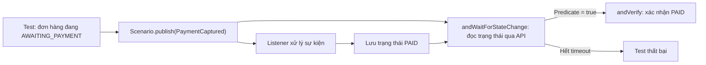

# `andWaitForStateChange`: theo dõi thay đổi trạng thái trong Spring Modulith

## 1. Mục tiêu và bối cảnh

Trong ứng dụng Spring Modulith, các module thường phối hợp qua **application event**. Một module phát sự kiện; module khác xử lý, cập nhật cơ sở dữ liệu hoặc thay đổi trạng thái nghiệp vụ. Nếu listener chạy bất đồng bộ hay xử lý sau khi transaction được commit, phép kiểm tra ngay sau khi phát sự kiện có thể nhìn thấy trạng thái cũ. Dùng `Thread.sleep(...)` để chờ chỉ khiến bài kiểm thử chậm, không ổn định và phụ thuộc tốc độ của máy chạy CI.

Phương thức `andWaitForStateChange(...)` trên `Scenario.When` giải quyết vấn đề này bằng cách **đọc lại trạng thái quan sát được cho đến khi điều kiện hoàn tất được thỏa mãn hoặc hết thời gian chờ**. Nó thuộc API `org.springframework.modulith.test.Scenario`, thường được dùng trong kiểm thử tích hợp với `@ApplicationModuleTest`.

Sau bài học, bạn có thể:

- Phân biệt việc *đã phát sự kiện* với việc *trạng thái nghiệp vụ đã thực sự đổi*.
- Viết `Scenario` kích hoạt hành vi rồi đợi một trạng thái cụ thể, kể cả khi xử lý bất đồng bộ.
- Hiểu giá trị nào được coi là thành công mặc định và khi nào phải cung cấp `Predicate` riêng.
- Điều chỉnh timeout, kiểm chứng kết quả sau khi chờ và chẩn đoán bài test không ổn định.
- Đặt phép kiểm thử trạng thái vào quality gate cùng với kiểm chứng ranh giới module bằng `ApplicationModules`.

> Phạm vi: bài này tập trung vào **thay đổi trạng thái có thể quan sát từ module**. Nó thuộc phần kiểm thử của `SPRING_MODULITH_VERIFICATION_TESTING`: vừa kiểm tra hành vi qua `@ApplicationModuleTest`, sự kiện và cơ sở dữ liệu, vừa kết hợp các phép kiểm tra kiến trúc để ngăn phụ thuộc sai và hồi quy trong CI.

## 2. Một tình huống điển hình

Giả sử module `payment` phát sự kiện `PaymentCaptured(orderId)` sau khi thu tiền. Module `order` nhận sự kiện rồi đổi trạng thái đơn hàng từ `AWAITING_PAYMENT` thành `PAID`.



Mấu chốt là test quan sát trạng thái qua một **API truy vấn của module** (ví dụ `OrderQueryService.statusOf(orderId)`). Nó không cần gọi thẳng listener hay đọc bảng của module khác. Cách tiếp cận này đồng thời tôn trọng ranh giới kiến trúc và phản ánh hành vi mà bên ngoài module có thể sử dụng.

Một lệnh `publish(...)` thành công chỉ cho biết thao tác kích hoạt đã chạy; nó **chưa chứng minh** việc xử lý sự kiện, commit và cập nhật trạng thái đã hoàn tất. `andWaitForStateChange(...)` gắn kết quá trình kích hoạt với điều kiện kết thúc có ý nghĩa nghiệp vụ.

## 3. Cấu trúc và ý nghĩa của API

Một kịch bản có ba phần:

```java
scenario.publish(new SomeDomainEvent(...))          // 1. Kích hoạt hành vi
        .andWaitForStateChange(                      // 2. Đọc lại trạng thái
                () -> queryService.findState(...),
                state -> /* điều kiện đã đạt */)
        .andVerify(state -> /* assertion */);       // 3. Kiểm tra kết quả
```

`Scenario` nhận vào test thông qua tham số của phương thức `@Test` trong ngữ cảnh `@ApplicationModuleTest`. Bạn cũng có thể bắt đầu bằng `scenario.stimulate(...)` khi muốn gọi một phương thức nghiệp vụ thay vì phát sự kiện trực tiếp.

| Thành phần | Vai trò | Lưu ý |
| --- | --- | --- |
| `publish(event)` | Phát event làm đầu vào của scenario. | Phù hợp kiểm thử phản ứng với event của module. |
| `stimulate(supplier)` | Gọi một hành vi của ứng dụng làm đầu vào. | Hữu ích khi muốn test theo API nghiệp vụ. |
| `andWaitForStateChange(Supplier<S>)` | Lặp lại phép đọc trạng thái và sử dụng tiêu chí thành công mặc định. | `Supplier` phải **chỉ quan sát**, không gây thay đổi trạng thái. |
| `andWaitForStateChange(Supplier<S>, Predicate<? super S>)` | Chờ đến khi kết quả đọc thỏa điều kiện tự định nghĩa. | Dùng khi cần phân biệt trạng thái trung gian và đích. |
| `andVerify(Consumer<S>)` | Chạy assertion với kết quả trạng thái đã được chấp nhận. | Assertion này chỉ chạy **sau** khi điều kiện chờ thành công. |
| `andWaitAtMost(Duration)` hoặc `customize(...)` | Đặt giới hạn chờ cho kịch bản. | Chọn ngưỡng phù hợp với xử lý thực tế và môi trường CI. |

### 3.1. Điều kiện hoàn tất mặc định

Với overload chỉ nhận `Supplier`, Spring Modulith coi những giá trị sau là tín hiệu hoàn tất:

| Kết quả của `Supplier` | Mặc định đã đạt? | Giải thích |
| --- | --- | --- |
| `null` | Không | Chưa quan sát được kết quả. |
| `Optional.empty()` | Không | Chưa có giá trị. |
| `Optional.of(value)` | Có | Chỉ kiểm tra **có giá trị**, chưa kiểm tra nội dung. |
| `Boolean.FALSE` / `false` | Không | Trạng thái điều kiện còn sai. |
| `Boolean.TRUE` / `true` | Có | Điều kiện đã đúng. |
| `0`, chuỗi rỗng, danh sách rỗng hoặc một object không `null` | Có | Giá trị không `null` được chấp nhận; độ lớn, kích thước hay thuộc tính chưa được xét. |

**Bẫy thường gặp:** `orderQueries.statusOf(id)` trả về `Optional.of(AWAITING_PAYMENT)` ngay từ đầu. Nếu dùng overload mặc định, phép chờ sẽ kết thúc ngay vì `Optional` đã có giá trị, rồi `andVerify` phát hiện chưa phải `PAID`. Nó không tiếp tục đợi sau khi assertion thất bại.

Do đó, khi trạng thái đích là nội dung của một object, một `Optional`, một số đếm hoặc một collection, hãy dùng overload có `Predicate` để mô tả **chính xác** trạng thái cần đạt.

## 4. Ví dụ tích hợp: chờ đơn hàng chuyển sang `PAID`

Đây là ví dụ Java theo mô hình gần với dự án thực. Giả định module `order` đã cung cấp `OrderQueryService.statusOf(UUID)` trả về `Optional<OrderStatus>`, có enum `OrderStatus` với `AWAITING_PAYMENT` và `PAID`, và listener nhận `PaymentCaptured`. `OrderTestData` là fixture của dự án dùng để tạo một đơn hàng ban đầu rồi **commit** dữ liệu trước khi bắt đầu scenario. Bạn cần thay các kiểu nghiệp vụ/fixture minh họa bằng thành phần hiện có trong ứng dụng.

```java
import static org.assertj.core.api.Assertions.assertThat;

import java.util.UUID;

import org.junit.jupiter.api.Test;
import org.springframework.beans.factory.annotation.Autowired;
import org.springframework.modulith.test.ApplicationModuleTest;
import org.springframework.modulith.test.Scenario;

@ApplicationModuleTest
class OrderPaymentStateTest {

    @Autowired OrderQueryService orderQueries;
    @Autowired OrderTestData testData;

    @Test
    void paymentCapturedChangesOrderStateToPaid(Scenario scenario) {
        UUID orderId = testData.createAwaitingPaymentAndCommit();

        // Xác nhận trạng thái xuất phát của fixture.
        assertThat(orderQueries.statusOf(orderId))
                .contains(OrderStatus.AWAITING_PAYMENT);

        scenario.publish(new PaymentCaptured(orderId))
                .andWaitForStateChange(
                        () -> orderQueries.statusOf(orderId),
                        status -> status.filter(s -> s == OrderStatus.PAID).isPresent())
                .andVerify(status ->
                        assertThat(status).contains(OrderStatus.PAID));
    }
}
```

**Diễn tiến thực tế:**

1. Fixture tạo bản ghi đơn hàng ở trạng thái `AWAITING_PAYMENT` và commit; assertion đầu bài xác nhận điểm xuất phát.
2. `scenario.publish(new PaymentCaptured(orderId))` đưa sự kiện vào ngữ cảnh ứng dụng của test. Listener có thể xử lý đồng bộ hoặc bất đồng bộ tùy cấu hình.
3. `Supplier` đọc `statusOf(orderId)` nhiều lần khi cần. `Optional.of(AWAITING_PAYMENT)` **chưa** thỏa predicate; `Optional.of(PAID)` mới thỏa.
4. `andVerify(...)` nhận chính kết quả của lần đọc đã đáp ứng điều kiện để kiểm tra lần cuối. Nếu không đạt điều kiện trong thời gian cho phép, scenario thất bại bởi timeout.

Phần quan trọng nhất là `Predicate`: phép chờ hướng đến một **trạng thái nghiệp vụ cụ thể**, không dừng ngay khi tìm thấy đơn hàng.

### 4.1. Khi có thể dùng overload mặc định?

Nếu phương thức truy vấn chỉ trả về `true` khi thực sự hoàn tất, có thể viết ngắn hơn:

```java
scenario.publish(new PaymentCaptured(orderId))
        .andWaitForStateChange(() -> orderQueries.isPaid(orderId))
        .andVerify(isPaid -> assertThat(isPaid).isTrue());
```

Ở đây `isPaid` có kiểu `boolean` hoặc `Boolean`, trả `false` khi chưa thanh toán và `true` khi đã thanh toán. Nếu phương thức trả về `int`, `List` hay một object không `null` ở cả hai trạng thái, **không** dùng overload mặc định để biểu diễn điều kiện hoàn tất.

### 4.2. Đặt timeout có chủ đích

Với môi trường tích hợp thường cần giới hạn thời gian chờ rõ ràng. Có thể cấu hình trước phép đọc:

```java
import java.time.Duration;

scenario.publish(new PaymentCaptured(orderId))
        .andWaitAtMost(Duration.ofSeconds(5))
        .forStateChange(
                () -> orderQueries.statusOf(orderId),
                status -> status.filter(s -> s == OrderStatus.PAID).isPresent())
        .andVerify(status -> assertThat(status).contains(OrderStatus.PAID));
```

Sau `andWaitAtMost(...)`, API `forStateChange(...)` diễn đạt cùng kỳ vọng như `andWaitForStateChange(...)`. Cũng có thể dùng `customize(conditionFactory -> conditionFactory.atMost(Duration.ofSeconds(5)))` khi cần cấu hình Awaitility linh hoạt hơn. Không chọn một con số timeout tùy tiện quá thấp: hãy cân nhắc thời gian xử lý sự kiện, database, môi trường CI và độ tin cậy mong muốn của test.

### 4.3. Trạng thái số đếm hoặc object tổng hợp

Với số đếm, `0` vốn không phải `null`, nên overload mặc định sẽ kết thúc quá sớm:

```java
scenario.publish(new ItemsImported(batchId))
        .andWaitForStateChange(
                () -> importQueries.countCompletedItems(batchId),
                completed -> completed >= expectedCount)
        .andVerify(completed -> assertThat(completed).isGreaterThanOrEqualTo(expectedCount));
```

Với object như `OrderSummary`, cũng phải kiểm tra thuộc tính mang ý nghĩa kết thúc:

```java
scenario.publish(new PaymentCaptured(orderId))
        .andWaitForStateChange(
                () -> orderQueries.summaryOf(orderId),
                summary -> summary != null && summary.status() == OrderStatus.PAID)
        .andVerify(summary -> assertThat(summary.status()).isEqualTo(OrderStatus.PAID));
```

Các ví dụ trên minh họa cách chọn `Predicate`; tên event, API truy vấn và kiểu dữ liệu là hợp đồng nghiệp vụ giả định.

## 5. Thiết kế quan sát trạng thái đúng với ranh giới module

`andWaitForStateChange` là phép chờ ở cấp **kiểm thử hành vi**. Trong Spring Modulith, phép chờ tốt còn phải giúp phát hiện lỗi đúng ở ranh giới module:

- **Đọc qua API công khai của module cần kiểm chứng**: dùng query service, application service hoặc named interface được phép truy cập. Tránh để test vượt qua nhiều tầng và phụ thuộc trực tiếp vào entity/repository nội bộ của module khác.
- **Chuẩn bị trạng thái ban đầu đã được lưu và commit**: đặc biệt khi listener dùng `@TransactionalEventListener(phase = AFTER_COMMIT)`. Nếu transaction không commit hoặc fixture còn nằm trong transaction chưa kết thúc, listener có thể chưa được kích hoạt như mong đợi.
- **Đảm bảo truy vấn nhìn thấy dữ liệu mới**: tránh giữ entity cũ trong persistence context của test. Sử dụng một cách đọc phù hợp với transaction và cơ chế persistence thực tế của module.
- **Tách kích hoạt khỏi quan sát**: `Supplier` phải an toàn để gọi lại nhiều lần. Không đặt `save(...)`, `publish(...)`, gửi HTTP command hay các thao tác gây side effect trong supplier.
- **Khoanh vùng kịch bản tích hợp**: `@ApplicationModuleTest` bootstrap module và các phụ thuộc được cấu hình. Đảm bảo những bean, event listener, database/test infrastructure cần thiết cho kịch bản thực sự có mặt trong test context.

Một test thấy trạng thái `PAID` chưa chứng minh tất cả module tuân thủ quy tắc phụ thuộc. Phần đó cần phép xác minh kiến trúc riêng:

```java
import org.junit.jupiter.api.Test;
import org.springframework.modulith.core.ApplicationModules;

class ArchitectureVerificationTest {

    @Test
    void moduleDependenciesAreValid() {
        ApplicationModules.of(MySpringBootApplication.class).verify();
    }
}
```

Kết hợp `ApplicationModules.verify()` với các quy tắc như `@ApplicationModule(allowedDependencies = ...)` và `@NamedInterface` (khi dự án sử dụng) giúp phát hiện phụ thuộc sai ở cấp cấu trúc; `@ApplicationModuleTest` cộng `andWaitForStateChange` giúp phát hiện hồi quy ở cấp hành vi và dữ liệu. Hai lớp bảo vệ giải quyết những loại lỗi khác nhau.

## 6. So sánh với cách chờ event và các cách kiểm thử khác

| Cách kiểm thử | Nên dùng khi | Giới hạn cần lưu ý |
| --- | --- | --- |
| `andWaitForStateChange(...)` | Kết quả mong đợi là trạng thái lưu trữ hoặc giá trị truy vấn. | Cần `Predicate` đúng, khả năng quan sát dữ liệu và transaction nhất quán. |
| `andWaitForEventOfType(...).matching(...).toArriveAndVerify(...)` | Chính **sự kiện được phát ra** là kết quả cần kiểm chứng. | Sự kiện xuất hiện chưa chắc đồng nghĩa thay đổi database đã hoàn tất. |
| Assertion ngay sau `publish(...)` | Luồng xử lý bảo đảm đồng bộ và trạng thái đã cập nhật trước khi phương thức trả về. | Dễ sai với listener bất đồng bộ và xử lý sau commit. |
| `Thread.sleep(...)` rồi assertion | Hầu như không nên dùng cho điều kiện chờ có thể quan sát. | Chậm khi trạng thái sớm đạt; flaky khi máy CI chậm. |

Nếu yêu cầu nghiệp vụ là "đã phát `OrderPaid`", kiểm chứng event là phù hợp. Nếu yêu cầu là "API của module trả về đơn hàng ở trạng thái `PAID`", kiểm chứng state change diễn tả mục tiêu chính xác hơn. Với luồng tích hợp quan trọng, có thể kiểm tra cả event và state trong các trường hợp phù hợp mà không ghép lẫn hai tín hiệu hoàn tất.

## 7. Chẩn đoán các lỗi hay gặp

| Hiện tượng | Nguyên nhân có thể | Cách xử lý |
| --- | --- | --- |
| `andVerify` thấy trạng thái cũ ngay lập tức. | `Supplier` trả object/`Optional` có giá trị từ trước, làm điều kiện mặc định thành công quá sớm. | Dùng overload `(Supplier, Predicate)` với trạng thái đích cụ thể. |
| Hết timeout dù đã thấy log listener chạy. | Listener lỗi, transaction rollback, dữ liệu chưa commit, sai `orderId`, hoặc truy vấn không nhìn thấy bản ghi mới. | Kiểm tra log, transaction, ID tương quan, và đường đọc dữ liệu. |
| Test chạy được trên máy nhưng fail ở CI. | Timeout quá thấp; phụ thuộc timing hay hạ tầng ngoài; fixture không cô lập. | Đặt timeout hợp lý, cô lập dữ liệu, loại bỏ `Thread.sleep`, dùng test infrastructure ổn định. |
| Test pass dù trạng thái chưa đạt. | Trả về `int`, collection, chuỗi hoặc object không `null`; điều kiện mặc định quá rộng. | Viết predicate kiểm tra giá trị/thuộc tính thực sự cần đạt. |
| Event `AFTER_COMMIT` không dẫn đến thay đổi. | Transaction chưa commit hoặc test bọc trong `@Transactional` không kết thúc như luồng production. | Chuẩn bị fixture đã commit; kiểm tra cách `Scenario` kích hoạt và ranh giới transaction của listener. |
| Test ảnh hưởng lẫn nhau khi chạy song song. | Dùng cùng ID hoặc cùng dữ liệu tồn tại lâu; supplier đọc bản ghi của lần chạy khác. | ID riêng cho từng test, fixture độc lập và cleanup phù hợp. |

Khi timeout xảy ra, ưu tiên đọc **trạng thái cuối cùng quan sát được**, log listener và transaction để xác định lỗi thực sự. Tăng timeout chỉ có ích nếu hệ thống đúng nhưng cần thêm thời gian; nó không sửa được lỗi thiếu commit hoặc predicate sai.

## 8. Đưa vào quality gate trong CI

Một pipeline kiểm chứng Spring Modulith nên chạy cả phép test kiến trúc và test tích hợp trên mọi pull request. Ví dụ với một dự án Gradle có task `test` bao gồm các JUnit test trên:

```bash
./gradlew test
```

Với Maven, lệnh tương đương thường là `./mvnw test`. Cần chuẩn bị database và các dịch vụ phụ trợ của môi trường kiểm thử theo cách dự án đang dùng (ví dụ test container hoặc database test độc lập). Build phải trả mã lỗi khi phép xác minh ranh giới module, assertion hoặc scenario timeout thất bại; CI sử dụng mã lỗi đó để chặn hồi quy.

Để bài test thực sự có giá trị như quality gate:

1. Nêu rõ trạng thái ban đầu và trạng thái đích; dùng dữ liệu kiểm thử mới cho mỗi lần chạy.
2. Kích hoạt qua public API hoặc event đúng với cách các module giao tiếp.
3. Dùng `Predicate` có ý nghĩa nghiệp vụ; không coi "có object" là bằng chứng "đã hoàn tất".
4. Đọc trạng thái qua giao diện của module; kiểm tra timeout và log khi thất bại.
5. Chạy cả `ApplicationModules.verify()` lẫn `@ApplicationModuleTest` trong CI, đồng thời kiểm tra các quy tắc `allowedDependencies` nếu có.

## 9. Bài thực hành tự kiểm chứng

**Bài A – trạng thái đơn hàng:** tạo test cho sự kiện `PaymentCaptured`, fixture ở trạng thái `AWAITING_PAYMENT`, rồi chờ `PAID`. Thử bỏ `Predicate` riêng trong lúc `statusOf(id)` đã có giá trị từ đầu; quan sát vì sao test thất bại sớm. Khôi phục predicate và xác nhận test qua được.

**Bài B – kiểm chứng một quá trình xử lý nền:** giả lập event yêu cầu nhập một batch gồm nhiều item. Cho API trả về số item đã hoàn tất và dùng predicate `completed == expectedCount`. Thử đặt ngưỡng chờ quá ngắn để đọc thông báo timeout; sau đó điều chỉnh phù hợp với thời gian thực tế.

**Bài C – bảo vệ kiến trúc:** đặt một bài test `ApplicationModules.of(...).verify()` bên cạnh hai test trên. Tạo thử một phụ thuộc vào package nội bộ của module khác trên nhánh thử nghiệm và xác minh quality gate báo lỗi cấu trúc; hoàn nguyên thay đổi này sau khi kiểm tra.

**Tiêu chí hoàn thành:** test diễn đạt đúng trạng thái cần đạt, ổn định khi chạy lặp lại, không dùng `Thread.sleep(...)`, và CI phát hiện được cả lỗi hành vi lẫn vi phạm ranh giới kiến trúc.

## 10. Ghi nhớ và tài liệu tham khảo

`andWaitForStateChange` giúp kiểm thử **kết quả có thể quan sát**, không chỉ sự kiện đã được gửi. Đầu vào là một hành vi kích hoạt; điều kiện chờ là một phép đọc lặp lại; `andVerify` xác nhận kết quả đã đạt. Khi trạng thái nằm trong `Optional`, object hoặc một số đếm, **chủ động định nghĩa `Predicate` cho trạng thái cuối cùng** là yếu tố quyết định chất lượng bài kiểm thử.

- [Spring Modulith Reference – Integration Testing Application Modules](https://docs.spring.io/spring-modulith/reference/testing.html): cách dùng `Scenario`, state change và cấu hình thời gian chờ.
- [Javadoc `Scenario.When`](https://docs.spring.io/spring-modulith/docs/current/api/org/springframework/modulith/test/Scenario.When.html): overload `andWaitForStateChange`, tiêu chí chấp nhận mặc định, `forStateChange`.
- [Javadoc `Scenario.When.StateChangeResult`](https://docs.spring.io/spring-modulith/docs/current/api/org/springframework/modulith/test/Scenario.When.StateChangeResult.html): callback `andVerify(...)` và các lựa chọn kiểm chứng tiếp theo.
