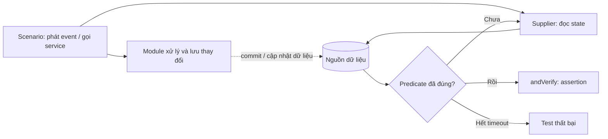

# Chọn repository hoặc aggregate làm nguồn state khi kiểm thử Spring Modulith

## 1. Bài toán: trạng thái nào chứng minh hệ thống đã xử lý xong?

Trong một ứng dụng Spring Modulith, module `payments` có thể phát sự kiện `PaymentCaptured`, còn module `orders` xử lý sự kiện và cập nhật đơn hàng thành `PAID`. Listener có thể chạy sau commit hoặc bất đồng bộ. Vì thế, việc phát sự kiện thành công **không đồng nghĩa** trạng thái mới đã được ghi và có thể đọc.

Spring Modulith cung cấp `Scenario` trong gói `org.springframework.modulith.test` để kiểm thử các luồng như vậy. Sau khi `publish(...)` hoặc `stimulate(...)` kích hoạt một hành vi, `andWaitForStateChange(...)` liên tục lấy giá trị từ một hàm đọc trạng thái cho đến khi điều kiện thành công được đáp ứng hoặc timeout.

Điểm thiết kế quyết định chất lượng bài test là **chọn nguồn state**: chỉ đọc một giá trị từ repository, hay lấy lại cả aggregate để kiểm chứng quy tắc nghiệp vụ? Đây là nội dung của chương *State change* trong module `SPRING_MODULITH_VERIFICATION_TESTING`. Kỹ năng này bổ trợ cho `@ApplicationModuleTest`, kiểm thử sự kiện và cơ sở dữ liệu, đồng thời gắn với xác minh ranh giới kiến trúc và quality gate trong CI.

Sau bài học, bạn có thể:

- Phân biệt **nguồn quan sát trạng thái** với thành phần thực hiện thay đổi trạng thái.
- Chọn truy vấn repository nhẹ hoặc aggregate theo mục tiêu kiểm chứng.
- Viết `Supplier` đọc trạng thái mới ở mỗi lượt poll và `Predicate` nhận diện chính xác trạng thái đích.
- Tránh đọc nhầm entity cũ do persistence context, transaction hoặc reference được giữ lại.
- Giữ ranh giới module khi tổ chức test, và bổ sung phép kiểm chứng kiến trúc trong CI.

## 2. `Supplier` mới là nguồn state của `Scenario`

Ví dụ sau minh họa cấu trúc chung; tên event và thành phần nghiệp vụ là ví dụ giả định:

```java
scenario.publish(new PaymentCaptured(orderId))
        .andWaitForStateChange(
                () -> stateReader.read(orderId),
                state -> isExpectedState(state))
        .andVerify(state -> assertExpectedState(state));
```

Trong đó:

1. `publish(...)` là **stimulus**: nguyên nhân có thể dẫn tới thay đổi.
2. `() -> stateReader.read(orderId)` là `Supplier<S>`: **nguồn state** được gọi lại khi cần, có thể là một phương thức repository, query service hoặc thao tác tải aggregate.
3. `Predicate<? super S>` là **điều kiện hoàn tất**: phải diễn tả đúng trạng thái cần chờ.
4. `andVerify(...)` là **assertion cuối** trên kết quả đã đáp ứng điều kiện.



**Phân biệt quan trọng:** repository và aggregate không nhất thiết là hai cách lưu dữ liệu khác nhau. Repository thường là cổng **tải aggregate** từ storage. Trong bài này, “chọn repository hay aggregate” chủ yếu là chọn **độ chi tiết của kết quả quan sát và điều kiện kiểm chứng**:

- **Repository/projection:** lấy trực tiếp một thuộc tính hoặc DTO trạng thái bằng truy vấn chuyên biệt, ví dụ `Optional<OrderStatus>`.
- **Aggregate:** tải **một phiên bản hiện tại** của aggregate rồi kiểm tra các quy tắc nghiệp vụ trên object đó, ví dụ `Optional<Order>`.

Không nên hiểu “aggregate làm nguồn state” là giữ nguyên một entity Java từ trước lúc phát sự kiện và đọc lại cùng object đó. Với persistence như JPA, object đã giữ có thể là ảnh chụp cũ, kể cả khi database đã đổi.

## 3. Tiêu chí chọn nguồn state

| Tình huống kiểm thử | Nguồn nên ưu tiên | Lý do |
| --- | --- | --- |
| Cần đợi một cờ `processed`, trạng thái enum `PAID`, hoặc timestamp hoàn tất. | Truy vấn repository/projection chỉ trả trường cần kiểm tra. | Đơn giản, ít dữ liệu, dễ viết predicate rõ ràng. |
| Cần chứng minh *nhiều thuộc tính thuộc cùng aggregate* đạt bất biến nghiệp vụ. | Tải aggregate mới ở mỗi lượt đọc, kiểm tra các thuộc tính cần thiết. | Các thuộc tính được quan sát cùng một lần tải, diễn đạt quy tắc domain. |
| Kết quả bên ngoài module là một read model cập nhật bất đồng bộ. | Query service hoặc repository của read model đó. | Kiểm chứng đúng kết quả mà consumer thực sự đọc. |
| Kiểm thử luồng xuyên module từ góc nhìn consumer. | API truy vấn **được module sở hữu công khai**. | Tránh làm test phụ thuộc vào repository/entity nội bộ của module khác. |
| Chỉ cần xác nhận một sự kiện đã được phát. | Cơ chế chờ và kiểm chứng **event** của `Scenario`. | Đọc repository hoặc aggregate không chứng minh trực tiếp việc event được phát. |
| State chỉ nằm trong object Java tạm thời, không được quản lý và chia sẻ an toàn. | Thiết kế một cổng quan sát ổn định trước khi viết state test. | Object bị giữ lại không bảo đảm phản ánh trạng thái thực của hệ thống. |

Một quy tắc thực dụng là: **chọn nguồn nhỏ nhất vẫn chứng minh đầy đủ yêu cầu nghiệp vụ**. Chỉ đợi `status = PAID` thì query một trạng thái thường đủ; nếu hoàn tất phải có cả `paymentReference` và `paidAt`, cần kiểm chứng thêm các trường đó. Chọn nguồn theo **điều kiện thành công** chứ không theo sở thích dùng repository hay object.

### 3.1. Đặt câu hỏi trước khi viết code

- **Ai sở hữu dữ liệu?** Repository nằm trong module được test hay trong module khác?
- **Điều kiện nào cho biết đã hoàn tất?** Record tồn tại, trạng thái có giá trị đích hay toàn bộ bất biến đã đúng?
- **Dữ liệu có đổi giữa các lần đọc không?** Listener bất đồng bộ, read model cập nhật sau commit hoặc transactional visibility?
- **Đọc từ đâu để phản ánh hành vi thực?** Bảng gốc, API truy vấn public, hay projection cho consumer?
- **Mỗi lượt đọc có an toàn không?** Có phải query không gây side effect, không giữ entity cũ và không quá tốn tài nguyên?

## 4. Tình huống nền: `PaymentCaptured` cập nhật đơn hàng

Giả định module `orders` có aggregate `Order`, ID kiểu `UUID`, enum trạng thái `OrderStatus` với `AWAITING_PAYMENT` và `PAID`. Module `payments` công bố sự kiện `PaymentCaptured(orderId)`, module `orders` nhận event, cập nhật đơn hàng và commit. Các class bên dưới minh họa hợp đồng, không phải thành phần được Spring Modulith tạo tự động:

```java
public enum OrderStatus {
    AWAITING_PAYMENT, PAID
}

public record PaymentCaptured(UUID orderId, String paymentReference) {}

// Rút gọn: entity/aggregate thực tế có mapping và logic nghiệp vụ riêng.
public class Order {
    private UUID id;
    private OrderStatus status;
    private String paymentReference;

    public OrderStatus getStatus() { return status; }
    public String getPaymentReference() { return paymentReference; }
    public boolean isPaid() {
        return status == OrderStatus.PAID
                && paymentReference != null
                && !paymentReference.isBlank();
    }
}
```

Với Spring Data JPA, repository của **chính module `orders`** có thể cấp hai kiểu phép đọc:

```java
import java.util.Optional;
import java.util.UUID;

import org.springframework.data.jpa.repository.JpaRepository;
import org.springframework.data.jpa.repository.Query;
import org.springframework.data.repository.query.Param;

interface OrderRepository extends JpaRepository<Order, UUID> {

    // Chỉ trả trạng thái; tên entity/thuộc tính phải khớp mapping JPA của dự án.
    @Query("select o.status from Order o where o.id = :id")
    Optional<OrderStatus> findStatusById(@Param("id") UUID id);

    // findById(UUID) được JpaRepository kế thừa: trả Optional<Order>.
}
```

`@Query` chỉ là minh họa nếu dự án dùng JPA; với JDBC, MongoDB hay một adapter khác, repository vẫn có thể cung cấp API truy vấn tương đương. Không buộc module chỉ được dùng JPA. Điểm chung là **mỗi lần gọi `Supplier` đều đọc lại trạng thái được lưu**.

## 5. Cách A — Chọn repository để chờ một trạng thái đơn giản

Khi yêu cầu là *đơn hàng đã chuyển sang `PAID`*, phép đọc `findStatusById(...)` diễn tả đúng điều cần kiểm chứng với chi phí thấp.

```java
import static org.assertj.core.api.Assertions.assertThat;

import java.util.UUID;

import org.junit.jupiter.api.Test;
import org.springframework.beans.factory.annotation.Autowired;
import org.springframework.modulith.test.ApplicationModuleTest;
import org.springframework.modulith.test.Scenario;

@ApplicationModuleTest
class OrderStateFromRepositoryTests {

    @Autowired OrderRepository orders;
    @Autowired OrderFixture fixture;

    @Test
    void paymentMakesOrderPaid(Scenario scenario) {
        // Fixture do dự án cung cấp, phải ghi và commit trạng thái ban đầu.
        UUID orderId = fixture.createAwaitingPaymentAndCommit();

        assertThat(orders.findStatusById(orderId))
                .contains(OrderStatus.AWAITING_PAYMENT);

        scenario.publish(new PaymentCaptured(orderId, "PAY-001"))
                .andWaitForStateChange(
                        () -> orders.findStatusById(orderId),
                        state -> state.filter(s -> s == OrderStatus.PAID)
                                .isPresent())
                .andVerify(state ->
                        assertThat(state).contains(OrderStatus.PAID));
    }
}
```

Ở đây `OrderFixture` là **test fixture giả định**, không thuộc framework. Dự án cần triển khai nó bằng cách phù hợp với transaction test để dữ liệu ban đầu đã commit trước lúc phát sự kiện. Listener xử lý `PaymentCaptured` cũng phải hiện diện trong application context của `@ApplicationModuleTest`.

Vì sao cần `Predicate` tường minh? Giá trị từ `findStatusById` là `Optional<OrderStatus>`. Ngay trước khi thanh toán, giá trị đã là `Optional.of(AWAITING_PAYMENT)`. Overload chỉ nhận `Supplier` có thể coi `Optional` có giá trị là đã đạt, dẫn đến assertion chạy quá sớm. Predicate ở đây chỉ trở thành `true` khi **nội dung** là `PAID`.

**Repository phù hợp khi:** trạng thái nhỏ, có thể truy vấn nhất quán và được định nghĩa rõ trong hợp đồng của module. Đối với một read model ngoài module, nên inject **public query service** thay vì repository nội bộ.

## 6. Cách B — Chọn aggregate để kiểm chứng bất biến nghiệp vụ

Giả sử `PAID` chỉ hợp lệ khi đồng thời có mã tham chiếu thanh toán. Nếu test chỉ chờ enum `PAID`, lỗi ghi thiếu `paymentReference` có thể lọt qua. Khi đó, tải aggregate mới cho mỗi lần quan sát rồi kiểm tra invariant sẽ phù hợp hơn.

```java
import static org.assertj.core.api.Assertions.assertThat;

import java.util.UUID;

import org.junit.jupiter.api.Test;
import org.springframework.beans.factory.annotation.Autowired;
import org.springframework.modulith.test.ApplicationModuleTest;
import org.springframework.modulith.test.Scenario;

@ApplicationModuleTest
class OrderStateFromAggregateTests {

    @Autowired OrderRepository orders;
    @Autowired OrderFixture fixture;

    @Test
    void paymentCompletesOrderAggregate(Scenario scenario) {
        UUID orderId = fixture.createAwaitingPaymentAndCommit();

        scenario.publish(new PaymentCaptured(orderId, "PAY-002"))
                .andWaitForStateChange(
                        () -> orders.findById(orderId),
                        candidate -> candidate.filter(Order::isPaid).isPresent())
                .andVerify(candidate -> {
                    Order current = candidate.orElseThrow();
                    assertThat(current.getStatus()).isEqualTo(OrderStatus.PAID);
                    assertThat(current.getPaymentReference()).isEqualTo("PAY-002");
                });
    }
}
```

`Order::isPaid` là phương thức domain minh họa. Nó phát biểu **quy tắc nghiệp vụ** thay vì buộc test biết mọi chi tiết biểu diễn. `andVerify` vẫn kiểm tra các thuộc tính quan trọng để báo lỗi rõ ràng nếu có hồi quy.

Đây là cách dùng aggregate **đúng**:

```java
// Tốt: mỗi lần Supplier chạy đều tải lại aggregate từ repository.
() -> orders.findById(orderId)
```

Đây là cách dễ gây sai lệch:

```java
// Không nên: entity được lấy trước event có thể vẫn là bản cũ.
Order cachedOrder = orders.findById(orderId).orElseThrow();

scenario.publish(new PaymentCaptured(orderId, "PAY-003"))
        .andWaitForStateChange(
                cachedOrder::isPaid,
                isPaid -> isPaid);
```

`cachedOrder` không tự động trở thành dữ liệu mới chỉ vì listener ở transaction khác đã cập nhật database. Tùy persistence context, phép đọc này có thể **không thấy** thay đổi hoặc tình cờ pass khi test dùng chung object mutable với production code. Cả hai đều làm kiểm thử thiếu tin cậy.

**Aggregate phù hợp khi:** trạng thái đích gắn với nhiều field hoặc invariant, bạn muốn quan sát logic domain cùng một phiên bản aggregate, và có thể tải lại dữ liệu với chi phí chấp nhận được. Nếu aggregate chứa collection lazy hoặc đồ thị entity rất lớn, nên cân nhắc một query projection đầy đủ các trường cần kiểm tra thay cho việc tải toàn bộ.

## 7. Cách C — Dùng query service hoặc read model qua ranh giới module

Trong kiến trúc module, test cần phân biệt hai góc nhìn:

- **Kiểm thử nội bộ module `orders`:** có thể inject `OrderRepository` để chuẩn bị fixture và quan sát persistence của chính module, nếu test nằm đúng phạm vi module.
- **Kiểm thử từ module khác:** không nên inject `orders.internal.OrderRepository` chỉ để đọc trạng thái. Dùng API truy vấn công khai hoặc named interface mà module `orders` chủ động cung cấp.

Giả sử `orders` công khai một DTO:

```java
public record OrderPaymentView(UUID orderId, OrderStatus status,
                               String paymentReference) {

    public boolean complete() {
        return status == OrderStatus.PAID
                && paymentReference != null
                && !paymentReference.isBlank();
    }
}

public interface OrderQueries {
    Optional<OrderPaymentView> paymentViewOf(UUID orderId);
}
```

Kịch bản của module consumer có thể quan sát qua API đó:

```java
scenario.publish(new PaymentCaptured(orderId, "PAY-004"))
        .andWaitForStateChange(
                () -> orderQueries.paymentViewOf(orderId),
                view -> view.filter(OrderPaymentView::complete).isPresent())
        .andVerify(view -> assertThat(view).isPresent());
```

Ví dụ chỉ chạy được khi `OrderQueries`, event contract và các module cần thiết được đưa vào test context theo cấu hình `@ApplicationModuleTest`; `@ApplicationModuleTest` mặc định không bảo đảm tự khởi tạo mọi module liên quan. Vì vậy, cần chọn bootstrap mode/dependency phù hợp hoặc sử dụng bài kiểm thử tích hợp phạm vi rộng hơn cho luồng xuyên module.

Read model có thể chậm hơn bảng gốc do pipeline cập nhật bất đồng bộ. Nếu hành vi cần bảo đảm là *consumer thấy `PAID`*, quan sát read model mới đo đúng hợp đồng. Nếu cần bảo đảm *transaction ghi đơn hàng thành công*, truy vấn ở tầng lưu trữ chính có thể phản ánh trạng thái sớm hơn. Hai phép đo trả lời **hai câu hỏi khác nhau**.

## 8. Tránh đọc state cũ: transaction, JPA và khả năng quan sát

`Supplier` được gọi nhiều lần không đồng nghĩa các lượt đọc chắc chắn nhìn thấy dữ liệu mới. Các trường hợp hay gây hiểu nhầm:

| Vấn đề | Biểu hiện | Cách xử lý |
| --- | --- | --- |
| Giữ reference `Order` trước khi phát event. | Predicate mãi đọc `AWAITING_PAYMENT` dù DB đã cập nhật. | Tải aggregate mới trong supplier; không cache entity của fixture. |
| Persistence context cấp một giữ entity cũ. | Gọi lại `findById` nhưng vẫn nhận cùng managed entity và state cũ. | Kiểm tra transaction boundary; để mỗi lượt quan sát dùng trạng thái đã commit và persistence context phù hợp, hoặc đọc projection độc lập. |
| Test giữ transaction dài với isolation/snapshot. | Các lần đọc không thấy commit từ listener. | Tránh đặt toàn test trong transaction giữ snapshot khi chờ async state; tổ chức fixture commit trước scenario. |
| Listener dùng `@TransactionalEventListener(AFTER_COMMIT)`. | Event không kích hoạt cập nhật như kỳ vọng. | Bảo đảm luồng phát event thực sự đi đến commit; kiểm tra transaction của stimulus và listener. |
| Truy vấn đi qua cache hoặc read replica. | State đạt chậm hoặc không cập nhật trong timeout. | Biết rõ nguồn đọc và cách invalidate cache/replication; chọn quan sát phù hợp hợp đồng. |
| Aggregate có thuộc tính/collection lazy. | Predicate chạm dữ liệu ngoài transaction và ném lỗi lazy initialization. | Đọc projection đủ trường, fetch cần thiết hoặc tổ chức query method có transaction thích hợp. |

Với JPA, `EntityManager` có persistence context cấp một. Nếu một test method được `@Transactional` bọc từ đầu đến cuối, `findById(...)` có thể trả lại entity đang được quản lý từ trước thay vì truy vấn thấy commit mới của listener. Cách giải quyết cụ thể phụ thuộc transaction manager, propagation và cách fixture hoạt động; đừng chữa lỗi bằng cách chỉ tăng timeout.

Ngoài ra, không nên `entityManager.clear()` hay `refresh(...)` tùy tiện trong supplier nếu nó can thiệp vào transaction của test, làm rơi thay đổi chưa flush hoặc tác động tới các assertion khác. Hãy thiết kế một **state reader** thực sự quan sát trạng thái đã commit, thường đơn giản nhất là repository projection hoặc một service đọc riêng có transaction rõ ràng.

### 8.1. Quy tắc của một `Supplier` tốt

```java
// Đọc thuần túy, định danh rõ, có thể gọi lặp lại.
() -> orders.findStatusById(orderId)

// Không tốt: ghi trạng thái trong thao tác đang được poll.
() -> {
    orders.markAsPaid(orderId); // side effect, mỗi lần poll lại ghi!
    return orders.findStatusById(orderId);
}
```

Một supplier tốt có đặc tính: chỉ đọc; không phát thêm event; không gửi HTTP command; luôn dùng cùng business key; không phụ thuộc biến mutable của test; có chi phí truy vấn tương xứng với tần suất poll; và có khả năng quan sát trạng thái đã commit.

## 9. Predicate phải diễn tả **đạt state**, không phải **có state**

Nhiều truy vấn trả giá trị hợp lệ ngay từ đầu: số đếm `0`, `Optional.of(AWAITING_PAYMENT)`, `Order` ở trạng thái chờ, hoặc DTO với `complete = false`. Nếu gọi `andWaitForStateChange(supplier)` mà không định nghĩa predicate, điều kiện thành công mặc định có thể rộng hơn yêu cầu, chẳng hạn `Optional` có giá trị hoặc object khác `null` được coi là đã xuất hiện.

| Kiểu đọc | Điều kiện hoàn tất đáng tin cậy |
| --- | --- |
| `Optional<OrderStatus>` | `v -> v.filter(s -> s == OrderStatus.PAID).isPresent()` |
| `Optional<Order>` | `v -> v.filter(Order::isPaid).isPresent()` |
| `Optional<OrderPaymentView>` | `v -> v.filter(OrderPaymentView::complete).isPresent()` |
| `long processedCount` | `count -> count >= expectedCount` |
| `boolean committed` | `committed -> committed` |

Đặc biệt, `andVerify(...)` **không thay thế** predicate: callback xác minh chạy sau khi phép chờ đã quyết định đạt điều kiện, không tự biến một điều kiện chờ sai thành phép đợi đúng. Đặt điều kiện nghiệp vụ vào `Predicate`, và dùng `andVerify` để tạo assertion có thông điệp/chi tiết rõ ràng.

### 9.1. Khi không cần đợi cả aggregate

Nếu rule chỉ là `status == PAID`, một query scalar thường:

- tránh tải thêm collection/relationship của aggregate;
- ít bị vướng lazy loading khi callback chạy sau transaction;
- thể hiện rõ điều kiện pass/fail và dễ tạo bằng chứng CI.

Ngược lại, nếu logic "đã thanh toán" bao gồm nhiều điều kiện, chỉ kiểm tra enum có thể là **false positive**. Khi đó dùng aggregate hoặc một projection chứa đủ thuộc tính cho invariant. Việc query nhỏ hơn không có ý nghĩa nếu nó bỏ sót điều cần bảo đảm.

## 10. Timeout, dữ liệu kiểm thử và tính ổn định trong CI

Các phép đọc lặp của `Scenario` cần có thời gian chờ hữu hạn. Spring Modulith hỗ trợ cấu hình thời gian chờ của scenario; ví dụ có thể dùng `andWaitAtMost(...)` rồi `forStateChange(...)`:

```java
import java.time.Duration;

scenario.publish(new PaymentCaptured(orderId, "PAY-005"))
        .andWaitAtMost(Duration.ofSeconds(5))
        .forStateChange(
                () -> orders.findStatusById(orderId),
                state -> state.filter(s -> s == OrderStatus.PAID)
                        .isPresent())
        .andVerify(state -> assertThat(state).contains(OrderStatus.PAID));
```

Thời gian `5` giây ở đây chỉ minh họa; ngưỡng phù hợp phụ thuộc tốc độ listener, commit, adapter và môi trường CI. Không dùng `Thread.sleep(...)` để thay thế vì nó vừa trì hoãn cố định, vừa không bảo đảm trạng thái đạt ở máy chậm.

Để test ổn định:

1. Tạo ID khác nhau cho mỗi scenario để tránh đọc nhầm bản ghi của lần chạy khác.
2. Commit fixture ở trạng thái xuất phát, rồi assertion xác nhận đúng trạng thái đó.
3. Phát event hoặc gọi API nghiệp vụ đúng tuyến xử lý production.
4. Chờ một trạng thái cụ thể qua repository/aggregate/query service thích hợp.
5. Đặt timeout có giới hạn; khi lỗi hãy ghi nhận event ID, aggregate ID và giá trị trạng thái cuối cùng.
6. Dọn dữ liệu kiểm thử sau test bằng cơ chế phù hợp với các transaction async; tránh giả định rollback của test cũng hoàn tác commit của listener.

## 11. Chẩn đoán lỗi theo nguồn state

| Dấu hiệu | Câu hỏi cần điều tra | Hướng sửa |
| --- | --- | --- |
| Test dừng quá sớm rồi báo chưa `PAID`. | Supplier trả `Optional`/aggregate đã tồn tại ngay từ đầu? | Dùng predicate kiểm tra giá trị đích, không chỉ non-null/present. |
| Test timeout nhưng DB đã `PAID`. | Có entity cache, transaction giữ snapshot, hoặc truy vấn sai ID? | Quan sát qua query projection độc lập; kiểm tra persistence context và transaction boundary. |
| Test pass dù thiếu `paymentReference`. | Predicate chỉ xem enum và bỏ qua invariant? | Quan sát aggregate hoặc DTO chứa đủ thuộc tính; kiểm tra invariant. |
| Module test không có listener. | Listener thuộc module khác hoặc bootstrap không bao gồm dependency? | Điều chỉnh phạm vi tích hợp và module test context. |
| CI lúc pass lúc fail. | Dữ liệu test trùng ID, trạng thái không được commit, timing không ổn định? | Fixture độc lập, transaction nhất quán, timeout hợp lý. |
| Test phải import package `.internal` từ module khác. | Nguồn state vượt ranh giới public API? | Đọc qua API công khai/named interface của module sở hữu. |

Khi nghi ngờ lỗi đọc state, nên kiểm tra song song (a) trạng thái được commit ở storage, (b) kết quả thực tế do supplier trả về và (c) thời điểm listener kết thúc. Ba quan sát này giúp phân biệt lỗi nghiệp vụ, lỗi transaction và lỗi nguồn state.

## 12. Kết hợp với kiểm chứng ranh giới kiến trúc

Chọn đúng nguồn state là một phần của bài test hành vi. Với Spring Modulith, kiểm chứng còn bao gồm **quy tắc phụ thuộc giữa các module**. Một test `Scenario` có thể chạy qua dù code đang import implementation nội bộ của module khác; vì vậy cần kiểm tra kiến trúc độc lập:

```java
import org.junit.jupiter.api.Test;
import org.springframework.modulith.core.ApplicationModules;

class ModulithArchitectureTests {

    @Test
    void moduleDependenciesFollowTheRules() {
        ApplicationModules.of(MyApplication.class).verify();
    }
}
```

Trong code thật, thay `MyApplication.class` bằng application class của Spring Boot. Sử dụng các khai báo như `@ApplicationModule(allowedDependencies = ...)` hoặc `@NamedInterface` khi có nhu cầu giới hạn API được phép sử dụng. Khi đó:

- `ApplicationModules.verify()` kiểm tra cấu trúc, quan hệ phụ thuộc và ranh giới giữa module.
- `@ApplicationModuleTest` cùng `Scenario.andWaitForStateChange(...)` kiểm tra thay đổi trạng thái có thể quan sát sau hành vi/event.
- Quality gate trên pull request chạy cả hai nhóm test; timeout, assertion và vi phạm phụ thuộc phải làm CI thất bại.

Với dự án Gradle đã cấu hình các test JUnit trong task `test`, có thể đưa `./gradlew test` vào CI. Việc bảo đảm database/test infrastructure sẵn sàng và mọi test tích hợp được task thu thập là trách nhiệm của cấu hình dự án.

## 13. Bài tập thực hành

**Bài 1 – chọn repository:** viết test phát `PaymentCaptured` rồi đọc `findStatusById(orderId)` bằng `Scenario`; predicate chỉ thành công khi trạng thái bằng `PAID`. Giải thích vì sao không dùng `Optional::isPresent`.

**Bài 2 – chọn aggregate:** mở rộng quy tắc thanh toán: `PAID` chỉ hợp lệ khi `paymentReference` khác rỗng. Viết test tải `Order` mỗi lần poll và kiểm tra `Order::isPaid`. Tạo một lỗi giả lập chỉ đổi enum mà không ghi reference để thấy test mới phát hiện hồi quy.

**Bài 3 – quan sát xuyên module:** chuyển phép đọc trạng thái sang `OrderQueries.paymentViewOf(...)` được công khai từ module `orders`. Kiểm tra các test vẫn tôn trọng `allowedDependencies` và không import repository nội bộ của module `orders` từ test của module khác.

**Bài 4 – stale state:** thử lấy `Order` một lần trước khi phát event và dùng method reference làm supplier. Phân tích lý do phép chờ có thể không thấy dữ liệu mới. Thay bằng việc tải lại từ repository hoặc đọc một projection được commit; xác minh lại kết quả.

**Tiêu chí hoàn thành:** bạn giải thích được vì sao chọn repository/projection hoặc aggregate, supplier không có side effect, predicate khớp trạng thái nghiệp vụ, phép đọc tránh dữ liệu cũ, và CI có cả kiểm thử hành vi lẫn xác minh kiến trúc.

## 14. Tổng kết và tham khảo

“Chọn repository hoặc aggregate làm nguồn state” là bài toán về **ngữ nghĩa quan sát**. Repository/projection phù hợp khi chỉ cần một trạng thái nhỏ, cụ thể. Aggregate phù hợp khi cần kiểm chứng invariant hoặc nhiều thuộc tính liên quan. Trong cả hai cách, phải đọc dữ liệu đủ mới, bảo đảm transaction quan sát được commit, và viết predicate đánh dấu **trạng thái đã đạt**, không chỉ **bản ghi đã tồn tại**. Khi luồng đi qua ranh giới module, hãy ưu tiên contract truy vấn công khai thay vì implementation nội bộ.

Tài liệu tra cứu:

- [Spring Modulith Reference – Testing Application Modules](https://docs.spring.io/spring-modulith/reference/testing.html): `@ApplicationModuleTest`, `Scenario`, event và state change.
- [Spring Modulith Javadoc – `Scenario`](https://docs.spring.io/spring-modulith/docs/current/api/org/springframework/modulith/test/Scenario.html): hợp đồng API của `Scenario`.
- [Spring Modulith Reference – Verifying Application Module Structure](https://docs.spring.io/spring-modulith/reference/verification.html): `ApplicationModules` và xác minh dependency.
- [Spring Data JPA Reference](https://docs.spring.io/spring-data/jpa/reference/): repository, JPA query và cơ chế truy cập dữ liệu để thiết kế phép đọc state.
