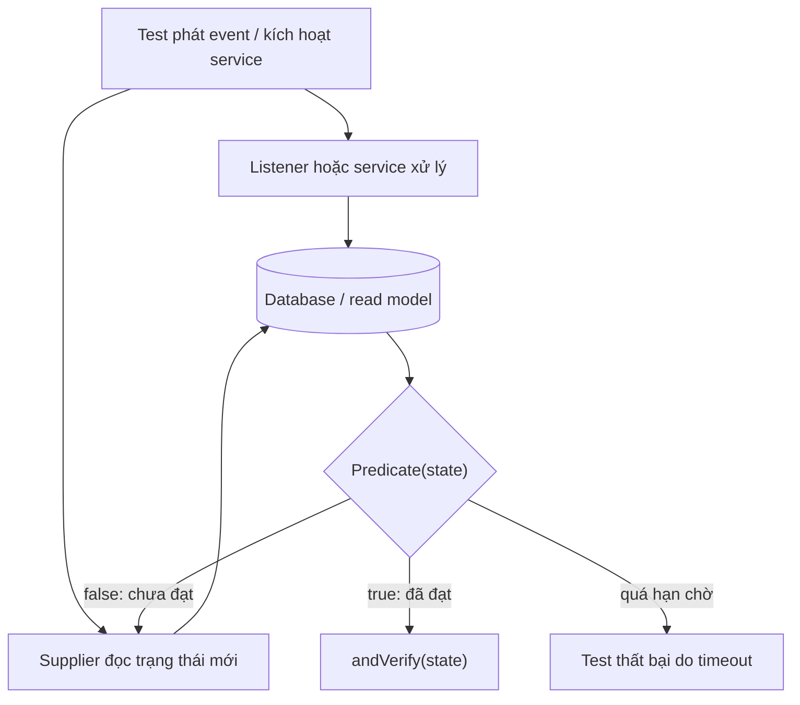

# Predicate xác định trạng thái mong đợi trong Spring Modulith

## 1. Vì sao phải xác định đúng trạng thái mong đợi?

Trong Spring Modulith, một module có thể phát sự kiện để module khác tiếp tục công việc. Ví dụ, `payments` công bố `PaymentCaptured` còn `orders` nhận sự kiện và đổi trạng thái đơn hàng từ `AWAITING_PAYMENT` sang `PAID`. Nếu listener xử lý bất đồng bộ hoặc sau khi transaction được commit, trạng thái chưa chắc đã thay đổi ngay khi lệnh phát sự kiện trả về.

`Scenario` trong `org.springframework.modulith.test` hỗ trợ kiểm thử luồng này. Sau khi kích hoạt hành vi, `andWaitForStateChange(...)` đọc lại một trạng thái có thể quan sát và **chờ đến khi điều kiện mong đợi trở thành đúng**. Điều kiện đó được biểu diễn bằng `Predicate` của Java.

Một bài test tốt phải trả lời chính xác: **Thay đổi nào chứng minh nghiệp vụ đã hoàn tất?** Đơn hàng đã tồn tại? Đã nhận event? Đã có trạng thái bất kỳ? Hay đã trở thành `PAID` với đầy đủ dữ liệu thanh toán? Những điều kiện này không tương đương.

Đây là chủ đề *State change* thuộc học phần `SPRING_MODULITH_VERIFICATION_TESTING`: rèn luyện kiểm thử `@ApplicationModuleTest`, sự kiện, cơ sở dữ liệu và tích hợp, kết hợp kiểm chứng ranh giới module bằng `ApplicationModules` để ngăn hồi quy trong CI.

**Mục tiêu:** sau bài này, bạn có thể thiết kế `Predicate` đúng về mặt nghiệp vụ; phân biệt điều kiện chờ với assertion; xử lý `Optional`, `null`, enum, số đếm và trạng thái tổng hợp; nhận diện điều kiện quá rộng/quá hẹp; và viết test ổn định khi event hoặc database xử lý bất đồng bộ.

## 2. Vị trí của `Predicate` trong một scenario

Luồng tổng quát:

```java
scenario.publish(new DomainEvent(...))
        .andWaitForStateChange(
                () -> stateReader.read(...),
                state -> /* trạng thái mong đợi đã đạt? */)
        .andVerify(state -> /* assertion trên kết quả đạt điều kiện */);
```

Trong đó:

| Phần | Ý nghĩa | Quy tắc thiết kế |
| --- | --- | --- |
| `publish(...)` hoặc `stimulate(...)` | Kích hoạt hành vi cần kiểm thử. | Sử dụng đường giao tiếp thực của module khi có thể. |
| `Supplier<S>` | Tải trạng thái đang quan sát ở mỗi lượt chờ. | Chỉ đọc, có thể gọi lại; không giữ entity cũ hoặc gây side effect. |
| `Predicate<? super S>` | Trả `true` khi trạng thái đã đạt tiêu chí kết thúc. | Mô tả chính xác đích nghiệp vụ, không chỉ kiểm tra object tồn tại. |
| `andVerify(...)` | Xác minh giá trị đã được chấp nhận. | Tạo assertion rõ ràng; không thay thế điều kiện chờ. |



`Predicate<S>` là một functional interface của Java:

```java
import java.util.function.Predicate;

Predicate<OrderStatus> paid = status -> status == OrderStatus.PAID;

boolean reached = paid.test(OrderStatus.PAID); // true
```

Với `Scenario`, việc trả `false` có nghĩa là **chưa hoàn tất, tiếp tục chờ khi còn thời gian**; `true` có nghĩa là **đủ điều kiện để chuyển sang bước xác minh**. Một exception bên trong predicate không phải tín hiệu “chưa đạt” an toàn: nó có thể khiến kịch bản thất bại. Hãy viết predicate chịu được các trạng thái trung gian hợp lệ như `null` hoặc `Optional.empty()`.

## 3. Điều kiện *có dữ liệu* khác với điều kiện *đúng dữ liệu*

Giả sử truy vấn `OrderQueries.statusOf(id)` trả về `Optional<OrderStatus>`. Ngay trước khi thanh toán, truy vấn đã có `Optional.of(AWAITING_PAYMENT)`. Điều kiện “có giá trị” sẽ thành công tức thì dù đơn hàng vẫn chưa được thanh toán.

So sánh:

```java
// Sai mục tiêu: chỉ xác nhận đơn hàng đã có trong kho dữ liệu.
state -> state.isPresent()

// Đúng mục tiêu: đơn hàng đã chuyển sang trạng thái PAID.
state -> state.filter(s -> s == OrderStatus.PAID).isPresent()
```

Overload chỉ nhận `Supplier` của `andWaitForStateChange` dùng một tiêu chí mặc định; không nên dựa vào tiêu chí đó nếu cần kiểm tra **giá trị bên trong**. Các tình huống dưới đây cho thấy vì sao predicate riêng an toàn hơn:

| Trạng thái được đọc | Có thể bị hiểu là đã có kết quả? | Predicate phản ánh yêu cầu nghiệp vụ |
| --- | --- | --- |
| `Optional.of(AWAITING_PAYMENT)` | `Optional` đã có phần tử. | `v -> v.filter(s -> s == PAID).isPresent()` |
| `Order` không `null` nhưng `status = NEW` | Aggregate đã tồn tại. | `o -> o != null && o.getStatus() == PAID` |
| Số đếm `0` | Giá trị `Integer`/`Long` không `null`. | `n -> n >= expectedCount` nếu được phép nhiều hơn ngưỡng. |
| DTO có `success = false` | DTO đã được trả về. | `result -> result != null && result.success()` |
| `Optional.empty()` | Không có bản ghi. | Kiểm tra `Optional` và nội dung khi bản ghi xuất hiện. |

**Nguyên tắc:** hãy định nghĩa điều kiện hoàn tất bằng **biến đổi nghiệp vụ có thể quan sát**, thay vì đặc điểm kỹ thuật của giá trị trả về (`non-null`, `isPresent`, collection không rỗng).

## 4. Ví dụ đầy đủ: chờ đơn hàng chuyển sang `PAID`

Ví dụ giả định hệ thống có `OrderStatus`, sự kiện `PaymentCaptured`, cổng truy vấn `OrderQueries` và fixture `OrderFixture`. Đây là các class nghiệp vụ do ứng dụng cung cấp, không phải API dựng sẵn của Spring Modulith. `OrderFixture.createAwaitingPaymentAndCommit()` tạo đơn hàng và **commit** trạng thái ban đầu trước khi sự kiện được phát.

```java
import java.util.Optional;
import java.util.UUID;

public enum OrderStatus {
    AWAITING_PAYMENT, PAID, PAYMENT_FAILED
}

public record PaymentCaptured(UUID orderId, String transactionId) {}

public interface OrderQueries {
    Optional<OrderStatus> statusOf(UUID orderId);
}
```

Các khai báo `public` ở ví dụ được đặt trong **các file Java riêng** khi đưa vào dự án. Listener và fixture là thành phần do ứng dụng triển khai.

Bài test tích hợp của module `orders`:

```java
import static org.assertj.core.api.Assertions.assertThat;

import java.util.UUID;

import org.junit.jupiter.api.Test;
import org.springframework.beans.factory.annotation.Autowired;
import org.springframework.modulith.test.ApplicationModuleTest;
import org.springframework.modulith.test.Scenario;

@ApplicationModuleTest
class OrderStatePredicateTests {

    @Autowired OrderQueries orderQueries;
    @Autowired OrderFixture fixture;

    @Test
    void capturedPaymentMakesOrderPaid(Scenario scenario) {
        UUID id = fixture.createAwaitingPaymentAndCommit();

        // Fixture xác nhận điểm xuất phát của bài test.
        assertThat(orderQueries.statusOf(id))
                .contains(OrderStatus.AWAITING_PAYMENT);

        scenario.publish(new PaymentCaptured(id, "TX-204"))
                .andWaitForStateChange(
                        () -> orderQueries.statusOf(id),
                        current -> current
                                .filter(status -> status == OrderStatus.PAID)
                                .isPresent())
                .andVerify(current ->
                        assertThat(current).contains(OrderStatus.PAID));
    }
}
```

Trình tự khi chạy:

1. `OrderFixture` tạo đơn hàng `AWAITING_PAYMENT`; assertion đầu tiên xác minh dữ liệu đầu vào.
2. `Scenario.publish(...)` gửi sự kiện làm *stimulus*; listener xử lý và cập nhật trạng thái nếu được bootstrap trong test context.
3. `Supplier` đọc `orderQueries.statusOf(id)` khi cần. `Optional.of(AWAITING_PAYMENT)` khiến predicate trả `false`; lúc chưa có record, `Optional.empty()` cũng trả `false`.
4. Khi đọc thấy `Optional.of(PAID)`, predicate trả `true`. Kịch bản chuyển sang `andVerify(...)` với kết quả đã được chấp nhận.
5. Nếu trạng thái đích không xuất hiện trong thời gian chờ, test thất bại vì timeout; test không tự coi `PAYMENT_FAILED` là thành công.

> Chú ý phạm vi: một `@ApplicationModuleTest` không mặc nhiên bootstrap mọi module trong toàn ứng dụng. Nếu listener xử lý sự kiện nằm ở module khác, cần cấu hình dependencies/bootstrap mode phù hợp hoặc đặt kịch bản tại cấp kiểm thử tích hợp rộng hơn. Một predicate đúng không thể bù cho một listener vắng mặt trong test context.

### 4.1. Vì sao không đặt assertion vào predicate?

Tránh cách làm:

```java
// Không phù hợp: assertion có thể ném lỗi ngay ở lượt đọc đầu.
current -> {
    assertThat(current).contains(OrderStatus.PAID);
    return true;
}
```

Khi state vẫn là `AWAITING_PAYMENT`, assertion ném exception trước khi scenario được quyền chờ thêm. Điều kiện chờ nên là **một boolean rõ ràng**, còn `andVerify(...)` dành cho assertion báo kết quả cuối.

## 5. Thiết kế predicate theo từng loại state

### 5.1. `Optional<T>`: vừa có giá trị, vừa đúng giá trị

Một `Optional` có thể rỗng khi entity chưa xuất hiện hoặc có giá trị trung gian. Viết predicate theo cấu trúc `filter(...).isPresent()` giúp xử lý cả hai tình huống:

```java
// Optional<OrderStatus>
state -> state.filter(s -> s == OrderStatus.PAID).isPresent()

// Optional<OrderSummary>; giả định OrderSummary có paid() và receiptId().
summary -> summary.filter(s -> s.paid() && s.receiptId() != null)
                  .isPresent()
```

Điều kiện trên giả định chính `Supplier` không trả `null` thay cho `Optional`. Nếu API có thể trả `null`, hãy sửa hợp đồng nguồn đọc để trả `Optional.empty()`, hoặc phòng vệ tường minh trước khi dùng `filter`.

### 5.2. Enum và trạng thái kết thúc

Với enum, so sánh bằng `==` vừa trực tiếp vừa an toàn khi biến có thể `null`:

```java
// Supplier trả OrderStatus hoặc null.
status -> status == OrderStatus.PAID
```

Nếu muốn test dừng sớm khi nghiệp vụ đạt **một trong các trạng thái kết thúc** (`PAID` hoặc `PAYMENT_FAILED`) và sau đó phân biệt kết quả thành công/thất bại:

```java
scenario.publish(new PaymentCaptured(id, "TX-205"))
        .andWaitForStateChange(
                () -> orderQueries.statusOf(id),
                state -> state.filter(s -> s == OrderStatus.PAID
                                        || s == OrderStatus.PAYMENT_FAILED)
                              .isPresent())
        .andVerify(state ->
                assertThat(state).contains(OrderStatus.PAID));
```

Với cách này, `PAYMENT_FAILED` làm điều kiện **dừng chờ** thành công nhưng assertion sau đó **thất bại ngay** vì kỳ vọng là `PAID`. Đây là kỹ thuật hữu ích khi trạng thái thất bại là terminal state và không thể chuyển tiếp sang thành công trong kịch bản. Nếu nghiệp vụ cho phép phục hồi từ trạng thái lỗi, phải thiết kế điều kiện phù hợp với luồng thực thay vì tự coi lỗi là cuối cùng.

### 5.3. Số đếm, ngưỡng và điều kiện chính xác

Với tiến trình import 100 bản ghi:

```java
scenario.publish(new ImportRequested(batchId))
        .andWaitForStateChange(
                () -> importQueries.completedCount(batchId),
                count -> count >= 100)
        .andVerify(count -> assertThat(count).isGreaterThanOrEqualTo(100));
```

`>= 100` phù hợp nếu nghiệp vụ chỉ yêu cầu đạt tối thiểu 100 đơn vị công việc. Nếu số phần tử **bắt buộc bằng chính xác** 100, hãy dùng `count -> count == 100`, kết hợp kiểm tra invariant riêng để phát hiện ghi thừa. Đừng dùng `count > 0` khi yêu cầu là *toàn bộ batch hoàn tất*: điều kiện đó chỉ chứng minh một phần công việc đã xong.

### 5.4. Aggregate hoặc DTO với nhiều điều kiện `AND`

Trạng thái `PAID` có thể chưa đủ nếu không có mã giao dịch và thời điểm thanh toán. Tốt nhất dùng một snapshot đọc nhất quán qua public query API:

```java
import java.time.Instant;

public record PaymentView(
        OrderStatus status, String transactionId, Instant paidAt) {

    public boolean isComplete() {
        return status == OrderStatus.PAID
                && transactionId != null
                && !transactionId.isBlank()
                && paidAt != null;
    }
}
```

```java
scenario.publish(new PaymentCaptured(id, "TX-206"))
        .andWaitForStateChange(
                () -> orderQueries.paymentViewOf(id), // Optional<PaymentView>
                result -> result.filter(PaymentView::isComplete).isPresent())
        .andVerify(result -> {
            PaymentView payment = result.orElseThrow();
            assertThat(payment.transactionId()).isEqualTo("TX-206");
            assertThat(payment.paidAt()).isNotNull();
        });
```

Ở đây ví dụ giả định `OrderQueries` còn khai báo `Optional<PaymentView> paymentViewOf(UUID id)`. Cách đọc snapshot cho phép kiểm tra nhiều thuộc tính **của cùng một kết quả**, tránh ghép một trạng thái mới với một trường cũ từ hai query không đồng bộ. Khi API trả về aggregate JPA, mỗi lượt poll cũng cần tải trạng thái hiện tại thay vì giữ tham chiếu entity trước sự kiện.

### 5.5. Điều kiện `OR`, collection và tính tương quan

`OR` phù hợp khi nhiều trạng thái là kết quả có thể chấp nhận, ví dụ `SHIPPED` **hoặc** `PICKED_UP`. Với collection, phải xác định `anyMatch` hay `allMatch` tùy nghiệp vụ:

```java
// Chỉ cần một item đã được giao.
items -> items != null && items.stream().anyMatch(ItemStatus::delivered)

// Tất cả item phải được giao, và batch không được rỗng.
items -> items != null && !items.isEmpty()
        && items.stream().allMatch(ItemStatus::delivered)
```

Không bỏ điều kiện `!items.isEmpty()` nếu danh sách rỗng không được coi là hoàn tất: `Stream.allMatch(...)` trả `true` cho stream rỗng theo logic toán học.

Quan trọng hơn, `Predicate` phải kiểm tra **đúng thực thể của kịch bản**. Nếu đợi tổng số đơn hàng có trạng thái `PAID` trên toàn hệ thống tăng lên, một test khác có thể khiến điều kiện đúng. Query nên lọc bằng `orderId`, `batchId` hoặc correlation ID riêng cho mỗi lần chạy.

## 6. Những tính chất của một predicate đáng tin cậy

| Tính chất | Ý nghĩa | Ví dụ |
| --- | --- | --- |
| **Đúng mục tiêu** | `true` phản ánh yêu cầu nghiệp vụ, không phản ánh sự hiện diện kỹ thuật. | `status == PAID`, không phải `order != null`. |
| **An toàn khi chưa có dữ liệu** | `null`, `Optional.empty()`, bản ghi trung gian đều cho `false` khi thích hợp. | `result != null && result.isComplete()`. |
| **Thuần túy** | Không ghi DB, phát event, gọi nghiệp vụ có side effect hay sửa biến của test. | `snapshot -> snapshot.done()`. |
| **Có thể đánh giá nhiều lần** | Cùng một state cho cùng kết quả; không phụ thuộc thời điểm, số lần poll hay random. | So sánh dữ liệu, không tăng bộ đếm trong lambda. |
| **Rõ phạm vi** | Gắn với ID và context của hành vi đã kích hoạt. | `statusOf(orderId)` thay vì `findLatestPaidOrder()`. |
| **Không vượt ranh giới module** | Kiểm chứng qua API được module sở hữu cho phép dùng. | `OrderQueries`, không import repository nội bộ của module khác. |

### 6.1. Tránh side effect trong `Supplier` và `Predicate`

```java
// Không tốt: mỗi lượt poll lại tự cập nhật nghiệp vụ.
() -> {
    orderService.markPaid(id);
    return orderQueries.statusOf(id);
}

// Không tốt: predicate sửa dữ liệu mà chính nó kiểm tra.
state -> {
    auditRepository.markVerified(id);
    return state.filter(s -> s == OrderStatus.PAID).isPresent();
}

// Tốt: Supplier chỉ đọc; Predicate chỉ đánh giá.
scenario.publish(new PaymentCaptured(id, "TX-209"))
        .andWaitForStateChange(
                () -> orderQueries.statusOf(id),
                state -> state.filter(s -> s == OrderStatus.PAID).isPresent())
        .andVerify(state -> assertThat(state).contains(OrderStatus.PAID));
```

Ở ví dụ cuối, hai biểu thức lambda chỉ làm nhiệm vụ đọc và đánh giá, nên có thể chạy lặp lại trong quá trình chờ. Tác động phụ có thể làm thay đổi trình tự event, che lỗi production và khiến bài test khó lặp lại.

### 6.2. Không giữ entity cũ trong lambda

```java
// Có nguy cơ sai: `existing` có thể là JPA entity đã tải trước event.
Order existing = orderRepository.findById(id).orElseThrow();

scenario.publish(new PaymentCaptured(id, "TX-207"))
        .andWaitForStateChange(existing::isPaid, paid -> paid);
```

Hãy tải lại state mỗi khi `Supplier` được gọi:

```java
scenario.publish(new PaymentCaptured(id, "TX-207"))
        .andWaitForStateChange(
                () -> orderRepository.findById(id),
                order -> order.filter(Order::isPaid).isPresent())
        .andVerify(order -> assertThat(order).isPresent());
```

Đây là ví dụ dùng repository **bên trong module sở hữu aggregate**. Nếu test ở module khác, nên dùng public query service thay vì phụ thuộc trực tiếp vào repository nội bộ. Ngay cả khi gọi lại `findById`, persistence context của JPA có thể trả entity được cache trong transaction test kéo dài; khi đó cần thiết kế cách đọc lại dữ liệu đã commit bằng projection hoặc transaction/persistence context phù hợp.

## 7. `Predicate`, `andVerify` và vấn đề đúng ở một thời điểm

Ba câu hỏi cần phân biệt:

1. **Khi nào ngừng chờ?** Do `Predicate` quyết định.
2. **Khi ngừng chờ, có đạt kỳ vọng của test không?** Do assertion trong `andVerify` quyết định.
3. **Trạng thái có giữ đúng về sau không?** Một lần predicate trả `true` **chưa chứng minh** trạng thái đó bền vững.

Ví dụ một lỗi làm đơn hàng chuyển thoáng qua `PAID` rồi quay về `AWAITING_PAYMENT`: bài test chỉ đợi `status == PAID` có thể pass ngay khi thấy giá trị trung gian. Nếu yêu cầu là trạng thái cuối cùng ổn định, hãy xác định một dấu hiệu hoàn tất bền vững (ví dụ có transaction reference đã commit, outbox confirmation hoặc trạng thái terminal), đồng thời kiểm tra thêm quy tắc bất biến ở bài test phù hợp. Đừng mặc định `andWaitForStateChange` xác nhận trạng thái ổn định trong một khoảng thời gian.

Với hệ thống bất đồng bộ, trạng thái phải được đọc qua một nguồn **có thể thấy commit**. Một entity đang được quản lý trong persistence context cũ, transaction isolation giữ snapshot, cache, hoặc read replica trễ có thể khiến predicate mãi nhận `false`. Timeout là dấu hiệu cần điều tra nguồn quan sát và listener; việc tăng thời gian chờ không sửa được lỗi ngữ nghĩa.

## 8. Cấu hình timeout và xử lý trạng thái lỗi

Predicate chính xác cần kết hợp thời gian chờ hữu hạn. Có thể định cấu hình giới hạn trước khi chọn điều kiện thay đổi trạng thái:

```java
import java.time.Duration;

scenario.publish(new PaymentCaptured(id, "TX-208"))
        .andWaitAtMost(Duration.ofSeconds(5))
        .forStateChange(
                () -> orderQueries.statusOf(id),
                state -> state.filter(s -> s == OrderStatus.PAID).isPresent())
        .andVerify(state -> assertThat(state).contains(OrderStatus.PAID));
```

`5` giây chỉ là giá trị minh họa, cần chọn theo môi trường thực tế và SLA của bài test. Kịch bản trả `false` liên tục đến hết giới hạn sẽ timeout. Nếu predicate ném exception do lỗi lập trình (`NullPointerException`, lazy load ngoài transaction...), hãy sửa lỗi đó; không che bằng `Thread.sleep(...)`.

Một vài trường hợp lỗi cần chiến lược khác nhau:

| Trạng thái quan sát | Thiết kế phù hợp | Lý do |
| --- | --- | --- |
| `PENDING` hợp lệ rồi chuyển `PAID`. | Chờ `status == PAID`. | `PENDING` là trạng thái trung gian. |
| Có terminal state `FAILED` bên cạnh `PAID`. | Chờ một trong hai terminal state, assertion chỉ chấp nhận `PAID`. | Báo thất bại sớm thay vì chờ vô ích đến timeout. |
| Có thể retry từ `FAILED` sang `PAID`. | Chờ theo trạng thái hoàn tất cuối của quy trình retry. | Không dừng quá sớm ở lỗi tạm thời. |
| Kết quả là bộ đếm tăng. | Chọn `>= target` hoặc `== target` theo invariant. | Điều kiện khác nhau dẫn tới ý nghĩa test khác nhau. |
| Hệ thống đọc qua cache/read model. | Chờ trên đúng API của consumer hoặc nguồn commit theo mục đích test. | Tránh false negative do đọc sai lớp dữ liệu. |

## 9. Chẩn đoán predicate quá rộng, quá hẹp và không ổn định

| Hiện tượng | Khả năng xảy ra | Cách khắc phục |
| --- | --- | --- |
| Scenario thoát khỏi chờ ngay nhưng `andVerify` thất bại. | Predicate quá rộng (`isPresent`, non-null, `count > 0`). | Kiểm tra chính xác enum/field/threshold mong đợi. |
| Timeout dù event listener đã ghi dữ liệu. | Supplier đọc entity cũ, sai ID, cache hoặc transaction không thấy commit. | Đối chiếu DB và kết quả supplier; sửa cách đọc trạng thái. |
| Timeout khi state đã là `PAYMENT_FAILED`. | Predicate chỉ cho phép `PAID` mà lỗi là terminal. | Cân nhắc chờ mọi terminal state rồi assert kết quả mong đợi. |
| Test pass dù chỉ xử lý một phần. | `anyMatch` hoặc `count > 0` được dùng thay yêu cầu toàn bộ. | Dùng `allMatch` có kiểm tra collection không rỗng hoặc so sánh số đếm đúng. |
| CI pass/fail không ổn định. | Dữ liệu giữa test trùng nhau, timing, read model trễ. | ID riêng, fixture commit rõ ràng, timeout phù hợp và cô lập test. |
| Predicate lỗi `NullPointerException`. | Giá trị chưa có hoặc DTO chứa field null. | Xử lý trạng thái chưa sẵn sàng bằng điều kiện an toàn. |

Khi debug một bài test timeout, thu thập ba thông tin: `orderId` hoặc correlation ID của kịch bản, trạng thái cuối cùng supplier trả về và log xử lý/commit của listener. Nếu trạng thái trong DB khác kết quả supplier, vấn đề thường nằm ở lớp truy vấn/transaction. Nếu cả hai đều không đổi, kiểm tra event, handler và các điều kiện nghiệp vụ.

## 10. Kết hợp quality gate và kiểm chứng kiến trúc

Trong Spring Modulith, tính đúng đắn của test state change không đủ để bảo đảm ranh giới kiến trúc. Một predicate có thể hoàn toàn đúng nhưng test vẫn phụ thuộc vào repository `internal` của module khác. Vì vậy, quy trình kiểm chứng nên có cả:

- **Kiểm chứng cấu trúc:** `ApplicationModules.of(MySpringBootApplication.class).verify()` để phát hiện phụ thuộc module trái quy tắc. Khi dự án dùng `@ApplicationModule(allowedDependencies = ...)` hoặc `@NamedInterface`, các khai báo đó giúp định nghĩa API phụ thuộc được phép.
- **Kiểm chứng hành vi:** `@ApplicationModuleTest` với `Scenario`, `Predicate` và assertion trên state có thể quan sát sau event.
- **Kiểm chứng tích hợp:** cấu hình database, transaction, listener và read model phù hợp để state supplier đọc được kết quả thật.

```java
import org.junit.jupiter.api.Test;
import org.springframework.modulith.core.ApplicationModules;

class ModuleArchitectureTest {

    @Test
    void dependenciesFollowModuleBoundaries() {
        ApplicationModules.of(MySpringBootApplication.class).verify();
    }
}
```

`MySpringBootApplication` là tên minh họa; thay bằng class cấu hình ứng dụng thật. Đưa test kiến trúc và các test trạng thái vào task kiểm thử được CI chạy ở pull request. Với dự án Gradle, lệnh thường là `./gradlew test` nếu test đã được cấu hình trong task; không mặc định mọi test tích hợp đều nằm trong task này khi dự án dùng test suite riêng.

## 11. Bài thực hành

**Bài A — tránh điều kiện `isPresent`:** Tạo đơn hàng `AWAITING_PAYMENT` rồi phát `PaymentCaptured`. Viết hai predicate: `(1) current -> current.isPresent()` và `(2) current -> current.filter(s -> s == PAID).isPresent()`. Quan sát vì sao điều kiện thứ nhất có thể dừng ngay. Sau đó chạy lại với điều kiện thứ hai.

**Bài B — trạng thái thành công và thất bại:** Giả lập luồng có `PAID`, `PAYMENT_FAILED` là trạng thái cuối. Thiết kế predicate dừng khi gặp một trong hai, nhưng assertion chỉ chấp nhận `PAID`. Giải thích việc báo lỗi sớm cải thiện chẩn đoán thế nào.

**Bài C — nhiều bất biến:** Cho `PaymentView` chứa `status`, `transactionId` và `paidAt`. Tạo fixture lỗi chỉ đổi `status = PAID` mà thiếu `paidAt`; viết predicate sao cho **không** coi là hoàn tất. Chọn query/projection hoặc aggregate để đọc các thuộc tính trong cùng một snapshot.

**Bài D — quy tắc toàn bộ:** Một batch cần hoàn tất chính xác `N` item. So sánh `anyMatch`, `allMatch` và `completedCount == N`; thử collection rỗng để quan sát kết quả bất ngờ của `allMatch` nếu thiếu điều kiện không rỗng.

**Tiêu chí đạt:** predicate diễn tả trạng thái cuối đúng nghiệp vụ, chịu được trạng thái trung gian, không side effect, dùng đúng ID, đọc dữ liệu đã commit; assertion rõ ràng và CI phát hiện được hồi quy hành vi lẫn vi phạm ranh giới module.

## 12. Ghi nhớ và tài liệu tham khảo

Trong `Scenario.andWaitForStateChange(...)`, **predicate là định nghĩa chính thức của điều kiện “đã đạt trạng thái mong đợi”**. Viết điều kiện quá rộng làm test qua sớm; quá hẹp làm timeout dù nghiệp vụ đã kết thúc; phụ thuộc vào state cũ làm test chập chờn. Hãy bắt đầu từ hợp đồng nghiệp vụ, thiết kế nguồn đọc quan sát được, rồi chuyển yêu cầu thành một boolean thuần túy và có thể kiểm thử.

Tài liệu tham khảo:

- [Spring Modulith Reference – Integration Testing Application Modules](https://docs.spring.io/spring-modulith/reference/testing.html): sử dụng `@ApplicationModuleTest`, `Scenario` và chờ state change.
- [Spring Modulith Javadoc – `Scenario.When`](https://docs.spring.io/spring-modulith/docs/current/api/org/springframework/modulith/test/Scenario.When.html): các overload `andWaitForStateChange(...)`, `forStateChange(...)` và cấu hình chờ.
- [Spring Modulith Reference – Verifying Application Module Structure](https://docs.spring.io/spring-modulith/reference/verification.html): kiểm chứng quan hệ phụ thuộc giữa module.
- [Java SE – `Predicate<T>`](https://docs.oracle.com/en/java/javase/21/docs/api/java.base/java/util/function/Predicate.html): hợp đồng functional interface và các phép kết hợp `and`, `or`, `negate`.
