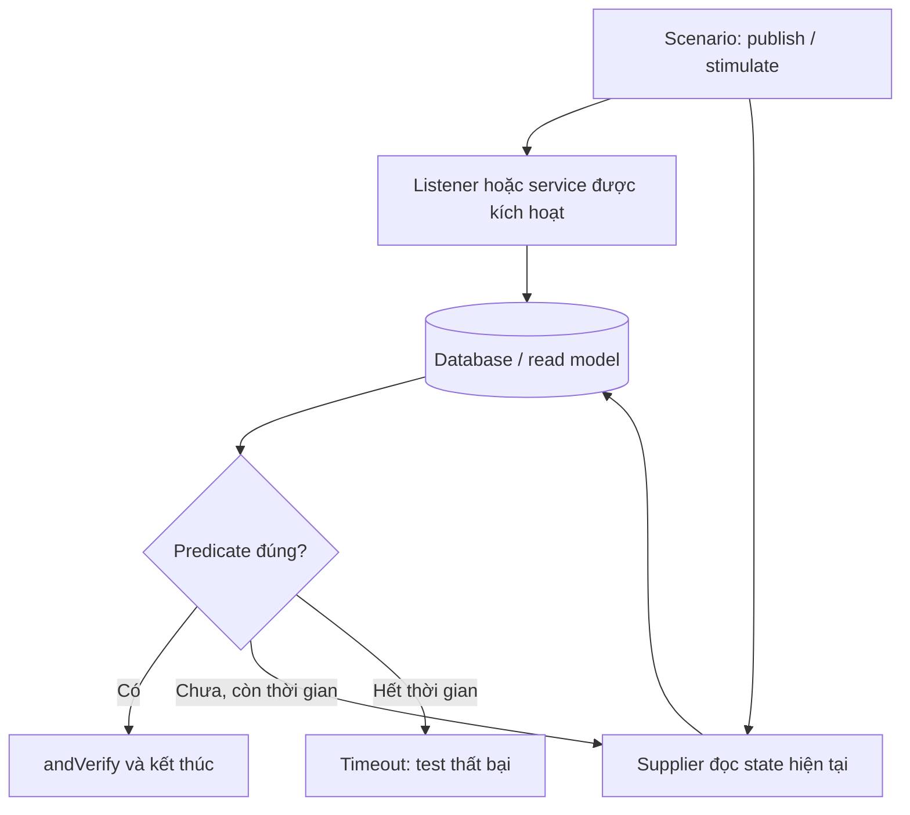

# Timeout khi state không thay đổi trong kiểm thử Spring Modulith

## 1. Bối cảnh và mục tiêu

Trong ứng dụng Spring Modulith, một module có thể yêu cầu công việc tại module khác bằng application event. Ví dụ, module thanh toán phát `PaymentCaptured`, module đơn hàng tiếp nhận sự kiện và đổi trạng thái từ `AWAITING_PAYMENT` sang `PAID`. Khi listener chạy bất đồng bộ hoặc gắn với transaction, trạng thái tại thời điểm phát sự kiện chưa nhất thiết là trạng thái cuối cùng.

`Scenario` của Spring Modulith hỗ trợ kiểm thử hành vi này qua `andWaitForStateChange(...)`: đọc trạng thái lặp lại và dừng khi một điều kiện nghiệp vụ đúng. **Timeout** xảy ra khi điều kiện đó không được thỏa mãn trong giới hạn chờ. Đây là tín hiệu kiểm thử chưa quan sát được kết quả mong đợi, chứ tự nó **không xác định** nguyên nhân là listener hỏng, database chậm, hay cách đọc state sai.

Bài học thuộc chương *State change* của `SPRING_MODULITH_VERIFICATION_TESTING`, nhằm rèn luyện kiểm chứng qua `@ApplicationModuleTest`, event, cơ sở dữ liệu và tích hợp; đồng thời kết hợp xác minh ranh giới module bằng `ApplicationModules` và quality gate trong CI.

Sau bài học, bạn có thể:

- Giải thích vì sao state không thay đổi trong giới hạn chờ và cách timeout được quyết định.
- Chọn điều kiện mong đợi rõ ràng, nguồn đọc state đáng tin cậy và thời gian chờ hữu hạn.
- Phân biệt lỗi phát sự kiện, listener, transaction, dữ liệu và predicate qua bằng chứng.
- Thiết kế bài kiểm thử tránh chờ cố định, tránh false positive và giảm flaky test trên CI.
- Xử lý trường hợp trạng thái thất bại kết thúc sớm thay vì chỉ chờ đến timeout.

## 2. Timeout của state change thực sự có nghĩa gì?

Một kịch bản có ba thành phần liên tiếp: **kích hoạt hành vi**, **đọc trạng thái đang có**, rồi **đánh giá điều kiện đạt**.

```java
scenario.publish(new PaymentCaptured(orderId, "TX-001"))
        .andWaitForStateChange(
                () -> orderQueries.statusOf(orderId),
                state -> state.filter(s -> s == OrderStatus.PAID).isPresent())
        .andVerify(state -> assertThat(state).contains(OrderStatus.PAID));
```

Ở ví dụ này:

1. `publish(...)` tạo stimulus là một sự kiện nghiệp vụ.
2. `Supplier` đọc giá trị `Optional<OrderStatus>` thông qua API truy vấn.
3. `Predicate` chỉ trả `true` khi giá trị trong `Optional` là `PAID`.
4. Nếu predicate chưa đúng và vẫn còn thời gian, cơ chế chờ tiếp tục quan sát.
5. Nếu predicate đúng, `andVerify(...)` chạy với giá trị đã đạt. Nếu hết hạn trước đó, kịch bản thất bại vì timeout.

Sơ đồ mô tả hai đường kết thúc:



Không phải mọi lần đọc đều nhất thiết giống nhau: state có thể chuyển từ `AWAITING_PAYMENT` sang `PROCESSING` rồi `PAID`. Predicate chỉ cần nhận ra đích phù hợp. Nếu state mãi giữ `AWAITING_PAYMENT`, hoặc chỉ đổi sang một trạng thái không được chấp nhận, phép chờ hết hạn.

**Một timeout có ít nhất ba khả năng khác nhau:** hệ thống không tạo ra state mới; state đã được tạo nhưng supplier không nhìn thấy; hoặc state đã xuất hiện nhưng predicate không công nhận. Vì vậy, tăng timeout không phải bước xử lý mặc định.

### 2.1. Phân biệt ba loại timeout

| Timeout | Phạm vi | Ý nghĩa khi xảy ra |
| --- | --- | --- |
| **State-change timeout** của `Scenario` | Chờ predicate trên state. | Không quan sát được điều kiện đích trong thời gian đã định. |
| **Test-method timeout** của JUnit hoặc framework test | Giới hạn tổng thời gian chạy phương thức. | Toàn bộ test vượt ngân sách, có thể do setup, DB, deadlock hoặc chờ state. |
| **Job timeout** của CI | Giới hạn toàn bộ job/pipeline. | Job bị dừng, chưa chắc đã nhận được báo cáo assertion cụ thể. |

Nên chọn ngân sách sao cho timeout của state change xảy ra **trước** giới hạn tổng của test và job CI. Điều này giúp thông báo lỗi phản ánh đúng điều kiện bị vi phạm, thay vì chỉ thấy job bị hủy. Không áp dụng một cấu hình thời gian giống nhau cho tất cả các tầng.

## 3. Sai lầm phổ biến: assert quá sớm hoặc ngủ cố định

Khi listener chạy bất đồng bộ, kiểm tra ngay sau lệnh publish tạo race condition:

```java
eventPublisher.publishEvent(new PaymentCaptured(orderId, "TX-002"));

// Có thể đọc trước khi listener kịp cập nhật và commit.
assertThat(orderQueries.statusOf(orderId))
        .contains(OrderStatus.PAID);
```

Bài test này có thể pass khi listener nhanh nhưng fail khi máy CI bận. Một cách sửa có vẻ tiện là:

```java
eventPublisher.publishEvent(new PaymentCaptured(orderId, "TX-003"));
Thread.sleep(2000);
assertThat(orderQueries.statusOf(orderId))
        .contains(OrderStatus.PAID);
```

Tuy nhiên, ngủ cố định 2 giây không giúp phân biệt việc listener hoàn thành trong 50 ms với việc đã lỗi hẳn. Nếu công việc mất hơn 2 giây, test vẫn fail; nếu đã hoàn thành từ sớm, test lãng phí thời gian.

Đối với hành vi bất đồng bộ, chờ có điều kiện cho phép hoàn tất ngay khi state đạt đích; đồng thời đặt một giới hạn để không chờ vô hạn. **Timeout là ranh giới phát hiện lỗi**, còn predicate là điều kiện thành công. Cả hai đều phải được thiết kế có chủ đích.

## 4. Ví dụ tích hợp: chờ `PAID` với timeout rõ ràng

Giả sử hệ thống có enum `OrderStatus`, sự kiện `PaymentCaptured` và API công khai `OrderQueries`. Các kiểu này thuộc ứng dụng minh họa, **không phải** thành phần Spring Modulith tự sinh. Khai báo `public` cần được đặt trong các file Java riêng trong dự án thực:

```java
import java.util.Optional;
import java.util.UUID;

public enum OrderStatus {
    AWAITING_PAYMENT, PROCESSING, PAID, PAYMENT_FAILED
}

// File Java khác:
public record PaymentCaptured(UUID orderId, String transactionId) {}

// File Java khác:
public interface OrderQueries {
    Optional<OrderStatus> statusOf(UUID id);
}
```

Bài test dùng `Scenario`:

```java
import static org.assertj.core.api.Assertions.assertThat;

import java.time.Duration;
import java.util.UUID;

import org.junit.jupiter.api.Test;
import org.springframework.beans.factory.annotation.Autowired;
import org.springframework.modulith.test.ApplicationModuleTest;
import org.springframework.modulith.test.Scenario;

@ApplicationModuleTest
class OrderStateTimeoutTests {

    @Autowired OrderQueries orderQueries;
    @Autowired OrderFixture fixture;

    @Test
    void paymentEventuallyMarksOrderPaid(Scenario scenario) {
        // Fixture do ứng dụng cung cấp; tạo dữ liệu rồi commit.
        UUID orderId = fixture.awaitingPaymentAndCommit();

        assertThat(orderQueries.statusOf(orderId))
                .contains(OrderStatus.AWAITING_PAYMENT);

        scenario.publish(new PaymentCaptured(orderId, "TX-004"))
                .andWaitAtMost(Duration.ofSeconds(5))
                .forStateChange(
                        () -> orderQueries.statusOf(orderId),
                        current -> current.filter(
                                status -> status == OrderStatus.PAID).isPresent())
                .andVerify(current ->
                        assertThat(current).contains(OrderStatus.PAID));
    }
}
```

`OrderFixture`, `awaitingPaymentAndCommit()`, `PaymentCaptured` và `OrderQueries` là hợp đồng giả định cần triển khai ở ứng dụng. Ví dụ dùng `andWaitAtMost(Duration)` rồi `forStateChange(...)` để mô tả một kịch bản với giới hạn chờ tường minh. `5` giây chỉ là số minh họa, không phải timeout chuẩn bắt buộc.

**Lý do test đáng tin cậy hơn:**

- Điểm xuất phát `AWAITING_PAYMENT` đã được lưu và kiểm chứng trước khi kích hoạt event.
- Test theo dõi **đúng đơn hàng** qua `orderId`, tránh trùng kết quả với test khác.
- Mỗi lần supplier được gọi đều truy vấn lại state; không giữ một entity Java cũ.
- Predicate kiểm tra `PAID`, thay vì chỉ thấy `Optional` có giá trị.
- `andVerify` chỉ chạy khi điều kiện chờ đã đạt, giúp assertion tập trung vào kết quả nghiệp vụ.

Một `@ApplicationModuleTest` không mặc nhiên khởi động mọi module trong hệ thống. Để ví dụ thực sự chạy, cần đặt listener ở phạm vi module test hoặc cấu hình dependency/bootstrap phù hợp. Nếu handler cần module khác nhưng không được đưa vào context, timeout là kết quả dễ hiểu dù code production vẫn đúng.

### 4.1. Timeout không phải lỗi assertion sau khi state đã đạt

Nếu predicate trả `false` suốt thời gian chờ, kịch bản timeout và không tiến tới callback xác minh. Nếu predicate trả `true` với state sai, callback có thể chạy sớm và **assertion thất bại**, đây là một lỗi khác.

Ví dụ điều kiện quá rộng:

```java
scenario.publish(new PaymentCaptured(orderId, "TX-005"))
        .andWaitForStateChange(
                () -> orderQueries.statusOf(orderId),
                state -> state.isPresent()) // Sai: đơn hàng tồn tại ngay từ đầu!
        .andVerify(state -> assertThat(state).contains(OrderStatus.PAID));
```

Bài test có thể thất bại **ngay**, không cần chờ đến timeout, vì `Optional.of(AWAITING_PAYMENT)` đã thỏa `isPresent()`. Vì vậy, trước khi tăng thời gian chờ, hãy kiểm tra predicate có diễn tả đúng đích nghiệp vụ hay không.

## 5. Các nhóm nguyên nhân khiến state không đổi

| Nhóm nguyên nhân | Dấu hiệu quan sát | Bằng chứng cần tìm |
| --- | --- | --- |
| Event chưa được phát theo đường thực tế | Không có log publish hoặc correlation ID. | Kiểm tra hành vi kích hoạt, input và event type. |
| Listener không có trong test context | Publish xong nhưng không thấy handler chạy. | Kiểm tra phạm vi `@ApplicationModuleTest`, bootstrap/dependencies và cấu hình bean. |
| Listener lỗi hoặc bị từ chối xử lý | Có log lỗi, exception, validation failure. | Kiểm tra exception, retry, điều kiện lọc event và transaction rollback. |
| Chưa commit transaction | Handler có gọi repository nhưng bên đọc không thấy dữ liệu. | Kiểm tra `@Transactional`, `AFTER_COMMIT`, propagation và thời điểm commit. |
| Sai khóa truy vấn hoặc event | Record khác được cập nhật, test luôn đọc record cũ. | So sánh `orderId`/correlation ID từ event, handler và supplier. |
| Nguồn đọc state bị stale | Database đã `PAID` nhưng supplier cứ trả `AWAITING_PAYMENT`. | Kiểm tra persistence context, cache, isolation level, read replica. |
| Predicate không thể đúng | State chuyển sang đích khác hoặc điều kiện quá chặt. | Ghi lại state quan sát được và so với quy tắc chuyển trạng thái. |
| Hạ tầng xử lý quá chậm | State cuối cùng vẫn xuất hiện nhưng quá hạn thường xuyên ở CI. | Đo độ trễ thực tế; xem tải DB, queue và thời điểm commit. |

Hai lỗi rất giống nhau qua bề ngoài là **không có update** và **có update nhưng đọc không thấy**. Không nên kết luận handler không chạy chỉ dựa trên một timeout.

### 5.1. Event, listener và phạm vi module

Trước hết kiểm tra sự kiện có thực sự đến được listener hay không. `Scenario.publish(...)` kích hoạt việc phát event trong ngữ cảnh test; không chứng minh listener ở module khác đã được nạp.

Trong một ứng dụng Modulith, mỗi module có ranh giới và các phụ thuộc khai báo. Nếu listener nằm ngoài module được bootstrap, phải mở rộng phạm vi test theo cấu hình Spring Modulith hoặc dùng một test tích hợp phù hợp. Đừng sửa bài test bằng cách inject repository `internal` từ module khác, vì như vậy có thể tạo phụ thuộc kiến trúc sai.

### 5.2. Listener bất đồng bộ và xử lý sau commit

Trong Spring, listener có thể được chạy qua `@Async` hoặc `@TransactionalEventListener(phase = AFTER_COMMIT)`. Hai cơ chế có ý nghĩa khác nhau:

- `@Async` có thể chuyển xử lý sang thread khác; lệnh publish không bảo đảm thread đó đã chạy xong.
- `AFTER_COMMIT` gắn việc tiếp nhận event với pha commit của transaction chứa sự kiện. Nếu transaction không commit hoặc không có transaction thích hợp, handler có thể không chạy như mong đợi. Trường hợp không có transaction còn phụ thuộc cấu hình `fallbackExecution`.
- Nếu listener thực hiện ghi sau commit của publisher, thao tác ghi cần transaction phù hợp cho phần xử lý đó, thay vì dựa trên một transaction đã hoàn tất.

Một ví dụ minh họa cho listener:

```java
import org.springframework.scheduling.annotation.Async;
import org.springframework.transaction.event.TransactionPhase;
import org.springframework.transaction.event.TransactionalEventListener;

// Phương thức này nằm trong một bean Spring.
@Async
@TransactionalEventListener(phase = TransactionPhase.AFTER_COMMIT)
public void on(PaymentCaptured event) {
    // Gọi một service có transaction ghi riêng, qua bean do Spring quản lý.
    orderApplicationService.markPaid(
            event.orderId(), event.transactionId());
}
```

Dự án cần bật cơ chế async tương ứng, bảo đảm event được phát trong giao dịch phù hợp, và xác định nơi commit dữ liệu. Nếu gặp timeout, kiểm tra các điều kiện này trước khi kết luận thời gian chờ quá ngắn.

### 5.3. Supplier đọc entity cũ

Một ví dụ sai:

```java
Order cached = orderRepository.findById(orderId).orElseThrow();

scenario.publish(new PaymentCaptured(orderId, "TX-006"))
        .andWaitForStateChange(cached::isPaid, paid -> paid);
```

`cached` được tải trước event. Khi handler ở thread/transaction khác commit, object Java này có thể vẫn giữ trạng thái cũ. Supplier được gọi nhiều lần nhưng chỉ hỏi đi hỏi lại **cùng một object**, khiến timeout xảy ra dù database đã đúng.

Cách quan sát tốt hơn:

```java
scenario.publish(new PaymentCaptured(orderId, "TX-006"))
        .andWaitForStateChange(
                () -> orderQueries.statusOf(orderId),
                status -> status.filter(s -> s == OrderStatus.PAID).isPresent())
        .andVerify(status -> assertThat(status).contains(OrderStatus.PAID));
```

Ngay cả khi supplier gọi lại `repository.findById(...)`, JPA first-level cache trong persistence context kéo dài vẫn có thể trả entity đang được quản lý. Hãy tổ chức fixture đã commit, chọn query projection hoặc query service thấy trạng thái đã commit, đồng thời kiểm tra isolation và cache của môi trường test.

### 5.4. Predicate đòi trạng thái không thể đạt

Giả sử `PaymentCaptured` chỉ chuyển `AWAITING_PAYMENT -> PAID`, nhưng test chờ `CANCELLED`. Timeout này là biểu hiện của **điều kiện sai**, không liên quan đến tốc độ handler.

Tương tự, chờ `completedCount == 100` là sai nếu hệ thống xử lý 101 item theo quy tắc “ít nhất 100”. Ngược lại, điều kiện `>= 100` là quá rộng khi nghiệp vụ yêu cầu **chính xác 100**. Predicate phải khớp invariant thực và các trạng thái terminal được cho phép.

## 6. Chọn timeout đúng: một ngân sách có căn cứ

Thời gian chờ nên đủ để hệ thống hoàn thành trong điều kiện bình thường, nhưng đủ ngắn để phát hiện lỗi trước khi lãng phí tài nguyên CI. Không có một ngưỡng 1, 5 hay 30 giây đúng cho mọi kịch bản.

Cân nhắc:

1. **Độ trễ hợp lệ của nghiệp vụ:** công việc xử lý đồng bộ, background job hay read model cập nhật qua broker?
2. **Hạ tầng test:** database nội bộ, Testcontainers, queue, độ trễ startup và executor.
3. **Dữ liệu thực nghiệm:** phân phối độ trễ của các lần chạy ổn định trên CI, đặc biệt những lần chậm hợp lệ.
4. **Ngân sách tổng của suite:** nhiều bài chờ 30 giây khi lỗi có thể kéo dài pipeline đáng kể.
5. **Khả năng phân tích lỗi:** timeout phải được báo trước khi job CI bị hủy.

| Chiến lược | Kết quả | Khuyến nghị |
| --- | --- | --- |
| `Thread.sleep(5000)` rồi assert | Chờ đủ 5 giây kể cả khi state đạt sớm. | Tránh đối với state có thể poll. |
| Timeout cực ngắn theo máy cá nhân | Dễ fail khi CI bị tải, scheduler thay đổi. | Tránh ngưỡng chưa được đo. |
| Timeout rất dài để “test chắc pass” | Che lỗi thật, làm thời gian phản hồi chậm. | Chẩn đoán nguyên nhân trước khi tăng. |
| Poll theo state với timeout dựa trên độ trễ hợp lệ | Kết thúc sớm khi đạt, báo lỗi khi hết hạn. | Phù hợp với `Scenario`. |

Nếu muốn cấu hình ngưỡng cụ thể trong scenario, mẫu `andWaitAtMost(...)` kết hợp `forStateChange(...)` thể hiện rõ ý định:

```java
import java.time.Duration;

scenario.publish(new PaymentCaptured(orderId, "TX-007"))
        .andWaitAtMost(Duration.ofSeconds(8))
        .forStateChange(
                () -> orderQueries.statusOf(orderId),
                state -> state.filter(s -> s == OrderStatus.PAID).isPresent())
        .andVerify(state -> assertThat(state).contains(OrderStatus.PAID));
```

Giá trị 8 giây chỉ minh họa một chính sách riêng của kịch bản. Khi timeout thật sự xảy ra, ưu tiên đo và sửa nguyên nhân thay vì cứ tăng từ 8 lên 15 rồi 30 giây.

## 7. Nếu state kết thúc bằng lỗi: đừng chỉ chờ hết timeout

Một nghiệp vụ có thể đi tới hai trạng thái terminal: `PAID` (thành công) và `PAYMENT_FAILED` (thất bại). Nếu test chỉ chờ `PAID`, nó sẽ timeout khi handler đã xử lý xong và xác định thanh toán thất bại. Khi đó kết quả chưa đủ thông tin để phân biệt **lỗi nghiệp vụ** với **listener không chạy**.

Có thể dừng khi đã quan sát **bất kỳ trạng thái terminal nào**, sau đó dùng assertion yêu cầu kết quả mong muốn:

```java
scenario.publish(new PaymentCaptured(orderId, "TX-008"))
        .andWaitForStateChange(
                () -> orderQueries.statusOf(orderId),
                state -> state.filter(s ->
                        s == OrderStatus.PAID
                        || s == OrderStatus.PAYMENT_FAILED).isPresent())
        .andVerify(state ->
                assertThat(state).contains(OrderStatus.PAID));
```

Nếu thấy `PAYMENT_FAILED`, phép chờ kết thúc nhưng assertion thất bại ngay, cho thông tin rõ hơn timeout. Chỉ áp dụng khi `PAYMENT_FAILED` thực sự là trạng thái kết thúc. Với cơ chế retry có thể phục hồi từ `PAYMENT_FAILED` thành `PAID`, điều kiện dừng này sẽ quá sớm.

**Không ném assertion trực tiếp trong predicate** để báo lỗi state trung gian. Predicate nên trả boolean trên state hiện tại; assertion hoặc kiểm tra kết quả terminal nên đặt trong `andVerify`.

## 8. Quy trình chẩn đoán timeout theo bằng chứng

Khi một test không thấy state đổi, thực hiện theo thứ tự sau:

1. **Xác nhận dữ liệu đầu vào.** Record có ở trạng thái xuất phát không? Fixture đã commit? `orderId` có mới và riêng cho test này?
2. **Xác nhận stimulus.** Đúng event class, đúng ID, đúng điều kiện kích hoạt? `publish`/`stimulate` có thực thi đường nghiệp vụ dự kiến?
3. **Xác nhận listener.** Listener có trong test context, được Spring quản lý và không bị điều kiện lọc bỏ? Với `@Async`, executor đã bật chưa?
4. **Xác nhận transaction.** Handler có lỗi, rollback hay chờ commit? Với `AFTER_COMMIT`, transaction gốc đã commit chưa?
5. **Xác nhận database/state gốc.** Truy vấn trực tiếp trong công cụ chẩn đoán có thấy bản ghi đổi không? Có ghi đúng business ID không?
6. **Xác nhận supplier.** Giá trị được poll có giống database đã commit không? Có cache, persistence context hoặc read replica gây trễ không?
7. **Xác nhận predicate.** State quan sát được có thực sự không đạt hay điều kiện chờ bị định nghĩa sai/quá chặt?
8. **Đánh giá thời gian.** Chỉ khi pipeline xử lý đúng nhưng trễ hợp lệ mới xem xét điều chỉnh timeout.

Có thể dùng bảng quyết định sau:

| Event/handler | Database | Supplier | Khả năng cao |
| --- | --- | --- | --- |
| Không thấy handler | Không đổi | Không đổi | Event chưa đến, context thiếu listener hoặc `AFTER_COMMIT` không kích hoạt. |
| Handler báo lỗi/rollback | Không đổi | Không đổi | Xử lý nghiệp vụ/transaction thất bại. |
| Handler hoàn tất | Đã đổi | Vẫn cũ | Lớp đọc state, cache, transaction isolation hoặc ID sai. |
| Handler hoàn tất | Đã đổi | Đã thấy đích | Predicate quá chặt/sai kiểu; hoặc phép chờ theo một state khác. |
| Handler chậm hợp lệ | Đổi sau timeout | Chậm nhận đích | Ngưỡng chờ quá thấp hoặc hạ tầng test thiếu ổn định. |

Khi ghi log, ưu tiên **correlation ID, thời điểm phát event, thời điểm handler commit, state cuối được supplier đọc và timeout được cấu hình**. Không cần ghi dữ liệu nhạy cảm của thanh toán. Chẩn đoán bằng log có định danh giúp tìm nguyên nhân nhanh hơn so với việc lặp chạy test cho đến khi pass.

### 8.1. Bẫy khi chạy song song

Hai test sử dụng cùng `orderId` hoặc cùng fixture tĩnh có thể tác động lẫn nhau. Một test có thể thấy dữ liệu của test khác rồi pass nhầm hoặc bị thay đổi state ngoài dự kiến. Hãy cấp ID mới cho mỗi kịch bản, cô lập dữ liệu, dọn dẹp sau test đúng với các transaction bất đồng bộ và không dựa vào rollback của test để tự động hoàn tác một commit trên thread khác.

## 9. Đặt timeout trong ranh giới kiến trúc Modulith

Một bài test chỉ đợi `PAID` chưa chứng minh phụ thuộc giữa module hợp lệ. Ví dụ, test có thể thấy state đổi trong khi code ứng dụng vẫn import repository thuộc package `internal` của module khác.

Để giữ ranh giới:

- Khi kiểm thử nội bộ module sở hữu state, có thể dùng repository phù hợp của chính module.
- Khi kiểm thử từ module khác, ưu tiên public query API hoặc named interface được phép sử dụng; không truy cập repository nội bộ chỉ để tránh timeout.
- Nếu listener ở module khác, kiểm tra bootstrap mode/dependencies của `@ApplicationModuleTest`; khi cần dùng kiểm thử tích hợp phạm vi rộng hơn.
- Xác minh cấu trúc kiến trúc bên cạnh test hành vi.

Ví dụ kiểm tra ranh giới:

```java
import org.junit.jupiter.api.Test;
import org.springframework.modulith.core.ApplicationModules;

class ApplicationModuleBoundariesTest {

    @Test
    void verifiesDependencies() {
        ApplicationModules.of(MySpringBootApplication.class).verify();
    }
}
```

`MySpringBootApplication` là application class minh họa. Tùy ứng dụng, có thể đặt `@ApplicationModule(allowedDependencies = ...)` và `@NamedInterface` để công bố/giới hạn các phụ thuộc được phép. Lỗi phụ thuộc sai và lỗi state change timeout là **hai loại lỗi khác nhau**, cần hai phép kiểm chứng bổ trợ nhau.

## 10. Quality gate trong CI

Một quality gate hữu ích cần phản hồi rõ ràng khi trạng thái không tiến đến đích. Đề xuất chuỗi kiểm chứng:

1. Chạy test `ApplicationModules.verify()` để bắt vi phạm phụ thuộc và truy cập nội bộ module.
2. Chạy `@ApplicationModuleTest` với test event và state change, có dữ liệu đầu vào cô lập.
3. Chuẩn bị hạ tầng test giống hợp đồng cần kiểm chứng: database, listener async, executor, broker/read model nếu có.
4. Cấu hình timeout state change có căn cứ và bảo đảm test report được lưu khi fail.
5. Để mã thoát thất bại của test chặn merge/quality gate; không bật retry vô điều kiện để che test flaky.

Trong dự án Gradle đã cấu hình test trong task `test`, một lệnh ví dụ là:

```bash
./gradlew test
```

Nếu integration test dùng task/test suite riêng, CI phải chạy task đó nữa. Timeout hữu hạn, predicate đúng và log đủ ngữ cảnh giúp phân loại **hồi quy nghiệp vụ** so với **sự cố môi trường**. Không tăng giới hạn CI hàng loạt chỉ vì một bài test chập chờn.

## 11. Bài thực hành và tình huống đánh giá

**Bài A — tái hiện timeout:** tạo test phát `PaymentCaptured` nhưng cố ý tạm ngắt handler trong môi trường bài tập. Dùng `andWaitAtMost(Duration.ofSeconds(2))` và `forStateChange(...)` để quan sát thất bại có thời hạn. Bật lại handler và xác minh test hoàn tất khi state đạt `PAID`.

**Bài B — supplier đọc sai ID:** tạo hai đơn hàng có ID riêng; event cập nhật đơn A nhưng supplier cố ý đọc đơn B. Xác nhận timeout là do **khóa quan sát sai**, rồi sửa về A và chạy lại.

**Bài C — trạng thái ở database và cache:** giữ entity trước event rồi dùng method reference làm supplier. So sánh kết quả với query service đọc trạng thái đã commit. Giải thích vì sao việc gọi supplier nhiều lần không có ích nếu chỉ đọc cùng object cũ.

**Bài D — điều kiện chờ sai:** test mong `PAID` nhưng predicate lại là `isPresent()`; mô tả vì sao callback assertion fail ngay. Sau đó thay predicate để chờ đúng `PAID` và kiểm tra `PAYMENT_FAILED` như terminal state.

**Bài E — timeout trên CI:** thu thập thời gian từ lúc phát sự kiện đến khi đọc thấy state mới ở nhiều lần chạy. Đề xuất ngân sách phù hợp dựa trên dữ liệu và kiểm tra giới hạn của JUnit/CI lớn hơn timeout scenario.

**Bài F — bảo vệ kiến trúc:** đặt test `ApplicationModules.of(...).verify()` cạnh test state change. Thử một dependency trái quy tắc giữa hai module trong nhánh thực hành, xác minh gate phát hiện rồi hoàn nguyên thay đổi.

Tiêu chí hoàn thành:

- Test diễn đạt rõ state ban đầu, state đích và thời hạn đạt đích.
- Không dùng `Thread.sleep` để suy đoán thời điểm hoàn tất.
- Supplier đọc state đã commit và predicate chỉ thành công ở điều kiện nghiệp vụ đúng.
- Khi timeout, có thể chỉ ra đường điều tra event → listener → transaction → database → supplier → predicate.
- CI phát hiện lỗi state change và vi phạm ranh giới module.

## 12. Ghi nhớ và tài liệu tham khảo

Timeout của `andWaitForStateChange(...)` có nghĩa là **trong thời gian cho phép, test chưa quan sát được điều kiện state mong đợi**. Để sửa đúng nguyên nhân, hãy kiểm tra cả đường tạo state, đường đọc state lẫn điều kiện chờ. Đặt thời gian chờ hữu hạn dựa trên hành vi hợp lệ; tách trạng thái terminal thất bại khỏi trường hợp không có tiến triển; và dùng phép kiểm chứng kiến trúc riêng để tránh phụ thuộc xuyên module sai.

Tài liệu tham khảo:

- [Spring Modulith — Testing Application Modules](https://docs.spring.io/spring-modulith/reference/testing.html): `@ApplicationModuleTest`, `Scenario` và state change.
- [Spring Modulith Javadoc — Scenario.When](https://docs.spring.io/spring-modulith/docs/current/api/org/springframework/modulith/test/Scenario.When.html): các bước chờ và cấu hình timeout trong scenario.
- [Spring Modulith — Verifying Application Module Structure](https://docs.spring.io/spring-modulith/reference/verification.html): `ApplicationModules.verify()` và phụ thuộc module.
- [Spring Framework — Transaction-bound Events](https://docs.spring.io/spring-framework/reference/data-access/transaction/event.html): `@TransactionalEventListener` và hành vi theo transaction.
- [Spring Framework — Task Execution and Scheduling](https://docs.spring.io/spring-framework/reference/integration/scheduling.html): `@Async` và cơ chế executor.
