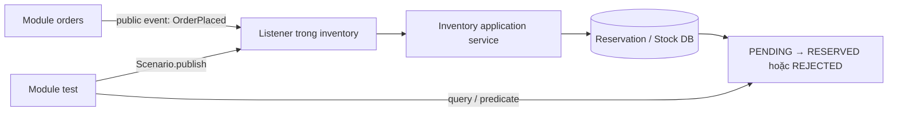

# State change do event listener gây ra trong Spring Modulith

## 1. Vì sao cần kiểm thử trạng thái do listener cập nhật?

Trong ứng dụng Spring Modulith, module phát sự kiện và module xử lý sự kiện có thể là hai thành phần độc lập. Module `orders` hoàn tất một đơn đặt hàng, công bố `OrderPlaced`; module `inventory` tiếp nhận sự kiện để giữ hàng trong kho. Sau khi listener xử lý, bản ghi đặt giữ hàng chuyển từ `PENDING` sang `RESERVED` hoặc `REJECTED`.

Kiểu phối hợp qua sự kiện giúp module giao tiếp bằng **hợp đồng nghiệp vụ công khai**, tránh gọi trực tiếp các repository hoặc service nội bộ của nhau. Tuy nhiên, test chỉ xác nhận `OrderPlaced` đã được phát hoặc handler đã được gọi **chưa chứng minh** trạng thái được cập nhật và commit đúng.

Bài học trong chương *State change* của module `SPRING_MODULITH_VERIFICATION_TESTING` tập trung vào **hành vi listener làm thay đổi state**. Nó kết hợp `@ApplicationModuleTest`, kiểm thử sự kiện, database và tích hợp, bên cạnh kiểm chứng ranh giới module bằng `ApplicationModules` và quality gate trong CI.

Sau bài học, bạn sẽ có thể:

- Vẽ và giải thích đường đi từ event của module phát đến trạng thái đã commit trong module nhận.
- Phân biệt listener đồng bộ, listener chạy bất đồng bộ và listener được gọi sau commit.
- Viết `Scenario` phát event rồi chờ đúng kết quả nghiệp vụ do listener tạo ra.
- Thiết kế listener có transaction riêng, xử lý lặp event phù hợp, và quan sát state qua API đúng ranh giới.
- Điều tra lỗi khi sự kiện đã phát nhưng state chưa đổi; xây dựng test CI có khả năng phát hiện hồi quy.

## 2. Tình huống xuyên module: đơn hàng dẫn tới giữ hàng

Giả sử hệ thống có hai module:

- **`orders`** sở hữu nghiệp vụ đặt hàng, phát `OrderPlaced(orderId, sku, quantity)` khi đơn được chấp nhận.
- **`inventory`** sở hữu tồn kho và trạng thái đặt giữ hàng. Nó nhận `OrderPlaced` để xác định `RESERVED` (đủ hàng) hoặc `REJECTED` (không đủ hàng).



Đường phụ thuộc mong muốn: module `inventory` biết **kiểu sự kiện công khai** của `orders`; `orders` không import `inventory.internal.ReservationRepository`. Các ranh giới và dependency được kiểm chứng riêng bằng `ApplicationModules.of(...).verify()`.

Bốn mốc kỹ thuật dễ bị nhầm lẫn:

| Mốc | Điều đã xác nhận | Điều **chưa** thể kết luận |
| --- | --- | --- |
| Event được publish | Bộ phận phát đã gửi sự kiện qua cơ chế ứng dụng. | Listener đã chạy hay chưa. |
| Listener bắt đầu | Handler được gọi với event. | Các quy tắc nghiệp vụ đã hoàn tất. |
| Repository được gọi `save(...)` | Thao tác ghi được yêu cầu trong transaction. | Transaction đã commit và reader thấy state mới. |
| Query API trả `RESERVED` | State mong đợi đã quan sát được qua đường đọc đã chọn. | Các thuộc tính khác cũng đúng, nếu test chưa kiểm tra. |

Vì vậy, với bài test hành vi, tiêu chí tốt nhất thường là **trạng thái nghiệp vụ đã hiển thị qua API của module sở hữu**, thay vì chỉ đếm lời gọi handler hoặc event.

## 3. Hợp đồng event và state của ví dụ

Đây là các **kiểu minh họa do ứng dụng cung cấp**, không phải class Spring Modulith tự tạo. Mỗi khai báo `public` được đặt trong file Java riêng trong dự án thực:

```java
import java.util.UUID;

// Trong public API của module orders:
public record OrderPlaced(UUID orderId, String sku, int quantity) {}

// Trong module inventory:
public enum ReservationStatus {
    PENDING, RESERVED, REJECTED
}

// Projection được module inventory công khai để truy vấn:
public record ReservationView(
        UUID orderId, String sku, int quantity,
        ReservationStatus status, String reason) {}

// Public query API thuộc module inventory:
public interface ReservationQueries {
    java.util.Optional<ReservationView> findByOrderId(UUID orderId);
}
```

Trạng thái mục tiêu phải có ý nghĩa nghiệp vụ:

- `PENDING`: đã tạo yêu cầu giữ hàng nhưng listener chưa xử lý xong.
- `RESERVED`: đã thực hiện thành công nghiệp vụ giữ hàng và dữ liệu được lưu.
- `REJECTED`: listener đã xử lý và xác định không thể giữ hàng.

Nếu không có khái niệm `PENDING` trong thiết kế thực, supplier có thể trả `Optional.empty()` trước khi listener tạo bản ghi; cần viết predicate xử lý trạng thái chưa có dữ liệu. Với quy trình có nhiều bước, một aggregate có thể chuyển qua thêm các trạng thái trung gian khác.

### 3.1. Event là contract, không phải lệnh gọi trực tiếp

Khi `orders` công bố một event, nó thông báo *điều đã xảy ra*. `inventory` quyết định cách phản ứng và cập nhật dữ liệu thuộc quyền sở hữu của mình. Producer không cần biết tên repository, bảng hay cấu trúc entity của consumer.

Đừng làm test bằng cách gọi thẳng `listener.handle(event)` nếu mục tiêu là xác minh **đường giao tiếp qua event**. Gọi thẳng handler có ích cho unit test logic nhưng bỏ qua cấu hình dispatch, transaction, async và wiring thực tế mà test tích hợp cần bao phủ.

## 4. Listener làm thay đổi state như thế nào?

Một listener cơ bản có thể nhận `OrderPlaced`, gọi application service của module `inventory`, rồi service cập nhật aggregate. Phân tách listener và service giúp dễ kiểm soát transaction, thử nghiệm và trách nhiệm của từng lớp.

### 4.1. Ví dụ listener chạy sau commit và bất đồng bộ

```java
import org.springframework.scheduling.annotation.Async;
import org.springframework.stereotype.Component;
import org.springframework.transaction.event.TransactionPhase;
import org.springframework.transaction.event.TransactionalEventListener;

@Component
class OrderPlacedListener {

    private final InventoryApplicationService inventory;

    OrderPlacedListener(InventoryApplicationService inventory) {
        this.inventory = inventory;
    }

    @Async
    @TransactionalEventListener(phase = TransactionPhase.AFTER_COMMIT)
    public void on(OrderPlaced event) {
        inventory.reserveFor(event);
    }
}
```

Cần hiểu rõ điều kiện vận hành:

1. `@TransactionalEventListener(AFTER_COMMIT)` thường chỉ chạy khi transaction đã phát event được commit. Nếu không có transaction, listener mặc định không chạy, trừ khi cấu hình `fallbackExecution` phù hợp.
2. `@Async` cho phép xử lý trên thread khác **khi hỗ trợ async được bật** và invocation đi qua cơ chế của Spring. Không mặc nhiên giả định `@Async` luôn hoạt động trong mọi cấu hình test.
3. Transaction của publisher không tự trở thành transaction ghi của thread listener. Application service cần quản lý transaction cập nhật riêng.
4. `@TransactionalEventListener` không đồng nghĩa trạng thái đã được cập nhật ngay lúc `publishEvent(...)` trả về.

Spring Modulith cũng có annotation chuyên dụng `@ApplicationModuleListener` cho listener module. Khi dùng annotation này, hãy đối chiếu tài liệu đúng phiên bản về các semantics async/transaction được ghép sẵn, rồi kiểm thử hành vi như với các annotation Spring tương đương.

### 4.2. Service nghiệp vụ sở hữu transaction ghi

Ví dụ tối giản theo mô hình aggregate và repository của chính module `inventory`:

```java
import org.springframework.stereotype.Service;
import org.springframework.transaction.annotation.Transactional;

@Service
class InventoryApplicationService {

    private final ReservationRepository reservations;
    private final StockService stock;

    InventoryApplicationService(
            ReservationRepository reservations, StockService stock) {
        this.reservations = reservations;
        this.stock = stock;
    }

    @Transactional
    public void reserveFor(OrderPlaced event) {
        Reservation reservation = reservations
                .findByOrderId(event.orderId())
                .orElseThrow();

        if (reservation.isTerminal()) {
            return; // Đã xử lý: không giữ hàng lần thứ hai.
        }

        if (!stock.canReserve(event.sku(), event.quantity())) {
            reservation.reject("NOT_ENOUGH_STOCK");
            return;
        }

        stock.reserve(event.sku(), event.quantity());
        reservation.markReserved();
        // Ví dụ giả định aggregate JPA đang managed và thay đổi
        // được lưu khi transaction commit.
    }
}
```

`ReservationRepository`, `Reservation` và `StockService` là **thành phần giả định**; cách triển khai thực tế tùy JPA, JDBC, MongoDB hoặc hệ thống tồn kho. Với JPA, thay đổi trên managed entity thường được ghi khi flush/commit; với adapter khác có thể cần gọi `save(...)` tường minh. Quan trọng là **update và kiểm tra invariant xảy ra trong transaction phù hợp**.

Đoạn `if (reservation.isTerminal())` minh họa tư tưởng idempotency, chưa thay thế được thiết kế chống xử lý trùng khi nhiều listener cạnh tranh. Phải sử dụng unique key, khóa/optimistic locking hoặc cơ chế đồng bộ phù hợp để tránh hai transaction cùng giữ hàng cho một event.

### 4.3. Điều gì sẽ xảy ra nếu handler lỗi?

Một exception trong listener có thể khiến transaction ghi rollback. Event đã được phát nhưng state vẫn `PENDING`. Nếu listener chạy bất đồng bộ, exception có thể xuất hiện ở luồng xử lý khác; bài test chỉ chờ state sẽ timeout nếu không có cách công bố trạng thái lỗi.

Khi ứng dụng cấu hình **Event Publication Registry** của Spring Modulith, thông tin event publication có thể được theo dõi để hỗ trợ xử lý publication chưa hoàn tất và cơ chế gửi/xử lý lại phù hợp. Registry không tự làm test pass, không đảm bảo mọi side effect được thực thi đúng một lần và không thay thế idempotency của domain service. Việc sử dụng cần phụ thuộc starter, cấu hình persistence và chính sách retry của dự án.

## 5. Kiểm thử event listener bằng `@ApplicationModuleTest` và `Scenario`

Để chứng minh listener đã dẫn đến state mới, test nên quan sát **đầu ra bền vững** qua query API của module:

```java
import static org.assertj.core.api.Assertions.assertThat;

import java.time.Duration;
import java.util.UUID;

import org.junit.jupiter.api.Test;
import org.springframework.beans.factory.annotation.Autowired;
import org.springframework.modulith.test.ApplicationModuleTest;
import org.springframework.modulith.test.Scenario;

@ApplicationModuleTest
class InventoryEventListenerTests {

    @Autowired ReservationQueries reservations;
    @Autowired ReservationFixture fixture;

    @Test
    void orderPlacedCreatesSuccessfulReservation(Scenario scenario) {
        UUID orderId = fixture.pendingReservationAndCommit("SKU-42", 2);

        assertThat(reservations.findByOrderId(orderId))
                .get()
                .extracting(ReservationView::status)
                .isEqualTo(ReservationStatus.PENDING);

        scenario.publish(new OrderPlaced(orderId, "SKU-42", 2))
                .andWaitAtMost(Duration.ofSeconds(5))
                .forStateChange(
                        () -> reservations.findByOrderId(orderId),
                        state -> state
                                .filter(it -> it.status()
                                        == ReservationStatus.RESERVED)
                                .isPresent())
                .andVerify(state -> {
                    ReservationView result = state.orElseThrow();
                    assertThat(result.orderId()).isEqualTo(orderId);
                    assertThat(result.sku()).isEqualTo("SKU-42");
                    assertThat(result.quantity()).isEqualTo(2);
                    assertThat(result.status())
                            .isEqualTo(ReservationStatus.RESERVED);
                });
    }
}
```

Trong ví dụ, `ReservationFixture` là helper do dự án tự triển khai để tạo reservation ban đầu và **commit** dữ liệu. Các import domain (`OrderPlaced`, `ReservationStatus`, v.v.) phụ thuộc package thực tế nên không được liệt kê.

Giá trị `5` giây chỉ minh họa; hãy chọn timeout từ độ trễ hợp lệ của hệ thống và môi trường CI. Một scenario như trên chỉ chạy đúng khi Spring test context có listener, service, repository và hạ tầng transaction cần thiết.

Cách đọc kết quả test:

1. Fixture tạo reservation `PENDING` và ghi xuống database.
2. `Scenario.publish(...)` phát `OrderPlaced` trong ngữ cảnh kiểm thử; listener nhận event theo cấu hình.
3. Listener yêu cầu service giữ hàng; service ghi state trong transaction và commit.
4. `Supplier` đọc lại reservation theo đúng `orderId`. Khi state còn `PENDING`, predicate là `false`.
5. Khi thấy `RESERVED`, predicate thành `true`; `andVerify(...)` kiểm chứng ID, SKU, số lượng và state.
6. Nếu state không đạt trước giới hạn, scenario thất bại vì timeout, mở đường điều tra từ event tới database.

**Không nên chỉ gọi `andWaitForStateChange(() -> reservations.findByOrderId(orderId))` mà bỏ predicate:** vì `Optional.of(PENDING)` đã có giá trị ngay từ đầu. Mục tiêu là trạng thái `RESERVED`, không phải sự tồn tại của bản ghi.

### 5.1. Có thể dùng `andWaitForStateChange` không kèm timeout?

Có thể dùng overload `andWaitForStateChange(supplier, predicate)` để chờ theo thời gian cấu hình mặc định của scenario; các bài test cần ngân sách rõ ràng trên CI nên cấu hình thời gian phù hợp. Với API cấu hình thời gian, chuỗi `andWaitAtMost(Duration).forStateChange(...)` là một cách diễn đạt minh bạch.

Việc chờ giúp giảm race condition khi event listener chạy async. Nó **không** làm cho listener hoạt động nếu context thiếu bean, transaction không commit hoặc predicate đòi một trạng thái không bao giờ xuất hiện.

## 6. Kiểm thử nhánh không đủ hàng và trạng thái terminal

Listener có thể xử lý thành công về mặt kỹ thuật nhưng đưa nghiệp vụ tới `REJECTED` thay vì `RESERVED`. Khi xác minh một test kỳ vọng giữ hàng thành công, nếu chỉ chờ `RESERVED`, test có thể timeout dù nghiệp vụ đã kết thúc bằng thất bại hợp lệ.

Nếu `REJECTED` thật sự là trạng thái **kết thúc**, có thể dừng chờ khi thấy một trong hai kết quả, rồi assert kỳ vọng:

```java
scenario.publish(new OrderPlaced(orderId, "SKU-42", 2))
        .andWaitForStateChange(
                () -> reservations.findByOrderId(orderId),
                state -> state.filter(it ->
                        it.status() == ReservationStatus.RESERVED
                        || it.status() == ReservationStatus.REJECTED
                ).isPresent())
        .andVerify(state ->
                assertThat(state.orElseThrow().status())
                        .isEqualTo(ReservationStatus.RESERVED));
```

Khi listener trả `REJECTED`, kịch bản dừng chờ và **assertion thất bại ngay**, giúp phân biệt với lỗi không có listener chạy. Ngược lại, khi yêu cầu bài test là **không đủ hàng dẫn đến REJECTED**, hãy chờ `REJECTED` và xác minh mã lý do `NOT_ENOUGH_STOCK`:

```java
scenario.publish(new OrderPlaced(orderId, "SKU-OUT", 100))
        .andWaitForStateChange(
                () -> reservations.findByOrderId(orderId),
                state -> state.filter(it ->
                        it.status() == ReservationStatus.REJECTED
                        && "NOT_ENOUGH_STOCK".equals(it.reason())
                ).isPresent())
        .andVerify(state -> {
            ReservationView result = state.orElseThrow();
            assertThat(result.status()).isEqualTo(ReservationStatus.REJECTED);
            assertThat(result.reason()).isEqualTo("NOT_ENOUGH_STOCK");
        });
```

Fixture cho ví dụ thứ hai phải tạo trạng thái tồn kho không đủ cho `SKU-OUT`; giả định đó là trách nhiệm của hạ tầng test. Đừng gọi đây là lỗi listener nếu business rule từ chối giữ hàng là kết quả đúng.

## 7. Phân biệt test phát event, test listener và test tích hợp toàn luồng

| Mục đích | Kích hoạt | Bằng chứng cần kiểm tra |
| --- | --- | --- |
| **Producer contract**: module `orders` phải phát `OrderPlaced`. | Gọi API đặt hàng của `orders`. | Event loại đúng, chứa đúng business/correlation ID và dữ liệu. |
| **Consumer contract**: listener `inventory` phản ứng với `OrderPlaced`. | `Scenario.publish(new OrderPlaced(...))`. | Reservation đổi `PENDING -> RESERVED/REJECTED` đúng điều kiện. |
| **Integration end-to-end**: đặt hàng thực dẫn tới giữ hàng. | Gọi use case đặt hàng thật, đi qua event publication. | Public API của `inventory` trả state mong đợi; producer/consumer đều được bootstrap. |
| **Architecture verification**: quan hệ phụ thuộc hợp lệ. | `ApplicationModules.of(...).verify()`. | Không có phụ thuộc trái ranh giới và quy tắc cấu trúc. |

Một bài unit test gọi thẳng `OrderPlacedListener.on(event)` có thể chứng minh logic handler nhưng chưa kiểm tra wiring, dispatch, `@Async`, `@TransactionalEventListener` và transaction. Một bài test producer chỉ chờ event được phát lại chưa chứng minh consumer đã cập nhật database. Chọn bằng chứng theo hợp đồng mình muốn bảo vệ.

Lưu ý `@ApplicationModuleTest` chủ yếu bootstraps module và các dependency được khai báo theo cấu hình. Một bài test ở `orders` không đương nhiên có mọi listener của `inventory`. Với consumer test, hãy đặt test đúng module hoặc cấu hình phạm vi phù hợp; với kiểm thử toàn luồng, chọn kiểu tích hợp bao phủ cả hai module.

## 8. Idempotency, event phát lại và tính nhất quán

Trong hệ thống event-driven, sự kiện có thể được xử lý lại sau lỗi, restart, hoặc cơ chế tái công bố. Nếu mỗi lần nhận `OrderPlaced` đều trừ tồn kho, một duplicate có thể gây giữ hàng hai lần.

Thiết kế listener nên cân nhắc:

1. **Khóa nghiệp vụ duy nhất:** chẳng hạn `orderId` hoặc một `eventId` gắn với operation.
2. **Bất biến của aggregate:** reservation đã `RESERVED` không được giữ hàng thêm lần nữa.
3. **Transaction nhất quán:** cập nhật lượng tồn và reservation cùng một ranh giới giao dịch nếu thuộc cùng nguồn dữ liệu.
4. **Kiểm soát cạnh tranh:** optimistic lock, unique constraint, hoặc khóa phù hợp để tránh hai transaction cùng xử lý.
5. **Quy tắc retry:** lỗi tạm thời được retry, lỗi nghiệp vụ cuối cùng ghi thành `REJECTED` nếu đó là hợp đồng của hệ thống.

Ví dụ test bổ sung cho event phát lặp cần quan sát **số lượng hàng được giữ**, không chỉ `RESERVED`:

```java
// Pseudocode theo hợp đồng fixture/queries của dự án.
var event = new OrderPlaced(orderId, "SKU-42", 2);

scenario.publish(event)
        .andWaitForStateChange(
                () -> reservations.findByOrderId(orderId),
                value -> value.filter(it ->
                        it.status() == ReservationStatus.RESERVED
                ).isPresent())
        .andVerify(value ->
                assertThat(value.orElseThrow().quantity()).isEqualTo(2));

// Kiểm thử tiếp bằng cách phát lại event qua đường đi được hỗ trợ,
// sau đó kiểm tra tổng lượng hàng giữ vẫn bằng 2 thay vì 4.
```

Phần comment cuối là **bước bài tập**, không phải implementation đã đủ để kiểm thử xử lý trùng. Muốn kiểm tra thực sự, cần kích hoạt lại event và đọc số lượng tồn/ledger sau khi listener hoàn tất; riêng trạng thái `RESERVED` không chứng minh listener chỉ chạy một lần.

## 9. Vì sao test vẫn thấy trạng thái cũ dù listener đã chạy?

Có nhiều nguyên nhân khiến `andWaitForStateChange` không đạt điều kiện. Hãy phân loại theo chuỗi sự kiện → xử lý → lưu → đọc:

| Triệu chứng | Khả năng | Hướng điều tra |
| --- | --- | --- |
| Không thấy log listener. | Handler không có trong test context, event type sai, `AFTER_COMMIT` không được kích hoạt. | Kiểm tra bootstrap, bean, event và commit của publisher. |
| Listener chạy nhưng transaction rollback. | Business rule ném exception, database constraint, lỗi kết nối. | Xem exception và transaction commit/rollback. |
| Service thực thi nhưng state vẫn `PENDING`. | Thiếu thao tác lưu, sửa entity detached, kiểm tra idempotency sai. | Kiểm tra aggregate state, repository và flush/commit. |
| Database là `RESERVED` nhưng supplier trả `PENDING`. | JPA persistence context cũ, transaction snapshot, cache hoặc replica trễ. | Dùng reader thấy dữ liệu đã commit, kiểm tra transaction và truy vấn. |
| State là `REJECTED` nhưng test chờ `RESERVED`. | Nghiệp vụ đi vào nhánh thất bại. | Kiểm tra reason và thiết kế điều kiện dừng. |
| Test pass ngay khi chưa đổi state. | Predicate chỉ kiểm tra `Optional.isPresent()` hoặc object khác `null`. | Kiểm tra trạng thái đích trong predicate. |
| CI thỉnh thoảng timeout. | Race, fixture không cô lập, executor/database chậm, timeout thấp. | ID riêng, đo độ trễ, xác định điểm commit và điều chỉnh ngân sách. |

Một nguồn lỗi quan trọng của JPA là **first-level cache**: giữ aggregate đã load trước khi publish rồi gọi lại getter trên cùng object có thể không phản ánh commit từ transaction khác. Ngay cả khi gọi `findById(...)` trong một persistence context kéo dài, JPA vẫn có thể trả entity managed cũ.

Ví dụ nên tránh:

```java
Reservation oldEntity = reservationRepository
        .findByOrderId(orderId)
        .orElseThrow();

scenario.publish(new OrderPlaced(orderId, "SKU-42", 2))
        .andWaitForStateChange(
                oldEntity::isReserved,
                reserved -> reserved);
```

Thay bằng supplier thực sự đọc state quan sát được qua repository projection hoặc public query API có transaction đọc phù hợp:

```java
scenario.publish(new OrderPlaced(orderId, "SKU-42", 2))
        .andWaitForStateChange(
                () -> reservations.findByOrderId(orderId),
                value -> value.filter(it ->
                        it.status() == ReservationStatus.RESERVED
                ).isPresent())
        .andVerify(value -> assertThat(value).isPresent());
```

Đảm bảo fixture ban đầu đã commit; không buộc toàn bộ test vào một transaction kéo dài khiến listener khác thread không thể thấy dữ liệu hoặc reader nhìn mãi snapshot cũ. Tăng timeout không sửa được sai lầm giữ object cũ.

## 10. Event listener và ranh giới kiến trúc trong Spring Modulith

Mục tiêu của Modulith là cho phép các module có trách nhiệm và dependency rõ ràng. Khi xây dựng consumer event:

- Event contract được công bố qua API của module phát hoặc một named interface được phép dùng.
- Module nhận sở hữu listener, application service và repository của chính dữ liệu mình quản lý.
- Module phát không cập nhật trực tiếp repository của module nhận.
- Test xuyên module truy vấn qua API công khai hoặc named interface, thay vì import `internal` package.

Ví dụ phép xác minh kiến trúc:

```java
import org.junit.jupiter.api.Test;
import org.springframework.modulith.core.ApplicationModules;

class ArchitectureVerificationTests {

    @Test
    void verifiesModuleDependencies() {
        ApplicationModules.of(MySpringBootApplication.class).verify();
    }
}
```

`MySpringBootApplication.class` là tên minh họa; thay bằng class ứng dụng của dự án. Khi có quy định `@ApplicationModule(allowedDependencies = ...)` và `@NamedInterface`, phương thức `verify()` giúp phát hiện phụ thuộc vượt bề mặt công khai được phép.

Cần chạy **cả** test cấu trúc và test state. State đúng ở runtime không bảo đảm không có import sai ranh giới; ngược lại, dependency hợp lệ không bảo đảm listener đã cập nhật aggregate theo đúng nghiệp vụ.

## 11. Quality gate và cách xây dựng bài test ổn định trên CI

Các điều kiện nên có khi đưa kiểm thử listener vào pipeline:

1. **Fixture riêng cho mỗi test**: `orderId`, SKU hoặc dữ liệu tồn kho không va chạm giữa các lần chạy.
2. **Điểm xuất phát đã commit**: API đọc xác nhận `PENDING` trước khi publish event.
3. **Đúng context và hạ tầng**: listener, executor async, transaction, database và các dependency cần thiết hoạt động trong test.
4. **Predicate mô tả trạng thái đích**: `RESERVED` hoặc `REJECTED` kèm business fields, tránh điều kiện chỉ có dữ liệu.
5. **Timeout hữu hạn, có căn cứ**: đủ cho độ trễ hợp lệ nhưng không che lỗi; log giữ correlation ID và state cuối khi timeout.
6. **Kiểm chứng module độc lập**: chạy `ApplicationModules.verify()` để bắt phụ thuộc sai.
7. **CI fail khi regression**: assertion, timeout hoặc vi phạm module phải trả mã lỗi.

Với dự án Gradle đã cấu hình JUnit tests trong `test` task, lệnh minh họa:

```bash
./gradlew test
```

Nếu dự án chạy integration tests ở task riêng, phải thêm task đó vào pipeline. Không coi retry test tự động là cách giải quyết lỗi flaky: cần chẩn đoán transaction, async dispatch, stale data và fixture trước.

### 11.1. Bộ bằng chứng tối thiểu khi một scenario timeout

Trong log hoặc báo cáo thất bại, nên có:

- Business/correlation ID của event và aggregate (ví dụ `orderId`).
- Event type, thời điểm publish, thời điểm listener bắt đầu/kết thúc.
- State cuối cùng supplier quan sát và state mong đợi.
- Lỗi handler/transaction nếu xảy ra; timeout được cấu hình.

Thông tin này giúp phân biệt handler chưa chạy, ghi thất bại, reader stale hay predicate sai. Tránh ghi dữ liệu nhạy cảm của khách hàng hoặc chi tiết thanh toán vào log test.

## 12. Bài thực hành

**Bài A — event làm đổi state:** tạo fixture reservation `PENDING`. Phát `OrderPlaced` với SKU đủ hàng, dùng `Scenario.andWaitForStateChange` chờ `RESERVED`; xác minh `orderId`, SKU và số lượng.

**Bài B — nhánh không đủ hàng:** tạo fixture không đủ tồn kho. Xác minh listener ghi `REJECTED` và mã `NOT_ENOUGH_STOCK`. So sánh test đợi `RESERVED` đến timeout với test đợi trạng thái kết thúc để thấy khác biệt chẩn đoán.

**Bài C — thiếu transaction:** trên nhánh thử nghiệm, làm event được publish ngoài transaction trong khi listener yêu cầu `AFTER_COMMIT` (và không bật fallback). Quan sát listener không chạy. Khôi phục luồng publish có transaction phù hợp, chạy lại.

**Bài D — kiểm thử event lặp:** phát lại cùng event theo cơ chế dự án hỗ trợ; kiểm tra lượng tồn kho chỉ bị trừ một lần. Sử dụng ID duy nhất và cơ chế khóa/constraint để tránh cạnh tranh.

**Bài E — so sánh phạm vi test:** viết unit test gọi thẳng listener rồi viết module test publish event thật. Nêu những tầng wiring/transaction/dispatch chỉ bài thứ hai bao phủ.

**Bài F — architecture gate:** bổ sung `ApplicationModules.of(...).verify()`. Tạo thử một import tới package `internal` module khác trên nhánh thực hành, kiểm tra gate phát hiện rồi hoàn nguyên.

**Tiêu chí hoàn thành:** event đi qua contract công khai; listener cập nhật state bằng transaction đúng; bài test quan sát trạng thái đã commit thay vì chỉ xác nhận event; predicate và timeout đủ rõ; và CI phát hiện được cả lỗi hành vi lẫn vi phạm ranh giới module.

## 13. Ghi nhớ và tham khảo

Một event listener đáng kiểm chứng không chỉ cần **nhận được event**, mà phải đưa dữ liệu về **trạng thái nghiệp vụ có thể quan sát**. Trong Spring Modulith, kiểm thử tốt diễn đạt ba điều: stimulus đúng, phản ứng của module nhận được commit, và API đọc trả đúng state. `Scenario` hỗ trợ chờ state trước khi assertion; kiểm chứng `ApplicationModules` bảo vệ ranh giới của những module phối hợp qua sự kiện.

Tài liệu tham khảo:

- [Spring Modulith — Testing Application Modules](https://docs.spring.io/spring-modulith/reference/testing.html): cách dùng `@ApplicationModuleTest`, `Scenario`, kiểm thử event và state.
- [Spring Modulith — Working with Application Events](https://docs.spring.io/spring-modulith/reference/events.html): event listener, xử lý bất đồng bộ và event publication registry.
- [Spring Modulith — Verifying Application Module Structure](https://docs.spring.io/spring-modulith/reference/verification.html): `ApplicationModules.verify()` và quy tắc phụ thuộc module.
- [Spring Framework — Transaction-bound Events](https://docs.spring.io/spring-framework/reference/data-access/transaction/event.html): các pha của `@TransactionalEventListener` và quan hệ với commit.
- [Spring Framework — Task Execution and Scheduling](https://docs.spring.io/spring-framework/reference/integration/scheduling.html): `@Async` và cấu hình executor.
