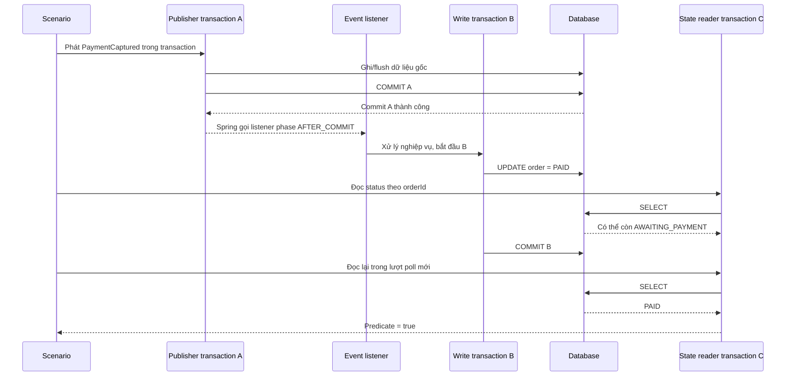

# Transaction visibility khi chờ state trong Spring Modulith

## 1. Vì sao state đã được ghi mà bài test vẫn không nhìn thấy?

Một bài kiểm thử Spring Modulith phát sự kiện `PaymentCaptured`, listener xử lý và gọi repository lưu trạng thái `PAID`. Dù log xác nhận đã chạy `save(...)`, `Scenario.andWaitForStateChange(...)` vẫn có thể timeout, vì **ghi dữ liệu**, **commit transaction** và **một truy vấn khác nhìn thấy dữ liệu** là những sự kiện riêng biệt.

Đây là vấn đề **transaction visibility**: trạng thái chỉ có ý nghĩa đối với phép kiểm chứng khi luồng đọc mà bài test sử dụng nhìn thấy phiên bản dữ liệu mong đợi, theo transaction, isolation, cache và kiến trúc của hệ thống.

Trong chương *State change* của học phần `SPRING_MODULITH_VERIFICATION_TESTING`, việc hiểu visibility giúp kết nối `@ApplicationModuleTest`, kiểm thử sự kiện, cơ sở dữ liệu và tích hợp. Các bài kiểm thử hành vi phải đi cùng xác minh ranh giới module bằng `ApplicationModules` và các quy tắc phụ thuộc, tạo quality gate chống hồi quy trên CI.

Sau bài này, bạn có thể:

- Phân biệt `flush`, `commit`, transaction của publisher, transaction của listener và transaction của reader.
- Giải thích `@TransactionalEventListener(AFTER_COMMIT)`, `@Async` và tại sao listener cần transaction ghi phù hợp.
- Nhận diện dữ liệu stale trong JPA persistence context, snapshot isolation, cache và read replica.
- Thiết kế `Supplier` của `Scenario.andWaitForStateChange(...)` đọc trạng thái **đã commit**, theo đúng business ID.
- Điều tra timeout theo chuỗi event → listener → transaction → database → reader → predicate.
- Xây dựng test tích hợp ổn định và bổ sung kiểm chứng kiến trúc trong CI.

## 2. Hai câu hỏi khác nhau: đã thay đổi hay đã quan sát được?

Giả sử module `payments` phát `PaymentCaptured(orderId)`, module `orders` phản ứng và chuyển đơn hàng từ `AWAITING_PAYMENT` sang `PAID`.

Một lời gọi `repository.save(order)` có thể chỉ cập nhật đối tượng do JPA quản lý. Một lời gọi `flush()` có thể đưa SQL xuống database nhưng transaction **vẫn chưa commit**. Transaction khác thường chưa nhìn thấy các thay đổi chưa commit. Sau commit, dữ liệu mới có thể thấy bởi một giao dịch đọc mới; tuy nhiên một transaction đang giữ snapshot cũ, entity trong first-level cache hoặc một read replica chậm có thể vẫn trả trạng thái cũ.

| Mốc | Điều đã xảy ra | Điều chưa được bảo đảm |
| --- | --- | --- |
| Listener nhận event | Handler bắt đầu xử lý. | State đã ghi hay transaction đã commit. |
| Aggregate thay đổi trong bộ nhớ | Object Java có giá trị mới. | SQL đã được thực thi. |
| `save(...)` hoặc `flush()` | Persistence layer đã nhận hoặc đẩy thao tác ghi. | Transaction đã commit thành công. |
| Transaction ghi commit | Database chính xác nhận transaction ghi. | Mọi reader, cache hoặc replica lập tức thấy giá trị mới. |
| Supplier trả `PAID` | Đường đọc của test đã thấy state mong đợi. | State không thể đổi lại trong tương lai, hoặc mọi invariant khác đã đúng. |

Chú ý: chính mức isolation và hệ quản trị CSDL quyết định khả năng thấy dữ liệu của những transaction khác nhau. Bài học dùng ngữ nghĩa transaction thông dụng của Spring/JPA; hành vi cụ thể cần được kiểm tra trên database và cấu hình dự án.

### 2.1. Dòng thời gian với listener sau commit



Sơ đồ là **một lịch thực thi minh họa**, đặc biệt khi listener bất đồng bộ. Transaction đọc C có thể bắt đầu/đóng lại nhiều lần trong quá trình poll. Thứ tự cụ thể tùy cơ chế dispatch, cấu hình giao dịch và thời gian xử lý.

Nếu listener chạy đồng bộ ngay sau commit của publisher, vẫn phải phân biệt commit của publisher với commit của thao tác ghi mới do listener tạo ra. Không suy luận “event đã phát” tức là “state đã commit”.

## 3. Ba ranh giới transaction cần xác định rõ

### 3.1. Transaction A: nơi phát sự kiện

Khi sử dụng `@TransactionalEventListener(phase = TransactionPhase.AFTER_COMMIT)`, listener theo pha này gắn với transaction mà event được phát trong đó. Nếu transaction đó rollback, điều kiện after-commit không xảy ra. Nếu không có transaction, listener mặc định không chạy, trừ khi được cấu hình `fallbackExecution` thích hợp.

```java
import org.springframework.context.ApplicationEventPublisher;
import org.springframework.stereotype.Service;
import org.springframework.transaction.annotation.Transactional;

@Service
class PaymentApplicationService {
    private final ApplicationEventPublisher events;

    PaymentApplicationService(ApplicationEventPublisher events) {
        this.events = events;
    }

    @Transactional
    public void capturePayment(UUID orderId, String transactionId) {
        // Xác nhận thanh toán và cập nhật bản ghi thuộc module payments.
        // Phần thực thi nghiệp vụ được lược bỏ trong ví dụ.
        events.publishEvent(new PaymentCaptured(orderId, transactionId));
        // Transaction hoàn tất khi phương thức được gọi qua Spring proxy kết thúc.
    }
}
```

Ví dụ giả định `PaymentCaptured` là event contract công khai và phương thức được gọi qua bean Spring để transaction interceptor có hiệu lực. `publishEvent(...)` là thao tác đăng thông báo; nó không bảo đảm listener after-commit đã xử lý xong ngay lúc lời gọi trả về.

### 3.2. Transaction B: nơi listener cập nhật state

Một listener xử lý sau commit cần **giao dịch ghi riêng, rõ ràng** cho thao tác thay đổi state. Đặc biệt, ở pha `AFTER_COMMIT`, transaction gốc đã commit nhưng một số tài nguyên có thể còn liên kết với thread; tác vụ ghi dựa vào ngữ cảnh đó dễ gây hiểu nhầm. Gọi một application service qua Spring proxy với transaction mới là lựa chọn dễ kiểm soát.

```java
import org.springframework.scheduling.annotation.Async;
import org.springframework.stereotype.Component;
import org.springframework.transaction.event.TransactionPhase;
import org.springframework.transaction.event.TransactionalEventListener;

@Component
class PaymentCapturedListener {
    private final OrderPaymentService orders;

    PaymentCapturedListener(OrderPaymentService orders) {
        this.orders = orders;
    }

    @Async
    @TransactionalEventListener(phase = TransactionPhase.AFTER_COMMIT)
    public void on(PaymentCaptured event) {
        orders.markPaid(event.orderId(), event.transactionId());
    }
}
```

```java
import org.springframework.stereotype.Service;
import org.springframework.transaction.annotation.Propagation;
import org.springframework.transaction.annotation.Transactional;

@Service
class OrderPaymentService {
    private final OrderRepository repository;

    OrderPaymentService(OrderRepository repository) {
        this.repository = repository;
    }

    @Transactional(propagation = Propagation.REQUIRES_NEW)
    public void markPaid(UUID orderId, String transactionId) {
        Order order = repository.findById(orderId).orElseThrow();
        order.markPaid(transactionId);
        // Với JPA, entity managed có thể được flush khi transaction B commit.
    }
}
```

Ở đây `OrderRepository`, `Order` và `PaymentCaptured` là thành phần của ứng dụng giả định. Mẫu trên nhấn mạnh việc listener **gọi một bean khác** để transaction mới được áp dụng qua proxy; `@Transactional` trên một phương thức được gọi trực tiếp nội bộ (self-invocation) thường không kích hoạt advice trong proxy mode.

`@Async` yêu cầu cấu hình async thích hợp, ví dụ `@EnableAsync`, và làm việc trên thread khác khi cơ chế Spring hoạt động. Transaction gắn với thread của publisher **không tự truyền** sang worker thread. Việc chỉ thêm annotation không thay thế cho kiểm thử integration thực tế.

`Propagation.REQUIRES_NEW` ở ví dụ làm rõ transaction B độc lập. Nó không phải quy tắc bắt buộc cho mọi listener: nếu không có transaction đang hoạt động, `REQUIRED` cũng có thể tạo transaction mới. Trong listener after-commit chạy đồng bộ trên thread có tài nguyên transaction gốc, `REQUIRES_NEW` giúp diễn đạt ý định dùng giao dịch ghi tách biệt một cách rõ ràng.

### 3.3. Transaction C: nơi bài test đọc state

Bên đọc phải **nhìn thấy commit của B**, không bị ràng buộc bởi một snapshot cũ của chính test. Với test không giữ transaction dài, một query service thường có thể đọc trạng thái đã commit bằng mỗi lời gọi mới. Nếu cần kiểm soát, có thể dùng một phương thức đọc được gọi qua Spring proxy để mỗi lần poll chạy một transaction độc lập.

```java
import java.util.Optional;
import java.util.UUID;

public interface OrderQueries {
    Optional<OrderStatus> statusOf(UUID orderId);
}
```

```java
import org.springframework.stereotype.Service;
import org.springframework.transaction.annotation.Propagation;
import org.springframework.transaction.annotation.Transactional;

@Service
class OrderQueriesAdapter implements OrderQueries {
    private final OrderRepository orders;

    OrderQueriesAdapter(OrderRepository orders) {
        this.orders = orders;
    }

    @Override
    @Transactional(readOnly = true, propagation = Propagation.REQUIRES_NEW)
    public Optional<OrderStatus> statusOf(UUID orderId) {
        return orders.findStatusById(orderId);
    }
}
```

`findStatusById(...)` là query **projection trả về enum** do repository trong module `orders` triển khai, chẳng hạn một `@Query` Spring Data JPA. Nên tránh để `OrderQueriesAdapter` trả managed entity được cache quá lâu nếu mục tiêu chỉ là đọc scalar status. Đây là một **lựa chọn thiết kế** khi cần buộc mỗi lời gọi read ở transaction mới; không phải mọi reader đều phải dùng `REQUIRES_NEW`. Nó có chi phí tạo transaction, sử dụng connection và nên được cân nhắc với tần suất poll.

**Điều kiện quan trọng:** mỗi lượt `Supplier` phải gọi **bean query service qua proxy**. Nếu gọi một phương thức `@Transactional` bằng `this.statusOf(...)` trong cùng đối tượng, proxy interception có thể không chạy và transaction đọc độc lập không được tạo.

## 4. Fixture và transaction test: nguồn gây hiểu nhầm lớn

Mặc định, Spring Test thường rollback test method được gắn `@Transactional` khi hoàn tất. Điều này rất tiện cho CRUD test đồng bộ, nhưng có thể làm bài test event after-commit bị sai:

1. Test bắt đầu transaction T.
2. Test tạo bản ghi đơn hàng `AWAITING_PAYMENT` nhưng chưa commit.
3. Test phát `PaymentCaptured` trong T.
4. Listener `AFTER_COMMIT` không được gọi vì T chưa commit; cuối test T bị rollback.
5. `Scenario` chờ `PAID` và timeout.

Không phải mọi `@ApplicationModuleTest` tự động bị bao bởi transaction. Vấn đề xuất hiện **nếu chính test hoặc test configuration** tạo transaction kéo dài qua stimulus và chờ state. Cần nhìn vào transaction thực tế chứ không suy luận chỉ từ annotation `@ApplicationModuleTest`.

### 4.1. Chuẩn bị dữ liệu ban đầu đã commit

Một fixture đúng cho kịch bản bất đồng bộ cần tạo đơn hàng và commit **trước** khi listener/thread khác cần truy cập nó. Ví dụ cách diễn đạt hợp đồng của fixture:

```java
public interface OrderFixture {
    UUID createAwaitingPaymentAndCommit();
}
```

Có thể triển khai fixture bằng `TransactionTemplate` ở một bean Spring, tạo transaction kết thúc trước khi phương thức fixture trả về:

```java
import java.util.UUID;

import org.springframework.stereotype.Component;
import org.springframework.transaction.support.TransactionTemplate;

@Component
class OrderFixtureImpl implements OrderFixture {
    private final TransactionTemplate transactions;
    private final OrderRepository orders;

    OrderFixtureImpl(TransactionTemplate transactions, OrderRepository orders) {
        this.transactions = transactions;
        this.orders = orders;
    }

    @Override
    public UUID createAwaitingPaymentAndCommit() {
        return transactions.execute(status -> {
            Order order = Order.awaitingPayment(UUID.randomUUID());
            orders.save(order);
            return order.getId();
        });
    }
}
```

**Lưu ý:** mẫu `TransactionTemplate` trên kết thúc transaction của nó nếu không có transaction bên ngoài; với template mặc định `PROPAGATION_REQUIRED`, nó có thể **tham gia** transaction đang tồn tại và khi đó không tự commit trước khi trả về. Vì vậy, nếu test được bao `@Transactional`, cần chủ động thiết kế ranh giới transaction phù hợp (ví dụ một fixture giao dịch độc lập với `PROPAGATION_REQUIRES_NEW` hoặc kết thúc test transaction theo cơ chế Spring Test), thay vì mặc nhiên tin tên phương thức “AndCommit”.

Ví dụ:

```java
// Chỉ minh họa cấu hình khi fixture thật sự cần transaction độc lập.
TransactionTemplate template = new TransactionTemplate(transactionManager);
template.setPropagationBehavior(
        TransactionDefinition.PROPAGATION_REQUIRES_NEW);

// template.execute(...) tạo giao dịch mới, không phụ thuộc transaction T.
```

Hai dòng `TransactionManager`/`TransactionDefinition` trên giả định biến và import tương ứng đã có. Nếu dùng test datasource không hỗ trợ transaction tương ứng hoặc có nhiều transaction manager, cần chọn đúng manager. Đặc biệt, một commit độc lập trong fixture sẽ không tự rollback theo transaction của test; hãy dùng ID riêng và cơ chế cleanup thích hợp.

### 4.2. `saveAndFlush` không thay thế commit

```java
orders.saveAndFlush(order); // Có thể đã gửi SQL xuống DB.
```

`saveAndFlush(...)` có thể ép gửi SQL trong transaction hiện tại, nhưng **không cam kết transaction đã commit**. Thread listener ở transaction khác vẫn có thể chưa thấy bản ghi; sự kiện `AFTER_COMMIT` của publisher vẫn chưa đến pha commit. Hãy kiểm tra transaction boundary, không dùng flush như giải pháp “để event listener thấy dữ liệu”.

### 4.3. Không dựa vào rollback của test để dọn commit bất đồng bộ

Nếu listener sử dụng transaction độc lập và đã commit, rollback transaction của test **không hoàn tác** transaction đó. Vì vậy, fixture tạo `orderId` riêng cho mỗi test, cleanup dữ liệu theo module, hoặc database/test container cô lập là cần thiết. Cleanup nên xảy ra sau khi các tác vụ bất đồng bộ liên quan thực sự kết thúc để tránh xóa dữ liệu khi listener còn chạy.

## 5. JPA persistence context: gọi lại `findById` chưa chắc đọc mới

Một lỗi quen thuộc là giữ entity từ trước khi phát event:

```java
Order oldEntity = orderRepository.findById(orderId).orElseThrow();

scenario.publish(new PaymentCaptured(orderId, "TX-101"))
        .andWaitForStateChange(oldEntity::isPaid, paid -> paid);
```

Nếu listener khác thread cập nhật database, `oldEntity` có thể là bản Java cũ. Supplier được gọi nhiều lần nhưng **không đọc lại state**.

Ngay cả đoạn dưới cũng có rủi ro nếu mỗi lượt đọc vẫn nằm trong **cùng một persistence context JPA**:

```java
scenario.publish(new PaymentCaptured(orderId, "TX-102"))
        .andWaitForStateChange(
                () -> orderRepository.findById(orderId),
                current -> current.filter(Order::isPaid).isPresent());
```

JPA first-level cache theo `EntityManager` có thể trả về entity managed đã tải trước đó. Đó là lý do query projection chỉ lấy trường cần kiểm tra thường dễ dùng hơn cho bài test chờ state:

```java
scenario.publish(new PaymentCaptured(orderId, "TX-103"))
        .andWaitForStateChange(
                () -> orderQueries.statusOf(orderId),
                value -> value.filter(s -> s == OrderStatus.PAID).isPresent())
        .andVerify(value -> assertThat(value).contains(OrderStatus.PAID));
```

**Không phải query projection luôn giải quyết mọi lỗi stale.** Nếu transaction đọc giữ snapshot tại mức isolation tương ứng, query scalar cũng có thể nhìn giá trị cũ. Nếu có query cache, application cache hoặc read replica, phải hiểu vòng đời và quy tắc đồng bộ của chúng.

Một cách sửa tốt là tổ chức reader để đọc kết quả **đã commit** qua một lời gọi/transaction thích hợp ở mỗi lần poll. Chỉ sử dụng `EntityManager.clear()` hoặc `refresh(...)` sau khi hiểu ảnh hưởng tới các thay đổi chưa flush và transaction của test; không dùng thao tác này vô điều kiện trong supplier.

## 6. Isolation level và snapshot ảnh hưởng tới việc poll

Các mức isolation điển hình của cơ sở dữ liệu có tác động khác nhau đến khả năng thấy commit từ transaction khác. Ví dụ dưới đây mô tả **hành vi thông dụng**, không thay thế tài liệu cụ thể của từng database:

| Tình huống reader C | Có thể thấy commit mới của B? | Lưu ý cho `Scenario` |
| --- | --- | --- |
| Mỗi lần đọc là transaction mới ở `READ_COMMITTED`. | Thường có, sau khi B commit. | Cách đọc thực dụng cho dữ liệu primary khi không có cache stale. |
| Nhiều query trong **cùng** transaction `READ_COMMITTED`. | Tùy thời điểm query và hệ CSDL, các statement thường thấy dữ liệu đã commit trước chúng. | Nếu còn JPA managed entity cũ, query vẫn có thể trả state cũ. |
| Một transaction `REPEATABLE_READ`/snapshot kéo dài. | Có thể tiếp tục thấy snapshot ban đầu. | Poll lâu không có ích nếu snapshot không được làm mới. |
| Query tới read replica bất đồng bộ. | Có thể thấy muộn hơn primary. | Timeout phải gắn với hợp đồng replication/độ trễ thực tế. |
| Query có application/JPA second-level cache. | Có thể thấy dữ liệu bị cache, tùy chính sách invalidation. | Chọn read API/cache policy phù hợp. |

Một ví dụ logic:

```text
T0: Reader transaction C bắt đầu, snapshot thấy status = AWAITING_PAYMENT
T1: Listener transaction B UPDATE status = PAID
T2: B COMMIT
T3: C đọc lại trên cùng snapshot => vẫn AWAITING_PAYMENT
T4: C kết thúc; reader transaction C2 bắt đầu
T5: C2 đọc tại primary => PAID
```

Đối với một hệ thống nhất quán cuối cùng, lời gọi query công khai của consumer có thể đi qua projection riêng. Test phải xác định **hợp đồng muốn bảo đảm**: “aggregate chính được commit” hay “consumer nhìn thấy trạng thái mới”. Hai phép kiểm tra có nguồn đọc và độ trễ khác nhau; không tự suy từ trạng thái bảng gốc rằng read model đã cập nhật.

## 7. Viết `@ApplicationModuleTest` quan sát state sau commit

Giả định hệ thống có public event contract `PaymentCaptured`, enum `OrderStatus`, và public query API `OrderQueries`. Đây đều là kiểu ứng dụng minh họa:

```java
import java.util.Optional;
import java.util.UUID;

// Các khai báo public đặt trong các file Java riêng trong dự án thật.
public record PaymentCaptured(UUID orderId, String transactionId) {}

public enum OrderStatus {
    AWAITING_PAYMENT, PAID, PAYMENT_FAILED
}

public interface OrderQueries {
    Optional<OrderStatus> statusOf(UUID orderId);
}
```

Bài test:

```java
import static org.assertj.core.api.Assertions.assertThat;

import java.time.Duration;
import java.util.UUID;

import org.junit.jupiter.api.Test;
import org.springframework.beans.factory.annotation.Autowired;
import org.springframework.modulith.test.ApplicationModuleTest;
import org.springframework.modulith.test.Scenario;

@ApplicationModuleTest
class PaymentTransactionVisibilityTests {

    @Autowired OrderFixture fixture;
    @Autowired OrderQueries orderQueries;

    @Test
    void afterCommitListenerEventuallyMakesPaidStateVisible(Scenario scenario) {
        UUID orderId = fixture.createAwaitingPaymentAndCommit();

        assertThat(orderQueries.statusOf(orderId))
                .contains(OrderStatus.AWAITING_PAYMENT);

        scenario.publish(new PaymentCaptured(orderId, "TX-104"))
                .andWaitAtMost(Duration.ofSeconds(8))
                .forStateChange(
                        () -> orderQueries.statusOf(orderId),
                        status -> status.filter(s -> s == OrderStatus.PAID)
                                        .isPresent())
                .andVerify(status ->
                        assertThat(status).contains(OrderStatus.PAID));
    }
}
```

Ở đây:

1. `OrderFixture` phải tạo và commit state ban đầu, có ID mới cho từng test.
2. `Scenario.publish(...)` kích hoạt event trong test; chính transaction/event semantics cụ thể của `Scenario` và cấu hình dự án quyết định khi nào listener `AFTER_COMMIT` nhận sự kiện.
3. Listener xử lý và commit transaction ghi của mình.
4. `OrderQueries.statusOf(...)` đọc state đang có qua một API quan sát ổn định.
5. Predicate chỉ đúng khi `Optional.of(PAID)`; `Optional.of(AWAITING_PAYMENT)` hoặc `Optional.empty()` chưa được chấp nhận.
6. Nếu hết 8 giây minh họa mà chưa thấy `PAID`, test thất bại với timeout, cần xem xét cả writer và reader.

**Phạm vi module:** `@ApplicationModuleTest` không nhất thiết bootstrap mọi module trong ứng dụng. Nếu publisher, listener hoặc reader nằm ở module phụ thuộc chưa được bao gồm, cần đặt bài test tại đúng module, cấu hình mode/dependencies phù hợp hoặc dùng integration test có phạm vi rộng hơn. Không sửa visibility bằng cách import repository từ package `internal` của module khác.

### 7.1. Một state reader tốt cần thỏa gì?

| Thuộc tính | Cách kiểm tra |
| --- | --- |
| Đọc từ đúng nguồn | Có thể thấy commit của transaction writer tương ứng với mục tiêu test. |
| Gắn đúng business ID | Luôn gọi `statusOf(orderId)` của stimulus hiện tại. |
| Không giữ entity cũ | Supplier gọi query service ở mỗi lần poll. |
| Thuần đọc | Không gọi `save(...)`, không phát thêm event hoặc thay đổi state trong Supplier. |
| Transaction rõ ràng | Không giữ snapshot/persistence context cũ khi cần thấy commit mới. |
| Chi phí hợp lý | Query projection nhỏ, hạn chế tải graph lớn và tránh lock không cần thiết. |
| Đúng ranh giới Modulith | Reader là API công khai hoặc named interface được module sở hữu cho phép dùng. |

Việc gọi lại supplier nhiều lần chỉ có ích nếu **mỗi lần đọc có cơ hội thấy một state mới**.

## 8. Kiểm tra transaction visibility bằng các tình huống có chủ đích

Một suite kiểm thử tốt cần nhận biết lỗi do transaction chứ không chỉ happy path.

### 8.1. Writer rollback

Nếu listener ném exception sau khi sửa entity nhưng trước commit, database không có state mới. Predicate chờ `PAID` phải **không pass**. Có thể kiểm tra log/exception và chứng minh transaction rollback; test cần timeout hữu hạn thay vì treo vô hạn.

### 8.2. Test giữ entity cũ

Lấy aggregate trước khi phát event rồi dùng `oldEntity::isPaid` để chờ. Bài test có thể timeout khi database đã `PAID`. Đổi supplier sang public query service đọc state đã commit và so sánh kết quả.

### 8.3. Transaction đọc snapshot kéo dài

Giữ cùng một transaction đọc khi listener commit ở transaction khác. Với hệ DB có snapshot semantics tương ứng, reader có thể không thấy thay đổi. Kết thúc transaction đọc, mở transaction mới rồi so sánh; chỉ làm bài thực hành này trong môi trường test cô lập.

### 8.4. `AFTER_COMMIT` không được kích hoạt

Phát event bên trong transaction test bị rollback, trong khi listener yêu cầu `AFTER_COMMIT`. Quan sát listener không đi đến state mong đợi. Sau đó tổ chức stimulus đi qua transaction thực sự commit và kiểm tra lại, không dùng `Thread.sleep(...)` để “sửa”.

### 8.5. Đã commit nhưng read model chậm

Nếu primary có `PAID` nhưng public query API đọc projection cập nhật bằng event sau đó, query có thể chỉ thấy `PAID` khi projection nhận bản ghi mới. Test consumer cần chờ **consumer-visible state**; không đổi sang đọc bảng primary nếu như vậy sẽ bỏ qua hợp đồng cần bảo vệ.

## 9. Chẩn đoán timeout: từ commit tới read

Khi `Scenario.andWaitForStateChange(...)` timeout, thu thập các dấu hiệu sau:

| Quan sát | Kết luận có cơ sở | Hành động tiếp theo |
| --- | --- | --- |
| Không có listener log. | Chưa xác nhận event đã tới handler. | Kiểm tra test context, event type, transaction publish, `AFTER_COMMIT`. |
| Listener chạy nhưng writer rollback. | State mới chưa được commit. | Kiểm tra exception, business rule, transaction propagation. |
| Writer báo commit, primary vẫn state cũ. | Cần xác minh đúng ID, bảng và transaction. | So sánh `orderId` và log/SQL/commit thực tế. |
| Primary đã `PAID`, query trong test vẫn cũ. | Vấn đề nằm ở reader visibility hoặc nguồn đọc. | Kiểm tra persistence context, isolation, cache, replica, ID. |
| Supplier thấy `PAID` nhưng test không pass. | Predicate có thể sai hoặc test quan sát object khác. | Log giá trị thực, kiểm tra condition và correlation ID. |
| State chỉ đổi sau timeout trên CI. | Độ trễ thực vượt ngưỡng chờ. | Đo thời gian event → commit → visible, điều chỉnh bottleneck/ngân sách hợp lệ. |
| Test pass ngay dù state chưa đổi. | Predicate chỉ kiểm tra non-null/`isPresent`. | Chờ đúng giá trị `PAID` hoặc invariant khác. |

Quy trình điều tra đề xuất:

1. **Kiểm tra fixture:** trạng thái đầu đã commit chưa? ID của bài test có đúng và riêng biệt?
2. **Kiểm tra event:** publish diễn ra trong transaction nào? Có commit không? Event type/correlation ID khớp handler?
3. **Kiểm tra listener:** bean có trong test context? `@Async`/`AFTER_COMMIT` hoạt động? Có exception hoặc retry?
4. **Kiểm tra writer:** service ghi trong transaction nào? Transaction có commit? `saveAndFlush` có bị hiểu nhầm là commit?
5. **Kiểm tra primary database:** tại cùng ID, state hiện có là gì sau commit?
6. **Kiểm tra reader:** mỗi poll có thực hiện query mới? Có transaction snapshot cũ hoặc JPA-managed entity cũ?
7. **Kiểm tra predicate:** điều kiện chờ có khớp trạng thái cuối của nghiệp vụ?
8. **Kiểm tra timeout:** chỉ điều chỉnh sau khi xác định độ trễ hợp lệ và lỗi hạ tầng.

Để phân tích, log các thông tin không nhạy cảm: `orderId`, event type, thời điểm event được publish, thời điểm listener bắt đầu và commit, state cuối supplier thấy, isolation level của reader nếu cần. Tránh lộ dữ liệu thanh toán thực.

## 10. Predicate, terminal state và giới hạn timeout

Khi hệ thống có trạng thái terminal `PAYMENT_FAILED`, predicate chỉ đợi `PAID` có thể timeout dù listener đã kết thúc bằng thất bại. Nếu `PAYMENT_FAILED` thật sự là terminal trong kịch bản, có thể dừng khi thấy một trong hai giá trị rồi assertion yêu cầu `PAID`:

```java
scenario.publish(new PaymentCaptured(orderId, "TX-105"))
        .andWaitForStateChange(
                () -> orderQueries.statusOf(orderId),
                status -> status.filter(s ->
                        s == OrderStatus.PAID
                        || s == OrderStatus.PAYMENT_FAILED).isPresent())
        .andVerify(status ->
                assertThat(status).contains(OrderStatus.PAID));
```

Khi quan sát `PAYMENT_FAILED`, scenario ngừng chờ và assertion thất bại ngay, giúp phân biệt lỗi nghiệp vụ với lỗi visibility. Không dùng mẫu này nếu `PAYMENT_FAILED` chỉ là trạng thái tạm có thể retry thành `PAID`.

Timeout nên được chọn từ độ trễ hợp lệ của hệ thống và môi trường test, đồng thời nhỏ hơn giới hạn tổng của phương thức test hoặc job CI. Không dùng `Thread.sleep(...)` cố định: nó không sửa snapshot cũ, lỗi commit, thiếu listener hoặc predicate sai. Khi state đạt sớm, chờ có điều kiện cho phép kết thúc sớm.

## 11. Bảo vệ ranh giới kiến trúc khi xử lý visibility

Một cách sửa test tạm thời dễ gây hại là truy cập repository hoặc `EntityManager` nội bộ của module khác để “đọc tận bảng”. Điều này có thể giúp thấy state nhưng tạo dependency không mong muốn.

Trong Spring Modulith:

- Module phát công bố event qua API hoặc named interface được phép dùng.
- Module nhận sở hữu listener, transaction ghi, aggregate và repository riêng.
- Test xuyên module quan sát state qua query API **được module sở hữu công khai**.
- Nếu read model cho consumer là một API khác, test đúng hợp đồng consumer cần quan sát read model đó.
- Kiểm tra phụ thuộc cấu trúc riêng, vì test state pass chưa chứng minh kiến trúc hợp lệ.

```java
import org.junit.jupiter.api.Test;
import org.springframework.modulith.core.ApplicationModules;

class ModulithBoundaryTests {

    @Test
    void moduleDependenciesAreValid() {
        ApplicationModules.of(MySpringBootApplication.class).verify();
    }
}
```

`MySpringBootApplication` là class minh họa. Tùy ứng dụng, dùng `@ApplicationModule(allowedDependencies = ...)` và `@NamedInterface` để nêu rõ phụ thuộc được phép. `ApplicationModules.verify()` giúp phát hiện import và quan hệ sai ranh giới, còn `@ApplicationModuleTest`/`Scenario` kiểm chứng kết quả hành vi sau commit.

## 12. Quality gate trong CI

Để phát hiện hồi quy về transaction visibility, một quality gate nên có:

1. **Kiểm chứng cấu trúc module:** chạy `ApplicationModules.of(...).verify()`.
2. **Kiểm thử writer/handler:** trường hợp thành công, lỗi và rollback được thể hiện bằng state và kết quả transaction.
3. **Kiểm thử state visible:** `Scenario` chờ state qua API đúng ranh giới, với predicate và timeout hữu hạn.
4. **Hạ tầng xác định:** database, executor async, test container/read model cần thiết hoạt động trong test environment.
5. **Dữ liệu độc lập:** mỗi kịch bản dùng ID riêng; cleanup được thiết kế cho commit bất đồng bộ.
6. **Log đủ để điều tra:** khi timeout, có thể đối chiếu event ID, writer commit và state cuối của supplier.
7. **Gate thực sự chặn lỗi:** timeout, assertion hoặc vi phạm dependency làm bước CI thất bại.

Với dự án Gradle đã thu thập JUnit test trong task `test`, ví dụ:

```bash
./gradlew test
```

Nếu integration test nằm trong task/test suite riêng, CI phải chạy cả phần đó. Không giả định mọi bài test tích hợp đều chạy qua task `test`. Việc retry tự động mà không điều tra có thể che lỗi stale context hoặc transaction setup.

## 13. Bài tập thực hành

**Bài A — phân biệt flush và commit:** trong cơ sở dữ liệu test có hai transaction, cho writer cập nhật status và flush nhưng chưa commit; reader ở transaction độc lập thử đọc. Sau khi writer commit, mở reader mới và so sánh kết quả. Ghi lại isolation level đang sử dụng.

**Bài B — sửa test transaction kéo dài:** tạo fixture `AWAITING_PAYMENT` bên trong một test method có `@Transactional` và listener `AFTER_COMMIT`. Phân tích lý do event có thể không được xử lý. Tổ chức fixture/stimulus trong ranh giới commit phù hợp và xác minh listener đổi state.

**Bài C — stale JPA entity:** giữ `Order` trước event rồi dùng method reference làm supplier. Sau đó dùng query projection qua service đọc transaction mới. So sánh giá trị mà hai cách quan sát trả về khi writer đã commit.

**Bài D — isolation và snapshot:** thử luồng đọc giữ một transaction `REPEATABLE_READ` kéo dài so với reader transaction mới trên hệ DB hỗ trợ. Giải thích vì sao gọi cùng câu SQL không bảo đảm thấy cùng bộ dữ liệu giữa hai mô hình.

**Bài E — lỗi terminal:** tạo listener ghi `PAYMENT_FAILED` và commit. Chờ hai terminal state nhưng assertion yêu cầu `PAID`; xác nhận test thất bại vì kết quả nghiệp vụ, không đợi vô ích tới timeout.

**Bài F — quality gate:** đưa test state visible cạnh `ApplicationModules.verify()`. Thử tình huống import repository `internal` của module khác trên nhánh thực hành, xác minh gate kiến trúc bắt lỗi; hoàn nguyên thử nghiệm.

**Tiêu chí hoàn thành:** giải thích được transaction A/B/C; fixture và writer có commit rõ; supplier đọc state có thể nhìn thấy commit; predicate đúng trạng thái nghiệp vụ; timeout hữu hạn; và CI phát hiện được cả hồi quy hành vi lẫn phụ thuộc module sai.

## 14. Ghi nhớ và tham khảo

Trong kiểm thử Spring Modulith, điều kiện thành công không chỉ là **state đã bị sửa** mà là **state mong đợi đã được quan sát qua đường đọc đúng hợp đồng**. `flush` không đồng nghĩa `commit`; listener `AFTER_COMMIT` không thừa hưởng transaction ghi phù hợp một cách tự động; entity JPA cũ hoặc snapshot isolation có thể khiến supplier chờ mãi. Hãy kiểm tra ranh giới publisher → listener → writer → reader, và dùng `Scenario` cùng predicate có ý nghĩa nghiệp vụ.

Tài liệu tham khảo:

- [Spring Modulith — Testing Application Modules](https://docs.spring.io/spring-modulith/reference/testing.html): `@ApplicationModuleTest`, `Scenario` và chờ state change.
- [Spring Modulith — Working with Application Events](https://docs.spring.io/spring-modulith/reference/events.html): listener, transaction và event publication.
- [Spring Modulith — Verifying Application Module Structure](https://docs.spring.io/spring-modulith/reference/verification.html): `ApplicationModules.verify()` và ranh giới module.
- [Spring Framework — Transaction-bound Events](https://docs.spring.io/spring-framework/reference/data-access/transaction/event.html): pha `@TransactionalEventListener`, commit và fallback.
- [Spring Framework — Transaction Propagation](https://docs.spring.io/spring-framework/reference/data-access/transaction/declarative/tx-propagation.html): `REQUIRED`, `REQUIRES_NEW` và ngữ nghĩa giao dịch.
- [Spring Framework — Transaction Isolation](https://docs.spring.io/spring-framework/reference/data-access/transaction/declarative/annotations.html): cấu hình `@Transactional` và isolation.
