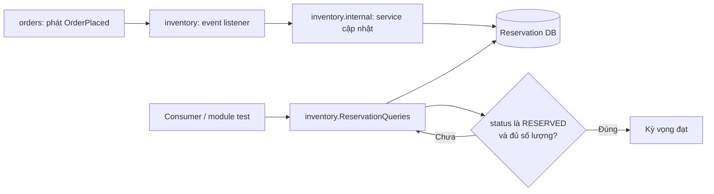
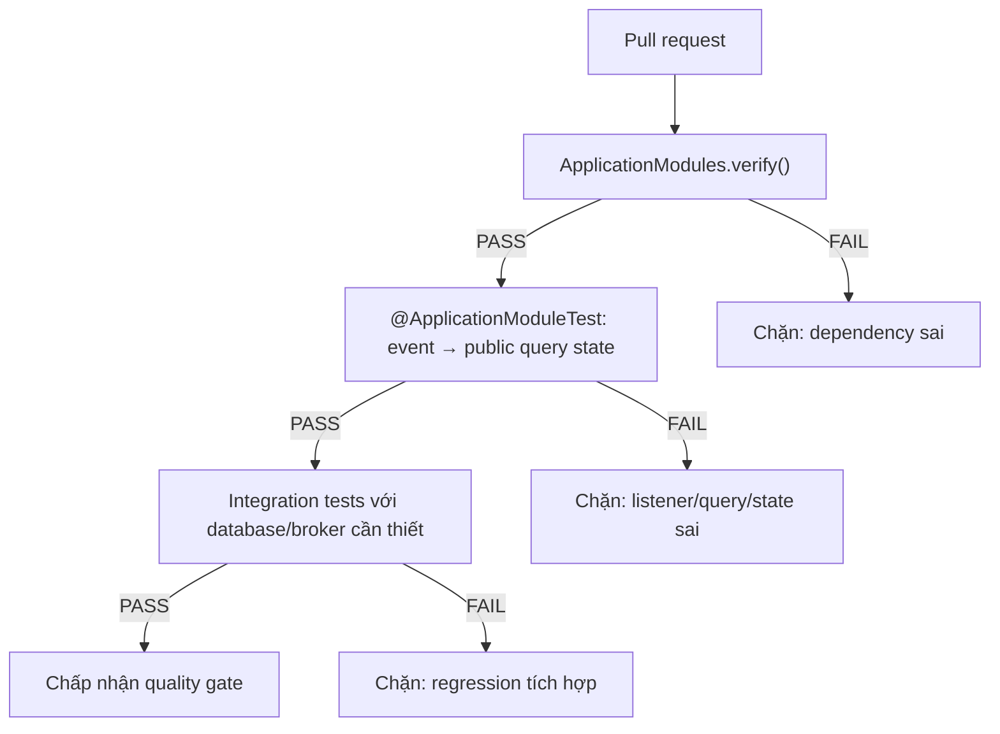

# Đọc state qua public API của module trong Spring Modulith

## 1. Tại sao nguồn đọc state phải tôn trọng ranh giới module?

Trong một ứng dụng Spring Modulith, mỗi application module sở hữu nghiệp vụ và dữ liệu của mình. Ví dụ, module `orders` phát sự kiện `OrderPlaced`, module `inventory` xử lý để giữ hàng. Sau khi listener hoàn tất, dữ liệu bên trong `inventory` có thể chuyển từ `PENDING` sang `RESERVED`.

Một bài kiểm thử tích hợp có thể lấy `inventory.internal.ReservationRepository` rồi gọi `findByOrderId(...)` để xem dữ liệu đã đổi hay chưa. Cách này đôi khi thuận tiện, nhưng nếu test đứng ở góc nhìn **module khác** thì việc truy cập repository nội bộ làm mờ ranh giới kiến trúc. Nó còn gắn bài test với cách lưu trữ riêng của `inventory`: đổi JPA entity, tên bảng hay repository có thể khiến test của consumer hỏng dù hợp đồng nghiệp vụ không đổi.

Giải pháp là **đọc state qua public API do module sở hữu công bố**, chẳng hạn `ReservationQueries.findByOrderId(orderId)` trả về DTO chỉ chứa dữ liệu cần thiết. Kịch bản kiểm thử quan sát được đúng trạng thái mà một consumer hợp lệ có quyền đọc.

Chủ đề nằm trong chương *State change* của `SPRING_MODULITH_VERIFICATION_TESTING`: rèn kỹ năng dùng `@ApplicationModuleTest`, kiểm thử sự kiện, cơ sở dữ liệu và tích hợp; đồng thời xác minh ranh giới bằng `ApplicationModules` và các quy tắc phụ thuộc giữa module để tạo quality gate trong CI.

**Sau bài học, bạn sẽ có thể:**

- Phân biệt public API của module với implementation/repository trong package `internal`.
- Thiết kế query interface và DTO trạng thái đủ biểu đạt kết quả nghiệp vụ.
- Viết `Scenario.andWaitForStateChange(...)` quan sát state qua API công khai sau một event.
- Giải thích vì sao cần ID tương quan, predicate đúng, commit, transaction visibility và timeout.
- Sử dụng `@NamedInterface` và `allowedDependencies` để kiểm soát bề mặt phụ thuộc.
- Nhận diện test pass nhưng vi phạm kiến trúc hoặc kiểm tra nhầm state của module khác.

## 2. Một module công khai gì và giữ kín gì?

Xét mô hình một ứng dụng bán hàng:

```text
com.example.shop
├── ShopApplication.java
├── orders
│   ├── OrderService.java
│   ├── events
│   │   ├── package-info.java
│   │   └── OrderPlaced.java
│   └── internal
│       └── OrderRepository.java
└── inventory
    ├── package-info.java
    ├── ReservationQueries.java
    ├── ReservationSnapshot.java
    ├── ReservationStatus.java
    └── internal
        ├── ReservationQueriesAdapter.java
        ├── ReservationRepository.java
        ├── Reservation.java
        └── OrderPlacedListener.java
```

Đây là **cấu trúc minh họa**, không phải cấu trúc bắt buộc của mọi dự án Spring Modulith. Với cách nhận diện module theo package mặc định, các kiểu ở **package gốc của module** thường thuộc API công khai của module; các package con được coi là thành phần nội bộ trừ khi được công khai qua named interface.

| Thành phần | Ai sở hữu? | Consumer module có nên phụ thuộc trực tiếp? |
| --- | --- | --- |
| `ReservationQueries` trong `inventory` | Module `inventory` | Có, nếu hợp đồng cho phép. |
| `ReservationSnapshot`/`ReservationStatus` trong API | Module `inventory` | Có, nếu là kiểu hợp đồng công khai. |
| `inventory.internal.ReservationRepository` | Module `inventory` | Không; thuộc chi tiết triển khai. |
| `inventory.internal.Reservation` (JPA entity) | Module `inventory` | Không; không dùng làm API liên module. |
| `orders.events.OrderPlaced` được công khai có chủ đích | Module `orders` | Có, nếu module nhận event được phép phụ thuộc. |
| `OrderPlacedListener` trong `inventory.internal` | Module `inventory` | Không; consumer gửi event, không gọi listener trực tiếp. |

**Public API không nhất thiết là REST API.** Trong Spring Modulith, nó có thể là interface Java được gọi trong cùng một tiến trình, class/record mang event, query service hoặc named interface. REST controller có thể sử dụng public query API, nhưng HTTP không phải điều kiện để một API được coi là công khai giữa các module.

### 2.1. Quy tắc phụ thuộc cho event contract

Nếu `orders.events` là package con được dùng làm hợp đồng event, có thể khai báo named interface:

```java
// File: com/example/shop/orders/events/package-info.java
@org.springframework.modulith.NamedInterface("events")
package com.example.shop.orders.events;
```

Tại package gốc của `inventory`, một cấu hình minh họa cho dependency được phép:

```java
// File: com/example/shop/inventory/package-info.java
@org.springframework.modulith.ApplicationModule(
        allowedDependencies = "orders::events")
package com.example.shop.inventory;
```

Giá trị `orders::events` biểu thị named interface `events` của module có tên `orders`; phải thay đúng tên module và tên interface thực tế. Nếu `inventory` còn cần các API khác từ `orders`, cần công bố và cho phép chúng trong thiết kế dependency. Không tự mở mọi dependency chỉ để một bài test chạy.

**Lưu ý hướng phụ thuộc:** `inventory` có thể biết sự kiện công khai của `orders`; `orders` không cần import `inventory.internal.ReservationRepository` để thúc ép trạng thái giữ hàng. Chính module nhận sự kiện tự quyết định cách cập nhật state.

## 3. Thiết kế public query API chỉ biểu lộ trạng thái cần thiết

Giả định nghiệp vụ giữ hàng cho mỗi `orderId` có một trạng thái:

- `PENDING`: đã tiếp nhận yêu cầu nhưng chưa hoàn tất xử lý.
- `RESERVED`: đã đặt giữ số lượng hàng yêu cầu.
- `REJECTED`: xử lý kết thúc với lý do từ chối.

Thiết kế một DTO bất biến để trả kết quả:

```java
// File: com/example/shop/inventory/ReservationStatus.java
package com.example.shop.inventory;

public enum ReservationStatus {
    PENDING, RESERVED, REJECTED
}
```

```java
// File: com/example/shop/inventory/ReservationSnapshot.java
package com.example.shop.inventory;

import java.util.UUID;

public record ReservationSnapshot(
        UUID orderId,
        String sku,
        int requestedQuantity,
        int reservedQuantity,
        ReservationStatus status,
        String reason) {

    public boolean reservationCompleted() {
        return status == ReservationStatus.RESERVED
                && reservedQuantity == requestedQuantity;
    }
}
```

```java
// File: com/example/shop/inventory/ReservationQueries.java
package com.example.shop.inventory;

import java.util.Optional;
import java.util.UUID;

public interface ReservationQueries {
    Optional<ReservationSnapshot> findByOrderId(UUID orderId);
}
```

`Optional.empty()` nghĩa là chưa có reservation cho ID đang hỏi. `Optional.of(snapshot)` nghĩa là bản ghi đã tồn tại; nó **không tự chứng minh** quy trình giữ hàng đã hoàn tất. Việc trả `record` giúp caller không tùy ý sửa state của module bằng cách thay đổi field của JPA entity.

Một API tốt nên công bố **dữ liệu đủ để diễn đạt hợp đồng**, nhưng không phơi bày thông tin lưu trữ như entity đang được JPA quản lý, `EntityManager`, transaction hay tên bảng. Trường `reason` chỉ là thông tin nghiệp vụ minh họa; nếu ứng dụng chứa dữ liệu nhạy cảm, DTO cần hạn chế dữ liệu theo đúng nhu cầu của consumer.

### 3.1. Adapter triển khai nằm trong module sở hữu dữ liệu

Một implementation ví dụ bằng Spring Data JPA:

```java
// File: com/example/shop/inventory/internal/ReservationQueriesAdapter.java
package com.example.shop.inventory.internal;

import java.util.Optional;
import java.util.UUID;

import org.springframework.stereotype.Service;
import org.springframework.transaction.annotation.Transactional;

import com.example.shop.inventory.ReservationQueries;
import com.example.shop.inventory.ReservationSnapshot;

@Service
class ReservationQueriesAdapter implements ReservationQueries {

    private final ReservationRepository repository;

    ReservationQueriesAdapter(ReservationRepository repository) {
        this.repository = repository;
    }

    @Override
    @Transactional(readOnly = true)
    public Optional<ReservationSnapshot> findByOrderId(UUID orderId) {
        return repository.findByOrderId(orderId)
                .map(reservation -> new ReservationSnapshot(
                        reservation.getOrderId(),
                        reservation.getSku(),
                        reservation.getRequestedQuantity(),
                        reservation.getReservedQuantity(),
                        reservation.getStatus(),
                        reservation.getReason()));
    }
}
```

`ReservationRepository` và các getter của aggregate chỉ là hợp đồng ví dụ của ứng dụng; chúng **không** được Spring Modulith tự sinh. Adapter chuyển từ dữ liệu nội bộ sang kiểu API. Nó có thể dùng JPA, JDBC, MongoDB hoặc truy vấn một read model tùy yêu cầu.

Trên một hệ thống có nhiều quan hệ lazy, nên thiết kế query/projection để lấy đủ trường trong transaction đọc phù hợp. Nếu dữ liệu lớn, tránh tải toàn bộ graph JPA chỉ để kiểm tra một enum trạng thái.

**Điểm kiến trúc:** `ReservationQueries` thuộc API công khai; `ReservationQueriesAdapter` và repository vẫn ở package nội bộ. Consumer chỉ biết interface và DTO, nhờ đó module sở hữu có thể thay đổi cơ chế persistence mà không đổi hợp đồng đọc state.

## 4. Từ event đến state quan sát qua API

Giả sử module `orders` công bố một event sau khi tạo đơn hàng:

```java
// File: com/example/shop/orders/events/OrderPlaced.java
package com.example.shop.orders.events;

import java.util.UUID;

public record OrderPlaced(UUID orderId, String sku, int quantity) {}
```

Listener trong `inventory` nhận event, gọi application service và chuyển reservation sang `RESERVED`. Handler/service được triển khai bên trong module `inventory`, trong transaction ghi phù hợp. Không cần cho module `orders` truy cập repository tồn kho.



Khi xử lý event có thể bất đồng bộ, sự kiện được phát trước khi trạng thái trở nên quan sát được. Nếu listener sử dụng `@TransactionalEventListener(phase = AFTER_COMMIT)`, nó còn phụ thuộc vào commit của transaction chứa event. Nếu worker thread ghi dữ liệu riêng, transaction ghi phải hoàn tất trước khi query ở thread khác nhìn thấy `RESERVED`.

Trong thực tế, *contract event* và *contract query* có thể thuộc hai module khác nhau. Test cần xác định đúng hướng phụ thuộc. Với listener nằm trong `inventory`, test theo hợp đồng **consumer event** thường được đặt trong module `inventory` và kích hoạt bằng cách phát `OrderPlaced`; còn một test end-to-end có thể bắt đầu từ public API đặt hàng của `orders` và quan sát public API của `inventory`.

## 5. Bài test `@ApplicationModuleTest` đọc state qua public API

Mẫu dưới đây minh họa test module `inventory`. Fixture giả định chuẩn bị reservation `PENDING` và commit trước khi scenario chạy. Các kiểu `ReservationFixture`, `OrderPlaced`, `ReservationQueries`, `ReservationSnapshot` đã được đề cập hoặc là thành phần do dự án cung cấp; cần import theo package thực tế.

```java
import static org.assertj.core.api.Assertions.assertThat;

import java.time.Duration;
import java.util.UUID;

import org.junit.jupiter.api.Test;
import org.springframework.beans.factory.annotation.Autowired;
import org.springframework.modulith.test.ApplicationModuleTest;
import org.springframework.modulith.test.Scenario;

@ApplicationModuleTest
class ReservationStatePublicApiTests {

    @Autowired ReservationQueries reservationQueries;
    @Autowired ReservationFixture fixture;

    @Test
    void orderPlacedEventuallyReservesStock(Scenario scenario) {
        UUID orderId = fixture.createPendingAndCommit("SKU-42", 2);

        assertThat(reservationQueries.findByOrderId(orderId))
                .get()
                .extracting(ReservationSnapshot::status)
                .isEqualTo(ReservationStatus.PENDING);

        scenario.publish(new OrderPlaced(orderId, "SKU-42", 2))
                .andWaitAtMost(Duration.ofSeconds(5))
                .forStateChange(
                        () -> reservationQueries.findByOrderId(orderId),
                        snapshot -> snapshot
                                .filter(ReservationSnapshot::reservationCompleted)
                                .isPresent())
                .andVerify(snapshot -> {
                    ReservationSnapshot value = snapshot.orElseThrow();
                    assertThat(value.orderId()).isEqualTo(orderId);
                    assertThat(value.sku()).isEqualTo("SKU-42");
                    assertThat(value.status())
                            .isEqualTo(ReservationStatus.RESERVED);
                    assertThat(value.reservedQuantity()).isEqualTo(2);
                });
    }
}
```

`ReservationFixture` là **test helper do ứng dụng xây dựng**. Phương thức `createPendingAndCommit(...)` phải thực sự commit trạng thái ban đầu, không chỉ gọi `saveAndFlush(...)` bên trong transaction test còn mở. Khi listener đọc bản ghi ở transaction khác, dữ liệu chưa commit có thể không khả dụng.

Trình tự diễn ra:

1. Fixture tạo reservation `PENDING` có `orderId` duy nhất, commit, rồi test xác minh điểm xuất phát qua API.
2. `Scenario.publish(...)` kích hoạt event. Listener trong `inventory` cần hiện diện trong test context và có cơ chế transaction/async đúng.
3. `Supplier` gọi `reservationQueries.findByOrderId(orderId)` mỗi lần quan sát, nhận một DTO snapshot hiện tại.
4. Predicate chỉ trả `true` khi `reservationCompleted()`, tức trạng thái `RESERVED` **và** số lượng đã giữ bằng số lượng yêu cầu.
5. `andVerify(...)` nhận snapshot đã thỏa điều kiện để kiểm tra các trường tương quan.
6. Nếu hết timeout mà predicate chưa đúng, test fail; cần tìm nguyên nhân tại listener, transaction, source read hoặc predicate.

**Tại sao đọc public API trong một test thuộc chính module sở hữu?** Nó bảo vệ luôn hợp đồng consumer nhìn thấy, giúp phát hiện lỗi adapter/query mapping dù repository nội bộ có thể đã ghi đúng. Một unit test nhỏ hơn có thể kiểm tra trực tiếp domain aggregate; hai loại test có mục tiêu khác nhau.

### 5.1. Cẩn thận với điều kiện chờ mặc định

Ví dụ dễ bị dừng quá sớm:

```java
scenario.publish(new OrderPlaced(orderId, "SKU-42", 2))
        .andWaitForStateChange(
                () -> reservationQueries.findByOrderId(orderId))
        .andVerify(snapshot ->
                assertThat(snapshot.orElseThrow().status())
                        .isEqualTo(ReservationStatus.RESERVED));
```

Nếu query trả `Optional.of(PENDING)` ngay lúc bắt đầu, overload chỉ nhận supplier có thể coi `Optional` **đã có phần tử** là điều kiện thành công. Assertion chạy sớm rồi thất bại, vì nó không làm thay công việc chờ. Một predicate cụ thể như `snapshot -> snapshot.filter(ReservationSnapshot::reservationCompleted).isPresent()` mới diễn đạt đúng trạng thái đích.

### 5.2. Nếu state chưa tồn tại khi event được phát

Không phải ứng dụng nào cũng chuẩn bị bản ghi `PENDING`. Một số listener chỉ tạo reservation khi nhận event; trước đó query trả `Optional.empty()`. Predicate ở ví dụ vẫn phù hợp:

```java
scenario.publish(new OrderPlaced(orderId, "SKU-99", 1))
        .andWaitForStateChange(
                () -> reservationQueries.findByOrderId(orderId),
                snapshot -> snapshot.filter(
                        s -> s.status() == ReservationStatus.RESERVED
                                && s.reservedQuantity() == 1)
                        .isPresent())
        .andVerify(snapshot -> assertThat(snapshot).isPresent());
```

Khi supplier trả `Optional.empty()`, predicate là `false`; khi listener tạo bản ghi `RESERVED` đủ số lượng, nó trở thành `true`. Chỉ dùng tình huống này nếu chính listener có nhiệm vụ tạo mới reservation và test đã thiết lập điều kiện tồn kho tương ứng.

## 6. Vì sao không đọc trực tiếp repository, entity hoặc schema của module khác?

Một anti-pattern trong test consumer:

```java
// Giả định đoạn mã ở test của module orders (consumer của inventory).
import com.example.shop.inventory.internal.ReservationRepository;

@Autowired ReservationRepository reservationRepository;

assertThat(reservationRepository.findByOrderId(orderId)).isPresent();
```

Có hai vấn đề. Thứ nhất, code phụ thuộc vào package `internal` của module khác, dễ vi phạm quy tắc Modulith. Thứ hai, assertion chỉ chứng minh reservation **tồn tại**, chưa chứng minh đã giữ hàng thành công. Tệ hơn, nếu test lấy một JPA entity trước sự kiện rồi giữ reference, trạng thái có thể bị stale.

Cách thể hiện hợp đồng rõ hơn:

```java
@Autowired ReservationQueries reservationQueries;

scenario.publish(new OrderPlaced(orderId, "SKU-42", 2))
        .andWaitForStateChange(
                () -> reservationQueries.findByOrderId(orderId),
                state -> state.filter(ReservationSnapshot::reservationCompleted)
                              .isPresent())
        .andVerify(state ->
                assertThat(state.orElseThrow().status())
                        .isEqualTo(ReservationStatus.RESERVED));
```

Đoạn mã thay thế vẫn cần được đặt vào test context có listener phù hợp. Việc test của `orders` import `ReservationQueries` cũng cần được cho phép theo **hướng dependency** thực tế. Trong kiến trúc event-driven thuần, `orders` không nhất thiết được phép phụ thuộc `inventory`: lúc đó, hãy chuyển bài test quan sát xuyên module sang **bài kiểm thử tích hợp toàn ứng dụng** hoặc module trung gian điều phối có hợp đồng rõ, thay vì thêm dependency sai chỉ để test biên dịch.

### 6.1. So sánh các nguồn đọc

| Nguồn | Thích hợp cho | Rủi ro / giới hạn |
| --- | --- | --- |
| Repository nội bộ của **chính module** | Unit/integration test chi tiết của module sở hữu dữ liệu. | Bám chặt persistence, chưa bảo đảm API consumer thấy đúng. |
| Public query API trả DTO | Module test theo hợp đồng; integration test xuyên module. | Phải thiết kế DTO đủ dữ liệu và xử lý transaction/read model. |
| Public query API trả `boolean` / enum | Kỳ vọng trạng thái đơn giản, ví dụ `isReserved(orderId)`. | Có thể bỏ sót invariant nếu chỉ đọc một cờ. |
| API HTTP của module/application | Kiểm thử hợp đồng ngoài tiến trình hoặc tầng web. | Có network, serialization/auth và độ trễ thêm; không luôn cần cho module test trong cùng JVM. |
| Truy cập bảng DB trực tiếp từ module khác | Chỉ cho tooling/hạ tầng được thiết kế cụ thể, không phải mặc định. | Gắn vào schema, vượt ownership, khó refactor. |
| JPA entity cache từ trước khi publish event | Không nên dùng để chờ state bất đồng bộ. | Có thể mãi đọc cùng trạng thái cũ. |

**Một query service công khai không tự động đảm bảo isolation hay dữ liệu mới.** Nó chỉ xác định quyền truy cập và hợp đồng; implementation vẫn phải đọc đúng nguồn, transaction và trạng thái quan sát theo thiết kế.

## 7. Transaction visibility khi đọc qua public API

`Supplier` chạy nhiều lần nhưng có thể tiếp tục nhận state cũ. Những tình huống thường gặp:

- **Fixture chưa commit:** listener ở thread/transaction khác không thấy reservation ban đầu.
- **Event listener `AFTER_COMMIT` chưa chạy:** transaction phát event chưa được commit hoặc bị rollback.
- **Persistence context cũ:** repository trả entity managed đã được load trước event.
- **Snapshot isolation:** transaction đọc kéo dài không thấy commit mới từ writer.
- **Cache/replica:** API query đọc read model hoặc replica cập nhật trễ hơn primary.
- **Sai ID:** event thay đổi reservation của đơn A, supplier luôn truy vấn đơn B.

Nếu cần bảo đảm mỗi lượt poll có cơ hội nhìn thấy commit mới, có thể thiết kế reader dùng **transaction đọc ngắn**, không chia sẻ một persistence context cũ xuyên suốt test. Với Spring, một bean đọc có `@Transactional(readOnly = true)` thường hợp lý khi test không có transaction bao quanh; nếu có transaction đọc kéo dài cần đánh giá lại propagation và isolation.

Ví dụ transaction đọc tách biệt khi thật sự cần:

```java
@Transactional(
        readOnly = true,
        propagation = Propagation.REQUIRES_NEW)
public Optional<ReservationSnapshot> findByOrderId(UUID orderId) {
    return repository.findByOrderId(orderId).map(this::toSnapshot);
}
```

Đây chỉ là **thân phương thức minh họa** của adapter, cần import `@Transactional`/`Propagation` và implement mapping trong code thật. `REQUIRES_NEW` có chi phí và không bắt buộc trong mọi dự án. Nếu gọi method `@Transactional` qua self-invocation mà không qua proxy Spring, propagation có thể không được áp dụng; hãy kiểm chứng ranh giới transaction thực tế.

Không dùng `EntityManager.clear()` hoặc `refresh(...)` tùy tiện trong supplier để ép state mới, vì thao tác đó có thể làm mất thay đổi chưa flush trong test. Thiết kế query DTO đọc state đã commit thường dễ kiểm soát hơn.

## 8. Những điều kiện chờ đáng tin cậy cho public state

API là **nguồn quan sát**, còn predicate định nghĩa **đích nghiệp vụ**. Không có predicate đúng, public API cũng có thể bị dùng sai.

| Giá trị từ API | Predicate nên dùng | Lý do |
| --- | --- | --- |
| `Optional<ReservationSnapshot>` | `v -> v.filter(ReservationSnapshot::reservationCompleted).isPresent()` | Đòi trạng thái và số lượng giữ hàng đúng. |
| `Optional<ReservationStatus>` | `v -> v.filter(s -> s == RESERVED).isPresent()` | Đợi chính trạng thái đích, không chỉ có record. |
| `boolean isReserved` | `reserved -> reserved` | Đúng nếu API chỉ trả `true` khi hoàn tất. |
| `long reservedCount` | `count -> count >= target` hoặc `== target` | Chọn dựa trên invariant tối thiểu/chính xác. |
| `List<ReservationSnapshot>` | `list -> !list.isEmpty() && list.stream().allMatch(ReservationSnapshot::reservationCompleted)` | Tránh `allMatch` trả `true` với danh sách rỗng. |

**Không viết vào predicate** các thao tác ghi DB, publish event, gọi HTTP command hay mutate DTO. Nó sẽ được đánh giá nhiều lần trong quá trình chờ; side effect gây nhiễu chính hành vi đang kiểm tra.

### 8.1. Đích thành công và nhánh thất bại cuối cùng

Nếu `REJECTED` cũng là trạng thái kết thúc, một bài test kỳ vọng `RESERVED` có thể đợi cả hai terminal state rồi assertion chỉ chấp nhận thành công:

```java
scenario.publish(new OrderPlaced(orderId, "SKU-42", 2))
        .andWaitForStateChange(
                () -> reservationQueries.findByOrderId(orderId),
                state -> state.filter(s ->
                        s.status() == ReservationStatus.RESERVED
                        || s.status() == ReservationStatus.REJECTED
                ).isPresent())
        .andVerify(state -> {
            ReservationSnapshot value = state.orElseThrow();
            assertThat(value.status()).isEqualTo(ReservationStatus.RESERVED);
            assertThat(value.reservedQuantity()).isEqualTo(2);
        });
```

Khi thấy `REJECTED`, kịch bản dừng và assertion thất bại ngay, giúp phân biệt nghiệp vụ không giữ được hàng với timeout do listener không chạy. Chỉ dùng nếu `REJECTED` thật sự là trạng thái cuối trong kịch bản; nếu có retry từ `REJECTED` sang `RESERVED`, điều kiện này sẽ quá sớm.

## 9. Giữ hợp đồng public API ổn định và hữu ích

Một contract truy vấn liên module nên có đặc điểm:

1. **Định danh ổn định:** dùng business ID/correlation ID rõ ràng, không đoán bản ghi “mới nhất”.
2. **Kiểu phản hồi độc lập persistence:** dùng DTO/record/enum đã công bố; hạn chế để consumer cần Hibernate hoặc lazy collection.
3. **Ngữ nghĩa trạng thái rõ ràng:** phân biệt chưa có, đang xử lý, thành công và thất bại.
4. **Đọc nhất quán:** nếu predicate cần nhiều trường, trả chúng trong cùng một snapshot hoặc hợp đồng nhất quán.
5. **Quyền truy cập rõ:** API đọc chỉ công khai dữ liệu cần thiết; không tự biến API query thành command sửa state.
6. **Chi phí chấp nhận được:** projection nhỏ, index theo business ID, không tải aggregate graph lớn cho mỗi lần poll.
7. **Versioning/refactor có kiểm soát:** sửa tên DTO/enum hoặc thêm trạng thái cần đánh giá tác động lên consumer và test.

Nếu yêu cầu bài test là “module khác thật sự thấy state mới”, hãy quan sát **chính query API của module đó**, kể cả khi nó đọc một projection eventual consistency. Nếu chỉ cần kiểm tra aggregate chính đã được commit trong module sở hữu, một test nội bộ repository cũng có giá trị nhưng trả lời một câu hỏi khác.

Đặc biệt, việc public API trả đúng `RESERVED` tại một thời điểm không tự chứng minh state sẽ giữ mãi đúng. Nếu cần invariant bền vững, hãy bổ sung test chuyển trạng thái và xử lý duplicate/rollback tương ứng.

## 10. Kiểm chứng ranh giới module và quality gate

Kiểm tra qua public API là một quy ước thiết kế. Để ngăn dependency sai lọt vào code khi refactor, Spring Modulith cho phép xác minh cấu trúc:

```java
import org.junit.jupiter.api.Test;
import org.springframework.modulith.core.ApplicationModules;

class ModulithArchitectureTests {

    @Test
    void respectsPublicModuleContracts() {
        ApplicationModules.of(ShopApplication.class).verify();
    }
}
```

`ShopApplication` là class cấu hình Spring Boot giả định. Phép `verify()` kiểm tra quan hệ phụ thuộc module theo mô hình đã khám phá; khi có cấu hình `@ApplicationModule(allowedDependencies = ...)` và `@NamedInterface`, chúng giúp làm rõ phạm vi được phép phụ thuộc. Test hành vi chỉ chứng minh dữ liệu đọc đúng; test kiến trúc bắt import sai package/module mà happy path không nhận diện.

Một quality gate có thể tổ chức:



Trong dự án Gradle đã cấu hình các bài test tương ứng trong task `test`, ví dụ có thể chạy:

```bash
./gradlew test
```

Nếu integration test nằm trong task khác, CI cần chạy cả task đó. Timeout của `Scenario` phải hữu hạn và có căn cứ theo độ trễ hợp lệ; không dùng `Thread.sleep(...)` để phỏng đoán khi nào dữ liệu đã đổi.

Một bài test ổn định nên lưu trong báo cáo lỗi: ID event và aggregate, state mong đợi, state cuối từ API, thời điểm handler commit, lỗi transaction nếu có. Khi điều tra, hãy so sánh DB primary với kết quả public query để xác định lỗi ở writer hay read model.

## 11. Chẩn đoán khi public API không trả state mong đợi

| Triệu chứng | Nguyên nhân có thể | Cách xử lý |
| --- | --- | --- |
| Repository nội bộ đã ghi `RESERVED` nhưng API trả `PENDING`. | Mapper/projection sai, reader cache hoặc transaction stale. | Kiểm tra implementation query, snapshot, cache và commit. |
| Test timeout và listener không xuất hiện trong log. | Bootstrap module thiếu handler; event không được dispatch; `AFTER_COMMIT` chưa có commit. | Kiểm tra context, event type, transaction publisher. |
| Test kết thúc quá sớm ở `PENDING`. | Predicate kiểm tra `Optional.isPresent()` hoặc non-null. | Chờ đúng `RESERVED` cùng invariant số lượng. |
| Code test consumer import `inventory.internal`. | Phụ thuộc vượt ranh giới module. | Chuyển sang public API, chỉnh đúng hướng phụ thuộc hoặc đặt test ở integration scope. |
| API trả `Optional.empty()` mãi. | Chưa có bản ghi, sai ID hoặc listener không tạo state. | Đối chiếu event order ID, DB và handler. |
| API trả `REJECTED`, test chỉ chờ `RESERVED`. | Nhánh nghiệp vụ từ chối đã hoàn tất. | Kiểm tra `reason` và chiến lược terminal-state. |
| Test pass trên máy nhưng fail trong CI. | Race, fixture chung ID, transaction chưa commit, timeout quá thấp. | Cô lập fixture, đo độ trễ và kiểm tra visibility. |

**Không “sửa nhanh” bằng cách gọi thẳng repository nội bộ từ consumer test.** Nếu mục tiêu là xác minh hợp đồng public query, việc bỏ qua API sẽ làm bài test mất khả năng phát hiện lỗi adapter/projection. Nếu mục tiêu là kiểm tra logic lưu trữ, hãy đặt bài test nội bộ ở đúng module.

## 12. Bài thực hành

**Bài A — thiết kế contract:** xác định những trường mà consumer cần biết để khẳng định một reservation đã hoàn tất. Tạo `ReservationQueries` và `ReservationSnapshot` ở package công khai, giữ `ReservationRepository` và JPA entity trong `internal`.

**Bài B — test qua public API:** tạo fixture `PENDING` đã commit, phát `OrderPlaced` bằng `Scenario`, đợi `reservationCompleted()` qua query API và kiểm tra `orderId`, SKU, số lượng. Giải thích vì sao `Optional.isPresent()` chưa đủ.

**Bài C — làm sai mapper:** trên nhánh thực hành, cố tình cho adapter luôn trả `PENDING` dù DB đã `RESERVED`. Xác nhận test public API phát hiện lỗi, trong khi test chỉ đọc repository có thể vẫn pass. Hoàn nguyên mapper.

**Bài D — bảo vệ ranh giới:** thử để module `orders` import `inventory.internal.ReservationRepository`. Chạy `ApplicationModules.verify()` để quan sát lỗi. Sửa lại theo event và public contract, không nới quy tắc chỉ để có test pass.

**Bài E — named interface:** khai báo `orders::events` rồi giới hạn dependency của `inventory` bằng `allowedDependencies`. Kiểm tra loại import nào hợp lệ và loại nào bị chặn khi xác minh module.

**Bài F — transaction visibility:** dùng listener bất đồng bộ, tạo data fixture không commit và quan sát lỗi. Sau đó thiết kế fixture commit đúng, reader trả snapshot mới mỗi poll; so sánh kết quả.

**Tiêu chí hoàn thành:** state được đọc qua contract do module sở hữu công bố, predicate biểu đạt đúng trạng thái mong đợi, dữ liệu được commit và có thể quan sát, test không import implementation nội bộ trái quy tắc, và CI bắt được lỗi hành vi cũng như dependency sai.

## 13. Ghi nhớ và tài liệu tham khảo

“Đọc state qua public API của module” nghĩa là **chọn đúng bề mặt quan sát mà consumer hợp lệ được phép sử dụng**. Một query interface và DTO công khai giúp giữ ranh giới, giảm phụ thuộc vào persistence và làm cho bài test có giá trị như kiểm chứng hợp đồng. Kết hợp `Scenario.andWaitForStateChange(...)` với predicate rõ ràng, transaction visibility phù hợp và `ApplicationModules.verify()` sẽ bảo vệ cả kết quả nghiệp vụ lẫn cấu trúc Modulith.

Tài liệu tham khảo:

- [Spring Modulith — Application Modules](https://docs.spring.io/spring-modulith/reference/fundamentals.html): cách tổ chức module, API được công khai và named interfaces.
- [Spring Modulith — Verifying Application Module Structure](https://docs.spring.io/spring-modulith/reference/verification.html): kiểm chứng phụ thuộc giữa module và `ApplicationModules.verify()`.
- [Spring Modulith — Testing Application Modules](https://docs.spring.io/spring-modulith/reference/testing.html): `@ApplicationModuleTest`, `Scenario` và chờ thay đổi state.
- [Spring Modulith — Working with Application Events](https://docs.spring.io/spring-modulith/reference/events.html): giao tiếp qua event và listener.
- [Spring Framework — Transaction-bound Events](https://docs.spring.io/spring-framework/reference/data-access/transaction/event.html): event theo transaction và pha commit.
