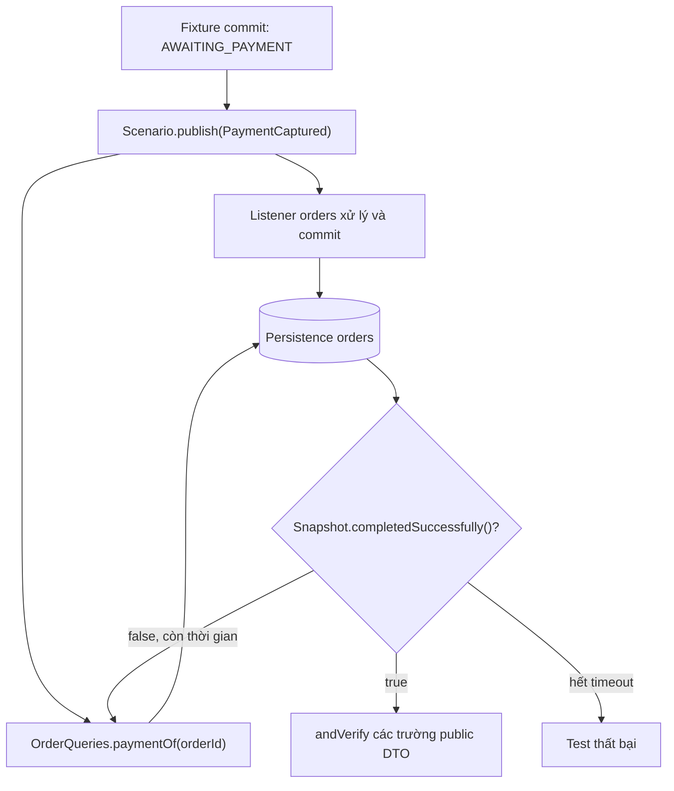
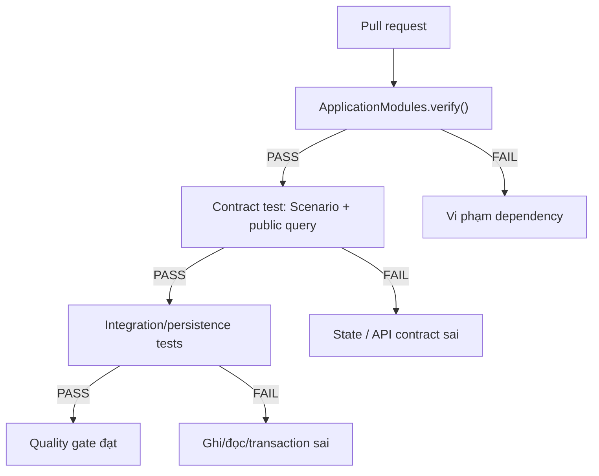

# Không truy cập trực tiếp trường nội bộ để assertion trong Spring Modulith

## 1. Vấn đề: test đúng dữ liệu nhưng sai ranh giới

Giả sử module `payments` phát sự kiện `PaymentCaptured`, module `orders` tiếp nhận và cập nhật đơn hàng từ `AWAITING_PAYMENT` sang `PAID`. Khi viết bài kiểm thử, ta có thể bị cám dỗ truy cập một field như `OrderEntity.paymentStatus` hoặc `orders.internal.OrderRepository` rồi khẳng định giá trị trong database đã thay đổi.

Cách này có thể trả về kết quả đúng ở một phiên bản ứng dụng, nhưng nó tạo ra **phụ thuộc vào biểu diễn nội bộ**. Khi module `orders` đổi cấu trúc entity, tách bảng, chuyển sang aggregate khác hoặc thay đổi cơ chế persistence mà vẫn giữ hợp đồng công khai, bài test của module khác bị vỡ không cần thiết. Tệ hơn, việc đọc field từ một entity Java đã load trước khi event chạy có thể đưa ra kết luận sai vì **trạng thái trong object không chắc là trạng thái đã commit**.

Trong chương *State change* của học phần `SPRING_MODULITH_VERIFICATION_TESTING`, mục tiêu là kiểm chứng kết quả hành vi qua `@ApplicationModuleTest`, event, database và tích hợp, đồng thời dùng `ApplicationModules` và quy tắc phụ thuộc để giữ chất lượng kiến trúc trong CI.

**Nguyên tắc cốt lõi:** một bài test ở **ranh giới module** nên khẳng định **kết quả nghiệp vụ có thể quan sát qua API được cho phép**, thay vì kiểm tra trực tiếp field/private state hoặc repository thuộc implementation của module khác.

Sau bài học, bạn có thể:

- Phân biệt assertion về **hợp đồng nghiệp vụ** và assertion về **chi tiết triển khai**.
- Giải thích vì sao truy cập field riêng, dùng reflection hoặc import package `internal` là không phù hợp cho contract test xuyên module.
- Thiết kế public query API/DTO và method domain để kiểm chứng đúng trạng thái mong đợi.
- Viết `Scenario.andWaitForStateChange(...)` với nguồn đọc và predicate rõ ràng.
- Nhận diện trường hợp được phép kiểm tra nội bộ trong unit test của chính module và trường hợp phải giữ tính black-box.
- Kết hợp kiểm thử hành vi với `ApplicationModules.verify()` và quality gate CI.

## 2. “Trường nội bộ” là gì và vì sao cần tránh?

Trong ngữ cảnh này, *trường nội bộ* gồm những thành phần biểu diễn trạng thái mà module sở hữu chưa hề cam kết công khai:

- Field `private` hoặc package-private của aggregate/entity, ví dụ `OrderJpaEntity.statusCode`.
- Getter hoặc method nằm trên class được đặt trong package `orders.internal`, dù method đó có modifier `public`.
- Repository, `EntityManager`, bảng SQL hoặc tên cột chỉ thuộc implementation của module.
- Biến mutable/cache của listener, ví dụ `listener.lastProcessedOrderId`, nếu không phải hợp đồng nghiệp vụ chính thức.
- Dữ liệu nội bộ lấy bằng `ReflectionTestUtils.getField(...)` hoặc Java Reflection.

Không phải mọi API Java mang từ khóa `public` đều có nghĩa là **public API của một application module**. Trong cách tổ chức Spring Modulith theo package, kiểu trong package gốc của module thường là bề mặt API, còn kiểu trong package con mặc định là nội bộ, trừ khi được công khai có chủ đích bằng named interface.

| Đối tượng test đọc | Thông điệp mà assertion thực sự xác nhận | Hạn chế |
| --- | --- | --- |
| `order.statusCode` qua reflection | Một field nội bộ hiện mang giá trị cụ thể. | Dễ vỡ khi refactor, có thể đọc entity stale; bỏ qua hợp đồng. |
| `orders.internal.OrderRepository.findById(id)` từ module khác | Dữ liệu trong persistence nội bộ thỏa điều kiện. | Phụ thuộc sai ranh giới; chưa chắc query public phản ánh đúng. |
| `orders.OrderQueries.paymentOf(id)` | Consumer được phép đọc một DTO trạng thái. | Phải kiểm chứng điều kiện nghiệp vụ trên DTO, không chỉ `isPresent`. |
| `OrderPaymentView.completedSuccessfully()` | Hợp đồng hoàn tất thanh toán đã được thỏa. | Cần xây dựng method đúng bất biến nghiệp vụ. |
| Listener mock nhận lời gọi `on(event)` | Một handler được gọi. | Không chứng minh database đã commit hoặc state mới quan sát được. |

**Không tuyệt đối cấm mọi kiểm tra nội bộ.** Unit test đặt *bên trong chính module sở hữu* có thể kiểm tra aggregate, entity và repository để bắt lỗi thuật toán hoặc mapping. Điều cần tránh là dùng các chi tiết đó làm **hợp đồng assertion cho bài test ở phía ngoài module**, đặc biệt đối với luồng event-driven xuyên module.

## 3. Phân biệt ba cấp kiểm thử và loại assertion phù hợp

| Cấp độ | Mục tiêu | Phép đọc/assertion nên chọn |
| --- | --- | --- |
| **Unit test domain** của module `orders` | Kiểm tra quy tắc chuyển trạng thái trong aggregate. | Method nghiệp vụ, getter/domain invariant; có thể kiểm tra chi tiết cần thiết của chính module. |
| **`@ApplicationModuleTest`** của module `orders` | Event, listener, repository/transaction và query API phối hợp đúng. | Phát event rồi quan sát state qua API công khai hoặc một cổng được module sở hữu. |
| **Integration test giữa các module** | Consumer hợp lệ nhìn thấy kết quả nghiệp vụ sau event/use case. | Public query API, read model hoặc giao diện chính thức của module đích; không import repository `internal`. |

Một lớp test không tốt chỉ vì sử dụng repository. Repository vẫn có vai trò trong **fixture, adapter và kiểm thử nội bộ của module**. Sự khác biệt là **bài test này đang bảo vệ hợp đồng gì, đứng ở ranh giới nào và có quyền phụ thuộc vào gì**.

Ví dụ, `orders` có thể test riêng `Order.markPaid()` để kiểm chứng việc nhập mã thanh toán và điều kiện trạng thái. Nhưng bài test của module `shipping` không nên lấy `OrderJpaEntity` về rồi đọc `statusCode` bằng reflection chỉ để quyết định có thể giao hàng.

## 4. Thiết kế ví dụ: từ `PaymentCaptured` đến `OrderPaymentView`

Giả định cấu trúc package sau:

```text
com.example.shop
├── ShopApplication.java
├── payments
│   ├── events
│   │   ├── package-info.java
│   │   └── PaymentCaptured.java
│   └── internal
│       └── PaymentService.java
└── orders
    ├── package-info.java
    ├── OrderQueries.java
    ├── OrderPaymentView.java
    ├── OrderStatus.java
    └── internal
        ├── PaymentCapturedListener.java
        ├── OrderPaymentService.java
        ├── OrderRepository.java
        ├── JpaOrderQueries.java
        └── OrderJpaEntity.java
```

Đây là bố cục minh họa, không phải cấu trúc duy nhất của Spring Modulith. `orders` chỉ phụ thuộc vào contract `payments.events.PaymentCaptured` đã được công khai, thay vì truy cập cơ sở dữ liệu riêng của `payments`.

### 4.1. Công khai event qua named interface

```java
// File: com/example/shop/payments/events/package-info.java
@org.springframework.modulith.NamedInterface("events")
package com.example.shop.payments.events;
```

```java
// File: com/example/shop/payments/events/PaymentCaptured.java
package com.example.shop.payments.events;

import java.util.UUID;

public record PaymentCaptured(UUID orderId, String transactionId) {}
```

Nếu module `orders` chỉ được phép phụ thuộc vào named interface này, khai báo minh họa:

```java
// File: com/example/shop/orders/package-info.java
@org.springframework.modulith.ApplicationModule(
        allowedDependencies = "payments::events")
package com.example.shop.orders;
```

Các tên `payments`, `orders` và `events` phải trùng với tên module/interface được Spring Modulith khám phá trong ứng dụng thực. Không phải mọi dự án đều cần cấu hình `allowedDependencies`; khi giới hạn được khai báo, chúng giúp xác định rõ contract module nhận được phép sử dụng.

### 4.2. API query trả snapshot thay vì JPA entity

Các khai báo `public` sau nằm trong **những file Java riêng**:

```java
// File: com/example/shop/orders/OrderStatus.java
package com.example.shop.orders;

public enum OrderStatus {
    AWAITING_PAYMENT, PAID, PAYMENT_FAILED
}
```

```java
// File: com/example/shop/orders/OrderPaymentView.java
package com.example.shop.orders;

import java.time.Instant;
import java.util.UUID;

public record OrderPaymentView(
        UUID orderId,
        OrderStatus status,
        String transactionId,
        Instant paidAt) {

    public boolean completedSuccessfully() {
        return status == OrderStatus.PAID
                && transactionId != null
                && !transactionId.isBlank()
                && paidAt != null;
    }
}
```

```java
// File: com/example/shop/orders/OrderQueries.java
package com.example.shop.orders;

import java.util.Optional;
import java.util.UUID;

public interface OrderQueries {
    Optional<OrderPaymentView> paymentOf(UUID orderId);
}
```

`OrderPaymentView` là **DTO bất biến dùng cho truy vấn**. Nó biểu diễn điều mà bên ngoài được phép biết, không phơi bày entity đang được JPA quản lý, version column, quan hệ lazy, phương thức mutate hay mã trạng thái lưu trong bảng.

Điểm quan trọng: assertion có thể đọc các *thành phần công khai của DTO* như `status()`, `transactionId()`, `paidAt()`, hoặc gọi `completedSuccessfully()`. Việc này **không đồng nghĩa** truy cập trực tiếp trường nội bộ: dữ liệu đó đã được module chủ động đưa vào hợp đồng.

Một hợp đồng tốt chỉ công khai những trường consumer thật sự cần. Nếu tên cột, trạng thái trung gian hoặc thông tin nhạy cảm không cần thiết, đừng đưa chúng vào DTO chỉ để phục vụ test.

## 5. Triển khai adapter bên trong module sở hữu

`OrderQueries` có thể được triển khai bằng một adapter nằm trong `orders.internal`. Ví dụ với JPA:

```java
// File: com/example/shop/orders/internal/JpaOrderQueries.java
package com.example.shop.orders.internal;

import java.util.Optional;
import java.util.UUID;

import org.springframework.stereotype.Service;
import org.springframework.transaction.annotation.Transactional;
import com.example.shop.orders.OrderQueries;
import com.example.shop.orders.OrderPaymentView;

@Service
class JpaOrderQueries implements OrderQueries {

    private final OrderRepository repository;

    JpaOrderQueries(OrderRepository repository) {
        this.repository = repository;
    }

    @Override
    @Transactional(readOnly = true)
    public Optional<OrderPaymentView> paymentOf(UUID orderId) {
        return repository.findById(orderId).map(order ->
                new OrderPaymentView(
                        order.getId(),
                        order.getStatus(),
                        order.getTransactionId(),
                        order.getPaidAt()));
    }
}
```

`OrderRepository` và `OrderJpaEntity` là **thành phần nghiệp vụ/persistence giả định** do ứng dụng triển khai. Adapter được phép biết chúng vì cùng thuộc module `orders`; consumer chỉ thấy interface và DTO.

Đây là vị trí hợp lý để:

- Chuyển enum/value object nội bộ sang giá trị hợp đồng.
- Giữ mapping JPA, schema và kỹ thuật transaction bên trong module.
- Trả một snapshot trạng thái có đủ trường cho predicate nghiệp vụ.
- Chọn query projection nhẹ nếu không cần tải toàn bộ entity.

Nếu một test truy cập trực tiếp entity thay vì `OrderQueries`, lỗi mapping trong `JpaOrderQueries` có thể lọt qua. Kiểm thử qua public API phát hiện cả lỗi đọc state, không chỉ lỗi ghi state.

### 5.1. Tại sao assertion trên getter nội bộ vẫn có thể sai?

Đoạn sau không truy cập field `private` trực tiếp, nhưng vẫn phụ thuộc implementation của module đích:

```java
// Anti-pattern nếu đây là test ở một module KHÁC:
OrderJpaEntity entity = internalRepository.findById(orderId).orElseThrow();
assertThat(entity.getStatus()).isEqualTo(OrderStatus.PAID);
```

`getStatus()` có thể là `public`, nhưng class `OrderJpaEntity` vẫn ở `orders.internal`. Modifier Java không xóa bỏ ranh giới module của Spring Modulith. Vì vậy, “thay `field` bằng getter” **chưa đủ** để có một contract test hợp lệ.

## 6. Các anti-pattern assertion dễ gặp

### 6.1. Dùng reflection để lấy field riêng

```java
import org.springframework.test.util.ReflectionTestUtils;

// Không phù hợp cho kiểm thử hợp đồng xuyên module.
Object rawStatus = ReflectionTestUtils.getField(orderEntity, "statusCode");
assertThat(rawStatus).isEqualTo("PAID");
```

Có ba điểm yếu: test phụ thuộc tên field, bỏ qua API của module, và có thể đọc object cũ. Nếu module chuyển từ `String statusCode` sang enum hoặc value object mà hợp đồng `OrderQueries` giữ nguyên, test sẽ vỡ vì chi tiết không còn liên quan đến consumer.

Đặc biệt, reflection có thể **né** một số kiểm tra phụ thuộc tĩnh vì class/field được tìm bằng chuỗi ở runtime. Đừng dựa vào `ApplicationModules.verify()` để phát hiện mọi trường hợp sử dụng reflection; code review và quy ước test vẫn cần thiết.

### 6.2. Đọc repository nội bộ của module khác

```java
// Anti-pattern trong test đặt ở ngoài module orders.
import com.example.shop.orders.internal.OrderRepository;

@Autowired OrderRepository orders;

assertThat(orders.findById(orderId)).isPresent();
```

Ngoài phụ thuộc sai ranh giới, test chỉ xác nhận *bản ghi tồn tại*. Nó chưa chứng minh `PAID` hoặc mã giao dịch đúng. Nếu test cần đọc repository để thiết lập fixture nội bộ, hãy làm ở test của chính module hoặc dùng helper chuyên biệt có quyền truy cập theo thiết kế.

### 6.3. Đọc state qua biến mutable của listener

```java
// Anti-pattern: đây không phải nguồn state đã commit.
assertThat(listener.getLastProcessedOrderId()).isEqualTo(orderId);
```

Listener có thể đã ghi một biến khi bắt đầu nhưng transaction ghi database lại rollback. Biến cũng có thể bị thay đổi bởi event khác chạy song song. Một test hợp đồng nên đọc kết quả từ API truy vấn ổn định thay vì kiểm tra trạng thái chẩn đoán tạm thời của bean.

### 6.4. Giữ entity từ trước khi event được xử lý

```java
OrderJpaEntity cached = repository.findById(orderId).orElseThrow();

scenario.publish(new PaymentCaptured(orderId, "TX-410"))
        .andWaitForStateChange(
                () -> cached.getStatus(),
                status -> status == OrderStatus.PAID);
```

Dù ở test nội bộ cùng module, supplier này có thể mãi đọc cùng entity trong memory. Khi listener chạy ở thread/transaction khác và commit, `cached` không tự được refresh. Nếu cần đợi state bất đồng bộ, supplier phải đọc lại trạng thái đã commit qua cổng phù hợp.

### 6.5. Assertion chỉ kiểm tra DTO tồn tại

```java
// Chưa đủ: Optional.of(AWAITING_PAYMENT) cũng isPresent().
snapshot -> snapshot.isPresent()

// Đúng hơn: snapshot biểu diễn nghiệp vụ thanh toán hoàn tất.
snapshot -> snapshot.filter(OrderPaymentView::completedSuccessfully)
                    .isPresent()
```

`andVerify(...)` là assertion cuối, **không sửa được predicate đã dừng quá sớm**. Cần chờ đúng trạng thái nghiệp vụ chứ không chỉ chờ một record xuất hiện.

## 7. Test đúng bằng `Scenario.andWaitForStateChange(...)`

Giả sử listener bên trong `orders` nhận `PaymentCaptured` và ghi trạng thái. Test của module `orders` có thể phát event rồi quan sát state qua `OrderQueries`, tránh dựa vào `OrderJpaEntity` hoặc tên field persistence.

```java
import static org.assertj.core.api.Assertions.assertThat;

import java.time.Duration;
import java.util.UUID;

import org.junit.jupiter.api.Test;
import org.springframework.beans.factory.annotation.Autowired;
import org.springframework.modulith.test.ApplicationModuleTest;
import org.springframework.modulith.test.Scenario;

@ApplicationModuleTest
class OrderPaymentContractTests {

    @Autowired OrderQueries queries;
    @Autowired OrderFixture fixture;

    @Test
    void capturedPaymentIsVisibleThroughPublicApi(Scenario scenario) {
        UUID id = fixture.createAwaitingPaymentAndCommit();

        assertThat(queries.paymentOf(id))
                .get()
                .extracting(OrderPaymentView::status)
                .isEqualTo(OrderStatus.AWAITING_PAYMENT);

        scenario.publish(new PaymentCaptured(id, "TX-411"))
                .andWaitAtMost(Duration.ofSeconds(5))
                .forStateChange(
                        () -> queries.paymentOf(id),
                        value -> value.filter(
                                OrderPaymentView::completedSuccessfully)
                                      .isPresent())
                .andVerify(value -> {
                    OrderPaymentView current = value.orElseThrow();

                    assertThat(current.orderId()).isEqualTo(id);
                    assertThat(current.status()).isEqualTo(OrderStatus.PAID);
                    assertThat(current.transactionId()).isEqualTo("TX-411");
                    assertThat(current.paidAt()).isNotNull();
                });
    }
}
```

Đây là ví dụ dựa trên các kiểu hợp đồng giả định:

- `OrderFixture` là helper của dự án; `createAwaitingPaymentAndCommit()` phải thực sự tạo và commit trạng thái ban đầu.
- `PaymentCaptured` là contract event đã được khai báo ở package công khai của `payments`.
- `OrderQueries` là public API thuộc module `orders`.
- Listener xử lý event, repository và hạ tầng transaction phải hiện diện trong test context. `@ApplicationModuleTest` không mặc nhiên khởi tạo mọi module khác.
- `Duration.ofSeconds(5)` chỉ minh họa thời hạn; ngưỡng hợp lý tùy ứng dụng và môi trường CI.

**Điều gì được bảo vệ?** Bài test đi từ event đến kết quả nghiệp vụ `PAID`, xác minh mapping của public query API, định danh `orderId` và các giá trị quan trọng. Thay đổi entity/schema nội bộ mà không đổi contract sẽ không làm test phải sửa chỉ vì tên field bị thay đổi.

### 7.1. Từng bước của state assertion



Bài test có hai tầng điều kiện:

1. **Predicate để chờ:** `completedSuccessfully()` quyết định khi nào trạng thái đã đạt.
2. **Assertion để mô tả kết quả:** `status()`, `transactionId()` và `paidAt()` cung cấp thông báo lỗi cụ thể nếu contract không đáp ứng.

Cả hai đều dựa trên **DTO thuộc public API**, không phụ thuộc JPA entity.

### 7.2. Khi trạng thái đích phức tạp hơn một enum

Chỉ chờ `status == PAID` có thể là false positive nếu nghiệp vụ đòi mã giao dịch và thời điểm thanh toán. Predicate `completedSuccessfully()` gói điều kiện:

```java
public boolean completedSuccessfully() {
    return status == OrderStatus.PAID
            && transactionId != null
            && !transactionId.isBlank()
            && paidAt != null;
}
```

Không nhất thiết mọi ứng dụng đều công khai method này trên DTO. Có thể viết predicate ở test dựa trên các trường công khai nếu đó là hợp đồng tiêu thụ. Tuy nhiên, một method rõ ngữ nghĩa tránh lặp quy tắc ở nhiều consumer; khi thay đổi invariant, hãy cập nhật API/test theo tiến hóa hợp đồng.

Lưu ý: method của DTO chỉ đánh giá những dữ liệu snapshot chứa. Nếu nghiệp vụ cần bất biến không thể biểu lộ qua DTO, nên tạo API cấp cao phù hợp hoặc bổ sung test domain nội bộ, thay vì ép consumer đọc các field private.

## 8. Kiểm thử nội bộ: được phép biết gì?

Phân biệt hai ví dụ.

**Unit test của aggregate ở trong module `orders`:**

```java
@Test
void markPaidSetsDomainState() {
    Order order = Order.awaitingPayment(orderId);

    order.markPaid("TX-412", clock.instant());

    assertThat(order.isPaid()).isTrue();
    assertThat(order.paymentReference()).isEqualTo("TX-412");
}
```

`Order`, `markPaid(...)` và `paymentReference()` ở đây là domain API minh họa. Một test cùng module có thể kiểm tra chi tiết triển khai khi cần bắt lỗi domain; nhưng vẫn nên ưu tiên **hành vi và invariant** thay vì reflection vào field private. Việc đổi tên field nội bộ không nên làm test domain hỏng nếu hành vi giữ nguyên.

**Module contract test từ bên ngoài `orders`:**

```java
OrderPaymentView view = queries.paymentOf(orderId).orElseThrow();

assertThat(view.completedSuccessfully()).isTrue();
assertThat(view.transactionId()).isEqualTo("TX-412");
```

Test thứ hai chỉ cần nhìn thấy phần mà module `orders` cam kết. Nó không phải biết `OrderJpaEntity` hay thuật toán map status trong DB. Nếu test nằm ở module consumer, việc import `OrderQueries` cũng phải hợp lệ theo hướng dependency. Với kiến trúc không cho phép consumer phụ thuộc trực tiếp `orders`, đặt test hợp đồng ở integration scope hoặc module được phép dùng API.

### 8.1. Khi nào cần kiểm tra repository/DB trực tiếp?

Có trường hợp cần thiết trong phạm vi **test của chính module sở hữu**:

- Kiểm tra mapping JPA, unique constraint và migration.
- Kiểm tra transaction rollback hoặc concurrency của persistence layer.
- Kiểm tra một query adapter tạo đúng DTO trong các tình huống dữ liệu đặc biệt.
- Kiểm tra cleanup, fixture và index/truy vấn cho hoạt động kỹ thuật.

Những bài test này là **white-box persistence tests**, khác với hợp đồng liên module. Không biến một test DB riêng thành đường phụ thuộc production giữa hai module. Cũng không lấy tên field private làm bằng chứng duy nhất cho nghiệp vụ đã hoàn thành.

## 9. Đọc state đúng sau transaction và event bất đồng bộ

Không truy cập field nội bộ mới giải quyết **vấn đề kiến trúc**. Bài test còn phải đọc đúng state sau khi listener đã commit.

Các tình huống cần phòng tránh:

| Nguy cơ | Biểu hiện | Cách tiếp cận |
| --- | --- | --- |
| Listener chạy `@Async`. | Assertion ngay sau publish thấy trạng thái ban đầu. | Dùng `Scenario.andWaitForStateChange(...)` với predicate rõ ràng. |
| Listener `AFTER_COMMIT`. | Event chưa kích hoạt handler vì transaction gốc chưa commit. | Tổ chức stimulus trong transaction thực sự commit. |
| Fixture mới `saveAndFlush`, chưa commit. | Listener ở thread khác không thấy record. | Chuẩn bị state ban đầu đã commit trước khi phát event. |
| Reader giữ JPA entity cũ. | Database `PAID` nhưng supplier mãi thấy state cũ. | Query snapshot/projection mới qua read API. |
| Transaction đọc giữ snapshot cũ. | Query lại vẫn nhận giá trị ban đầu. | Xem isolation/transaction boundary; tránh giữ transaction dài xuyên quá trình chờ. |
| Read model hoặc replica cập nhật chậm. | Public API phản ánh state muộn hơn DB chính. | Chờ kết quả consumer-visible và chọn timeout theo hợp đồng. |
| Predicate chỉ kiểm tra `isPresent()`. | Test dừng trước khi trạng thái đạt. | Kiểm tra điều kiện đích `completedSuccessfully()`. |

Một public query adapter thường dùng transaction đọc ngắn để tạo DTO. Nếu test bị bao bởi transaction lâu và gọi lại reader trong cùng persistence context/snapshot, `@Transactional(readOnly = true)` mặc định có thể tham gia transaction đang tồn tại. Khi cần transaction đọc mới, thiết kế adapter hoặc test boundary với propagation phù hợp và kiểm chứng trên database thật; không rải `REQUIRES_NEW` vô điều kiện cho mọi query.

### 9.1. Chẩn đoán bằng bằng chứng, không bằng reflection

Khi test timeout, nên kiểm tra:

1. `orderId` và event type đã phát có khớp listener không?
2. Listener có được bootstrap trong `@ApplicationModuleTest` không?
3. Transaction của listener có commit hay rollback?
4. Query public trả `Optional.empty()`, trạng thái cũ hay DTO `PAID` thiếu field?
5. Primary DB đã có dữ liệu mới mà adapter không thấy, hay chính writer không cập nhật?
6. Predicate có sai invariant hoặc chờ trạng thái không thể đạt?
7. Timeout có đủ theo độ trễ hợp lệ của môi trường CI?

Có thể log `orderId`, trạng thái cuối từ query API và thời điểm commit, nhưng không cần đọc private field bằng reflection để điều tra. Khi phải chẩn đoán sâu persistence, làm ở môi trường test nội bộ hoặc công cụ quan sát phù hợp, tránh đưa truy cập implementation vào hợp đồng test xuyên module.

## 10. Kiểm tra cấu trúc bằng `ApplicationModules.verify()`

Một test trạng thái pass không đồng nghĩa code tôn trọng ranh giới. Spring Modulith cho phép xác minh cấu trúc và phụ thuộc:

```java
import org.junit.jupiter.api.Test;
import org.springframework.modulith.core.ApplicationModules;

class ModuleArchitectureTests {

    @Test
    void respectsApplicationModuleBoundaries() {
        ApplicationModules.of(ShopApplication.class).verify();
    }
}
```

`ShopApplication` là Spring Boot application class giả định. Với `@NamedInterface("events")` và `@ApplicationModule(allowedDependencies = ...)`, phép xác minh có thể phát hiện dependency từ module khác tới package/API không được công khai hoặc không được cho phép.

Tuy nhiên:

- `verify()` phân tích cấu trúc phụ thuộc mà Spring Modulith nhận diện; nó không phải công cụ tự kiểm chứng mọi assertion có ý nghĩa nghiệp vụ.
- Truy cập trường qua string/reflection có thể không xuất hiện như dependency tĩnh mà kiểm tra kiến trúc nhìn thấy.
- Một truy cập repository từ **chính module sở hữu** có thể hợp lệ về kiến trúc nhưng vẫn không phù hợp với mục tiêu kiểm tra public contract.

Vì vậy, **kiểm thử hành vi**, **kiểm chứng cấu trúc**, quy ước package và **code review** bổ trợ cho nhau; không phép nào thay hoàn toàn các phép còn lại.

## 11. CI quality gate để ngăn hồi quy hành vi và ranh giới

Một quality gate hiệu quả nên bảo vệ cả ba điều:

1. **Module graph đúng:** chạy test sử dụng `ApplicationModules.of(...).verify()` để kiểm chứng phụ thuộc.
2. **State contract đúng:** chạy `@ApplicationModuleTest` với `Scenario` và predicate trên public query API; timeout hoặc assertion sai phải làm test thất bại.
3. **Persistence/integration đúng:** chạy những test cần database, transaction, async executor, read model hoặc broker trong phạm vi phù hợp.

Ví dụ với dự án Gradle đã cấu hình JUnit test trong task `test`:

```bash
./gradlew test
```

Nếu dự án có task/test suite riêng cho integration tests, CI phải chạy thêm task đó. Không giả định tất cả integration tests nằm trong `test`.

Các tiêu chí để test tránh flaky:

- Fixture tạo dữ liệu với ID riêng, có state ban đầu đã commit.
- Listener và dependency cần thiết hiện diện trong test context.
- Supplier đọc state qua API ổn định với khả năng nhìn thấy commit mới.
- Predicate có nghĩa nghiệp vụ và timeout hữu hạn, có căn cứ.
- Assertion xác minh đúng ID và dữ liệu tương quan, tránh pass nhầm từ test khác.
- Báo cáo lỗi giữ state cuối và correlation ID, không lộ dữ liệu thanh toán nhạy cảm.
- Reviewer có thể xác nhận test consumer **không import package `internal` hoặc đọc private field bằng reflection**.



## 12. Tình huống so sánh: thay đổi implementation không đổi contract

Giả sử ban đầu dữ liệu đơn hàng lưu dưới dạng `status_code VARCHAR` trong một bảng. Sau refactor, module `orders` chuyển sang một value object và bảng thanh toán riêng. Hai cách test phản ứng khác nhau:

| Thay đổi nội bộ | Test truy cập field/repository nội bộ | Test qua public query API |
| --- | --- | --- |
| Đổi `statusCode` thành `paymentState`. | Reflection `getField("statusCode")` thất bại. | Không cần đổi nếu `OrderPaymentView` giữ nguyên. |
| Đổi schema từ một bảng sang nhiều bảng. | SQL/ORM test consumer hỏng. | Adapter chịu trách nhiệm mapping, consumer vẫn đọc DTO. |
| Chuyển từ JPA sang JDBC. | Test consumer phụ thuộc JPA không dùng được. | API giữ hợp đồng; adapter thay đổi. |
| Thêm trạng thái nội bộ `CAPTURE_CONFIRMED` trước `PAID`. | Assertion cứng vào field trung gian dễ vỡ. | Predicate chờ trạng thái công khai `PAID`. |
| Adapter trả sai `paidAt` dù DB đúng. | Test repository có thể vẫn pass. | Public contract test phát hiện hồi quy. |

Điểm lợi không chỉ là ít sửa test, mà là test thất bại **đúng lúc consumer bị ảnh hưởng**. Khi public API thay đổi có chủ đích, test consumer nên được cập nhật cùng hợp đồng mới; tránh cố giữ cấu trúc cũ vô hạn.

## 13. Bài thực hành

**Bài A — phát hiện test phụ thuộc field:** cho một bài test đọc `OrderJpaEntity.statusCode` bằng `ReflectionTestUtils`. Liệt kê các phụ thuộc ngầm về tên field, kiểu dữ liệu và transaction. Viết lại để đọc `OrderQueries.paymentOf(orderId)`.

**Bài B — predicate chính xác:** tạo đơn hàng `AWAITING_PAYMENT` rồi publish `PaymentCaptured`. So sánh điều kiện chờ `Optional::isPresent` và `OrderPaymentView::completedSuccessfully`; giải thích vì sao điều kiện đầu có thể dừng sớm.

**Bài C — mapping sai:** cố ý để adapter trả `paidAt = null` dù entity đã ghi `PAID`. Xác minh test chỉ kiểm tra status có thể pass nhưng contract test dựa trên `completedSuccessfully()` thất bại. Hoàn nguyên mapping.

**Bài D — kiểm thử nội bộ vs xuyên module:** viết một unit test cho `Order.markPaid()` trong chính module và một `@ApplicationModuleTest` phát event rồi đọc DTO. Chỉ ra trách nhiệm của mỗi test và loại lỗi mỗi test phát hiện.

**Bài E — kiến trúc:** tạo thử một import `orders.internal.OrderRepository` từ module `shipping`; chạy `ApplicationModules.verify()` và phân tích vi phạm. Chuyển sang dùng bề mặt công khai được cho phép hoặc bố trí test tích hợp toàn ứng dụng đúng phạm vi; hoàn nguyên thay đổi thử nghiệm.

**Bài F — state stale:** lấy entity một lần trước event rồi dùng getter trong supplier. So sánh với query service đọc snapshot đã commit mỗi lượt poll, giải thích tác động của JPA cache và transaction isolation.

**Tiêu chí hoàn thành:** một bài test ở ranh giới module không dùng reflection/private field hoặc repository nội bộ của module khác; predicate chờ đúng kết quả nghiệp vụ; nguồn đọc thấy commit; và CI có kiểm chứng state contract lẫn module dependency.

## 14. Tổng kết và tham khảo

Không truy cập trực tiếp trường nội bộ để assertion **không có nghĩa ngừng kiểm tra dữ liệu**. Nó có nghĩa là kiểm chứng **đúng tầng trừu tượng và đúng quyền sở hữu**: unit test nội bộ kiểm tra chi tiết domain khi cần, còn contract/integration test ngoài module đọc dữ liệu qua API chính thức. Kết hợp snapshot DTO, predicate rõ ràng, `Scenario.andWaitForStateChange(...)` và `ApplicationModules.verify()` giúp bảo vệ cả kết quả nghiệp vụ lẫn kiến trúc.

Tài liệu tham khảo:

- [Spring Modulith — Fundamentals: Application Modules](https://docs.spring.io/spring-modulith/reference/fundamentals.html): tổ chức module và bề mặt API.
- [Spring Modulith — Verifying Application Module Structure](https://docs.spring.io/spring-modulith/reference/verification.html): kiểm chứng phụ thuộc, named interfaces và quy tắc module.
- [Spring Modulith — Testing Application Modules](https://docs.spring.io/spring-modulith/reference/testing.html): `@ApplicationModuleTest`, `Scenario` và state change.
- [Spring Modulith — Working with Application Events](https://docs.spring.io/spring-modulith/reference/events.html): phối hợp giữa module qua event.
- [Spring Framework — Testing Utilities](https://docs.spring.io/spring-framework/reference/testing.html): công cụ test, bao gồm reflection utility và phạm vi sử dụng.
