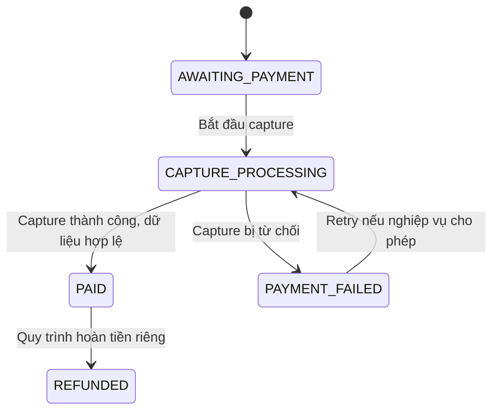
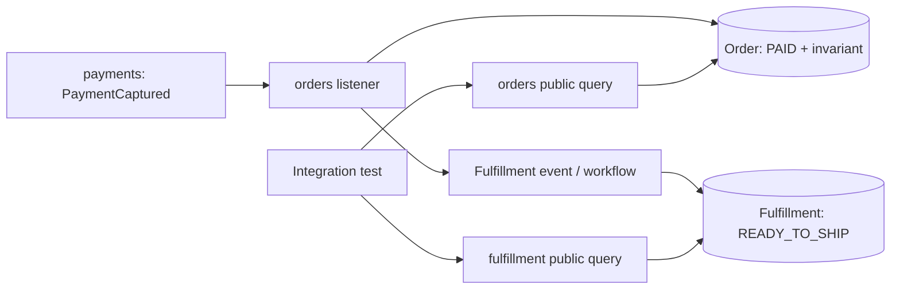

# Kiểm tra state cuối cùng và invariant liên quan trong Spring Modulith

## 1. Vì sao đạt một trạng thái enum vẫn có thể chưa đủ?

Trong một hệ thống Spring Modulith, module `payments` phát sự kiện `PaymentCaptured`, còn module `orders` xử lý và chuyển đơn hàng từ `AWAITING_PAYMENT` sang `PAID`. Một bài test có thể xác minh:

```java
assertThat(orderQueries.statusOf(orderId)).contains(OrderStatus.PAID);
```

Nhưng liệu đơn hàng đã thực sự được thanh toán đúng? Có thể field trạng thái là `PAID` trong khi **số tiền đã ghi nhận nhỏ hơn tổng tiền**, mã giao dịch trống hoặc thời điểm thanh toán chưa được lưu. Nếu test chỉ so sánh một enum, các lỗi ấy có thể lọt qua CI.

Vì vậy, khi kiểm thử *State change*, cần phân biệt:

- **State cuối cùng (final/terminal state trong một quy trình):** trạng thái biểu thị một bước nghiệp vụ đã hoàn tất, chẳng hạn `PAID` hoặc `PAYMENT_FAILED`.
- **Invariant (bất biến nghiệp vụ):** quy tắc phải luôn đúng trong một trạng thái hợp lệ; ví dụ “nếu đơn hàng được đánh dấu đã thanh toán, số tiền ghi nhận phải bằng tổng tiền, đồng thời có tham chiếu và thời điểm xác nhận”.
- **Tính quan sát được:** API đọc sau khi listener commit trả dữ liệu phản ánh state và invariant ấy.

Bài thuộc chương *State change* của `SPRING_MODULITH_VERIFICATION_TESTING`. Mục tiêu của học phần là kiểm chứng ranh giới kiến trúc bằng `ApplicationModules`, kiểm thử module bằng `@ApplicationModuleTest`, kiểm thử sự kiện, database và tích hợp, rồi đưa các bằng chứng đó vào CI quality gate để ngăn phụ thuộc sai và hồi quy.

Sau bài này, bạn sẽ có thể:

1. Viết tiêu chí hoàn tất nghiệp vụ gồm **state đích và các invariant liên quan**.
2. Lựa chọn aggregate, projection hoặc public query API để đọc một snapshot nhất quán.
3. Dùng `Scenario.andWaitForStateChange(...)` hoặc `andWaitAtMost(...).forStateChange(...)` với predicate phù hợp.
4. Phân biệt điều kiện **dừng chờ** và assertion **xác nhận kết quả cuối**.
5. Phát hiện thiếu dữ liệu, sai số tiền, trạng thái lỗi, event trùng và hồi quy sau refactor.
6. Tránh phụ thuộc vào repository/field nội bộ của module khác, đồng thời tích hợp test kiến trúc trong CI.

## 2. Định nghĩa state cuối cùng theo hợp đồng nghiệp vụ

Từ “cuối cùng” không có nghĩa một entity **không bao giờ đổi nữa**. Trong quy trình *thu tiền*, `PAID` có thể là trạng thái kết thúc của bước capture; sau đó một luồng hoàn tiền hợp lệ vẫn có thể chuyển sang `REFUNDED`. Trạng thái terminal phải được hiểu **trong phạm vi workflow đang kiểm thử**.

Ví dụ quy trình thanh toán đơn hàng:



Không phải mọi trạng thái trong sơ đồ đều bắt buộc có trong mọi hệ thống; đây là ví dụ để làm rõ **phạm vi của khẳng định**.

| Câu hỏi | Trả lời phù hợp khi viết test |
| --- | --- |
| Trạng thái nào chứng minh bước capture đã xong? | `PAID` với kết quả thành công; `PAYMENT_FAILED` nếu thất bại terminal. |
| Đã tồn tại một `Order` có đủ chứng minh hoàn tất? | Chưa. Bản ghi có thể tồn tại từ `AWAITING_PAYMENT`. |
| Đã nhận event `PaymentCaptured` có đủ không? | Chưa. Listener có thể chưa commit hoặc đã rollback. |
| `status == PAID` có đủ không? | Chỉ đủ nếu đó là **toàn bộ** hợp đồng; thường cần số tiền, mã giao dịch và thời điểm. |
| Predicate thấy `PAID` một lần có chứng minh bền vững mãi mãi? | Không. Nó xác nhận một **lần quan sát**; không chứng minh không có chuyển trạng thái về sau. |

Hãy bắt đầu từ câu nghiệp vụ đầy đủ, ví dụ:

> “Với đơn hàng X có tổng tiền 125.000 VND, sau khi capture thành công, state phải là PAID, số tiền capture đúng 125.000 VND, mã giao dịch không trống và thời điểm xác nhận phải được ghi.”

Trong hệ thống thực, còn có thể cần invariant về currency, thuế, unique transaction ID, ledger, số dư hoặc lịch sử chuyển trạng thái.

## 3. Viết invariant thành điều kiện có thể kiểm chứng

Giả sử aggregate đơn hàng có:

- `orderId`: định danh nghiệp vụ, phải tương ứng event.
- `totalAmount`: tổng tiền phải thu.
- `capturedAmount`: số tiền đã ghi nhận từ capture.
- `currency`: mã tiền tệ, không được thiếu.
- `transactionReference`: tham chiếu từ hệ thống thanh toán.
- `paidAt`: thời điểm giao dịch được xác nhận.
- `status`: trạng thái của bước thanh toán.

Với snapshot được lấy sau khi commit, điều kiện hoàn tất có thể định nghĩa:

```text
PAID_AND_VALID =
    status == PAID
    AND totalAmount > 0
    AND capturedAmount == totalAmount
    AND currency có giá trị
    AND transactionReference có giá trị
    AND paidAt != null
```

Một phép kiểm tra đơn thuần `status == PAID` sẽ không phát hiện nếu `capturedAmount` nhỏ hơn `totalAmount`.

### 3.1. DTO công khai biểu diễn trạng thái và invariant

Khi kiểm thử qua ranh giới module, nên dùng public query API trả DTO bất biến. Các kiểu sau là **kiểu nghiệp vụ minh họa**, không phải class Spring Modulith tự sinh; mỗi khai báo `public` nằm trong file Java riêng.

```java
// File: com/example/shop/orders/OrderStatus.java
package com.example.shop.orders;

public enum OrderStatus {
    AWAITING_PAYMENT, CAPTURE_PROCESSING, PAID, PAYMENT_FAILED, REFUNDED
}
```

```java
// File: com/example/shop/orders/OrderPaymentView.java
package com.example.shop.orders;

import java.math.BigDecimal;
import java.time.Instant;
import java.util.UUID;

public record OrderPaymentView(
        UUID orderId,
        OrderStatus status,
        BigDecimal totalAmount,
        BigDecimal capturedAmount,
        String currency,
        String transactionReference,
        Instant paidAt) {

    public boolean paidAndConsistent() {
        return status == OrderStatus.PAID
                && totalAmount != null
                && totalAmount.signum() > 0
                && capturedAmount != null
                && capturedAmount.compareTo(totalAmount) == 0
                && currency != null && !currency.isBlank()
                && transactionReference != null
                && !transactionReference.isBlank()
                && paidAt != null;
    }

    public boolean captureTerminal() {
        return status == OrderStatus.PAID
                || status == OrderStatus.PAYMENT_FAILED;
    }
}
```

```java
// File: com/example/shop/orders/OrderQueries.java
package com.example.shop.orders;

import java.util.Optional;
import java.util.UUID;

public interface OrderQueries {
    Optional<OrderPaymentView> paymentOf(UUID orderId);
}
```

Với `BigDecimal`, `compareTo(...) == 0` so sánh **giá trị số** mà không coi khác biệt scale như `125.0` và `125.00` là lỗi. Đừng dùng `double` cho invariant tiền tệ. Mã tiền tệ còn phải được so với **currency kỳ vọng của giao dịch**, chứ chỉ kiểm tra khác rỗng chưa đủ bảo đảm đúng loại tiền.

`paidAndConsistent()` là quy tắc tại **bản ghi được quan sát**. Trong domain implementation, invariant tương ứng cũng cần được bảo vệ bằng phương thức chuyển trạng thái hợp lệ, validation và transaction, không chỉ đặt ở DTO test.

### 3.2. Invariant theo trạng thái là một mệnh đề điều kiện

Cần phân biệt:

- “Tại thời điểm test kỳ vọng `PAID`, tất cả trường phải hợp lệ.”
- “**Bất cứ** khi nào aggregate ở trạng thái `PAID`, các field liên quan đều phải hợp lệ.”

Điều thứ hai là invariant domain mạnh hơn. Nó nên được thực thi bởi aggregate/service khi chuyển trạng thái, còn test kiểm tra nó bằng nhiều kịch bản: capture thành công, retry, duplicate event, rollback và các chuyển trạng thái khác. Chỉ có một happy-path test chưa chứng minh mọi đường cập nhật bảo toàn invariant.

## 4. Kiểm thử từ event đến state và invariant

Ví dụ module `payments` công bố `PaymentCaptured`, module `orders` nhận event và cập nhật aggregate trong transaction. Kiểu event giả định:

```java
// File: com/example/shop/payments/events/PaymentCaptured.java
package com.example.shop.payments.events;

import java.math.BigDecimal;
import java.util.UUID;

public record PaymentCaptured(
        UUID orderId,
        String transactionReference,
        BigDecimal amount,
        String currency) {}
```

Fixture phải tạo đơn hàng ở `AWAITING_PAYMENT`, commit trạng thái ban đầu và trả về `orderId`. Test sẽ dùng `Scenario` của Spring Modulith để kích hoạt xử lý.

```java
import static org.assertj.core.api.Assertions.assertThat;

import java.math.BigDecimal;
import java.time.Duration;
import java.util.UUID;

import org.junit.jupiter.api.Test;
import org.springframework.beans.factory.annotation.Autowired;
import org.springframework.modulith.test.ApplicationModuleTest;
import org.springframework.modulith.test.Scenario;

@ApplicationModuleTest
class OrderPaymentInvariantTests {

    @Autowired OrderQueries orderQueries;
    @Autowired OrderFixture fixture;

    @Test
    void paymentCapturedProducesConsistentPaidOrder(Scenario scenario) {
        BigDecimal expectedAmount = new BigDecimal("125000.00");
        UUID orderId = fixture.awaitingPaymentAndCommit(
                expectedAmount, "VND");

        assertThat(orderQueries.paymentOf(orderId))
                .get()
                .extracting(OrderPaymentView::status)
                .isEqualTo(OrderStatus.AWAITING_PAYMENT);

        scenario.publish(new PaymentCaptured(
                        orderId, "CAPTURE-501", expectedAmount, "VND"))
                .andWaitAtMost(Duration.ofSeconds(5))
                .forStateChange(
                        () -> orderQueries.paymentOf(orderId),
                        current -> current.filter(
                                OrderPaymentView::paidAndConsistent)
                                .isPresent())
                .andVerify(current -> {
                    OrderPaymentView paid = current.orElseThrow();

                    assertThat(paid.orderId()).isEqualTo(orderId);
                    assertThat(paid.status()).isEqualTo(OrderStatus.PAID);
                    assertThat(paid.totalAmount())
                            .isEqualByComparingTo(expectedAmount);
                    assertThat(paid.capturedAmount())
                            .isEqualByComparingTo(expectedAmount);
                    assertThat(paid.currency()).isEqualTo("VND");
                    assertThat(paid.transactionReference())
                            .isEqualTo("CAPTURE-501");
                    assertThat(paid.paidAt()).isNotNull();
                });
    }
}
```

Trong ví dụ:

1. `OrderFixture` là helper **do dự án tự triển khai**, không thuộc Spring Modulith. Tên `awaitingPaymentAndCommit(...)` chỉ đúng khi fixture **thực sự commit** trước khi listener ở transaction khác cần đọc.
2. `Scenario.publish(...)` tạo stimulus là sự kiện. Cấu hình test context phải có listener, query adapter và hạ tầng database liên quan.
3. `Supplier` đọc `Optional<OrderPaymentView>` theo đúng `orderId` mỗi lượt poll.
4. Predicate `paidAndConsistent()` **không** trả `true` nếu chỉ có status `PAID` nhưng thiếu tiền, reference hoặc thời điểm.
5. Khi trạng thái đủ điều kiện, `andVerify(...)` xác minh thêm **đúng ID, đúng số tiền, đúng tiền tệ và đúng transaction reference** của event hiện tại.
6. Hết thời hạn mà không thấy một snapshot hợp lệ thì test timeout. Con số 5 giây chỉ minh họa; giới hạn thực tế cần theo độ trễ hợp lệ của hệ thống và CI.

Lưu ý: `@ApplicationModuleTest` không mặc định bootstrap mọi module. Bài test của `orders` cần có listener xử lý `PaymentCaptured` thuộc phạm vi test, và kiểu event công khai phải được phép phụ thuộc. Nếu muốn kiểm thử toàn bộ producer lẫn consumer, cần cấu hình phạm vi tích hợp phù hợp hoặc dùng test rộng hơn.

## 5. Chọn chiến lược chờ: đợi invariant hay đợi terminal state?

Đây là quyết định quan trọng vì nó ảnh hưởng **ý nghĩa lỗi** khi test thất bại.

### 5.1. Chiến lược A: chờ đủ state và invariant

```java
scenario.publish(event)
        .andWaitForStateChange(
                () -> orderQueries.paymentOf(orderId),
                value -> value.filter(OrderPaymentView::paidAndConsistent)
                              .isPresent())
        .andVerify(value -> assertThat(value).isPresent());
```

**Ưu điểm:** không dừng sớm nếu hệ thống tạm trả `PAID` nhưng các trường cần thiết chưa có. Phù hợp khi API read model cập nhật từng bước, và hợp đồng cuối cùng chỉ được coi hoàn tất khi mọi dữ liệu đã xuất hiện.

**Giới hạn:** nếu ứng dụng bị lỗi và ghi `PAID` thiếu reference mãi mãi, bài test chỉ timeout; thông báo lỗi có thể không chỉ ngay tới invariant bị vi phạm. Vì vậy, nên bổ sung quan sát state cuối cùng và log giá trị snapshot khi fail, không dùng retry vô hạn.

### 5.2. Chiến lược B: chờ trạng thái terminal, assert invariant ngay

Nếu quy tắc domain bảo đảm **trạng thái terminal chỉ được commit cùng toàn bộ dữ liệu liên quan** (một atomic transition), có thể chờ terminal state rồi kiểm tra invariant trong `andVerify`:

```java
scenario.publish(event)
        .andWaitForStateChange(
                () -> orderQueries.paymentOf(orderId),
                value -> value.filter(OrderPaymentView::captureTerminal)
                              .isPresent())
        .andVerify(value -> {
            OrderPaymentView result = value.orElseThrow();

            assertThat(result.status()).isEqualTo(OrderStatus.PAID);
            assertThat(result.paidAndConsistent()).isTrue();
            assertThat(result.transactionReference())
                    .isEqualTo("CAPTURE-501");
        });
```

**Ưu điểm:** nếu trạng thái terminal là `PAYMENT_FAILED`, assertion báo thất bại nghiệp vụ ngay; nếu `PAID` thiếu trường, assertion thất bại ngay thay vì chờ hết timeout.

**Điều kiện:** không nên dùng chiến lược B nếu read model có thể trả `PAID` tạm thời **trước** khi các field khác cập nhật hợp lệ. Nếu đó là hành vi hợp lệ, chiến lược này tạo false negative. Cần hoặc chờ invariant đầy đủ như A, hoặc thiết kế read model chỉ công bố trạng thái hoàn tất khi các trường nhất quán.

| Hợp đồng hệ thống | Chiến lược ưu tiên | Lý do |
| --- | --- | --- |
| `PAID` chỉ được commit cùng tất cả field liên quan. | B: chờ terminal rồi assert invariant. | Phát hiện lỗi sai invariant sớm, thông báo rõ. |
| `PAID` được cập nhật trước khi read model có đủ field. | A: chờ trạng thái và invariant. | Tránh assert khi dữ liệu đang hội tụ hợp lệ. |
| `PAYMENT_FAILED` là trạng thái terminal không thể retry. | Có thể dừng ở cả `PAID` và `PAYMENT_FAILED`, rồi assert thành công. | Phân biệt thất bại nghiệp vụ với timeout. |
| `PAYMENT_FAILED` có thể retry rồi thành `PAID`. | Chờ condition hoàn tất của toàn workflow retry. | Không dừng quá sớm tại lỗi tạm thời. |

**Nguyên tắc:** `Predicate` trả lời “khi nào đủ điều kiện ngừng chờ?”; `andVerify` trả lời “kết quả đó có thỏa toàn bộ kỳ vọng?” Hai bước không thay thế nhau.

## 6. Đọc state và invariant trong cùng một snapshot

Giả sử test thực hiện ba truy vấn độc lập:

```java
OrderStatus status = queries.statusOf(orderId);
BigDecimal amount = queries.capturedAmountOf(orderId);
String reference = queries.transactionReferenceOf(orderId);
```

Nếu listener xử lý hoặc read model được cập nhật giữa các lời gọi, ba giá trị này có thể đến từ **những thời điểm khác nhau**. Test có thể ghép status của giao dịch mới với reference của giao dịch cũ.

Với invariant trên một aggregate, nên đọc một DTO/projection **cùng lần quan sát**:

```java
Optional<OrderPaymentView> snapshot = queries.paymentOf(orderId);
```

Một snapshot hợp lý cần:

- Gắn với cùng `orderId` và, nếu cần, cùng `transactionReference`/version.
- Có các trường cần thiết để kiểm tra invariant ở cùng ranh giới đọc nhất quán.
- Được dựng từ transaction/nguồn dữ liệu phù hợp với hợp đồng.
- Không dùng JPA entity đã bị giữ lại trước khi listener chạy.
- Không làm side effect trong thao tác đọc.

**Không đánh đồng một DTO với snapshot transaction mạnh.** Nếu adapter tự ghép nhiều câu query ngoài một transaction nhất quán, nó vẫn có thể trộn các phiên bản dữ liệu. Nếu invariant trải trên nhiều bảng/nguồn, hãy kiểm tra transaction isolation, mô hình đọc và version/correlation ID.

### 6.1. Aggregate hay query projection?

| Nguồn quan sát | Khi phù hợp | Lưu ý |
| --- | --- | --- |
| Tải aggregate của **chính module sở hữu** | Test domain/integration nội bộ cần kiểm tra nhiều invariant. | Tải lại qua transaction phù hợp, tránh persistence context cũ và lazy loading. |
| Repository projection | Test cần một tập trường nhỏ trong một nguồn dữ liệu. | Query phải đủ field và giữ ngữ nghĩa đọc nhất quán. |
| Public query API trả snapshot DTO | Contract test xuyên module, consumer-visible state. | Tránh import repository/entity `internal` từ module khác. |
| Read model cập nhật bất đồng bộ | Hợp đồng yêu cầu consumer nhìn thấy kết quả hội tụ. | Chờ invariant đầy đủ theo đường đọc thực; timeout phụ thuộc độ trễ hợp lệ. |

Nếu hợp đồng bên ngoài module chỉ cho phép API trả enum `PAID` mà cần kiểm tra invariant nội bộ phức tạp, có thể tách: **test domain nội bộ** bảo vệ invariant, **test module/consumer** bảo vệ trạng thái công khai. Không mở toàn bộ field private chỉ để một bài test ngoài module biết mọi chi tiết persistence.

## 7. Bảo vệ invariant ngay tại transition trong domain

Một bài test chỉ phát hiện vi phạm; implementation cần **ngăn trạng thái không hợp lệ được commit** khi có thể. Ví dụ aggregate minh họa:

```java
import java.math.BigDecimal;
import java.time.Instant;

public class Order {

    private OrderStatus status;
    private BigDecimal totalAmount;
    private BigDecimal capturedAmount;
    private String currency;
    private String transactionReference;
    private Instant paidAt;

    public void markPaid(
            BigDecimal amount, String eventCurrency,
            String reference, Instant confirmedAt) {

        if (status != OrderStatus.AWAITING_PAYMENT
                && status != OrderStatus.CAPTURE_PROCESSING) {
            throw new IllegalStateException("Invalid payment transition");
        }

        if (totalAmount == null || totalAmount.signum() <= 0
                || amount == null || amount.compareTo(totalAmount) != 0) {
            throw new IllegalArgumentException("Captured amount mismatch");
        }

        if (currency == null || !currency.equals(eventCurrency)
                || reference == null || reference.isBlank()
                || confirmedAt == null) {
            throw new IllegalArgumentException("Incomplete capture data");
        }

        this.capturedAmount = amount;
        this.transactionReference = reference;
        this.paidAt = confirmedAt;
        this.status = OrderStatus.PAID;
    }
}
```

Đoạn code giả định các field `totalAmount`, `currency` và trạng thái ban đầu đã được khởi tạo hợp lệ. Đây là **phần minh họa domain logic**, chưa bao gồm JPA mapping, chính sách retry, concurrency, hoàn tiền, idempotency hay xử lý giao dịch bên ngoài. Có thể dùng aggregate immutable hoặc phương thức transition khác tùy thiết kế.

Điểm quan trọng: cập nhật dữ liệu cần thiết **cùng một transaction** và đặt quy tắc trong phương thức domain thay vì để listener gọi các setter độc lập:

```java
// Dễ để lại state không hợp lệ nếu một bước bị bỏ sót:
order.setStatus(OrderStatus.PAID);
order.setCapturedAmount(amount);
// Quên set transactionReference hoặc paidAt.
```

Nếu entity được commit giữa các setter hoặc các trường được ghi ở nhiều service khác nhau, consumer có thể đọc một trạng thái `PAID` thiếu invariant. Domain method như `markPaid(...)` giúp gom điều kiện và hành động chuyển trạng thái thành một operation có ý nghĩa.

### 7.1. Unit test cho invariant của aggregate

```java
import static org.assertj.core.api.Assertions.assertThat;
import static org.assertj.core.api.Assertions.assertThatThrownBy;

import java.math.BigDecimal;
import java.time.Instant;

import org.junit.jupiter.api.Test;

class OrderDomainTests {

    @Test
    void rejectsPartialCapture() {
        Order order = OrderFixtures.awaitingPayment(
                new BigDecimal("125000.00"), "VND");

        assertThatThrownBy(() -> order.markPaid(
                new BigDecimal("100000.00"),
                "VND", "CAPTURE-502", Instant.parse("2026-01-01T00:00:00Z")))
                .isInstanceOf(IllegalArgumentException.class);

        assertThat(order.isPaid()).isFalse();
    }
}
```

`OrderFixtures.awaitingPayment(...)` và `Order.isPaid()` ở đây là API kiểm thử/domain **giả định**. Bài test nhấn mạnh quy tắc “từ chối chuyển `PAID` nếu số tiền capture thiếu”; cần bổ sung test cho reference trống, currency không khớp, trạng thái đã kết thúc và transition không hợp lệ.

Unit test cho aggregate và `@ApplicationModuleTest` là hai tầng bổ trợ: tầng đầu bảo vệ logic domain ngay tại transition; tầng sau bảo vệ đường event → transaction → dữ liệu quan sát.

## 8. Những invariant khác cần kiểm tra theo yêu cầu nghiệp vụ

Không phải invariant nào cũng nằm trong một snapshot duy nhất. Hãy phân loại:

| Loại invariant | Ví dụ | Kiểm thử thích hợp |
| --- | --- | --- |
| **Nội bộ aggregate** | `PAID` phải có `capturedAmount == totalAmount` và reference. | Unit test aggregate + module integration test. |
| **Trong cùng transaction/DB** | Tạo một bản ghi receipt cùng lúc ghi `PAID`. | Integration test trong module sở hữu với transaction thật. |
| **Tính duy nhất** | Mỗi `transactionReference` chỉ liên kết tới một capture hợp lệ. | DB unique constraint + test duplicate/concurrency. |
| **Xuyên module** | Sau `PAID`, module fulfillment cuối cùng trở thành `READY_TO_SHIP`. | Integration test hội tụ, quan sát qua public APIs. |
| **Bất biến âm** | Thanh toán bị từ chối không được tạo receipt thành công. | Test error path + kiểm tra không có side effect trong ranh giới phù hợp. |
| **Theo thời gian** | Không được ghi nhận capture hai lần khi event bị gửi lại. | Test retry/duplicate và trạng thái/ledger tổng hợp, không chỉ enum. |

Tránh khẳng định **nguyên tử xuyên module** chỉ vì hai API cuối cùng đều trả kết quả đúng. Nếu các module lưu trên transaction khác nhau hoặc qua event bất đồng bộ, dữ liệu có thể đạt **eventual consistency**. Hợp đồng test cần xác định khi nào một quy trình được coi hoàn tất và bằng chứng nào chứng minh điều đó.

### 8.1. Ví dụ kiểm chứng liên module

Giả sử một yêu cầu bổ sung: *sau khi payment đã PAID, fulfillment cuối cùng phải READY_TO_SHIP*. Test tích hợp toàn ứng dụng có thể:

1. Gọi use case capture từ public API của `payments`.
2. Chờ `orders.OrderQueries.paymentOf(id)` trả snapshot `paidAndConsistent()`.
3. Chờ `fulfillment.FulfillmentQueries.statusOf(id)` trả `READY_TO_SHIP`.
4. Xác nhận hai kết quả tham chiếu đúng cùng `orderId`/correlation ID.

Sơ đồ:



Nếu read model ở mỗi module cập nhật bất đồng bộ, nên kiểm tra trạng thái qua API chính thức **sau khi chờ kết quả hội tụ**, không truy cập bảng hoặc repository `internal` của module khác. Cũng không gộp giả tạo nhiều bước thành một transaction duy nhất nếu kiến trúc không có bảo đảm đó.

## 9. Event trùng, idempotency và invariant về tác động phụ

Giả sử một event `PaymentCaptured` bị gửi lại do retry. Status `PAID` vẫn đúng, nhưng một implementation sai có thể tạo **hai receipt** hoặc ghi **hai ledger entry** cho cùng một giao dịch.

Bài test chỉ kiểm tra:

```java
assertThat(queries.paymentOf(orderId).orElseThrow().status())
        .isEqualTo(OrderStatus.PAID);
```

sẽ **không** phát hiện tác động phụ bị lặp. Cần thêm invariant tương ứng, ví dụ:

- Một `transactionReference` chỉ được xử lý một lần.
- Tổng số tiền capture ghi nhận không nhân đôi.
- Số receipt/ledger entry hợp lệ cho một capture bằng 1.
- Replay một event đã xử lý không phá state hoặc tạo side effect mới.

Những quy tắc này cần được bảo vệ bằng **idempotency key**, unique constraint, optimistic locking hoặc cơ chế phối hợp transaction phù hợp. Kiểm tra `if (status == PAID) return;` đơn thuần chưa đủ khi hai worker xử lý đồng thời.

Một cấu trúc test phù hợp:

```text
Arrange:
  - Tạo order chưa thanh toán, commit, ID riêng.
Act 1:
  - Phát PaymentCaptured(reference = CAPTURE-503).
Await:
  - Chờ order PAID với invariant hợp lệ.
Act 2:
  - Phát lại đúng event theo cơ chế dự án hỗ trợ.
Synchronize:
  - Chờ/quan sát quá trình xử lý lại hoàn tất bằng một tín hiệu phù hợp.
Assert:
  - Order vẫn hợp lệ.
  - Số receipt hoặc ledger entry cho reference này vẫn đúng 1.
  - Không có side effect thứ hai.
```

**Lưu ý:** việc trạng thái vẫn `PAID` ngay sau `Act 2` không chứng minh replay đã xử lý xong. Cần một **điểm đồng bộ có ý nghĩa** (ví dụ cơ chế event publication/trạng thái xử lý, callback, hoặc test infrastructure) trước khi khẳng định không xuất hiện tác động phụ. Một assertion âm tại thời điểm tùy ý là yếu và dễ flaky.

## 10. Transaction visibility và sự nhất quán của dữ liệu đọc

Với listener chạy bất đồng bộ hoặc `@TransactionalEventListener(phase = AFTER_COMMIT)`, bài test không nên assert ngay sau khi publish event. `save(...)` hoặc `saveAndFlush(...)` chưa đồng nghĩa transaction ghi đã commit.

Các lỗi thường gặp:

| Lỗi | Tác động lên invariant test | Cách tránh |
| --- | --- | --- |
| Fixture tạo order nhưng chưa commit. | Listener ở thread khác không thấy order. | Chuẩn bị và commit dữ liệu đầu vào. |
| Listener chạy ngoài test context. | State không đổi, test timeout. | Cấu hình bootstrap module/dependencies phù hợp. |
| Reader giữ entity JPA từ trước sự kiện. | Predicate thấy trạng thái cũ mãi. | Mỗi poll tải snapshot qua reader thích hợp. |
| Test nằm trong transaction giữ snapshot. | Dù writer commit, reader vẫn có thể đọc giá trị cũ. | Xem transaction boundary, isolation level và persistence context. |
| API đọc read replica chậm. | Các field có thể hội tụ muộn hơn primary. | Chọn timeout theo hợp đồng consumer, không mặc định instant consistency. |
| Predicate chỉ kiểm tra `Optional.isPresent()`. | Test thoát chờ trước khi trạng thái cuối đạt. | Chờ `paidAndConsistent()` hoặc terminal state. |
| Snapshot ghép nhiều truy vấn độc lập. | Có thể trộn version khác nhau của status, amount và reference. | Đọc cùng transaction/snapshot hoặc dùng projection nhất quán. |

Với JPA, gọi lại `findById(...)` trong cùng persistence context có thể trả entity managed cũ. Một public query service trả DTO được tạo ở mỗi lượt quan sát giúp tránh lưu giữ entity trong test, nhưng **không tự bảo đảm** rằng transaction đọc được tạo mới hoặc cache không stale. Implementation cần phù hợp với isolation, transaction propagation và nguồn dữ liệu thật.

Tránh `Thread.sleep(...)` như một biện pháp thay thế: sleep không sửa được transaction chưa commit, stale entity hay sai predicate. `Scenario` cho phép chờ theo điều kiện với timeout hữu hạn.

## 11. Ranh giới module và vị trí đặt assertion

Một bài test contract của module khác **không nên import** `orders.internal.OrderRepository` hoặc dùng reflection đọc field `OrderJpaEntity.capturedAmount`. Điều đó làm bài test phụ thuộc vào implementation và có thể vi phạm ranh giới module.

Thay vào đó:

- Module `orders` công bố `OrderQueries` và `OrderPaymentView` ở API được phép.
- Listener, aggregate và repository nằm trong module sở hữu.
- Test consumer chỉ đọc những dữ liệu đã được công bố hoặc dùng một API nghiệp vụ cao hơn.
- Invariant riêng của aggregate được kiểm tra tại test domain trong chính module, không buộc phải công khai mọi field private.
- Nếu hợp đồng event nằm ở package con của module phát, có thể công khai nó bằng `@NamedInterface` và giới hạn quan hệ với `@ApplicationModule(allowedDependencies = ...)`.

Ví dụ test kiến trúc:

```java
import org.junit.jupiter.api.Test;
import org.springframework.modulith.core.ApplicationModules;

class ModuleArchitectureTests {

    @Test
    void boundariesAreRespected() {
        ApplicationModules.of(ShopApplication.class).verify();
    }
}
```

`ShopApplication` là Spring Boot application class minh họa. `ApplicationModules.verify()` giúp phát hiện các phụ thuộc module trái quy tắc. Một trạng thái `PAID` hợp lệ **không tự chứng minh** dependency graph hợp lệ; ngược lại, đồ thị module hợp lệ **không tự chứng minh** invariant domain được bảo vệ.

## 12. Chẩn đoán khi state cuối không hợp lệ hoặc test timeout

| Hiện tượng | Giả thuyết cần xác minh | Hướng xử lý |
| --- | --- | --- |
| API trả `PAID` nhưng thiếu `transactionReference`. | Writer cập nhật field không atomically hoặc mapper bỏ field. | Kiểm tra transition domain, transaction ghi và query adapter. |
| Số tiền capture khác tổng tiền. | Handler bỏ validation, currency sai, làm tròn hoặc xử lý thanh toán từng phần. | Xem chính sách partial payment; định nghĩa lại invariant đúng nghiệp vụ. |
| Test timeout, DB primary đã `PAID` và đầy đủ field. | Reader stale, read model trễ, ID sai hoặc predicate quá hẹp. | Đối chiếu giá trị từ supplier, transaction/isolation và correlation ID. |
| Test dừng sớm khi `PAYMENT_FAILED`. | Terminal predicate cho phép dừng rồi assertion thất bại. | Đọc error reason và phân biệt thất bại nghiệp vụ với timeout. |
| Test pass dù có 2 ledger entry. | Assertion chỉ xem `Order.status`, bỏ invariant idempotency. | Kiểm tra số entry/unique key qua API/test adapter phù hợp. |
| Test pass trước khi read model hội tụ. | Predicate chỉ xem enum hoặc `isPresent`. | Chờ snapshot đủ field, đúng version nếu cần. |
| Test fail ngẫu nhiên trên CI. | Fixture không cô lập, async scheduling, transaction chưa commit hoặc timeout thấp. | ID riêng, transaction đúng, đọc state mới và đo độ trễ hợp lệ. |
| Test tại module consumer import repository `internal`. | Phụ thuộc sai ranh giới. | Chuyển sang public query API; chạy test kiến trúc. |

Để dễ chẩn đoán, nên ghi `orderId`, `transactionReference`, trạng thái cuối supplier thấy, giá trị amount/currency cần thiết, thời điểm listener commit và timeout. Tránh đưa dữ liệu thanh toán nhạy cảm vào log; dùng giá trị giả trong test.

### 12.1. Phân biệt lỗi predicate và lỗi assertion

Nếu predicate chỉ chờ `status == PAID`, test có thể dừng rồi assertion fail vì thiếu reference. Đây là tín hiệu **invariant sai** tương đối trực tiếp.

Nếu predicate chờ `paidAndConsistent()`, test timeout khi reference không bao giờ xuất hiện. Đây là tín hiệu **không đạt trạng thái hoàn tất theo hợp đồng**, nhưng cần kiểm tra snapshot cuối để biết field nào sai.

Hai thiết kế đều có giá trị tùy vào đặc điểm cập nhật state. Không nên lấy thông báo timeout làm bằng chứng duy nhất rằng listener không được gọi.

## 13. CI quality gate cho state cuối và invariant

Một bộ test chất lượng cho pull request nên gồm:

1. **Unit test domain:** kiểm tra transition thành công và việc từ chối dữ liệu không hợp lệ (amount, currency, reference, trạng thái xuất phát).
2. **Module integration test:** `@ApplicationModuleTest` phát event rồi chờ state và invariant qua query API, có timeout hữu hạn.
3. **Test lỗi/rollback:** nếu transaction ghi thất bại, không được thấy trạng thái thành công giả.
4. **Test idempotency:** event duplicate không tạo thêm receipt/ledger entry; có cơ chế quan sát xử lý lại hoàn tất.
5. **Test kiến trúc:** `ApplicationModules.of(...).verify()` chặn phụ thuộc sai giữa module.
6. **Integration end-to-end khi cần:** các state có quan hệ xuyên module hội tụ qua đúng public APIs.
7. **Báo cáo:** timeout và assertion sai làm CI fail, có log/correlation ID đủ phân tích.

Ví dụ dự án Gradle đã cấu hình các bài test trong task `test`:

```bash
./gradlew test
```

Nếu integration test có task riêng, CI phải chạy cả task đó. Không dùng retry vô điều kiện để che lỗi flaky và không mở rộng timeout cho mọi bài test khi chưa biết nguyên nhân.

Một bảng yêu cầu nghiệm thu có thể dùng trong code review:

| Hợp đồng | Bằng chứng |
| --- | --- |
| Đúng state cuối | `PAID` hoặc terminal state tương ứng với use case. |
| Đúng dữ liệu liên quan | Amount, currency, reference, `paidAt` và ID tương quan. |
| Không có tác động phụ trùng | Ledger/receipt count hoặc idempotency proof. |
| Dữ liệu đã quan sát được | Query API đọc sau commit/hội tụ. |
| Đúng ranh giới module | Không có dependency tới implementation ngoài phạm vi. |
| Không flaky | Timeout hữu hạn, fixture độc lập và transaction đúng. |

## 14. Bài thực hành

**Bài A — thiếu invariant:** tạo event `PaymentCaptured` có amount đúng, nhưng cố ý cho listener đổi `status = PAID` mà không ghi `paidAt` trong nhánh thực hành. So sánh kết quả của test chỉ kiểm tra enum với test chờ `paidAndConsistent()`. Khôi phục listener sau thử nghiệm.

**Bài B — chẩn đoán thông báo thất bại:** viết hai scenario: (A) đợi đủ invariant, (B) đợi `captureTerminal()` rồi assert tất cả field. Cho lỗi thiếu reference và quan sát khác biệt giữa timeout với assertion trực tiếp. Giải thích khi nào mỗi cách phù hợp.

**Bài C — sai currency và amount:** viết unit test cho aggregate từ chối event có amount thiếu hoặc currency không khớp; chứng minh không thể commit state `PAID` với dữ liệu không hợp lệ.

**Bài D — bản snapshot nhất quán:** so sánh test đọc `status`, `capturedAmount` và `transactionReference` qua ba query khác nhau với test trả một `OrderPaymentView`. Mô tả nguy cơ trộn state khi listener hoặc read model cập nhật đồng thời.

**Bài E — event bị phát lại:** tạo cơ chế test phát hai lần cùng `transactionReference`. Sau khi xác nhận việc xử lý lại đã kết thúc, kiểm tra tổng captured amount và số ledger entry, không chỉ status `PAID`.

**Bài F — invariant xuyên module:** xây dựng test đặt hàng + thanh toán + chuẩn bị giao. Chờ public API `orders` báo `paidAndConsistent()` và public API `fulfillment` báo `READY_TO_SHIP` theo cùng ID, có timeout riêng cho từng bước. Không truy cập repository nội bộ của module khác.

**Bài G — quality gate:** đưa test `ApplicationModules.verify()` cùng test state/invariant vào CI. Tạo thử một import trái ranh giới ở nhánh học tập để xác minh gate bắt lỗi, rồi hoàn nguyên.

**Tiêu chí đạt:** học viên phân biệt trạng thái terminal với invariant, thiết kế predicate/andVerify đúng ngữ nghĩa, đọc một snapshot đáng tin cậy sau commit, phát hiện lỗi thiếu field và duplicate event, đồng thời kiểm tra ranh giới Modulith.

## 15. Tổng kết và tài liệu tham khảo

Trong kiểm thử Spring Modulith, **state cuối đúng chỉ là điểm bắt đầu**. Một kết quả nghiệp vụ đáng tin cậy còn phải bảo toàn invariant: đúng tiền, đúng giao dịch, đúng thời điểm, đúng quan hệ dữ liệu và không có tác động phụ sai. Hãy định nghĩa trạng thái kết thúc của đúng workflow, chọn nguồn quan sát nhất quán, chờ bằng `Scenario`, assert các trường quan trọng và bổ sung test domain cho mọi đường chuyển trạng thái.

Kiểm chứng `ApplicationModules.verify()` bảo vệ **cấu trúc phụ thuộc**; `@ApplicationModuleTest` và test tích hợp bảo vệ **hành vi và invariant**. Khi cả hai nhóm có mặt trong CI quality gate, hệ thống có cơ hội phát hiện sớm hồi quy khi thay đổi listener, persistence hoặc ranh giới module.

Tài liệu tham khảo:

- [Spring Modulith — Testing Application Modules](https://docs.spring.io/spring-modulith/reference/testing.html): `@ApplicationModuleTest`, `Scenario` và state change.
- [Spring Modulith Javadoc — Scenario.When](https://docs.spring.io/spring-modulith/docs/current/api/org/springframework/modulith/test/Scenario.When.html): API chờ state, kiểm chứng và timeout.
- [Spring Modulith — Verifying Application Module Structure](https://docs.spring.io/spring-modulith/reference/verification.html): `ApplicationModules.verify()` và quy tắc phụ thuộc.
- [Spring Modulith — Working with Application Events](https://docs.spring.io/spring-modulith/reference/events.html): xử lý event và các tình huống công bố lại sự kiện.
- [Spring Framework — Transaction-bound Events](https://docs.spring.io/spring-framework/reference/data-access/transaction/event.html): event sau commit và transaction visibility.
- [Java SE — BigDecimal](https://docs.oracle.com/en/java/javase/21/docs/api/java.base/java/math/BigDecimal.html): so sánh số tiền chính xác với `compareTo(...)`.
