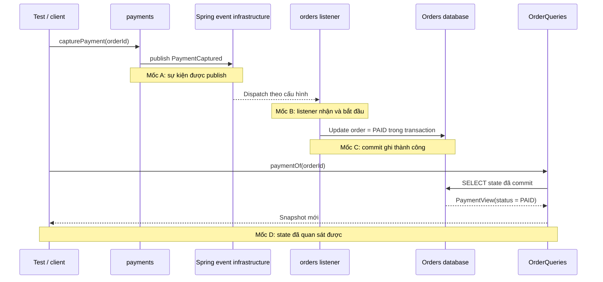

# Phân biệt state change với event publication trong Spring Modulith

## 1. Bối cảnh: phát sự kiện có đồng nghĩa với hoàn thành nghiệp vụ không?

Một hệ thống Spring Modulith thường sử dụng application event để phối hợp các module. Ví dụ, module `payments` xác nhận thanh toán rồi phát `PaymentCaptured`; module `orders` nhận sự kiện và chuyển trạng thái đơn hàng từ `AWAITING_PAYMENT` sang `PAID`.

Ta có thể kiểm tra sự kiện `PaymentCaptured` đã được publish. Nhưng **event được phát không tự chứng minh rằng đơn hàng đã trở thành `PAID`**. Listener có thể chưa được gọi, đang chạy bất đồng bộ, đã ném exception, bị rollback hoặc chỉ cập nhật một read model chưa kịp đồng bộ. Ngược lại, một đơn hàng có trạng thái `PAID` cũng chưa đủ để kết luận producer đã publish đúng sự kiện của giao dịch *đang được kiểm thử*.

Đó là hai hợp đồng khác nhau:

- **Event publication contract:** module phát sự kiện **đúng loại, đúng nội dung và đúng thời điểm nghiệp vụ** để module khác có thể phản ứng.
- **State change contract:** sau khi hành vi và các xử lý liên quan hoàn tất, **trạng thái nghiệp vụ có thể quan sát** đạt kết quả mong đợi, với các invariant liên quan.

Bài này thuộc chương *State change* của học phần `SPRING_MODULITH_VERIFICATION_TESTING`. Mục tiêu của học phần là kiểm chứng ranh giới kiến trúc bằng `ApplicationModules` và các quy tắc phụ thuộc module, thực hành `@ApplicationModuleTest`, event, database và tích hợp; sau đó đặt các phép kiểm chứng trong CI quality gate để chặn hồi quy.

Sau bài học, bạn sẽ biết cách:

1. Phân biệt các mốc **publish → dispatch → listener xử lý → commit → state visible**.
2. Chọn test phù hợp khi yêu cầu là *sự kiện đã phát* hoặc *dữ liệu đã đổi*.
3. Sử dụng `PublishedEvents` để kiểm tra event contract và `Scenario.andWaitForStateChange(...)` để kiểm tra state contract.
4. Phân tích transaction, listener `@Async` / `@TransactionalEventListener` và publication registry khi điều tra timeout.
5. Thiết kế bài test xuyên module đúng API công khai, không phụ thuộc repository nội bộ.
6. Kết hợp event test, state test, kiểm tra kiến trúc và CI gate.

## 2. Một chuỗi xử lý có nhiều mốc khác nhau

Giả sử service thanh toán tạo bản ghi capture và publish event. Đường đi có thể như sau:



Sơ đồ mô tả thứ tự nghiệp vụ, **không hàm ý mốc A, B, C, D luôn xảy ra ngay lập tức**. Với listener đồng bộ, một số mốc có thể nằm trong cùng thread/transaction; với `@Async`, `AFTER_COMMIT` hoặc projection được cập nhật gián tiếp, chúng có thể cách nhau đáng kể.

| Mốc | Bằng chứng thường có | Điều chưa được bảo đảm |
| --- | --- | --- |
| **A — publish** | Có event loại `PaymentCaptured` với dữ liệu đúng; test thu nhận publication. | Listener phù hợp đã hoàn tất. |
| **B — dispatch/receive** | Log hoặc công cụ kiểm thử xác nhận handler được gọi. | Transaction của handler đã commit. |
| **C — handler commit** | Dữ liệu writer đã được commit thành công tại database nguồn. | Tất cả API đọc, cache, replica hoặc read model đều thấy dữ liệu mới. |
| **D — state visible** | Public query API trả `PAID` và invariant phù hợp. | Không có chuyển trạng thái khác về sau, trừ khi quy tắc nghiệp vụ bảo đảm. |

**Kết luận quan trọng:** mỗi mốc cần một phép kiểm chứng tương ứng. Không dùng assertion trên event để thay thế assertion trên state, hoặc ngược lại.

### 2.1. Spring application event không mặc nhiên là hàng đợi bên ngoài

`ApplicationEventPublisher` của Spring trước hết là cơ chế công bố event trong ngữ cảnh ứng dụng. Việc dùng application event **không tự đồng nghĩa** đã có message broker bền vững, nhận event chính xác một lần, giao dịch xuyên module hay retry thành công. Spring Modulith có các cơ chế tăng độ tin cậy như Event Publication Registry và khả năng externalization, nhưng chúng phụ thuộc dependency, cấu hình và phiên bản đang dùng.

Do đó, cần mô tả chính xác loại sự kiện mà bài test bảo vệ: **in-process application event**, publication được theo dõi bởi registry, hay message đã được chuyển đến hệ thống ngoài. Những hợp đồng này không giống nhau.

## 3. Hai câu hỏi test khác nhau

Trước khi viết test, hãy viết một câu bằng ngôn ngữ nghiệp vụ.

**Câu hỏi 1 — event publication:** “Khi thanh toán được capture thành công, module `payments` có công bố `PaymentCaptured` mang đúng `orderId`, `transactionId` và số tiền hay không?”

Câu này quan tâm đến **producer**. Test có thể dừng sau khi xác minh sự kiện được publish. Không cần phụ thuộc vào cách module `orders` lưu đơn hàng nếu mục tiêu chỉ là event contract.

**Câu hỏi 2 — state change:** “Khi module `orders` nhận `PaymentCaptured`, liệu trạng thái thanh toán của đúng đơn hàng có trở thành `PAID` sau khi handler commit, đồng thời mã giao dịch và số tiền được ghi đúng hay không?”

Câu này quan tâm đến **consumer/handler**. Test phải đọc state được cập nhật, không chỉ quan sát event đã có mặt.

**Câu hỏi 3 — end-to-end:** “Khi gọi use case capture thanh toán thật, kết quả cuối nhìn qua public API của `orders` có phù hợp hay không?”

Câu này cần test tích hợp kết nối producer, dispatch và consumer; nó không thể được chứng minh chỉ bằng một test producer hoặc một test consumer dùng event giả lập riêng lẻ.

| Cấp kiểm thử | Kích hoạt | Quan sát | Hồi quy có thể bắt |
| --- | --- | --- | --- |
| Producer event contract | Gọi use case của `payments`. | `PublishedEvents` hoặc cơ chế kiểm tra publication tương ứng. | Không phát event, sai payload, sai correlation ID. |
| Consumer state contract | `Scenario.publish(new PaymentCaptured(...))` trong test module `orders`. | `OrderQueries.paymentOf(id)` và predicate state. | Listener xử lý sai, không commit, mapping/read API sai. |
| E2E/integration | Gọi public API capture thật. | State consumer có thể nhìn thấy; có thể thêm event evidence. | Wiring xuyên module, transaction, event contract, dữ liệu cuối. |
| Architecture verification | Phân tích mô hình module. | `ApplicationModules.of(...).verify()`. | Phụ thuộc sai ranh giới, dùng package API không được phép. |

## 4. Hợp đồng minh họa: payment event và order state

Các kiểu sau do **ứng dụng ví dụ tự định nghĩa**, không phải kiểu có sẵn trong Spring Modulith. Các khai báo `public` được đặt trong **những file Java khác nhau**:

```java
// com/example/shop/payments/events/PaymentCaptured.java
package com.example.shop.payments.events;

import java.math.BigDecimal;
import java.util.UUID;

public record PaymentCaptured(
        UUID orderId,
        String transactionId,
        BigDecimal amount,
        String currency) {}
```

```java
// com/example/shop/orders/OrderStatus.java
package com.example.shop.orders;

public enum OrderStatus {
    AWAITING_PAYMENT, PAID, PAYMENT_FAILED
}
```

```java
// com/example/shop/orders/PaymentView.java
package com.example.shop.orders;

import java.math.BigDecimal;
import java.util.UUID;

public record PaymentView(
        UUID orderId,
        OrderStatus status,
        String transactionId,
        BigDecimal capturedAmount,
        String currency) {

    public boolean isCaptured() {
        return status == OrderStatus.PAID
                && transactionId != null
                && !transactionId.isBlank()
                && capturedAmount != null
                && capturedAmount.signum() > 0
                && currency != null
                && !currency.isBlank();
    }
}
```

```java
// com/example/shop/orders/OrderQueries.java
package com.example.shop.orders;

import java.util.Optional;
import java.util.UUID;

public interface OrderQueries {
    Optional<PaymentView> paymentOf(UUID orderId);
}
```

Trong test cụ thể, `isCaptured()` mới là **điều kiện tối thiểu**. Để chứng minh đúng giao dịch, assertion còn cần đối chiếu `transactionId`, `capturedAmount` và `currency` với stimulus. Nếu nghiệp vụ yêu cầu capture phải bằng tổng tiền đơn hàng, API hoặc test nội bộ module cần có dữ liệu và invariant tương ứng.

Sự kiện `PaymentCaptured` là contract của module `payments`; `OrderQueries` và `PaymentView` thuộc quyền sở hữu module `orders`. Mỗi module được tự do thay đổi repository/entity nội bộ mà không buộc consumer sửa test miễn là hợp đồng công khai không đổi.

## 5. Kiểm thử **producer**: event được công bố đúng hay không?

Spring Modulith cung cấp hỗ trợ thu nhận các application event được publish trong test module, qua `PublishedEvents`. Dưới đây là ví dụ test *producer contract*: gọi API nghiệp vụ để phát event và lọc event theo `orderId`.

```java
import static org.assertj.core.api.Assertions.assertThat;

import java.math.BigDecimal;
import java.util.UUID;

import org.junit.jupiter.api.Test;
import org.springframework.beans.factory.annotation.Autowired;
import org.springframework.modulith.test.ApplicationModuleTest;
import org.springframework.modulith.test.PublishedEvents;

@ApplicationModuleTest
class PaymentPublicationTests {

    @Autowired PaymentApplicationService payments;
    @Autowired PaymentFixture fixture;

    @Test
    void capturePublishesTheExpectedEvent(PublishedEvents events) {
        UUID orderId = fixture.paymentReadyAndCommit();
        BigDecimal amount = new BigDecimal("125000.00");

        payments.capture(orderId, "TX-601", amount, "VND");

        assertThat(events.ofType(PaymentCaptured.class)
                .matching(PaymentCaptured::orderId, orderId))
                .anySatisfy(event -> {
                    assertThat(event.transactionId()).isEqualTo("TX-601");
                    assertThat(event.amount()).isEqualByComparingTo(amount);
                    assertThat(event.currency()).isEqualTo("VND");
                });
    }
}
```

`PaymentApplicationService`, `PaymentFixture` và `capture(...)` là thành phần ví dụ của ứng dụng. Phương thức `PublishedEvents.ofType(...).matching(...)` thể hiện cách chọn các event phù hợp trong phạm vi test. Nếu ứng dụng công bố event ở pha bất đồng bộ **sau** khi use case trả về, test phải dùng cơ chế chờ event phù hợp với phiên bản Spring Modulith đang dùng, thay vì giả định publication đã xuất hiện ngay.

**Test này chứng minh:** có ít nhất một event `PaymentCaptured` phù hợp đã được quan sát khi test kiểm tra, với những dữ liệu mà assertion nêu. Nó **không chứng minh** module `orders` đã xử lý event hay database `orders` đã commit. Ngoài ra, `anySatisfy` chấp nhận một hoặc nhiều event phù hợp; nếu hợp đồng đòi **chính xác một publication**, phải kiểm tra số lượng và tránh để event không liên quan từ setup làm nhiễu kết quả.

### 5.1. Event payload là hợp đồng, không phải state của consumer

Giả sử module `orders` vẫn `AWAITING_PAYMENT`. Event publication test có thể pass nếu `payments` đã publish đúng. Điều này **không mâu thuẫn**: sự kiện được phát là trách nhiệm producer, còn chuyển state là trách nhiệm listener của consumer.

Ngược lại, nếu module `orders` bị sửa trực tiếp thành `PAID` mà không có `PaymentCaptured`, một bài test state có thể pass trong khi producer event contract bị vi phạm. Vì vậy, hai test không dư thừa cho nhau.

## 6. Kiểm thử **consumer**: event có gây thay đổi state thật không?

Trong test module `orders`, hãy tạo order `AWAITING_PAYMENT` đã commit và publish `PaymentCaptured` như stimulus. Sau đó, đợi đúng snapshot nghiệp vụ qua public query API.

```java
import static org.assertj.core.api.Assertions.assertThat;

import java.math.BigDecimal;
import java.time.Duration;
import java.util.UUID;

import org.junit.jupiter.api.Test;
import org.springframework.beans.factory.annotation.Autowired;
import org.springframework.modulith.test.ApplicationModuleTest;
import org.springframework.modulith.test.Scenario;

@ApplicationModuleTest
class PaymentStateChangeTests {

    @Autowired OrderQueries orders;
    @Autowired OrderFixture fixture;

    @Test
    void capturedPaymentChangesTheOrderState(Scenario scenario) {
        UUID orderId = fixture.awaitingPaymentAndCommit();
        BigDecimal amount = new BigDecimal("125000.00");

        assertThat(orders.paymentOf(orderId))
                .get()
                .extracting(PaymentView::status)
                .isEqualTo(OrderStatus.AWAITING_PAYMENT);

        scenario.publish(new PaymentCaptured(
                        orderId, "TX-602", amount, "VND"))
                .andWaitAtMost(Duration.ofSeconds(5))
                .forStateChange(
                        () -> orders.paymentOf(orderId),
                        value -> value.filter(PaymentView::isCaptured)
                                      .isPresent())
                .andVerify(value -> {
                    PaymentView paid = value.orElseThrow();

                    assertThat(paid.orderId()).isEqualTo(orderId);
                    assertThat(paid.status()).isEqualTo(OrderStatus.PAID);
                    assertThat(paid.transactionId()).isEqualTo("TX-602");
                    assertThat(paid.capturedAmount())
                            .isEqualByComparingTo(amount);
                    assertThat(paid.currency()).isEqualTo("VND");
                });
    }
}
```

Trong ví dụ, `OrderFixture` là helper do ứng dụng triển khai. Tên `awaitingPaymentAndCommit()` yêu cầu **thực sự commit** trước khi listener chạy trong transaction khác; gọi `saveAndFlush(...)` khi transaction test chưa commit là chưa đủ.

Bài test diễn đạt các bước rõ ràng:

1. **Arrange:** order được lưu ở `AWAITING_PAYMENT` và đọc lại để xác minh.
2. **Stimulate:** `Scenario.publish(...)` gửi `PaymentCaptured` vào cơ chế sự kiện của test context.
3. **Await:** `Supplier` đọc state qua `OrderQueries.paymentOf(orderId)` mỗi lần cần quan sát.
4. **Predicate:** `PaymentView::isCaptured` chỉ trả đúng khi trạng thái và các trường cơ bản hợp lệ.
5. **Verify:** assertion đối chiếu đúng `orderId`, transaction, số tiền và currency của event.
6. **Timeout:** nếu không thấy snapshot mong đợi trong giới hạn, test thất bại. Giá trị 5 giây chỉ minh họa.

**Chú ý phạm vi module:** `@ApplicationModuleTest` không mặc định bootstrap mọi module. Consumer test cần có event listener thực sự thuộc test context, còn việc kích hoạt trực tiếp `Scenario.publish(...)` **không kiểm chứng** rằng producer production đã phát event đúng lúc. Để chứng minh toàn luồng, cần bài test tích hợp bổ sung.

### 6.1. Vì sao không chỉ chờ một event xuất hiện?

Đoạn ý tưởng sau kiểm tra một điều kiện khác:

```text
Stimulus -> event published -> assert event type
```

Nó trả lời “hệ thống có công bố sự kiện không?”, chứ không trả lời “listener đã cập nhật đơn hàng chưa?”. Với state change, test cần thêm đường đọc:

```text
Stimulus -> event dispatch -> listener -> commit
         -> OrderQueries.paymentOf(orderId) -> predicate -> assertion
```

Một listener có thể đã **nhận** event nhưng không ghi gì, hoặc ghi rồi rollback. Assertion trên event không nhìn thấy những lỗi ấy.

## 7. Event publication, listener invocation và database commit

Cơ chế listener của Spring ảnh hưởng quan trọng đến mốc nào là đồng bộ.

### 7.1. Listener đồng bộ theo cơ chế mặc định

Một `@EventListener` thông thường được xử lý đồng bộ theo event multicaster mặc định nếu không cấu hình async ở nơi khác. Khi listener cập nhật và commit trước lúc publish trả về, test có thể thấy state mới ngay. Tuy nhiên, điều này phụ thuộc vào transaction boundary: một handler chạy **trong transaction của publisher** có thể thực hiện cập nhật nhưng transaction vẫn chưa commit khi lời gọi `publishEvent(...)` kết thúc.

Do đó, ngay cả với listener đồng bộ, câu hỏi quan trọng là **khi nào reader nhìn thấy commit** chứ không chỉ “cùng thread hay khác thread”.

### 7.2. Listener bất đồng bộ

Khi `@Async` được kích hoạt và cấu hình thích hợp, listener có thể chạy trên worker thread:

```java
import org.springframework.context.event.EventListener;
import org.springframework.scheduling.annotation.Async;

@Async
@EventListener
public void on(PaymentCaptured event) {
    orderPaymentService.markPaid(
            event.orderId(), event.transactionId(),
            event.amount(), event.currency());
}
```

Đây là thân phương thức minh họa trong một Spring bean; `orderPaymentService` là bean nghiệp vụ. Trong trường hợp này, `publishEvent(...)` có thể trả về trước khi handler bắt đầu hoặc kết thúc. Transaction của publisher không tự lan sang thread khác. Hãy dùng test chờ state thay vì assertion ngay lập tức hoặc `Thread.sleep(...)` cố định.

### 7.3. Listener xử lý sau commit

Một ví dụ khác:

```java
import org.springframework.scheduling.annotation.Async;
import org.springframework.transaction.event.TransactionPhase;
import org.springframework.transaction.event.TransactionalEventListener;

@Async
@TransactionalEventListener(phase = TransactionPhase.AFTER_COMMIT)
public void on(PaymentCaptured event) {
    orderPaymentService.markPaid(
            event.orderId(), event.transactionId(),
            event.amount(), event.currency());
}
```

Listener `AFTER_COMMIT` chỉ được gọi sau pha commit của transaction đã publish event, theo ngữ nghĩa của Spring. Nếu không có transaction, listener mặc định không chạy, trừ khi có `fallbackExecution` phù hợp. Thao tác cập nhật order của handler cần transaction ghi riêng/rõ ràng, đặc biệt khi chạy sau transaction của publisher hoặc trên thread async.

Spring Modulith cũng có `@ApplicationModuleListener` hỗ trợ một kiểu listener phù hợp với application module. Khi sử dụng, cần kiểm tra các semantics transaction/async theo **phiên bản Spring Modulith của dự án**, thay vì giả định mọi annotation có cùng thời điểm xử lý.

| Cấu hình | Khi publish trả về, có thể khẳng định state đã commit? | Hướng kiểm thử |
| --- | --- | --- |
| Listener đồng bộ, cập nhật và commit đã hoàn tất | Có thể, nếu hợp đồng/ràng buộc transaction thực sự bảo đảm. | Assertion state hoặc scenario tùy mục tiêu. |
| `@Async @EventListener` | Không. | Chờ state qua query API. |
| `@TransactionalEventListener(AFTER_COMMIT)` | Không chỉ từ việc publish trả về. | Bảo đảm transaction gốc commit, rồi quan sát state writer. |
| Event được externalize qua broker | Không; còn phụ thuộc externalization và consumer ngoài. | Test publisher/externalizer riêng và test consumer/E2E riêng. |

## 8. Event Publication Registry là gì và không phải là gì?

Spring Modulith có **Event Publication Registry** để theo dõi publication đối với những listener hỗ trợ cơ chế publication phù hợp, giúp nhận diện publication chưa được đánh dấu hoàn tất và hỗ trợ những chiến lược xử lý lại theo cấu hình.

Khái niệm cần tách bạch:

- **Event published:** ứng dụng đã thực hiện publication qua cơ chế sự kiện.
- **Publication recorded:** registry đã lưu thông tin publication theo cơ chế được cấu hình; khả năng lưu bền tùy implementation/persistence.
- **Publication completed:** cơ chế registry đánh dấu publication đã được xử lý hoàn tất theo quy tắc của listener/publication tracking.
- **Business state visible:** API đọc của consumer trả state mong đợi, sau khi những update có liên quan đã được commit và có thể đọc được.

**Publication được đánh dấu completed không phải một bằng chứng tổng quát rằng mọi dữ liệu business của tất cả module hoặc dịch vụ bên ngoài đã hội tụ.** Chẳng hạn listener có thể chỉ chuyển công việc sang một hàng đợi khác; trạng thái cuối ở downstream vẫn chưa hình thành. Mặt khác, khi một listener thực sự cập nhật DB và báo hoàn thành sau commit, các mốc có thể gần nhau nhưng phải được xác định theo thiết kế cụ thể.

Bảng so sánh:

| Bằng chứng | Có thể chứng minh | Không nên suy luận thêm |
| --- | --- | --- |
| Sự kiện xuất hiện trong `PublishedEvents` test | Event phù hợp được công bố trong test context. | Listener đã commit state. |
| Có bản ghi publication trong registry | Hệ thống đã theo dõi một publication theo cấu hình. | Payload đã được mọi consumer xử lý. |
| Registry đánh dấu publication hoàn tất | Công việc publication/listener đã hoàn tất theo cơ chế tracking. | Mọi read model, replica, downstream đã có state cuối. |
| `OrderQueries` trả snapshot `PAID` đúng ID | Bên đọc nhìn thấy state nghiệp vụ tương ứng. | Event không bị phát trùng, không có side effect khác. |
| Registry còn publication chưa hoàn tất | Cần điều tra trạng thái xử lý/retry tương ứng. | Chắc chắn business state chưa đổi; có thể có lỗi ở bước xác nhận hoàn tất. |

**Không nên** viết một test chỉ hỏi “registry còn pending không?” rồi thay nó cho bài test `PaymentView.isCaptured()`. Hai phép kiểm chứng quan sát các tầng khác nhau. Cũng không nên dùng mỗi trạng thái `PAID` để kết luận publication registry không có dữ liệu chưa hoàn tất.

### 8.1. Retry, duplicate event và at-least-once

Nếu publication chưa hoàn tất được xử lý lại, listener có thể nhận cùng một event nhiều hơn một lần. Thiết kế phải tính đến **idempotency**, ví dụ dùng `transactionId`/event ID làm khóa nghiệp vụ, unique constraint hoặc optimistic locking để tránh ghi hai receipt hay trừ tiền hai lần.

Một bài test chỉ kiểm tra order cuối là `PAID` có thể bỏ sót việc tạo **hai ledger entry** từ một event bị replay. Cần bài test riêng theo dõi invariant tác động phụ sau khi cả lần xử lý đầu và lần replay đã hoàn tất. Không dùng trạng thái `PAID` hiện có làm tín hiệu rằng lần replay đã chạy xong.

## 9. Điều kiện chờ của `Scenario` khác với assertion publication

Đối với state change, `Scenario.andWaitForStateChange(...)` kết hợp một **nguồn đọc** và một **predicate**.

```java
scenario.publish(new PaymentCaptured(orderId, "TX-603", amount, "VND"))
        .andWaitForStateChange(
                () -> orders.paymentOf(orderId),
                state -> state.filter(PaymentView::isCaptured).isPresent())
        .andVerify(state -> assertThat(state).isPresent());
```

Những lỗi thiết kế phổ biến:

| Cách kiểm tra | Lỗi có thể xảy ra | Sửa theo đúng hợp đồng |
| --- | --- | --- |
| Chỉ `assertThat(events...).isNotEmpty()` | Consumer không xử lý vẫn pass. | Có thêm state contract test. |
| `state -> state.isPresent()` | `Optional.of(AWAITING_PAYMENT)` đã tồn tại trước event. | Predicate đòi `PAID` và invariant. |
| `oldEntity::isPaid` | Đọc một object JPA cũ đã giữ từ trước. | Supplier gọi query service mỗi lần poll. |
| `Thread.sleep(1000)` rồi assert | Flaky nếu handler chậm hơn hoặc đã hoàn tất sớm. | Chờ theo điều kiện với timeout hữu hạn. |
| Đợi một event loại đúng nhưng không so ID | Event của test khác có thể bị tính nhầm. | Lọc theo `orderId`/correlation ID. |
| Chờ `PAID` nhưng bỏ qua amount/reference | State enum đúng, dữ liệu nghiệp vụ sai. | Assertion đối chiếu payload với snapshot. |

**Timeout của state change** chỉ cho biết predicate chưa đúng trong thời gian chờ. Nó không tự trả lời liệu event đã được publish đúng hay chưa. Phải thu thập thêm bằng chứng từ producer, listener, transaction và reader.

## 10. Khi chỉ muốn kiểm tra event: đừng ép sang state change

Không phải event nào cũng trực tiếp dẫn đến một thay đổi database ở cùng module. Một sự kiện có thể là thông báo kiểm toán, publication cho hệ thống ngoài, hay kích hoạt việc gửi email. Trong các tình huống đó, ép bài test thành “đợi một field state đổi” có thể khiến test kiểm tra một chi tiết triển khai không tồn tại trong hợp đồng.

Thay vào đó, chọn loại bằng chứng phù hợp:

- **Producer publish event:** `PublishedEvents` hoặc bước chờ event của `Scenario` khi phù hợp.
- **Handler cập nhật aggregate:** `Scenario.andWaitForStateChange(...)` trên một public read API.
- **Consumer phát tiếp một event:** kiểm tra event đầu ra của consumer; nếu cần chứng minh state, kiểm tra riêng.
- **Externalization:** xác nhận theo cơ chế publication/message boundary của hệ thống ngoài.
- **Không phát event khi điều kiện không hợp lệ:** kiểm tra *không có publication phù hợp* sau một hành vi đồng bộ và một điểm đồng bộ rõ; tránh assertion âm tại thời điểm chưa biết async work đã kết thúc.

Bài test cần trung thành với **mục tiêu nghiệp vụ** hơn là cố dùng một API chỉ vì nó xuất hiện trong chương kiểm thử state.

## 11. Khi chỉ muốn kiểm tra state: không phải lúc nào cũng cần quan sát event

Một bài test aggregate `Order.markPaid(...)` có thể kiểm chứng quy tắc domain mà không cần Spring event infrastructure. Ví dụ:

```java
@Test
void markingPaymentUpdatesOrderInvariant() {
    Order order = OrderFixtures.awaitingPayment(amount, "VND");

    order.markPaid("TX-604", amount, "VND");

    assertThat(order.isPaid()).isTrue();
    assertThat(order.paymentReference()).isEqualTo("TX-604");
}
```

`Order`, `OrderFixtures` và các method ở đây là API domain **giả định**. Đây là một **unit test**, có mục tiêu khác với test event publication. Nếu sửa handler để không nhận event, unit test vẫn pass: nó chỉ bảo vệ logic chuyển state **khi method được gọi**.

Nhờ phân tầng, một suite đầy đủ có thể xác định lỗi nằm ở business rule, producer event contract, wiring listener, transaction hay read adapter — thay vì dồn tất cả vào một test E2E khó chẩn đoán.

## 12. Test tích hợp toàn luồng mà không trộn các trách nhiệm

Khi mục tiêu là “capture thật dẫn đến order PAID”, test tích hợp có thể gọi API nghiệp vụ producer và chờ state consumer:

```java
// Pseudocode minh họa cách sắp xếp một bài integration test
// có cả producer, listener và query API trong test context.

UUID orderId = fixture.prepareOrderAndPaymentAndCommit();
BigDecimal amount = new BigDecimal("125000.00");

scenario.stimulate(
        () -> paymentApplicationService.capture(
                orderId, "TX-605", amount, "VND"))
        .andWaitForStateChange(
                () -> orderQueries.paymentOf(orderId),
                view -> view.filter(PaymentView::isCaptured).isPresent())
        .andVerify(view -> {
            PaymentView result = view.orElseThrow();
            assertThat(result.transactionId()).isEqualTo("TX-605");
            assertThat(result.capturedAmount())
                    .isEqualByComparingTo(amount);
        });
```

Đây là **mẫu tích hợp minh họa**; cần thiết lập transactional semantics của `capture(...)`, bootstrap đầy đủ listener và các dependency tương ứng. Nếu use case `capture(...)` được gọi trong transaction bị rollback bởi test, listener `AFTER_COMMIT` có thể không chạy.

Tại sao bài test này khác consumer test ở mục 6?

- Consumer test **phát sự kiện trực tiếp**: kiểm tra module nhận xử lý event contract.
- E2E test **gọi use case thật**: kiểm tra cả đường producer tạo event, dispatch và consumer cập nhật state.
- Producer publication test kiểm tra **payload của sự kiện** ngay tại nơi phát.

Nên giữ cả các test nhỏ và bài E2E quan trọng. Khi bài E2E fail, test nhỏ giúp khoanh vùng: producer không publish, payload sai, listener không cập nhật, transaction rollback hay reader stale.

## 13. Transaction visibility: event có rồi nhưng state vẫn cũ

Trong `@ApplicationModuleTest` hoặc integration test, nguyên nhân phổ biến của “event đã publish nhưng state chưa đổi” là **transaction visibility**.

### 13.1. `saveAndFlush` không đồng nghĩa commit

```java
repository.saveAndFlush(order); // SQL có thể được flush.
```

Lệnh này **không bảo đảm transaction đã commit**. Listener ở thread/transaction khác có thể chưa thấy bản ghi; một listener `AFTER_COMMIT` còn phụ thuộc transaction gốc thực sự commit. Fixture nên tạo dữ liệu và commit đúng thời điểm trước khi kịch bản bất đồng bộ cần quan sát.

### 13.2. JPA first-level cache và transaction đọc kéo dài

Nếu supplier dùng một entity được giữ từ trước:

```java
Order cached = orderRepository.findById(orderId).orElseThrow();

scenario.publish(event)
        .andWaitForStateChange(cached::isPaid, paid -> paid);
```

thì callback được chạy lại nhiều lần vẫn có thể chỉ đọc **cùng object stale**. Ngay cả khi gọi lại `findById(...)` trong cùng JPA persistence context, provider có thể trả entity đang managed. Với snapshot isolation, transaction đọc kéo dài còn có thể không thấy commit từ transaction khác.

Nên đọc snapshot mới qua query service có transaction/isolation phù hợp:

```java
scenario.publish(event)
        .andWaitForStateChange(
                () -> orderQueries.paymentOf(orderId),
                view -> view.filter(PaymentView::isCaptured).isPresent())
        .andVerify(view -> assertThat(view).isPresent());
```

Public API giúp bảo vệ **ranh giới module**, nhưng tự nó không xóa cache hay mở transaction mới. Adapter thực tế phải bảo đảm phép đọc có cơ hội thấy commit mới, không giữ JPA context cũ hoặc đọc read replica không theo yêu cầu của test.

### 13.3. Hai chiến lược chờ khác nhau

Khi listener trả `PAYMENT_FAILED` là terminal state, chỉ chờ `PAID` có thể timeout dù xử lý nghiệp vụ đã kết thúc bằng từ chối. Có thể chờ một trong hai terminal states, rồi assert thành công:

```java
scenario.publish(event)
        .andWaitForStateChange(
                () -> orderQueries.paymentOf(orderId),
                view -> view.filter(v ->
                        v.status() == OrderStatus.PAID
                        || v.status() == OrderStatus.PAYMENT_FAILED
                ).isPresent())
        .andVerify(view ->
                assertThat(view.orElseThrow().status())
                        .isEqualTo(OrderStatus.PAID));
```

Chỉ áp dụng nếu `PAYMENT_FAILED` thực sự terminal trong workflow. Nếu retry có thể chuyển lỗi tạm sang thành công, điều kiện dừng sớm không phù hợp.

## 14. Trường hợp đối chiếu: publication và state cho kết quả khác nhau

Bảng sau giúp chẩn đoán theo **hai chiều quan sát**, thay vì suy luận một chiều từ event:

| Event publication test | State change test | Cách hiểu khả dĩ |
| --- | --- | --- |
| PASS | PASS | Producer phát đúng; consumer cũng tạo state phù hợp trong các bài test tương ứng. |
| PASS | FAIL/timeout | Producer phát event, nhưng consumer có thể thiếu handler, rollback, đọc stale hoặc predicate sai. |
| FAIL | PASS khi consumer test publish event trực tiếp | Listener xử lý event hợp lệ, nhưng producer thực tế chưa chắc phát event đúng. |
| FAIL | PASS khi E2E vẫn cho state đúng | Có thể update state qua một đường khác, publication assertion lọc sai, hoặc event contract bị thiếu. |
| PASS | State `PAYMENT_FAILED` | Event đã phát; consumer xử lý nhưng cho kết quả thất bại nghiệp vụ. |
| Registry còn incomplete | State `PAID` | Cần điều tra cơ chế đánh dấu hoàn tất/retry; không mặc định state chưa được ghi. |
| Registry báo completed | Read model vẫn cũ | Có thể consumer projection cập nhật chậm hoặc publication completion chỉ bao phủ một bước. |

**Giới hạn của bảng:** producer test và consumer test có thể dùng fixture/test context khác nhau. Hai kết quả PASS riêng không chứng minh mọi mối nối runtime đều hoạt động; bài E2E/integration vẫn cần khi muốn bảo vệ đường đi toàn luồng.

### 14.1. Kịch bản lỗi thực tế

Giả sử event xuất hiện trong `PublishedEvents` và listener ghi log “đã xử lý”, nhưng `OrderQueries.paymentOf(id)` vẫn trả `AWAITING_PAYMENT`. Điều tra theo thứ tự:

1. Payload có đúng `orderId` và `transactionId` mà test đang đọc?
2. Listener được bootstrap trong test context và nhận **đúng event class**?
3. Listener có chạy async hoặc after-commit; transaction publisher đã commit chưa?
4. Service ghi state có transaction đúng; có exception/rollback?
5. Primary database đã thấy `PAID` hay vẫn `AWAITING_PAYMENT`?
6. Nếu DB đúng, reader có cache, snapshot, read replica hoặc query mapping sai?
7. Predicate có kiểm tra đích nghiệp vụ, hay đang đòi một giá trị không thể đạt?
8. Timeout có dựa trên độ trễ hợp lệ, không quá ngắn cho CI?

Nếu event test FAIL, hãy điều tra phía producer trước. Nếu event PASS và DB không đổi, tập trung vào listener/transaction. Nếu DB đã đổi và query stale, tập trung vào visibility/read adapter. Đây là lợi ích thực tế của việc **tách event publication khỏi state change**.

## 15. Bảo vệ ranh giới module khi viết cả hai loại test

Một bẫy phổ biến là dùng repository của module khác để “bổ sung bằng chứng” rằng event đã được xử lý:

```java
// Anti-pattern nếu mã nằm ngoài module orders:
import com.example.shop.orders.internal.OrderRepository;

@Autowired OrderRepository repository;

assertThat(repository.findById(orderId).orElseThrow().getStatus())
        .isEqualTo(OrderStatus.PAID);
```

Lúc đó test phụ thuộc vào persistence nội bộ, có thể vi phạm quy tắc của Spring Modulith và không kiểm tra hợp đồng public query API. Hãy sử dụng `OrderQueries.paymentOf(orderId)` được module `orders` công khai, hoặc đặt bài kiểm thử persistence ở **chính module sở hữu** nếu mục tiêu là mapping/internal state.

Với contract event nằm ở package con, có thể công bố bằng named interface:

```java
// File: com/example/shop/payments/events/package-info.java
@org.springframework.modulith.NamedInterface("events")
package com.example.shop.payments.events;
```

Và trong module `orders` giới hạn những dependency được phép:

```java
// File: com/example/shop/orders/package-info.java
@org.springframework.modulith.ApplicationModule(
        allowedDependencies = "payments::events")
package com.example.shop.orders;
```

Tên `payments::events` chỉ là ví dụ; phải tương ứng module và named interface thực tế. Test consumer cần event contract công khai, không cần repository/payment service nội bộ của producer.

Xác minh kiến trúc riêng:

```java
import org.junit.jupiter.api.Test;
import org.springframework.modulith.core.ApplicationModules;

class ModulithBoundariesTests {

    @Test
    void dependenciesAreValid() {
        ApplicationModules.of(ShopApplication.class).verify();
    }
}
```

`ShopApplication` là application class giả định. `ApplicationModules.verify()` giúp kiểm tra dependency graph và các quy tắc công bố/allowed dependencies. Nó **không** thay thế test event, state hay giao dịch; ngược lại, event/state test PASS không bảo đảm kiến trúc không có import sai ranh giới.

## 16. Quality gate trên CI: không thay thế test này bằng test kia

Một chuỗi kiểm chứng cân bằng cho pull request:

1. **Architecture:** `ApplicationModules.of(...).verify()` để bắt dependency sai giữa module.
2. **Producer publication:** `@ApplicationModuleTest` xác minh `PaymentCaptured` được công bố với payload đúng.
3. **Consumer state:** `@ApplicationModuleTest` + `Scenario.andWaitForStateChange(...)` xác minh snapshot của `orders` chuyển `PAID` và thỏa invariant.
4. **Failure and retry:** xác minh `PAYMENT_FAILED`, rollback, event duplicate/idempotency và tình huống publisher không công bố khi điều kiện nghiệp vụ không đạt.
5. **Integration/E2E cần thiết:** gọi use case thật, bao gồm listener, DB, async executor, registry hoặc broker tùy kiến trúc.
6. **Reporting:** timeout, assertion sai hoặc dependency vi phạm phải làm CI thất bại; giữ log correlation ID và state cuối để điều tra.

Ví dụ dự án Gradle đã cấu hình JUnit test trong task `test`:

```bash
./gradlew test
```

Nếu integration test chạy ở task riêng, phải bổ sung task đó trong pipeline. Không mặc định mọi bài test tích hợp được thực thi bằng `test`.

**Một quality gate tốt không chỉ hỏi “có event không?”** Nó còn hỏi liệu state mong đợi có được quan sát sau commit, có đúng nội dung hay không và code có tôn trọng API module hay không. Mỗi câu hỏi có bằng chứng khác nhau và một lỗi có thể chỉ xuất hiện ở một tầng.

## 17. Bài tập thực hành

**Bài A — publication không đồng nghĩa state:** viết producer test dùng `PublishedEvents` cho `PaymentCaptured`, sau đó tạm tắt listener của `orders` trong bài tập. Xác nhận event test vẫn có thể PASS trong khi state test timeout. Khôi phục listener sau đó.

**Bài B — state không đồng nghĩa publication:** tạo một consumer test phát `PaymentCaptured` trực tiếp qua `Scenario.publish(...)` và đợi `PAID`. Cố ý sửa `PaymentApplicationService` của producer để không publish event trong nhánh thử nghiệm. Phân tích vì sao consumer test vẫn có thể PASS; bổ sung producer test để phát hiện lỗi.

**Bài C — sai payload:** để producer phát event với `orderId` đúng nhưng `transactionId` hoặc amount sai. Viết assertion trên `PublishedEvents` và `PaymentView`; so sánh lỗi nào xuất hiện trước và vì sao cần cả hai bằng chứng.

**Bài D — transaction sau commit:** cho listener dùng `@TransactionalEventListener(AFTER_COMMIT)`, tạo stimulus trong transaction test bị rollback. Quan sát publication và state dưới các điều kiện giao dịch khác nhau; sau đó tổ chức transaction gốc commit thật.

**Bài E — listener nhận event nhưng rollback:** cho handler ném exception trước commit trong một nhánh bài tập. Xác minh sự kiện có thể đã được publish, nhưng state reader không thấy `PAID`. Kiểm tra log và bằng chứng rollback.

**Bài F — registry và replay:** với dự án đã bật Event Publication Registry, khảo sát trạng thái publication incomplete/completed bằng cơ chế dự án cung cấp. Thử xử lý lại event chưa hoàn tất, kiểm tra idempotency: không được tạo receipt hoặc ledger entry thứ hai. Không chỉ dựa vào `PAID` đã có để khẳng định replay đã kết thúc.

**Bài G — hướng phụ thuộc:** giữ `payments.events` là named interface và giới hạn module `orders` chỉ phụ thuộc contract event cần thiết. Thử import repository `payments.internal` vào `orders` rồi chạy `ApplicationModules.verify()`; sửa lại và hoàn nguyên thay đổi thử nghiệm.

**Bài H — E2E:** gọi public use case capture thật; đợi state `PAID` qua `orders.OrderQueries`. Đối chiếu kết quả với producer/consumer tests độc lập để xác nhận mỗi test đang bảo vệ mắt xích nào.

**Tiêu chí đạt:** có thể giải thích bằng ví dụ tại sao publish event không chứng minh state change; xác định đúng mốc commit/visibility; dùng event assertions và state assertions riêng; liên kết chúng bằng correlation ID; và cấu hình CI chặn cả regression hành vi lẫn vi phạm kiến trúc.

## 18. Ghi nhớ và tài liệu tham khảo

**Event publication là sự kiện được công bố; state change là kết quả nghiệp vụ được cập nhật và có thể đọc.** Ở giữa là dispatch, listener, transaction, commit, cache và đôi khi read model/broker. Một phép kiểm tra publication không thay thế phép kiểm tra state; một trạng thái cuối đúng cũng không tự chứng minh event contract đã được phát chính xác.

Đối với ứng dụng Spring Modulith, hãy chọn `PublishedEvents` khi muốn bảo vệ **producer contract**, chọn `Scenario.andWaitForStateChange(...)` khi muốn bảo vệ **consumer state**, kết hợp kiểm thử tích hợp khi cần bảo vệ toàn luồng, và luôn chạy `ApplicationModules.verify()` để giữ ranh giới module. Những lớp kiểm chứng bổ trợ nhau tạo nên một quality gate CI có khả năng chẩn đoán và ngăn hồi quy.

Tài liệu tham khảo:

- [Spring Modulith — Testing Application Modules](https://docs.spring.io/spring-modulith/reference/testing.html): `@ApplicationModuleTest`, `PublishedEvents`, `Scenario` và kiểm thử event/state.
- [Spring Modulith — Working with Application Events](https://docs.spring.io/spring-modulith/reference/events.html): event publication, listener, Event Publication Registry và xử lý lại.
- [Spring Modulith — Verifying Application Module Structure](https://docs.spring.io/spring-modulith/reference/verification.html): `ApplicationModules.verify()` và các quy tắc dependency.
- [Spring Framework — Application Events](https://docs.spring.io/spring-framework/reference/core/beans/context-introduction.html): publication và xử lý application events trong application context.
- [Spring Framework — Transaction-bound Events](https://docs.spring.io/spring-framework/reference/data-access/transaction/event.html): `@TransactionalEventListener`, `AFTER_COMMIT` và `fallbackExecution`.
- [Spring Framework — Scheduling and Asynchronous Execution](https://docs.spring.io/spring-framework/reference/integration/scheduling.html): `@Async` và cấu hình xử lý bất đồng bộ.
