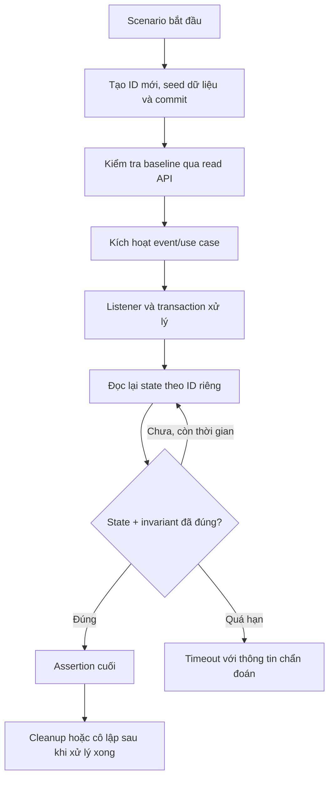
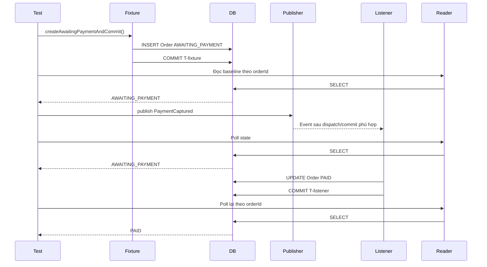

# Tái lập state trong mỗi scenario khi kiểm thử Spring Modulith

## 1. Vì sao mỗi scenario phải bắt đầu từ state có thể tái lập?

Một bài kiểm thử state change thường thực hiện ba bước: **chuẩn bị trạng thái ban đầu**, **kích hoạt hành vi**, rồi **quan sát trạng thái mong đợi**. Trong ứng dụng Spring Modulith, hành vi này có thể đi qua application event, listener bất đồng bộ, transaction riêng và cơ sở dữ liệu. Nếu state ban đầu không được tạo lại cho từng kịch bản, kết quả test có thể phụ thuộc vào test đã chạy trước, thứ tự thực thi hoặc dữ liệu còn sót trong môi trường CI.

Ví dụ: bài test A chuyển đơn hàng `ORDER-1` từ `AWAITING_PAYMENT` sang `PAID`; bài test B dùng lại `ORDER-1`, định kiểm tra xử lý `PaymentCaptured`. Vì đơn hàng đã là `PAID`, predicate `status == PAID` có thể đúng **ngay trước khi listener của bài B thực sự chạy**. Test B pass giả, dù đường event → listener đã bị hỏng.

**Tái lập state trong mỗi scenario** nghĩa là mỗi kịch bản có đầu vào, trạng thái xuất phát và môi trường quan sát được thiết lập độc lập, đủ để chạy riêng lẻ hoặc cùng những kịch bản khác mà không phụ thuộc kết quả test trước đó. Nó không nhất thiết có nghĩa khởi động lại toàn bộ Spring context hay tạo mới database vật lý cho từng phương thức; điều quan trọng là *cô lập các dữ liệu và side effect có thể tác động đến kết luận của test*.

Đây là nội dung chương *State change* của `SPRING_MODULITH_VERIFICATION_TESTING`: thực hành `@ApplicationModuleTest`, event, database và kiểm thử tích hợp, đồng thời dùng `ApplicationModules` và các quy tắc phụ thuộc module làm quality gate trong CI để ngăn hồi quy hành vi lẫn kiến trúc.

Sau bài học, bạn có thể:

- Xác định những thành phần nào tạo thành **state ban đầu** của một scenario.
- Viết fixture tạo dữ liệu **riêng, có trạng thái rõ ràng và đã commit** cho mỗi test.
- Phân biệt rollback của test với commit từ listener chạy bất đồng bộ hoặc `AFTER_COMMIT`.
- Tránh dữ liệu dùng chung, thứ tự test ngầm và cleanup chạy trước khi tác vụ nền hoàn tất.
- Dùng `Scenario.andWaitForStateChange(...)` kiểm tra chuyển trạng thái từ một baseline thực sự đúng.
- Đưa các quy tắc cô lập dữ liệu và kiểm chứng ranh giới module vào CI.

## 2. “State” không chỉ là một field trong database

Khi tái lập một scenario, đừng chỉ đặt `Order.status = AWAITING_PAYMENT` rồi cho rằng môi trường đã sạch. State có thể bao gồm:

| Thành phần | Ví dụ trong hệ thống đặt hàng | Nguy cơ nếu không cô lập |
| --- | --- | --- |
| **Dữ liệu nghiệp vụ** | Order, payment, inventory reservation, receipt | Scenario mới đọc được bản ghi của scenario trước. |
| **Định danh và tương quan** | `orderId`, `transactionId`, `eventId` | Listener xử lý nhầm bản ghi; test pass vì event không liên quan. |
| **Event đang chờ xử lý** | Async task, publication chưa hoàn tất, message queue | Event cũ tiếp tục chạy trong khi test mới bắt đầu. |
| **Transaction và persistence context** | EntityManager, uncommitted fixture, snapshot đọc | Listener không thấy dữ liệu hoặc reader mãi thấy state cũ. |
| **Cache và read model** | Projection, application cache, replica | API đọc trả kết quả cũ dù DB đã cập nhật. |
| **Nguồn lực dùng chung** | Tồn kho theo SKU, số dư tài khoản, khóa nghiệp vụ | Test khác thay đổi tiền đề của scenario. |
| **Thời gian và cấu hình** | Clock, ngày hết hạn, feature flag, retry policy | Hành vi khác nhau theo giờ hoặc cấu hình test trước. |
| **Hệ thống ngoài** | Broker, outbox, email fake, HTTP stub | Side effect tồn đọng khiến test sai lệch. |

Không phải kịch bản nào cũng cần reset tất cả các mục. Hãy xác định **những trạng thái thực sự tham gia vào hợp đồng của scenario**, rồi chọn hình thức cô lập phù hợp: dữ liệu theo ID riêng, transaction/cleanup, reset test double, test container, hoặc tách môi trường tích hợp.

### 2.1. Baseline, stimulus và oracle

Một test độc lập cần có ba khái niệm rõ ràng:

- **Baseline:** điều phải đúng *trước* stimulus, ví dụ order X đang ở `AWAITING_PAYMENT`, chưa có capture và chưa có receipt.
- **Stimulus:** hành vi hoặc event mà test đang kiểm chứng, ví dụ `PaymentCaptured(orderId = X, transactionId = Y)`.
- **Oracle:** bằng chứng để phán định kết quả, ví dụ public query API trả `PAID` với capture reference Y, amount đúng và không có receipt trùng.



**Không bỏ qua bước kiểm tra baseline.** Một predicate đạt sớm vì dữ liệu từ scenario trước vẫn tồn tại không phải bằng chứng listener hiện tại hoạt động đúng.

## 3. Những anti-pattern gây phụ thuộc giữa các test

### 3.1. Dùng một entity hoặc ID tĩnh cho toàn bộ test class

```java
// Anti-pattern: chia sẻ đối tượng nghiệp vụ mutable giữa nhiều test.
static UUID orderId = UUID.fromString(
        "00000000-0000-0000-0000-000000000123");

@BeforeAll
static void seedOneOrderForAllTests() {
    // Chuẩn bị một order chung rồi để mọi scenario dùng lại.
}
```

Bài test thứ nhất có thể chuyển order sang `PAID`; bài thứ hai không còn baseline như dự định. Chạy độc lập thì pass, chạy cả suite thì fail hoặc pass giả.

**Thay thế:** tạo order mới ở mỗi scenario với ID riêng; sử dụng cùng *hàm xây fixture* chứ không chia sẻ cùng *bản ghi đã bị mutate*.

### 3.2. Phụ thuộc thứ tự thực thi của JUnit

```java
@Test
void createOrder() {
    // Tạo order, lưu ID vào một biến của test class.
}

@Test
void capturedPayment() {
    // Giả định createOrder() đã chạy trước.
}
```

JUnit không được dùng như workflow engine để các test truyền state cho nhau. Một bài test phải chạy được khi chọn riêng phương thức, khi test runner đổi thứ tự, và khi CI chia suite thành nhiều shard. Nếu bài toán thực sự là một workflow gồm nhiều bước phụ thuộc nhau, hãy đặt các bước đó **trong cùng một test scenario**, với fixture và assertion tại từng mốc cần thiết.

### 3.3. Chỉ kiểm tra trạng thái cuối mà không biết điểm xuất phát

```java
scenario.publish(new PaymentCaptured(orderId, "TX-701"))
        .andWaitForStateChange(
                () -> queries.statusOf(orderId),
                status -> status.filter(s -> s == OrderStatus.PAID).isPresent());
```

Đoạn này có thể dừng ngay nếu `orderId` đã `PAID` trước event. Cần xác minh `AWAITING_PAYMENT` trước stimulus và kiểm tra correlation/transaction reference sau đó. Tốt hơn nữa, mỗi scenario tạo dữ liệu riêng, không nhận ID từ biến toàn cục.

### 3.4. “Dọn” dữ liệu bằng rollback của test trong khi listener đã commit riêng

Một test có `@Transactional` thường được Spring Test rollback khi kết thúc. Nhưng listener `@Async` hoặc listener after-commit có thể ghi bằng **transaction riêng** và commit ngoài transaction của test. Rollback transaction test không tự rollback các commit độc lập ấy. Mặt khác, nếu event listener yêu cầu `AFTER_COMMIT` nhưng test chưa commit transaction phát event, listener có thể **không được gọi**.

Vì thế, không nên nghĩ “gắn `@Transactional` ở test là tự động cô lập mọi thứ” trong scenario bất đồng bộ.

## 4. Định nghĩa dữ liệu đầu vào bằng fixture rõ ngữ nghĩa

Giả sử module `orders` sở hữu đơn hàng, module `payments` công bố `PaymentCaptured`. Chúng ta muốn kiểm tra listener thuộc `orders` cập nhật state sau khi nhận event.

Các kiểu nghiệp vụ sau là **ví dụ do ứng dụng tự định nghĩa**, không phải class Spring Modulith tự sinh. Mỗi khai báo `public` cần nằm trong file Java riêng:

```java
// File: com/example/shop/orders/OrderStatus.java
package com.example.shop.orders;

public enum OrderStatus {
    AWAITING_PAYMENT, PAID, PAYMENT_FAILED
}
```

```java
// File: com/example/shop/payments/events/PaymentCaptured.java
package com.example.shop.payments.events;

import java.math.BigDecimal;
import java.util.UUID;

public record PaymentCaptured(
        UUID orderId,
        String transactionId,
        BigDecimal amount,
        String currency) {}
```

```java
// File: com/example/shop/orders/OrderPaymentSnapshot.java
package com.example.shop.orders;

import java.math.BigDecimal;
import java.util.UUID;

public record OrderPaymentSnapshot(
        UUID orderId,
        OrderStatus status,
        BigDecimal expectedAmount,
        BigDecimal capturedAmount,
        String transactionId,
        String currency) {

    public boolean paidAndConsistent() {
        return status == OrderStatus.PAID
                && expectedAmount != null
                && capturedAmount != null
                && capturedAmount.compareTo(expectedAmount) == 0
                && transactionId != null && !transactionId.isBlank()
                && currency != null && !currency.isBlank();
    }
}
```

```java
// File: com/example/shop/orders/OrderQueries.java
package com.example.shop.orders;

import java.util.Optional;
import java.util.UUID;

public interface OrderQueries {
    Optional<OrderPaymentSnapshot> paymentOf(UUID orderId);
}
```

`OrderPaymentSnapshot` là DTO công khai do module `orders` sở hữu. Module test hoặc integration test đọc state qua `OrderQueries` thay vì import repository từ package `orders.internal` của module khác.

**Điểm quan trọng về tiền:** dùng `BigDecimal.compareTo(...)` để so sánh giá trị số; `125000.0` và `125000.00` không trở thành hai số tiền khác nhau chỉ vì scale. Test vẫn cần kiểm tra mã tiền tệ bằng giá trị kỳ vọng.

### 4.1. Fixture phải nhận dữ liệu nghiệp vụ quan trọng dưới dạng tham số

Thay vì một hàm khó hiểu như `seedEverything()`, dùng API fixture có ý định rõ:

```java
public interface OrderFixture {
    UUID createAwaitingPaymentAndCommit(
            BigDecimal totalAmount, String currency);
}
```

Cách này giúp mỗi scenario biết chính xác số tiền, tiền tệ và trạng thái ban đầu; không phụ thuộc seed toàn cục hoặc ngẫu nhiên không kiểm soát. Tên `AndCommit` chỉ nên dùng khi implementation thực sự tạo **commit hoàn chỉnh trước khi trả về**.

## 5. Tạo fixture đã commit trong transaction độc lập

Với listener chạy ở thread/transaction khác, bản ghi đầu vào phải sẵn sàng để đọc. Một phương thức `saveAndFlush(...)` trong transaction chưa commit **không đủ**. Ví dụ test-support implementation của `OrderFixture` dùng `TransactionTemplate`:

```java
// Ví dụ nằm trong package test-support có quyền truy cập repository
// của chính module orders; không đặt repository này vào public API.
import java.math.BigDecimal;
import java.util.UUID;

import org.springframework.transaction.PlatformTransactionManager;
import org.springframework.transaction.TransactionDefinition;
import org.springframework.transaction.support.TransactionTemplate;

final class JpaOrderFixture implements OrderFixture {

    private final OrderRepository repository;
    private final TransactionTemplate transactions;

    JpaOrderFixture(
            OrderRepository repository,
            PlatformTransactionManager transactionManager) {

        this.repository = repository;
        this.transactions = new TransactionTemplate(transactionManager);
        this.transactions.setPropagationBehavior(
                TransactionDefinition.PROPAGATION_REQUIRES_NEW);
    }

    @Override
    public UUID createAwaitingPaymentAndCommit(
            BigDecimal amount, String currency) {

        return transactions.execute(status -> {
            UUID id = UUID.randomUUID();
            OrderEntity order = OrderEntity.awaitingPayment(
                    id, amount, currency);

            repository.save(order);
            return id;
        });
    }
}
```

`OrderRepository`, `OrderEntity.awaitingPayment(...)` và các phương thức domain ở trên là **giả định của dự án**. Đây là một ví dụ triển khai fixture, chưa phải class chạy độc lập nếu không có repository, entity và test bean registration. Đặt test-support class trong module sở hữu dữ liệu hoặc dùng public command API phù hợp, không để module consumer import repository nội bộ của `orders`.

`TransactionTemplate.execute(...)` tạo giao dịch mới với `PROPAGATION_REQUIRES_NEW`. Sau khi callback kết thúc thành công, giao dịch đó được commit trước khi `execute(...)` trả về; nếu callback ném lỗi, giao dịch rollback. Cách này không phụ thuộc việc test bên ngoài có transaction hay không, nhưng cũng có hệ quả: dữ liệu đã commit **không được rollback tự động** theo transaction của test.

**Ưu tiên thiết kế đơn giản:** nếu test method không bị bọc bởi `@Transactional`, một fixture `@Transactional` ở Spring bean được gọi qua proxy cũng có thể tạo/commit dữ liệu đúng. `REQUIRES_NEW` là kỹ thuật khi cần cam kết giao dịch tách biệt, không phải thứ cần gắn vào mọi service sản xuất.

### 5.1. Đăng ký fixture vào test context

Test helper nằm ở `src/test/java` không nhất thiết được component scan tự động như bean ứng dụng. Có thể khai báo bean trong `@TestConfiguration` và import vào test:

```java
import org.springframework.boot.test.context.TestConfiguration;
import org.springframework.context.annotation.Bean;
import org.springframework.transaction.PlatformTransactionManager;

@TestConfiguration(proxyBeanMethods = false)
class OrderFixturesConfiguration {

    @Bean
    OrderFixture orderFixture(
            OrderRepository orders,
            PlatformTransactionManager manager) {

        return new JpaOrderFixture(orders, manager);
    }
}
```

Lớp cấu hình và repository phải nằm trong **package/visibility hợp lệ** để biên dịch. Nếu repository thuộc module khác mà test bị cấm phụ thuộc, hãy thay bằng fixture qua public API hoặc xây integration-test setup ở module sở hữu. Không mở repository nội bộ thành `public` chỉ để test của module khác tạo dữ liệu.

## 6. Một scenario hoàn chỉnh luôn kiểm tra baseline

Bài test mẫu sau đặt trong module `orders`. Listener `PaymentCaptured`, query adapter và database cần có mặt trong test context. `@Import` giúp đưa fixture test-support vào context:

```java
import static org.assertj.core.api.Assertions.assertThat;

import java.math.BigDecimal;
import java.time.Duration;
import java.util.UUID;

import org.junit.jupiter.api.Test;
import org.springframework.beans.factory.annotation.Autowired;
import org.springframework.context.annotation.Import;
import org.springframework.modulith.test.ApplicationModuleTest;
import org.springframework.modulith.test.Scenario;

@ApplicationModuleTest
@Import(OrderFixturesConfiguration.class)
class PaymentScenarioIsolationTests {

    @Autowired OrderFixture fixture;
    @Autowired OrderQueries queries;

    @Test
    void capturedPaymentStartsFromFreshAwaitingOrder(Scenario scenario) {
        BigDecimal amount = new BigDecimal("125000.00");
        UUID orderId = fixture.createAwaitingPaymentAndCommit(
                amount, "VND");

        // Baseline: order này chưa nhận capture từ bất cứ scenario nào.
        OrderPaymentSnapshot before = queries.paymentOf(orderId)
                .orElseThrow();

        assertThat(before.status())
                .isEqualTo(OrderStatus.AWAITING_PAYMENT);
        assertThat(before.capturedAmount()).isNull();
        assertThat(before.transactionId()).isNull();

        // Stimulus: ID và dữ liệu của riêng scenario hiện tại.
        scenario.publish(new PaymentCaptured(
                        orderId, "TX-701", amount, "VND"))
                .andWaitAtMost(Duration.ofSeconds(5))
                .forStateChange(
                        () -> queries.paymentOf(orderId),
                        value -> value.filter(
                                OrderPaymentSnapshot::paidAndConsistent)
                                .isPresent())
                .andVerify(value -> {
                    OrderPaymentSnapshot paid = value.orElseThrow();
                    assertThat(paid.orderId()).isEqualTo(orderId);
                    assertThat(paid.status()).isEqualTo(OrderStatus.PAID);
                    assertThat(paid.capturedAmount())
                            .isEqualByComparingTo(amount);
                    assertThat(paid.transactionId())
                            .isEqualTo("TX-701");
                    assertThat(paid.currency()).isEqualTo("VND");
                });
    }
}
```

Ví dụ này **chưa phải một dự án có thể chạy ngay** vì các kiểu fixture, entity, repository và event listener thuộc ứng dụng minh họa cần được hiện thực. Điểm chính nằm ở **thứ tự và trách nhiệm**:

1. **Tạo mới** bản ghi có ID chưa từng dùng cho kịch bản khác.
2. **Commit** baseline để listener và reader ở transaction khác có thể quan sát.
3. **Assert baseline** bằng API đọc trước khi phát event.
4. **Publish stimulus** chứa ID và dữ liệu tương quan của chính test.
5. **Poll trạng thái mới** từ public query API, không giữ một JPA entity cũ.
6. **Assert invariant** của trạng thái đích.
7. **Dọn hoặc cô lập side effect** sau khi xử lý xong theo chiến lược môi trường test.

Một `Scenario` của Spring Modulith **không tự reset tất cả bảng, queue hay cache** chỉ vì bạn gọi `scenario.publish(...)`. Trách nhiệm thiết lập/cô lập dữ liệu vẫn thuộc thiết kế kiểm thử.

### 6.1. Vì sao chờ đúng một giá trị chưa đủ?

Nếu predicate chỉ là `snapshot -> snapshot.isPresent()`, order đã tồn tại ở baseline nên scenario có thể dừng ngay. Nếu chỉ đợi `status == PAID`, test có thể pass với state còn lại từ test cũ hoặc đúng state nhưng sai transaction.

Nên dùng **ID mới + baseline rõ + predicate nghiệp vụ + assertion tương quan**:

```java
value -> value.filter(OrderPaymentSnapshot::paidAndConsistent)
              .isPresent()
```

và trong `andVerify(...)` đối chiếu `orderId`, `transactionId`, amount/currency. Đây là hai lớp phòng vệ khác nhau: fixture độc lập tránh nhiễm dữ liệu; predicate/verify chứng minh hành vi hiện tại.

## 7. Nhiều scenario trong cùng test class không được dùng lại state

Giả sử cần kiểm tra cả thanh toán thành công và thanh toán thất bại. Mỗi scenario tự tạo đơn hàng ban đầu:

```java
@Test
void successfulCapture(Scenario scenario) {
    UUID id = fixture.createAwaitingPaymentAndCommit(
            new BigDecimal("99000.00"), "VND");

    assertThat(queries.paymentOf(id).orElseThrow().status())
            .isEqualTo(OrderStatus.AWAITING_PAYMENT);

    scenario.publish(new PaymentCaptured(
                    id, "TX-702", new BigDecimal("99000.00"), "VND"))
            .andWaitForStateChange(
                    () -> queries.paymentOf(id),
                    state -> state.filter(
                            OrderPaymentSnapshot::paidAndConsistent)
                            .isPresent())
            .andVerify(state ->
                    assertThat(state.orElseThrow().status())
                            .isEqualTo(OrderStatus.PAID));
}

@Test
void rejectedCapture(Scenario scenario) {
    UUID id = fixture.createAwaitingPaymentAndCommit(
            new BigDecimal("76000.00"), "VND");

    // PaymentDeclined là event ví dụ, có listener riêng của ứng dụng.
    scenario.publish(new PaymentDeclined(id, "TX-703", "DECLINED"))
            .andWaitForStateChange(
                    () -> queries.paymentOf(id),
                    state -> state.filter(s ->
                            s.status() == OrderStatus.PAYMENT_FAILED)
                            .isPresent())
            .andVerify(state ->
                    assertThat(state.orElseThrow().status())
                            .isEqualTo(OrderStatus.PAYMENT_FAILED));
}
```

`PaymentDeclined` là event ứng dụng giả định, cần có handler cập nhật `PAYMENT_FAILED` trong test context. Hai test không đọc/ghi chung `orderId`; chúng có thể chạy riêng hoặc theo thứ tự bất kỳ.

Nếu fixture chỉ khác ID nhưng cả hai test **cùng tranh một SKU tồn kho, cùng tài khoản nhận tiền hoặc cùng quota**, chúng vẫn có thể ảnh hưởng nhau. Khi chuẩn bị baseline, cần cô lập cả những nguồn lực nghiệp vụ mà handler thật sự sử dụng.

### 7.1. Test trước không được làm điều kiện cho test sau

Một quy tắc hữu ích: thử chạy kịch bản chỉ với phương thức `rejectedCapture()`. Nếu kết quả phụ thuộc vào việc `successfulCapture()` đã chạy trước, scenario chưa tự chứa. Không “sửa” bằng `@TestMethodOrder` trừ khi đây là một bài kiểm thử workflow có chủ đích và không giả vờ rằng các test độc lập.

## 8. Transaction của test, listener và fixture: ba đường commit khác nhau

Hãy phân biệt:

- **Transaction T-fixture:** ghi dữ liệu xuất phát và commit.
- **Transaction T-event:** use case phát event, có thể commit trước khi listener `AFTER_COMMIT` chạy.
- **Transaction T-listener:** listener cập nhật aggregate và commit.
- **Transaction T-reader:** query API đọc giá trị đã commit để predicate đánh giá.



Sơ đồ là lịch thực thi có thể xảy ra với listener bất đồng bộ, không phải quy tắc mọi hệ thống luôn theo thứ tự này.

### 8.1. Bẫy `@Transactional` ở test method

Một bài test có `@Transactional` bao quanh toàn phương thức thường được Spring Test rollback khi kết thúc. Nếu event được phát trong chính transaction test chưa commit, listener `@TransactionalEventListener(phase = AFTER_COMMIT)` có thể không chạy; nếu fixture dùng `PROPAGATION_REQUIRED`, nó có thể tham gia transaction của test thay vì commit riêng.

**Ưu tiên:** không đặt `@Transactional` bao toàn bộ một test đang chờ listener async/after-commit nếu điều đó làm mờ ranh giới commit. Khi cần transaction để seed dữ liệu, tạo transaction riêng đã kết thúc trước stimulus. Nếu dùng `TestTransaction` trong test Spring để kết thúc transaction test một cách chủ đích, phải thiết kế rõ từng điểm commit/rollback và cleanup; đó là kỹ thuật chuyên biệt, không phải mặc định.

### 8.2. Bẫy `saveAndFlush(...)`

```java
repository.saveAndFlush(order);
```

Lệnh này có thể đẩy SQL xuống database nhưng **không tương đương commit**. Thread listener khác có thể chưa thấy order, và event after-commit chưa tới pha gọi listener. Nếu test timeout, hãy xác minh transaction thực sự, không chỉ tìm `flush` trong log.

### 8.3. State reader cũng cần được tái tạo theo mỗi lượt quan sát

Nếu test giữ một JPA entity trước khi listener cập nhật:

```java
OrderEntity cached = repository.findById(orderId).orElseThrow();

scenario.publish(event)
        .andWaitForStateChange(cached::isPaid, done -> done);
```

thì mỗi lượt poll vẫn có thể hỏi **cùng object**. JPA persistence context hoặc transaction snapshot kéo dài cũng có thể gây stale state khi query lại. Dùng query/projection mới từ public API với transaction/isolation phù hợp, không để supplier phụ thuộc object của baseline.

## 9. Cleanup sau scenario: đúng thời điểm quan trọng hơn đúng câu lệnh

Tạo dữ liệu riêng cho mỗi scenario không có nghĩa có thể bỏ qua cleanup. Khi suite chạy lâu, dữ liệu seed và publication còn sót có thể làm DB phình to, tăng độ trễ, gây constraint conflict hoặc ảnh hưởng bộ xử lý retry.

Tuy nhiên, cleanup **quá sớm** còn nguy hiểm hơn: test phát event, timeout, rồi `@AfterEach` xóa order khi listener vẫn đang xử lý. Listener sau đó đọc bản ghi không tồn tại và ném lỗi, gây nhiễu test tiếp theo.

| Chiến lược | Khi phù hợp | Giới hạn / điều cần nhớ |
| --- | --- | --- |
| **ID riêng cho từng scenario** | Hầu hết bài test DB/event. | Cô lập bản ghi, nhưng không tự dọn DB/cache/broker. |
| **Rollback của transaction test** | CRUD test đồng bộ, mọi ghi nằm trong cùng transaction. | Không hoàn tác commit trong async listener/transaction khác; after-commit có thể không kích hoạt. |
| **Cleanup theo ID sau khi công việc đã hoàn tất** | Suite có side effect được kiểm soát. | Phải xử lý thứ tự xóa và transaction; timeout có thể để lại task đang chạy. |
| **Reset schema/data giữa test class hoặc suite** | Integration tests không thể cô lập theo ID đầy đủ. | Tốn chi phí, có thể xung đột khi chạy song song. |
| **Testcontainers/DB cô lập** | Tích hợp DB thật và nhiều ràng buộc persistence. | Một container thường được tái sử dụng giữa nhiều test; không mặc định sạch cho mỗi method. |
| **Reset fake/stub/broker/clock theo scope test** | Hành vi có external state hoặc cache. | Cần kiểm tra listener pending và transaction tương ứng. |
| **`@DirtiesContext` khi thật cần** | Test cố ý thay đổi cấu hình hoặc bean state của Spring context. | Làm context khởi tạo lại, **không tự dọn DB ngoài context**, chi phí cao. |

Nếu test thất bại trước khi handler hoàn tất, một lựa chọn an toàn cho suite là cô lập môi trường theo class/suite để không tái sử dụng dữ liệu bẩn cho bài sau, đồng thời ghi log các publication/task đang chờ. Không tùy tiện xóa dữ liệu mà worker còn sử dụng.

### 9.1. Một quy trình cleanup có trách nhiệm

1. Xác định mọi tài nguyên mà scenario có thể sửa: order, receipt, ledger, outbox/registry, cache, queue.
2. Gắn tác động phụ với một `orderId`/transaction ID riêng, để có thể truy vết.
3. Đợi **tín hiệu hoàn tất phù hợp** trước khi cleanup, không dựa vào thời gian ngủ tùy ý.
4. Xóa dữ liệu theo thứ tự phù hợp với khóa ngoại và transaction, hoặc loại bỏ môi trường test cô lập.
5. Nếu có side effect ngoài DB, đặt test double/broker/test container ở phạm vi riêng hoặc reset bằng cơ chế hỗ trợ.
6. Khi cleanup lỗi, báo lỗi và giữ đủ thông tin điều tra; không âm thầm nuốt exception.

Một cleanup gọi trong `@AfterEach` có thể phù hợp nếu scenario bảo đảm các tác vụ liên quan đã kết thúc trước khi test kết thúc. Điều này không được bảo đảm chỉ vì **một** predicate status `PAID` đã đúng, nếu còn các bước bất đồng bộ khác đang chạy.

## 10. Cô lập dữ liệu khi test chạy song song

Hai test dùng ID khác nhau vẫn có thể phụ thuộc nhau thông qua **nguồn lực dùng chung**:

- Cả hai giữ cùng một SKU có tồn kho hữu hạn.
- Cả hai sử dụng cùng một `transactionId` và unique constraint.
- Cả hai đặt chung một tên cache key hoặc cùng một topic/consumer group.
- Cả hai thay đổi một feature flag/global fake clock.
- Cả hai cùng dọn bảng bằng `TRUNCATE` khi test kia đang chạy.

Với test có khả năng chạy song song, ưu tiên tạo **namespace dữ liệu riêng**: `orderId` riêng, SKU test riêng, account/tenant test riêng, correlation ID riêng. Khi không thể tách một tài nguyên có tính toàn cục, dùng chiến lược tuần tự hóa hoặc môi trường hoàn toàn độc lập, thay vì hy vọng scheduler chạy theo thứ tự mong muốn.

Ví dụ:

```java
UUID orderId = UUID.randomUUID();
String sku = "SKU-TEST-" + orderId;
String transactionId = "CAPTURE-" + orderId;
```

Các giá trị được tạo trong test có thể được ghi vào thông báo lỗi để chạy lại và điều tra; không dùng một giá trị tĩnh duy nhất cho mọi invocation. Việc dùng UUID không thay thế unique constraint hoặc concurrency control trong ứng dụng.

### 10.1. Kiểm thử song song khác kiểm thử độc lập

**Độc lập:** kết quả test không phụ thuộc dữ liệu hoặc thứ tự của test khác.

**Chạy song song an toàn:** ngoài tính độc lập, hai test cùng lúc không tranh nguồn lực làm thay đổi kết luận của nhau.

Một suite có thể độc lập khi chạy tuần tự nhưng không an toàn khi parallel. Hãy quyết định chính sách parallel execution dựa trên tài nguyên thật, không chỉ dựa trên việc test có tên khác nhau.

## 11. Thời gian, randomness và dữ liệu tái lập

Không phải mọi đầu vào của scenario đều nằm trong DB. Nếu business rule phụ thuộc thời gian (ví dụ đơn hàng hết hạn sau 15 phút), gọi trực tiếp `Instant.now()` nhiều nơi sẽ khiến test thay đổi theo môi trường.

Một chiến lược tốt là inject `Clock` vào service nghiệp vụ và dùng clock kiểm soát được trong test:

```java
import java.time.Clock;
import java.time.Instant;
import java.time.ZoneOffset;

Clock fixedClock = Clock.fixed(
        Instant.parse("2026-01-15T10:00:00Z"), ZoneOffset.UTC);
```

Đây là một **ví dụ thiết lập clock**. Muốn service sử dụng nó, cấu hình bean `Clock` tương ứng trong test context hoặc tiêm clock qua constructor theo thiết kế ứng dụng. Nếu nhiều test dùng chung bean mutable clock và tự thay đổi thời gian, vẫn có thể nhiễm lẫn nhau; clock bất biến theo scope test thường dễ tái lập hơn.

Về randomness, tránh chọn một số tiền hoặc SKU ngẫu nhiên mà không ghi lại input. Dùng dữ liệu test có ý nghĩa nghiệp vụ, tạo ID riêng và in ID vào log khi fail. “Tái lập” nghĩa là **có thể dựng lại cùng tiền đề và hành vi**, không bắt buộc phải dùng lại cùng một giá trị ID giữa mọi lần chạy.

## 12. Event Publication Registry và queue cũng là state cần cân nhắc

Spring Modulith hỗ trợ Event Publication Registry để theo dõi publication theo cấu hình, gồm publication chưa hoàn tất và khả năng xử lý lại. Nếu test trước để lại publication chưa hoàn tất, một lần resubmission/retry có thể kích hoạt event cũ trong lúc scenario mới đang chạy.

Vì vậy:

- Tách `eventId`/`transactionId` giữa các scenario.
- Kiểm tra phạm vi/persistence của Event Publication Registry được cấu hình trong test.
- Khi cần retry, kiểm tra **điểm xử lý hoàn tất** và idempotency của listener.
- Không mặc định mọi publication completed đồng nghĩa tất cả read models đã hội tụ.
- Dọn test publication theo cơ chế do hạ tầng hỗ trợ, tránh xóa bừa bản ghi registry khi listener còn chạy.

Tương tự với broker ngoài: consumer group, partition, topic và message tồn đọng cần chiến lược cô lập. Testcontainers có thể cung cấp broker/DB thật cho integration test, nhưng không tự bảo đảm hàng đợi sạch giữa hai phương thức test dùng cùng container.

### 12.1. Khi replay event, baseline phải khác thế nào?

Một test **idempotency** cố ý gửi lại cùng event là ngoại lệ có chủ đích của quy tắc “mỗi scenario dùng ID riêng”: trong *cùng một scenario*, event được replay phải có **cùng idempotency key** để kiểm tra trùng lặp.

Quy tắc chính xác:

- Giữa **hai scenario độc lập**: tạo aggregate/correlation ID khác nhau.
- Trong **một scenario kiểm tra duplicate**: cố ý dùng lại event ID/transaction ID theo hợp đồng retry.
- Trước khi assert “không bị ghi đôi”, phải có một dấu hiệu đáng tin rằng lần replay đã được xử lý; trạng thái `PAID` từ lần đầu chưa đủ.

## 13. Tái lập scenario kiểm thử lỗi và rollback

Scenario không chỉ là happy path. Với luồng thanh toán, có thể cần những trạng thái xuất phát khác nhau:

| Scenario | Baseline độc lập | Stimulus | Kỳ vọng chính |
| --- | --- | --- | --- |
| Capture hợp lệ | Order mới ở `AWAITING_PAYMENT`; chưa có capture. | `PaymentCaptured` đúng amount/currency. | `PAID` với reference và amount đúng. |
| Thanh toán bị từ chối | Order mới ở `AWAITING_PAYMENT`. | `PaymentDeclined` với reason hợp lệ. | `PAYMENT_FAILED`, không tạo receipt thành công. |
| Event có sai order ID | Order A tồn tại, event trỏ B không tồn tại. | Event cho B. | Không chuyển A sang `PAID`; handler báo/điều khiển lỗi theo hợp đồng. |
| Listener rollback | Order mới, transaction handler bị cố ý làm lỗi. | `PaymentCaptured`. | Không có state `PAID` được commit; test nhận bằng chứng lỗi phù hợp. |
| Duplicate event | Order mới, chưa xử lý event. | Phát cùng event hai lần trong **một test**. | State hợp lệ, không tạo side effect hai lần. |
| Hai event khác nhau cùng lúc | Hai order riêng, hoặc cùng order theo bài toán concurrency. | Phát concurrent events. | Invariant/locking đúng và không mất update. |

Với **assertion âm** như “không có receipt”, cần một điểm đồng bộ đủ mạnh để biết handler đã kết thúc hoặc transaction lỗi đã được xử lý; đọc ngay sau publish có thể pass sai chỉ vì worker chưa chạy. Tránh dùng `Thread.sleep(...)` cố định để giả định quá trình đã hoàn tất.

Nếu test mong đợi listener rollback và state không đổi, `Scenario.andWaitForStateChange(...)` chờ `PAID` không phải oracle phù hợp, vì nó chỉ timeout. Có thể kiểm tra exception/publication error, transaction outcome hoặc terminal failure signal theo hợp đồng của ứng dụng, sau đó xác minh state vẫn đúng khi xử lý thật sự đã kết thúc.

## 14. Ranh giới module: fixture nội bộ và assertion công khai

Mục tiêu của Spring Modulith là giữ phụ thuộc có chủ đích. Với test trong module `orders`, một fixture test-support có thể dùng repository của **chính module sở hữu** để seed dữ liệu chuyên biệt; nhưng test bên ngoài module không nên import `orders.internal.OrderRepository`.

Có thể tổ chức:

- **Setup nội bộ module:** fixture làm việc với aggregate/repository thuộc module sở hữu; chỉ test cùng module được dùng.
- **Setup xuyên module:** dùng public command API hoặc một integration-test fixture có quyền được thiết kế rõ ràng, không thêm dependency production sai.
- **Assertion hợp đồng:** đọc qua `OrderQueries.paymentOf(orderId)` hoặc public API liên quan.
- **Đường event:** listener phụ thuộc vào event type đã được công bố; package con có thể được mở bằng `@NamedInterface` nếu cần.
- **Kiểm chứng cấu trúc:** chạy `ApplicationModules.verify()` trong CI để bắt phụ thuộc trái quy tắc.

Ví dụ test ranh giới:

```java
import org.junit.jupiter.api.Test;
import org.springframework.modulith.core.ApplicationModules;

class ModuleBoundariesTests {

    @Test
    void dependenciesAreValid() {
        ApplicationModules.of(ShopApplication.class).verify();
    }
}
```

`ShopApplication` là application class ví dụ. Khi dự án có `@ApplicationModule(allowedDependencies = ...)` và `@NamedInterface`, những quy tắc ấy giúp giới hạn dependency được phép. Một test state pass **không chứng minh** rằng code không truy cập package `internal` trái quy định; test kiến trúc và test hành vi bổ trợ nhau.

## 15. Khi nào tái sử dụng Spring context, khi nào reset?

Spring Test có thể cache và tái sử dụng application context giữa nhiều test, giúp giảm chi phí khởi động. Việc này **không đồng nghĩa database hoặc bean mutable state được reset** giữa mọi method.

| Đối tượng | Có thể tái sử dụng? | Điều phải cô lập |
| --- | --- | --- |
| Spring application context | Có, nếu cấu hình tương thích. | Mutable singleton/test double/cache gây cross-test pollution. |
| Database schema | Có, nếu fixture/cleanup cô lập. | Bản ghi và constraint/khóa theo dữ liệu scenario. |
| Testcontainer database | Có, trong class/suite theo chính sách test. | Data còn trong container và transaction pending. |
| Event publisher/listener bean | Có, nếu implementation stateless hoặc được reset phù hợp. | Queue nội bộ, callback, pending work, biến đếm. |
| Public query adapter | Có, nếu đọc đúng state mỗi lượt. | Cache, transaction snapshot hoặc dữ liệu theo ID. |
| Fixture API | Có, dưới dạng **hàm tạo dữ liệu**. | Không tái sử dụng **entity/ID đã bị mutate**. |

`@DirtiesContext` hữu ích khi test thay đổi state của Spring context đến mức không thể tái sử dụng. Nhưng nó thường tốn kém và không đảm bảo xóa được data trong DB ngoài tiến trình. Ưu tiên dữ liệu theo scenario, fixture idempotent và cleanup có chủ đích trước khi dùng reset context toàn diện.

## 16. Chẩn đoán khi test chỉ fail trong full suite hoặc trên CI

Một dấu hiệu nổi bật của state không tái lập là **test pass khi chạy một mình, fail hoặc pass giả khi chạy chung**.

| Triệu chứng | Giả thuyết khả dĩ | Kiểm tra ưu tiên |
| --- | --- | --- |
| Test pass ngay sau publish | ID bị dùng lại; baseline đã ở state đích. | Assert baseline trước stimulus; sinh business ID riêng. |
| Test chỉ fail khi chạy cả class | Test method trước sửa fixture, cache hoặc DB. | Chạy method độc lập/đổi thứ tự; tìm shared mutable state. |
| Listener không thấy order mới | Fixture chưa commit; event chạy transaction khác. | Kiểm tra commit thực tế, không chỉ `flush`. |
| State của order A đổi khi test B chạy | Cùng ID, SKU/account chung hoặc event correlation sai. | Log ID từng scenario; cô lập resource chung. |
| CI thỉnh thoảng timeout | Async task còn tồn, cleanup sớm, DB bận, timeout thiếu căn cứ. | Đo event → commit → visible và trạng thái queue. |
| Test sau fail vì unique constraint | Receipt/publication/transactionId của test trước còn tồn. | Seed ID riêng, cleanup và unique keys theo scenario. |
| DB đúng nhưng reader vẫn thấy state cũ | JPA persistence context/cache/snapshot cũ. | Query snapshot mới với transaction phù hợp. |
| Rollback test xong DB vẫn còn side effect | Listener commit ở transaction khác. | Thiết kế cleanup độc lập cho commit async. |
| Thay thứ tự test làm đổi kết quả | Có dependency ngầm giữa scenarios. | Tách baseline và stimulus, bỏ shared global state. |
| Test duplicate event pass quá sớm | Đọc state đã đạt từ lần xử lý thứ nhất. | Chờ tín hiệu lần replay hoàn tất rồi mới assert side effect. |

Các dữ kiện hữu ích khi timeout: tên test/scenario, `orderId`, `transactionId`, baseline đã đọc, event đã publish, listener/transaction commit, state cuối supplier quan sát được, timeout và publication đang chờ. Không ghi thông tin thanh toán thật hay dữ liệu cá nhân nhạy cảm trong log.

## 17. Quality gate trong CI cho khả năng tái lập

Đưa tính độc lập của scenario thành tiêu chí review và pipeline:

1. **Architecture verification:** `ApplicationModules.of(...).verify()` kiểm tra dependency graph, public API/named interfaces và allowed dependencies.
2. **Module tests:** `@ApplicationModuleTest` kiểm chứng event → state với fixture ID riêng, commit và assertion baseline.
3. **Integration tests:** dùng DB/broker/executor thật theo mức cần thiết, cô lập publication và cleanup side effect.
4. **Chạy độc lập:** một bài test quan trọng phải chạy được khi chỉ chọn đúng method, không cần test khác chuẩn bị state.
5. **Chạy cả suite:** phát hiện nhiễm state, data constraint hoặc cache từ scenario khác.
6. **Kiểm tra parallel khi có bật:** tránh các tài nguyên dùng chung có khả năng thay đổi kết luận.
7. **Fail có ích:** timeout/assertion/vi phạm kiến trúc làm CI fail, giữ đủ thông tin tái hiện.

Với dự án Gradle đã cấu hình JUnit test trong task `test`, có thể dùng:

```bash
./gradlew test
```

Nếu integration tests thuộc task riêng, pipeline phải chạy cả task đó. Không dùng retry vô điều kiện để che flaky tests; hãy tìm dữ liệu dùng chung, transaction boundary hoặc cleanup chưa đúng.

### 17.1. Checklist review trước khi merge

- Scenario có tạo **mới** aggregate và correlation ID riêng không?
- Fixture có thực sự commit trước khi listener cần đọc không?
- Test có assert baseline chưa được xử lý trước khi phát event không?
- Predicate có đợi **state đích và invariant** chứ không chỉ `isPresent()` không?
- Test có dùng public API đúng ranh giới để quan sát không?
- Có transaction/listener async nào tiếp tục chạy sau khi test kết thúc hoặc timeout không?
- Cleanup có vô tình xóa dữ liệu trong khi worker khác còn xử lý không?
- Có cache, queue, registry, clock hoặc global resource cần reset không?
- Test có chạy riêng, chạy trong suite và (nếu hỗ trợ) chạy song song ổn định không?
- CI có chạy cả test cấu trúc module lẫn test hành vi không?

## 18. Bài tập thực hành

**Bài A — phát hiện baseline dùng chung:** viết hai bài test dùng cùng một order tĩnh, để bài đầu chuyển `PAID`. Quan sát bài thứ hai có thể pass trước khi listener chạy. Sửa bằng cách tạo order mới mỗi scenario và assert `AWAITING_PAYMENT` trước stimulus.

**Bài B — transaction fixture:** tạo fixture chỉ `saveAndFlush(...)` trong transaction của test và listener `AFTER_COMMIT`. Giải thích vì sao listener chưa chắc chạy/nhìn thấy dữ liệu. Chuyển fixture sang transaction đã commit rõ ràng và xác minh lại.

**Bài C — chạy độc lập và cả suite:** chọn riêng test thanh toán bị từ chối rồi chạy cả class. Nếu kết quả khác, tìm state chung (ID, inventory, cache, test double). Tái cấu trúc đến khi thứ tự chạy không ảnh hưởng kết luận.

**Bài D — stale state reader:** giữ entity `OrderEntity` từ trước stimulus, dùng getter trong supplier rồi so với `OrderQueries.paymentOf(id)` ở mỗi lượt. Giải thích rủi ro JPA persistence context và transaction snapshot.

**Bài E — cleanup quá sớm:** trong môi trường bài tập cô lập, mô phỏng listener async xử lý trễ và `@AfterEach` xóa order. Tìm race gây lỗi, sau đó dùng điểm đồng bộ/chiến lược cô lập phù hợp trước khi cleanup. Không sửa bằng `Thread.sleep` tùy ý.

**Bài F — parallel resource:** tạo hai test có order ID riêng nhưng cùng SKU tồn kho hữu hạn, chạy song song. Quan sát ảnh hưởng, rồi đổi fixture tạo SKU/stock riêng hoặc tách môi trường.

**Bài G — duplicate event:** trong cùng scenario, phát event với một idempotency key hai lần. Sau khi xử lý lần hai hoàn tất, xác minh số ledger entry/receipt không tăng thêm. Giải thích vì sao trạng thái `PAID` sẵn có chưa đủ.

**Bài H — kiến trúc và CI:** thêm test `ApplicationModules.verify()` và module tests vào pipeline. Tạo thử phụ thuộc vào `orders.internal` từ module khác trong nhánh học tập, xác minh gate phát hiện và hoàn nguyên thay đổi.

**Tiêu chí đạt:** mỗi scenario có dữ liệu xuất phát rõ ràng, tự dựng và đã commit; không lệ thuộc thứ tự test; có xử lý side effect bất đồng bộ, cache, queue và cleanup phù hợp; mọi assertion theo ID và state nghiệp vụ; quality gate phát hiện lỗi ranh giới lẫn lỗi hành vi.

## 19. Ghi nhớ và tài liệu tham khảo

**Tái lập state trong mỗi scenario không chỉ là reset một enum.** Đó là tạo một **điểm xuất phát độc lập và có thể quan sát**: business ID mới, dữ liệu nghiệp vụ đúng, transaction đã commit, event và side effect không bị nhiễm từ bài test khác. `Scenario` giúp điều phối hành vi và chờ state; nó **không thay thế fixture, transaction isolation, cleanup và chiến lược môi trường test**.

Một test tốt luôn biết **trước khi phát event state là gì**, **event đang nhắm tới đúng ID nào**, và **API công khai phải đọc được state cùng invariant nào sau khi xử lý**. Khi phối hợp test này với `ApplicationModules.verify()` và CI quality gate, việc refactor listener, database hay cách bootstrap module có nhiều khả năng làm lộ hồi quy thật thay vì gây flaky test vì dữ liệu dùng chung.

Tài liệu tham khảo:

- [Spring Modulith — Testing Application Modules](https://docs.spring.io/spring-modulith/reference/testing.html): `@ApplicationModuleTest`, `Scenario` và state change.
- [Spring Modulith — Working with Application Events](https://docs.spring.io/spring-modulith/reference/events.html): listener và Event Publication Registry.
- [Spring Modulith — Verifying Application Module Structure](https://docs.spring.io/spring-modulith/reference/verification.html): `ApplicationModules.verify()` và quy tắc phụ thuộc.
- [Spring Framework — TestContext Framework: Transaction Management](https://docs.spring.io/spring-framework/reference/testing/testcontext-framework/tx.html): transaction của test, rollback và các ranh giới giao dịch.
- [Spring Framework — Transaction-bound Events](https://docs.spring.io/spring-framework/reference/data-access/transaction/event.html): `@TransactionalEventListener`, `AFTER_COMMIT` và commit.
- [Spring Framework — Transaction Propagation](https://docs.spring.io/spring-framework/reference/data-access/transaction/declarative/tx-propagation.html): `REQUIRED` và `REQUIRES_NEW`.
- [Testcontainers for Java](https://java.testcontainers.org/): hạ tầng database/broker cô lập cho integration testing.
