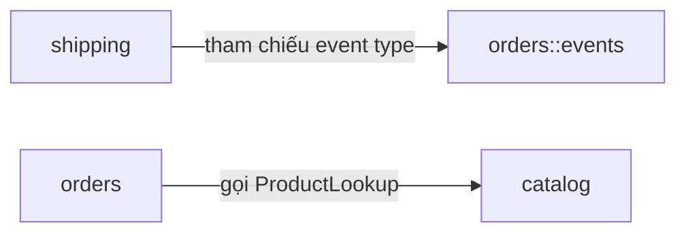
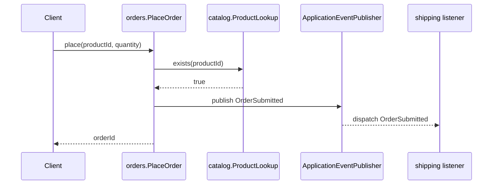
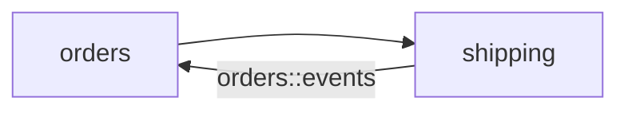
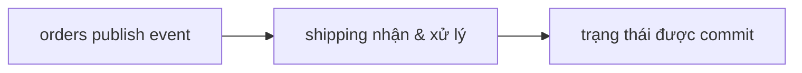
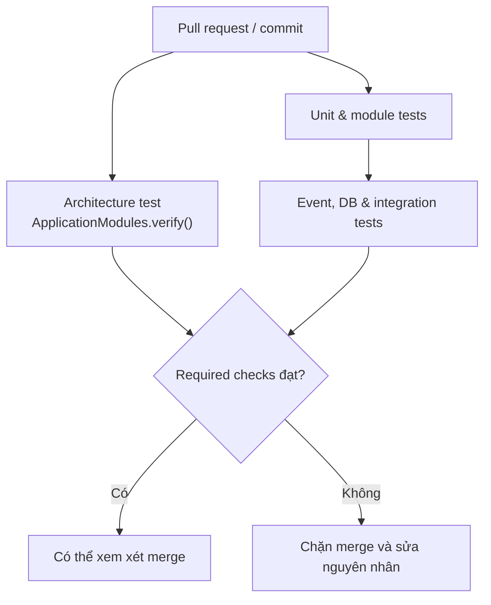
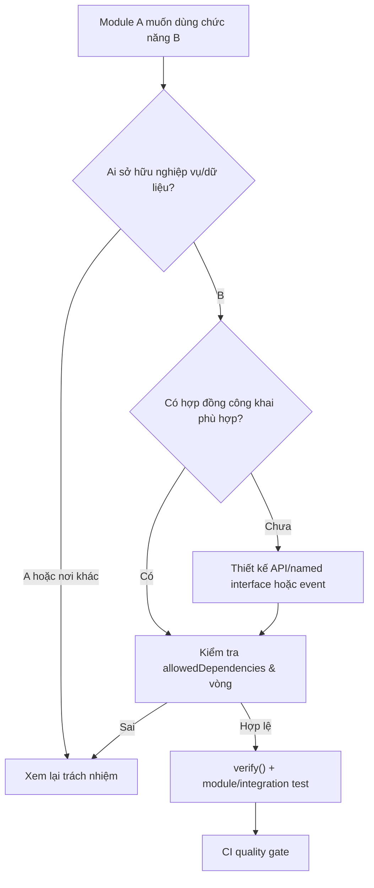

# Test module có được truy cập module khác không?

Trong ứng dụng Spring Boot dạng modular monolith, câu hỏi “module này có được truy cập module khác không?” có **hai nghĩa cần tách biệt**:

1. **Quy tắc kiến trúc:** Mã thuộc module A có được phép tham chiếu API, type hoặc package của module B không?
2. **Phạm vi kiểm thử:** Khi dùng `@ApplicationModuleTest` cho A, Spring có nạp bean của B vào test context không, và bài test có thể kiểm tra sự phối hợp A–B bằng cách nào?

Câu trả lời không đơn giản là “được” hay “không được”. Spring Modulith **cho phép các application module hợp tác có chủ đích**, nhưng yêu cầu chúng tôn trọng **giao diện được công bố, chiều phụ thuộc và chính sách dependency**. Một module khác có thể được đưa vào test context để kiểm tra tích hợp; điều đó không làm các phụ thuộc bị cấm trở thành hợp lệ.

Bài thuộc chương **Module boundaries** của **SPRING_MODULITH_VERIFICATION_TESTING**. Trọng tâm là kiểm chứng ranh giới kiến trúc bằng `ApplicationModules.verify()`, thực hành `@ApplicationModuleTest`, quan sát sự kiện và kiểm thử tích hợp có phạm vi, sau đó đặt các kiểm chứng vào **CI quality gate** để chặn phụ thuộc sai và hồi quy.

## 1. Mục tiêu học tập

Sau bài này, bạn có thể:

1. Giải thích khi nào module A được dùng **API công khai** hoặc **named interface** của module B.
2. Phân biệt `public` của Java với **public API của application module**.
3. Đọc và viết `@ApplicationModule(allowedDependencies = ...)` để giới hạn dependency giữa module.
4. Phát hiện tham chiếu vào package nội bộ, phụ thuộc ngoài danh sách cho phép và **phụ thuộc vòng** bằng `ApplicationModules.of(...).verify()`.
5. Phân biệt **quyền phụ thuộc trong production code** với **phạm vi Spring TestContext** của `@ApplicationModuleTest`.
6. Chọn `STANDALONE`, `DIRECT_DEPENDENCIES` hoặc `ALL_DEPENDENCIES` theo mục tiêu test; không dùng bootstrap mode để che lỗi kiến trúc.
7. Kiểm thử hợp đồng producer–consumer qua sự kiện mà không suy diễn rằng publish thành công đồng nghĩa xử lý và commit thành công.
8. Thiết kế một bài tập hồi quy CI chứng minh rằng dependency sai sẽ làm gate báo đỏ.

## 2. Trả lời ngắn: có, nhưng phải đúng hợp đồng

Trong Spring Modulith, **module A có thể phụ thuộc module B** nếu:

- B công bố type hoặc giao diện mà A thật sự cần, ví dụ type ở package API của B hoặc một `@NamedInterface` được công bố.
- Chiều dependency A → B không vi phạm chính sách như `allowedDependencies` mà A khai báo.
- Quan hệ mới không hình thành vòng module bị cấm theo quy tắc kiểm chứng.
- Sự hợp tác phù hợp với trách nhiệm nghiệp vụ và yêu cầu nhất quán dữ liệu.

Ngược lại, **không nên** cho A tham chiếu repository, implementation hoặc type nằm trong phần nội bộ của B chỉ vì Java compiler cho phép.

| Thao tác từ module A | Có hợp lệ về nguyên tắc không? | Điều kiện |
|---|---|---|
| Gọi API công khai của B | **Có thể** | API được công bố, chiều phụ thuộc được phép, không tạo vòng |
| Dùng named interface `B::events` | **Có thể** | B công bố `events` và A được phép phụ thuộc giao diện đó |
| Import `B.internal.SomeRepository` | **Không** theo ranh giới mặc định | Type nội bộ không phải API công khai, dù là Java `public` |
| Gọi API công khai B nhưng `allowedDependencies` của A không cho phép B | **Không** | Quyền truy cập Java không vượt được dependency policy |
| Tạo vòng A → B → A bằng các API công khai | **Không** nếu quy tắc module cấm vòng | Phải thiết kế lại chiều phối hợp |
| Test A với bean thật của B qua `DIRECT_DEPENDENCIES` | **Có thể** | B là dependency hợp lệ của A và có cấu hình/bean phục vụ test |
| Test A qua `STANDALONE` nhưng mong B tự có mặt | **Không mặc định** | Cần test double hoặc bootstrap mode phù hợp |

**Cần nhớ:** hai câu “A có quyền phụ thuộc B không?” và “bean của B có nằm trong test context không?” độc lập. Một câu trả lời `có` ở tầng runtime không chứng minh câu trả lời `có` ở tầng kiến trúc.

## 3. Ví dụ xuyên suốt: catalog, orders và shipping

Giả sử ứng dụng bán hàng có ba application module:

- `catalog` sở hữu dữ liệu và khả năng tra cứu sản phẩm.
- `orders` nhận yêu cầu đặt hàng, kiểm tra thông tin sản phẩm qua API `catalog` rồi phát sự kiện.
- `shipping` quan sát sự kiện của `orders` để ghi nhận yêu cầu chuẩn bị giao hàng.

Cấu trúc package dự kiến:

```text
com.acme.shop
├── ShopApplication.java
├── catalog
│   ├── ProductLookup.java
│   └── internal
│       └── DemoProductLookup.java
├── orders
│   ├── package-info.java
│   ├── PlaceOrder.java
│   ├── events
│   │   ├── package-info.java
│   │   └── OrderSubmitted.java
│   └── internal
│       └── OrderRepository.java
└── shipping
    ├── package-info.java
    ├── ShippingStatus.java
    └── internal
        ├── ShipmentProjection.java
        └── OnOrderSubmitted.java
```

Với cách nhận diện module mặc định và `ShopApplication` tại `com.acme.shop`, ba package con trực tiếp `catalog`, `orders`, `shipping` thường được nhận diện thành application module.

### 3.1. Đồ thị phụ thuộc hợp lệ



Đọc mũi tên theo **chiều mã nguồn sử dụng type**:

- `orders` có dependency tới `catalog` vì nó dùng `catalog.ProductLookup`.
- `shipping` có dependency tới `orders::events` vì listener nhận `OrderSubmitted`.
- `orders` **không** cần import type nào của `shipping` để publish event.

Các quan hệ trên tạo thành một chuỗi không có vòng: `shipping → orders → catalog`.

### 3.2. Đồ thị luồng sự kiện khi chạy khác đồ thị type



Luồng thông tin runtime đi từ producer `orders` đến consumer `shipping`, nhưng dependency về **Java event type** của consumer đi từ `shipping` tới `orders::events`. Nhầm hai chiều này thường dẫn tới sơ đồ dependency sai.

Ví dụ code tiếp theo chỉ dùng dữ liệu demo trong bộ nhớ: nó **không lưu đơn hàng** và **không đặt giữ sản phẩm thực sự**. Do đó `OrderSubmitted` phải được hiểu là “yêu cầu đã được tiếp nhận trong ví dụ”, không phải bằng chứng đơn hàng hoặc shipment đã commit vào database.

## 4. Ba lớp ranh giới cần kiểm tra

Khi quyết định một module có được dùng type thuộc module khác, hãy kiểm tra đủ ba lớp.

### 4.1. Lớp một — Quyền truy cập của Java

Java kiểm tra class, method, field có `public`, package-private, `protected` hay `private`. Nếu một type là `public` và khả dụng trên classpath/module path, Java compiler có thể cho code khác import.

Ví dụ `com.acme.shop.catalog.internal.LegacyStockRepository` có thể là một interface `public`. Điều đó **không nói rằng** nghiệp vụ `orders` được phép dùng interface ấy theo kiến trúc.

### 4.2. Lớp hai — API công khai của application module

Trong mô hình Spring Modulith mặc định:

- Type ở package gốc của module, chẳng hạn `catalog.ProductLookup`, thuộc giao diện công khai cơ bản.
- Package con như `catalog.internal` là nội bộ, trừ trường hợp được công bố có chủ đích.
- `@NamedInterface` có thể công bố một phần package con dưới một tên rõ ràng.

Đây là quy ước **cấp module**, không phải cú pháp Java mới. `public class` trong `catalog.internal` vẫn có thể bị `ApplicationModules.verify()` nhận diện là API nội bộ bị dùng sai.

### 4.3. Lớp ba — Chính sách dependency của module nguồn

Ngay cả khi `catalog.ProductLookup` là API công khai, `orders` vẫn phải tuân thủ danh sách `allowedDependencies` nếu có.

Nếu `orders` chỉ được phép phụ thuộc `catalog`, một lời gọi tới API công khai của `shipping` có thể biên dịch nhưng vẫn sai chính sách.

| Lớp kiểm tra | Câu hỏi | Ví dụ sai |
|---|---|---|
| Java | Type có thể truy cập bằng ngôn ngữ Java không? | Import một class package-private từ package khác |
| Public module API | Type đó có nằm trong bề mặt API được công bố không? | Import `catalog.internal.StockRepository` dù nó `public` |
| Dependency policy/graph | Module nguồn có được phép phụ thuộc module đích theo hướng đó không? | `orders` phụ thuộc `shipping` khi chỉ cho phép `catalog`, hoặc tạo vòng |

**Kết luận:** Java compiler không tự thực thi đủ hai lớp ranh giới của Spring Modulith; cần architecture verification.

## 5. Khai báo hợp đồng công khai và chiều phụ thuộc

### 5.1. Catalog cung cấp API hẹp

File `catalog/ProductLookup.java`:

```java
package com.acme.shop.catalog;

import java.util.UUID;

public interface ProductLookup {
    boolean exists(UUID productId);
}
```

File `catalog/internal/DemoProductLookup.java`:

```java
package com.acme.shop.catalog.internal;

import com.acme.shop.catalog.ProductLookup;
import java.util.UUID;
import org.springframework.stereotype.Component;

@Component
class DemoProductLookup implements ProductLookup {

    @Override
    public boolean exists(UUID productId) {
        // Chỉ là stub để minh họa module test,
        // không phải truy vấn catalog thật.
        return productId != null;
    }
}
```

Class triển khai được giữ trong `catalog.internal`. `orders` chỉ phụ thuộc `ProductLookup`; nó không biết catalog lấy dữ liệu từ JDBC, JPA, cache hay HTTP.

### 5.2. Orders cho phép dependency đến catalog

File `orders/package-info.java`:

```java
@org.springframework.modulith.ApplicationModule(
    allowedDependencies = "catalog"
)
package com.acme.shop.orders;
```

Ý nghĩa: trong phạm vi các application module, `orders` được phép phụ thuộc `catalog` theo hợp đồng. Chính sách này **không** có nghĩa `orders` được quyền truy cập các type nội bộ `catalog.internal`.

### 5.3. Orders công bố event contract qua named interface

File `orders/events/package-info.java`:

```java
@org.springframework.modulith.NamedInterface("events")
package com.acme.shop.orders.events;
```

File `orders/events/OrderSubmitted.java`:

```java
package com.acme.shop.orders.events;

import java.util.UUID;

public record OrderSubmitted(
        UUID orderId,
        UUID productId,
        int quantity) {}
```

`@NamedInterface("events")` đánh dấu `orders.events` là một phần giao diện công khai có tên của `orders`. Đây là cách tiêu thụ event contract mà không cần công bố package `orders.internal`.

### 5.4. Shipping chỉ dùng events của orders

File `shipping/package-info.java`:

```java
@org.springframework.modulith.ApplicationModule(
    allowedDependencies = "orders::events"
)
package com.acme.shop.shipping;
```

Điều kiện này có hai tác dụng:

1. `shipping` có thể dùng hợp đồng event đã công bố `orders::events`.
2. `shipping` không được dựa vào những phần khác của `orders` hoặc một module khác nằm ngoài chính sách.

Cú pháp `orders::events` gồm **tên module** và **tên named interface**. Nó là quy tắc thiết kế được kiểm chứng, không phải một lệnh để Spring tự tạo event listener hoặc tự đưa bean của `orders` vào test context.

## 6. Ví dụ producer: truy cập module khác qua API hợp lệ

File `orders/PlaceOrder.java`:

```java
package com.acme.shop.orders;

import com.acme.shop.catalog.ProductLookup;
import com.acme.shop.orders.events.OrderSubmitted;
import java.util.UUID;
import org.springframework.context.ApplicationEventPublisher;
import org.springframework.stereotype.Service;

@Service
public class PlaceOrder {

    private final ProductLookup products;
    private final ApplicationEventPublisher events;

    public PlaceOrder(
            ProductLookup products,
            ApplicationEventPublisher events) {
        this.products = products;
        this.events = events;
    }

    public UUID place(UUID productId, int quantity) {
        if (productId == null || quantity <= 0) {
            throw new IllegalArgumentException("Invalid order item");
        }
        if (!products.exists(productId)) {
            throw new IllegalArgumentException("Unknown product");
        }

        UUID orderId = UUID.randomUUID();
        events.publishEvent(
            new OrderSubmitted(orderId, productId, quantity)
        );
        return orderId;
    }
}
```

Ở đây có hai loại dependency:

- `orders` dùng `catalog.ProductLookup`: **dependency xuyên module đồng bộ qua API công khai**, được `allowedDependencies = "catalog"` cho phép.
- `orders` dùng `ApplicationEventPublisher` của Spring Framework để phát `OrderSubmitted` thuộc chính module `orders`: **không tạo dependency tới `shipping`**.

Đây là ví dụ minh họa giao tiếp và ranh giới, chưa phải quy trình đặt hàng production. Hàm `exists` không giữ chỗ tồn kho, không ngăn race condition và không lưu đơn. Bài test không được suy luận rằng sau khi publish event đã có dữ liệu commit.

## 7. Ví dụ consumer: chỉ tham chiếu named interface

API đọc kết quả của `shipping`, file `shipping/ShippingStatus.java`:

```java
package com.acme.shop.shipping;

import java.util.UUID;

public interface ShippingStatus {
    boolean received(UUID orderId);
}
```

Implementation in-memory, file `shipping/internal/ShipmentProjection.java`:

```java
package com.acme.shop.shipping.internal;

import com.acme.shop.shipping.ShippingStatus;
import java.util.Set;
import java.util.UUID;
import java.util.concurrent.ConcurrentHashMap;
import org.springframework.stereotype.Component;

@Component
class ShipmentProjection implements ShippingStatus {

    private final Set<UUID> orders =
        ConcurrentHashMap.newKeySet();

    void record(UUID orderId) {
        orders.add(orderId);
    }

    @Override
    public boolean received(UUID orderId) {
        return orders.contains(orderId);
    }
}
```

Listener, file `shipping/internal/OnOrderSubmitted.java`:

```java
package com.acme.shop.shipping.internal;

import com.acme.shop.orders.events.OrderSubmitted;
import org.springframework.context.event.EventListener;
import org.springframework.stereotype.Component;

@Component
class OnOrderSubmitted {

    private final ShipmentProjection projection;

    OnOrderSubmitted(ShipmentProjection projection) {
        this.projection = projection;
    }

    @EventListener
    void on(OrderSubmitted event) {
        projection.record(event.orderId());
    }
}
```

`shipping` chỉ import `orders.events.OrderSubmitted`, không import `orders.PlaceOrder` hoặc `orders.internal.OrderRepository`. Producer không cần biết listener cụ thể có tồn tại. `@EventListener` trong ví dụ dùng dispatch đồng bộ mặc định, nhưng ứng dụng có thể thay đổi cấu hình Spring event multicaster; với listener async/sau commit, cách kiểm thử phải thay đổi.

`ConcurrentHashMap.newKeySet()` ở đây chỉ ghi nhận mã đơn trong **bộ nhớ của JVM hiện tại**; nó không chứng minh tạo shipment thật, lưu bền vững hay xử lý lại sau restart.

## 8. Trường hợp truy cập sai: compiler xanh nhưng kiến trúc đỏ

### 8.1. Đi vào package nội bộ của module khác

Giả sử module `orders` dùng trực tiếp một interface `public`:

```java
// Giả định interface sau là public về mặt Java.
package com.acme.shop.catalog.internal;

public interface LegacyStockRepository {
    boolean existsInStorage(java.util.UUID productId);
}
```

Sau đó mã production của `orders` khai báo:

```java
package com.acme.shop.orders;

import com.acme.shop.catalog.internal.LegacyStockRepository;

// Fragment minh họa dependency sai: không thêm vào code hợp lệ ở trên.
class BadOrderLookup {

    private final LegacyStockRepository repository;

    BadOrderLookup(LegacyStockRepository repository) {
        this.repository = repository;
    }
}
```

Code có thể **biên dịch** vì `LegacyStockRepository` là `public`. Nhưng type thuộc `catalog.internal` không nằm trong API công khai mặc định của `catalog`; đây là dependency không nên có.

Unit test của `BadOrderLookup` có thể mock repository và vẫn xanh. Phép kiểm chứng kiến trúc mới trả lời câu hỏi “mối phụ thuộc ấy có được phép tồn tại không?”.

### 8.2. Dùng API công khai nhưng sai allowedDependencies

Giả sử `shipping` thêm:

```java
// Fragment gây vi phạm policy của shipping.
import com.acme.shop.catalog.ProductLookup;
```

Nếu mã của `shipping` thực sự dùng `ProductLookup` trong field, constructor hoặc method, đây là phụ thuộc `shipping → catalog`. Type `ProductLookup` là API công khai, nhưng `shipping` chỉ cho phép `orders::events`, nên dependency ấy vẫn trái chính sách.

**Lưu ý:** một dòng `import` không sử dụng có thể bị compiler loại bỏ khỏi quan hệ bytecode cần phân tích. Khi thử tạo lỗi, hãy tạo **tham chiếu type thực sự được biên dịch**, không chỉ thêm một dòng import.

### 8.3. Phụ thuộc vòng dù cả hai phía đều dùng API công khai

Nếu `orders` gọi `shipping.ShippingStatus`, trong khi `shipping` đã phụ thuộc `orders::events`, ta có:



Không cần import type nội bộ để vòng này xuất hiện. Kiểm chứng cấu trúc phải xem **toàn bộ đồ thị module**.

Các lựa chọn sửa cần dựa trên nghiệp vụ: đặt việc điều phối ở nơi thích hợp, thay đổi hướng trách nhiệm, thiết kế hợp đồng riêng hoặc giao tiếp qua event khi chấp nhận xử lý bất đồng bộ. Không phải cứ thêm một interface là tự động phá được vòng.

## 9. Kiểm chứng quyền truy cập bằng ApplicationModules.verify()

Spring Modulith cung cấp `ApplicationModules` trong `org.springframework.modulith.core`. Một architecture test tối giản đặt tại package gốc:

```java
package com.acme.shop;

import org.junit.jupiter.api.Test;
import org.springframework.modulith.core.ApplicationModules;

class ModuleBoundaryTests {

    @Test
    void enforcesModuleBoundaries() {
        ApplicationModules.of(ShopApplication.class).verify();
    }
}
```

`ApplicationModules.of(ShopApplication.class)` phân tích cấu trúc ứng dụng và tạo mô hình application module; `verify()` áp dụng những quy tắc kiến trúc được hỗ trợ, trong đó thường có:

- Không có **module dependency cycle**.
- Không tham chiếu các type thuộc **API nội bộ** của module khác.
- Không vượt qua **`allowedDependencies`** đã khai báo.

Trong ví dụ hợp lệ, các cạnh `orders → catalog` và `shipping → orders::events` có thể vượt kiểm chứng. Nếu thêm một trong những dependency sai ở mục 8, test cần báo thất bại.

### 9.1. Chạy trong JUnit nhưng không phải unit test nghiệp vụ

Architecture test cũng dùng `@Test` của JUnit, song nó xác minh **mô hình cấu trúc**, không thực thi `PlaceOrder.place(...)` để kiểm tra đầu ra. Nó không cần gọi `SpringApplication.run(...)` hoặc khởi động toàn bộ Spring Boot `ApplicationContext` chỉ để tìm dependency sai.

Một test hành vi dùng Mockito có thể vẫn xanh vì mock trả giá trị hợp lệ. Ngược lại, `verify()` có thể xanh nhưng payload event sai. Hai loại bằng chứng **không thay thế nhau**.

### 9.2. Đọc đúng lỗi và khắc phục đúng nguyên nhân

| Loại vi phạm | Dấu hiệu cần tìm | Cách sửa ưu tiên |
|---|---|---|
| Truy cập nội bộ | Type đích nằm trong `B.internal` hoặc package con không được công bố | Dùng API/named interface thực sự hợp lệ; giữ repository nội bộ |
| Ngoài danh sách được phép | Dependency A → B trái `allowedDependencies` | Xem lại quyền sở hữu use case và chiều phụ thuộc |
| Vòng module | Có đường A → B → … → A | Tái thiết kế trách nhiệm và giao tiếp; không chỉ đổi modifier `public` |
| Module không được nhận diện đúng | Package dự kiến không xuất hiện trong mô hình | Kiểm tra vị trí package gốc và cấu hình nhận diện module |

**Không nên xử lý lỗi bằng cách** đổi mọi type nội bộ thành API công khai hoặc mở `allowedDependencies` cho tất cả module. Điều đó có thể làm test xanh nhưng làm mất khả năng bảo vệ kiến trúc.

### 9.3. Giới hạn của kiểm chứng cấu trúc

`verify()` không tự chứng minh:

- Dữ liệu nghiệp vụ được tính hoặc lưu đúng.
- Một bean triển khai tồn tại trong context với profile hiện tại.
- Event đã được consumer xử lý và commit.
- Mọi phụ thuộc qua reflection, SQL, cấu hình chuỗi hay external HTTP đều được phát hiện.
- Code test nằm ngoài phạm vi được mô hình hóa chắc chắn tuân theo cùng quy tắc.

Vì vậy cần thêm test runtime, và khi có các liên kết động hoặc quyền sở hữu database, có thể cần quy tắc bổ sung ngoài kiểm chứng type dependency.

## 10. Module test “truy cập module khác” nghĩa là gì?

Một bài `@ApplicationModuleTest` **không tự động quyết định quyền kiến trúc**. Nó dùng mô hình module để xác định **phạm vi Spring TestContext cần bootstrap**. Câu hỏi lúc này là: “Những bean của module nào được khởi tạo để test có thể chạy?”.

Ba chế độ thường gặp:

| Bootstrap mode | Phạm vi application module | Cách dùng phù hợp |
|---|---|---|
| `STANDALONE` (mặc định) | Module đang kiểm thử | Kiểm tra logic/bean nội bộ; thay dependency bên ngoài bằng test double khi cần |
| `DIRECT_DEPENDENCIES` | Module đang kiểm thử và các module phụ thuộc trực tiếp | Chạy use case cùng bean thật từ module dependency hợp lệ |
| `ALL_DEPENDENCIES` | Module đang kiểm thử và các dependency bắc cầu | Kiểm tra luồng module cần nhiều tầng phụ thuộc |

Đây là **phạm vi bean của test**, không phải lệnh làm mất dependency trong source code, cũng không phải thay đổi quy tắc `allowedDependencies`.

### 10.1. STANDALONE không tự nạp các bean nghiệp vụ từ module khác

`PlaceOrder` của `orders` có constructor parameter `catalog.ProductLookup`. Khi test `orders` ở chế độ `STANDALONE`, module `catalog` thường không thuộc phạm vi bootstrap nghiệp vụ.

Nếu Spring context không tìm thấy bean `ProductLookup`, test có thể báo thiếu dependency. Có hai lựa chọn theo mục tiêu:

- **Test cô lập `orders`:** cung cấp test double/mock cho `ProductLookup` bằng cơ chế Spring Test tương thích phiên bản đang dùng.
- **Test phối hợp `orders` và `catalog`:** dùng `DIRECT_DEPENDENCIES` và bean thật của `catalog`.

Thiếu bean ở chế độ `STANDALONE` **không đồng nghĩa** chiều `orders → catalog` vi phạm kiến trúc. Đó có thể chỉ là kết quả của phạm vi test đã chọn.

### 10.2. DIRECT_DEPENDENCIES giúp kiểm tra collaboration

Dùng module `orders` và dependency trực tiếp `catalog`:

```java
package com.acme.shop.orders;

import static org.assertj.core.api.Assertions.assertThat;

import com.acme.shop.orders.events.OrderSubmitted;
import java.util.UUID;
import org.junit.jupiter.api.Test;
import org.springframework.beans.factory.annotation.Autowired;
import org.springframework.modulith.test.ApplicationModuleTest;
import org.springframework.modulith.test.ApplicationModuleTest.BootstrapMode;
import org.springframework.modulith.test.PublishedEvents;

@ApplicationModuleTest(mode = BootstrapMode.DIRECT_DEPENDENCIES)
class OrdersWithCatalogTests {

    @Autowired PlaceOrder orders;

    @Test
    void usesCatalogAndPublishesOrder(PublishedEvents events) {
        UUID productId = UUID.randomUUID();

        UUID orderId = orders.place(productId, 2);

        assertThat(events.ofType(OrderSubmitted.class))
            .singleElement()
            .satisfies(event -> {
                assertThat(event.orderId()).isEqualTo(orderId);
                assertThat(event.productId()).isEqualTo(productId);
                assertThat(event.quantity()).isEqualTo(2);
            });
    }
}
```

Test này giả định dự án có dependency test Spring Modulith tương thích, `ShopApplication` ở package gốc và `catalog.internal.DemoProductLookup` được Spring tạo thành bean. Vì demo trả `true` cho ID không null, test có thể kiểm tra use case và event mà không cần database.

Những điều test này có thể tạo bằng chứng:

- Spring đã tạo được các bean cần thiết trong phạm vi bootstrap.
- `PlaceOrder` gọi được collaborator công khai `ProductLookup` của `catalog`.
- `OrderSubmitted` được publish với payload đã assert.

Những điều nó **không chứng minh**:

- `shipping` đã xử lý event.
- Đơn hàng thực sự được lưu và commit.
- Bất kỳ dependency nào khác trong code đều hợp lệ — việc đó cần `verify()` riêng.

### 10.3. ALL_DEPENDENCIES không phải lựa chọn mặc định cho mọi lỗi

`ALL_DEPENDENCIES` có thể hữu ích khi module được kiểm thử cần các module phụ thuộc bắc cầu. Nhưng nó cũng làm phạm vi test rộng hơn, dễ kéo theo nhiều cấu hình/hạ tầng hơn.

Không nên mở từ `STANDALONE` lên `ALL_DEPENDENCIES` chỉ để làm im lỗi thiếu bean mà chưa xác định dependency thật sự cần thiết. Phạm vi test nên mô tả **hợp đồng bạn muốn kiểm tra**, không dùng để hợp pháp hóa một thiết kế sai.

## 11. Có nên import class của module khác trong mã test?

Trong test có ba tình huống cần phân biệt:

1. **Test gọi API công khai của module khác như một collaborator hợp lệ:** có thể chấp nhận khi đúng mục tiêu tích hợp và đúng chính sách dependency của production.
2. **Test trực tiếp dùng type nội bộ của module khác để assert trạng thái:** có thể khiến test gắn vào implementation và trở nên mong manh; ưu tiên quan sát qua API/query hợp lệ hoặc trạng thái dữ liệu có chủ đích.
3. **Test import một type ngoài phạm vi production dependency chỉ để tạo dữ liệu mẫu:** việc import này **không tự chứng minh** module production được phép phụ thuộc type đó.

`ApplicationModules.verify()` tập trung vào các module và type trong mô hình ứng dụng mà nó phân tích. Không nên giả định rằng **mọi import trong `src/test`** đều mặc nhiên được áp cùng quy tắc như production code. Nếu nhóm muốn kiểm soát chặt dependency của test source, cần kiểm tra phạm vi áp dụng và bổ sung quy tắc/test kiến trúc phù hợp.

Tuy nhiên, điều đó không có nghĩa nên “lách” ranh giới bằng test: nếu một module chỉ có thể kiểm thử bằng cách mở repository nội bộ của module khác, đây là tín hiệu để xem lại **API quan sát trạng thái, fixture và cách thiết kế hợp đồng**.

## 12. Module consumer có thể kiểm thử mà không cần producer đang chạy

`shipping` nhận `OrderSubmitted` từ module `orders`. Nhưng khi kiểm tra logic consumer, ta không nhất thiết phải khởi chạy use case `PlaceOrder`.

Trong module test của `shipping`, test có thể **phát trực tiếp một event contract** rồi quan sát trạng thái shipping:

```java
package com.acme.shop.shipping;

import static org.assertj.core.api.Assertions.assertThat;

import com.acme.shop.orders.events.OrderSubmitted;
import java.util.UUID;
import org.junit.jupiter.api.Test;
import org.springframework.beans.factory.annotation.Autowired;
import org.springframework.context.ApplicationEventPublisher;
import org.springframework.modulith.test.ApplicationModuleTest;

@ApplicationModuleTest
class ShippingModuleTests {

    @Autowired ApplicationEventPublisher publisher;
    @Autowired ShippingStatus shipping;

    @Test
    void receivesOrderSubmitted() {
        UUID orderId = UUID.randomUUID();

        publisher.publishEvent(new OrderSubmitted(
            orderId, UUID.randomUUID(), 2
        ));

        assertThat(shipping.received(orderId)).isTrue();
    }
}
```

Trong ví dụ `@EventListener` đồng bộ và state in-memory, assertion có thể đọc kết quả ngay sau publish.

Đây là bằng chứng rằng **listener của `shipping` xử lý event đầu vào trong context được chọn**. Nó không chứng minh producer luôn phát event đúng; điều đó được kiểm tra riêng ở `OrdersWithCatalogTests`.

### 12.1. Published không đồng nghĩa handled

Hãy phân biệt:



- `PublishedEvents` trong test producer xác minh **event đã phát**.
- Consumer test xác minh **logic nhận và xử lý event**.
- Database/transaction integration test xác minh **kết quả lưu bền vững sau commit**.

Nếu listener chạy bất đồng bộ hoặc sau commit, không thể giả định `publishEvent(...)` trả về là consumer đã hoàn tất.

### 12.2. Listener sau commit cần test khác

Với `@ApplicationModuleListener`, Spring Modulith hỗ trợ mẫu event listener theo transaction, thường xử lý sau commit và bất đồng bộ theo cấu hình. Producer cần có transaction phù hợp; test nên chờ **điều kiện quan sát được** thay vì dùng `Thread.sleep(...)`.

`Scenario` của Spring Modulith Test có thể hỗ trợ mô tả bước kích hoạt và chờ sự kiện/trạng thái kết quả. Tuy nhiên, một listener đã chạy hay publication đã được ghi nhận vẫn **không tự bảo đảm** tác động nghiệp vụ “exactly once”; phải kiểm tra retry và idempotency riêng khi cần.

## 13. Khi cần tích hợp nhiều module, hãy test kết quả tại đúng ranh giới

Giả sử ứng dụng thật lưu đơn vào PostgreSQL, ghi event publication sau commit rồi tạo yêu cầu shipment trong database.

Kiểm chứng quyền truy cập type/module vẫn cần `verify()`, nhưng để chứng minh luồng runtime còn cần:

| Hợp đồng/rủi ro | Bài kiểm chứng phù hợp | Điều quan sát |
|---|---|---|
| `orders` chỉ dùng API `catalog` | `ApplicationModules.verify()` | Dependency graph hợp lệ |
| `PlaceOrder` kiểm tra sản phẩm đúng | Unit hoặc `@ApplicationModuleTest` | Input hợp lệ/không hợp lệ, collaborator và kết quả |
| `OrderSubmitted` đúng payload | `PublishedEvents` | Event đúng ID, sản phẩm, số lượng và số lần phát |
| `shipping` xử lý event | Module test consumer | Trạng thái shipment tương ứng |
| Consumer có thể nhận lặp | Consumer/DB integration test | Một tác dụng bền vững theo khóa idempotency |
| Producer commit rồi listener xử lý | Transaction/event integration test | Kết quả quan sát sau commit, xử lý lỗi/retry |
| Endpoint trả kết quả đúng | `@SpringBootTest` + HTTP/MockMvc test | Response và trạng thái xuyên module |

Nếu cần kiểm chứng constraint, isolation hay locking của database, Testcontainers là một lựa chọn sử dụng engine DB tương ứng. Mock repository hoặc collection in-memory không phản ánh đầy đủ transaction, deadlock và concurrency.

**Lưu ý về Spring Test:** `@Transactional` trên bài test có thể khiến test transaction rollback khi kết thúc, còn listener sau commit hoặc chạy trong transaction riêng có điểm quan sát khác. Vì vậy cần thiết kế test transaction thực tế trước khi khẳng định event và dữ liệu đã commit.

## 14. Đặt kiểm chứng ranh giới vào CI quality gate

Một quy tắc `allowedDependencies` chỉ đáng tin nếu mỗi thay đổi có thể tạo dependency mới đều được kiểm tra.



Một pipeline cần ít nhất:

1. **Kiểm chứng mô hình module và dependency** bằng `ApplicationModules.verify()`.
2. **Kiểm thử hành vi module** với `@ApplicationModuleTest`, bao gồm cả input sai và payload event.
3. **Kiểm thử consumer và hạ tầng** nếu ứng dụng có event, transaction hoặc database quan trọng.
4. **Báo cáo test gắn với commit**, có số lượng test đã chạy, failed và skipped.
5. **Check bắt buộc** trước merge để pipeline đỏ thực sự ngăn phụ thuộc sai lọt vào nhánh chính.

Ví dụ lệnh theo build wrapper của dự án:

```bash
# Maven: những test được cấu hình trong phase test
./mvnw test

# Gradle: task test được cấu hình
./gradlew test
```

Nếu integration test nằm trong phase/task riêng, CI phải gọi thêm đúng phần đó. Không nên coi pipeline xanh là bằng chứng đầy đủ khi `ModuleBoundaryTests` hoặc các test quan trọng bị skip.

### 14.1. Kiểm tra gate bằng thay đổi gây lỗi có chủ đích

Trong nhánh thử nghiệm:

1. Tạo một reference từ `shipping` tới `orders.internal.OrderRepository` (cần type tồn tại, accessible ở mức Java và được tham chiếu trong code biên dịch).
2. Chạy `ModuleBoundaryTests` và kiểm tra nó báo vi phạm.
3. Bỏ reference sai, thay bằng hợp đồng hợp lệ nếu thật sự cần.
4. Chạy lại architecture test và các module/integration test liên quan.
5. Xác nhận required checks trong CI đạt ở revision mới nhất.

Đây là cách chứng minh gate **phát hiện được loại lỗi mục tiêu**, chứ không chỉ tồn tại một class JUnit mang tên “ArchitectureTests”.

## 15. Quy trình ra quyết định khi module muốn gọi module khác

Giả sử developer muốn thêm `AService` của module A gọi `BRepository` của module B. Có thể đi theo quy trình sau:

**Bước 1 — Xác định mục tiêu nghiệp vụ.** A cần hỏi thông tin, thực hiện một use case hay chỉ cần thông báo B về một điều đã xảy ra?

**Bước 2 — Xác định owner.** Nếu dữ liệu thuộc B, A không nên quyết định quy tắc truy vấn/ghi vào repository nội bộ B.

**Bước 3 — Chọn hợp đồng.** Với truy vấn đồng bộ, dùng API hẹp của B nếu yêu cầu nghiệp vụ phù hợp. Với thông báo nghiệp vụ chấp nhận bất đồng bộ, cân nhắc event.

**Bước 4 — Kiểm tra module graph.** Hướng A → B đã được cho phép chưa? B có đang phụ thuộc A không? Có tạo vòng hoặc phụ thuộc ngoài `allowedDependencies` không?

**Bước 5 — Công bố đúng phạm vi.** Nếu cần API từ package con, cân nhắc `@NamedInterface` có chủ đích. Không công bố toàn bộ repository, entity hoặc implementation chỉ để giải quyết một import.

**Bước 6 — Thêm bằng chứng.** Chạy `verify()` cho kiến trúc; viết module test cho hợp đồng mới; thêm integration test cho transaction/event nếu cần.

**Bước 7 — Chặn hồi quy.** Đảm bảo test chạy trong CI và báo đỏ nếu dependency bị thay đổi trái quy tắc.



## 16. Những ngộ nhận cần tránh

**“Module khác thì tuyệt đối không được gọi.”** Không đúng. Spring Modulith hỗ trợ dependency xuyên module khi thông qua API hợp lệ và tuân thủ chính sách.

**“Type là `public` nên mọi module được dùng.”** Không đúng. Public theo Java khác public API theo mô hình Spring Modulith; `allowedDependencies` còn có thể giới hạn quyền của module nguồn.

**“Khai báo `allowedDependencies = "catalog"` cho phép dùng mọi class trong catalog.”** Không đúng. Chính sách hướng dependency và công bố API là hai lớp điều kiện khác nhau.

**“Đã có `@NamedInterface("events")` thì consumer tự nhận event.”** Không đúng. Named interface công bố hợp đồng type, không tự đăng ký listener hoặc bảo đảm dispatch.

**“`@ApplicationModuleTest(mode = ALL_DEPENDENCIES)` nghĩa là mọi dependency đều được cho phép.”** Không đúng. Bootstrap mode chỉ điều khiển phạm vi context test, không nới quy tắc kiến trúc.

**“`STANDALONE` thiếu bean là chứng cứ code module truy cập sai.”** Không nhất thiết. Có thể chỉ thiếu collaborator vì test cố tình không nạp module dependency hợp lệ.

**“Module test có thể import class khác nên production code cũng được import.”** Không suy ra được. Test code có mục đích và phạm vi phân tích riêng; production dependency phải được kiểm chứng độc lập.

**“PublishedEvents xanh nghĩa là shipping đã lưu thành công.”** Không đúng. Nó chứng minh event đã phát trong test, còn consumer và database cần test riêng.

**“Spring context chạy tốt thì `verify()` chắc chắn xanh.”** Không đúng. Spring DI không mặc định áp dụng toàn bộ ranh giới Spring Modulith khi khởi tạo bean.

## 17. Bài tập thực hành

**Bối cảnh:** tạo ứng dụng Spring Boot với `catalog`, `orders` và `shipping` như mục 3. Chọn các dependency Spring Modulith core/test, Spring Boot và JUnit tương thích với dự án; các đoạn Java trong bài nhằm minh họa cấu trúc source, không tạo dữ liệu bền vững.

### Phần A — Xây một module graph hợp lệ

1. Tạo `ProductLookup` tại API gốc của `catalog` và một `@Component` implementation trong `catalog.internal`.
2. Tạo `orders.PlaceOrder` dùng `ProductLookup` và công bố `OrderSubmitted` qua `orders::events`.
3. Khai báo `orders` chỉ phụ thuộc `catalog`; `shipping` chỉ phụ thuộc `orders::events`.
4. Vẽ dependency graph theo chiều **module có type reference → module sở hữu type**.
5. Giải thích vì sao `orders` publish event không có nghĩa `orders` phụ thuộc `shipping`.

### Phần B — Chứng minh các trường hợp bị từ chối

1. Thêm một interface `public` vào `catalog.internal`; tạo field hoặc constructor parameter dùng type ấy trong `orders`.
2. Chạy `ApplicationModules.of(ShopApplication.class).verify()` và ghi lại loại vi phạm.
3. Loại bỏ dependency nội bộ; thử cho `shipping` tham chiếu API công khai `catalog.ProductLookup`, trái `allowedDependencies` của nó.
4. Xử lý lỗi bằng điều chỉnh trách nhiệm/hợp đồng, không chỉ thêm module vào danh sách cho phép.
5. Giải thích nếu `orders` bắt đầu gọi `shipping.ShippingStatus` thì có nguy cơ xuất hiện vòng module nào.

### Phần C — Thử ba chế độ @ApplicationModuleTest

1. Viết test `orders` ở `STANDALONE`, quan sát nhu cầu mock/test double cho `ProductLookup` nếu context không có bean.
2. Viết test `orders` ở `DIRECT_DEPENDENCIES` để sử dụng bean thật của `catalog`; assert payload `OrderSubmitted` với `PublishedEvents`.
3. Xác định lý do một test có thể cần `ALL_DEPENDENCIES` và những module phụ thuộc bắc cầu nào sẽ được nạp; không dùng chỉ để tránh thiết kế fixture.
4. So sánh bằng chứng của từng mode với kết quả `verify()`.

### Phần D — Kiểm thử phía consumer và CI

1. Viết test `shipping` ở `STANDALONE`, phát trực tiếp `OrderSubmitted` bằng `ApplicationEventPublisher`.
2. Assert `ShippingStatus.received(orderId)` sau xử lý trong ví dụ `@EventListener` đồng bộ.
3. Nếu chuyển sang listener bất đồng bộ/sau commit, mô tả thay đổi cần thiết về transaction và điều kiện chờ.
4. Nếu lưu shipment vào database, bổ sung integration test với constraint và idempotency thực sự.
5. Đưa architecture test và module/integration tests bắt buộc vào CI; tạo một dependency sai để xác nhận gate báo đỏ rồi hoàn nguyên.

**Tiêu chí hoàn thành:** bạn phân biệt được **quyền phụ thuộc kiến trúc** với **phạm vi test context**, có một graph hợp lệ, chứng minh `verify()` phát hiện ít nhất một vi phạm và có test producer–consumer phù hợp với phạm vi đã chọn.

## 18. Câu hỏi tự kiểm tra

**1. Module A có được truy cập module B không?**

Có thể, nếu A dùng giao diện được B công bố, chiều dependency được chính sách cho phép và không vi phạm các quy tắc kiến trúc như phụ thuộc vòng.

**2. Vì sao Java cho import `catalog.internal.LegacyStockRepository` nhưng Spring Modulith vẫn có thể báo lỗi?**

Vì `public` là quy tắc Java, còn `internal` là phần không được công bố của application module theo mô hình Spring Modulith.

**3. `@NamedInterface` và `allowedDependencies` khác nhau ở điểm nào?**

`@NamedInterface` công bố phần API của module đích; `allowedDependencies` kiểm soát chiều phụ thuộc của module nguồn. Hai cơ chế bổ trợ, không thay thế nhau.

**4. `ApplicationModules.verify()` có cần Spring Boot context khởi động không?**

Không cần khởi động toàn bộ application context để kiểm tra cấu trúc module; nó phân tích mô hình và quan hệ code/type.

**5. Vì sao `@ApplicationModuleTest` `STANDALONE` không tự có bean từ catalog?**

Vì mode mặc định tập trung vào module được kiểm thử; dependency bên ngoài có thể cần test double hoặc một mode bao gồm module phụ thuộc.

**6. Khi nào chọn `DIRECT_DEPENDENCIES`?**

Khi muốn kiểm tra use case của module cùng bean thật thuộc các module mà nó phụ thuộc trực tiếp, chẳng hạn `orders` và `catalog` trong ví dụ.

**7. Dùng `ALL_DEPENDENCIES` có làm một dependency trái `allowedDependencies` thành hợp lệ không?**

Không. Nó chỉ chọn phạm vi module để bootstrap test context; quyền kiến trúc vẫn do mô hình và quy tắc dependency quyết định.

**8. Tại sao shipping module test không cần gọi `PlaceOrder`?**

Vì có thể phát trực tiếp event contract `OrderSubmitted` và quan sát hành vi listener. Producer contract được kiểm tra độc lập trong orders module test.

**9. Vì sao `PublishedEvents` chưa đủ để chứng minh consumer đã hoàn tất?**

Vì nó quan sát event đã publish, không khẳng định listener đã xử lý, transaction đã commit hoặc database đã lưu đúng.

**10. Một PR thêm type reference vào package nội bộ module khác nhưng unit test xanh; gate cần hành động gì?**

`ApplicationModules.verify()` phải được chạy trên revision đó; khi phát hiện vi phạm cần báo đỏ và chặn merge cho đến khi dependency được sửa hoặc thiết kế được xử lý đúng quy trình.

## Kết luận

**Test module có được truy cập module khác không?** — **Có thể**, nhưng phải đúng **public API hoặc named interface**, đúng **`allowedDependencies`** và không phá ranh giới của đồ thị module. Spring Modulith cho phép cộng tác giữa module chứ không biến chúng thành những hòn đảo biệt lập.

Để kiểm chứng điều đó, hãy dùng **`ApplicationModules.of(...).verify()`** cho quan hệ type/module; dùng **`@ApplicationModuleTest`** với bootstrap mode thích hợp để kiểm tra bean và hành vi trong phạm vi mong muốn; thêm producer/consumer, database và transaction integration test khi kết luận liên quan đến kết quả runtime. Khi các bài kiểm tra cần thiết được chạy bắt buộc trong **CI quality gate**, phụ thuộc sai và hồi quy sẽ được phát hiện ngay cả khi unit test riêng lẻ vẫn xanh.
