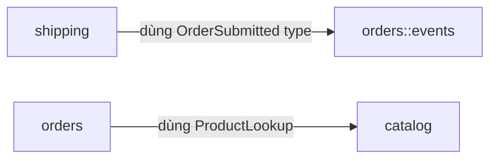
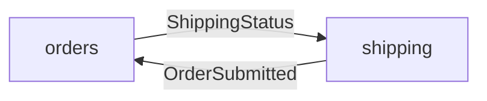
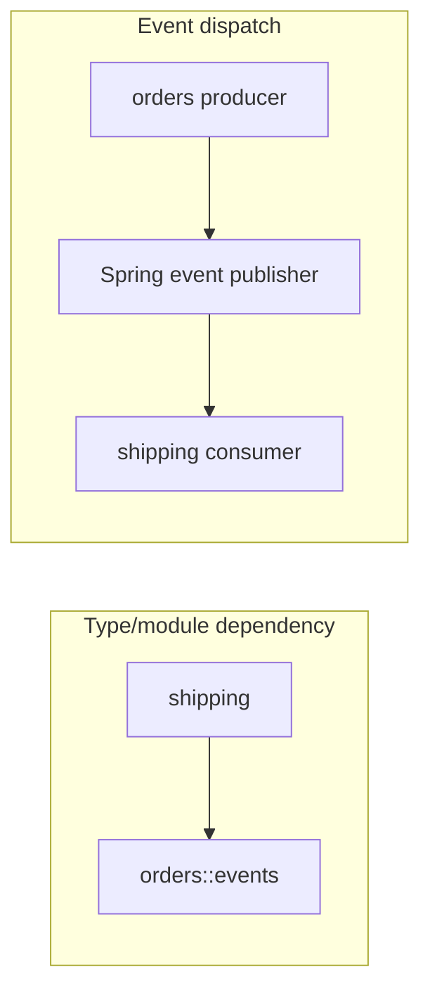
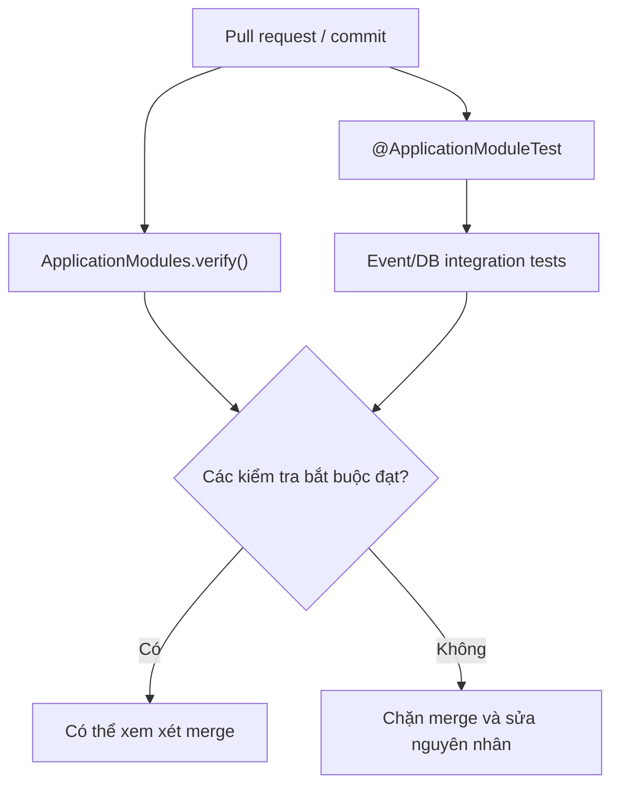
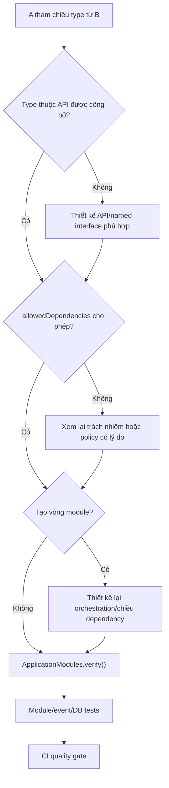

# Dependency hợp lệ và dependency bị cấm

Trong một ứng dụng Spring Modulith, **module được phép hợp tác với nhau**, nhưng không phải mọi sự phụ thuộc đều hợp lệ. Một lời gọi từ `orders` sang `catalog` có thể hoàn toàn đúng nếu nó dùng API tra cứu sản phẩm được công bố. Cũng lời gọi đó sẽ làm hỏng ranh giới nếu `orders` truy cập thẳng `catalog.internal.ProductRepository`, dù class repository là `public` trong Java và ứng dụng Spring Boot vẫn khởi động.

Chủ đề **“Dependency hợp lệ và dependency bị cấm”** thuộc chương **Module boundaries** của **SPRING_MODULITH_VERIFICATION_TESTING**. Ta sẽ xây một tiêu chuẩn ra quyết định, phân tích các trường hợp sai điển hình và viết phép kiểm chứng bằng `ApplicationModules.of(...).verify()`. Sau đó, ta bổ sung `@ApplicationModuleTest`, kiểm thử sự kiện, dữ liệu và quality gate trong CI để bảo vệ kiến trúc trước những thay đổi về sau.

> **Nguyên tắc nền tảng:** Một dependency hợp lệ phải đi qua **giao diện được công bố**, tuân thủ **quy tắc phụ thuộc của module nguồn**, không tạo **chu trình module** và phù hợp với trách nhiệm nghiệp vụ. Java compiler và Spring dependency injection không tự bảo đảm đầy đủ các điều kiện đó.

## 1. Mục tiêu học tập

Sau bài này, bạn có thể:

1. Nhận diện những tham chiếu trong mã tạo ra **dependency giữa application module**, thay vì chỉ nhìn import bằng mắt.
2. Phân biệt ba lớp quyền: **Java visibility**, **public API của application module** và **module dependency policy**.
3. Phân loại dependency hợp lệ qua API công khai hoặc `@NamedInterface`, so với dependency bị cấm vào package nội bộ, ngoài `allowedDependencies` hoặc tạo vòng.
4. Viết `@ApplicationModule(allowedDependencies = ...)` và `@NamedInterface` đúng trách nhiệm module.
5. Xây dựng architecture test `ApplicationModules.of(ShopApplication.class).verify()` và hiểu các lỗi nó có thể phát hiện.
6. Phân biệt **dependency của production code** với **phạm vi bean khi test** bằng `@ApplicationModuleTest`.
7. Kiểm tra hợp đồng producer–consumer và nêu giới hạn của phép xác minh sự kiện, database, transaction.
8. Đưa quy tắc dependency vào **CI quality gate** để phụ thuộc sai trở thành hồi quy có thể phát hiện tự động.

## 2. Dependency là gì trong mô hình Spring Modulith?

Một dependency về kiến trúc xuất hiện khi **mã thuộc module A sử dụng một type hoặc thành phần của module B**. Chiều mũi tên được đọc là:

```text
A ---> B

A là module sử dụng.
B là module cung cấp type hoặc hợp đồng được sử dụng.
```

Ví dụ `orders.OrderService` có constructor parameter kiểu `catalog.ProductLookup`, nghĩa là `orders → catalog`. Nó **không** có nghĩa catalog phụ thuộc ngược orders.

### 2.1. Những dạng tham chiếu cần chú ý

| Dạng sử dụng | Ví dụ | Tác động tới kiến trúc |
|---|---|---|
| Kiểu tham số constructor | `OrderService(ProductLookup products)` | Module chứa `OrderService` dùng type của module sở hữu `ProductLookup` |
| Field và return type | `private final StockRepository stock;` | Một quan hệ type dependency |
| Lời gọi method hoặc constructor | `catalog.find(productId)` | Phụ thuộc vào API đích và các type có liên quan |
| Kế thừa hoặc implements | `class X implements OtherModulePort` | Quan hệ phụ thuộc cấp type |
| Type trong annotation hoặc generic | `List<OtherModuleDto>` | Có thể tạo quan hệ type được bộ phân tích nhận diện |
| Sự kiện được consumer nhận | `on(OrderSubmitted event)` | Consumer phụ thuộc vào type event do producer công bố |
| Chuỗi tên class, reflection, câu SQL hoặc URL | `Class.forName("...")`, truy vấn bảng module khác | Có thể tạo coupling thực tế nhưng **không nên mặc định** là dependency sẽ được `verify()` nhận diện đầy đủ |

Một dòng `import` không được dùng chưa chắc tạo dependency trong bytecode: trình biên dịch có thể không sinh tham chiếu tương ứng. Khi kiểm tra kiến trúc, quan tâm **quan hệ thực sự được phân tích từ code**, không chỉ số dòng import.

### 2.2. Các đồ thị khác nhau không đồng nghĩa nhau

Trong cùng ứng dụng có thể tồn tại:

- **Đồ thị type/module dependency:** module nào dùng type của module nào.
- **Đồ thị Spring bean injection:** một bean được inject bean nào trong `ApplicationContext`.
- **Đồ thị luồng sự kiện:** ai publish và ai nhận sự kiện khi chạy.
- **Đồ thị truy cập dữ liệu:** module nào thực sự đọc/ghi bảng hoặc tài nguyên dữ liệu nào.

`ApplicationModules.verify()` chủ yếu bảo vệ **quy tắc cấu trúc module và dependency mà Spring Modulith phân tích được**. Không được suy luận rằng tất cả bốn đồ thị sẽ được kiểm chứng đầy đủ bằng một phép gọi duy nhất.

## 3. Ví dụ xuyên suốt: catalog, orders và shipping

Giả sử ứng dụng Spring Boot bán hàng có ba năng lực:

- `catalog`: sở hữu danh mục sản phẩm và cung cấp API kiểm tra sản phẩm.
- `orders`: tiếp nhận yêu cầu đặt hàng và phát `OrderSubmitted`.
- `shipping`: nhận sự kiện để ghi nhận việc cần chuẩn bị giao hàng.

Cấu trúc package minh họa:

```text
com.acme.shop
├── ShopApplication.java
├── catalog
│   ├── ProductLookup.java
│   └── internal
│       └── DemoProductLookup.java
├── orders
│   ├── package-info.java
│   ├── PlaceOrder.java
│   ├── events
│   │   ├── package-info.java
│   │   └── OrderSubmitted.java
│   └── internal
│       └── OrderRepository.java
└── shipping
    ├── package-info.java
    ├── ShippingStatus.java
    └── internal
        ├── ShippingProjection.java
        └── OnOrderSubmitted.java
```

Với cách nhận diện mặc định, các package con trực tiếp dưới `com.acme.shop` thường trở thành ba application module. `ShopApplication` nằm ở package gốc:

```java
package com.acme.shop;

import org.springframework.boot.SpringApplication;
import org.springframework.boot.autoconfigure.SpringBootApplication;

@SpringBootApplication
public class ShopApplication {

    public static void main(String[] args) {
        SpringApplication.run(ShopApplication.class, args);
    }
}
```

Các ví dụ tiếp theo tập trung vào **ranh giới và luồng kiểm thử**, dùng dữ liệu bộ nhớ cho dễ quan sát. Chúng **không** tự lưu đơn hàng, tạo shipment bền vững hoặc bảo đảm tồn kho chính xác trong production.

### 3.1. Đồ thị dependency mong muốn



Chiều dependency hợp lệ dự kiến:

- `orders → catalog`: orders dùng API công khai `ProductLookup`.
- `shipping → orders::events`: shipping dùng hợp đồng sự kiện được công bố.
- **Không** có `orders → shipping`: producer không biết implementation của consumer.

Từ đó, ta có thể kiểm tra điều gì sẽ xảy ra nếu developer thêm tham chiếu trực tiếp tới repository nội bộ hoặc thêm cạnh ngược gây vòng.

## 4. Ba lớp quy tắc quyết định dependency hợp lệ

### 4.1. Lớp thứ nhất: Java có truy cập được type không?

Java compiler áp dụng `public`, `protected`, package-private và `private`. Nếu một type `public` nằm trên classpath mà không bị ràng buộc khác ở cấp Java module system, mã nguồn khác có thể import và sử dụng nó.

Ví dụ:

```java
package com.acme.shop.catalog.internal;

// public ở cấp Java, nhưng vẫn thuộc package nội bộ của catalog.
public interface LegacyProductRepository {
    boolean existsInStorage(java.util.UUID productId);
}
```

Tính `public` chỉ giải quyết **quy tắc ngôn ngữ Java**. Nó chưa cho biết use case của `orders` được phép gọi repository này hay không.

### 4.2. Lớp thứ hai: type có thuộc API của application module không?

Theo quy ước mặc định của Spring Modulith:

- Type đặt ở **package gốc của module**, ví dụ `catalog.ProductLookup`, thường thuộc API công khai của module.
- Type thuộc package con `catalog.internal` thường là **nội bộ**.
- Một package con có thể được công bố bằng `@NamedInterface` nếu có chủ đích.

Vì vậy `catalog.internal.LegacyProductRepository` ở trên có thể được Java compiler chấp nhận, nhưng bị Spring Modulith xem là type nội bộ **không được module khác tham chiếu**.

### 4.3. Lớp thứ ba: chiều dependency có được module nguồn cho phép không?

Ngay cả một type nằm trong API công khai của `catalog` cũng không tự động là dependency hợp lệ với **mọi module**.

Nếu `shipping` khai báo chỉ được phụ thuộc `orders::events`, việc `shipping` dùng `catalog.ProductLookup` vẫn trái chính sách. Lý do không phải `ProductLookup` bị ẩn, mà là **shipping không có quyền tạo cạnh shipping → catalog** theo hợp đồng kiến trúc đã định nghĩa.

### 4.4. Lớp bổ sung: không có module dependency cycle

Giả sử cả `orders` và `shipping` đều công bố API hợp lệ, nhưng:

- `shipping` dùng `orders::events`;
- `orders` lại gọi `shipping.ShippingStatus`.

Khi đó tạo chu trình `orders → shipping → orders`. Một graph module có vòng làm giảm khả năng thay đổi độc lập và là nhóm vi phạm mà Spring Modulith có thể kiểm chứng.

**Công thức ra quyết định:**

```text
Dependency A -> B hợp lệ khi:
  (1) Type đích truy cập được ở mức Java,
  (2) Type đích thuộc API module/named interface được công bố,
  (3) Chính sách module nguồn cho phép phụ thuộc đó,
  (4) Quan hệ không tạo dependency cycle bị cấm,
  (5) Phù hợp trách nhiệm nghiệp vụ thực tế.
```

Điều kiện thứ năm là **đánh giá thiết kế của nhóm**, không phải một suy luận nghiệp vụ mà `verify()` có thể tự thực hiện.

## 5. Ma trận phân loại dependency hợp lệ và bị cấm

| Quan hệ trong ví dụ | Kết luận | Lý do |
|---|---|---|
| `orders → catalog.ProductLookup` | **Hợp lệ** | API công khai; orders được phép phụ thuộc catalog |
| `catalog.internal.DemoProductLookup → catalog.ProductLookup` | **Hợp lệ** | Hai type trong cùng application module |
| `shipping → orders.events.OrderSubmitted` | **Hợp lệ** | `orders::events` được công bố và cho phép |
| `orders → catalog.internal.LegacyProductRepository` | **Bị cấm** | Đi vào phần nội bộ của catalog |
| `shipping → catalog.ProductLookup` | **Bị cấm theo policy ví dụ** | Public API nhưng shipping không được phép phụ thuộc catalog |
| `orders → shipping.ShippingStatus` | **Bị cấm trong thiết kế hiện tại** | Vượt `allowedDependencies` của orders; đồng thời dễ tạo vòng |
| `shipping → orders.internal.OrderRepository` | **Bị cấm** | Type nội bộ; trái phạm vi `orders::events` |
| `orders → org.springframework.context.ApplicationEventPublisher` | **Không phải cạnh giữa application module** | API Spring Framework ngoài tập application module của ứng dụng |
| `shipping` nhận `OrderSubmitted` bằng `@EventListener` | **Có thể hợp lệ** | Code consumer phụ thuộc type trong named interface công khai |
| `orders` viết SQL trực tiếp vào bảng riêng của shipping | **Rủi ro thiết kế; phải kiểm tra bổ sung** | Không được khẳng định `verify()` luôn bắt được SQL/coupling dữ liệu động |

**Quan trọng:** trạng thái “hợp lệ” trong bảng là **theo thiết kế ví dụ**, không phải quy tắc cố định cho mọi hệ thống. Trong một ứng dụng khác, module `shipping` có thể cần dùng catalog hợp lệ; khi đó phải xem lại trách nhiệm và công bố hợp đồng đúng, không sao chép nguyên `allowedDependencies` của ví dụ.

## 6. Công bố API hợp lệ của catalog

Một module nên công bố **năng lực nghiệp vụ** mà các module khác cần, thay vì mở repository, entity và cơ chế lưu trữ ra ngoài.

File `com/acme/shop/catalog/ProductLookup.java`:

```java
package com.acme.shop.catalog;

import java.util.UUID;

public interface ProductLookup {
    boolean exists(UUID productId);
}
```

File `com/acme/shop/catalog/internal/DemoProductLookup.java`:

```java
package com.acme.shop.catalog.internal;

import com.acme.shop.catalog.ProductLookup;
import java.util.UUID;
import org.springframework.stereotype.Component;

@Component
class DemoProductLookup implements ProductLookup {

    @Override
    public boolean exists(UUID productId) {
        // Stub minh họa; không phải tra cứu catalog production.
        return productId != null;
    }
}
```

Điều đáng chú ý:

- Interface `ProductLookup` nằm ở package gốc của catalog nên có thể tạo thành **public module API**.
- Bean triển khai nằm trong `catalog.internal`, không cần được module khác biết tên.
- Việc `orders` constructor-inject `ProductLookup` là dependency `orders → catalog`.
- Spring có thể cung cấp bean `DemoProductLookup` tại runtime, nhưng điều đó **không quyết định quyền kiến trúc**.

Có thể thay `DemoProductLookup` bằng JPA, JDBC hoặc cache mà không yêu cầu `orders` import `catalog.internal`. Đây là lợi ích thực tế của một dependency hợp lệ đi qua hợp đồng hẹp.

## 7. Khai báo allowedDependencies: module nguồn được phép phụ thuộc ai?

Tại `com/acme/shop/orders/package-info.java`:

```java
@org.springframework.modulith.ApplicationModule(
    allowedDependencies = "catalog"
)
package com.acme.shop.orders;
```

`orders` được phép phụ thuộc module `catalog` theo policy. Cú pháp `allowedDependencies` là metadata kiến trúc để kiểm chứng, **không phải** lệnh mở Java access hoặc nạp bean của catalog.

### 7.1. Điều gì được phép và không được phép?

Nếu `orders` dùng `catalog.ProductLookup`, ta có cạnh hợp lệ. Nếu code khác của `orders` tham chiếu `shipping.ShippingStatus`, nó tạo cạnh tới `shipping` nằm ngoài whitelist ví dụ.

Đồng thời, `allowedDependencies = "catalog"` **không cho phép** `orders` import `catalog.internal.LegacyProductRepository`. Whitelist module nguồn và ranh giới API module đích là hai điều kiện độc lập.

### 7.2. Không khai báo policy có nghĩa gì?

Không nên diễn giải việc **chưa khai báo `allowedDependencies`** là một cam kết “không có dependency” hoặc “mọi dependency đều tốt về nghiệp vụ”. Khi không giới hạn tập dependency bằng annotation này, những quy tắc kiến trúc khác (như cấm dùng nội bộ và cấm vòng) vẫn có thể áp dụng. Nhưng một tập dependency được kỳ vọng hẹp **chưa được diễn đạt bằng whitelist**.

Khi muốn ngăn `orders` phụ thuộc một module không liên quan, nên cân nhắc khai báo chính sách cụ thể, rồi bảo vệ nó bằng architecture test.

### 7.3. Khi nào phải sửa policy?

Một yêu cầu mới có thể hợp lý khi `orders` cần gọi một module khác. Trước khi thêm module đó vào `allowedDependencies`, hãy hỏi:

1. Nghiệp vụ nào yêu cầu cạnh mới?
2. Module đích có API công khai đúng nhu cầu không?
3. Cạnh mới có tạo vòng không?
4. Có thể giao tiếp qua event nếu yêu cầu không cần kết quả tức thời không?
5. Những module test và integration test nào phải thay đổi?

Mở whitelist chỉ để test xanh mà không xem lại đồ thị có thể hợp thức hóa một thiết kế khó bảo trì.

## 8. Named interface: công bố một phần package con

Đôi khi hợp đồng công khai cần nằm trong package con riêng, chẳng hạn `orders.events`. Theo quy ước module mặc định, package con không tự nhiên được xem là API công khai. Spring Modulith có `@NamedInterface` để công bố rõ phần này.

File `com/acme/shop/orders/events/package-info.java`:

```java
@org.springframework.modulith.NamedInterface("events")
package com.acme.shop.orders.events;
```

File `com/acme/shop/orders/events/OrderSubmitted.java`:

```java
package com.acme.shop.orders.events;

import java.util.UUID;

public record OrderSubmitted(
    UUID orderId,
    UUID productId,
    int quantity
) {}
```

`OrderSubmitted` chứa dữ liệu tối thiểu cho ví dụ. Trong hệ thống thật, phải định nghĩa rõ ý nghĩa của event, điều kiện phát, thời điểm transaction và chính sách xử lý lặp. Tên “Submitted” nhằm diễn đạt **yêu cầu đã được tiếp nhận**, không khẳng định đơn hàng đã commit.

Tại `com/acme/shop/shipping/package-info.java`:

```java
@org.springframework.modulith.ApplicationModule(
    allowedDependencies = "orders::events"
)
package com.acme.shop.shipping;
```

Ý nghĩa của `orders::events`:

- `orders` là tên application module đích.
- `events` là tên giao diện do `@NamedInterface("events")` công bố.
- `shipping` có thể phụ thuộc vào **hợp đồng thuộc giao diện này**, không phải mọi type của `orders`.

`@NamedInterface` không tự tạo listener, không publish event và không cấp phép thông qua một database. Nó chỉ diễn đạt **bề mặt API** mà module khác có thể dùng nếu chính sách nguồn cho phép.

## 9. Tạo producer hợp lệ trong orders

File `com/acme/shop/orders/PlaceOrder.java`:

```java
package com.acme.shop.orders;

import com.acme.shop.catalog.ProductLookup;
import com.acme.shop.orders.events.OrderSubmitted;
import java.util.UUID;
import org.springframework.context.ApplicationEventPublisher;
import org.springframework.stereotype.Service;

@Service
public class PlaceOrder {

    private final ProductLookup products;
    private final ApplicationEventPublisher events;

    public PlaceOrder(
            ProductLookup products,
            ApplicationEventPublisher events) {
        this.products = products;
        this.events = events;
    }

    public UUID place(UUID productId, int quantity) {
        if (productId == null || quantity <= 0) {
            throw new IllegalArgumentException("Invalid order item");
        }

        if (!products.exists(productId)) {
            throw new IllegalArgumentException("Unknown product");
        }

        UUID orderId = UUID.randomUUID();

        events.publishEvent(
            new OrderSubmitted(orderId, productId, quantity)
        );

        return orderId;
    }
}
```

Phân tích các quan hệ:

- `PlaceOrder → ProductLookup`: **dependency xuyên module hợp lệ** từ orders tới public API của catalog.
- `PlaceOrder → OrderSubmitted`: dependency **nội bộ trong cùng module orders**, dù event nằm ở package con.
- `PlaceOrder → ApplicationEventPublisher`: sử dụng API Spring Framework, không phải dependency tới module shipping.
- **Không có** tham chiếu từ orders tới `shipping`, vì producer không cần biết danh sách consumer.

Sự kiện trong đoạn code trên có thể được listener trong cùng Spring `ApplicationContext` nhận. Tuy nhiên, không được suy luận “publish thành công” nghĩa là có bản ghi đơn hàng bền vững; ví dụ chưa triển khai repository/transaction.

## 10. Tạo consumer hợp lệ trong shipping

API quan sát trạng thái của shipping, file `com/acme/shop/shipping/ShippingStatus.java`:

```java
package com.acme.shop.shipping;

import java.util.UUID;

public interface ShippingStatus {
    boolean received(UUID orderId);
}
```

Implementation in-memory, file `shipping/internal/ShippingProjection.java`:

```java
package com.acme.shop.shipping.internal;

import com.acme.shop.shipping.ShippingStatus;
import java.util.Set;
import java.util.UUID;
import java.util.concurrent.ConcurrentHashMap;
import org.springframework.stereotype.Component;

@Component
class ShippingProjection implements ShippingStatus {

    private final Set<UUID> receivedOrderIds =
        ConcurrentHashMap.newKeySet();

    void record(UUID orderId) {
        receivedOrderIds.add(orderId);
    }

    @Override
    public boolean received(UUID orderId) {
        return receivedOrderIds.contains(orderId);
    }
}
```

Listener, file `shipping/internal/OnOrderSubmitted.java`:

```java
package com.acme.shop.shipping.internal;

import com.acme.shop.orders.events.OrderSubmitted;
import org.springframework.context.event.EventListener;
import org.springframework.stereotype.Component;

@Component
class OnOrderSubmitted {

    private final ShippingProjection projection;

    OnOrderSubmitted(ShippingProjection projection) {
        this.projection = projection;
    }

    @EventListener
    void on(OrderSubmitted event) {
        projection.record(event.orderId());
    }
}
```

Code consumer chỉ dùng `orders.events.OrderSubmitted` thuộc named interface. Nó **không** gọi `orders.PlaceOrder` và không phụ thuộc repository của orders.

Ở cấu hình event multicaster đồng bộ mặc định, `@EventListener` chạy trong luồng dispatch tương ứng. Nếu sau này đổi sang `@ApplicationModuleListener` hoặc event multicaster bất đồng bộ, điều kiện chờ và ranh giới transaction của test cũng phải thay đổi.

Bộ nhớ `Set<UUID>` không lưu dữ liệu qua restart và không quản lý shipment thực sự. Khi cần chứng minh idempotency hoặc lưu bền vững, phải dùng database và kiểm tra constraint/transaction tương ứng.

## 11. Những dependency bị cấm: phân tích nguyên nhân và cách sửa

### 11.1. Sai vì truy cập package nội bộ

Giả sử catalog có:

```java
package com.acme.shop.catalog.internal;

import java.util.UUID;

// Minh họa type có thể import ở mức Java nhưng không thuộc public module API.
public interface LegacyProductRepository {
    boolean existsInStorage(UUID productId);
}
```

Sau đó một class trong orders khai báo:

```java
package com.acme.shop.orders;

import com.acme.shop.catalog.internal.LegacyProductRepository;

// Mã CỐ TÌNH SAI, không ghép vào ví dụ production hợp lệ.
class BadOrderLookup {

    private final LegacyProductRepository repository;

    BadOrderLookup(LegacyProductRepository repository) {
        this.repository = repository;
    }
}
```

Dù `LegacyProductRepository` là Java `public` và code có thể compile, dependency này vi phạm ranh giới module: orders đã dùng chi tiết nội bộ của catalog.

**Cách sửa:** dùng hoặc thiết kế API công khai `catalog.ProductLookup` có đúng hành vi cần thiết. Đừng chỉ chuyển repository ra package gốc rồi kết luận ranh giới đã an toàn.

### 11.2. Sai vì dependency ngoài allowedDependencies

Giả sử shipping cần kiểm tra `ProductLookup`:

```java
package com.acme.shop.shipping;

import com.acme.shop.catalog.ProductLookup;

// Mã CỐ TÌNH SAI theo policy của ví dụ.
class DirectCatalogAccess {

    private final ProductLookup products;

    DirectCatalogAccess(ProductLookup products) {
        this.products = products;
    }
}
```

`ProductLookup` là API công khai của catalog, nhưng `shipping` chỉ được phép phụ thuộc `orders::events`. Vấn đề là **chính sách chiều phụ thuộc**, không phải visibility của type.

**Cách sửa:** làm rõ vì sao shipping cần thông tin sản phẩm; cân nhắc bổ sung dữ liệu cần thiết vào hợp đồng event, thiết kế API truy vấn phù hợp với trách nhiệm hoặc điều chỉnh policy **sau khi** đánh giá kiến trúc. Không tự động thêm `catalog` vào whitelist chỉ để phép verify xanh.

### 11.3. Sai vì tạo dependency cycle

Shipping đang phụ thuộc `orders::events`. Nếu orders bắt đầu inject `shipping.ShippingStatus`, đồ thị có vòng:



Ngay cả khi cả hai phía dùng type công khai, dependency cycle vẫn là lỗi kiến trúc.

**Cách sửa:** phân định lại ai sở hữu use case, sử dụng event để thông báo thay vì gọi ngược nếu hợp đồng cho phép, hoặc đặt orchestration tại một module phù hợp. Không có giải pháp duy nhất cho mọi nghiệp vụ; điều cần tránh là hai module trở thành điều kiện biên dịch của nhau.

### 11.4. Sai do “shared” bị biến thành kho chứa mọi thứ

Một package `shared` chứa entity, repository và service của nhiều nghiệp vụ có thể khiến mọi module phụ thuộc ngược vào các chi tiết không được kiểm soát. Nếu `shared` là application module thật, dependency tới nó vẫn cần được xem xét như các cạnh khác.

Chỉ đưa **khái niệm ổn định và dùng chung đúng nghĩa** vào shared kernel. Không dùng “shared” để tránh quyết định module nào sở hữu dữ liệu.

### 11.5. Sai do type dependency ẩn trong signature

Một developer có thể không import repository trực tiếp trong thân method, nhưng để lộ type nội bộ qua public API:

```java
// Fragment minh họa thiết kế cần tránh:
public com.acme.shop.catalog.internal.ProductEntity load(
        java.util.UUID id) {
    // ...
}
```

Chữ ký method cũng tạo coupling với type nội bộ. Khi thiết kế API xuyên module, tránh làm lộ JPA entity hoặc DTO nội bộ trong return type, parameter, generic hay exception mà module khác buộc phải dùng.

## 12. Khi không có dependency type rõ ràng vẫn có thể có coupling xấu

Một hệ thống có thể vi phạm ý tưởng **ownership** mà không tạo cạnh Java dễ nhận diện:

- Orders chạy native SQL đọc bảng thuộc shipping.
- Một module dùng reflection để tải implementation bằng tên class dạng chuỗi.
- Hai module chia sẻ và sửa cùng bảng không có hợp đồng rõ ràng.
- Module A gọi HTTP endpoint nội bộ của B theo chuỗi URL nhưng không có hợp đồng versioning.
- Module con phụ thuộc vào một event schema ngoài code mà không có test tương thích.

Các liên kết này không nên mặc định là những lỗi `ApplicationModules.verify()` sẽ phát hiện toàn diện. Phải dùng **kiểm tra bổ sung**: quy tắc ownership dữ liệu, kiến trúc review, integration test, contract test và kiểm soát quyền truy cập database nếu phù hợp.

### 12.1. Một nguyên tắc về dữ liệu

**Application module không đồng nghĩa database riêng.** Trong modular monolith, các module có thể dùng chung `DataSource` hoặc schema. Chính sách ai được sửa bảng nào là một **hợp đồng thiết kế**, không tự được bảo đảm chỉ nhờ tách package.

| Loại coupling | Kiểm chứng có giá trị |
|---|---|
| Tham chiếu Java type nội bộ | `ApplicationModules.verify()` |
| Ngoài `allowedDependencies` | `ApplicationModules.verify()` |
| Dùng SQL vào bảng không thuộc ownership | Review, quy tắc truy cập dữ liệu, integration test và cơ chế DB phù hợp |
| Event payload không tương thích | Producer/consumer contract test |
| Transaction sai, dữ liệu ghi dở dang | Database/transaction integration test |
| Hành vi xuyên API sai | System/API test |

Một kiến trúc module tốt cần cả **type boundary** và **data boundary** được thiết kế có chủ đích.

## 13. Viết architecture test phát hiện dependency bị cấm

Một bài JUnit test ở package gốc ứng dụng:

```java
package com.acme.shop;

import org.junit.jupiter.api.Test;
import org.springframework.modulith.core.ApplicationModules;

class ModuleBoundaryVerificationTests {

    @Test
    void moduleDependenciesRespectTheArchitecture() {
        ApplicationModules.of(ShopApplication.class).verify();
    }
}
```

`ApplicationModules.of(ShopApplication.class)` xây dựng mô hình module; `verify()` kiểm tra những quy tắc kiến trúc được Spring Modulith hỗ trợ, đặc biệt là:

- phụ thuộc vòng giữa các application module;
- phụ thuộc vào type nằm ngoài API công khai của module đích;
- quan hệ trái với `allowedDependencies` đã khai báo.

Bài test này không cần gọi `PlaceOrder.place(...)` và không cần khởi tạo Spring Boot application context đầy đủ để kiểm tra code dependency. Vì vậy nó có thể bắt một vi phạm mà các unit test chỉ kiểm tra tính toán hoàn toàn không nhìn thấy.

### 13.1. Xác minh detector đang thấy đúng module

Nếu architecture test xanh, cần bảo đảm các module mong đợi thực sự có mặt trong mô hình. Ví dụ tại package gốc:

```java
package com.acme.shop;

import static org.assertj.core.api.Assertions.assertThat;

import org.junit.jupiter.api.Test;
import org.springframework.modulith.core.ApplicationModules;

class ModuleDiscoveryTests {

    @Test
    void discoversExpectedModules() {
        ApplicationModules modules =
            ApplicationModules.of(ShopApplication.class);

        assertThat(modules.getModuleByName("catalog")).isPresent();
        assertThat(modules.getModuleByName("orders")).isPresent();
        assertThat(modules.getModuleByName("shipping")).isPresent();
    }
}
```

Nếu dự án dùng tên module tùy biến, các assertion phải phản ánh cấu hình thực tế. Một phép `verify()` xanh trên mô hình nhận diện sai không đủ để kết luận những phần mong đợi đều đã được kiểm chứng.

### 13.2. Thử một vi phạm có chủ đích

Để xác nhận gate có tác dụng, trên **nhánh thử nghiệm**:

1. Tạo một type `public` trong `catalog.internal` (nếu chưa có).
2. Tạo field hoặc constructor parameter trong orders tham chiếu type đó.
3. Chạy `ModuleBoundaryVerificationTests`; kỳ vọng vi phạm bị báo.
4. Xóa tham chiếu sai, dùng `ProductLookup` công khai và chạy lại.
5. Xác nhận test đạt trở lại.

Không chỉ thêm `import` không sử dụng; mục tiêu là tạo **dependency thực sự trong mã được phân tích**. Không đưa mã cố tình vi phạm lên nhánh chính.

## 14. Chọn cách sửa dependency bị cấm

Khi gặp vi phạm, đừng chỉ hỏi “thêm annotation nào để test xanh?”, mà hỏi “vì sao module này cần chức năng của module kia?”.

| Tình huống | Thay đổi ưu tiên | Sai lầm cần tránh |
|---|---|---|
| A dùng repository nội bộ B để đọc dữ liệu | B công bố query/use-case API hẹp | Chuyển toàn bộ repository thành public |
| A dùng entity JPA của B trong API | Công bố DTO/value contract phù hợp | Chia sẻ entity có vòng đời nội bộ |
| A cần biết B đã hoàn tất xử lý | Event kết quả, API truy vấn hoặc cơ chế phối hợp có chủ đích | Giả định publish tức là đã xử lý xong |
| A cần gọi B nhưng sẽ tạo vòng | Xem lại orchestration/ownership hoặc chiều giao tiếp | Nới whitelist của cả hai và giữ vòng |
| A phụ thuộc B hợp lý nhưng whitelist chưa có | Sửa policy có giải trình và test | Tự động thêm mọi module vào danh sách |
| A đang dùng type không công bố trong package con B | Thiết kế named interface đúng nghĩa nếu thực sự là contract | Công bố tất cả package con để né lỗi |

**Không có kiến trúc tốt chỉ nhờ rule xanh.** Rule nên bảo vệ các quyết định rõ ràng của domain; nếu quyết định ban đầu sai, phải sửa thiết kế chứ không đổi cấu hình để tránh cảnh báo.

## 15. Phân biệt architecture verification với @ApplicationModuleTest

`ApplicationModules.verify()` hỏi: *Quan hệ type/module có hợp lệ không?*

`@ApplicationModuleTest` hỏi: *Trong phạm vi Spring TestContext đã chọn, những bean và use case này có hoạt động đúng không?*

| Kiểu test | Có dựng Spring context? | Bằng chứng chính |
|---|---|---|
| Architecture test bằng `verify()` | Không cần boot context ứng dụng | Cấu trúc dependency được phép |
| Unit test JUnit/Mockito | Thường không | Logic một class với collaborator giả lập |
| `@ApplicationModuleTest` | Có, theo phạm vi module | Bean wiring và hành vi của module |
| `@SpringBootTest` | Có, thường rộng hơn | Luồng tích hợp Spring Boot theo cấu hình test |
| Database/event integration test | Theo cách test | Transaction, persistence, consumer và kết quả runtime |

**Lưu ý:** Một bean trong `ApplicationContext` có thể được inject thành công dù class tham chiếu type nội bộ module khác. Do đó “Spring context khởi động được” **không** thay `verify()`.

### 15.1. BootstrapMode không làm thay đổi quyền dependency

`@ApplicationModuleTest` hỗ trợ các chế độ:

| Chế độ | Phạm vi application module được bootstrap | Khi nào chọn |
|---|---|---|
| `STANDALONE` (mặc định) | Module được kiểm thử | Kiểm tra nội bộ, thay collaborator ngoài bằng test double nếu cần |
| `DIRECT_DEPENDENCIES` | Module được kiểm thử và các module nó phụ thuộc trực tiếp | Kiểm tra phối hợp với module dependency hợp lệ |
| `ALL_DEPENDENCIES` | Module được kiểm thử và các dependency bắc cầu | Kiểm tra luồng gồm nhiều tầng phụ thuộc |

Dùng `ALL_DEPENDENCIES` không biến một cạnh trái `allowedDependencies` thành hợp lệ. Tương tự, `STANDALONE` không nạp bean module khác có thể gây lỗi thiếu bean **dù dependency trong production hoàn toàn hợp lệ**.

### 15.2. Test orders và catalog qua dependency hợp lệ

Ví dụ:

```java
package com.acme.shop.orders;

import static org.assertj.core.api.Assertions.assertThat;

import com.acme.shop.orders.events.OrderSubmitted;
import java.util.UUID;
import org.junit.jupiter.api.Test;
import org.springframework.beans.factory.annotation.Autowired;
import org.springframework.modulith.test.ApplicationModuleTest;
import org.springframework.modulith.test.ApplicationModuleTest.BootstrapMode;
import org.springframework.modulith.test.PublishedEvents;

@ApplicationModuleTest(mode = BootstrapMode.DIRECT_DEPENDENCIES)
class PlaceOrderModuleTests {

    @Autowired PlaceOrder orders;

    @Test
    void publishesOrderSubmitted(PublishedEvents events) {
        UUID productId = UUID.randomUUID();

        UUID orderId = orders.place(productId, 2);

        assertThat(events.ofType(OrderSubmitted.class))
            .singleElement()
            .satisfies(event -> {
                assertThat(event.orderId()).isEqualTo(orderId);
                assertThat(event.productId()).isEqualTo(productId);
                assertThat(event.quantity()).isEqualTo(2);
            });
    }
}
```

Chế độ `DIRECT_DEPENDENCIES` đưa module catalog vào phạm vi kiểm thử của orders. `DemoProductLookup` cung cấp bean qua `ProductLookup` và trả `true` cho ID không null, đủ để kiểm tra use case minh họa.

Test này có hai phần bằng chứng riêng:

- **Wiring/collaboration:** bean `PlaceOrder` dùng được bean `ProductLookup` trong context.
- **Hành vi producer:** sự kiện đã phát có payload mong đợi.

Nó không chứng minh shipping đã xử lý hoặc dữ liệu đã commit; hơn nữa, **quy tắc dependency vẫn phải kiểm tra độc lập bằng `verify()`**.

## 16. Sự kiện không loại bỏ hoàn toàn dependency

Trong ví dụ, orders phát `OrderSubmitted` nhưng không tham chiếu shipping. Tuy nhiên, shipping vẫn phụ thuộc vào **schema Java và ý nghĩa** của `orders::events`.



Hai chiều khác nhau không mâu thuẫn:

- **Compile time:** shipping import `OrderSubmitted`.
- **Runtime:** orders phát dữ liệu, shipping nhận khi listener có mặt và phù hợp.

### 16.1. Consumer module test độc lập

File test dưới `com.acme.shop.shipping`:

```java
package com.acme.shop.shipping;

import static org.assertj.core.api.Assertions.assertThat;

import com.acme.shop.orders.events.OrderSubmitted;
import java.util.UUID;
import org.junit.jupiter.api.Test;
import org.springframework.beans.factory.annotation.Autowired;
import org.springframework.context.ApplicationEventPublisher;
import org.springframework.modulith.test.ApplicationModuleTest;

@ApplicationModuleTest
class ShippingModuleTests {

    @Autowired ApplicationEventPublisher publisher;
    @Autowired ShippingStatus status;

    @Test
    void recordsIncomingOrderEvent() {
        UUID orderId = UUID.randomUUID();

        publisher.publishEvent(
            new OrderSubmitted(orderId, UUID.randomUUID(), 2)
        );

        assertThat(status.received(orderId)).isTrue();
    }
}
```

Với listener `@EventListener` đồng bộ mặc định và `ShippingProjection` in-memory, assertion có thể chạy ngay sau publish. Test không cần khởi động producer orders; nó kiểm tra **contract phía consumer**.

### 16.2. Publish khác xử lý, xử lý khác commit

Phải tách ba bằng chứng:

1. **Published:** producer phát event đúng type/payload (có thể dùng `PublishedEvents`).
2. **Handled:** consumer thực thi logic với event đầu vào.
3. **Committed:** trạng thái dữ liệu cần thiết được lưu bền vững sau transaction.

`PublishedEvents` không bảo đảm nấc 2 hoặc 3. Khi listener dùng `@ApplicationModuleListener`, xử lý sau commit và bất đồng bộ có thể làm assertion ngay sau publish không còn đúng. `Scenario` của Spring Modulith Test có thể hỗ trợ test chờ event hoặc trạng thái quan sát được theo điều kiện.

Nếu consumer dùng database, test cần quan tâm transaction, unique constraint, retry và idempotency. Dùng một annotation hoặc cơ chế event publication registry không tự biến mọi tác dụng nghiệp vụ thành “exactly once”.

## 17. Database ownership và tích hợp xuyên module

Dependency bị cấm không chỉ đến từ import type. Trong hệ thống có dữ liệu quan trọng, hãy bổ sung **hợp đồng ownership**: module nào được phép tạo, thay đổi hoặc đọc trạng thái nào, qua đường đi nào.

| Rủi ro | Lớp kiểm chứng | Bằng chứng cần thiết |
|---|---|---|
| Orders dùng `catalog.internal.ProductRepository` | Cấu trúc | `verify()` báo vi phạm |
| Shipping gọi API catalog trái whitelist | Cấu trúc | `verify()` báo dependency ngoài policy |
| Shipping đọc bảng orders trực tiếp qua SQL | Thiết kế dữ liệu/integration | Quy tắc ownership và đường truy cập được kiểm tra riêng |
| Consumer nhận cùng event hai lần | Hành vi và database | Không tạo hai tác dụng nghiệp vụ ngoài yêu cầu |
| Producer commit nhưng consumer lỗi | Event/transaction integration | Lỗi/retry/recovery theo chính sách được thiết kế |
| Hai đơn tranh số lượng tồn kho | Database concurrency test | Không bán vượt tồn theo isolation/locking đã chọn |

**Testcontainers** là một lựa chọn hữu ích để dùng database tương tự production cho integration test. Nhưng chỉ chạy PostgreSQL container chưa đủ: test phải có **schema, transaction, dữ liệu và assertion** phản ánh rủi ro cần chứng minh.

Khi dùng `@Transactional` trong Spring test, chú ý transaction bao ngoài có thể được rollback cuối test. Listener chạy sau commit hoặc trong transaction riêng có thể quan sát dữ liệu khác. Cần kiểm tra trạng thái sau commit theo đúng kiến trúc ứng dụng.

## 18. Thiết kế CI quality gate chặn dependency sai

Một kiến trúc chỉ được bảo vệ lâu dài nếu các phép kiểm chứng chạy lại khi code thay đổi.



Trong CI cần ít nhất:

1. Architecture test chạy trên revision hiện tại, nhận diện đúng module và kiểm tra `allowedDependencies`/API nội bộ/vòng.
2. Module test có assertion về behavior; không chỉ test context khởi động.
3. Event/DB integration test chạy với hạ tầng phù hợp nếu module có transaction và dữ liệu quan trọng.
4. Báo cáo rõ test đã chạy, failed, skipped và môi trường.
5. Các check bắt buộc thực sự chặn merge khi thất bại.

Ví dụ với wrapper dự án:

```bash
# Maven Wrapper
./mvnw test

# Gradle Wrapper
./gradlew test
```

Đây chỉ là lệnh chạy các test thuộc phase/task đã cấu hình. Nếu integration tests dùng phase hoặc task riêng, pipeline phải thực thi thêm. Không nên coi build xanh là đã bảo vệ dependency nếu architecture test bị exclude hoặc skipped.

### 18.1. Bài kiểm tra hồi quy có chủ đích

Để chứng minh gate hoạt động:

1. Tạm tạo một type reference từ orders sang `catalog.internal.LegacyProductRepository`.
2. Chạy architecture test; yêu cầu nó báo đỏ.
3. Loại bỏ dependency sai, dùng `ProductLookup`.
4. Kiểm tra test kiến trúc trở lại xanh.
5. Bổ sung một thay đổi làm sai event quantity để kiểm tra module test producer báo đỏ.
6. Khôi phục code và xác nhận required CI checks đạt.

Nếu test không đỏ khi lỗi được tạo ra, hãy kiểm tra test có chạy không, mô hình có nhận diện module đúng không, hoặc assertion đã đo đúng thuộc tính chưa.

## 19. Quy trình chẩn đoán một dependency nghi vấn

Khi code review thấy module A dùng type từ module B:

**Bước 1 — Xác định owner.** Type đó nằm trong module nào? Có thuộc module đang review không hay chỉ là thư viện Spring/Java ngoài hệ thống module?

**Bước 2 — Đọc đường dẫn package.** Type ở package gốc module, named interface được công bố, hay package nội bộ?

**Bước 3 — Đọc dependency policy của module nguồn.** `allowedDependencies` có giới hạn A được dùng B hoặc `B::interface` hay không?

**Bước 4 — Xem toàn bộ module graph.** Thêm cạnh A → B có tạo vòng với một cạnh B → A sẵn có không?

**Bước 5 — Hỏi về trách nhiệm nghiệp vụ.** A có thực sự cần gọi B hay đang đọc/ghi dữ liệu không thuộc quyền sở hữu?

**Bước 6 — Chạy architecture test.** Dùng `ApplicationModules.verify()` trên đúng mô hình module và xem báo cáo.

**Bước 7 — Test hợp đồng runtime.** Nếu dependency hợp lệ, viết hoặc sửa module test, producer/consumer test và integration test phù hợp với hành vi mới.

**Bước 8 — Đưa vào CI.** Bảo đảm thay đổi sau này không âm thầm làm ranh giới lệch khỏi thiết kế.



Sơ đồ là **quy trình tư duy**, không có nghĩa mọi trường hợp sai có thể giải quyết chỉ bằng một annotation. Khi có vòng, cần sửa đồ thị trước khi coi dependency là hợp lệ.

## 20. Bài tập thực hành phân loại dependency

**Bối cảnh:** dựng ba module `catalog`, `orders`, `shipping` như các mục trước. Mục tiêu là phân loại và chứng minh bằng test cả trường hợp hợp lệ lẫn bị cấm.

### Phần A — Xác định module graph

1. Tạo `ShopApplication` và cấu trúc package đúng với mô hình ví dụ.
2. Tạo `catalog.ProductLookup` và `catalog.internal.DemoProductLookup`.
3. Tạo `orders.PlaceOrder` dùng `ProductLookup`.
4. Công bố `orders::events` bằng `@NamedInterface("events")`; tạo `OrderSubmitted`.
5. Khai báo `allowedDependencies = "catalog"` cho orders và `allowedDependencies = "orders::events"` cho shipping.
6. Vẽ dependency graph và giải thích chiều mỗi cạnh.

### Phần B — Cố tình tạo ba loại vi phạm

1. **Internal:** cho orders dùng `catalog.internal.LegacyProductRepository` trong field hoặc constructor.
2. **Whitelist:** cho shipping dùng `catalog.ProductLookup`, trong khi policy shipping chỉ cho phép `orders::events`.
3. **Cycle:** thử cho orders dùng API của shipping trong khi shipping đã phụ thuộc orders::events.
4. Chạy `ApplicationModules.of(ShopApplication.class).verify()`, đọc thông báo cho từng tình huống.
5. Sửa nguyên nhân, không chỉ nới policy để bỏ cảnh báo. Xác nhận graph hợp lệ trở lại.

### Phần C — Kiểm chứng hành vi module

1. Viết `PlaceOrderModuleTests` với `@ApplicationModuleTest(mode = DIRECT_DEPENDENCIES)`.
2. Assert một `OrderSubmitted` có đúng `orderId`, `productId`, `quantity`.
3. Viết thêm test đầu vào `quantity <= 0` phải từ chối và không publish event.
4. Viết `ShippingModuleTests` ở `STANDALONE`, phát trực tiếp event và assert `ShippingStatus.received(orderId)`.
5. Giải thích vì sao producer test và consumer test là **hai bằng chứng khác nhau**.

### Phần D — Dữ liệu và CI

1. Nếu dùng persistence thật, bổ sung kiểm thử transaction, unique constraint hoặc idempotency bằng database tương thích.
2. Nếu listener chạy bất đồng bộ, chờ điều kiện quan sát được thay vì ngủ cố định.
3. Cho CI chạy architecture test và các module/integration tests bắt buộc.
4. Tạo một dependency sai trên nhánh thử nghiệm để xem gate đỏ, rồi khôi phục.
5. Ghi lại commit, tên test, số test đã chạy và bị skip, cùng rủi ro còn chưa có test.

**Tiêu chí đạt:** bạn có thể giải thích *vì sao* từng dependency được phép hoặc bị cấm, không chỉ dựa vào thông báo lỗi; architecture test bắt được các vi phạm mục tiêu; hành vi module được kiểm tra độc lập và CI bảo vệ quy tắc theo revision.

## 21. Câu hỏi ôn tập

**1. Có phải tất cả dependency giữa hai application module đều bị cấm?**

Không. Dependency hợp lệ qua API công khai hoặc named interface, tuân thủ policy và không tạo vòng, là cách các module cộng tác có chủ đích.

**2. Vì sao type `public` nằm trong `catalog.internal` vẫn có thể bị từ chối?**

Vì Java visibility khác với public API của application module. Package nội bộ không tự trở thành hợp đồng được công bố.

**3. `@NamedInterface` và `allowedDependencies` giải quyết hai vấn đề gì?**

`@NamedInterface` chỉ rõ phần API module đích công bố; `allowedDependencies` giới hạn module nguồn được phép tham chiếu module/giao diện đích nào.

**4. Nếu shipping dùng `catalog.ProductLookup` là API công khai, vì sao vẫn có thể sai?**

Vì trong ví dụ shipping chỉ cho phép `orders::events`. API công khai của B không mặc định được A sử dụng nếu whitelist của A không cho phép cạnh đó.

**5. Có thể sửa dependency cycle bằng cách khai báo cả hai hướng trong allowedDependencies không?**

Không. Vòng là vấn đề cấu trúc đồ thị. Phải xem lại trách nhiệm và phương thức phối hợp, không chỉ thay annotation.

**6. `ApplicationModules.verify()` có tự kiểm tra SQL vào bảng module khác không?**

Không nên giả định như vậy. Phép kiểm chứng tập trung vào mô hình và dependency được phân tích; ownership dữ liệu và SQL động cần kiểm tra bổ sung.

**7. Nếu `@ApplicationModuleTest` STANDALONE thiếu bean catalog, đó có phải lỗi dependency bị cấm?**

Không nhất thiết. Có thể context test không bao gồm module dependency hợp lệ. Chọn test double hoặc `DIRECT_DEPENDENCIES` theo mục tiêu test.

**8. `PublishedEvents` xanh có chứng minh shipping đã ghi shipment thành công không?**

Không. Nó quan sát event đã được phát. Consumer và trạng thái dữ liệu cần test riêng.

**9. Lý do cần xác nhận module discovery trước khi tin hoàn toàn kết quả verify xanh là gì?**

Nếu module mong đợi không nằm trong mô hình được nhận diện, phép kiểm chứng có thể chưa bảo vệ đúng phần ứng dụng cần kiểm tra.

**10. Khi gặp vi phạm internal, có nên chuyển repository sang package gốc để hết lỗi?**

Không phải cách sửa mặc định. Nên công bố một API/use case hẹp phù hợp và tiếp tục giấu implementation.

**11. Vì sao đưa architecture test vào CI giúp chống hồi quy?**

Vì một tham chiếu type mới có thể tạo cạnh bị cấm dù behavior test vẫn xanh. CI chạy lại `verify()` ở mỗi revision giúp phát hiện điều đó trước merge.

## Kết luận

**Dependency hợp lệ** trong Spring Modulith là quan hệ giữa các application module thông qua **API được công bố**, tuân thủ **`allowedDependencies`**, không tạo **dependency cycle** và phục vụ một trách nhiệm nghiệp vụ rõ. **Dependency bị cấm** thường xuất hiện khi module dùng type nội bộ của module khác, tạo cạnh ngoài policy hoặc khiến đồ thị module có vòng. Các coupling qua SQL, reflection hoặc hệ thống ngoài có thể cần quy tắc bổ sung vì không phải lúc nào cũng được phân tích đầy đủ từ Java type.

Hãy biến các nguyên tắc đó thành bằng chứng: `ApplicationModules.of(...).verify()` bảo vệ dependency graph; `@ApplicationModuleTest` kiểm tra bean và hành vi module; `PublishedEvents` và consumer test kiểm tra hai phía hợp đồng sự kiện; database/transaction integration test xác minh kết quả runtime. Khi được chạy bắt buộc trong **CI quality gate**, những quy tắc ranh giới này không chỉ là quy ước thiết kế mà trở thành cơ chế ngăn phụ thuộc sai và hồi quy lâu dài.
