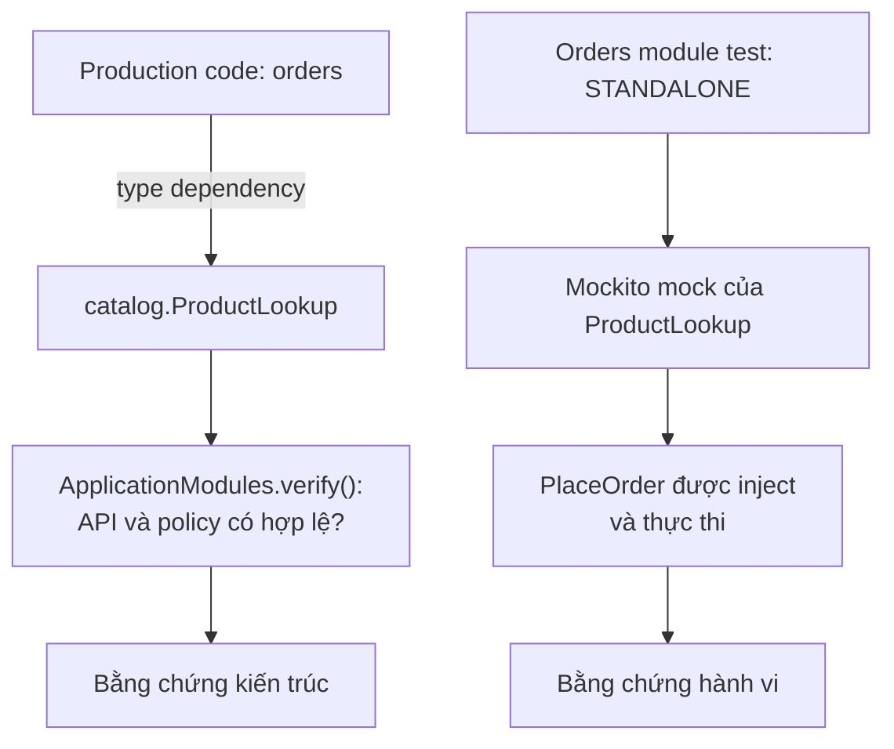
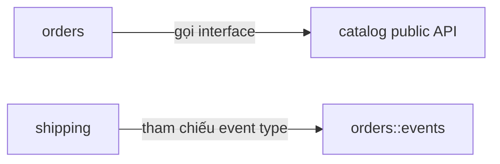
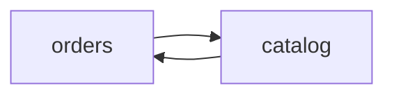
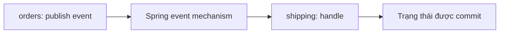
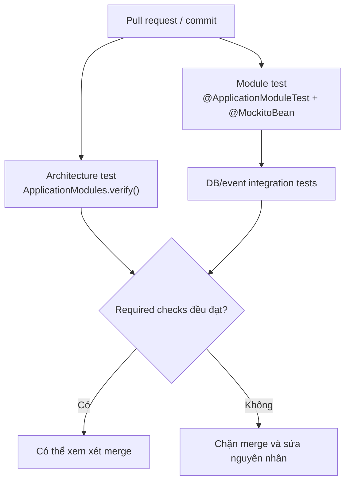

# Mock collaborator ngoài module

Trong một modular monolith xây dựng bằng Spring Boot và Spring Modulith, module `orders` có thể cần gọi API của module `catalog` để xác minh sản phẩm tồn tại trước khi tiếp nhận đơn hàng. Khi kiểm thử riêng `orders`, ta không nhất thiết phải khởi tạo toàn bộ `catalog`, database hoặc các adapter của nó. Thay vào đó, **mock collaborator ngoài module** cho phép tạo một đầu vào có thể kiểm soát, tập trung vào quyết định nghiệp vụ của `orders`.

Tuy nhiên, một mock không làm cho dependency sai trở thành hợp lệ. Nếu `orders` vốn không được phép dùng `catalog.internal.ProductRepository`, việc khai báo mock cho repository ấy có thể khiến bài test hành vi chạy xanh nhưng **vẫn vi phạm ranh giới kiến trúc**. Do đó cần kết hợp hai lớp bằng chứng: `ApplicationModules.verify()` kiểm chứng **quyền phụ thuộc**, còn `@ApplicationModuleTest` với mock kiểm chứng **hành vi của module đang xét**.

Bài thuộc chương **Module boundaries** trong **SPRING_MODULITH_VERIFICATION_TESTING**. Mục tiêu học tập là kiểm chứng ranh giới bằng `ApplicationModules` và các quy tắc dependency; thực hành `@ApplicationModuleTest`, kiểm thử sự kiện, database và tích hợp; sau cùng đặt những phép kiểm tra quan trọng vào **CI quality gate** để ngăn phụ thuộc sai và hồi quy.

## 1. Mục tiêu học tập

Sau bài này, bạn có thể:

1. Giải thích **collaborator ngoài module** là gì và vì sao test cô lập cần thay thế một số collaborator bằng mock.
2. Phân biệt **mock bean trong Spring TestContext** với **mock object trong unit test Mockito**.
3. Sử dụng `@ApplicationModuleTest` ở chế độ `STANDALONE` cùng `@MockitoBean` hoặc cơ chế thay thế tương thích phiên bản Spring Boot.
4. Xác định type nào **được phép mock** trong khi vẫn tôn trọng public API, named interface và `allowedDependencies`.
5. Dùng Mockito stub hành vi hợp lệ, hành vi từ chối và ngoại lệ; đồng thời xác minh output, sự kiện và các tương tác quan trọng.
6. So sánh test dùng mock với `DIRECT_DEPENDENCIES`, test fake, database integration test và system test.
7. Nhận diện những lỗi “test xanh giả” do mock quá nhiều, mock sai bean, stub không thực tế hoặc dựa vào thứ tự giữa các test.
8. Tổ chức architecture test và module test thành bằng chứng độc lập trong CI.

## 2. Trước hết: collaborator là gì?

**Collaborator** là đối tượng hoặc bean mà một use case cần để thực hiện trách nhiệm của nó. Ví dụ:

- `orders.PlaceOrder` gọi `catalog.ProductLookup` để xác minh mã sản phẩm.
- `orders.PlaceOrder` dùng `ApplicationEventPublisher` để phát sự kiện `OrderSubmitted`.
- `shipping.ShippingListener` gọi một repository nội bộ để ghi nhận yêu cầu giao hàng.

Trong số đó, `catalog.ProductLookup` là collaborator **thuộc application module khác**. `ApplicationEventPublisher` là API hạ tầng của Spring Framework, không phải một application module nghiệp vụ của chúng ta. Repository nằm trong `shipping.internal` là collaborator **nội bộ của chính shipping**.

Ba loại này có thể đòi hỏi chiến lược test khác nhau:

| Loại collaborator | Ví dụ | Chiến lược test thường phù hợp |
|---|---|---|
| API công khai của một module khác | `catalog.ProductLookup` được `orders` gọi | Mock bean trong `orders` STANDALONE hoặc nạp `catalog` qua `DIRECT_DEPENDENCIES` |
| Bean nội bộ của module đang test | `orders.internal.OrderPolicy` | Ưu tiên test cùng bean thật nếu phù hợp mục tiêu module test |
| API/hạ tầng Spring | `ApplicationEventPublisher` | Có thể để thật để `PublishedEvents` quan sát sự kiện |
| Adapter tới dịch vụ ngoài | `PaymentGateway`, HTTP client, broker adapter | Mock/fake ở đúng abstraction cho module test; dùng integration/contract test để kiểm tra adapter thật |
| Database/repository của module đang test | `orders.internal.OrderRepository` | Có thể dùng database test phù hợp, hoặc thay bằng test double nếu mục tiêu chỉ là logic |

**Khái niệm “ngoài module” không đồng nghĩa “ngoài JVM”.** Một collaborator ngoài module có thể là bean trong cùng `ApplicationContext` khi ứng dụng chạy thật. Cũng có thể nó là client kết nối một dịch vụ qua HTTP. Cần biết ranh giới mà test đang cô lập.

## 3. Hai câu hỏi khác nhau: được phụ thuộc và có được nạp bean

Giả sử module A cần API của module B:

1. **Câu hỏi kiến trúc:** mã A có được phép tham chiếu type của B không?
2. **Câu hỏi kiểm thử:** khi bootstrap `@ApplicationModuleTest` cho A, có bean triển khai của B không?

Hai câu hỏi phải được trả lời độc lập.

- `ApplicationModules.verify()` kiểm tra các quy tắc kiến trúc mà Spring Modulith hỗ trợ, bao gồm giới hạn public/internal API, dependency policy và chu trình module.
- `@ApplicationModuleTest` điều khiển **phạm vi application module được nạp vào Spring TestContext**. `STANDALONE` mặc định tập trung vào module đang test.
- `@MockitoBean` có thể cung cấp một Spring mock bean cho type collaborator không có bean triển khai trong context đang dựng.
- Việc test A chạy được bằng mock B **không thể** hợp thức hóa một dependency A → B vốn bị cấm.



Nhóm cần giữ **cả bằng chứng kiến trúc lẫn bằng chứng hành vi**, vì mỗi bằng chứng chỉ bảo vệ một loại rủi ro.

## 4. Ví dụ ứng dụng: orders gọi API catalog

Ta dùng cấu trúc Spring Boot đơn giản:

```text
com.acme.shop
├── ShopApplication.java
├── catalog
│   ├── ProductLookup.java
│   └── internal
│       └── JpaProductLookup.java
├── orders
│   ├── package-info.java
│   ├── PlaceOrder.java
│   ├── events
│   │   ├── package-info.java
│   │   └── OrderSubmitted.java
│   └── internal
│       └── OrderRepository.java
└── shipping
    ├── package-info.java
    └── internal
        └── OnOrderSubmitted.java
```

Để không yêu cầu database cho mọi ví dụ, `JpaProductLookup` ở sơ đồ chỉ biểu diễn **adapter production giả định**, chưa có phần implementation trong các đoạn code hoàn chỉnh phía dưới.

Quy tắc thiết kế:

- `catalog` sở hữu việc xác định sản phẩm có tồn tại.
- `orders` chỉ sử dụng **public API** `catalog.ProductLookup`, không dùng repository nội bộ của catalog.
- `orders` phát một `OrderSubmitted` khi request hợp lệ và sản phẩm tồn tại.
- `shipping` có thể nhận `OrderSubmitted` qua named interface `orders::events`, nhưng consumer không nằm trong phạm vi mục tiêu của producer module test.
- Ví dụ không lưu đơn và không có transaction; event chỉ biểu diễn **yêu cầu được tiếp nhận**.

### 4.1. Dependency graph và luồng runtime



Đây là chiều **type dependency**. Khi `orders` publish event, dữ liệu runtime có thể đi tới `shipping` nếu listener được nạp vào context. Nhưng `orders` không cần tham chiếu implementation của `shipping`.

Chính vì `orders` không phụ thuộc `shipping`, **test publisher ở STANDALONE không cần nạp shipping**. Nếu muốn chứng minh shipping xử lý thành công, cần một consumer test hoặc integration test riêng.

## 5. Bước một: khai báo public API hợp lệ của module catalog

File `catalog/ProductLookup.java`:

```java
package com.acme.shop.catalog;

import java.util.UUID;

public interface ProductLookup {
    boolean exists(UUID productId);
}
```

Interface nằm ở package gốc của application module `catalog` nên theo mô hình mặc định nó thuộc phần API công khai cơ bản.

Trong ứng dụng thật, một class `catalog.internal.JpaProductLookup` có thể triển khai interface này bằng JPA repository. `orders` không cần biết cách catalog tra cứu dữ liệu, chỉ cần hợp đồng `exists(productId)`.

### 5.1. Quyền dependency trong orders

File `orders/package-info.java`:

```java
@org.springframework.modulith.ApplicationModule(
    allowedDependencies = "catalog"
)
package com.acme.shop.orders;
```

Quy tắc `allowedDependencies = "catalog"` cho phép `orders` phụ thuộc vào application module `catalog`. Nó **không** biến `catalog.internal` thành public API.

Nếu `orders` có một field kiểu `catalog.internal.JpaProductLookup` hoặc `catalog.internal.ProductRepository`, mock loại type nội bộ này trong test không giải quyết lỗi kiến trúc. Cần sửa mã production để sử dụng một public API phù hợp.

### 5.2. Event contract thuộc chính orders

File `orders/events/package-info.java`:

```java
@org.springframework.modulith.NamedInterface("events")
package com.acme.shop.orders.events;
```

File `orders/events/OrderSubmitted.java`:

```java
package com.acme.shop.orders.events;

import java.util.UUID;

public record OrderSubmitted(
    UUID orderId,
    UUID productId,
    int quantity
) {}
```

`@NamedInterface("events")` giúp một module khác như shipping tiêu thụ event contract nếu được phép. `orders` dùng event của **chính mình** nên không tạo một dependency xuyên module mới khi khởi tạo `OrderSubmitted`.

## 6. Bước hai: một use case thật sự cần collaborator ngoài module

File `orders/PlaceOrder.java`:

```java
package com.acme.shop.orders;

import com.acme.shop.catalog.ProductLookup;
import com.acme.shop.orders.events.OrderSubmitted;
import java.util.UUID;
import org.springframework.context.ApplicationEventPublisher;
import org.springframework.stereotype.Service;

@Service
public class PlaceOrder {

    private final ProductLookup products;
    private final ApplicationEventPublisher events;

    public PlaceOrder(
            ProductLookup products,
            ApplicationEventPublisher events) {
        this.products = products;
        this.events = events;
    }

    public UUID place(UUID productId, int quantity) {
        if (productId == null || quantity <= 0) {
            throw new IllegalArgumentException("Invalid order item");
        }

        if (!products.exists(productId)) {
            throw new IllegalArgumentException("Unknown product");
        }

        UUID orderId = UUID.randomUUID();
        events.publishEvent(
            new OrderSubmitted(orderId, productId, quantity)
        );
        return orderId;
    }
}
```

Ở đây `PlaceOrder` có hai collaborator:

- `ProductLookup`: một **API public nằm ngoài module orders**. Ta cần quyết định mock hay dùng bean thật từ catalog.
- `ApplicationEventPublisher`: thành phần của Spring. Với module test cần xác minh event, giữ cơ chế publish thực và dùng `PublishedEvents` thường hợp lý hơn mock publisher.

Test mong muốn tập trung vào ba quy tắc của `orders`:

1. Với `productId` hợp lệ, `quantity > 0` và catalog trả “có sản phẩm”, tạo mã yêu cầu và publish `OrderSubmitted` đúng dữ liệu.
2. Khi catalog nói “không có sản phẩm”, từ chối và **không publish event**.
3. Khi input không hợp lệ, từ chối **trước khi gọi catalog**, không publish event.

Muốn kiểm tra riêng các quyết định ấy, ta không cần khởi tạo `JpaProductLookup` hay database của catalog.

## 7. Bước ba: mock ProductLookup trong @ApplicationModuleTest STANDALONE

### 7.1. Khi nào @MockitoBean phù hợp?

Trong các phiên bản Spring Framework hỗ trợ `@MockitoBean` (ví dụ Spring Framework 6.2 trở lên), annotation này cho Spring TestContext **thay thế hoặc cung cấp một mock bean** theo type/tên để những bean khác có thể inject nó.

Ví dụ test dưới package `com.acme.shop.orders`:

```java
package com.acme.shop.orders;

import static org.assertj.core.api.Assertions.assertThat;
import static org.mockito.Mockito.verify;
import static org.mockito.Mockito.verifyNoInteractions;
import static org.mockito.Mockito.when;

import com.acme.shop.catalog.ProductLookup;
import com.acme.shop.orders.events.OrderSubmitted;
import java.util.UUID;
import org.junit.jupiter.api.Test;
import org.springframework.beans.factory.annotation.Autowired;
import org.springframework.modulith.test.ApplicationModuleTest;
import org.springframework.modulith.test.PublishedEvents;
import org.springframework.test.context.bean.override.mockito.MockitoBean;

@ApplicationModuleTest
class OrdersModuleTests {

    @Autowired PlaceOrder orders;

    // Cung cấp Spring mock bean cho API của module catalog.
    @MockitoBean ProductLookup products;

    @Test
    void acceptsExistingProductAndPublishesEvent(
            PublishedEvents events) {

        UUID productId = UUID.randomUUID();
        when(products.exists(productId)).thenReturn(true);

        UUID orderId = orders.place(productId, 2);

        assertThat(events.ofType(OrderSubmitted.class))
            .singleElement()
            .satisfies(event -> {
                assertThat(event.orderId()).isEqualTo(orderId);
                assertThat(event.productId()).isEqualTo(productId);
                assertThat(event.quantity()).isEqualTo(2);
            });

        verify(products).exists(productId);
    }

    @Test
    void rejectsMissingProductWithoutEvent(
            PublishedEvents events) {

        UUID productId = UUID.randomUUID();
        when(products.exists(productId)).thenReturn(false);

        org.assertj.core.api.Assertions.assertThatThrownBy(
            () -> orders.place(productId, 2)
        ).isInstanceOf(IllegalArgumentException.class)
         .hasMessage("Unknown product");

        assertThat(events.ofType(OrderSubmitted.class)).isEmpty();
        verify(products).exists(productId);
    }

    @Test
    void rejectsInvalidQuantityBeforeCallingCatalog(
            PublishedEvents events) {

        org.assertj.core.api.Assertions.assertThatThrownBy(
            () -> orders.place(UUID.randomUUID(), 0)
        ).isInstanceOf(IllegalArgumentException.class)
         .hasMessage("Invalid order item");

        assertThat(events.ofType(OrderSubmitted.class)).isEmpty();
        verifyNoInteractions(products);
    }
}
```

`@ApplicationModuleTest` ở đây dùng chế độ mặc định `STANDALONE`. Module catalog không cần được bootstrap như một application module trong test context; `@MockitoBean ProductLookup` cung cấp dependency Spring bean mà `PlaceOrder` cần.

**Điều kiện phiên bản:** import `org.springframework.test.context.bean.override.mockito.MockitoBean` yêu cầu phiên bản Spring Framework có API này. Với một số dự án Spring Boot 3.x cũ, annotation phổ biến là `org.springframework.boot.test.mock.mockito.MockBean`. Khi chuyển dự án lên phiên bản mới, cần kiểm tra cơ chế mock bean được hỗ trợ và lộ trình thay thế; **đừng trộn hai annotation** chỉ vì sao chép từ hướng dẫn của hai đời Spring khác nhau.

### 7.2. Vì sao test không dùng @Mock đơn thuần?

Annotation Mockito `@Mock` trong unit test tạo **mock object** theo cơ chế Mockito. Nếu đặt một field `@Mock ProductLookup products` vào bài Spring module test, field đó **không mặc nhiên được đăng ký thành Spring bean** để `PlaceOrder` inject.

`@MockitoBean` tham gia vào cơ chế tạo/ghi đè bean của Spring TestContext, nên phù hợp khi test thật sự bootstrap Spring. Ngược lại, trong unit test thuần Java không có context, `@Mock` kết hợp Mockito extension hoặc `Mockito.mock(...)` là đủ.

### 7.3. Vì sao không mock ApplicationEventPublisher trong test này?

Nếu thay `ApplicationEventPublisher` bằng một Mockito mock rồi chỉ gọi `verify(publisher).publishEvent(...)`, bạn sẽ kiểm tra **lời gọi tới mock** thay vì cơ chế Spring publish thực.

Ở đây mục tiêu của `@ApplicationModuleTest` là kiểm tra event được publish trong Spring TestContext, nên ta dùng `PublishedEvents` để quan sát event. Mock `ProductLookup` nhưng **giữ publisher thật** giúp ranh giới test rõ hơn:

- Bên ngoài: quyết định của catalog được giả lập có kiểm soát.
- Bên trong: use case của orders và cơ chế phát Spring event được chạy thật trong phạm vi test.
- Kết quả: có assertion về payload, số sự kiện và nhánh từ chối.

### 7.4. Điều gì đã được kiểm chứng?

| Thuộc tính | Test tạo bằng chứng không? | Vì sao |
|---|---|---|
| Input không hợp lệ bị từ chối | Có | Có assertion ngoại lệ và không publish |
| Orders chỉ hỏi catalog khi cần | Có cho ca đã test | `verifyNoInteractions` và `verify` |
| Event đúng một bản ghi, đúng payload | Có | `PublishedEvents` + `singleElement()` |
| Catalog truy vấn database đúng | **Không** | `ProductLookup` là mock |
| Shipping xử lý sự kiện thành công | **Không** | Consumer ngoài phạm vi STANDALONE |
| Transaction đơn hàng commit | **Không** | Mã demo không có persistence/transaction |
| Dependency `orders → catalog` hợp lệ | **Chưa do test này** | Cần `ApplicationModules.verify()` độc lập |

Một kết quả test xanh **không có phạm vi rộng hơn những assertion thực tế**.

## 8. Phương án cho dự án Spring Boot dùng @MockBean

Với dự án dùng Spring Boot phiên bản chưa có `@MockitoBean` của Spring Framework, có thể gặp cú pháp:

```java
import org.springframework.boot.test.mock.mockito.MockBean;
import org.springframework.modulith.test.ApplicationModuleTest;

@ApplicationModuleTest
class OrdersModuleTests {

    @MockBean ProductLookup products;

    // @Autowired PlaceOrder orders;
    // Các test dùng Mockito.when(...) tương tự ví dụ trước.
}
```

Đây chỉ là **mẫu thay thế annotation theo đời thư viện**, không phải yêu cầu khai báo cùng lúc `@MockBean` và `@MockitoBean`. `@MockBean` đã được đánh dấu deprecated ở một số bản Spring Boot 3.x mới để hướng tới cơ chế `@MockitoBean`. Hãy chọn annotation dựa trên **Spring Boot/Spring Framework version thực tế của dự án**.

Không nên sửa build chỉ vì một import không tồn tại trong ví dụ. Trước hết xác định phiên bản dependency đang dùng; sau đó chọn API được phiên bản ấy hỗ trợ.

## 9. Mockito stubbing: thiết lập phản ứng tối thiểu, có ý nghĩa

Một mock cho collaborator ngoài module hữu ích khi bạn kiểm soát **những phản ứng mà use case cần quyết định**.

Ví dụ với `ProductLookup.exists(...)`:

| Tình huống | Stub mock | Kỳ vọng từ orders |
|---|---|---|
| Product tồn tại | `when(products.exists(id)).thenReturn(true)` | Publish event một lần |
| Product không tồn tại | `when(products.exists(id)).thenReturn(false)` | Từ chối, không publish |
| Input quantity không hợp lệ | Không cần stub | Từ chối trước khi gọi catalog |
| Catalog lỗi bất thường | `when(products.exists(id)).thenThrow(...)` | Phản ứng lỗi theo hợp đồng ứng dụng |

Nếu muốn kiểm tra lỗi phụ thuộc, hãy định nghĩa rõ **hợp đồng xử lý lỗi**. Ví dụ giả định `PlaceOrder` hiện tại không bắt ngoại lệ catalog, nên ngoại lệ từ mock sẽ lan ra phía caller:

```java
@Test
void propagatesCatalogFailure(PublishedEvents events) {
    UUID productId = UUID.randomUUID();

    when(products.exists(productId))
        .thenThrow(new IllegalStateException("Catalog unavailable"));

    assertThatThrownBy(
        () -> orders.place(productId, 1)
    ).isInstanceOf(IllegalStateException.class)
     .hasMessage("Catalog unavailable");

    assertThat(events.ofType(OrderSubmitted.class)).isEmpty();
}
```

Đây là **test fragment** cần đặt trong class đã import `when`, `assertThatThrownBy`, `products` và `orders`; mã minh họa một quyết định hiện tại, không có nghĩa lan truyền `IllegalStateException` luôn là hợp đồng tốt cho HTTP API production. Một ứng dụng thật có thể cần phân loại lỗi, timeout, retry hoặc trả lỗi nghiệp vụ khác.

### 9.1. Không stub quá nhiều hành vi không liên quan

Mock nên trả đúng những dữ liệu cần thiết cho use case. Nếu một test cấu hình hàng chục lời gọi liên tiếp tới catalog, payment và shipping, có thể bạn đang test một luồng tích hợp quá rộng bằng toàn bộ mock.

Khi đó nên tách:

- Unit/module test cho quyết định bên trong orders.
- Collaboration test với bean thật từ module trực tiếp.
- Integration/system test cho phối hợp xuyên module có hạ tầng.

### 9.2. Ưu tiên assertion kết quả thay vì chỉ đếm lời gọi

`verify(products).exists(productId)` giúp xác minh một tương tác có ý nghĩa, nhưng một test chỉ dùng `verify(...)` có thể bỏ sót việc orders publish event sai payload hoặc trả sai kết quả.

Thứ tự ưu tiên khi test:

1. **Kết quả công khai:** giá trị trả về, ngoại lệ, event hoặc trạng thái.
2. **Tương tác quan trọng:** collaborator có được gọi với input đúng không?
3. **Số lần gọi chính xác:** chỉ khi số lần gọi thuộc hợp đồng hoặc ảnh hưởng chi phí/tác dụng phụ.

Không ràng buộc vào mọi chi tiết nội bộ không cần thiết, vì refactor hợp lệ có thể làm test vỡ dù nghiệp vụ không thay đổi.

## 10. Mockito mock và Spring mock bean khác nhau ở đâu?

| Cách dùng | Có Spring context? | Dùng để làm gì? | Giới hạn |
|---|---|---|---|
| `Mockito.mock(ProductLookup.class)` | Không bắt buộc | Tạo object mock thuần Java | Không tự đăng ký Spring bean |
| `@Mock` với `MockitoExtension` | Không | JUnit unit test cho class | Không kiểm tra wiring hoặc Spring events thực |
| `@InjectMocks` với `@Mock` | Không | Tạo class cần test bằng Mockito | Khả năng inject theo Mockito, không đồng nghĩa Spring wiring |
| `@MockitoBean` | Có Spring TestContext | Thay/cung cấp mock bean để bean khác inject | Phụ thuộc phiên bản Spring hỗ trợ |
| `@MockBean` | Có Spring Boot TestContext | Cách mock bean quen thuộc ở đời Boot 3.x | Có thể deprecated/không có ở đời khác |
| `@TestConfiguration` + fake bean | Có | Dựng một adapter giả có hành vi xác định | Cần quản lý trạng thái và bean ambiguity |
| `DIRECT_DEPENDENCIES` | Có, nạp thêm module thật | Kiểm tra collaboration giữa module hợp lệ | Kéo thêm cấu hình và phụ thuộc của module B |

**Mẹo chọn nhanh:** nếu chỉ cần kiểm tra quy tắc số lượng và việc publish event với một kết quả catalog giả lập, `@ApplicationModuleTest(STANDALONE)` + `@MockitoBean` là lựa chọn hợp lý. Nếu muốn xác minh Spring có tạo được `JpaProductLookup` thật hoặc câu SQL tra cứu hoạt động, mock này lại là **sai công cụ cho mục tiêu đó**.

## 11. So sánh với unit test thuần Mockito

Cùng use case `PlaceOrder` có thể được kiểm thử không cần Spring context:

```java
package com.acme.shop.orders;

import static org.assertj.core.api.Assertions.assertThat;
import static org.mockito.Mockito.verify;
import static org.mockito.Mockito.when;

import com.acme.shop.catalog.ProductLookup;
import com.acme.shop.orders.events.OrderSubmitted;
import java.util.UUID;
import org.junit.jupiter.api.Test;
import org.junit.jupiter.api.extension.ExtendWith;
import org.mockito.ArgumentCaptor;
import org.mockito.Captor;
import org.mockito.InjectMocks;
import org.mockito.Mock;
import org.mockito.junit.jupiter.MockitoExtension;
import org.springframework.context.ApplicationEventPublisher;

@ExtendWith(MockitoExtension.class)
class PlaceOrderUnitTests {

    @Mock ProductLookup products;
    @Mock ApplicationEventPublisher publisher;
    @InjectMocks PlaceOrder orders;

    @Captor ArgumentCaptor<OrderSubmitted> eventCaptor;

    @Test
    void sendsEventWhenCatalogSaysProductExists() {
        UUID productId = UUID.randomUUID();
        when(products.exists(productId)).thenReturn(true);

        UUID orderId = orders.place(productId, 2);

        verify(publisher).publishEvent(eventCaptor.capture());

        OrderSubmitted event = eventCaptor.getValue();
        assertThat(event.orderId()).isEqualTo(orderId);
        assertThat(event.productId()).isEqualTo(productId);
        assertThat(event.quantity()).isEqualTo(2);
    }
}
```

Ở test này, `publisher` cũng là mock; `ArgumentCaptor` lấy event truyền tới lời gọi `publishEvent(...)`. Nó kiểm tra producer đã gọi publisher với object đúng nhưng **không kiểm tra Spring event dispatch**.

So sánh:

- **Unit test:** nhanh, dễ tạo nhiều ca logic; không chứng minh bean wiring của Spring.
- **Module test:** tạo Spring TestContext trong phạm vi module; có thể dùng mock cho một collaborator bên ngoài trong khi vẫn chạy bean và cơ chế event của Spring.
- **Integration test:** dùng bean thật, database hoặc hệ thống ngoài theo mục đích; chứng minh phối hợp rộng hơn.

Cả ba đều có chỗ đứng. Không cần biến mọi phép kiểm tra logic đơn giản thành `@SpringBootTest` chỉ để nó “giống production”.

## 12. Khi nào nên dùng test fake thay cho Mockito mock?

**Fake** là implementation đơn giản có hành vi cố định, thường thích hợp khi nhiều ca test cần một collaborator có trạng thái dễ hiểu.

Ví dụ một implementation cho `ProductLookup`:

```java
package com.acme.shop.orders;

import com.acme.shop.catalog.ProductLookup;
import java.util.Set;
import java.util.UUID;
import java.util.concurrent.ConcurrentHashMap;

final class FakeProductLookup implements ProductLookup {

    private final Set<UUID> knownProducts =
        ConcurrentHashMap.newKeySet();

    void add(UUID productId) {
        knownProducts.add(productId);
    }

    @Override
    public boolean exists(UUID productId) {
        return knownProducts.contains(productId);
    }
}
```

Fake trên tạo dữ liệu có kiểm soát và dễ hiểu: `add(id)` để mô phỏng catalog biết một sản phẩm. Trong một **unit test thuần Java**, ta có thể truyền fake vào constructor của `PlaceOrder` mà không cần Spring.

Nếu muốn dùng fake trong `@ApplicationModuleTest`, cần đưa fake vào Spring context bằng cấu hình test, ví dụ một `@TestConfiguration` và `@Bean` phù hợp. Không đồng thời đăng ký fake và `@MockitoBean` cho cùng dependency nếu không có lý do rõ ràng, vì một cái có thể thay/che cái còn lại.

Mẫu cấu hình minh họa:

```java
import com.acme.shop.catalog.ProductLookup;
import org.springframework.boot.test.context.TestConfiguration;
import org.springframework.context.annotation.Bean;

@TestConfiguration(proxyBeanMethods = false)
class CatalogFakeConfiguration {

    @Bean
    ProductLookup productLookup() {
        return new FakeProductLookup();
    }
}
```

Để dùng cấu hình này, import nó vào bài test bằng cơ chế Spring Test thích hợp như `@Import(CatalogFakeConfiguration.class)`. Đây là một **lựa chọn thay thế mock bean**; cần chắc chắn context không có nhiều bean `ProductLookup` gây ambiguity.

### 12.1. Mock hay fake cho tình huống nào?

| Mục đích | Nên ưu tiên |
|---|---|
| Một ca cần catalog trả true/false cụ thể | Mockito mock |
| Muốn mô phỏng collaborator ném ngoại lệ chính xác | Mockito mock |
| Nhiều case cùng sử dụng tập sản phẩm giả có trạng thái | Fake |
| Cần xác minh wiring thật giữa orders và catalog | Bean thật, `DIRECT_DEPENDENCIES` |
| Cần kiểm tra database catalog | Catalog integration test với DB phù hợp |
| Cần kiểm tra HTTP client của catalog tới dịch vụ ngoài | Contract/integration test riêng cho adapter |

Fake cũng cần thiết kế cách reset giữa các test. Một fake singleton giữ state từ test trước có thể khiến suite không độc lập.

## 13. Khi nào bỏ mock để dùng DIRECT_DEPENDENCIES?

Giả sử muốn kiểm tra việc `orders` gọi **bean thực** của module `catalog`, không chỉ một mock. Khi đó `@ApplicationModuleTest` có thể nạp cả module đang test và các module mà nó phụ thuộc trực tiếp:

```java
package com.acme.shop.orders;

import org.springframework.modulith.test.ApplicationModuleTest;
import org.springframework.modulith.test.ApplicationModuleTest.BootstrapMode;

@ApplicationModuleTest(
    mode = BootstrapMode.DIRECT_DEPENDENCIES
)
class OrdersCatalogCollaborationTests {
    // Có thể @Autowired PlaceOrder và bean catalog thật.
    // Bổ sung dữ liệu/hạ tầng phù hợp rồi assert kết quả.
}
```

Các chế độ cơ bản:

| Chế độ | Phạm vi module trong test | Phù hợp khi |
|---|---|---|
| `STANDALONE` (mặc định) | Module đang kiểm thử | Cô lập use case, mock collaborator ngoài module |
| `DIRECT_DEPENDENCIES` | Module đang test và các module phụ thuộc trực tiếp | Kiểm tra collaboration với bean thật |
| `ALL_DEPENDENCIES` | Module đang test và các phụ thuộc bắc cầu | Cần một chuỗi module hợp lệ nhiều tầng |

Ở ví dụ `orders → catalog`, `DIRECT_DEPENDENCIES` có thể đưa catalog vào context. Nhưng nếu bean thật của catalog cần JPA `DataSource`, schema và migration, test phải cấp các tài nguyên đó. **Mở rộng bootstrap mode không tự giải quyết hạ tầng.**

`ALL_DEPENDENCIES` không có nghĩa “mọi module ứng dụng”. Nó dựa trên **đồ thị các phụ thuộc của module đang test**. Không nên chuyển tất cả test lên mode rộng nhất chỉ vì ngại viết test double; điều đó làm lỗi khó khoanh vùng và tăng thời gian chạy.

### 13.1. Quyết định dựa trên câu hỏi test

- “Orders sẽ làm gì **nếu** catalog nói sản phẩm tồn tại?” → Mock collaborator.
- “Orders có nối được vào **bean catalog thật** hay không?” → `DIRECT_DEPENDENCIES`.
- “Repository của catalog query sản phẩm có chính xác không?” → Catalog database integration test.
- “Từ HTTP nhận đơn đến shipping xử lý xong có đúng không?” → System/integration test với các module cần thiết.

Đừng kỳ vọng một test trả lời đồng thời mọi câu hỏi.

## 14. Đừng dùng mock để che dependency bị cấm

Tình huống dễ mắc:

```java
// Ví dụ SAI về ranh giới module.
package com.acme.shop.orders;

import com.acme.shop.catalog.internal.ProductRepository;

class BadOrderService {

    private final ProductRepository repository;

    BadOrderService(ProductRepository repository) {
        this.repository = repository;
    }
}
```

Nếu `ProductRepository` là Java `public` nhưng nằm trong `catalog.internal`, mã có thể biên dịch. Một test dùng `@MockitoBean ProductRepository` cũng có thể cung cấp mock để Spring khởi tạo `BadOrderService`.

Tuy nhiên điều đó **không chứng minh dependency hợp lệ**. Nó chỉ chứng minh test context tạo được bean với mock.

Kiểm tra đúng phải là:

```java
package com.acme.shop;

import org.junit.jupiter.api.Test;
import org.springframework.modulith.core.ApplicationModules;

class ModuleArchitectureTests {

    @Test
    void moduleBoundariesStayValid() {
        ApplicationModules.of(ShopApplication.class).verify();
    }
}
```

`verify()` kiểm chứng quy tắc cấu trúc theo mô hình Spring Modulith, trong đó có hạn chế truy cập API nội bộ, danh sách dependency được phép và chu trình module. Với ví dụ vi phạm, test kiến trúc cần báo đỏ khi các module/type được nhận diện đúng.

**Cách sửa:** đổi production dependency thành public API `catalog.ProductLookup` có ngữ nghĩa đúng, rồi mock chính interface ấy trong module test; không chỉ thêm `@MockitoBean` để che bean thiếu.

### 14.1. Mock không sửa được dependency cycle

Nếu `orders` phụ thuộc `catalog` và `catalog` lại có một type reference tới `orders`, có thể xuất hiện vòng `orders → catalog → orders`. Việc mock bean của catalog trong test orders **không làm cạnh production biến mất**.



Phải sửa hướng phối hợp, trách nhiệm module hoặc vị trí hợp đồng. Số lượng mock và bootstrap mode không giải quyết được vấn đề đồ thị.

## 15. Những lỗi thường gặp với @MockitoBean

### 15.1. Mock sai type hoặc sai tên bean

Nếu constructor nhận `ProductLookup` nhưng test khai báo mock cho một implementation không đúng hoặc không được sử dụng, Spring vẫn có thể báo thiếu bean, ambiguous beans hoặc thực thi implementation ngoài mong muốn.

Nguyên tắc:

- Ưu tiên mock **đúng abstraction được inject** trong constructor.
- Nếu có nhiều bean cùng type, xác định `@Qualifier` hoặc bean name theo cấu hình thật.
- Không dùng mock implementation nội bộ chỉ để né yêu cầu API công khai.
- Xem log Spring TestContext để biết mock bean có thực sự được dùng không.

### 15.2. Quên stub và hiểu sai giá trị mặc định

Mockito trả về giá trị mặc định khi method chưa stub, ví dụ `false` cho `boolean`. Vì vậy `ProductLookup.exists(id)` chưa stub có thể dẫn tới nhánh từ chối, dù tester tưởng catalog “đã được mock nên sản phẩm tự tồn tại”.

Để test dễ đọc, nên stub **tường minh cho các đầu vào liên quan đến hợp đồng**. Việc test phát hiện nhánh từ chối do giá trị mặc định đôi khi là tín hiệu giả, không phải bằng chứng được thiết kế.

### 15.3. Mock collaborator bên trong module quá nhiều

Nếu mọi bean nội bộ của `orders` đều được mock, bài `@ApplicationModuleTest` có thể chỉ kiểm tra vài lời gọi giữa mock thay vì một use case thật. Khi ấy giá trị lớn nhất của module test — kiểm tra Spring wiring và phối hợp nội bộ module — bị suy giảm.

Mock chủ yếu ở **ranh giới đi ra ngoài module**; để các bean thuộc trách nhiệm module chạy thật khi mục tiêu là kiểm tra hành vi phối hợp của chúng.

### 15.4. Nhầm reset mock với dữ liệu database

Mock bean thường được cơ chế Spring Test quản lý/reset giữa các test theo cấu hình, nhưng điều đó không có nghĩa database hoặc fake singleton được reset theo.

Nếu các test dùng chung fixture, event listener hoặc state toàn cục, cần chiến lược cô lập dữ liệu rõ ràng. Không dựa vào thứ tự method, và không đánh đồng `Mockito.reset(...)` với rollback transaction.

### 15.5. Mock một API vốn cần kiểm tra thật

Mock `ProductLookup` phù hợp để test quyết định của orders, nhưng sẽ vô nghĩa nếu mục đích là chứng minh:

- adapter JPA của catalog ánh xạ bảng đúng;
- các constraint ngăn dữ liệu sai;
- HTTP timeout của client được xử lý;
- bean thật của catalog được khởi tạo đầy đủ;
- transaction commit/rollback đúng.

Mỗi thuộc tính này cần test ở lớp phù hợp.

### 15.6. Cẩn trọng với context caching và test chạy song song

Spring TestContext có cơ chế cache context để giảm thời gian bootstrap. Khi nhiều test thay đổi trạng thái singleton hoặc cấu hình mock khác nhau, hành vi có thể khó dự đoán nếu không cô lập fixtures.

Hãy sử dụng dữ liệu riêng cho mỗi test, không lưu kết quả business vào biến static dùng chung và tránh tùy tiện dựa vào cách các test được thực thi theo thứ tự. `@DirtiesContext` chỉ nên dùng khi thật sự cần làm mới context, vì nó tăng chi phí và có thể che thiết kế test chưa tốt.

## 16. Mock collaborator và kiểm thử event: published chưa phải handled

Ví dụ `OrdersModuleTests` ở mục 7 xác minh `OrderSubmitted` **được phát**. Nó không thể chứng minh shipping đã nhận, vì shipping nằm ngoài mục tiêu của test `orders` ở `STANDALONE`.



Cần ba nhóm bằng chứng:

1. **Producer test:** đã publish sự kiện đúng type, số lần và payload.
2. **Consumer test:** khi nhận sự kiện phù hợp, shipping tạo kết quả nghiệp vụ đúng.
3. **Database/transaction integration test:** trạng thái được lưu bền vững, xử lý lỗi và duplicate đúng hợp đồng.

### 16.1. Consumer có thể test độc lập

Giả sử shipping có listener:

```java
package com.acme.shop.shipping.internal;

import com.acme.shop.orders.events.OrderSubmitted;
import org.springframework.context.event.EventListener;
import org.springframework.stereotype.Component;

@Component
class OnOrderSubmitted {

    private final ShipmentRecorder recorder;

    OnOrderSubmitted(ShipmentRecorder recorder) {
        this.recorder = recorder;
    }

    @EventListener
    void on(OrderSubmitted event) {
        recorder.record(event.orderId(), event.productId());
    }
}
```

`ShipmentRecorder` ở đây là **collaborator nội bộ giả định**, chưa có implementation trong bài. Test shipping có thể phát trực tiếp `OrderSubmitted` rồi quan sát API/trạng thái shipping. Không cần khởi chạy producer `PlaceOrder` để kiểm tra phần contract phía nhận.

### 16.2. Listener bất đồng bộ hoặc sau commit

Nếu consumer dùng `@ApplicationModuleListener` hoặc `@TransactionalEventListener` theo mô hình transaction, thời điểm xử lý khác listener `@EventListener` đồng bộ thông thường.

Một bài test cần:

- Có producer transaction phù hợp với ngữ nghĩa `AFTER_COMMIT` khi dùng listener sau commit.
- Nạp bean consumer trong phạm vi test cần thiết.
- Chờ **một event hoặc trạng thái quan sát được**, không giả định publish xong là consumer xong.
- Assert dữ liệu sau commit nếu hợp đồng nghiệp vụ đòi hỏi persistence.

`Scenario` của Spring Modulith Test có thể hỗ trợ kiểu kiểm thử kích hoạt và chờ kết quả theo điều kiện. Không dùng `Thread.sleep(...)` với thời gian đoán trước khi sự kiện có thể xử lý chậm trên CI.

### 16.3. Mock không thay thế kiểm thử dữ liệu

Nếu shipping ghi shipment vào PostgreSQL, test dùng mock repository chỉ chứng minh code gọi interface đó. Nó **không** xác minh constraint, rollback hay idempotency.

Testcontainers có thể hỗ trợ dùng engine cơ sở dữ liệu phù hợp cho integration test. Tùy yêu cầu, cần thử sự kiện lặp, unique constraint và concurrent update để bảo vệ trạng thái bền vững.

## 17. Ma trận chọn test theo rủi ro

| Rủi ro/hợp đồng | Test ưu tiên | Mock collaborator ngoài module? |
|---|---|---|
| Orders dùng package nội bộ của catalog | `ApplicationModules.verify()` | **Không giải quyết được bằng mock** |
| Orders chỉ được phụ thuộc catalog | Architecture test + `allowedDependencies` | Mock không thay đổi policy |
| Quantity không hợp lệ phải bị từ chối | Unit hoặc orders module test | Có thể mock catalog hoặc không cần gọi |
| Catalog trả “không tồn tại” | Orders module test | **Có**, stub `false` |
| Orders publish `OrderSubmitted` đúng payload | `@ApplicationModuleTest` + `PublishedEvents` | **Có**, stub API catalog |
| Orders nối được vào implementation catalog thật | `DIRECT_DEPENDENCIES` | Thường **không**, dùng bean thật |
| Catalog đọc database đúng | Catalog DB integration test | **Không**, cần DB/adapter thật |
| Shipping xử lý event | Shipping module test | Có thể mock collaborator **ngoài shipping** nếu cần |
| Shipping lưu shipment sau commit | DB/transaction integration test | Không mock phần persistence cần kiểm chứng |
| Luồng HTTP đặt hàng xuyên module | System/API test | Chọn mock theo phạm vi, ưu tiên các thành phần thật thiết yếu |

Cùng một yêu cầu có thể cần **nhiều lớp bằng chứng**. Test dùng mock không kém giá trị khi mục tiêu đúng là cô lập một quyết định; vấn đề là diễn giải kết quả vượt quá phạm vi của nó.

## 18. CI quality gate: mock test và architecture test phải cùng tồn tại

Một thay đổi source có thể làm unit/module test xanh nhờ Mockito nhưng tạo dependency bị cấm. Vì vậy CI không được chỉ chạy các test dùng mock.



Các check nên có:

1. **Module architecture verification:** bảo đảm những module mong đợi được nhận diện đúng, public/internal APIs và `allowedDependencies` không bị phá.
2. **Module test:** kiểm tra happy path, negative path, event payload và collaborator interactions cần thiết.
3. **Integration test:** kiểm tra việc nối bean thật, database, transaction, consumer async hoặc dịch vụ ngoài khi đó là rủi ro cần bảo vệ.
4. **System/API test:** kiểm tra một số luồng người dùng quan trọng từ điểm vào ứng dụng.
5. **Báo cáo CI:** kết quả gắn với commit, số test đã chạy và bị skip; required checks thất bại phải chặn merge.

Ví dụ các lệnh khi project có wrapper:

```bash
# Maven Wrapper: chạy test thuộc phase đã cấu hình
./mvnw test

# Gradle Wrapper: chạy task test đã cấu hình
./gradlew test
```

Nếu integration tests nằm trong phase/task khác, CI phải gọi đúng phần đó. Không được tự suy ra các lệnh trên đã chạy mọi bài test chỉ vì build báo xanh.

### 18.1. Thử phá hợp đồng để kiểm tra gate

Trong một nhánh thực hành:

- Thêm type reference thật từ orders tới `catalog.internal.ProductRepository`. **Kỳ vọng:** architecture test đỏ, dù module test có thể vẫn xanh nếu đang mock repository.
- Đổi producer để publish `quantity + 1`. **Kỳ vọng:** `PublishedEvents` assertion đỏ.
- Bỏ xử lý một event phía shipping. **Kỳ vọng:** consumer/integration test đỏ.
- Khôi phục mã hợp lệ và chạy lại các check cần thiết.

Đây là phép thử giúp biết bộ test thực sự phát hiện những hồi quy đã cam kết.

## 19. Bài tập thực hành theo bốn vòng

### Vòng A — Tạo một dependency hợp lệ

1. Tạo `ShopApplication` tại `com.acme.shop`.
2. Tạo module `catalog` với public interface `ProductLookup`.
3. Tạo module `orders` với `PlaceOrder` constructor-inject `ProductLookup`.
4. Khai báo `orders/package-info.java` có `allowedDependencies = "catalog"`.
5. Tạo `OrderSubmitted` trong `orders.events` và công bố `@NamedInterface("events")`.
6. Viết `ModuleArchitectureTests` với `ApplicationModules.of(ShopApplication.class).verify()`.

### Vòng B — Module test với mock bên ngoài

1. Viết `OrdersModuleTests` dưới package `orders` với `@ApplicationModuleTest` (mặc định `STANDALONE`).
2. Dùng `@MockitoBean ProductLookup products` nếu phiên bản Spring hỗ trợ; nếu không, chọn annotation tương thích.
3. Stub `products.exists(productId)` trả `true` và assert `OrderSubmitted` đúng payload bằng `PublishedEvents`.
4. Stub trả `false` và assert orders từ chối, không publish.
5. Truyền `quantity = 0` và xác minh `ProductLookup` không được gọi.
6. Giải thích vì sao không mock `ApplicationEventPublisher` khi mục đích là quan sát event qua `PublishedEvents`.

### Vòng C — So sánh với bean thật

1. Cài một `ProductLookup` bean thực (hoặc fake đăng ký qua cấu hình test) bên module catalog.
2. Tạo một test khác dùng `@ApplicationModuleTest(mode = DIRECT_DEPENDENCIES)` để kiểm tra collaboration.
3. So sánh thời gian bootstrap, thành phần được nạp và phạm vi assertion với test dùng `@MockitoBean`.
4. Nếu bean thực yêu cầu database, cung cấp test DB phù hợp; không chuyển lại mock rồi kết luận SQL đúng.
5. Tạo một dependency đi vào `catalog.internal`; xác minh `verify()` báo đỏ dù test dùng mock có thể chạy.

### Vòng D — Hoàn thiện bằng chứng CI

1. Đưa architecture test và module tests vào CI job bắt buộc.
2. Bổ sung consumer/integration test cho shipping nếu use case có event downstream.
3. Nếu dùng persistence, thêm test transaction/idempotency với database phù hợp.
4. Kiểm tra các bài test không bị exclude hoặc skip ngoài kế hoạch.
5. Tạo hai hồi quy có chủ đích: một dependency internal sai và một event payload sai. Xác nhận từng nhóm test tương ứng báo đỏ, rồi hoàn nguyên.

**Tiêu chí đạt:** test module `orders` chạy độc lập với implementation catalog nhưng vẫn kiểm tra đầy đủ quyết định của orders; architecture test bảo vệ dependency; test tích hợp có phạm vi phù hợp; CI bắt được các lỗi mà mock có thể che.

## 20. Câu hỏi ôn tập

**1. Mock collaborator ngoài module để giải quyết vấn đề gì?**

Để kiểm tra riêng hành vi của module đang xét mà không phải bootstrap bean, database hoặc hệ thống bên ngoài chỉ phục vụ việc trả một phản hồi có thể kiểm soát.

**2. Module A mock type nội bộ của module B có khiến dependency A → B hợp lệ không?**

Không. Mock chỉ thay/cung cấp bean khi test; production dependency vẫn phải tuân thủ public API, `allowedDependencies` và quy tắc chống vòng.

**3. Vì sao dùng `@MockitoBean` thay cho `@Mock` trong một `@ApplicationModuleTest`?**

Vì `@MockitoBean` tham gia Spring TestContext và có thể cung cấp mock bean cho dependency injection. `@Mock` thuần Mockito không tự đăng ký bean.

**4. Có thể dùng `@MockBean` không?**

Có thể trong những phiên bản Spring Boot hỗ trợ annotation đó. Với các đời Spring Framework mới, `@MockitoBean` là API thay thế thường được ưu tiên. Phải đối chiếu phiên bản thực tế, không dùng cả hai tùy tiện.

**5. Tại sao không nên mock `ApplicationEventPublisher` nếu muốn test `PublishedEvents`?**

Vì khi mock publisher, test chỉ thấy lời gọi tới mock và không mặc nhiên phát event qua cơ chế Spring. `PublishedEvents` phù hợp để quan sát event publish thật trong TestContext.

**6. `STANDALONE` thiếu bean `ProductLookup` có chứng minh dependency orders → catalog sai kiến trúc không?**

Không. Nó có thể chỉ do catalog không được bootstrap trong test context. Cần mock/test fake hoặc đổi phạm vi test nếu muốn dùng bean catalog thật.

**7. Khi nào chọn `DIRECT_DEPENDENCIES` thay cho mock?**

Khi mục tiêu là kiểm tra collaboration với module catalog và bean thật, thay vì chỉ quyết định của orders trước một phản hồi giả lập.

**8. Một test mock catalog xanh có chứng minh catalog truy vấn PostgreSQL đúng không?**

Không. Vì database của catalog không chạy trong test. Phải thêm integration test cho adapter/repository thật.

**9. Vì sao cần cả `verify()` và `@ApplicationModuleTest`?**

`verify()` bảo vệ cấu trúc module; module test bảo vệ hành vi đã assert. Chúng ngăn những loại lỗi khác nhau.

**10. Điều gì khiến test dùng mock trở nên “xanh giả”?**

Ví dụ chỉ assert mock được gọi mà không assert output; để mock trả giá trị mặc định không chủ đích; mock quá nhiều nội bộ; hoặc diễn giải kết quả mock như bằng chứng database/consumer đã hoàn tất.

## Kết luận

**Mock collaborator ngoài module** là cách hữu ích để giữ `@ApplicationModuleTest` tập trung vào trách nhiệm của một application module. Trong ví dụ `orders → catalog`, `@MockitoBean ProductLookup` cho phép test các quyết định của orders và xác minh `OrderSubmitted` qua `PublishedEvents` mà không cần khởi tạo database hoặc implementation catalog thật.

Điều kiện tiên quyết là **production dependency phải hợp lệ**: đi qua public module API hoặc named interface được công bố, tuân thủ `allowedDependencies` và không tạo vòng bị cấm. `ApplicationModules.verify()` bảo vệ điều kiện kiến trúc này; module test bảo vệ hành vi; các test consumer, database, transaction và system bảo vệ phối hợp runtime. Khi được chạy bắt buộc trong **CI quality gate**, tổ hợp đó ngăn mock che khuất dependency sai và giúp phát hiện hồi quy khi ứng dụng Spring Boot tiếp tục phát triển.
