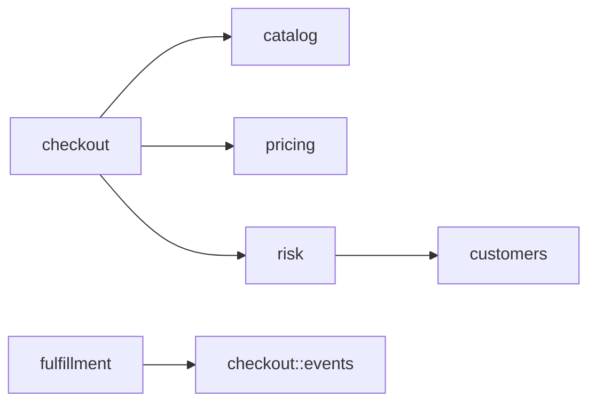
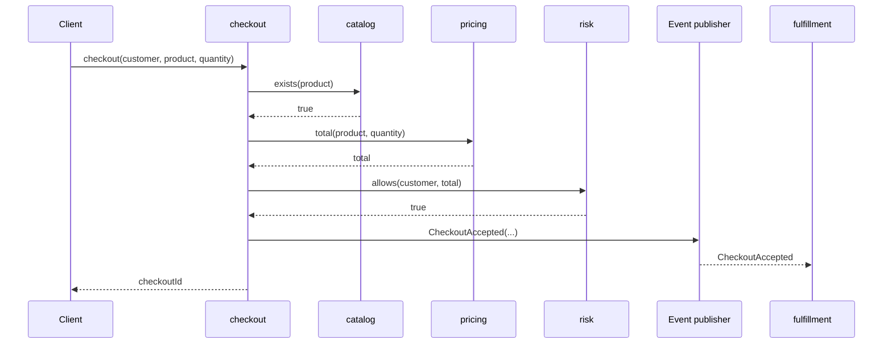
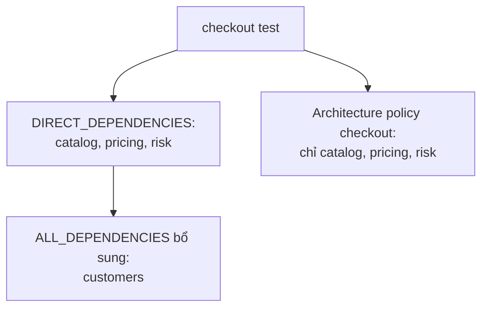
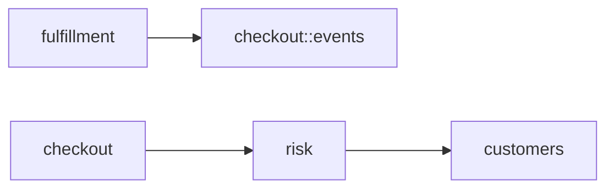
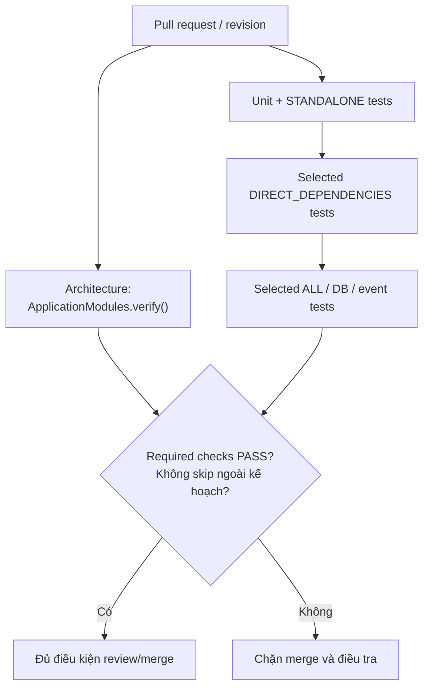

# Chọn module test khi module có nhiều dependency

Trong Spring Modulith, một application module hiếm khi hoạt động hoàn toàn biệt lập. Chẳng hạn, module `checkout` cần kiểm tra sản phẩm của `catalog`, tính giá qua `pricing`, kiểm tra rủi ro qua `risk` rồi phát sự kiện cho `fulfillment`. Khi viết kiểm thử, câu hỏi thường gặp là: **nên nạp bao nhiêu module vào Spring TestContext để kiểm tra checkout vừa đúng hành vi, vừa nhanh và đáng tin?**

Chỉ sử dụng `@SpringBootTest` để nạp toàn bộ ứng dụng có thể kéo theo database, message listener và bean không liên quan. Ngược lại, luôn dùng `@ApplicationModuleTest` ở chế độ `STANDALONE` rồi mock tất cả dependency khiến ta có rất ít bằng chứng về khả năng phối hợp thật. Cách làm phù hợp là **chọn phạm vi kiểm thử từ hợp đồng cần chứng minh**, không chọn theo số lượng module một cách máy móc.

Bài thuộc chương **Module boundaries** của **SPRING_MODULITH_VERIFICATION_TESTING**. Chúng ta sẽ phân biệt ba chế độ bootstrap của `@ApplicationModuleTest`, xây ví dụ có nhiều dependency trực tiếp và bắc cầu, kiểm chứng quan hệ module bằng `ApplicationModules.verify()`, test sự kiện, dữ liệu và tích hợp, rồi tổ chức các lớp test trong **quality gate CI** để ngăn phụ thuộc sai và hồi quy.

## 1. Mục tiêu học tập

Sau bài này, bạn có thể:

1. Vẽ và đọc **đồ thị dependency có hướng** khi một module phụ thuộc nhiều module khác.
2. Phân biệt **dependency trực tiếp**, **dependency bắc cầu**, **public API/named interface** và dependency nội bộ bị cấm.
3. Chọn giữa `STANDALONE`, `DIRECT_DEPENDENCIES` và `ALL_DEPENDENCIES` theo mục tiêu và chi phí của bài test.
4. Dùng `@MockitoBean` hoặc test double cho nhiều collaborator ngoài module mà không làm mất trọng tâm test.
5. Viết `@ApplicationModuleTest` kiểm tra cả happy path, lỗi và event với `PublishedEvents`.
6. Biết khi nào phải mở rộng sang integration test với bean thật, database, transaction, consumer hoặc API HTTP.
7. Nhận biết những lỗi khó thấy như **bean thiếu, phụ thuộc bắc cầu kéo thêm hạ tầng, mock che sai hợp đồng và test xanh nhưng kiến trúc sai**.
8. Thiết lập ma trận bằng chứng và quality gate CI phù hợp với các mức kiểm thử.

## 2. Nguyên tắc quyết định: chọn theo câu hỏi, không theo số dependency

Giả sử `checkout` có ba dependency trực tiếp. Điều này **không có nghĩa** mọi bài test `checkout` đều phải nạp ba module kia.

| Câu hỏi cần trả lời | Điểm khởi đầu phù hợp | Lý do |
|---|---|---|
| Khi catalog báo sản phẩm không tồn tại, checkout xử lý ra sao? | `STANDALONE` + mock `CatalogApi` | Kiểm tra quyết định của checkout, không kiểm tra database catalog |
| Với giá hợp lệ và risk chấp nhận, event có đúng payload không? | `STANDALONE` + mock ba API | Chạy use case thật, quan sát event thật trong test context |
| Checkout có nối đúng với bean thật của catalog, pricing, risk không? | `DIRECT_DEPENDENCIES` | Nạp những module trực tiếp liên quan |
| Bean của risk cần bean thuộc customers và phải kiểm tra chuỗi thật? | `ALL_DEPENDENCIES` hoặc integration test có phạm vi phù hợp | Cần chuỗi dependency bắc cầu |
| Cần xác minh transaction, schema hoặc query PostgreSQL? | Database integration test với hạ tầng phù hợp | Mock không chứng minh persistence |
| Cần kiểm tra producer → consumer sau commit? | Event/integration test, có thể dùng `Scenario` | Phải quan sát xử lý và trạng thái cuối |
| Cần xác minh không có vòng hoặc dùng package nội bộ trái phép? | `ApplicationModules.verify()` | Đây là hợp đồng kiến trúc, không phải hành vi |
| Cần kiểm tra HTTP endpoint trong ứng dụng hoàn chỉnh? | `@SpringBootTest`/`MockMvc` hoặc HTTP thực | Quan sát luồng từ bên ngoài hệ thống |

Một bộ test tốt thường **kết hợp nhiều phạm vi**, nhưng mỗi bài test có mục đích và bằng chứng cụ thể. “Nạp càng nhiều module càng an toàn” là một ngộ nhận: phạm vi rộng khiến test dễ chậm, khó cô lập lỗi và dễ phụ thuộc hạ tầng không liên quan.

## 3. Ví dụ xuyên suốt: checkout có ba dependency trực tiếp và một dependency bắc cầu

Ta sử dụng ứng dụng Spring Boot bán hàng với năm module nghiệp vụ:

- `catalog`: xác nhận sản phẩm tồn tại.
- `pricing`: tính tổng giá.
- `risk`: đánh giá khả năng chấp nhận giao dịch của khách hàng.
- `customers`: cung cấp hồ sơ khách hàng cho `risk`.
- `checkout`: điều phối ba kết quả trên và phát `CheckoutAccepted`.
- `fulfillment`: tiêu thụ event `CheckoutAccepted` sau khi checkout chấp nhận yêu cầu.

`checkout` chỉ trực tiếp gọi `catalog`, `pricing`, `risk`; nó không cần gọi `customers` hay `fulfillment`.

### 3.1. Cấu trúc package

```text
com.acme.shop
├── ShopApplication.java
├── catalog
│   ├── CatalogApi.java
│   └── internal
│       └── JpaCatalogAdapter.java
├── pricing
│   ├── PricingApi.java
│   └── internal
│       └── PricingService.java
├── customers
│   ├── CustomerProfileLookup.java
│   └── internal
│       └── CustomerRepository.java
├── risk
│   ├── package-info.java
│   ├── RiskApi.java
│   └── internal
│       └── RiskEvaluationService.java
├── checkout
│   ├── package-info.java
│   ├── CheckoutService.java
│   └── events
│       ├── package-info.java
│       └── CheckoutAccepted.java
└── fulfillment
    ├── package-info.java
    └── internal
        └── OnCheckoutAccepted.java
```

Với cách nhận diện mặc định, các package con trực tiếp dưới `com.acme.shop` là những ứng viên application module. Dự án có cấu hình nhận diện khác cần đối chiếu với mô hình mà Spring Modulith thực sự xây dựng.

### 3.2. Đồ thị dependency



Đọc mũi tên theo chiều **module đang tham chiếu type → module sở hữu type**:

- **Trực tiếp từ checkout:** `catalog`, `pricing`, `risk`.
- **Bắc cầu từ checkout:** `customers` qua đường `checkout → risk → customers`.
- **Không phải dependency của checkout:** `fulfillment`. Module fulfillment phụ thuộc vào event contract do checkout công bố, không ngược lại.

Đồ thị này cho phép ta hiểu chính xác khác biệt giữa ba bootstrap mode. Nếu sơ đồ có thêm cạnh `risk → checkout`, có thể hình thành vòng và phải sửa kiến trúc; việc thay đổi mode test không làm vòng biến mất.

### 3.3. Runtime event flow



Sơ đồ runtime cho thấy producer có thể gửi dữ liệu tới consumer fulfillment, nhưng chiều dependency về **type event** lại là `fulfillment → checkout::events`. Nếu fulfillment không nằm trong Spring context của test checkout, producer vẫn có thể publish event; bài test chỉ không chứng minh được consumer đã xử lý.

**Giới hạn ví dụ:** những đoạn Java dưới đây không lưu đơn hàng hoặc trừ tồn kho. `CheckoutAccepted` chỉ được hiểu là yêu cầu đã qua các điều kiện demo; không thể dùng để chứng minh transaction của một đơn hàng production đã commit.

## 4. Điều kiện kiến trúc phải đúng trước khi chọn bootstrap mode

Trước khi quyết định mock hay nạp module thật, cần bảo đảm dependency ở **production code** là hợp lệ.

Ba lớp điều kiện:

1. **Java visibility:** type có truy cập được theo quy tắc Java không?
2. **Module API visibility:** type có thuộc public API hoặc named interface do module đích công bố không?
3. **Dependency policy và đồ thị:** module nguồn có được phép phụ thuộc module đích và cạnh mới có tạo vòng không?

Ví dụ `checkout` nên dùng `catalog.CatalogApi`, không dùng `catalog.internal.JpaCatalogAdapter` hoặc `catalog.internal.ProductRepository`. Dù một class nội bộ là Java `public`, theo mô hình module mặc định nó không tự trở thành API công khai.

### 4.1. Khai báo chiều dependency của checkout

File `checkout/package-info.java`:

```java
@org.springframework.modulith.ApplicationModule(
    allowedDependencies = {
        "catalog",
        "pricing",
        "risk"
    }
)
package com.acme.shop.checkout;
```

Như vậy `checkout` được phép phụ thuộc ba module trực tiếp đã thiết kế. `customers` **không được phép trở thành dependency trực tiếp** chỉ vì `risk` đang dùng nó; `allowedDependencies` của checkout vẫn cần phản ánh đúng trách nhiệm của checkout.

### 4.2. Khai báo chiều dependency của risk

File `risk/package-info.java`:

```java
@org.springframework.modulith.ApplicationModule(
    allowedDependencies = "customers"
)
package com.acme.shop.risk;
```

`risk` dùng API của `customers` để đánh giá giao dịch. Cạnh `checkout → risk → customers` tạo dependency bắc cầu về mặt đồ thị. Điều đó **không có nghĩa** checkout được phép trực tiếp import `customers.CustomerProfileLookup`.

### 4.3. Công bố event contract

File `checkout/events/package-info.java`:

```java
@org.springframework.modulith.NamedInterface("events")
package com.acme.shop.checkout.events;
```

File `fulfillment/package-info.java`:

```java
@org.springframework.modulith.ApplicationModule(
    allowedDependencies = "checkout::events"
)
package com.acme.shop.fulfillment;
```

Fulfillment được phép dùng event contract; nó không tự được phép dùng `checkout.internal` hoặc truy cập trực tiếp database checkout.

### 4.4. Kiểm chứng architecture độc lập với module test

Tạo một bài JUnit test ở package gốc:

```java
package com.acme.shop;

import org.junit.jupiter.api.Test;
import org.springframework.modulith.core.ApplicationModules;

class ModuleArchitectureTests {

    @Test
    void verifiesDeclaredModuleBoundaries() {
        ApplicationModules.of(ShopApplication.class).verify();
    }
}
```

`verify()` kiểm tra những quy tắc kiến trúc Spring Modulith hỗ trợ, điển hình là phụ thuộc vòng, truy cập API nội bộ và vi phạm `allowedDependencies`.

Một `@ApplicationModuleTest(mode = ALL_DEPENDENCIES)` có thể khởi động bean dù code đang tham chiếu type nội bộ trái quy tắc. **Bootstrap thành công không thay thế `verify()`.** Cả hai phải có trong chiến lược kiểm chứng.

## 5. Xây các public API dùng cho nhiều collaborator

Để module test có thể tập trung vào checkout, hãy định nghĩa các hợp đồng **hẹp và ổn định**.

### 5.1. CatalogApi

File `catalog/CatalogApi.java`:

```java
package com.acme.shop.catalog;

import java.util.UUID;

public interface CatalogApi {
    boolean exists(UUID productId);
}
```

### 5.2. PricingApi

File `pricing/PricingApi.java`:

```java
package com.acme.shop.pricing;

import java.math.BigDecimal;
import java.util.UUID;

public interface PricingApi {
    BigDecimal total(UUID productId, int quantity);
}
```

### 5.3. RiskApi

File `risk/RiskApi.java`:

```java
package com.acme.shop.risk;

import java.math.BigDecimal;
import java.util.UUID;

public interface RiskApi {
    boolean allows(UUID customerId, BigDecimal total);
}
```

Các interface này nằm tại package gốc của module sở hữu nên thuộc public API mặc định của mô hình Spring Modulith. Implementation có thể nằm ở `internal` và dùng database hoặc service ngoài tùy dự án.

`RiskApi` có thể được triển khai dựa trên `customers.CustomerProfileLookup`. Nhưng checkout không cần biết cách risk đánh giá, vì nó chỉ nhận kết quả `allows(...)`.

### 5.4. Sự kiện đầu ra của checkout

File `checkout/events/CheckoutAccepted.java`:

```java
package com.acme.shop.checkout.events;

import java.math.BigDecimal;
import java.util.UUID;

public record CheckoutAccepted(
    UUID checkoutId,
    UUID customerId,
    UUID productId,
    int quantity,
    BigDecimal total
) {}
```

Ý nghĩa của event trong bài: checkout đã chấp nhận input, catalog, pricing và risk trả kết quả hợp lệ theo các điều kiện demo. Không có database commit hay payment thực trong ví dụ; khi triển khai nghiệp vụ thực, cần xác định lại tên event, transaction và dữ liệu cần công bố.

## 6. CheckoutService: một use case dùng ba dependency

File `checkout/CheckoutService.java`:

```java
package com.acme.shop.checkout;

import com.acme.shop.catalog.CatalogApi;
import com.acme.shop.pricing.PricingApi;
import com.acme.shop.risk.RiskApi;
import com.acme.shop.checkout.events.CheckoutAccepted;
import java.math.BigDecimal;
import java.util.UUID;
import org.springframework.context.ApplicationEventPublisher;
import org.springframework.stereotype.Service;

@Service
public class CheckoutService {

    private final CatalogApi catalog;
    private final PricingApi pricing;
    private final RiskApi risk;
    private final ApplicationEventPublisher events;

    public CheckoutService(
            CatalogApi catalog,
            PricingApi pricing,
            RiskApi risk,
            ApplicationEventPublisher events) {
        this.catalog = catalog;
        this.pricing = pricing;
        this.risk = risk;
        this.events = events;
    }

    public UUID checkout(
            UUID customerId,
            UUID productId,
            int quantity) {

        if (customerId == null || productId == null || quantity <= 0) {
            throw new IllegalArgumentException("Invalid checkout input");
        }

        if (!catalog.exists(productId)) {
            throw new IllegalArgumentException("Unknown product");
        }

        BigDecimal total = pricing.total(productId, quantity);

        if (total == null || total.signum() <= 0) {
            throw new IllegalStateException("Invalid price quote");
        }

        if (!risk.allows(customerId, total)) {
            throw new IllegalStateException("Checkout declined");
        }

        UUID checkoutId = UUID.randomUUID();

        events.publishEvent(new CheckoutAccepted(
            checkoutId, customerId, productId, quantity, total
        ));

        return checkoutId;
    }
}
```

Phân tích hành vi:

- `CatalogApi` trả `false` → từ chối ngay, không gọi pricing/risk.
- `PricingApi` trả giá `null`, bằng 0 hoặc âm → từ chối, không gọi risk.
- `RiskApi` trả `false` → từ chối, không publish event.
- Ba collaborator trả giá trị phù hợp → publish đúng một `CheckoutAccepted` và trả ID.
- Input không hợp lệ → từ chối trước khi gọi bất kỳ collaborator bên ngoài.

Những quyết định trên có thể được kiểm tra tốt bằng **test module độc lập**, không cần database hay bean thật của bốn module còn lại.

## 7. STANDALONE: mock các collaborator ngoài module

### 7.1. Vì sao đây thường là điểm bắt đầu tốt?

Ở `STANDALONE`, `@ApplicationModuleTest` tập trung vào Spring bean thuộc module checkout. Ba bean implementation của `catalog`, `pricing`, `risk` thông thường không được nạp theo phạm vi application module.

Nếu không có test double, Spring có thể không tạo được `CheckoutService` vì thiếu bean cho ba interface trên. Giải pháp có chủ đích là đăng ký **mock bean theo đúng public API**.

Với Spring Framework hỗ trợ `@MockitoBean`, ví dụ:

```java
package com.acme.shop.checkout;

import static org.assertj.core.api.Assertions.assertThat;
import static org.assertj.core.api.Assertions.assertThatThrownBy;
import static org.mockito.Mockito.verify;
import static org.mockito.Mockito.verifyNoInteractions;
import static org.mockito.Mockito.when;

import com.acme.shop.catalog.CatalogApi;
import com.acme.shop.pricing.PricingApi;
import com.acme.shop.risk.RiskApi;
import com.acme.shop.checkout.events.CheckoutAccepted;
import java.math.BigDecimal;
import java.util.UUID;
import org.junit.jupiter.api.Test;
import org.springframework.beans.factory.annotation.Autowired;
import org.springframework.modulith.test.ApplicationModuleTest;
import org.springframework.modulith.test.PublishedEvents;
import org.springframework.test.context.bean.override.mockito.MockitoBean;

@ApplicationModuleTest
class CheckoutModuleTests {

    @Autowired CheckoutService checkout;

    @MockitoBean CatalogApi catalog;
    @MockitoBean PricingApi pricing;
    @MockitoBean RiskApi risk;

    @Test
    void publishesAcceptedCheckout(PublishedEvents events) {
        UUID customerId = UUID.randomUUID();
        UUID productId = UUID.randomUUID();
        BigDecimal total = new BigDecimal("250.00");

        when(catalog.exists(productId)).thenReturn(true);
        when(pricing.total(productId, 2)).thenReturn(total);
        when(risk.allows(customerId, total)).thenReturn(true);

        UUID checkoutId = checkout.checkout(customerId, productId, 2);

        assertThat(events.ofType(CheckoutAccepted.class))
            .singleElement()
            .satisfies(event -> {
                assertThat(event.checkoutId()).isEqualTo(checkoutId);
                assertThat(event.customerId()).isEqualTo(customerId);
                assertThat(event.productId()).isEqualTo(productId);
                assertThat(event.quantity()).isEqualTo(2);
                assertThat(event.total()).isEqualByComparingTo(total);
            });

        verify(catalog).exists(productId);
        verify(pricing).total(productId, 2);
        verify(risk).allows(customerId, total);
    }

    @Test
    void rejectsUnknownProduct(PublishedEvents events) {
        UUID productId = UUID.randomUUID();

        when(catalog.exists(productId)).thenReturn(false);

        assertThatThrownBy(() ->
            checkout.checkout(UUID.randomUUID(), productId, 1)
        ).isInstanceOf(IllegalArgumentException.class)
         .hasMessage("Unknown product");

        assertThat(events.ofType(CheckoutAccepted.class)).isEmpty();
        verifyNoInteractions(pricing, risk);
    }

    @Test
    void rejectsDeclinedRisk(PublishedEvents events) {
        UUID customerId = UUID.randomUUID();
        UUID productId = UUID.randomUUID();
        BigDecimal total = new BigDecimal("50.00");

        when(catalog.exists(productId)).thenReturn(true);
        when(pricing.total(productId, 1)).thenReturn(total);
        when(risk.allows(customerId, total)).thenReturn(false);

        assertThatThrownBy(() ->
            checkout.checkout(customerId, productId, 1)
        ).isInstanceOf(IllegalStateException.class)
         .hasMessage("Checkout declined");

        assertThat(events.ofType(CheckoutAccepted.class)).isEmpty();
    }

    @Test
    void invalidQuantityDoesNotCallDependencies(
            PublishedEvents events) {

        assertThatThrownBy(() ->
            checkout.checkout(UUID.randomUUID(), UUID.randomUUID(), 0)
        ).isInstanceOf(IllegalArgumentException.class);

        verifyNoInteractions(catalog, pricing, risk);
        assertThat(events.ofType(CheckoutAccepted.class)).isEmpty();
    }
}
```

Trong các dự án dùng phiên bản Spring Boot cũ hơn, `@MockBean` của Spring Boot Test có thể là cơ chế mock bean đang được hỗ trợ. `@MockitoBean` thuộc Spring TestContext từ Spring Framework 6.2; cần chọn **một cơ chế phù hợp phiên bản** và không khai báo chồng hai cơ chế cho cùng bean.

### 7.2. Những bằng chứng thu được từ STANDALONE

- Bean `CheckoutService` chạy trong Spring TestContext của module checkout.
- Các nhánh validation, catalog, pricing, risk xử lý đầu vào như assertion mô tả.
- `CheckoutAccepted` được phát với ID và payload tương ứng.
- Đường đi từ chối không phát event và không gọi collaborator không cần thiết.

### 7.3. Những điều STANDALONE + mock không chứng minh

- Bean thật của catalog/pricing/risk có khởi tạo được hay không.
- Giá trong database pricing có được tính đúng hay không.
- `RiskApi` có tích hợp đúng với `CustomerProfileLookup` và database khách hàng không.
- Consumer fulfillment đã xử lý `CheckoutAccepted` chưa.
- Event hoặc bản ghi checkout đã commit thành công.
- Dependency kiến trúc có hợp lệ không (phải kiểm chứng bằng `verify()` riêng).

**Đừng biến “bài test module xanh” thành tuyên bố “mọi module phụ thuộc đã được kiểm chứng”.** Bằng chứng chỉ áp dụng cho hành vi checkout khi các collaborator đưa về kết quả được stub.

## 8. Dùng mock có chọn lọc: không nhất thiết mock toàn bộ module khác

Có nhiều dependency **không đồng nghĩa tất cả đều cần được mock giống nhau**.

Ví dụ một bài test cần kiểm tra thuật toán định giá production nhưng chỉ muốn giả lập catalog và risk. Ta có thể chọn:

- Test `pricing` riêng với bean thật (có thể thêm database nếu pricing cần).
- Test `checkout` với mock ba API để chứng minh orchestration.
- Test phối hợp `checkout + pricing` qua một integration test được cấu hình có chủ đích.

Lựa chọn phụ thuộc vào mức độ tin cậy và đặc điểm collaborator:

| Loại collaborator | Ưu tiên trong checkout module test | Bằng chứng bổ sung |
|---|---|---|
| Catalog API phụ thuộc DB | Mock theo hợp đồng | Catalog DB integration test |
| Pricing service thuần tính toán | Mock khi chỉ test orchestration; test riêng thuật toán thật | Pricing unit/module test |
| Risk API phụ thuộc customer profile và hệ thống ngoài | Mock các phản hồi rủi ro đặc trưng | Risk module/integration/contract test |
| ApplicationEventPublisher | Thường để thật để `PublishedEvents` quan sát | Consumer event/integration test |
| Bean nội bộ checkout | Ưu tiên để thật trong module test | Unit test nhỏ nếu thuật toán phức tạp |

Mock càng sâu vào chi tiết nội bộ, test càng có nguy cơ chỉ kiểm tra Mockito tương tác với Mockito thay vì nghiệp vụ đang được thực thi.

## 9. DIRECT_DEPENDENCIES: nạp toàn bộ module phụ thuộc trực tiếp

Chế độ `DIRECT_DEPENDENCIES` mở rộng context để bao gồm module checkout và các module **checkout trực tiếp phụ thuộc**.

Trong graph ví dụ:

```text
Module đang test: checkout

DIRECT_DEPENDENCIES:
  checkout
  catalog
  pricing
  risk

Không tự mở rộng theo dependency bắc cầu chỉ vì risk cần customers:
  customers (đi qua risk)
```

Cú pháp:

```java
package com.acme.shop.checkout;

import org.springframework.modulith.test.ApplicationModuleTest;
import org.springframework.modulith.test.ApplicationModuleTest.BootstrapMode;

@ApplicationModuleTest(
    mode = BootstrapMode.DIRECT_DEPENDENCIES
)
class CheckoutDirectDependenciesTests {
    // Cấu hình dữ liệu, bean và các assertion theo hợp đồng phối hợp.
}
```

### 9.1. Bằng chứng mà DIRECT_DEPENDENCIES cung cấp

Khi các module phụ thuộc được nạp với **bean triển khai thật**, test có thể kiểm tra:

- Checkout được inject đúng `CatalogApi`, `PricingApi`, `RiskApi` từ các module sở hữu.
- Một đường đi phối hợp giữa checkout và các module trực tiếp hoạt động với cấu hình test.
- Các interface và bean configuration tương ứng tạo được context.
- Những hành vi tích hợp mà test assert thực sự đạt trong môi trường đó.

Nhưng **khởi động được context chưa chứng minh tất cả use case đúng**. Phải kích hoạt hành động và assert kết quả; nếu các adapter thật cần DB, contract với API ngoài hoặc container, test phải cung cấp hạ tầng tương ứng.

### 9.2. Những lỗi thường xuất hiện

- `catalog.internal.JpaCatalogAdapter` cần `DataSource` mà test không cấu hình.
- `pricing` có một bean cần property chưa được cấp trong test profile.
- `risk.internal.RiskEvaluationService` inject `customers.CustomerProfileLookup`; vì customers là module bắc cầu không nằm trong phạm vi trực tiếp, test có thể thiếu bean.
- Multiple bean implementation của cùng interface dẫn tới ambiguous injection.
- Một listener được nạp nhưng test không dự liệu side effect hoặc sự kiện async.

Đây có thể là **lỗi bootstrap/test configuration**, không tự động là lỗi kiến trúc. Cần xác định module sở hữu bean, chiều dependency đúng hay không, rồi chọn mở phạm vi, fake hoặc mock ở biên phù hợp.

### 9.3. Không tăng phạm vi để che dependency sai

Nếu `checkout` import `customers.internal.CustomerRepository` trái `allowedDependencies`, mở lên `DIRECT_DEPENDENCIES` hoặc `ALL_DEPENDENCIES` không biến cạnh sai thành hợp lệ. Dùng `ApplicationModules.verify()` để kiểm tra trước.

## 10. ALL_DEPENDENCIES: khi cần cả dependency bắc cầu

`ALL_DEPENDENCIES` bao gồm module đang kiểm thử và các module trong **bao đóng phụ thuộc bắc cầu** của nó theo mô hình được nhận diện.

Trong ví dụ:

```text
Module đang test: checkout

ALL_DEPENDENCIES:
  checkout
  catalog
  pricing
  risk
  customers    # bởi vì risk -> customers

Không suy ra tự có:
  fulfillment  # nó phụ thuộc checkout, không phải checkout phụ thuộc nó
```

Cú pháp:

```java
package com.acme.shop.checkout;

import org.springframework.modulith.test.ApplicationModuleTest;
import org.springframework.modulith.test.ApplicationModuleTest.BootstrapMode;

@ApplicationModuleTest(
    mode = BootstrapMode.ALL_DEPENDENCIES
)
class CheckoutAllDependenciesTests {
    // Test khi cần chuỗi checkout -> risk -> customers.
}
```

### 10.1. Sự khác biệt quan trọng: bắc cầu không cấp quyền import trực tiếp

Vì `customers` có thể được nạp trong test `ALL_DEPENDENCIES`, **không có nghĩa** checkout được phép thêm field kiểu `customers.CustomerProfileLookup` vào production code. Checkout vẫn bị giới hạn bởi `allowedDependencies` của nó.

Phạm vi context và quyền kiến trúc là hai khái niệm khác nhau:



### 10.2. Chọn ALL khi nào?

Nên cân nhắc `ALL_DEPENDENCIES` nếu:

- Bài test cần chạy **luồng thật** qua nhiều tầng dependency.
- Hành vi cần chứng minh nằm ở chính tương tác bắc cầu (ví dụ risk dùng hồ sơ khách hàng).
- Đội ngũ có thể cung cấp dữ liệu, hạ tầng và fixture cho các module liên quan.
- Chi phí bootstrap/độ ổn định chấp nhận được trong loại test đã chọn.

**Không** nên dùng `ALL_DEPENDENCIES` chỉ để “hết lỗi thiếu bean”, vì điều đó có thể kéo vào nhiều module, listener và cơ sở dữ liệu hơn mức cần thiết.

### 10.3. Các cách thay thế ALL

Nếu chỉ muốn test checkout và risk thật nhưng customers là một adapter phụ thuộc hạ tầng, có thể:

- Test risk riêng, mock `CustomerProfileLookup` của module customers.
- Dùng một test double có chủ đích cho customer profile trong collaboration test.
- Tạo integration test nhỏ với risk và customers thật thay vì nâng mọi checkout test lên `ALL_DEPENDENCIES`.

Lựa chọn tối ưu được quyết định bởi **hợp đồng cần kiểm chứng**, không bởi sự tiện lợi ngắn hạn khi cấu hình test.

## 11. Bảng so sánh ba bootstrap mode cho cùng đồ thị

| Tiêu chí | STANDALONE | DIRECT_DEPENDENCIES | ALL_DEPENDENCIES |
|---|---|---|---|
| Module checkout | Có | Có | Có |
| Catalog/pricing/risk | Không theo phạm vi module mặc định | Có | Có |
| Customers qua risk | Không | Không tự bao gồm | Có |
| Fulfillment là consumer ngược chiều | Không tự bao gồm | Không tự bao gồm | Không tự bao gồm |
| Cần mock collaborator | Thường có với các API ngoài checkout | Tùy bean và dependency bắc cầu | Ít hơn nếu mọi bean thật được nạp |
| Chi phí context | Thường thấp | Trung bình hoặc cao hơn | Có thể cao nhất |
| Khả năng phát hiện lỗi wiring nhiều module | Thấp với dependency bị mock | Tốt cho dependency trực tiếp | Tốt cho chuỗi bắc cầu đã nạp |
| Khả năng kiểm tra SQL/transaction | Chỉ khi setup phù hợp | Chỉ khi setup phù hợp | Chỉ khi setup phù hợp |
| Giữ ranh giới module đúng? | Vẫn cần `verify()` | Vẫn cần `verify()` | Vẫn cần `verify()` |
| Mục tiêu tiêu biểu | Quy tắc nội bộ checkout | Phối hợp checkout với ba module trực tiếp | Luồng checkout–risk–customers |

**Không có mode nào mặc định “tốt nhất”.** Để bảo vệ một ứng dụng lớn, ta thường dùng nhiều `STANDALONE` test kiểm tra các quyết định cụ thể, một số test phạm vi rộng hơn cho collaboration quan trọng và các integration/system test có hạ tầng phù hợp.

## 12. Ma trận lựa chọn theo rủi ro và chi phí

Có thể dùng ma trận sau trong code review trước khi viết test:

| Hợp đồng/rủi ro | Chọn trước | Lý do |
|---|---|---|
| Quantity = 0 phải bị từ chối trước khi gọi module khác | STANDALONE | Không cần bean khác; mock giúp assert không có tương tác |
| Catalog trả “không có sản phẩm” | STANDALONE | Điều kiện của checkout, dữ liệu catalog là đầu vào giả lập |
| Price quote bằng 0/âm phải bị từ chối | STANDALONE | Stub price và assert không gọi risk |
| Risk từ chối checkout | STANDALONE | Test orchestration và không phát sự kiện |
| Checkout publish event đúng payload | STANDALONE + `PublishedEvents` | Producer thuộc checkout, consumer không cần chạy |
| Checkout kết nối đúng bean pricing thật | DIRECT_DEPENDENCIES | Kiểm tra wiring/collaboration |
| Risk thật tra hồ sơ khách hàng thành công | Risk module/integration test hoặc ALL theo phạm vi | Kiểm tra dependency bắc cầu |
| Catalog JPA query đúng bảng | Catalog DB integration test | Phải chạy adapter/DB thật |
| Fulfillment xử lý `CheckoutAccepted` | Fulfillment module test | Consumer nằm ngoài graph dependency của checkout |
| Hai event trùng không tạo fulfillment trùng | DB/event integration test | Cần idempotency, constraint và transaction |
| Không có import vào `risk.internal` | `ApplicationModules.verify()` | Phép kiểm chứng kiến trúc |
| HTTP checkout trả kết quả hợp lệ | System/API test | Từ controller tới kết quả quan sát được |

Ma trận là **khung thiết kế test**, không phải báo cáo một suite đã chạy. Với mỗi dự án, cần ghi tên test thực, commit, môi trường, assertion và phần chưa được bao phủ.

## 13. Thiết kế test nhiều dependency mà không thành “rừng mock”

Khi module cần năm, bảy hoặc mười collaborator, dễ xuất hiện test với hàng chục lệnh `when(...)`. Đây là lúc nên đánh giá lại trách nhiệm và cách tạo fixture.

### 13.1. Chỉ stub điều kiện liên quan đến tình huống

Với test `rejectsUnknownProduct`, **không cần** stub pricing và risk vì code từ chối trước khi gọi chúng. Điều này giúp test tự mô tả thứ tự nghiệp vụ cần bảo vệ.

Tương tự, một test input không hợp lệ nên dùng `verifyNoInteractions(...)` nếu “không gọi các hệ thống ngoài khi input sai” là một yêu cầu có ý nghĩa.

### 13.2. Dùng fixture builder nếu lặp nhiều dữ liệu

Có thể tạo helper trong **chính class test** để chuẩn bị trường hợp hợp lệ:

```java
private void allowCheckout(
        UUID customerId,
        UUID productId,
        int quantity,
        BigDecimal total) {

    when(catalog.exists(productId)).thenReturn(true);
    when(pricing.total(productId, quantity)).thenReturn(total);
    when(risk.allows(customerId, total)).thenReturn(true);
}
```

Helper này làm giảm lặp trong nhiều happy-path test. Nhưng đừng che giấu các điều kiện khác nhau đằng sau một `setupEverything()` quá rộng; người đọc phải biết test phụ thuộc phản hồi nào.

### 13.3. Kiểm tra số lần gọi chỉ khi thực sự quan trọng

`verify(catalog).exists(productId)` có giá trị khi việc hỏi đúng sản phẩm là một phần hợp đồng. Tuy nhiên, ép mọi collaborator phải được gọi đúng một số lần và đúng thứ tự nội bộ không cần thiết có thể khiến test dễ vỡ khi refactor hợp lệ.

Ưu tiên:

1. Kết quả nghiệp vụ bên ngoài.
2. Event và trạng thái có thể quan sát.
3. Những interaction ảnh hưởng side effect hoặc hiệu năng.
4. Chi tiết thứ tự chỉ khi hợp đồng thật sự yêu cầu.

### 13.4. Khi số collaborator quá lớn là dấu hiệu thiết kế

Nếu một use case phải điều phối quá nhiều module khác, nên xem xét:

- Checkout có đang gánh nhiều trách nhiệm không?
- Một số nghiệp vụ có thể thuộc module pricing hoặc risk thay vì checkout?
- Public API có đủ hẹp, hay đang lộ repository/implementation?
- Sự phối hợp này nên được thực hiện ở orchestration layer hoặc qua event?
- Có vòng phụ thuộc cần tái thiết kế không?

**Không nên chỉ dùng thêm mock để hợp thức hóa một kiến trúc coupling quá rộng.**

## 14. Vì sao mode rộng hơn không chứng minh database đúng?

Nếu `DIRECT_DEPENDENCIES` nạp `catalog.internal.JpaCatalogAdapter`, nhưng test vẫn thay DataSource bằng H2 hoặc fake repository, kết quả chỉ phản ánh **hạ tầng test đó**.

Muốn chứng minh:

- migration hoạt động với PostgreSQL;
- unique constraint thật ngăn duplicate;
- transaction rollback khi một bước lỗi;
- concurrent checkout không gây bán vượt tồn;

thì cần **database integration test** với engine/schema và transaction boundary phù hợp. Testcontainers có thể cung cấp một DB tương ứng, nhưng việc có container chưa đủ nếu test không assert hành vi cần chứng minh.

### 14.1. Transaction test có ranh giới riêng

Trong Spring Test, `@Transactional` trên phương thức test thường đặt test trong transaction được rollback khi kết thúc. Một listener `@TransactionalEventListener` xử lý `AFTER_COMMIT` hoặc `@ApplicationModuleListener` có thể không chạy như dự kiến nếu event được publish trong một test transaction chưa commit.

Vì vậy khi kiểm thử chuỗi:

```text
checkout transaction commits
    -> event publication
        -> fulfillment listener
            -> fulfillment transaction commits
```

cần quan sát đúng các ranh giới commit, không chỉ assert trong một persistence context chưa flush/commit. Việc đổi bootstrap mode không tự sửa vấn đề transaction.

### 14.2. Một tình huống khó về idempotency

Giả sử `fulfillment` nhận lại cùng `CheckoutAccepted` hai lần. Bộ nhớ in-memory có thể dùng `Set<UUID>` để tránh trùng trong một JVM, nhưng khi service restart hoặc có nhiều tiến trình, hiệu quả đó không được bảo đảm.

Nếu nghiệp vụ yêu cầu không tạo hai shipment bền vững:

- định nghĩa khóa idempotency như `checkoutId`;
- dùng unique constraint hoặc cơ chế tương ứng trong persistence;
- xử lý race giữa hai consumer;
- kiểm tra trạng thái dữ liệu cuối sau các lần nhận lặp.

Những bằng chứng này thuộc **consumer/database integration**, không phải STANDALONE producer test checkout.

## 15. Sự kiện: consumer không tự nằm trong ALL_DEPENDENCIES

Một ngộ nhận quan trọng khi module có nhiều dependency là: “`ALL_DEPENDENCIES` sẽ nạp tất cả những module liên quan đến event”.

Trong đồ thị ví dụ, `fulfillment` **phụ thuộc** `checkout::events`; checkout **không phụ thuộc** fulfillment. Vì vậy không nên giả định `ALL_DEPENDENCIES` của checkout sẽ nạp fulfillment.



Nếu mục tiêu là kiểm tra producer, dùng `PublishedEvents` trong module test checkout. Nếu mục tiêu là kiểm tra consumer, viết test **trong module fulfillment**, phát event đầu vào rồi assert kết quả xử lý.

### 15.1. Kiểm tra publisher

Ví dụ `CheckoutModuleTests` đã dùng:

```java
assertThat(events.ofType(CheckoutAccepted.class))
    .singleElement()
    .satisfies(event -> {
        assertThat(event.checkoutId()).isEqualTo(checkoutId);
        assertThat(event.total()).isEqualByComparingTo(total);
    });
```

Điều này chứng minh event đã được publish trong phạm vi test và payload khớp assertion, **không chứng minh fulfillment đã xử lý**.

### 15.2. Kiểm tra consumer

Giả định fulfillment có API `FulfillmentStatus` và một listener `@EventListener` đồng bộ. Một test dưới package `com.acme.shop.fulfillment` có thể:

```java
package com.acme.shop.fulfillment;

import static org.assertj.core.api.Assertions.assertThat;

import com.acme.shop.checkout.events.CheckoutAccepted;
import java.math.BigDecimal;
import java.util.UUID;
import org.junit.jupiter.api.Test;
import org.springframework.beans.factory.annotation.Autowired;
import org.springframework.context.ApplicationEventPublisher;
import org.springframework.modulith.test.ApplicationModuleTest;

@ApplicationModuleTest
class FulfillmentModuleTests {

    @Autowired ApplicationEventPublisher publisher;
    @Autowired FulfillmentStatus status;

    @Test
    void receivesCheckoutAccepted() {
        UUID checkoutId = UUID.randomUUID();

        publisher.publishEvent(new CheckoutAccepted(
            checkoutId,
            UUID.randomUUID(),
            UUID.randomUUID(),
            2,
            new BigDecimal("250.00")
        ));

        assertThat(status.received(checkoutId)).isTrue();
    }
}
```

Đây là ví dụ **có điều kiện**: `FulfillmentStatus`, listener và storage của module fulfillment cần được cài đặt; test chỉ phù hợp khi listener được nạp và xử lý đồng bộ như giả định.

Nếu listener bất đồng bộ/sau commit, dùng điều kiện chờ trạng thái hoặc event kết quả (chẳng hạn thông qua `Scenario` của Spring Modulith Test) và kiểm tra transaction theo cấu hình thật. Không thay thế bằng `Thread.sleep(...)` cố định.

### 15.3. Ba cấp bằng chứng về sự kiện

| Cấp | Câu hỏi | Test phù hợp |
|---|---|---|
| **Published** | Checkout phát sự kiện đúng chưa? | `PublishedEvents` trong checkout module test |
| **Handled** | Fulfillment đã thực thi xử lý theo input event chưa? | Fulfillment module test |
| **Committed** | Kết quả shipment đã lưu đúng chưa? | Event/database integration test |

Chọn mode `ALL_DEPENDENCIES` cho checkout **không bỏ qua** nhu cầu ba loại bằng chứng này.

## 16. Sự khác biệt giữa Spring bean graph và module graph

Một module có thể có ba dependency hợp lệ nhưng Spring vẫn báo thiếu bean trong `STANDALONE`. Ngược lại, khi dùng `@SpringBootTest`, ứng dụng có thể inject đầy đủ bean dù có một dependency vào package `internal` trái kiến trúc.

| Khía cạnh | Module graph | Spring bean graph |
|---|---|---|
| Đơn vị | Application module/type dependency | Bean/constructor injection |
| Được hình thành từ | Package, type reference, metadata Modulith | Bean definitions, component scanning, configuration |
| Kiểm chứng tiêu biểu | `ApplicationModules.verify()` | Spring TestContext bootstrap, bean assertions |
| Lỗi đặc trưng | Vòng module, internal access, policy violation | NoSuchBeanDefinition, ambiguous bean, missing property |
| “Test xanh” chứng minh gì? | Cấu trúc tuân thủ những quy tắc đã phân tích | Bean trong phạm vi test đã khởi tạo được |
| Không tự chứng minh | Tính đúng nghiệp vụ, transaction | Tính đúng ranh giới module |

Khi gặp lỗi bootstrap, hãy chẩn đoán theo thứ tự:

1. Dependency production có hợp lệ theo module API/policy không?
2. Bean thuộc module nào, là direct hay transitive dependency?
3. Test mode có bao gồm module ấy không?
4. Nếu không bao gồm, nên mock/fake hay mở rộng mode theo mục tiêu?
5. Nếu đã bao gồm, bean cần config, profile, database hay external service nào?
6. Bài test có assertion về hành vi cần kiểm chứng hay chỉ khởi động context?

Cách chẩn đoán này tránh dùng `ALL_DEPENDENCIES` như “phương thuốc” mặc định cho mọi lỗi.

## 17. Những lỗi phổ biến khi chọn phạm vi module test

### 17.1. Luôn chọn ALL_DEPENDENCIES

Nhược điểm: nhiều bean/hạ tầng không liên quan, tăng thời gian, tăng độ phức tạp fixture và dễ xuất hiện lỗi do module bắc cầu thay đổi. Chỉ chọn khi **hành vi bắc cầu** thực sự thuộc mục tiêu test.

### 17.2. Luôn chọn STANDALONE và mock toàn bộ

Nhược điểm: ít bằng chứng về real wiring, persistence, transaction và consumer. Để có độ tin cậy tổng thể, cần một số bài integration test dùng bean thật.

### 17.3. Mock implementation nội bộ của module khác

Nếu checkout mock `catalog.internal.JpaCatalogAdapter` thay vì `catalog.CatalogApi`, test có thể bootstrap nhưng production dependency đi xuyên ranh giới. Cần sửa API và chạy `verify()` độc lập.

### 17.4. Quên dependency bắc cầu

`DIRECT_DEPENDENCIES` của checkout có `risk` nhưng không nhất thiết có `customers`, nên bean risk có thể không khởi tạo được. Cần hiểu topology trước khi đổi cấu hình hoặc tạo test double.

### 17.5. Nhầm dependency đảo chiều với dependency của module đang test

Fulfillment tiêu thụ `CheckoutAccepted` không có nghĩa fulfillment là dependency của checkout. Không suy diễn consumer sẽ có mặt trong `ALL_DEPENDENCIES`.

### 17.6. Test dựa vào Mockito default value

Nếu không stub `CatalogApi.exists(...)`, Mockito có thể trả `false` và làm checkout bị từ chối. Test xanh ở nhánh từ chối không chứng minh tester đã chủ đích kiểm tra catalog phản hồi đúng.

Stub rõ ràng những điều kiện có ý nghĩa cho từng scenario; dùng `verifyNoInteractions` khi muốn bảo vệ thứ tự nghiệp vụ.

### 17.7. Dùng @Mock thay cho Spring mock bean

`@Mock` tạo Mockito object nhưng không tự đưa vào Spring TestContext. Trong `@ApplicationModuleTest`, cần cơ chế mock bean (`@MockitoBean` hoặc API tương thích version), hoặc import test configuration cung cấp fake bean.

### 17.8. Khởi động context xanh nhưng không có assertion nghiệp vụ

Một test chỉ kiểm tra `@Autowired CheckoutService` không null mới chứng minh wiring tối thiểu. Cần assert output, event, trạng thái hoặc ca lỗi cụ thể.

### 17.9. Để test dùng chung trạng thái

In-memory state, singleton bean hoặc database fixture giữ dữ liệu qua nhiều test có thể tạo flaky test, nhất là khi mở phạm vi sang nhiều module. Sử dụng ID riêng cho từng case, cleanup/isolation và tránh phụ thuộc thứ tự chạy.

## 18. Kiến trúc đúng vẫn là quality gate đầu tiên

Một test `@ApplicationModuleTest` có nhiều mock và đủ assertion có thể xanh trong khi checkout trực tiếp dùng `customers.internal.CustomerRepository` ở một class không được test động tới.

Vì vậy cần một architecture gate độc lập:

```java
@Test
void moduleDependenciesAreAllowed() {
    ApplicationModules.of(ShopApplication.class).verify();
}
```

Một **thử nghiệm âm tính** khi cấu hình gate:

- Tạo một tham chiếu type thực sự từ checkout tới `customers.internal.CustomerRepository` (type phải tồn tại và biên dịch được ở mức Java).
- Kỳ vọng `verify()` báo vi phạm public API hoặc `allowedDependencies`.
- Xóa tham chiếu sai, khôi phục API hợp lệ.
- Chạy lại architecture test để xác nhận gate xanh.

Không chỉ thêm import không được sử dụng: loại import đó có thể không tạo dependency đáng kể trong mã được biên dịch. Không đưa vi phạm có chủ đích vào nhánh chính.

## 19. Xây chiến lược kiểm thử nhiều tầng cho checkout

Một bộ kiểm chứng có thể phân thành các lớp có mục tiêu khác nhau:

| Tầng | Ví dụ bài test | Mục đích | Mức độ thường thấy |
|---|---|---|---|
| 1. Kiến trúc | `ModuleArchitectureTests` | Bảo vệ public API, policy, graph | Nhanh, chạy mọi PR |
| 2. Unit | `CheckoutPolicyUnitTests` | Logic validation và nhánh quyết định | Nhanh, nhiều case biên |
| 3. Module cô lập | `CheckoutModuleTests` + mock | Orchestration và event producer | Nhanh/trung bình |
| 4. Collaboration trực tiếp | `CheckoutDirectDependenciesTests` | Checkout + bean thật catalog/pricing/risk | Trung bình, tùy hạ tầng |
| 5. Integration bắc cầu | Checkout–risk–customers | Đường đi xuyên chuỗi dependency | Có thể chậm |
| 6. Consumer event | `FulfillmentModuleTests` | Listener xử lý contract | Theo tính đồng bộ/DB |
| 7. Database/transaction | JPA/constraint/idempotency tests | Dữ liệu sau commit và lỗi | Tùy container/DB |
| 8. System/API | HTTP checkout flow | Tích hợp từ điểm vào | Thường chọn ít luồng quan trọng |

Không cần tạo tất cả tám tầng cho mọi tính năng. Chọn theo **rủi ro**, giá trị kiểm chứng và tần suất thay đổi.

### 19.1. Bằng chứng nào phù hợp với một pull request?

Giả sử PR đổi thuật toán tính giá:

- `pricing` unit/module test bảo vệ phép tính.
- Checkout STANDALONE test xác minh phản ứng với price quote hợp lệ/bất hợp lệ.
- Một collaboration/integration test nếu output pricing thực cần khớp event checkout.
- Architecture test bảo đảm không thêm phụ thuộc ngược.
- Các test regression liên quan chạy trên **commit của PR**, không chỉ kết quả của nhánh cũ.

Nếu PR chỉ đổi tên internal class mà không đổi API, architecture/module tests vẫn quan trọng nhưng không cần tự thêm một end-to-end test mới cho mỗi refactor.

## 20. CI quality gate cho các mode và các dependency



Có thể chạy các job độc lập song song; sơ đồ biểu diễn **chiều tăng phạm vi**, không bắt buộc pipeline tuyến tính.

### 20.1. Quy tắc vận hành

1. **Architecture verification phải được chạy bắt buộc** cho revision cần merge.
2. **Module tests quan trọng phải chạy** và có assertion cụ thể, không chỉ khởi động context.
3. **Selected collaboration/integration tests** phải dùng đúng mode/hạ tầng để phản ánh rủi ro.
4. **Báo cáo test** cần ghi số ca đã chạy, thất bại, bị skip và môi trường.
5. **Branch protection/merge rule** phải chặn merge khi check bắt buộc thất bại.

Lệnh ví dụ khi dự án có build wrapper:

```bash
# Maven: chạy những test được cấu hình trong phase test
./mvnw test

# Gradle: chạy task test đã cấu hình
./gradlew test
```

Hai lệnh này không tự chứng minh toàn bộ integration suite đã chạy: Maven có thể tách integration test qua plugin/phase, Gradle có thể có `integrationTest` task. CI phải thực thi **đúng các phase/task được cấu hình**.

### 20.2. Bảo vệ test không bị bỏ sót

Một pipeline có thể xanh vì:

- Architecture test bị exclude.
- Test integration dùng Testcontainers bị skip do môi trường CI không sẵn sàng.
- Một test `@Disabled` lâu ngày không được xem lại.
- Test chỉ bootstrap context nhưng không có assertion.
- Job xanh ở revision cũ trong khi PR hiện tại đã đổi dependency.

Hãy liên kết **yêu cầu → test → báo cáo thực thi → commit**, không chỉ lưu ảnh chụp dòng `BUILD SUCCESS`.

## 21. Checklist chọn mode khi review một module có nhiều dependency

Trước khi chấp nhận một bài test, người review có thể hỏi:

- **Mục tiêu:** test đang chứng minh logic riêng, bean wiring trực tiếp, luồng bắc cầu, hay dữ liệu sau commit?
- **Graph:** module có bao nhiêu dependency trực tiếp và bắc cầu; chiều dependency có hợp lệ không?
- **API:** collaborator dùng public API/named interface hay type nội bộ?
- **Policy:** `allowedDependencies` có phản ánh các cạnh cần thiết không? Có vòng không?
- **Mode:** tại sao chọn `STANDALONE`/`DIRECT_DEPENDENCIES`/`ALL_DEPENDENCIES`?
- **Mock:** collaborator nào được mock, phản hồi mock nào đã stub, có che hợp đồng quan trọng không?
- **Context:** bean thật nào được nạp, có cần profile, DB, transaction, broker hoặc HTTP stub không?
- **Assertion:** test quan sát outcome, event, trạng thái cuối và negative case thế nào?
- **Async:** producer publish khác consumer handle/commit; nếu async có chờ điều kiện phù hợp chưa?
- **CI:** test được chạy bắt buộc trên commit đang xét chưa, có skip hay flaky test nào không?

Nếu một câu hỏi chưa có câu trả lời, hãy ghi lại **giới hạn của bằng chứng**, thay vì tự động chọn mode rộng nhất để tạo cảm giác đã bao phủ đủ.

## 22. Bài tập thực hành: chọn mode cho nhiều dependency

**Bối cảnh:** triển khai ứng dụng `com.acme.shop` với `checkout`, `catalog`, `pricing`, `risk`, `customers`, `fulfillment`. Chỉ bắt đầu từ các interface và demo code trong bài; các module adapter/database thực tế cần tự cài khi mở rộng.

### Phần A — Nhận diện module và graph

1. Đặt `ShopApplication` tại package gốc ứng dụng.
2. Xác định dependency trực tiếp `checkout → catalog/pricing/risk`.
3. Bổ sung dependency `risk → customers`, không thêm cạnh trực tiếp từ checkout tới customers.
4. Công bố `checkout::events`; cho `fulfillment` tiêu thụ `CheckoutAccepted`.
5. Vẽ hai đồ thị: type dependency và runtime event flow.
6. Viết architecture test `ApplicationModules.of(ShopApplication.class).verify()`.

### Phần B — STANDALONE với ba mock

1. Tạo `CheckoutService` như mục 6.
2. Tạo `CheckoutModuleTests` đặt trong package checkout với `@ApplicationModuleTest` mặc định.
3. Dùng `@MockitoBean` cho `CatalogApi`, `PricingApi` và `RiskApi` (hoặc API mock bean tương thích version).
4. Viết test happy path assert `CheckoutAccepted` có đúng ID, quantity, total.
5. Viết case unknown product và risk decline; xác nhận **không publish event**.
6. Viết case invalid input; xác nhận không gọi collaborator ngoài module.

### Phần C — DIRECT_DEPENDENCIES

1. Tạo implementation bean thật hoặc test fake phù hợp cho catalog, pricing và risk.
2. Chọn `@ApplicationModuleTest(mode = DIRECT_DEPENDENCIES)`.
3. Quan sát các bean được nạp, dependency bị thiếu và vai trò của customers là dependency bắc cầu.
4. Viết một assertion kết quả phối hợp thực tế, không chỉ kiểm tra context start.
5. Giải thích vì sao mode này không tự bảo đảm SQL/transaction đúng.

### Phần D — ALL_DEPENDENCIES hoặc integration test có mục đích

1. Tạo `RiskApi` implementation cần `customers.CustomerProfileLookup`.
2. Chọn `ALL_DEPENDENCIES` nếu muốn kiểm tra cả đường bắc cầu checkout–risk–customers.
3. Chuẩn bị dữ liệu/fixture và hạ tầng tương ứng; ghi những bean/hạ tầng mà test thực sự dùng.
4. So sánh chi phí/độ ổn định với việc test `risk` riêng và mock customers trong test phối hợp khác.
5. Nêu vì sao fulfillment không mặc nhiên nằm trong `ALL_DEPENDENCIES` của checkout.

### Phần E — Event, database và hồi quy CI

1. Viết `FulfillmentModuleTests` phát trực tiếp `CheckoutAccepted` và assert kết quả xử lý.
2. Nếu consumer có DB, kiểm tra unique constraint/idempotency cho event trùng.
3. Nếu listener sau commit, thiết kế test chờ event hoặc trạng thái có thể quan sát và kiểm tra ranh giới transaction.
4. Đưa architecture, STANDALONE, selected collaboration và integration tests vào CI.
5. Cố tình tạo type reference từ checkout tới `customers.internal.CustomerRepository`; architecture test phải đỏ. Khôi phục code và xác nhận gate xanh.
6. Ghi báo cáo: revision, nhóm test, bootstrap mode, môi trường, kết quả và phạm vi chưa kiểm tra.

**Tiêu chí hoàn thành:** bạn có thể giải thích **vì sao chọn mode** cho từng bài test, test nào có mock, test nào dùng bean thật, những module trực tiếp/bắc cầu nào được nạp; đồng thời `verify()` bảo vệ ranh giới và CI phát hiện được ít nhất một dependency sai có chủ đích.

## 23. Câu hỏi ôn tập

**1. Module có nhiều dependency thì có nên luôn chọn `ALL_DEPENDENCIES` không?**

Không. Chọn dựa trên câu hỏi kiểm chứng. `STANDALONE` với mock phù hợp cho logic/orchestration, `DIRECT_DEPENDENCIES` cho phối hợp trực tiếp, `ALL_DEPENDENCIES` cho luồng bắc cầu thực sự cần.

**2. `STANDALONE` thiếu bean `CatalogApi` có chứng minh checkout phụ thuộc sai catalog không?**

Không. Có thể module catalog không được nạp theo phạm vi test. Cần test double hoặc mode rộng hơn theo mục tiêu, rồi kiểm tra quyền kiến trúc riêng bằng `verify()`.

**3. `DIRECT_DEPENDENCIES` của checkout có bao gồm customers không?**

Không tự bao gồm theo graph ví dụ. Customers là dependency bắc cầu của checkout qua risk. `ALL_DEPENDENCIES` mới mở rộng tới các dependency bắc cầu.

**4. Vì sao fulfillment không tự xuất hiện trong `ALL_DEPENDENCIES` của checkout?**

Vì `fulfillment → checkout::events`, không phải checkout phụ thuộc fulfillment. Bootstrap mode đi theo **dependency của module đang test**, không phải mọi consumer sự kiện.

**5. Checkout có được trực tiếp import `customers.CustomerProfileLookup` vì ALL đã nạp customers không?**

Không. Dependency policy production của checkout chỉ cho phép catalog/pricing/risk; việc nạp bean không cấp thêm quyền kiến trúc.

**6. `@MockitoBean` và `@Mock` khác nhau thế nào?**

`@MockitoBean` là cơ chế Spring TestContext để cung cấp/thay mock bean; `@Mock` của Mockito không tự đăng ký bean trong Spring context.

**7. Một test dùng ba mock xanh có chứng minh tính đúng của pricing hay risk thật không?**

Không. Nó kiểm tra phản ứng của checkout với các giá trị stub. Cần module/integration test riêng cho pricing và risk.

**8. Muốn xác minh event đã phát đúng payload thì nên dùng gì?**

`PublishedEvents` trong `@ApplicationModuleTest` là một lựa chọn phù hợp để quan sát event producer, assert type, số lượng và payload.

**9. Muốn chứng minh fulfillment đã commit shipment thì chỉ cần `PublishedEvents` không?**

Không. Cần consumer và database/transaction integration test với trạng thái sau commit theo yêu cầu.

**10. Architecture test và test collaboration có thể thay thế nhau không?**

Không. Architecture test kiểm tra API/policy/cycle; collaboration test kiểm tra bean wiring và hành vi cụ thể. Một bên xanh không chứng minh bên kia đúng.

**11. Nếu risk bean cần CustomerProfileLookup mà DIRECT thiếu, lựa chọn nào hợp lý?**

Kiểm tra graph và mục tiêu: dùng test double cho dependency bắc cầu nếu không cần kiểm tra customers thật; hoặc dùng `ALL_DEPENDENCIES`/integration test khi cần chuỗi thật.

**12. Vì sao CI phải chạy cả kiến trúc và module tests?**

Một thay đổi có thể làm sai dependency nhưng hành vi mock test vẫn xanh, hoặc giữ dependency đúng nhưng làm sai event/logic. Hai nhóm test bảo vệ các rủi ro khác nhau và phải được thực thi trên đúng revision.

## Kết luận

**Chọn module test khi module có nhiều dependency** là bài toán chọn **phạm vi bằng chứng**, không phải tìm chế độ nạp nhiều module nhất. `STANDALONE` với mock giúp kiểm tra quyết định riêng của module nhanh và có kiểm soát; `DIRECT_DEPENDENCIES` kiểm tra phối hợp với các module phụ thuộc trực tiếp; `ALL_DEPENDENCIES` mở rộng tới chuỗi bắc cầu khi hợp đồng thật sự cần. Các consumer nằm ở chiều phụ thuộc ngược không tự được nạp chỉ vì có event.

Trong **SPRING_MODULITH_VERIFICATION_TESTING**, mọi lựa chọn bootstrap phải đi cùng kiểm chứng ranh giới bằng `ApplicationModules.verify()`, kiểm thử hành vi `@ApplicationModuleTest`, kiểm thử producer/consumer, database và transaction khi cần, cùng **CI quality gate** để tự động phát hiện phụ thuộc sai và hồi quy. Kết luận đáng tin luôn nêu rõ **module nào được nạp, collaborator nào được mock, hành vi nào đã assert, hạ tầng nào đã chạy và giới hạn nào chưa được kiểm chứng**.
