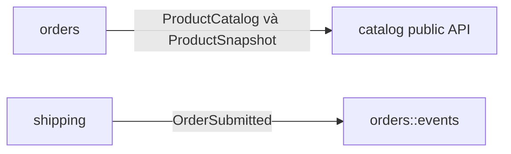
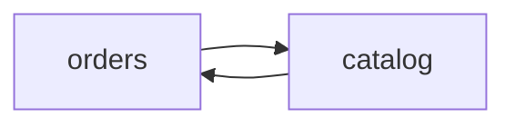
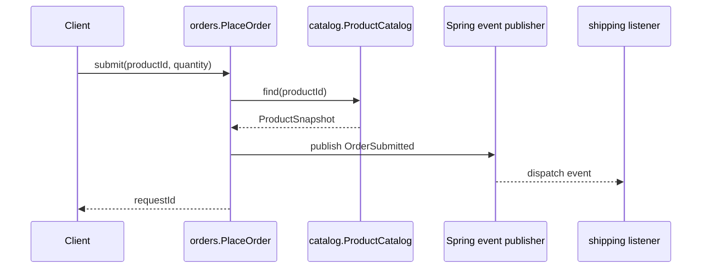
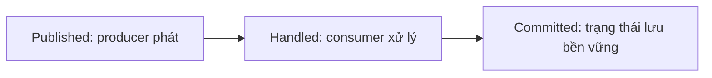
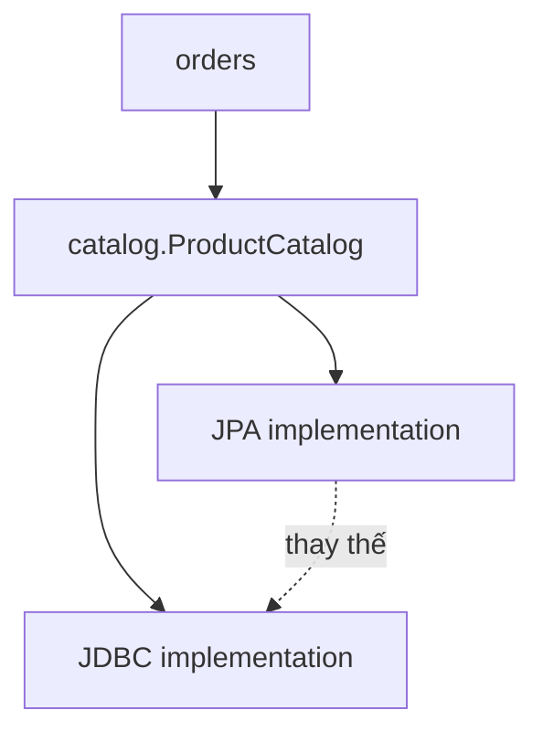
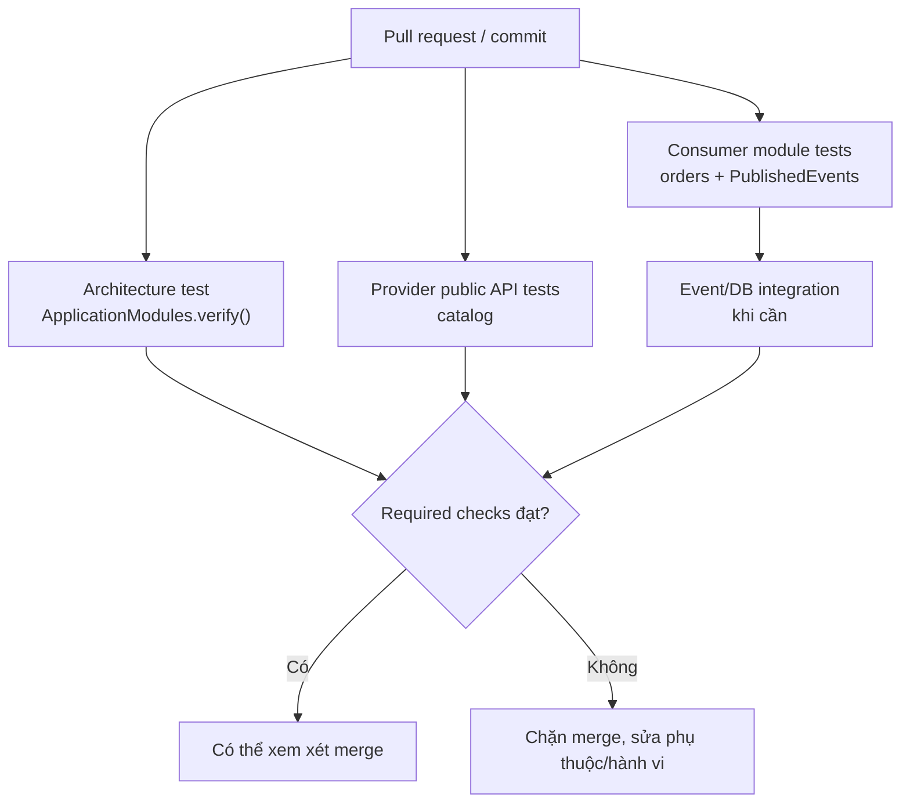

# Kiểm tra public API thay vì implementation package

Trong một ứng dụng Spring Boot phát triển theo Spring Modulith, việc class A gọi được class B chưa đủ để khẳng định hai module có quan hệ hợp lệ. Một type nằm trong `catalog.internal` có thể được khai báo `public` trong Java, Spring vẫn tạo bean của nó, thậm chí unit test vẫn chạy xanh. Nhưng điều đó **không biến type ấy thành public API của application module `catalog`**.

Thực hành **kiểm tra public API thay vì implementation package** giúp giữ ranh giới nghiệp vụ ổn định: các module khác chỉ nhìn thấy **hợp đồng được công bố**, không phụ thuộc trực tiếp vào repository, entity, adapter, listener hoặc cơ chế persistence của module đích. Spring Modulith hỗ trợ mô hình đó qua quy ước package, `@NamedInterface`, `@ApplicationModule(allowedDependencies = ...)` và `ApplicationModules.verify()`.

Bài thuộc chương **Module boundaries** của **SPRING_MODULITH_VERIFICATION_TESTING**. Bên cạnh cách kiểm chứng ranh giới kiến trúc, bài còn chỉ ra cách viết `@ApplicationModuleTest` dựa trên public API, kiểm thử sự kiện producer–consumer, dữ liệu/tích hợp và xây **CI quality gate** để ngăn dependency sai hoặc hồi quy khi refactor.

## 1. Mục tiêu học tập

Sau bài này, bạn có thể:

1. Phân biệt **Java `public`** với **public API của Spring Modulith application module**.
2. Xác định đâu là **implementation package** và vì sao module khác không nên import từ đó.
3. Thiết kế một API công khai hẹp, tránh để lộ JPA entity, repository và class implementation.
4. Công bố một package con có chủ đích qua `@NamedInterface` và giới hạn dependency bằng `allowedDependencies`.
5. Viết `ApplicationModules.of(...).verify()` để phát hiện truy cập implementation package, dependency không được phép và vòng module.
6. Viết `@ApplicationModuleTest` gọi **interface công khai** và thay collaborator ngoài module bằng mock phù hợp, thay vì mock implementation nội bộ của module khác.
7. Xác minh hợp đồng sự kiện ở hai phía mà không đánh đồng “đã publish”, “đã xử lý” và “đã commit”.
8. Thiết kế một bộ test hồi quy và checklist code review bảo vệ public API trong CI.

## 2. Câu trả lời cốt lõi: công khai ở tầng nào?

Một lời gọi từ module `orders` sang `catalog` chỉ hợp lệ khi xem xét đủ các tầng sau.

| Tầng | Câu hỏi cần hỏi | Ví dụ |
|---|---|---|
| **Java visibility** | Type có được Java cho phép sử dụng không? | `catalog.internal.JpaProductCatalog` khai báo `public` |
| **Module API visibility** | Type đó có thuộc phần API mà `catalog` công bố không? | `catalog.ProductCatalog` ở package gốc module |
| **Dependency policy** | `orders` có được phép phụ thuộc `catalog` hay giao diện con được chỉ định không? | `allowedDependencies = "catalog"` |
| **Module graph** | Cạnh mới có tạo vòng dependency hoặc phá một quy tắc kiến trúc không? | `orders → catalog → orders` |
| **Trách nhiệm nghiệp vụ** | Đây là hợp đồng nên chia sẻ hay là chi tiết cài đặt? | Gọi `ProductCatalog.find(...)` thay vì `ProductJpaRepository.findById(...)` |

Spring Modulith có thể tự động kiểm chứng nhiều quy tắc **cấu trúc**, đặc biệt việc dùng API nội bộ, các dependency bị cấm và vòng module. Tuy nhiên, nó **không tự suy ra toàn bộ ý nghĩa nghiệp vụ** của interface, tính tương thích mọi phiên bản sự kiện hay quyền sở hữu bảng database. Những điều này cần thiết kế và kiểm thử bổ sung.

Một quy tắc thực hành hữu ích:

> Module A nên phụ thuộc vào **hợp đồng mà B cam kết duy trì**, không phụ thuộc vào **cách B đang thực hiện hợp đồng ấy**.

## 3. Bài toán xuyên suốt: catalog, orders, shipping

Giả sử ứng dụng bán hàng có ba năng lực nghiệp vụ:

- `catalog` sở hữu danh mục sản phẩm và cung cấp thông tin tối thiểu cho use case đặt hàng.
- `orders` nhận yêu cầu, đọc **public API** của catalog, rồi publish một sự kiện.
- `shipping` quan sát sự kiện do orders công bố; nó không cần truy cập repository hay service nội bộ của orders.

Cấu trúc package đề xuất:

```text
com.acme.shop
├── ShopApplication.java
├── catalog
│   ├── ProductCatalog.java           # API công khai
│   ├── ProductSnapshot.java          # hợp đồng dữ liệu công khai
│   └── internal
│       ├── DemoProductCatalog.java   # implementation
│       ├── ProductEntity.java        # mô hình persistence (giả định)
│       └── ProductJpaRepository.java # persistence adapter (giả định)
├── orders
│   ├── package-info.java
│   ├── PlaceOrder.java               # API công khai
│   ├── events
│   │   ├── package-info.java         # named interface
│   │   └── OrderSubmitted.java
│   └── internal
│       ├── DefaultPlaceOrder.java    # implementation use case
│       └── OrderRepository.java      # persistence adapter (giả định)
└── shipping
    ├── package-info.java
    ├── ShippingStatus.java
    └── internal
        ├── ShippingProjection.java
        └── OnOrderSubmitted.java
```

Trong cách nhận diện module **mặc định** của Spring Modulith, các package con trực tiếp của `com.acme.shop` thường được nhận diện là ba application module. Dự án có tùy biến nhận diện module phải đối chiếu với mô hình thực tế mà `ApplicationModules` tạo ra.

### 3.1. Đồ thị type dependency mong muốn



Đọc mỗi mũi tên theo chiều **module dùng type → module sở hữu type**. Trong sơ đồ này:

- `orders` được phép dùng `catalog.ProductCatalog` và `catalog.ProductSnapshot`.
- `orders` không tham chiếu `catalog.internal.DemoProductCatalog` hoặc `ProductJpaRepository`.
- `shipping` phụ thuộc `orders::events`, không phụ thuộc `orders.internal.DefaultPlaceOrder`.
- `orders` không cần biết lớp listener của `shipping`.

### 3.2. Vì sao đây là một ranh giới có giá trị?

Nếu `catalog` thay từ JPA sang JDBC, hoặc đổi entity, index và cache, `orders` vẫn chỉ cần hợp đồng `ProductCatalog`. Trong trường hợp thay đổi triển khai **không làm thay đổi hành vi cam kết của API**, code orders có thể không phải sửa.

Nếu `orders` import trực tiếp `ProductJpaRepository`, mọi thay đổi storage của catalog có nguy cơ lan sang orders. Điều này tạo **implementation coupling**, làm giảm tính độc lập của application module.

Ví dụ dùng dữ liệu demo in-memory trong các đoạn code tiếp theo. Nó tập trung vào **kiểm chứng ranh giới**, không chứng minh tồn kho, giao dịch hoặc đơn hàng production đã được lưu bền vững.

## 4. Public API của application module không chỉ là modifier public

Theo mô hình Spring Modulith thông thường:

- Package gốc của module, như `catalog`, là **bề mặt API mặc định**.
- Các package con như `catalog.internal` được coi là **nội bộ**, nếu không được công bố có chủ đích bằng cơ chế phù hợp.
- `@NamedInterface` có thể chỉ định một tập type/package con là một giao diện công khai có tên.

Java vẫn áp dụng các quy tắc access riêng. Ví dụ một class package-private trong package gốc module không tự nhiên trở nên truy cập được từ code package khác. Ngược lại, một class `public` ở package `internal` không tự động thuộc API công khai của module.

### 4.1. Ba đoạn code dễ bị nhầm

**API công khai theo mô hình module:**

```java
package com.acme.shop.catalog;

public interface ProductCatalog {
    // Phần hợp đồng mà các module khác được phép sử dụng.
}
```

**Implementation nội bộ dù là Java public:**

```java
package com.acme.shop.catalog.internal;

public class LegacyProductService {
    // public về Java, nhưng vẫn là triển khai nội bộ của catalog.
}
```

**Implementation nội bộ được giấu mạnh hơn bằng package-private:**

```java
package com.acme.shop.catalog.internal;

class JpaProductCatalog {
    // Chỉ những type cùng package Java mới truy cập trực tiếp.
}
```

Khi có thể, package-private giúp Java compiler tăng thêm một lớp phòng vệ. Nhưng **không thể dựa duy nhất vào package-private**: một số implementation phải là `public` vì framework hoặc cấu trúc cài đặt. Spring Modulith architecture verification vẫn cần để kiểm tra quan hệ module.

### 4.2. Giao diện công khai là cam kết, không phải nơi chứa mọi thứ tiện dùng

Đưa mọi repository, entity, mapper hoặc service lên package gốc chỉ để `verify()` xanh là một dấu hiệu thiết kế yếu. Mỗi type công khai làm tăng những thứ module khác có thể phụ thuộc.

Hãy chỉ công bố những khả năng thực sự cần thiết:

| Nhu cầu bên ngoài | API nên cân nhắc | Không nên mặc định công bố |
|---|---|---|
| Kiểm tra sản phẩm có tồn tại | `ProductCatalog.find(...)` hoặc `exists(...)` | `ProductJpaRepository` |
| Lấy dữ liệu sản phẩm tối thiểu | `ProductSnapshot` hoặc value object phù hợp | `ProductEntity` JPA |
| Gửi yêu cầu đặt hàng | `PlaceOrder.submit(...)` | `DefaultPlaceOrder` implementation |
| Thông báo đã tiếp nhận yêu cầu | `OrderSubmitted` event contract | `OrderAggregate` nội bộ |
| Xem tình trạng giao hàng | `ShippingStatus.seen(...)` | `ShippingProjection` và schema lưu trữ |

**API hẹp không có nghĩa API càng ít method càng tốt bằng mọi giá**. Nó cần đủ rõ để thực hiện trách nhiệm nghiệp vụ nhưng không làm lộ cách cài đặt mà module sở hữu có thể thay đổi.

## 5. Thiết kế hợp đồng catalog theo nhu cầu của orders

File `catalog/ProductSnapshot.java`:

```java
package com.acme.shop.catalog;

import java.math.BigDecimal;
import java.util.UUID;

public record ProductSnapshot(
    UUID productId,
    boolean available,
    BigDecimal unitPrice
) {}
```

File `catalog/ProductCatalog.java`:

```java
package com.acme.shop.catalog;

import java.util.Optional;
import java.util.UUID;

public interface ProductCatalog {
    Optional<ProductSnapshot> find(UUID productId);
}
```

Đây là **hợp đồng truy vấn công khai**. Nó diễn đạt chính xác phần thông tin mà orders cần: ID, trạng thái có thể sử dụng và đơn giá. Nó không tiết lộ product entity có quan hệ JPA nào, bảng nào hay cơ chế cache nào.

### 5.1. Vì sao trả ProductSnapshot thay vì ProductEntity?

Giả sử `ProductEntity` có các trường mang tính triển khai như:

- ID khóa chính và version để optimistic locking;
- mapping quan hệ tới category và supplier;
- trạng thái lưu trữ hoặc soft-delete;
- Hibernate annotations và lazy-loading collections.

Nếu API công khai trả thẳng entity, consumer có thể vô tình phụ thuộc vào persistence model của catalog. Thay đổi database sau này sẽ trở nên khó vì type đó đã bị các module khác sử dụng.

`ProductSnapshot` là một kiểu dữ liệu **được chủ sở hữu API cam kết**, có thể được tạo từ entity, từ cache hay từ dịch vụ ngoài. Tuy nhiên, record này vẫn là contract, nên thay đổi trường hoặc ý nghĩa của nó phải được xem xét như một thay đổi API thực sự.

### 5.2. Một implementation demo được giữ trong catalog.internal

Ví dụ minh họa cố ý dùng một ID sản phẩm cố định để không cần database:

```java
package com.acme.shop.catalog.internal;

import com.acme.shop.catalog.ProductCatalog;
import com.acme.shop.catalog.ProductSnapshot;
import java.math.BigDecimal;
import java.util.Optional;
import java.util.UUID;
import org.springframework.stereotype.Component;

@Component
class DemoProductCatalog implements ProductCatalog {

    private static final UUID DEMO_ID = UUID.fromString(
        "00000000-0000-0000-0000-000000000001"
    );

    @Override
    public Optional<ProductSnapshot> find(UUID productId) {
        if (!DEMO_ID.equals(productId)) {
            return Optional.empty();
        }

        return Optional.of(new ProductSnapshot(
            DEMO_ID,
            true,
            new BigDecimal("12.50")
        ));
    }
}
```

Module `orders` **không cần import** `DemoProductCatalog`. Nó chỉ biết `ProductCatalog`. Nếu catalog chuyển sang adapter JPA, phía orders không đổi vì contract không đổi.

Implementation này chỉ phục vụ ví dụ: một ứng dụng thật phải tự xác định sản phẩm, trạng thái bán, giá và thời điểm dữ liệu còn hiệu lực; đọc snapshot **không tương đương giữ hàng hoặc khóa giá**.

## 6. Định nghĩa API công khai của orders

Để consumer của use case không cần biết class triển khai, `orders` cũng công bố một interface hẹp.

File `orders/PlaceOrder.java`:

```java
package com.acme.shop.orders;

import java.util.UUID;

public interface PlaceOrder {
    UUID submit(UUID productId, int quantity);
}
```

File `orders/events/OrderSubmitted.java`:

```java
package com.acme.shop.orders.events;

import java.math.BigDecimal;
import java.util.UUID;

public record OrderSubmitted(
    UUID requestId,
    UUID productId,
    int quantity,
    BigDecimal total
) {}
```

Việc trả `UUID` ở đây chỉ biểu diễn mã yêu cầu được chấp nhận theo use case demo. Trong ví dụ chưa có đơn hàng được lưu; do đó event `OrderSubmitted` mang ý nghĩa **yêu cầu đã vượt qua kiểm tra tối thiểu và được publish**, không có nghĩa một đơn hàng đã commit vào database.

### 6.1. Orders được phép phụ thuộc catalog

Tại `orders/package-info.java`:

```java
@org.springframework.modulith.ApplicationModule(
    allowedDependencies = "catalog"
)
package com.acme.shop.orders;
```

`allowedDependencies` giới hạn **chiều phụ thuộc được phép từ orders** tới application module khác. Một type thuộc public API của catalog có thể được orders dùng; implementation nội bộ vẫn không trở thành công khai.

### 6.2. Đăng ký named interface cho event contract

Tại `orders/events/package-info.java`:

```java
@org.springframework.modulith.NamedInterface("events")
package com.acme.shop.orders.events;
```

Giao diện `orders::events` cho phép các module khác tiêu thụ event contract mà không truy cập phần triển khai nội bộ của orders.

Tại `shipping/package-info.java`:

```java
@org.springframework.modulith.ApplicationModule(
    allowedDependencies = "orders::events"
)
package com.acme.shop.shipping;
```

Shipping chỉ được phép tham chiếu phần giao diện `events` của orders trong thiết kế này; nó không được gọi `orders.internal.DefaultPlaceOrder` hay `orders.internal.OrderRepository`.

## 7. Implementation đúng: phụ thuộc vào interface thay vì implementation

File `orders/internal/DefaultPlaceOrder.java`:

```java
package com.acme.shop.orders.internal;

import com.acme.shop.catalog.ProductCatalog;
import com.acme.shop.catalog.ProductSnapshot;
import com.acme.shop.orders.PlaceOrder;
import com.acme.shop.orders.events.OrderSubmitted;
import java.math.BigDecimal;
import java.util.UUID;
import org.springframework.context.ApplicationEventPublisher;
import org.springframework.stereotype.Service;

@Service
class DefaultPlaceOrder implements PlaceOrder {

    private final ProductCatalog catalog;
    private final ApplicationEventPublisher events;

    DefaultPlaceOrder(
            ProductCatalog catalog,
            ApplicationEventPublisher events) {
        this.catalog = catalog;
        this.events = events;
    }

    @Override
    public UUID submit(UUID productId, int quantity) {
        if (productId == null || quantity <= 0) {
            throw new IllegalArgumentException("Invalid order input");
        }

        ProductSnapshot product = catalog.find(productId)
            .orElseThrow(() ->
                new IllegalArgumentException("Unknown product")
            );

        if (!product.available()) {
            throw new IllegalStateException("Product unavailable");
        }

        if (product.unitPrice() == null
                || product.unitPrice().signum() <= 0) {
            throw new IllegalStateException("Invalid product price");
        }

        BigDecimal total = product.unitPrice()
            .multiply(BigDecimal.valueOf(quantity));

        UUID requestId = UUID.randomUUID();

        events.publishEvent(new OrderSubmitted(
            requestId, productId, quantity, total
        ));

        return requestId;
    }
}
```

Những quan hệ quan trọng trong đoạn mã:

- `DefaultPlaceOrder` là implementation thuộc `orders.internal` và implement **public API `PlaceOrder` của chính orders**.
- `DefaultPlaceOrder` gọi `catalog.ProductCatalog`, không dùng `catalog.internal.DemoProductCatalog`.
- `ProductSnapshot` là hợp đồng data thuộc public API của catalog, không phải entity persistence.
- `OrderSubmitted` nằm trong package con được orders công bố để consumer khác sử dụng; việc orders dùng event type của chính mình không tạo dependency xuyên module.
- `ApplicationEventPublisher` là API của Spring Framework; việc publish event không tạo type dependency từ orders tới shipping.

Cấu trúc này cho phép kiểm tra **hành vi của orders qua `PlaceOrder`**, thay vì bắt test hoặc module khác biết `DefaultPlaceOrder` là class cụ thể nào.

## 8. Trường hợp sai: dùng implementation package của module khác

Giả sử developer có một repository nội bộ của catalog, `public` ở cấp Java để tiện triển khai:

```java
package com.acme.shop.catalog.internal;

import java.util.UUID;

// Ví dụ minh họa về type nội bộ có Java visibility public.
public interface ProductJpaRepository {
    boolean existsById(UUID productId);
}
```

Một service mới trong orders làm như sau:

```java
package com.acme.shop.orders.internal;

import com.acme.shop.catalog.internal.ProductJpaRepository;

// MÃ CỐ TÌNH VI PHẠM RANH GIỚI MODULE.
class BadOrderValidation {

    private final ProductJpaRepository repository;

    BadOrderValidation(ProductJpaRepository repository) {
        this.repository = repository;
    }

    boolean productExists(java.util.UUID productId) {
        return repository.existsById(productId);
    }
}
```

Nếu `ProductJpaRepository` là Java `public` và sẵn có trên classpath, đoạn code có thể biên dịch. Spring có thể tạo bean và inject repository nếu cấu hình phù hợp. Một unit test mock repository còn có thể trả `true` và đạt.

**Nhưng module orders đang phụ thuộc vào type thuộc `catalog.internal`.** Việc đó trái ranh giới API của catalog, dù `orders` có `allowedDependencies = "catalog"`.

### 8.1. Vì sao allowedDependencies = "catalog" không cứu được?

Hai quy tắc độc lập:

1. Orders có được tạo cạnh dependency tới **module catalog** không? — Có.
2. Orders có được dùng **mọi type trong catalog**, kể cả package nội bộ không? — Không.

Chỉ thỏa điều kiện thứ nhất là chưa đủ. `ApplicationModules.verify()` phải phát hiện những tham chiếu vào API nội bộ trong mô hình được phân tích.

### 8.2. Chữa lỗi theo hợp đồng, không theo visibility

Cách sửa ưu tiên:

- Sử dụng `ProductCatalog.find(...)` hoặc thiết kế API công khai đáp ứng use case thật.
- Giữ repository và entity bên trong catalog.
- Không chuyển `ProductJpaRepository` ra package gốc chỉ để hết cảnh báo.
- Không thêm `@NamedInterface("internal")` vào implementation package như một giải pháp chữa cháy.
- Cập nhật test để kiểm tra **hợp đồng công khai**.

Một thay đổi chỉ làm `verify()` xanh nhưng phơi bày chi tiết lưu trữ ra công khai có thể khiến kiến trúc khó bảo trì hơn về lâu dài.

## 9. Type nằm ở public API vẫn có thể bị dùng sai theo policy

Có một lỗi khác không liên quan đến `internal`: sử dụng **API thật sự công khai** nhưng trái chính sách dependency của module nguồn.

Giả sử `shipping` muốn gọi `catalog.ProductCatalog`. Type này được công bố, nhưng shipping chỉ được phép phụ thuộc `orders::events`.

```java
package com.acme.shop.shipping.internal;

import com.acme.shop.catalog.ProductCatalog;

// Fragment cố tình tạo dependency trái policy của shipping.
class DirectCatalogQuery {

    private final ProductCatalog products;

    DirectCatalogQuery(ProductCatalog products) {
        this.products = products;
    }
}
```

Đây là cạnh `shipping → catalog`. API đích hợp lệ về visibility, nhưng **policy của shipping không cho phép cạnh đó**.

| Tình huống | API đích công khai? | Chiều dependency được phép? | Kết luận |
|---|---|---|---|
| Orders dùng `catalog.ProductCatalog` | Có | Có | Hợp lệ theo ví dụ |
| Orders dùng `catalog.internal.ProductJpaRepository` | Không | Được phép phụ thuộc catalog nói chung | Vẫn bị cấm |
| Shipping dùng `orders.events.OrderSubmitted` | Có, qua `orders::events` | Có | Hợp lệ theo ví dụ |
| Shipping dùng `catalog.ProductCatalog` | Có | Không | Bị cấm theo policy |
| Shipping dùng `orders.internal.DefaultPlaceOrder` | Không | Chỉ được dùng `orders::events` | Bị cấm ở cả hai lớp |
| Orders gọi `shipping.ShippingStatus` | Public nếu ở package gốc | Không | Bị cấm và có thể tạo vòng |

**Kết luận:** “public API” và “được phép phụ thuộc” là **hai điều kiện cần xét cùng nhau**.

## 10. Named interface: khi public API cần nằm trong package con

Một số nhóm muốn tách public contract ra khỏi package gốc thành:

```text
catalog
├── api
│   ├── package-info.java
│   ├── ProductCatalog.java
│   └── ProductSnapshot.java
└── internal
    ├── JpaProductCatalog.java
    └── ProductJpaRepository.java
```

Đây là **phương án thiết kế thay thế** ví dụ đã dùng `catalog.ProductCatalog` ở package gốc, không phải hai cấu trúc cần tồn tại đồng thời. Nếu chuyển API sang package con `catalog.api`, cần công bố có chủ đích:

File `catalog/api/package-info.java`:

```java
@org.springframework.modulith.NamedInterface("api")
package com.acme.shop.catalog.api;
```

Nếu module orders chỉ cần giao diện này, khai báo:

```java
@org.springframework.modulith.ApplicationModule(
    allowedDependencies = "catalog::api"
)
package com.acme.shop.orders;
```

Và code orders import `com.acme.shop.catalog.api.ProductCatalog`, thay vì import `catalog.internal.*`.

### 10.1. Sự khác nhau giữa ba ký hiệu

| Ký hiệu | Ý nghĩa |
|---|---|
| `catalog` | Module đích theo tên, với API công khai được phép dùng theo policy |
| `catalog::api` | Named interface `api` được công bố bởi catalog |
| `catalog.internal` | Package con theo Java, **không mặc nhiên là API công khai** |

`::` là cú pháp tham chiếu **named interface** trong metadata Spring Modulith; dấu chấm trong package Java không làm một package tự trở thành named interface.

### 10.2. Named interface không phải cách mở mọi implementation

Công bố `catalog::api` hữu ích khi muốn public contract nằm gọn trong một package riêng. Nhưng nếu đặt `@NamedInterface("api")` vào chính package chứa repository/entity implementation, nhóm sẽ mở rộng bề mặt phụ thuộc ngoài chủ đích.

Hãy công bố **hợp đồng nghiệp vụ**, không phải một gói “mở cửa kỹ thuật”.

### 10.3. Không tạo dependency vòng dù các interface đều công khai

Nếu catalog bắt đầu dùng `orders.PlaceOrder` trong khi orders đang dùng `catalog.ProductCatalog`, đồ thị có vòng:



Việc cả hai đầu đều là public API không làm vòng thành hợp lệ. Kiểm chứng kiến trúc và đánh giá trách nhiệm nghiệp vụ vẫn cần thiết.

## 11. Architecture verification: bắt lỗi internal access ngay trong JUnit

Tại package gốc `com.acme.shop`, tạo:

```java
package com.acme.shop;

import org.junit.jupiter.api.Test;
import org.springframework.modulith.core.ApplicationModules;

class PublicApiBoundaryTests {

    @Test
    void verifiesModuleApisAndDependencies() {
        ApplicationModules.of(ShopApplication.class).verify();
    }
}
```

`ApplicationModules.of(ShopApplication.class)` dựng mô hình module; `verify()` kiểm chứng các quy tắc Spring Modulith hỗ trợ, thường gồm:

- Không có vòng dependency giữa application module.
- Không dùng type thuộc **phần nội bộ** của module khác.
- Không vi phạm `@ApplicationModule(allowedDependencies = ...)`.

### 11.1. Điều cần có để phép kiểm chứng đáng tin

Một test xanh cần đi cùng sự xác nhận **đúng phạm vi module được nhận diện**. Với ví dụ của bài:

```java
package com.acme.shop;

import static org.assertj.core.api.Assertions.assertThat;

import org.junit.jupiter.api.Test;
import org.springframework.modulith.core.ApplicationModules;

class ModuleDiscoveryTests {

    @Test
    void findsBusinessModules() {
        ApplicationModules modules =
            ApplicationModules.of(ShopApplication.class);

        assertThat(modules.getModuleByName("catalog")).isPresent();
        assertThat(modules.getModuleByName("orders")).isPresent();
        assertThat(modules.getModuleByName("shipping")).isPresent();
    }
}
```

Nếu dự án dùng tên hoặc cơ chế nhận diện module tùy biến, test phải phản ánh cấu hình thực tế. Một kết quả `verify()` xanh trên mô hình không chứa package cần bảo vệ có thể tạo cảm giác an toàn giả.

### 11.2. Thử vi phạm để chứng minh architecture test sẽ đỏ

Trong nhánh thử nghiệm, tạo một tham chiếu type thật từ orders đến `catalog.internal.ProductJpaRepository`:

```java
// Fragment cố tình sai, chỉ dùng trong nhánh thử nghiệm.
private final com.acme.shop.catalog.internal
    .ProductJpaRepository repository;
```

Chỉ thêm `import` không sử dụng có thể không tạo một dependency đáng kể trong bytecode. Hãy để type thực sự được tham chiếu trong field, constructor parameter hoặc signature và đảm bảo code vẫn biên dịch về mặt Java.

Kỳ vọng:

1. Java compile không nhất thiết báo lỗi vì type là `public`.
2. Architecture test báo vi phạm ranh giới module.
3. Sửa code dùng `ProductCatalog` công khai.
4. Chạy lại và xác nhận architecture test đạt.

Không commit vi phạm cố ý lên nhánh chính. Nếu test không báo đỏ, phải kiểm tra rule đang được chạy, cách nhận diện module và việc type reference đã được phân tích.

### 11.3. Những điều verify() không thay thế

`verify()` **không** tự chứng minh:

- Giá, số lượng hoặc trạng thái nghiệp vụ đúng.
- Bean Spring thực sự được inject trong mọi profile.
- Event đã được consumer xử lý.
- Dữ liệu database đã commit hoặc transaction đã rollback đúng.
- Mọi liên kết động qua reflection, SQL, URL, tên class dạng chuỗi đều tuân thủ ownership.
- Public API không có thay đổi ngữ nghĩa gây hỏng consumer mà vẫn giữ cùng type.

Vì vậy kiến trúc test cần đi cùng module test và integration test, không thay thế chúng.

## 12. Test hành vi qua interface công khai, không qua implementation

Sau khi architecture test kiểm tra quyền phụ thuộc, ta cần kiểm tra hành vi của `orders`. Với `@ApplicationModuleTest`, bài test nên dùng **`PlaceOrder`**, không dùng `DefaultPlaceOrder`:

```java
package com.acme.shop.orders;

import static org.assertj.core.api.Assertions.assertThat;
import static org.assertj.core.api.Assertions.assertThatThrownBy;
import static org.mockito.Mockito.verify;
import static org.mockito.Mockito.verifyNoInteractions;
import static org.mockito.Mockito.when;

import com.acme.shop.catalog.ProductCatalog;
import com.acme.shop.catalog.ProductSnapshot;
import com.acme.shop.orders.events.OrderSubmitted;
import java.math.BigDecimal;
import java.util.Optional;
import java.util.UUID;
import org.junit.jupiter.api.Test;
import org.springframework.beans.factory.annotation.Autowired;
import org.springframework.modulith.test.ApplicationModuleTest;
import org.springframework.modulith.test.PublishedEvents;
import org.springframework.test.context.bean.override.mockito.MockitoBean;

@ApplicationModuleTest
class OrdersPublicApiTests {

    @Autowired PlaceOrder orders;

    @MockitoBean ProductCatalog products;

    @Test
    void publishesEventThroughPublicUseCase(
            PublishedEvents events) {

        UUID productId = UUID.randomUUID();

        when(products.find(productId)).thenReturn(
            Optional.of(new ProductSnapshot(
                productId, true, new BigDecimal("12.50")
            ))
        );

        UUID requestId = orders.submit(productId, 2);

        assertThat(events.ofType(OrderSubmitted.class))
            .singleElement()
            .satisfies(event -> {
                assertThat(event.requestId()).isEqualTo(requestId);
                assertThat(event.productId()).isEqualTo(productId);
                assertThat(event.quantity()).isEqualTo(2);
                assertThat(event.total())
                    .isEqualByComparingTo(new BigDecimal("25.00"));
            });

        verify(products).find(productId);
    }

    @Test
    void rejectsMissingProductWithoutEvent(
            PublishedEvents events) {

        UUID productId = UUID.randomUUID();
        when(products.find(productId)).thenReturn(Optional.empty());

        assertThatThrownBy(() -> orders.submit(productId, 2))
            .isInstanceOf(IllegalArgumentException.class)
            .hasMessage("Unknown product");

        assertThat(events.ofType(OrderSubmitted.class)).isEmpty();
    }

    @Test
    void rejectsInvalidInputBeforeCallingCatalog(
            PublishedEvents events) {

        assertThatThrownBy(() ->
            orders.submit(UUID.randomUUID(), 0)
        ).isInstanceOf(IllegalArgumentException.class)
         .hasMessage("Invalid order input");

        verifyNoInteractions(products);
        assertThat(events.ofType(OrderSubmitted.class)).isEmpty();
    }
}
```

Ở đây:

- `@Autowired PlaceOrder orders` chỉ phụ thuộc **public API của module đang được test**.
- `@MockitoBean ProductCatalog products` thay thế **collaborator công khai của module catalog**, không mock class `catalog.internal`.
- Các bean nội bộ như `DefaultPlaceOrder` vẫn được Spring tạo trong phạm vi module và cung cấp qua interface.
- `PublishedEvents` quan sát event được publish thật trong Spring TestContext.
- Test có assertion về **payload, kết quả và ca lỗi**, không chỉ kiểm tra bean tồn tại.

### 12.1. Lưu ý phiên bản Spring

`@MockitoBean` thuộc `org.springframework.test.context.bean.override.mockito` trong các phiên bản Spring Framework hỗ trợ cơ chế này (từ 6.2). Dự án Spring Boot đời cũ có thể dùng `@MockBean` của Spring Boot Test.

Chọn annotation theo dependency management của dự án; **không đặt đồng thời `@MockitoBean` và `@MockBean`** cho cùng type chỉ để sửa lỗi import. Bài này minh họa cú pháp của môi trường có `@MockitoBean`.

### 12.2. Vì sao không @Autowired implementation?

Một test inject:

```java
// Không nên xem đây là test public contract:
@Autowired DefaultPlaceOrder implementation;
```

sẽ gắn vào class triển khai cụ thể. Nếu class đó đổi tên, được thay bằng decorator hoặc adapter khác nhưng **hợp đồng `PlaceOrder` không đổi**, test có thể phải sửa không cần thiết.

Đối với **contract test qua ranh giới**, hãy gọi API mà consumer được phép sử dụng. Test của phần implementation nội bộ vẫn có chỗ đứng, nhưng phải được đặt tên và giới hạn phạm vi đúng: đó là **implementation test**, không phải bằng chứng rằng public API ổn định.

### 12.3. Test dùng mock không chứng minh catalog hoạt động đúng

`OrdersPublicApiTests` có thể xanh dù adapter JPA thật của catalog bị lỗi SQL hoặc thiếu migration, vì catalog đã được mock. Kết luận đúng là:

> Với phản hồi catalog được giả lập, use case công khai của orders xử lý input và publish event đúng theo những assertion đã chạy.

Để kết luận catalog implementation đúng, cần catalog module/integration test riêng.

## 13. Test module catalog qua public API của chính nó

Một module sở hữu implementation có quyền kiểm thử chi tiết nội bộ, nhưng vẫn nên có ít nhất các bài test kiểm tra **hành vi theo contract công khai**.

Ví dụ đặt test trong package `com.acme.shop.catalog`:

```java
package com.acme.shop.catalog;

import static org.assertj.core.api.Assertions.assertThat;

import java.math.BigDecimal;
import java.util.UUID;
import org.junit.jupiter.api.Test;
import org.springframework.beans.factory.annotation.Autowired;
import org.springframework.modulith.test.ApplicationModuleTest;

@ApplicationModuleTest
class CatalogPublicApiTests {

    private static final UUID DEMO_ID = UUID.fromString(
        "00000000-0000-0000-0000-000000000001"
    );

    @Autowired ProductCatalog products;

    @Test
    void exposesProductThroughContract() {
        ProductSnapshot snapshot = products.find(DEMO_ID)
            .orElseThrow();

        assertThat(snapshot.productId()).isEqualTo(DEMO_ID);
        assertThat(snapshot.available()).isTrue();
        assertThat(snapshot.unitPrice())
            .isEqualByComparingTo(new BigDecimal("12.50"));
    }

    @Test
    void returnsEmptyForUnknownProduct() {
        assertThat(products.find(UUID.randomUUID())).isEmpty();
    }
}
```

Test này sử dụng `DemoProductCatalog` in-memory như mục 5, nên bằng chứng chỉ dành cho implementation demo đó. Nếu triển khai catalog thật dùng PostgreSQL, phải thay bằng hoặc bổ sung **database integration test** phản ánh schema và adapter thực tế.

Điểm chính: **test consumer không biết implementation; test của module sở hữu có thể biết nhưng vẫn nên kiểm tra contract public mà consumer phụ thuộc**.

### 13.1. Hai bộ test giữ hai trách nhiệm khác nhau

| Bộ test | Ai sở hữu? | Điều kiểm tra |
|---|---|---|
| `CatalogPublicApiTests` | catalog | Contract `ProductCatalog` được implementation của catalog thực hiện |
| `OrdersPublicApiTests` | orders | Use case orders xử lý phản hồi của `ProductCatalog` đúng |
| `PublicApiBoundaryTests` | toàn ứng dụng | Orders không truy cập catalog internal hoặc tạo dependency sai |
| Integration test orders + catalog | phạm vi phối hợp | Bean thật của hai module kết nối và hoạt động cùng nhau |

Không một bộ nào tự thay thế hoàn toàn bộ còn lại.

## 14. DIRECT_DEPENDENCIES: kiểm tra hai module phối hợp qua public API thật

Khi cần chứng minh `orders` khởi tạo được với bean `ProductCatalog` thật, có thể mở rộng `@ApplicationModuleTest`:

```java
package com.acme.shop.orders;

import static org.assertj.core.api.Assertions.assertThat;

import com.acme.shop.orders.events.OrderSubmitted;
import java.util.UUID;
import org.junit.jupiter.api.Test;
import org.springframework.beans.factory.annotation.Autowired;
import org.springframework.modulith.test.ApplicationModuleTest;
import org.springframework.modulith.test.ApplicationModuleTest.BootstrapMode;
import org.springframework.modulith.test.PublishedEvents;

@ApplicationModuleTest(
    mode = BootstrapMode.DIRECT_DEPENDENCIES
)
class OrdersCatalogCollaborationTests {

    @Autowired PlaceOrder orders;

    @Test
    void usesCatalogBeanThroughPublicApi(PublishedEvents events) {
        UUID productId = UUID.fromString(
            "00000000-0000-0000-0000-000000000001"
        );

        UUID requestId = orders.submit(productId, 2);

        assertThat(events.ofType(OrderSubmitted.class))
            .singleElement()
            .satisfies(event -> {
                assertThat(event.requestId()).isEqualTo(requestId);
                assertThat(event.total())
                    .isEqualByComparingTo("25.00");
            });
    }
}
```

Với `@ApplicationModuleTest(mode = DIRECT_DEPENDENCIES)`, phạm vi module test bao gồm orders cùng những **module mà orders phụ thuộc trực tiếp**, ở đây là catalog.

Ví dụ giả định `DemoProductCatalog` được đăng ký thành bean và không có implementation khác gây ambiguous injection. Test sử dụng implementation demo thật trong context, **không chứng minh SQL của catalog**. Nếu adapter thật đòi DataSource, test sẽ cần hạ tầng tương ứng.

### 14.1. Ba chế độ bootstrap không phải ba cấp quyền kiến trúc

| Bootstrap mode | Phạm vi test | Điểm cần nhớ |
|---|---|---|
| `STANDALONE` | Module đang test | Có thể mock/fake API module ngoài |
| `DIRECT_DEPENDENCIES` | Module và các module phụ thuộc trực tiếp | Có thể chạy bean thật của module dependency |
| `ALL_DEPENDENCIES` | Module và phụ thuộc bắc cầu | Không có nghĩa mọi consumer sẽ được nạp |
 
Một dependency vào `catalog.internal` vẫn sai cho dù `DIRECT_DEPENDENCIES` hoặc `ALL_DEPENDENCIES` có giúp Spring tìm được bean của catalog. **Phạm vi runtime test không thay quyền truy cập kiến trúc**.

### 14.2. Không dùng ALL_DEPENDENCIES để sửa một kiến trúc sai

Giả sử catalog phụ thuộc ngược orders, tạo vòng; việc mở test context hơn không phá được vòng. Phải refactor trách nhiệm, thay đổi chiều phối hợp hoặc đặt hợp đồng ở vị trí hợp lý, rồi xác minh lại bằng `ApplicationModules.verify()`.

## 15. Event contract cũng là một loại public API

Một module không chỉ công bố interface Java đồng bộ. Event contract là một phần **giao diện được consumer sử dụng**.

Ở ví dụ:

- Orders publish `OrderSubmitted`.
- Shipping dùng type `orders.events.OrderSubmitted`.
- `@NamedInterface("events")` làm package con ấy trở thành API được công bố.
- `allowedDependencies = "orders::events"` giới hạn shipping chỉ dùng phần contract đó.

Sơ đồ runtime:



Trong đó dependency về type của shipping đi **từ shipping tới orders::events**, không phải chiều giao tiếp runtime ngược lại.

### 15.1. Consumer chỉ cần event contract, không cần implementation của producer

Shipping có thể triển khai một projection in-memory để kiểm thử độc lập:

File `shipping/ShippingStatus.java`:

```java
package com.acme.shop.shipping;

import java.util.UUID;

public interface ShippingStatus {
    boolean seen(UUID requestId);
}
```

File `shipping/internal/ShippingProjection.java`:

```java
package com.acme.shop.shipping.internal;

import com.acme.shop.shipping.ShippingStatus;
import java.util.Set;
import java.util.UUID;
import java.util.concurrent.ConcurrentHashMap;
import org.springframework.stereotype.Component;

@Component
class ShippingProjection implements ShippingStatus {

    private final Set<UUID> seenIds =
        ConcurrentHashMap.newKeySet();

    void record(UUID requestId) {
        seenIds.add(requestId);
    }

    @Override
    public boolean seen(UUID requestId) {
        return seenIds.contains(requestId);
    }
}
```

File `shipping/internal/OnOrderSubmitted.java`:

```java
package com.acme.shop.shipping.internal;

import com.acme.shop.orders.events.OrderSubmitted;
import org.springframework.context.event.EventListener;
import org.springframework.stereotype.Component;

@Component
class OnOrderSubmitted {

    private final ShippingProjection projection;

    OnOrderSubmitted(ShippingProjection projection) {
        this.projection = projection;
    }

    @EventListener
    void on(OrderSubmitted event) {
        projection.record(event.requestId());
    }
}
```

Listener chỉ dùng event type thuộc named interface, không inject `DefaultPlaceOrder` hoặc `OrderRepository` của orders.

`ConcurrentHashMap.newKeySet()` chỉ tạo kết quả trong bộ nhớ JVM demo; nó không phải hệ thống shipment production hay bằng chứng idempotency bền vững sau restart.

### 15.2. Consumer module test qua event contract

```java
package com.acme.shop.shipping;

import static org.assertj.core.api.Assertions.assertThat;

import com.acme.shop.orders.events.OrderSubmitted;
import java.math.BigDecimal;
import java.util.UUID;
import org.junit.jupiter.api.Test;
import org.springframework.beans.factory.annotation.Autowired;
import org.springframework.context.ApplicationEventPublisher;
import org.springframework.modulith.test.ApplicationModuleTest;

@ApplicationModuleTest
class ShippingPublicContractTests {

    @Autowired ApplicationEventPublisher publisher;
    @Autowired ShippingStatus shipping;

    @Test
    void processesPublicEventContract() {
        UUID requestId = UUID.randomUUID();

        publisher.publishEvent(new OrderSubmitted(
            requestId,
            UUID.randomUUID(),
            2,
            new BigDecimal("25.00")
        ));

        assertThat(shipping.seen(requestId)).isTrue();
    }
}
```

Đây là bằng chứng consumer xử lý event được đưa vào trong context với `@EventListener` đồng bộ mặc định. Nó **không** chứng minh producer đã publish đúng trong production — phần đó được kiểm tra bởi `OrdersPublicApiTests`.

### 15.3. Published, handled và committed là ba câu hỏi khác nhau



- `PublishedEvents` giúp assert producer đã publish đúng type, số lần và payload.
- Consumer test chứng minh listener xử lý một input event cụ thể.
- Database/transaction integration test chứng minh dữ liệu cần thiết đã commit đúng.

Nếu listener được chuyển sang `@ApplicationModuleListener` hoặc `@TransactionalEventListener` sau commit, assertion ngay sau `publishEvent(...)` có thể không phù hợp. Lúc đó phải xác định producer transaction và chờ điều kiện trạng thái/event kết quả, có thể dùng `Scenario` của Spring Modulith Test.

## 16. Giữ public API ổn định qua thay đổi implementation

Giả sử catalog đổi adapter:



Mục tiêu thiết kế là consumer không buộc phải sửa import khi provider chuyển từ JPA sang JDBC. Nhưng chỉ giữ nguyên tên interface chưa đủ; **ngữ nghĩa** của contract cũng phải được bảo vệ.

Ví dụ câu hỏi cần ghi rõ:

- `find(id)` trả `Optional.empty()` khi không có sản phẩm hay khi sản phẩm bị ẩn?
- `available` biểu thị “đang được bán”, “còn tồn kho” hay “được phép đặt hàng”?
- `unitPrice` tính bằng loại tiền nào, đã bao gồm thuế/chiết khấu chưa?
- Dữ liệu giá có phải snapshot tại thời điểm request hay có thể thay đổi tức thì?
- Caller được phép cache kết quả bao lâu?
- Ngoại lệ hệ thống và timeout được xử lý thế nào?

Nếu thay đổi ý nghĩa từ “available = đang được bán” thành “available = còn trên một kho cụ thể” mà không cập nhật hợp đồng, test cấu trúc có thể vẫn xanh trong khi nghiệp vụ trở nên sai.

### 16.1. Hai lớp bảo vệ cần phối hợp

| Loại thay đổi | Architecture verification | Contract/behavior tests |
|---|---|---|
| Orders import repository nội bộ catalog | Phải báo lỗi nếu mô hình nhận diện đúng | Có thể vẫn xanh nếu mock |
| Catalog đổi JPA sang JDBC nhưng giữ API | Có thể vẫn đạt | Cần xác minh hành vi API vẫn đúng |
| `ProductSnapshot` đổi field/type | Compile và dependency có thể bị ảnh hưởng | Kiểm tra cả producer và consumer contract |
| `find(...)` thay đổi ngữ nghĩa mà type giữ nguyên | Không nhất thiết phát hiện | Behavior/contract test phải phát hiện |
| Shipping phụ thuộc API ngoài `orders::events` | `allowedDependencies` cần báo lỗi | Consumer test riêng chưa chắc phát hiện |
| Event được publish đúng nhưng listener lỗi | Không phát hiện runtime | Consumer/integration test phát hiện |

Một public API tốt cần **nội dung nghiệp vụ đủ chính xác** để team khác biết có thể dựa vào điều gì, không chỉ là một danh sách chữ ký Java.

## 17. Database ownership và implementation package

Spring Modulith tổ chức ranh giới module trong một modular monolith, nhưng không tự cấp database riêng cho từng module. Các module có thể chia sẻ `DataSource`, transaction manager hoặc schema.

Vì thế một module vẫn có thể truy cập dữ liệu module khác qua SQL động mà không tạo Java type reference rõ ràng. Ví dụ `orders` thực thi native SQL trên bảng do catalog sở hữu là một dạng coupling dữ liệu cần xem xét riêng; không nên mặc định `ApplicationModules.verify()` nhận diện hết.

### 17.1. Public API không phải quyền ghi vào mọi bảng của provider

Giả sử `ProductCatalog.find(...)` là API đọc. Nó **không** cho phép orders tự cập nhật giá hoặc số lượng tồn kho bằng SQL.

Các câu hỏi về data boundary cần được ghi rõ:

- Module nào sở hữu bảng và migration?
- API nào có quyền thay đổi trạng thái?
- Luồng nào yêu cầu transaction đồng bộ?
- Có cần khóa hoặc version để chống cập nhật cạnh tranh không?
- Sau khi module phát event, trạng thái đã commit chưa?
- Nếu consumer thất bại, hệ thống retry hoặc bù trừ thế nào?

### 17.2. Kiểm thử dữ liệu theo đúng rủi ro

| Rủi ro | Test phù hợp | Điều cần quan sát |
|---|---|---|
| Mapping entity/repository lỗi | Catalog database integration test | Dữ liệu lưu và đọc lại đúng |
| Migration thiếu cột/constraint | Test khởi tạo schema và CRUD | Schema đúng với code |
| Hai request tranh cùng tồn kho | Concurrency integration test | Không bán vượt tồn theo thiết kế |
| Event xử lý lại tạo shipment trùng | Consumer DB/idempotency test | Một tác dụng bền vững theo khóa nghiệp vụ |
| Producer commit nhưng consumer lỗi | Event/transaction integration test | Theo dõi publication, retry và trạng thái cuối |
| Orders đọc trực tiếp bảng catalog | Review ownership + kiểm tra bổ sung | Không có đường tắt bỏ qua contract |

**Testcontainers** có thể giúp dùng PostgreSQL/MySQL hoặc hạ tầng tương ứng cho integration test. Nhưng dùng container không tự chứng minh tính đúng nếu bài test chỉ khởi động database mà không assert transaction, constraint và kết quả nghiệp vụ.

### 17.3. Cẩn trọng transaction trong Spring Test

Một phương thức test có `@Transactional` thường chạy trong test transaction được rollback khi kết thúc. Listener chạy ở pha `AFTER_COMMIT` hoặc transaction riêng có thể có thời điểm quan sát khác.

Vì vậy muốn kết luận một event được xử lý và dữ liệu đã commit, phải thiết kế test đúng **ranh giới giao dịch**, chứ không chỉ kiểm tra entity còn trong persistence context chưa commit.

## 18. Khi public API chưa đủ tốt, làm gì thay vì import internal?

Một consumer có thể nói: “`ProductCatalog` hiện không cung cấp thông tin tôi cần, nên tôi phải gọi repository nội bộ”. Điều đó là dấu hiệu cần thiết kế lại hợp đồng, không phải lý do để phá ranh giới.

Quy trình ưu tiên:

1. **Xác định nhu cầu nghiệp vụ chính xác:** consumer cần trả lời câu hỏi gì?
2. **Xác định ownership:** dữ liệu/decision thuộc module nào?
3. **Thiết kế API hẹp tại provider:** trả về value object hoặc DTO có ý nghĩa, không lộ storage.
4. **Xem chiều phụ thuộc:** module nguồn được phép dùng API đó không?
5. **Kiểm tra vòng:** thêm cạnh hoặc API mới có tạo chu trình dependency không?
6. **Chọn đồng bộ hay event:** nếu consumer cần dữ liệu ngay, query API có thể hợp lý; nếu cần thông báo điều đã xảy ra, event có thể phù hợp.
7. **Viết test hợp đồng:** provider test trả đúng ý nghĩa, consumer test xử lý đúng dữ liệu; architecture test bảo vệ ranh giới.
8. **Gắn CI gate:** quy tắc mới phải được kiểm tra ở mỗi thay đổi.

Ví dụ nếu shipping cần biết trọng lượng đóng gói, có thể thiết kế một contract do module sở hữu dữ liệu cung cấp. Không tự nhiên biến `shipping` thành người đọc entity JPA của catalog.

### 18.1. Tránh tạo “public API” giả

Một interface như:

```java
public interface UniversalCatalogAccess {
    Object invoke(String operation, Object[] parameters);
}
```

có vẻ không lộ repository type, nhưng nó có thể tạo một cửa hậu: consumer phụ thuộc tên operation dạng chuỗi, khó kiểm tra compile-time và hợp đồng nghiệp vụ mơ hồ.

Một API công khai tốt nên **có kiểu dữ liệu và ngữ nghĩa rõ**, đủ hẹp để bảo vệ ownership và đủ ổn định để consumer sử dụng.

## 19. Ma trận bằng chứng: kiểm tra API thay vì implementation bằng gì?

| Hợp đồng/rủi ro | Phép kiểm chứng | Bằng chứng mong đợi | Giới hạn |
|---|---|---|---|
| Orders không import `catalog.internal.*` | `ApplicationModules.verify()` | Vi phạm internal bị báo đỏ | Không tự kiểm SQL/reflection |
| Orders chỉ phụ thuộc catalog | `allowedDependencies` + `verify()` | Cạnh ngoài whitelist bị báo đỏ | Phụ thuộc vào đúng mô hình module |
| Shipping chỉ dùng `orders::events` | Named interface + `verify()` | Không truy cập orders internal | Không chứng minh consumer runtime |
| Catalog thực hiện `ProductCatalog` đúng | Catalog module/contract test | Input/response theo hợp đồng | Demo in-memory không chứng minh DB |
| Orders dùng API catalog đúng | Orders module test + mock `ProductCatalog` | Validation, ID, event đúng | Catalog bean thật không chạy |
| Orders nối được bean catalog thật | `DIRECT_DEPENDENCIES` | Wiring và đường đi được assert | Phạm vi/hạ tầng test có thể hẹp |
| Shipping xử lý `OrderSubmitted` | Shipping module test | Projection/state đúng với event | Không chứng minh commit production |
| Database sau commit đúng | DB/transaction integration test | Trạng thái bền vững và constraint đúng | Cần môi trường phù hợp |
| Mỗi thay đổi được kiểm tra lại | CI required checks | Report gắn commit, không skip ngoài kế hoạch | Phụ thuộc cấu hình CI |

Bảng này mô tả **kế hoạch thu thập bằng chứng**, không phải kết quả đã chạy ở một dự án thật. Khi triển khai, hãy điền tên bài test, revision và báo cáo từ pipeline thực tế.

## 20. CI quality gate: bảo vệ public API qua từng pull request

Một pull request có thể đổi implementation và vô tình tạo import trực tiếp vào package nội bộ. Unit test vẫn có thể xanh vì logic được mock; architecture test cần báo đỏ.



Những điều cần thiết lập:

- Chạy architecture verification trên **commit cần merge**, không dựa vào lần xanh trước đó.
- Kiểm tra các module mong đợi được nhận diện, tránh kết quả xanh vì phạm vi thiếu.
- Chạy provider và consumer module tests với assertion về hợp đồng, không chỉ context load.
- Với thay đổi event/database/transaction quan trọng, chạy integration tests cần thiết và cấp hạ tầng phù hợp.
- Lưu JUnit XML/test report, số test chạy, thất bại và skip.
- Đánh dấu required checks để lỗi hoặc test bắt buộc bị bỏ qua không được coi là đã đạt.

Ví dụ các lệnh thông thường khi dự án có wrapper:

```bash
# Maven: các test thuộc phase test
./mvnw test

# Maven: các phase đến verify theo cấu hình plugin
./mvnw verify

# Gradle: task test được cấu hình
./gradlew test
```

Không mặc định mọi integration test đều chạy trong ba lệnh trên. Một số dự án tách Maven Failsafe hoặc Gradle `integrationTest` task; CI phải chạy đúng những phần mà nhóm quy định.

### 20.1. Kiểm tra hiệu lực gate bằng lỗi có chủ đích

Trên nhánh thử nghiệm:

1. Cho orders tham chiếu thực sự `catalog.internal.ProductJpaRepository`.
2. Xác minh architecture test báo đỏ, dù module test orders có thể vẫn xanh.
3. Khôi phục dependency công khai `ProductCatalog`.
4. Sửa producer để publish sai `quantity` hoặc `total`.
5. Xác minh `OrdersPublicApiTests` báo đỏ ở assertion event.
6. Khôi phục code và xác nhận cả kiến trúc lẫn hành vi đều đạt.

Bộ test cần chứng minh **lỗi nào sẽ bị nhóm test nào phát hiện**. Điều này quan trọng hơn một con số test count lớn nhưng không có sự liên kết với rủi ro.

## 21. Checklist code review: dùng public API đúng chưa?

Khi review một thay đổi trong application module, hãy hỏi:

- Type được import thuộc **module nào**?
- Nó ở package gốc module, named interface được công bố hay implementation package?
- Type có `public` chỉ ở mức Java hay thật sự là phần public module API?
- Module nguồn có `allowedDependencies` nào? Quan hệ mới có nằm trong tập được phép không?
- Cạnh mới có tạo module dependency cycle không?
- Public API có làm lộ JPA entity, repository, adapter hoặc cấu trúc lưu trữ không?
- Consumer có đang gọi **contract** hay đang phụ thuộc class implementation cụ thể?
- Bài test có inject **public interface** thay vì `internal.Default...` không?
- Nếu mock collaborator ngoài module, test có được diễn giải đúng phạm vi không?
- Nếu API data/event đổi, provider và consumer tests nào sẽ phát hiện hồi quy?
- `ApplicationModules.verify()` có chạy trong CI trên commit hiện tại không?
- Có SQL hoặc liên kết động vượt ranh giới mà architecture verification không nhìn thấy không?

Nếu một câu trả lời chưa rõ, nên ghi lại giới hạn của kiểm chứng hoặc bổ sung test trước khi coi thay đổi là an toàn.

## 22. Bài tập thực hành: chặn truy cập implementation package

**Bối cảnh:** xây ứng dụng Spring Boot với ba module `catalog`, `orders`, `shipping`. Mục tiêu là chứng minh rằng chỉ **hợp đồng công khai** được tiêu thụ xuyên module; implementation có thể thay đổi nhưng public behavior vẫn giữ.

### Vòng A — Tạo public API

1. Đặt `ShopApplication` ở `com.acme.shop`.
2. Tạo `catalog.ProductCatalog` và `catalog.ProductSnapshot`.
3. Tạo `catalog.internal.DemoProductCatalog` làm implementation demo.
4. Tạo `orders.PlaceOrder` và `orders.internal.DefaultPlaceOrder`.
5. Tạo `orders::events` với `OrderSubmitted` và `@NamedInterface("events")`.
6. Cho `orders` chỉ phụ thuộc `catalog`; `shipping` chỉ phụ thuộc `orders::events`.
7. Vẽ graph và giải thích chiều từng cạnh.

### Vòng B — Kiểm chứng kiến trúc

1. Viết `PublicApiBoundaryTests` gọi `ApplicationModules.of(ShopApplication.class).verify()`.
2. Viết `ModuleDiscoveryTests` xác nhận ba module mong đợi được nhận diện.
3. Tạo một type `public` trong `catalog.internal` và tham chiếu nó trong field/constructor của orders.
4. Chạy architecture test; phải thấy vi phạm nội bộ hoặc dependency sai.
5. Bỏ tham chiếu sai, dùng `ProductCatalog` và chạy lại.
6. Cố cho shipping phụ thuộc `catalog.ProductCatalog`; xác minh lỗi `allowedDependencies` dù API đích công khai.
7. Khôi phục các quan hệ hợp lệ.

### Vòng C — Kiểm thử public behavior

1. Viết `OrdersPublicApiTests` ở `@ApplicationModuleTest` STANDALONE.
2. Inject `PlaceOrder`, không inject `DefaultPlaceOrder`.
3. Mock `ProductCatalog` qua `@MockitoBean` hoặc API mock bean phù hợp với phiên bản.
4. Assert event `OrderSubmitted` đúng ID, quantity, total khi catalog trả dữ liệu hợp lệ.
5. Assert không publish nếu product không tồn tại hoặc quantity không hợp lệ.
6. Viết `CatalogPublicApiTests` dùng `ProductCatalog` để kiểm tra contract của implementation demo.
7. So sánh sự khác biệt giữa **consumer mock test** và **provider implementation test**.

### Vòng D — Integration và hồi quy CI

1. Viết một test `DIRECT_DEPENDENCIES` cho orders dùng `DemoProductCatalog` thật.
2. Viết `ShippingPublicContractTests` phát trực tiếp `OrderSubmitted` và quan sát shipping state.
3. Nếu có database thật, thêm integration test kiểm tra migration, transaction, dữ liệu và idempotency.
4. Đưa architecture test, module tests và các integration test cần thiết vào CI.
5. Cố tình tạo internal dependency và event payload regression; xác nhận từng nhóm test tương ứng báo đỏ.
6. Ghi báo cáo: commit, kết quả `verify()`, module tests, môi trường, skipped cases và phạm vi chưa chứng minh.

**Tiêu chí hoàn thành:** khi implementation catalog thay đổi mà giữ contract, code consumer và test theo public API không cần phụ thuộc class implementation. Ngược lại, nếu một dependency vào `internal` xuất hiện, architecture test phải phát hiện. Nếu hợp đồng hành vi đổi, provider/consumer tests phù hợp phải báo lỗi.

## 23. Câu hỏi ôn tập

**1. Class `public` trong `catalog.internal` có phải public API của catalog không?**

Không mặc định. Modifier `public` chỉ là quyền truy cập ở cấp Java. Public API của application module phụ thuộc vào mô hình package và những giao diện được công bố.

**2. Vì sao orders nên inject `ProductCatalog` thay vì `DemoProductCatalog`?**

Vì interface là hợp đồng mà catalog cam kết; implementation có thể thay đổi mà orders không cần biết cơ chế lưu trữ.

**3. `allowedDependencies = "catalog"` có cho phép orders dùng `catalog.internal.ProductJpaRepository` không?**

Không. Chiều dependency được phép và phạm vi API được công bố là hai điều kiện độc lập.

**4. Khi nào dùng `@NamedInterface("api")`?**

Khi muốn công bố một package con chứa hợp đồng, ví dụ `catalog.api`, thay vì đặt contract ở package gốc module. Phải khai báo và tham chiếu đúng tên giao diện.

**5. Vì sao không chuyển repository ra package gốc để architecture test hết đỏ?**

Vì như vậy có thể biến implementation thành hợp đồng công khai và làm tăng coupling. Nên thiết kế API hẹp đáp ứng nhu cầu nghiệp vụ.

**6. `ApplicationModules.verify()` kiểm tra được gì ở đây?**

Theo mô hình/rule Spring Modulith hỗ trợ, nó giúp phát hiện type dependency vào phần nội bộ, dependency ngoài `allowedDependencies` và vòng module.

**7. `@ApplicationModuleTest` dùng mock catalog có kiểm tra được repository catalog thật không?**

Không. Nó kiểm tra hành vi orders với phản hồi catalog được giả lập. Cần provider/integration test cho implementation thật.

**8. Bài test nào nên inject `PlaceOrder` thay vì `DefaultPlaceOrder`?**

Bài kiểm tra **public use-case contract** của orders, vì consumer không nên phụ thuộc lớp implementation nội bộ.

**9. Public API không đổi chữ ký nhưng thay ý nghĩa dữ liệu thì `verify()` có báo không?**

Không nhất thiết. Cần behavior/contract tests cho ý nghĩa của dữ liệu và các giả định của consumer.

**10. `PublishedEvents` chứng minh shipping đã ghi dữ liệu thành công chưa?**

Chưa. Nó xác minh event đã publish. Consumer handling và database commit phải có kiểm thử riêng.

**11. Public API ở package con tự động được công bố vì các type `public` không?**

Không mặc định. Thường cần `@NamedInterface` hoặc cấu hình nhận diện giao diện thích hợp.

**12. Tại sao CI phải chạy cả architecture test và module tests?**

Vì có thể kiến trúc sai nhưng behavior test vẫn xanh, hoặc kiến trúc đúng nhưng logic/event sai. Hai nhóm test bảo vệ các hợp đồng khác nhau.

## Kết luận

**Kiểm tra public API thay vì implementation package** là nguyên tắc cốt lõi để giữ application module có ranh giới bền vững. Trong Spring Modulith, các module khác nên phụ thuộc vào **interface, DTO/value contract hoặc named interface được công bố**, đồng thời tuân thủ `allowedDependencies` và không tạo vòng dependency. Các type thuộc `internal` vẫn là chi tiết triển khai dù Java cho phép khai báo chúng `public`.

Để biến nguyên tắc đó thành bằng chứng, hãy dùng `ApplicationModules.verify()` bảo vệ đồ thị module và phạm vi API, `@ApplicationModuleTest` kiểm tra behavior thông qua public interface, các producer/consumer tests kiểm tra hợp đồng sự kiện, và database/transaction integration tests kiểm tra những tác động bền vững. Khi các phép kiểm tra liên quan được chạy bắt buộc trong **CI quality gate**, thay đổi implementation có thể diễn ra an toàn hơn, còn các dependency sai và hồi quy hợp đồng sẽ có cơ chế phát hiện sớm.
