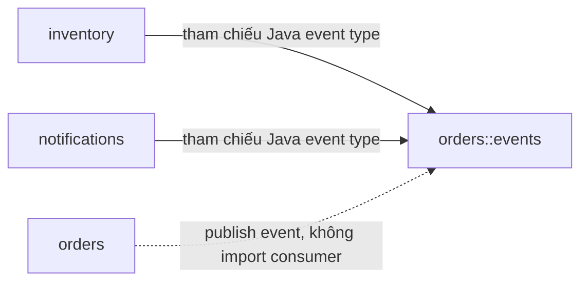
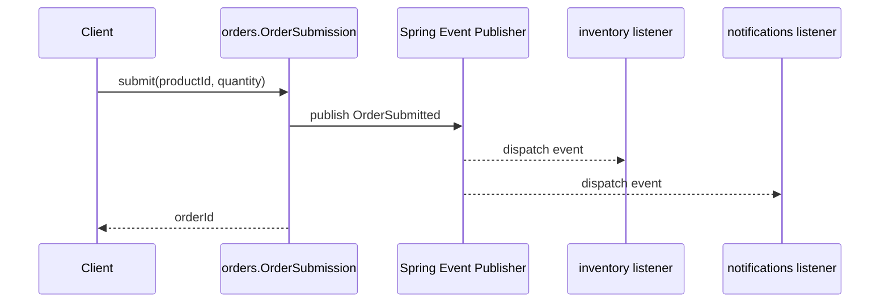
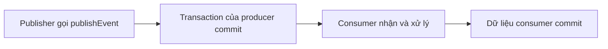
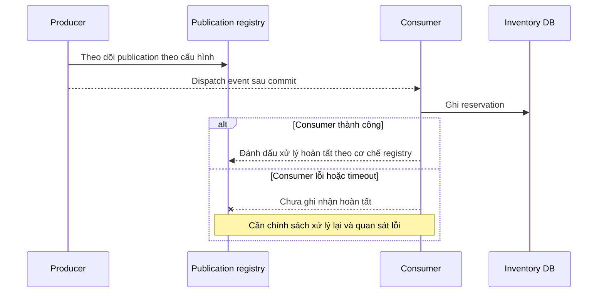
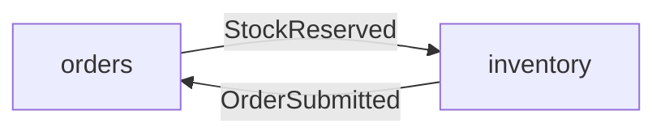
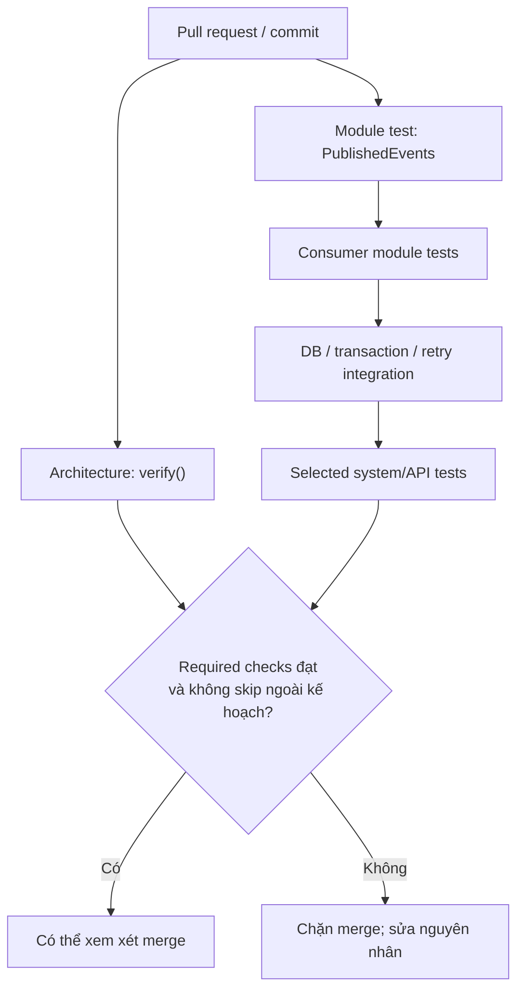

# Dùng event để thay giao tiếp gọi trực tiếp

Trong một ứng dụng Spring Boot có nhiều application module, một use case có thể bắt đầu bằng cách gọi service của module khác:

```text
orders -> inventory.reserve(...)
orders -> notifications.send(...)
orders -> analytics.track(...)
```

Cách gọi đồng bộ này có thể đúng khi phía gọi **cần kết quả tức thì**. Nhưng nếu `orders` chỉ muốn thông báo rằng một yêu cầu đặt hàng đã được tiếp nhận, việc biết trực tiếp các implementation của `inventory`, `notifications` và `analytics` khiến module đặt hàng bị gắn vào những phần không thuộc trách nhiệm của nó.

**Spring Modulith** hỗ trợ thiết kế theo module và giao tiếp bằng **sự kiện nghiệp vụ**. Producer công bố điều đã xảy ra; các consumer đăng ký phản ứng qua hợp đồng sự kiện được công bố. Nhờ đó, producer không cần biết consumer cụ thể, đồng thời Spring Modulith giúp kiểm tra **chiều dependency**, ranh giới public/internal API, kiểm thử module và luồng sự kiện.

Tuy nhiên, **dùng event không tự xóa coupling, không tự làm xử lý bất đồng bộ, không tự bảo đảm delivery hay “exactly once”**. Những vấn đề về transaction, retry, idempotency, quan sát trạng thái và kiểm thử hồi quy vẫn phải được giải quyết rõ ràng.

Bài thuộc chương **Module boundaries** của **SPRING_MODULITH_VERIFICATION_TESTING**. Trọng tâm là thay giao tiếp gọi trực tiếp bằng event khi hợp lý, kiểm chứng ranh giới với `ApplicationModules.verify()`, viết `@ApplicationModuleTest` và kiểm thử sự kiện, cơ sở dữ liệu, tích hợp, rồi đưa các phép kiểm tra vào **CI quality gate** để ngăn phụ thuộc sai và hồi quy.

## 1. Mục tiêu học tập

Sau bài học, bạn có thể:

1. Phân biệt khi nào **gọi đồng bộ qua public API** hợp lý và khi nào nên cân nhắc **publish sự kiện nghiệp vụ**.
2. Chuyển một liên kết producer → consumer trực tiếp thành giao tiếp dựa trên **event contract** mà vẫn giữ ranh giới module rõ ràng.
3. Đọc đúng chiều **type/module dependency** so với chiều **thông tin lúc runtime**.
4. Dùng `@NamedInterface` và `@ApplicationModule(allowedDependencies = ...)` để công bố event và giới hạn dependency phía consumer.
5. Viết `ApplicationModules.of(...).verify()` để chặn truy cập implementation package, dependency ngoài policy và vòng module.
6. Dùng `@ApplicationModuleTest` cùng `PublishedEvents` để chứng minh producer phát đúng loại và payload của sự kiện.
7. Viết consumer module test để chứng minh **kết quả xử lý** mà không cần khởi chạy producer thật.
8. Giải thích sự khác nhau giữa `@EventListener`, `@TransactionalEventListener` và `@ApplicationModuleListener`, đặc biệt về commit và async.
9. Xác định rủi ro về mất sự kiện, xử lý lặp, thứ tự, idempotency và eventual consistency.
10. Xây dựng ma trận test và CI quality gate cho các hợp đồng kiến trúc, event, database và tích hợp.

## 2. Giao tiếp gọi trực tiếp có vấn đề gì?

Giả sử `orders` tiếp nhận yêu cầu đặt hàng và chủ động gọi hai module khác:

```java
package com.acme.shop.orders;

// MẪU CỐ TÌNH COUPLING, không phải thiết kế đề xuất.
import com.acme.shop.inventory.internal.InventoryReservationService;
import com.acme.shop.notifications.internal.EmailSender;
import java.util.UUID;

class CoupledOrderService {

    private final InventoryReservationService reservations;
    private final EmailSender emails;

    CoupledOrderService(
            InventoryReservationService reservations,
            EmailSender emails) {
        this.reservations = reservations;
        this.emails = emails;
    }

    void submit(UUID orderId, UUID productId, int quantity) {
        reservations.reserve(orderId, productId, quantity);
        emails.sendOrderReceived(orderId);
    }
}
```

Trong ví dụ giả định, các type `InventoryReservationService` và `EmailSender` nằm trong package `internal` của module đích. Chúng được giả định là Java `public` để ví dụ có thể biên dịch, nhưng **không phải public module API**.

Có ít nhất ba vấn đề:

- **Sai ranh giới:** `orders` truy cập implementation nội bộ của `inventory` và `notifications`.
- **Coupling về hành vi:** việc tiếp nhận đơn có thể phụ thuộc vào email hoặc việc đặt giữ hàng, kể cả khi nghiệp vụ không cần hoàn tất chúng trước khi trả phản hồi.
- **Khó tiến hóa:** muốn đổi cách thông báo hoặc thêm analytics, đội phát triển phải sửa producer `orders`.

### 2.1. Không phải mọi lời gọi trực tiếp đều sai

Nếu nghiệp vụ quy định **không được xác nhận đơn khi chưa biết kho có đủ hàng**, `orders` có thể cần một **public API đồng bộ của `inventory`** để hỏi kết quả ngay. Ví dụ:

```java
package com.acme.shop.inventory;

import java.util.UUID;

public interface AvailabilityQuery {
    boolean canReserve(UUID productId, int quantity);
}
```

Gọi `AvailabilityQuery` qua public API, có chiều phụ thuộc hợp lệ, **không phải một anti-pattern chỉ vì nó đồng bộ**.

Điều cần xem xét là **mối quan hệ thời gian và trách nhiệm**:

- Producer có bắt buộc phải đợi consumer trả lời để đưa ra quyết định hiện tại không?
- Consumer phản ứng với một sự kiện đã xảy ra hay thực hiện một lệnh mà producer đang chờ?
- Nếu consumer tạm lỗi, nghiệp vụ có cho phép trạng thái `PENDING` và xử lý lại không?
- Nếu tác dụng phụ hoàn tất muộn, người dùng sẽ quan sát kết quả qua kênh nào?

Event thường phù hợp với **thông báo về một sự kiện đã xảy ra**, không phải một cách che giấu lời gọi RPC bắt buộc trả kết quả tức thời.

## 3. So sánh direct call và event-based collaboration

| Khía cạnh | Gọi trực tiếp qua API | Publish sự kiện và listener |
|---|---|---|
| Quan hệ producer–consumer | Caller biết một API cần gọi | Producer biết hợp đồng event, không cần biết listener cụ thể |
| Chiều dependency | Caller → module cung cấp API | Consumer → module công bố event type, khi event thuộc producer |
| Kết quả tức thì | Dễ diễn đạt qua return/exception | Không mặc định có kết quả trả về cho producer |
| Độ trễ phản ứng | Thường thuộc cùng call chain | Có thể đồng bộ hoặc bất đồng bộ tùy cơ chế |
| Lỗi consumer | Có thể ảnh hưởng trực tiếp call chain | Phụ thuộc listener type, transaction, retry và dispatch |
| Mở rộng số consumer | Producer có thể phải gọi thêm API | Có thể thêm consumer mà không sửa producer nếu hợp đồng phù hợp |
| Tính nhất quán | Có thể phối hợp đồng bộ trong một transaction khi phù hợp | Có thể eventual consistency; cần xử lý thời điểm commit |
| Kiểm thử | Unit/module test caller + integration | Producer event test + consumer test + transaction/integration |
| Rủi ro chính | Coupling, latency, lỗi dây chuyền | Contract drift, duplication, ordering, stale state và delivery |

**Điểm cốt lõi:** event là một **lựa chọn thiết kế giao tiếp**. Nó giảm dependency trực tiếp từ producer tới implementation consumer, nhưng không biến mọi tương tác thành độc lập hoàn toàn.

## 4. Ví dụ xuyên suốt: orders và inventory

Ta xây ứng dụng Spring Boot với:

- `orders`: tiếp nhận yêu cầu đặt hàng và phát `OrderSubmitted`.
- `inventory`: nhận event, ghi nhận rằng có yêu cầu xử lý tồn kho.
- `notifications`: có thể được bổ sung về sau như một consumer khác của cùng hợp đồng.

Cấu trúc package:

```text
com.acme.shop
├── ShopApplication.java
├── orders
│   ├── OrderSubmission.java
│   ├── events
│   │   ├── package-info.java
│   │   └── OrderSubmitted.java
│   └── internal
│       └── OrderRepository.java
├── inventory
│   ├── package-info.java
│   ├── ReservationStatus.java
│   └── internal
│       ├── ReservationProjection.java
│       └── OnOrderSubmitted.java
└── notifications
    ├── package-info.java
    └── internal
        └── OnOrderSubmitted.java
```

Với cơ chế nhận diện **mặc định**, các package con trực tiếp dưới package gốc ứng dụng thường là application module. Nếu dự án thay đổi cách nhận diện module, phải kiểm tra mô hình thực tế do Spring Modulith tạo ra.

### 4.1. Đồ thị dependency sau khi thay direct call



Mũi tên đặc biệt quan trọng:

- `inventory` phụ thuộc vào **hợp đồng `orders::events`** vì listener dùng `OrderSubmitted` làm parameter.
- `notifications` cũng có thể dùng contract đó.
- `orders` không phải import `inventory.internal.OnOrderSubmitted` hoặc `notifications.internal.EmailSender`.

Trong mô hình mặc định này, event type được **sở hữu bởi module phát sự kiện**. Nếu event được đưa vào một module hợp đồng trung lập, đồ thị dependency sẽ khác; cần kiểm chứng theo cấu trúc được chọn.

### 4.2. Chiều runtime khác chiều dependency



**Luồng dữ liệu runtime** đi từ orders tới inventory/notifications. **Type dependency** trong mã consumer lại đi về phía contract do orders công bố.

Đó là lý do việc đổi từ gọi service trực tiếp sang event **có thể đảo chiều dependency về mặt type**. Cần vẽ cả hai đồ thị khi review kiến trúc.

## 5. Hợp đồng event phải diễn tả nghiệp vụ rõ ràng

Một event tốt mô tả **một sự kiện có ý nghĩa đã xảy ra**, không chỉ là một tên method khác được đóng gói.

Trong demo, tên `OrderSubmitted` được hiểu là “đã chấp nhận một yêu cầu đặt hàng hợp lệ ở cấp input”. Ta cố ý **không** nói đơn hàng đã lưu database hoặc đã đặt giữ kho thành công vì mã ví dụ chưa có bước đó.

File `orders/events/OrderSubmitted.java`:

```java
package com.acme.shop.orders.events;

import java.util.UUID;

public record OrderSubmitted(
    UUID orderId,
    UUID productId,
    int quantity
) {}
```

### 5.1. Event payload là một hợp đồng công khai

| Thành phần | Ý nghĩa theo ví dụ | Cần làm rõ khi dùng production |
|---|---|---|
| `orderId` | ID của yêu cầu được tiếp nhận | Là ID bền vững hay ID tạm? Có dùng làm khóa idempotency không? |
| `productId` | Định danh sản phẩm | Có đủ để consumer lấy dữ liệu cần thiết mà không đọc bảng nội bộ không? |
| `quantity` | Số lượng khách yêu cầu | Đơn vị đo, điều kiện hợp lệ và cách xử lý nhiều dòng hàng |
| Tên `OrderSubmitted` | Yêu cầu đã được tiếp nhận | Đã commit trong DB hay chỉ vượt kiểm tra input? |
| Thời điểm phát | Do producer quyết định | Trước commit, trong transaction hay sau commit? |
| Xử lý lại | Do hệ thống và consumer quyết định | Idempotency, retry, ordering và lỗi ngoại vi |

Không nên đặt tên `OrderCompleted` nếu lúc publish đơn hàng vẫn chưa qua các bước mà nghiệp vụ gọi là “completed”.

### 5.2. Event không phải command ngầm

So sánh hai câu:

- **Command:** “Hãy giữ 2 sản phẩm cho đơn A và báo ngay có thành công không”.
- **Event:** “Yêu cầu đặt hàng A với 2 sản phẩm đã được tiếp nhận”.

Command nhấn mạnh **hành động cần thực hiện** và thường có người chịu trách nhiệm xử lý. Event nhấn mạnh **sự kiện đã xảy ra**, có thể có nhiều subscriber.

Nếu producer publish một “event” nhưng chờ listener thực thi đồng bộ và trả lời trước khi tiếp tục, đó có thể là **RPC trá hình**. Không phải lúc nào điều đó sai về mặt kỹ thuật, nhưng nó làm mất một phần lợi ích decoupling và cần ghi rõ ngữ nghĩa lỗi/timeout.

## 6. Công bố event contract bằng @NamedInterface

Với Spring Modulith, package `orders.events` là package con của application module `orders`. Trong mô hình mặc định, package con không tự là API công khai cho module khác.

Đặt file `orders/events/package-info.java`:

```java
@org.springframework.modulith.NamedInterface("events")
package com.acme.shop.orders.events;
```

Sau đó module inventory có thể phụ thuộc có chủ đích vào `orders::events` thay vì toàn bộ implementation `orders`.

File `inventory/package-info.java`:

```java
@org.springframework.modulith.ApplicationModule(
    allowedDependencies = "orders::events"
)
package com.acme.shop.inventory;
```

Nếu có notifications:

```java
@org.springframework.modulith.ApplicationModule(
    allowedDependencies = "orders::events"
)
package com.acme.shop.notifications;
```

Cú pháp `orders::events` gồm **tên application module** và **tên named interface** được công bố. Nó không phải tên một Spring bean và không có tác dụng tự đăng ký event listener.

### 6.1. Hai điều kiện độc lập để dependency hợp lệ

Muốn inventory import `OrderSubmitted`:

1. Type thuộc **giao diện module được công bố**, ở đây là `orders::events`.
2. Module nguồn `inventory` được phép phụ thuộc vào giao diện đó theo `allowedDependencies`.

Ngược lại:

```java
// Sai vì nằm ngoài giao diện orders::events được cho phép:
import com.acme.shop.orders.internal.OrderRepository;
```

Ngay cả khi `OrderRepository` là Java `public`, nó không tự trở thành public module API. `allowedDependencies = "orders::events"` càng không cấp quyền dùng implementation nội bộ.

### 6.2. Không mở rộng API chỉ để verification xanh

Một cách sửa sai là chuyển toàn bộ repository/entity của orders vào `orders.events` hoặc gắn `@NamedInterface` cho package `orders.internal`. Điều này có thể làm test kiến trúc bớt báo lỗi nhưng khiến consumer phụ thuộc vào chi tiết lưu trữ.

**Chỉ công bố những type thực sự là hợp đồng lâu dài.** Khi consumer cần dữ liệu khác, đánh giá ý nghĩa nghiệp vụ và bổ sung payload/API phù hợp thay vì mở implementation package.

## 7. Viết producer không biết consumer

Trong phần demo chưa có database, `OrderSubmission` chỉ xác thực input rồi publish event.

File `orders/OrderSubmission.java`:

```java
package com.acme.shop.orders;

import com.acme.shop.orders.events.OrderSubmitted;
import java.util.UUID;
import org.springframework.context.ApplicationEventPublisher;
import org.springframework.stereotype.Service;

@Service
public class OrderSubmission {

    private final ApplicationEventPublisher events;

    public OrderSubmission(ApplicationEventPublisher events) {
        this.events = events;
    }

    public UUID submit(UUID productId, int quantity) {
        if (productId == null || quantity <= 0) {
            throw new IllegalArgumentException("Invalid order item");
        }

        UUID orderId = UUID.randomUUID();

        events.publishEvent(new OrderSubmitted(
            orderId,
            productId,
            quantity
        ));

        return orderId;
    }
}
```

Các quan hệ trong mã:

- `OrderSubmission` phụ thuộc `OrderSubmitted` do **chính orders sở hữu**.
- `ApplicationEventPublisher` thuộc Spring Framework.
- **Không có dependency Java** từ `orders` tới `inventory` hoặc `notifications`.
- Producer không quyết định tên class listener hoặc cách consumer lưu dữ liệu.

Điều này làm giảm lý do phải sửa orders khi có consumer mới chỉ cần nhận cùng hợp đồng sự kiện.

### 7.1. Một cảnh báo về ý nghĩa kết quả

Method `submit(...)` trả `orderId` sau khi gọi `publishEvent(...)`. Trong ví dụ:

- ID đã được tạo trong bộ nhớ.
- Event đã được gửi tới cơ chế Spring Events trong context hiện tại.
- **Không có repository nào được gọi** và không có transaction lưu đơn.

Vì vậy bài test chỉ có thể kết luận **đầu vào được kiểm tra và event được publish**. Không nên ghi rằng “đơn đã lưu thành công” hoặc “kho đã giữ xong” khi mã chưa làm những việc đó.

## 8. Consumer nhận event qua hợp đồng công khai

Định nghĩa một API nhỏ để test quan sát kết quả của module inventory.

File `inventory/ReservationStatus.java`:

```java
package com.acme.shop.inventory;

import java.util.UUID;

public interface ReservationStatus {
    boolean recorded(UUID orderId);
}
```

Implementation in-memory, file `inventory/internal/ReservationProjection.java`:

```java
package com.acme.shop.inventory.internal;

import com.acme.shop.inventory.ReservationStatus;
import java.util.Set;
import java.util.UUID;
import java.util.concurrent.ConcurrentHashMap;
import org.springframework.stereotype.Component;

@Component
class ReservationProjection implements ReservationStatus {

    private final Set<UUID> receivedIds =
        ConcurrentHashMap.newKeySet();

    void record(UUID orderId) {
        receivedIds.add(orderId);
    }

    @Override
    public boolean recorded(UUID orderId) {
        return receivedIds.contains(orderId);
    }
}
```

Listener, file `inventory/internal/OnOrderSubmitted.java`:

```java
package com.acme.shop.inventory.internal;

import com.acme.shop.orders.events.OrderSubmitted;
import org.springframework.context.event.EventListener;
import org.springframework.stereotype.Component;

@Component
class OnOrderSubmitted {

    private final ReservationProjection projection;

    OnOrderSubmitted(ReservationProjection projection) {
        this.projection = projection;
    }

    @EventListener
    void on(OrderSubmitted event) {
        projection.record(event.orderId());
    }
}
```

**Lưu ý:** `ReservationProjection` chỉ ghi nhận ID trong bộ nhớ JVM, không thực hiện reservation hàng tồn thực tế. `Set` tránh ghi ID hai lần trong cùng instance nhưng **không chứng minh idempotency bền vững**, xử lý nhiều tiến trình, concurrency database hoặc khả năng phục hồi sau restart.

### 8.1. Producer không phụ thuộc consumer; consumer vẫn phụ thuộc contract

`OnOrderSubmitted` import `orders.events.OrderSubmitted`. Đây là một type dependency **inventory → orders::events** được định nghĩa và cho phép.

Việc dùng event chuyển một phần coupling thành **contract coupling**:

- Nếu xóa hoặc đổi kiểu `quantity`, consumer có thể bị ảnh hưởng khi compile.
- Nếu đổi **ý nghĩa** của `quantity` nhưng vẫn giữ kiểu `int`, compile có thể xanh mà hành vi sai.
- Nếu đổi tên hoặc ngữ nghĩa event, nhiều consumer có thể phải cập nhật.

Do đó event contract cần được thiết kế, version hóa/thay đổi có kiểm soát và có test phù hợp.

## 9. @EventListener có mặc định bất đồng bộ không?

**Không.** `@EventListener` của Spring Framework với event multicaster mặc định thường được gọi **đồng bộ** trong cùng call chain của `publishEvent(...)`. Nếu listener ném ngoại lệ, ngoại lệ có thể lan tới producer và tác động transaction đang mở.

Vì vậy chuyển code từ:

```java
inventory.reserve(orderId, productId, quantity);
```

sang:

```java
events.publishEvent(new OrderSubmitted(
    orderId, productId, quantity
));
```

**không tự bảo đảm** rằng producer trả về nhanh hơn hay không bị lỗi consumer ảnh hưởng. Những kết luận này phụ thuộc vào cách event multicaster/listener được cấu hình và transaction.

### 9.1. Bốn trường hợp cần phân biệt

| Cơ chế | Thời điểm chính | Đặc điểm kiểm thử |
|---|---|---|
| `@EventListener`, multicaster đồng bộ mặc định | Xử lý ngay lúc publish | Có thể assert kết quả consumer ngay sau publish trong cùng context |
| `@EventListener` + async multicaster hoặc `@Async` phù hợp | Xử lý trên luồng khác | Phải chờ kết quả quan sát được; xử lý lỗi khác đồng bộ |
| `@TransactionalEventListener(AFTER_COMMIT)` | Sau khi transaction liên quan commit | Producer cần có transaction phù hợp, trừ khi cấu hình fallback |
| `@ApplicationModuleListener` | Mẫu listener Spring Modulith cho xử lý sau commit/bất đồng bộ và transaction thích hợp | Cần setup producer transaction, cơ chế retry/idempotency và test async |

Bảng mô tả hành vi thông thường; hãy kiểm tra **phiên bản Spring/Spring Modulith và cấu hình event infrastructure** trong dự án thực tế.

### 9.2. Khi nào nên giữ listener đồng bộ?

Một listener đồng bộ có thể phù hợp với phản ứng nhỏ, rẻ, không có tác dụng phụ xa và khi producer **chấp nhận** hậu quả lỗi listener trong cùng call chain.

Nhưng nếu consumer làm HTTP call chậm, gửi email, truy cập hệ thống ngoài hoặc cần retry tách biệt, thực hiện đồng bộ trong transaction của producer có thể tạo coupling runtime và latency không mong muốn.

**Không chọn sync/async chỉ dựa vào annotation.** Hãy bắt đầu từ hợp đồng độ trễ, nhất quán, mức độ quan trọng của tác dụng phụ và cách xử lý lỗi.

## 10. Kiểm chứng architecture sau khi chuyển sang event

Tạo architecture test trong package gốc `com.acme.shop`:

```java
package com.acme.shop;

import org.junit.jupiter.api.Test;
import org.springframework.modulith.core.ApplicationModules;

class ModuleArchitectureTests {

    @Test
    void followsModuleBoundaries() {
        ApplicationModules.of(ShopApplication.class).verify();
    }
}
```

`ApplicationModules.of(ShopApplication.class)` dựng mô hình application module. `verify()` kiểm tra những quy tắc mà Spring Modulith hỗ trợ, điển hình:

- Không có **module dependency cycle**.
- Không dùng type thuộc **implementation/internal package** của module khác.
- Tuân thủ `allowedDependencies` và các giới hạn API được công bố.

Trong thiết kế ví dụ:

- `orders` không import `inventory.internal.*`.
- `inventory` chỉ dùng `orders::events`.
- `notifications` (nếu có) cũng chỉ dùng `orders::events`.
- Không xuất hiện vòng orders ↔ inventory do dependency type ngoài contract.

### 10.1. Cách kiểm tra event refactor thật sự làm yếu coupling trực tiếp

Một phép thử trong nhánh thực hành:

1. Tạo một interface `public` ở `inventory.internal`, ví dụ `LegacyInventoryReservation`.
2. Cho `orders` dùng type này trong một field/constructor parameter thật (không chỉ thêm import thừa).
3. Chạy `ModuleArchitectureTests`; mong đợi architecture verification báo vi phạm ranh giới.
4. Xóa phụ thuộc nội bộ, chỉ publish `OrderSubmitted`.
5. Chạy lại architecture test và xác nhận đạt.

Việc mã Java có thể biên dịch không đủ để kết luận hợp lệ vì type `public` trong `internal` vẫn là API nội bộ ở cấp application module.

### 10.2. Đừng hiểu verify() xanh là toàn bộ event hoạt động

`verify()` không tự kiểm tra:

- Sự kiện có được publish khi input hợp lệ không.
- Payload có đúng `orderId/productId/quantity` không.
- Consumer có được nạp trong runtime context không.
- Consumer có xử lý event và lưu database thành công không.
- After-commit listener có chạy sau transaction phù hợp không.
- Retry/idempotency có bảo đảm tác dụng nghiệp vụ như yêu cầu không.

Những câu hỏi này cần **test hành vi và tích hợp** riêng. Architecture test là lớp bảo vệ cấu trúc, không phải bằng chứng bao trùm mọi hợp đồng runtime.

## 11. Kiểm thử producer bằng @ApplicationModuleTest và PublishedEvents

Ở `@ApplicationModuleTest` chế độ `STANDALONE`, Spring TestContext tập trung vào module được kiểm thử. Vì `orders` không cần biết inventory hay notifications, producer test có thể chạy mà không nạp các consumer.

File `orders/OrderSubmissionModuleTests.java`:

```java
package com.acme.shop.orders;

import static org.assertj.core.api.Assertions.assertThat;
import static org.assertj.core.api.Assertions.assertThatThrownBy;

import com.acme.shop.orders.events.OrderSubmitted;
import java.util.UUID;
import org.junit.jupiter.api.Test;
import org.springframework.beans.factory.annotation.Autowired;
import org.springframework.modulith.test.ApplicationModuleTest;
import org.springframework.modulith.test.PublishedEvents;

@ApplicationModuleTest
class OrderSubmissionModuleTests {

    @Autowired OrderSubmission orders;

    @Test
    void publishesExpectedEvent(PublishedEvents events) {
        UUID productId = UUID.randomUUID();

        UUID orderId = orders.submit(productId, 2);

        assertThat(events.ofType(OrderSubmitted.class))
            .singleElement()
            .satisfies(event -> {
                assertThat(event.orderId()).isEqualTo(orderId);
                assertThat(event.productId()).isEqualTo(productId);
                assertThat(event.quantity()).isEqualTo(2);
            });
    }

    @Test
    void rejectsZeroQuantityWithoutEvent(
            PublishedEvents events) {

        assertThatThrownBy(() ->
            orders.submit(UUID.randomUUID(), 0)
        ).isInstanceOf(IllegalArgumentException.class)
         .hasMessage("Invalid order item");

        assertThat(events.ofType(OrderSubmitted.class)).isEmpty();
    }

    @Test
    void rejectsNullProductWithoutEvent(
            PublishedEvents events) {

        assertThatThrownBy(() ->
            orders.submit(null, 1)
        ).isInstanceOf(IllegalArgumentException.class);

        assertThat(events.ofType(OrderSubmitted.class)).isEmpty();
    }
}
```

### 11.1. Test này chứng minh điều gì?

- Input hợp lệ khiến `OrderSubmission` publish đúng **một** `OrderSubmitted`.
- Event mang đúng ID, product và quantity.
- Input không hợp lệ bị từ chối và không publish.
- Bean `OrderSubmission` hoạt động trong Spring TestContext của module orders.

### 11.2. Test này không chứng minh điều gì?

- `inventory` đã nhận hoặc xử lý event.
- `notifications` gửi email thành công.
- Bản ghi đơn được lưu/commit.
- Event sẽ được phát lại nếu consumer lỗi.
- Cơ sở dữ liệu hay broker đã bảo đảm delivery.

`PublishedEvents` là bằng chứng **producer đã phát**, không phải bằng chứng **consumer đã xử lý**. Phân biệt này đặc biệt quan trọng khi dùng `@ApplicationModuleListener` hoặc listener async.

### 11.3. Đừng chỉ assert event tồn tại

Một test chỉ kiểm tra “có một event cùng loại” có thể bỏ sót event phát hai lần hoặc sai `quantity`. Hãy assert **số lần, payload và trường hợp không được phát** theo hợp đồng nghiệp vụ.

## 12. Kiểm thử consumer độc lập với producer

Module inventory có thể được kiểm tra bằng cách tự publish `OrderSubmitted` làm input. Nó không phải chạy `OrderSubmission.submit(...)` của orders để xác minh logic listener.

File `inventory/InventoryModuleTests.java`:

```java
package com.acme.shop.inventory;

import static org.assertj.core.api.Assertions.assertThat;

import com.acme.shop.orders.events.OrderSubmitted;
import java.util.UUID;
import org.junit.jupiter.api.Test;
import org.springframework.beans.factory.annotation.Autowired;
import org.springframework.context.ApplicationEventPublisher;
import org.springframework.modulith.test.ApplicationModuleTest;

@ApplicationModuleTest
class InventoryModuleTests {

    @Autowired ApplicationEventPublisher publisher;
    @Autowired ReservationStatus status;

    @Test
    void recordsIncomingOrderEvent() {
        UUID orderId = UUID.randomUUID();

        publisher.publishEvent(new OrderSubmitted(
            orderId, UUID.randomUUID(), 2
        ));

        assertThat(status.recorded(orderId)).isTrue();
    }
}
```

Điều kiện của ví dụ:

- `@EventListener` được cấu hình đồng bộ mặc định.
- `ReservationProjection` là Spring bean thuộc module inventory.
- State chỉ nằm trong bộ nhớ; ID test mới cho mỗi case.

Test này chứng minh **consumer phản ứng với một input event** theo assertion, không chứng minh producer phát đúng payload ở mọi nhánh. Producer test và consumer test là **hai phía của cùng một contract**.

### 12.1. Kiểm tra trường hợp nhận lại event

Nếu consumer ghi nhận ID vào `Set` in-memory, có thể thêm test cùng event hai lần:

```java
@Test
void recordsDuplicateIdOnlyOnceInMemory() {
    UUID orderId = UUID.randomUUID();
    OrderSubmitted event = new OrderSubmitted(
        orderId, UUID.randomUUID(), 2
    );

    publisher.publishEvent(event);
    publisher.publishEvent(event);

    assertThat(status.recorded(orderId)).isTrue();
}
```

Đoạn test này **chỉ chứng minh có ID trong tập**, không chứng minh “đã xử lý đúng một lần”, vì API `ReservationStatus.recorded` không trả số lần tác dụng hoặc kết quả ghi bền vững. Muốn kiểm tra duplicate thật sự, cần thiết kế một **observable outcome** tốt hơn (ví dụ đếm reservation record trong database với khóa unique) và assert đúng kết quả.

Đó là ví dụ điển hình cho việc **assertion phải đủ mạnh để hỗ trợ kết luận**.

## 13. Khi chuyển sang @ApplicationModuleListener

Một ứng dụng production có thể yêu cầu inventory chỉ bắt đầu xử lý sau khi dữ liệu orders đã commit. Spring Framework có `@TransactionalEventListener`; Spring Modulith cung cấp `@ApplicationModuleListener` để hỗ trợ mẫu listener của application module gắn với transaction và xử lý bất đồng bộ.

Minh họa consumer sau commit:

```java
package com.acme.shop.inventory.internal;

import com.acme.shop.orders.events.OrderSubmitted;
import org.springframework.modulith.events.ApplicationModuleListener;
import org.springframework.stereotype.Component;

@Component
class InventoryAfterCommitListener {

    private final ReservationApplicationService reservations;

    InventoryAfterCommitListener(
            ReservationApplicationService reservations) {
        this.reservations = reservations;
    }

    @ApplicationModuleListener
    void on(OrderSubmitted event) {
        reservations.reserve(
            event.orderId(), event.productId(), event.quantity()
        );
    }
}
```

**Đây là fragment kiến trúc:** `ReservationApplicationService` là collaborator nội bộ giả định phải được cài đặt và kiểm thử riêng. Không dùng cùng lúc listener `@EventListener` ở mục 8 và listener này để xử lý **cùng tác dụng nghiệp vụ** nếu không cố ý muốn tạo hai consumer.

### 13.1. Producer cần transaction phù hợp

Với listener kích hoạt theo pha after-commit, ví dụ service ghi dữ liệu thực tế:

```java
@Service
class PersistedOrderSubmission {

    private final OrderRepository orders;
    private final ApplicationEventPublisher events;

    PersistedOrderSubmission(
            OrderRepository orders,
            ApplicationEventPublisher events) {
        this.orders = orders;
        this.events = events;
    }

    @Transactional
    public UUID submit(UUID productId, int quantity) {
        // Validate input và tạo order entity phù hợp với domain.
        Order order = Order.create(productId, quantity);
        orders.save(order);

        events.publishEvent(new OrderSubmitted(
            order.id(), productId, quantity
        ));

        return order.id();
    }
}
```

Đây **không phải file có thể copy chạy độc lập**: `Order`, `OrderRepository`, import Spring/JPA và cấu hình database phải được xây dựng cho dự án cụ thể. Mục đích của fragment là làm rõ:

1. Producer lưu dữ liệu trong transaction.
2. Producer publish event khi transaction vẫn đang hoạt động.
3. Listener theo after-commit được kích hoạt theo **kết quả commit**, không giống listener đồng bộ chạy ngay.
4. Consumer phải có transaction và chính sách retry/idempotency phù hợp.

Nếu dùng `@ApplicationModuleListener` với producer từ **mục 7** vốn không có transaction, đừng giả định listener sẽ hoạt động như `@EventListener`. Để dùng đúng ngữ nghĩa sau commit, cần thiết kế producer transaction thực.

### 13.2. Ba trạng thái cần được quan sát tách biệt



Một test producer đơn lẻ không chứng minh các bước còn lại. Nếu production API trả ID ngay sau khi producer commit nhưng consumer còn đang xử lý, UI hoặc API cần thể hiện trạng thái **PENDING** hoặc trạng thái tương đương theo nghiệp vụ.

### 13.3. Chọn loại listener theo mục tiêu

- Dùng `@EventListener` đồng bộ nếu tác dụng phụ rất nhỏ và nghiệp vụ chấp nhận coupling cùng call chain.
- Dùng `@TransactionalEventListener` khi hành động phải gắn với một pha transaction cụ thể.
- Dùng `@ApplicationModuleListener` khi cần mẫu listener theo Spring Modulith cho giao tiếp module bất đồng bộ/sau commit với cấu hình phù hợp.

Không coi ba annotation là các cách viết tương đương. Chúng có **hành vi transaction và lỗi khác nhau**, nên phải có test tương ứng.

## 14. Transaction rollback và tính nhất quán dữ liệu

Giả sử producer publish event bên trong một transaction, sau đó transaction bị rollback. Ý nghĩa của event là gì?

| Cơ chế listener | Điều có thể xảy ra |
|---|---|
| `@EventListener` đồng bộ | Listener có thể đã thực thi khi publish, trước khi transaction hoàn tất |
| `@TransactionalEventListener(AFTER_COMMIT)` | Listener chỉ chạy khi có commit phù hợp, trừ các cấu hình fallback đặc biệt |
| `@ApplicationModuleListener` | Mẫu sau commit/bất đồng bộ phụ thuộc transaction producer và cấu hình Modulith |
| Consumer dùng database khác hoặc external API | Cần chính sách transaction, compensation/idempotency và phục hồi riêng |

Khi producer còn trong transaction, việc gửi email hoặc gọi API bên ngoài ngay lập tức có thể tạo tác dụng không thể rollback, ngay cả khi dữ liệu orders sau đó rollback.

### 14.1. Ranh giới transaction của test có thể gây hiểu nhầm

Một bài Spring test gắn `@Transactional` có thể được Spring Test quản lý bằng transaction bao ngoài rồi rollback sau khi test. Listener `AFTER_COMMIT` có thể không được kích hoạt tại thời điểm test mong đợi.

Khi test event sau commit:

1. Xác định transaction của **use case production** và của **test**.
2. Tạo dữ liệu với commit rõ ràng khi hợp đồng yêu cầu.
3. Chờ listener theo điều kiện observable thay vì sleep cố định.
4. Đọc lại dữ liệu sau commit qua context/transaction thích hợp.
5. Kiểm tra nhánh rollback **không** tạo tác dụng sai.

**Không kết luận “đã commit thành công” từ việc entity còn nằm trong persistence context của test transaction chưa commit.**

## 15. Bảo đảm xử lý sự kiện: publication registry và giới hạn

Nếu producer đã commit nhưng consumer lỗi, ứng dụng cần biết **publication nào chưa hoàn tất** để có thể xử lý lại. Spring Modulith có các cơ chế **event publication registry** và hỗ trợ khôi phục publication theo phiên bản/cấu hình được sử dụng.

Nhưng không nên diễn giải các tính năng đó thành bảo đảm mặc định rằng mọi event được xử lý **chính xác một lần**.

Một timeline cần được thiết kế rõ:



Sơ đồ minh họa ý tưởng; thứ tự ghi publication, commit, dispatch và đánh dấu hoàn tất **phụ thuộc bản Spring Modulith, loại repository và cách cấu hình**. Không lấy sơ đồ như tuyên bố chi tiết triển khai của một phiên bản cụ thể.

### 15.1. Những điều registry có thể hỗ trợ

- Ghi nhận các publication hướng tới listener theo cơ chế được cấu hình.
- Phân biệt publication hoàn tất và chưa hoàn tất.
- Hỗ trợ cơ chế xử lý lại những publication chưa hoàn tất theo API/cấu hình tương ứng.

### 15.2. Những điều registry không tự giải quyết

- Consumer thực hiện side effect hai lần khi event bị replay.
- Hai consumer cập nhật đồng thời một bản ghi gây race condition.
- Thứ tự xử lý các event cạnh tranh.
- Một HTTP call ngoài đã thành công nhưng consumer crash trước khi ghi nhận hoàn tất.
- Schema event thay đổi không tương thích.
- Các tác dụng trong database khác không nằm trong cùng transaction.

Vì vậy **retry phải đi cùng idempotency**. Không chỉ dựa vào registry để tránh tác dụng phụ trùng.

## 16. Idempotency: event có thể đến nhiều lần

Giả sử inventory nhận cùng `OrderSubmitted` hai lần. Nếu mỗi lần listener đều giảm tồn kho, một đơn có thể giữ hàng hai lần.

### 16.1. Khóa nghiệp vụ

Một khóa idempotency thường có thể là:

```text
consumer = inventory
operation = reserve-on-order-submitted
businessKey = orderId

unique(consumer, operation, businessKey)
```

Nếu cùng `orderId` có nhiều dòng hàng, khóa có thể phải bao gồm `orderLineId` hoặc một ID reservation riêng. Không có một khóa chung đúng cho mọi domain.

### 16.2. Unique constraint trong database

Ví dụ phác thảo schema:

```sql
CREATE TABLE inventory_reservation (
    id UUID PRIMARY KEY,
    order_id UUID NOT NULL,
    product_id UUID NOT NULL,
    quantity INTEGER NOT NULL,
    status VARCHAR(30) NOT NULL,
    CONSTRAINT uq_inventory_reservation_order
        UNIQUE (order_id)
);
```

Đây là thiết kế minh họa **một reservation cho mỗi đơn**. Nếu nghiệp vụ cho phép nhiều dòng sản phẩm, cần unique key và mô hình bảng khác. Không dùng schema demo này như cấu trúc production cho mọi hệ thống.

### 16.3. Cần atomicity, không chỉ kiểm tra rồi ghi

Đoạn xử lý:

```text
if (!existsReservation(orderId)) {
    insertReservation(orderId)
}
```

có race condition khi hai thread cùng thấy “chưa tồn tại”. Cần unique constraint/transaction hoặc cơ chế atomic tương ứng. Kiểm thử concurrency phải xác nhận chỉ một tác dụng bền vững xảy ra trong tình huống tranh chấp.

### 16.4. Idempotency test đúng cần assert gì?

- Gửi cùng event nhiều lần (hoặc gọi handler nhiều lần theo cách test phù hợp).
- Đọc lại database sau khi các transaction liên quan hoàn tất.
- Đảm bảo số record hoặc số lượng tồn kho thay đổi **đúng như hợp đồng**.
- Xác minh phản ứng khi duplicate conflict: bỏ qua, trả kết quả đã có hay xử lý lỗi có kiểm soát.
- Chạy thêm ca concurrent nếu nghiệp vụ đòi hỏi.

Một test chỉ assert `ReservationStatus.recorded(orderId) == true` sau hai lần gửi **không đủ** chứng minh idempotency, vì cùng một kết quả boolean có thể xuất hiện ngay cả khi hệ thống đã trừ kho hai lần.

## 17. Ordering, stale state và eventual consistency

Thay direct call bằng event thường làm xuất hiện **độ trễ giữa hành động producer và trạng thái consumer** khi xử lý async.

Giả sử producer phát:

```text
OrderSubmitted(orderId=A)
OrderCancelled(orderId=A)
```

Nếu hai listener/event được xử lý bất đồng bộ, không nên tự giả định trạng thái đến consumer luôn giữ đúng thứ tự mong muốn. Cần thiết kế:

- Phiên bản hoặc sequence trên aggregate nếu order quan trọng.
- Quy tắc trạng thái hợp lệ: đã hủy thì không được tiếp tục tạo reservation mới.
- Kiểm tra **stale event** và event đến lại.
- Mức nhất quán mà người dùng nhìn thấy: `PENDING`, `RESERVED`, `REJECTED`.
- Cơ chế đồng bộ và truy vấn trạng thái sau xử lý.

### 17.1. Đừng trả trạng thái “đã hoàn tất” quá sớm

Nếu HTTP endpoint chỉ mới publish event:

```json
{
  "orderId": "some-id",
  "status": "PENDING"
}
```

có thể trung thực hơn một phản hồi `RESERVED`, nếu inventory chưa xác nhận.

Nếu nghiệp vụ bắt buộc phản hồi “còn hàng và đã giữ thành công” ngay, **gọi đồng bộ qua public API hoặc một workflow điều phối rõ ràng** có thể là lựa chọn phù hợp hơn event fire-and-forget.

### 17.2. Tránh suy luận về transaction phân tán

Các module cùng JVM có thể dùng chung một database transaction trong một số luồng đồng bộ. Nhưng khi consumer chạy async/sau commit, transaction producer đã kết thúc; không nên giả định thay đổi của consumer là một phần của cùng transaction.

Nếu có nhiều database/service, cần các cơ chế phù hợp với nghiệp vụ như retry, idempotency, compensation và quan sát trạng thái; event annotation không tự cung cấp atomicity xuyên các hệ thống.

## 18. Một bẫy kiến trúc: dùng event hai chiều vẫn có thể tạo vòng

Giả sử inventory tiêu thụ `orders::events`, rồi inventory phát `StockReserved` cho orders tiêu thụ:

```text
inventory -> orders::events
orders -> inventory::events
```

Nếu cả hai type contract được sở hữu bởi hai module tương ứng và hai module import type của nhau, ta có thể tạo **dependency cycle** dù giao tiếp runtime là event.



**Event không tự bảo đảm module graph không có vòng.** Cần giải quyết bằng thiết kế hợp đồng và trách nhiệm.

### 18.1. Những phương án thiết kế có thể cân nhắc

- Chuyển orchestration sang một **application module điều phối** có dependency một chiều phù hợp.
- Đưa các event contract thực sự ổn định vào **module hợp đồng trung lập** nếu phù hợp với bounded context và ownership.
- Dùng một mô hình quy trình với trạng thái riêng, để các module chỉ xuất bản và không trực tiếp import type ngược chiều.
- Điều chỉnh chiều dependency và responsibility theo domain, không chỉ đổi tên package.

Mỗi phương án có trade-off. Không được biến một module `shared` thành kho chứa toàn bộ entity, repository và service chỉ để làm `verify()` xanh.

### 18.2. Cần kiểm tra lại sau refactor

Sau khi thay đổi:

1. Vẽ đồ thị dependency code/type mới.
2. Kiểm tra hợp đồng nào là public/named interface.
3. Chạy `ApplicationModules.verify()`.
4. Viết producer test và consumer test ở mỗi phía.
5. Thêm integration test cho kết quả nghiệp vụ xuyên event.
6. Đặt gate trong CI để phòng tái xuất hiện vòng.

## 19. Kiểm thử bất đồng bộ bằng Scenario hoặc điều kiện quan sát

Một consumer dùng `@ApplicationModuleListener` có thể không hoàn tất trước khi `publishEvent(...)` trả về. Viết:

```java
publisher.publishEvent(event);
assertThat(database.findReservation(orderId)).isPresent();
```

ngay lập tức có thể tạo **flaky test** nếu consumer chưa xử lý xong.

Spring Modulith Test hỗ trợ `Scenario` để diễn đạt **hành động kích hoạt** và **điều kiện chờ**. Ví dụ định hướng (giả định có event kết quả `ReservationRecorded` và listener tương ứng):

```java
@Autowired Scenario scenario;
@Autowired ApplicationEventPublisher publisher;

@Test
void waitsForReservationResult() {
    UUID orderId = UUID.randomUUID();

    scenario
        .stimulate(() -> publisher.publishEvent(
            new OrderSubmitted(orderId, UUID.randomUUID(), 2)
        ))
        .andWaitForEventOfType(ReservationRecorded.class)
        .matching(ReservationRecorded::orderId, orderId)
        .toArriveAndVerify(result ->
            assertThat(result.orderId()).isEqualTo(orderId));
}
```

**Đây là ví dụ minh họa, không phải test tự chạy:** cần định nghĩa `ReservationRecorded`, thiết lập event consumer/transaction và kiểm tra API theo phiên bản Spring Modulith đang dùng.

### 19.1. Vì sao tốt hơn Thread.sleep(...)

`Thread.sleep(500)` chờ thời gian cố định mà không biết consumer đã hoàn tất hay chưa:

- Máy nhanh: test lãng phí thời gian.
- CI chậm: test có thể thất bại vì không đủ thời gian.
- Consumer lỗi: ngủ đủ lâu vẫn không tạo bằng chứng về kết quả.

Chờ một **điều kiện quan sát được** với timeout có ý nghĩa giúp test bền vững hơn. Nhưng kể cả khi một event kết quả đã xuất hiện, nếu hợp đồng yêu cầu database đã commit, cần **đọc trạng thái bền vững sau commit** và có assertion tương ứng.

### 19.2. Thiết kế test không phụ thuộc thứ tự

Với consumer async hoặc registry recovery:

- Dùng ID mới cho mỗi case.
- Làm sạch fixture DB/publication theo cách có kiểm soát.
- Không dựa vào thứ tự chạy JUnit methods.
- Đặt timeout phù hợp hạ tầng, không kéo dài vô hạn.
- Phân biệt failure do business logic với do container/broker chưa sẵn sàng.
- Kiểm tra retry không tạo duplicate side effect.

## 20. Database và Testcontainers: bảo vệ tác dụng thật

Module test có mock repository hoặc state in-memory chỉ chứng minh phần hành vi quan sát được trong môi trường đó. Khi event cập nhật database, thêm integration test là thiết yếu nếu nghiệp vụ phụ thuộc vào commit, constraint, isolation hoặc concurrency.

| Rủi ro | Phép kiểm tra phù hợp | Assertion có ý nghĩa |
|---|---|---|
| Consumer ghi sai reservation | Database integration test | Bản ghi khớp ID/số lượng/trạng thái |
| Event trùng làm ghi trùng | Unique constraint + idempotency test | Một reservation bền vững cho khóa nghiệp vụ |
| Hai consumer cạnh tranh | Concurrency integration test | Không có hai tác dụng ngoài yêu cầu |
| Producer rollback sau publish | Transaction/event integration | Listener after-commit không thực hiện tác dụng không hợp lệ |
| Consumer lỗi sau producer commit | Failure/retry integration | Publication còn có thể xử lý lại và trạng thái cuối đúng |
| Schema migration lỗi | Database bootstrap/migration test | Schema và constraint tạo đúng |
| Contract payload thay đổi | Producer/consumer contract test | Consumer vẫn hiểu dữ liệu hoặc fail rõ ràng |

Testcontainers có thể dùng PostgreSQL/MySQL hoặc hạ tầng phù hợp với production. Tuy nhiên, **container được khởi động thành công không tự chứng minh** persistence hoặc transaction đúng. Hãy đưa vào test những assertion cần thiết.

### 20.1. Bài test cần đi qua commit thật

Nếu muốn xác nhận consumer đọc đơn đã commit:

1. Producer lưu dữ liệu trong transaction.
2. Transaction thực sự commit.
3. Listener được kích hoạt theo phase phù hợp.
4. Consumer mở transaction riêng nếu cần ghi dữ liệu.
5. Bài test quan sát kết quả cuối ngoài phạm vi dữ liệu chưa commit.

Một test `@Transactional` mặc định rollback có thể không kích hoạt listener after-commit như production. Không khẳng định “after-commit đã hoạt động” khi test chưa đi qua ranh giới commit.

## 21. Public API và event contract phải được version hóa có chủ đích

Event contract là một dạng public API. Khi consumer đã phụ thuộc `OrderSubmitted`, mọi thay đổi payload hoặc semantics đều có thể ảnh hưởng nó.

Ví dụ:

```text
v1: OrderSubmitted(orderId, productId, quantity)

v2: OrderSubmitted(orderId, productId, quantity, currency)
```

Trong một monolith cùng biên dịch, thay đổi type có thể khiến lỗi compile xuất hiện sớm. Nhưng nếu event được lưu, phát lại sau triển khai hoặc externalize tới hệ thống ngoài, consumer cũ/mới có thể cùng tồn tại; khi đó còn cần chiến lược schema compatibility và migration.

### 21.1. Các quyết định cần công bố

- Event có **ID riêng** để trace và deduplicate không?
- Event thể hiện **trạng thái trước hay sau commit**?
- Trường mới có default/optional hợp lý không?
- Consumer có được phép đọc dữ liệu bổ sung qua API riêng hay event phải self-contained?
- Khi cần đổi ý nghĩa của trường, có nên tạo **event type/version mới**?
- Những publication chưa hoàn tất từ phiên bản cũ sẽ được xử lý ra sao?

### 21.2. Consumer test nên đóng vai trò contract test

Khi producer thêm hoặc đổi dữ liệu:

- Producer test assert payload mong đợi.
- Consumer test nhận event phù hợp và assert kết quả.
- Nếu externalization tồn tại, có thêm schema/serialization/compatibility test.
- Integration test chứng minh transaction, retry và dữ liệu cuối.

Không dùng architecture test để thay thế những hợp đồng ngữ nghĩa này. `verify()` kiểm tra đồ thị và API visibility, **không biết ý nghĩa “currency phải là VND”** nếu bạn chưa có assertion tương ứng.

## 22. Quy trình chuyển đổi an toàn từ direct call sang event

Một refactor giao tiếp nên thực hiện theo từng bước, thay vì chỉ thay service call bằng `publishEvent(...)` rồi xóa test cũ.

**Bước 1 — Xác định use case và yêu cầu phản hồi.** Nếu producer cần kết quả tức thì để quyết định response, không tự động đổi sang event bất đồng bộ.

**Bước 2 — Xác định ownership.** Producer sở hữu sự kiện gì? Consumer sở hữu tác dụng phụ gì? Dữ liệu nào là public contract?

**Bước 3 — Thiết kế event contract.** Đặt tên theo nghiệp vụ, định nghĩa ID/payload/ngữ nghĩa, thời điểm publish và chính sách xử lý trùng/lỗi.

**Bước 4 — Công bố có chủ đích.** Dùng `@NamedInterface("events")` khi event nằm ở package con; dùng `allowedDependencies` để chỉ cho consumer phụ thuộc giao diện được công bố.

**Bước 5 — Thay direct call trong producer.** Không còn import implementation consumer; chỉ publish event mà producer sở hữu.

**Bước 6 — Tạo consumer listener.** Lựa chọn `@EventListener` hay cơ chế after-commit/async phù hợp với transaction và độ trễ.

**Bước 7 — Bảo vệ kiến trúc.** Chạy `ApplicationModules.verify()`; bảo đảm không có import internal, dependency ngoài policy hoặc vòng.

**Bước 8 — Kiểm thử producer và consumer riêng.** `PublishedEvents` cho event producer; consumer module test cho phản ứng phía nhận.

**Bước 9 — Bổ sung integration test cần thiết.** Database, idempotency, retry, failure recovery, transaction và concurrency nếu rủi ro yêu cầu.

**Bước 10 — Đưa vào CI quality gate.** Chạy các nhóm test bắt buộc trên commit mới nhất và chặn merge khi vi phạm.

### 22.1. Không để refactor tạo double processing

Trong giai đoạn chuyển đổi, dễ vô tình giữ **cả** lời gọi trực tiếp cũ và listener mới:

```text
orders -> inventory.reserve(...)
orders -> publish OrderSubmitted
                 -> inventory listener -> reserve(...)
```

Nếu cùng một tác dụng bị kích hoạt hai lần, hệ thống có thể trừ kho hoặc tạo reservation trùng. Khi chuyển đổi, phải xác định **một đường xử lý nghiệp vụ chính** hoặc có idempotency/deduplication rõ ràng cho giai đoạn song song.

## 23. Ma trận truy vết hợp đồng → test → bằng chứng

| ID | Hợp đồng cần bảo vệ | Bài test | Dấu hiệu hồi quy |
|---|---|---|---|
| ARCH-01 | Orders không dùng type nội bộ inventory | `ApplicationModules.verify()` | Thêm tham chiếu `inventory.internal.*` làm test đỏ |
| ARCH-02 | Inventory chỉ dùng `orders::events` | `verify()` + `allowedDependencies` | Inventory import API ngoài policy làm test đỏ |
| ARCH-03 | Không có vòng module | `verify()` | Hai chiều dependency type làm test đỏ |
| ORD-01 | Input không hợp lệ bị từ chối | `OrderSubmissionModuleTests` | Producer chấp nhận quantity = 0 |
| ORD-02 | Một `OrderSubmitted` đúng payload được publish | `PublishedEvents` test | Thiếu event, phát lặp hoặc sai field |
| INV-01 | Inventory nhận event đúng | `InventoryModuleTests` | Listener không cập nhật projection |
| INV-02 | Event lặp không gây tác dụng bền vững sai | Consumer DB integration | Duplicate reservation hoặc giảm kho hai lần |
| TX-01 | Consumer chỉ xử lý sau commit khi yêu cầu | Transaction/event integration | Rollback vẫn tạo tác dụng không hợp lệ |
| REC-01 | Publication chưa hoàn tất được xử lý theo chính sách | Failure/retry integration | Lỗi consumer làm mất kết quả không thể phục hồi |
| API-01 | HTTP thể hiện trạng thái đúng | System/API test | Trả “completed” dù consumer còn pending |
| CI-01 | Mọi check bắt buộc chạy trên PR | CI report/required checks | Architecture/event/DB tests bị skip hoặc không chạy |

Đây là **kế hoạch kiểm chứng**, không phải báo cáo kết quả thực thi ở một dự án thật. Khi áp dụng phải điền tên test, môi trường, số test, revision và kết quả từ pipeline.

## 24. CI quality gate cho giao tiếp bằng event

Một refactor từ direct call sang event có thể làm code compile và unit test xanh nhưng tạo:

- Một dependency vòng do orders bắt đầu tiêu thụ event inventory.
- Một listener không còn được Spring scan.
- Một event sai payload.
- Một transaction không commit nhưng listener được kích hoạt sai.
- Một retry tạo tác dụng trùng.

CI cần bảo vệ từng loại rủi ro bằng nhóm test phù hợp.



### 24.1. Những lệnh chạy thường gặp

Khi dự án có wrapper:

```bash
# Maven: chạy test thuộc phase test
./mvnw test

# Maven: chạy các phase đến verify theo plugin đã cấu hình
./mvnw verify

# Gradle: chạy task test được cấu hình
./gradlew test
```

Không tự suy ra các lệnh trên đã chạy toàn bộ integration test. Maven có thể tách test qua Failsafe/profile; Gradle có thể có `integrationTest` task; CI cần gọi đúng phần được nhóm quy định.

### 24.2. Bằng chứng CI cần ghi nhận

- Commit SHA của code được kiểm tra.
- Những module nào được nhận diện trong architecture test.
- Số test chạy, failed, skipped cho từng nhóm.
- Database/container/event configuration của integration tests.
- Các required checks có thật sự chặn merge khi đỏ không.
- Phạm vi chưa được chứng minh (ví dụ chưa test broker bên ngoài, chưa test concurrent retry).

Một dòng `BUILD SUCCESS` **không đủ** nếu architecture test hoặc consumer integration test đã bị exclude.

## 25. Bài tập thực hành: thay direct call bằng event

**Bối cảnh:** tạo Spring Boot application có `orders` và `inventory`; `notifications` là phần mở rộng tùy chọn. Bắt đầu từ use case cần thông báo sau khi tiếp nhận yêu cầu, không yêu cầu kết quả reservation ngay.

### Vòng A — Xác định giao tiếp cần thay

1. Viết sơ đồ direct call `orders → inventory.reserve(...)`.
2. Đánh dấu những tham chiếu type đi vào implementation package của inventory.
3. Giải thích vì sao một public synchronous API có thể đúng nếu producer cần kết quả tức thì.
4. Chọn trường hợp **không cần trả kết quả ngay**, đủ điều kiện để thử thiết kế event.

### Vòng B — Thiết kế hợp đồng và ranh giới

1. Tạo `ShopApplication` ở `com.acme.shop`.
2. Tạo `orders.events.OrderSubmitted` với `orderId`, `productId`, `quantity`.
3. Công bố `orders::events` qua `@NamedInterface("events")`.
4. Giới hạn inventory bằng `@ApplicationModule(allowedDependencies = "orders::events")`.
5. Viết `OrderSubmission` chỉ publish event, không import inventory.
6. Vẽ đồ thị Java type dependency và runtime event flow, giải thích hai chiều khác nhau.

### Vòng C — Kiểm chứng kiến trúc

1. Viết JUnit test `ApplicationModules.of(ShopApplication.class).verify()`.
2. Tạm thêm tham chiếu `inventory.internal.LegacyReservationService` vào production code orders.
3. Đảm bảo đó là type reference thực sự và biên dịch được ở mức Java; chạy verify để thấy vi phạm.
4. Gỡ dependency nội bộ, trở lại phát event, rồi chạy verify đạt.
5. Thử thiết kế một event phản hồi từ inventory, phân tích nguy cơ vòng module trước khi thêm.

### Vòng D — Kiểm thử producer và consumer

1. Viết `@ApplicationModuleTest` cho orders.
2. Dùng `PublishedEvents` assert đúng một `OrderSubmitted` và payload mong đợi.
3. Viết negative test quantity bằng 0 phải từ chối và không publish.
4. Viết `@ApplicationModuleTest` cho inventory, publish trực tiếp `OrderSubmitted` rồi assert `ReservationStatus.recorded(orderId)`.
5. Ghi rõ giới hạn in-memory, không kết luận idempotency bền vững từ boolean assertion.

### Vòng E — Transaction, database và bất đồng bộ

1. Bổ sung repository thật và producer `@Transactional` nếu nghiệp vụ yêu cầu đơn được commit.
2. Thử chuyển consumer sang `@ApplicationModuleListener` với cấu hình phù hợp.
3. Kiểm thử cả commit và rollback; không dựa vào test transaction mặc định rồi giả định after-commit đã chạy.
4. Thêm unique key/idempotency cho reservation; thử gửi event lặp và kiểm tra trạng thái database.
5. Khi consumer async, dùng điều kiện chờ như `Scenario` hoặc cơ chế phù hợp, tránh sleep cố định.
6. Nếu cần Testcontainers, sử dụng DB engine/schema/constraint phản ánh rủi ro thật.

### Vòng F — CI và báo cáo bằng chứng

1. Đưa architecture, producer module, consumer module và integration tests bắt buộc vào CI.
2. Gây lỗi `inventory.internal` ở orders để architecture gate đỏ.
3. Gây lỗi payload `quantity` để producer test đỏ.
4. Gây lỗi consumer bỏ ghi trạng thái để consumer test đỏ.
5. Hoàn nguyên và xác nhận các required checks đạt trên revision mới nhất.
6. Ghi: commit, module được phát hiện, assertion chính, test đã chạy/skipped, môi trường và rủi ro còn ngoài phạm vi.

**Tiêu chí hoàn thành:** producer không import implementation consumer, consumer chỉ tham chiếu named event interface, `verify()` bắt được dependency bị cấm, module tests chứng minh hai phía hợp đồng và integration/CI test bảo vệ những yêu cầu về transaction, idempotency và hồi quy đã chọn.

## 26. Câu hỏi ôn tập

**1. Dùng event có nghĩa producer không còn phụ thuộc bất kỳ module nào không?**

Không. Producer không phải biết implementation consumer, nhưng vẫn sở hữu type/payload event và có thể phụ thuộc các API khác theo thiết kế. Consumer thường phụ thuộc vào event contract của producer.

**2. Vì sao chiều event runtime và chiều module dependency có thể khác nhau?**

Vì producer phát dữ liệu tới consumer khi chạy, còn Java listener của consumer phải import event type do producer công bố. Vì thế type dependency đi consumer → event contract.

**3. Có phải lời gọi đồng bộ giữa module luôn sai?**

Không. Gọi public API hợp lệ khi producer cần kết quả ngay là lựa chọn đúng trong nhiều trường hợp. Vấn đề là coupling vào implementation nội bộ hoặc chọn cơ chế không phù hợp hợp đồng nghiệp vụ.

**4. `@NamedInterface("events")` có tự làm event bất đồng bộ không?**

Không. Nó công bố package/type như một named interface của application module. Tính đồng bộ, transaction và delivery là vấn đề khác.

**5. `@EventListener` mặc định chạy sau commit không?**

Không. Với cấu hình multicaster đồng bộ thông thường, listener được gọi ngay khi publish. Muốn sau commit phải dùng cơ chế transaction-aware phù hợp.

**6. `@ApplicationModuleListener` có dùng y hệt `@EventListener` trong demo không transaction được không?**

Không nên giả định. Mẫu listener này dựa trên xử lý transaction/after-commit, nên producer và test cần thiết lập transaction phù hợp.

**7. `PublishedEvents` chứng minh gì?**

Nó quan sát event được publish trong test, giúp assert type, số lượng và payload; không tự chứng minh listener consumer hoàn tất hoặc database đã commit.

**8. Tại sao consumer có thể được test mà không chạy producer?**

Vì consumer xử lý một hợp đồng sự kiện đầu vào. Test có thể publish trực tiếp event hợp lệ rồi assert kết quả consumer trong context được chọn.

**9. Một event có thể bị xử lý lặp không?**

Có, tùy delivery, retry và failure. Consumer cần idempotency phù hợp; không dựa vào một annotation để tuyên bố chính xác một lần.

**10. Vì sao event trả lời từ inventory có thể tạo dependency cycle?**

Nếu inventory tham chiếu `orders::events` còn orders tham chiếu `inventory::events`, hai module có type dependencies hai chiều. Cần thiết kế lại contract/ownership hoặc orchestration.

**11. Khi nào Testcontainers giúp kiểm chứng event tốt hơn?**

Khi cần test SQL, constraint, transaction, concurrency hoặc trạng thái bền vững với database giống production. Container không thay thế assertion và thiết kế transaction đúng.

**12. Nếu CI xanh nhưng consumer integration test bị skip, có thể kết luận đã chống hồi quy đầy đủ chưa?**

Chưa. Phải xác nhận các check bắt buộc thực sự chạy trên revision được xét; test bị skip có thể để lại khoảng trống bằng chứng.

## Kết luận

**Dùng event để thay giao tiếp gọi trực tiếp** giúp một producer trong Spring Modulith không phải tham chiếu implementation của những module phản ứng với một sự kiện nghiệp vụ. Consumer có thể dùng **named event interface** được công bố, còn `ApplicationModules.verify()` kiểm chứng những quy tắc cấu trúc như dependency nội bộ bị cấm, `allowedDependencies` và vòng module.

Giá trị của event chỉ bền vững khi hiểu đúng **hợp đồng và giới hạn**: event không mặc định bất đồng bộ, không đồng nghĩa consumer đã xử lý hoặc database đã commit, và không tự giải quyết retry, ordering, idempotency hay eventual consistency. Kết hợp `@ApplicationModuleTest`, `PublishedEvents`, consumer tests, database/transaction integration tests và **CI quality gate** giúp bảo vệ cả ranh giới kiến trúc lẫn hành vi runtime, để việc chuyển từ direct call sang event thực sự giảm coupling thay vì chỉ chuyển lỗi sang một chỗ khó quan sát hơn.
