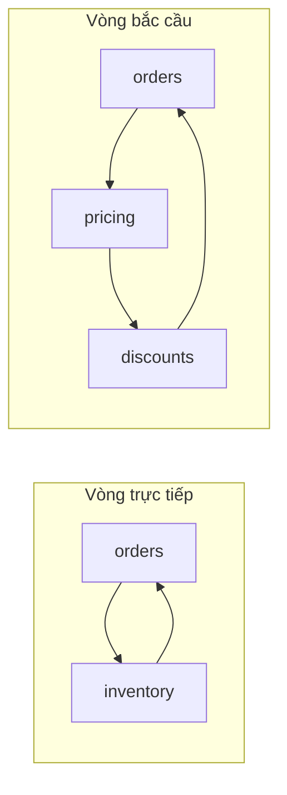
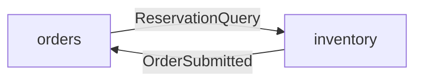
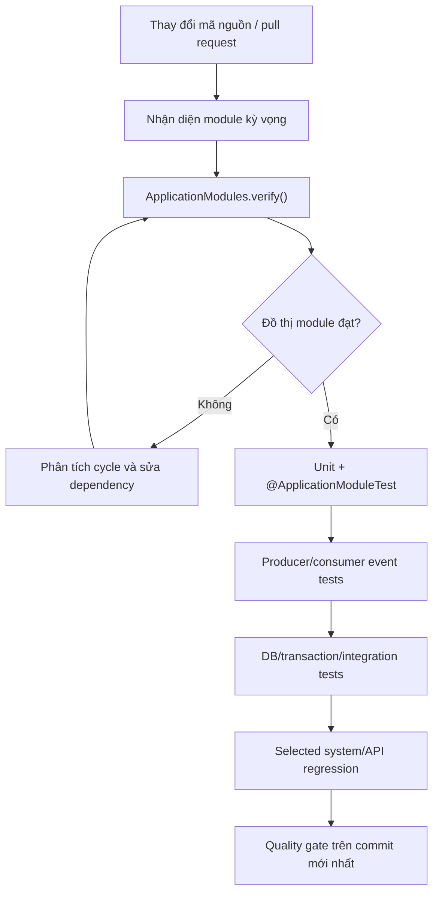
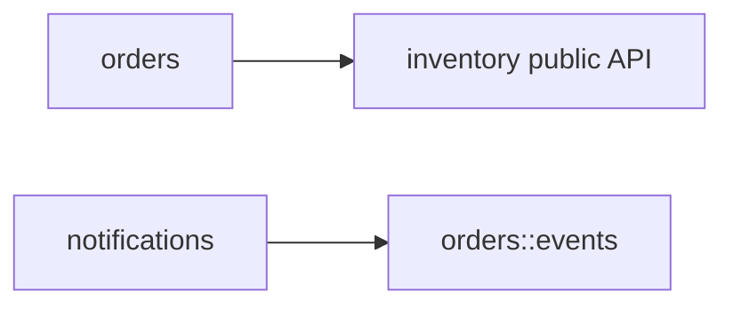
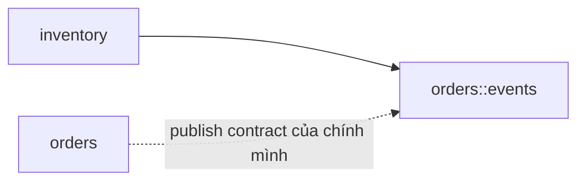
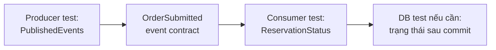
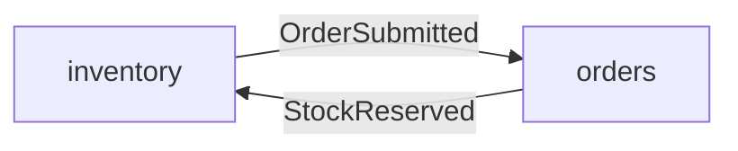
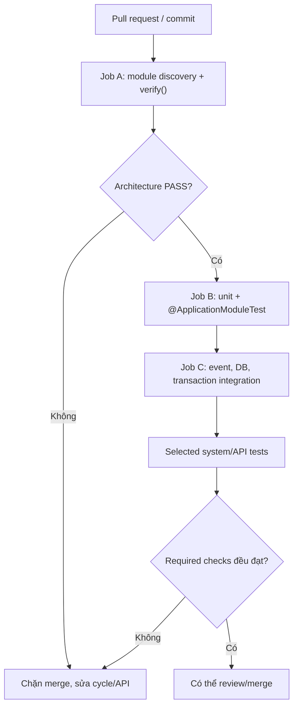

# Kiểm tra cycle bằng verify trước test hành vi

Một ứng dụng Spring Boot có thể **biên dịch**, khởi động `ApplicationContext` thành công và vượt qua nhiều unit test nhưng vẫn chứa **phụ thuộc vòng giữa các application module**. Chẳng hạn `orders` gọi trực tiếp một API của `inventory`, trong khi `inventory` lại nhận một sự kiện có type do `orders` công bố. Mỗi lời gọi riêng lẻ có vẻ hợp lý; khi ghép thành đồ thị, ta có vòng `orders → inventory → orders`.

Spring Modulith giúp phát hiện vấn đề này bằng mô hình `ApplicationModules` và phép kiểm chứng `verify()`. Với một chương trình kiểm thử có nhiều mức, nên **kiểm tra tính hợp lệ của cấu trúc module trước khi dùng các test hành vi rộng hơn làm bằng chứng hoàn thành**. Nếu kiến trúc đã có vòng, một suite `@ApplicationModuleTest` xanh vẫn không thể biến vòng đó thành hợp lệ.

Bài thuộc chương **Module boundaries** của **SPRING_MODULITH_VERIFICATION_TESTING**. Trọng tâm là kiểm chứng ranh giới của ứng dụng Spring Modulith bằng `ApplicationModules` và quy tắc phụ thuộc, sau đó thực hành `@ApplicationModuleTest`, kiểm thử event, database và tích hợp, kết hợp **CI quality gate** để phát hiện phụ thuộc sai và hồi quy sớm.

## 1. Mục tiêu học tập

Sau bài này, bạn có thể:

1. Nhận biết **module dependency cycle** và phân biệt nó với vòng gọi hàm, circular bean injection hoặc cycle giữa project build.
2. Vẽ đúng chiều dependency dựa trên **module chứa mã dùng type → module sở hữu type**.
3. Dùng `ApplicationModules.of(ShopApplication.class).verify()` làm **architecture test fail-fast**.
4. Giải thích vì sao kiểm thử cấu trúc nên có kết quả rõ ràng **trước khi kết luận từ test hành vi**, dù JUnit không đảm bảo thứ tự chạy test method.
5. Phân tích cycle ngay cả khi hai phía dùng **public API** hoặc event contract hợp lệ.
6. Thiết kế lại phụ thuộc để phá vòng mà không mở package `internal` hay nới `allowedDependencies` vô tội vạ.
7. Tạo producer và consumer tests với `@ApplicationModuleTest`, `PublishedEvents` và các assertion cụ thể.
8. Bổ sung kiểm thử transaction, database, idempotency và hệ thống khi hợp đồng runtime cần.
9. Cấu hình một **CI architecture gate** ngăn merge trước khi những rủi ro lớn hơn bị che bởi hành vi test xanh.
10. Ghi nhận bằng chứng đúng phạm vi: **structure PASS** khác với **behavior PASS** và **integration PASS**.

## 2. Phụ thuộc vòng là gì?

Một dependency được biểu diễn bằng mũi tên:

```text
Module A ---> Module B

Đọc là: code thuộc A tham chiếu một type/API do B sở hữu.
```

Một **dependency cycle** xuất hiện khi có đường đi từ một module quay lại chính nó qua một hay nhiều module khác:

```text
A -> B -> A

A -> B -> C -> A
```

Nếu bỏ qua chiều mũi tên hoặc chỉ nhìn số module liên quan, rất dễ kết luận sai. Đặc biệt, một **luồng sự kiện runtime** từ A sang B không nhất thiết tạo type dependency A → B.

### 2.1. Vì sao cycle nguy hiểm trong modular monolith?

Một chu trình khiến các module khó tiến hóa độc lập:

- Thay hợp đồng A có thể buộc B sửa, rồi thay B lại ảnh hưởng A.
- Việc tách module thành dịch vụ độc lập về sau khó hơn.
- Test B dễ phải nạp A, trong khi A lại yêu cầu B, làm giảm lợi ích của `@ApplicationModuleTest`.
- Quyền sở hữu nghiệp vụ bị mơ hồ: không rõ ai là producer, ai quyết định kết quả.
- Đội ngũ có xu hướng thêm nhiều API trung gian và mock để “làm test xanh” mà không giảm coupling thực.
- Đồ thị khó lý giải khi xuất hiện vòng bắc cầu A → B → C → A.

**Không có nghĩa:** cứ xuất hiện một chu trình giữa các method gọi trong cùng module là vi phạm. Ở đây ta đang nói về **chu trình giữa các application module được Spring Modulith nhận diện**.

### 2.2. Vòng trực tiếp và vòng bắc cầu



Trong cả hai trường hợp, **đường đi có hướng quay về module ban đầu**. Dù từng API được khai báo `public`, đồ thị vẫn có cycle.

## 3. Phân biệt bốn loại cycle dễ nhầm

| Loại vòng | Thành phần tham gia | Ví dụ | Bằng chứng cần dùng |
|---|---|---|---|
| **Application module dependency cycle** | Module và type dependency | `orders → inventory → orders` | `ApplicationModules.verify()` |
| **Spring bean dependency cycle** | Bean/constructor injection | `OrderService` inject `InventoryService` và ngược lại | Spring context bootstrap; phân tích bean graph |
| **Runtime call cycle** | Chuỗi method/event khi chạy | Handler A kích hoạt handler B rồi B gọi lại A | Test hành vi, trace, kiểm soát recursion/loop |
| **Build/module cycle** | Maven/Gradle modules hoặc JPMS requires | Project `orders` depends `inventory` và ngược lại | Build system/compiler/module tooling |

Bốn loại có thể liên quan nhưng **không tương đương**.

### 3.1. Kiến trúc có cycle trong khi Spring context vẫn khởi động

Giả sử `orders.OrderSubmission` inject `inventory.ReservationQuery`. Ở chiều ngược lại, `inventory.internal.OnOrderSubmitted` chỉ import **event type** `orders.events.OrderSubmitted`, không inject bean `OrderSubmission`.

Đồ thị module:

```text
orders -> inventory
inventory -> orders
```

Nhưng bean graph có thể vẫn không có hai bean constructor-inject nhau. Spring có thể boot bình thường; `ApplicationModules.verify()` vẫn cần báo vi phạm module cycle nếu mô hình nhận diện đúng.

### 3.2. Bean cycle không phải lúc nào cũng là module cycle

Hai bean trong **cùng** package application module có thể inject nhau và gây lỗi Spring, nhưng không tạo vòng giữa **hai application module** khác nhau. Architecture test module và Spring context test cần bảo vệ những rủi ro riêng.

### 3.3. Runtime event loop có thể không xuất hiện trong type graph đơn giản

Một listener có thể phát lại cùng event theo cấu hình hoặc dữ liệu khiến chuỗi xử lý lặp vô hạn. Ngay cả khi module graph hợp lệ, runtime loop vẫn cần behavioral/integration test và quan sát thực thi.

**Kết luận:** bắt đầu bằng `verify()` để bảo vệ **module boundary**, rồi dùng test hành vi và tích hợp bảo vệ runtime. Không dùng một loại test để suy diễn đã kiểm tra tất cả loại vòng.

## 4. Ví dụ xuyên suốt: orders và inventory

Giả sử một ứng dụng Spring Boot bán hàng có:

- `orders`: tiếp nhận yêu cầu đặt hàng.
- `inventory`: ghi nhận yêu cầu kiểm tra/đặt giữ hàng.
- `notifications`: có thể thông báo về đơn hàng, nhưng không cần tham gia trực tiếp vào ví dụ cycle.

Cấu trúc sau sẽ được dùng cho **phiên bản đã sửa hợp lệ**:

```text
com.acme.shop
├── ShopApplication.java
├── orders
│   ├── OrderSubmission.java
│   ├── events
│   │   ├── package-info.java
│   │   └── OrderSubmitted.java
│   └── internal
│       └── OrderRepository.java           # giả định chưa triển khai
├── inventory
│   ├── package-info.java
│   ├── ReservationStatus.java
│   └── internal
│       ├── ReservationProjection.java
│       └── OnOrderSubmitted.java
└── notifications
    ├── package-info.java
    └── internal
        └── OnOrderSubmitted.java           # tùy chọn
```

Phần **cố tình có cycle** ở mục tiếp theo là **mã mô tả lỗi để thực hành**, không ghép đồng thời với cấu trúc hợp lệ cuối bài.

### 4.1. ShopApplication nằm tại package gốc

```java
package com.acme.shop;

import org.springframework.boot.SpringApplication;
import org.springframework.boot.autoconfigure.SpringBootApplication;

@SpringBootApplication
public class ShopApplication {

    public static void main(String[] args) {
        SpringApplication.run(ShopApplication.class, args);
    }
}
```

Với cách nhận diện module **mặc định**, các package con trực tiếp của package gốc thường được coi là application module. Nếu dự án có cơ chế nhận diện hoặc tên module tùy biến, **phải kiểm tra mô hình thực tế** trước khi kết luận.

## 5. Tạo cycle có chủ đích: hai chiều phụ thuộc đều có lý do

Ban đầu developer muốn `orders` biết ngay tồn kho có cho phép tiếp nhận đơn hay không. Họ tạo API công khai tại `inventory`:

```java
package com.acme.shop.inventory;

import java.util.UUID;

public interface ReservationQuery {
    boolean canAccept(UUID productId, int quantity);
}
```

Sau đó `orders` sử dụng:

```java
package com.acme.shop.orders;

import com.acme.shop.inventory.ReservationQuery;
import java.util.UUID;

// Fragment cố tình minh họa cạnh orders -> inventory.
class OrderEligibilityCheck {

    private final ReservationQuery inventory;

    OrderEligibilityCheck(ReservationQuery inventory) {
        this.inventory = inventory;
    }

    boolean canPlace(UUID productId, int quantity) {
        return inventory.canAccept(productId, quantity);
    }
}
```

Đến đây, ta có cạnh **`orders → inventory`**. Cạnh này không nhất thiết sai nếu API công khai, policy cho phép, và chưa có chiều phụ thuộc ngược.

### 5.1. Inventory bắt đầu xử lý event của orders

Một thời gian sau, inventory bổ sung listener:

```java
package com.acme.shop.inventory.internal;

import com.acme.shop.orders.events.OrderSubmitted;
import org.springframework.context.event.EventListener;
import org.springframework.stereotype.Component;

@Component
class OnOrderSubmitted {

    @EventListener
    void on(OrderSubmitted event) {
        // Xử lý nghiệp vụ của inventory ở đây.
    }
}
```

Listener import `orders.events.OrderSubmitted`, nghĩa là có thêm cạnh **`inventory → orders`** về mặt Java type dependency.

### 5.2. Đồ thị tổng hợp



Đây là **cycle**. Đáng lưu ý:

- `ReservationQuery` có thể là public API hợp lệ của inventory.
- `OrderSubmitted` có thể là named interface công khai của orders.
- Cả hai dependency có thể biên dịch.
- Spring có thể vẫn tạo context nếu không có vòng bean constructor-injection.

**Nhưng public API hợp lệ ở từng cạnh không làm vòng module hợp lệ.** `verify()` phải được chạy để phát hiện cấu trúc này trước khi nhóm chấp nhận các test hành vi là đủ bằng chứng.

## 6. Đừng chữa cycle bằng cách chỉ mở allowedDependencies

Một nhóm có thể thử khai báo hai phía:

```java
// orders/package-info.java (CỐ TÌNH SAI về cấu trúc tổng thể)
@org.springframework.modulith.ApplicationModule(
    allowedDependencies = "inventory"
)
package com.acme.shop.orders;
```

```java
// inventory/package-info.java (CỐ TÌNH SAI về cấu trúc tổng thể)
@org.springframework.modulith.ApplicationModule(
    allowedDependencies = "orders::events"
)
package com.acme.shop.inventory;
```

Hai annotation này có thể làm những **cạnh đơn lẻ** nằm trong whitelist tương ứng. Tuy nhiên `orders → inventory → orders` vẫn là cycle.

### 6.1. Những cách sửa giả

- Chuyển mọi class sang `public` rồi cho cả hai bên import.
- Thêm cả hai module vào `allowedDependencies` của nhau.
- Dùng `@NamedInterface` cho package implementation để giấu lỗi internal-access.
- Dùng `@MockBean`/`@MockitoBean` cho collaborator vòng nhằm làm test khởi động.
- Đổi `@ApplicationModuleTest` sang `ALL_DEPENDENCIES`.
- Xóa architecture test trong CI để suite không còn đỏ.

Những cách này **không thay đổi đồ thị type dependency có hướng** hoặc có thể còn làm ranh giới yếu hơn. Cần refactor trách nhiệm và chiều giao tiếp, không chỉ chỉnh metadata/test setup.

## 7. Kiểm chứng cycle bằng ApplicationModules.verify()

Đặt architecture test ở package gốc, ví dụ `com.acme.shop`:

```java
package com.acme.shop;

import org.junit.jupiter.api.Test;
import org.springframework.modulith.core.ApplicationModules;

class ModuleArchitectureTests {

    @Test
    void moduleGraphIsAcyclicAndBoundariesAreValid() {
        ApplicationModules.of(ShopApplication.class).verify();
    }
}
```

`ApplicationModules.of(ShopApplication.class)` dựng mô hình application module từ ứng dụng. `verify()` kiểm chứng các quy tắc kiến trúc được Spring Modulith hỗ trợ, thông thường bao gồm:

1. Không tồn tại **module dependency cycle**.
2. Module không sử dụng API **nội bộ** của module khác.
3. Các quan hệ được kiểm tra phải tuân thủ `@ApplicationModule(allowedDependencies = ...)` nếu có.
4. Các quy tắc bổ sung áp dụng theo cấu hình/thư viện đang sử dụng.

Đối với code cố tình có vòng ở mục 5, **kỳ vọng architecture test thất bại**, không phụ thuộc chuyện các JUnit behavior test của `OrderEligibilityCheck` có xanh hay không.

### 7.1. Không cần khởi động toàn bộ ứng dụng để kiểm tra đồ thị

Kiến trúc test dùng `ApplicationModules` phân tích mô hình module/code. Nó không cần gọi `SpringApplication.run(...)` để chứng minh relation giữa module.

Điều này khiến nó phù hợp làm một trong những **kiểm tra nhanh, báo lỗi sớm** trong build/CI.

### 7.2. Verify xanh chưa chắc phạm vi nhận diện đã đúng

Nếu `ShopApplication` đặt sai package hoặc dự án có cấu hình nhận diện module khác mặc định, mô hình được dựng có thể không chứa các module bạn mong đợi. Khi đó một kết quả xanh cần được kiểm tra phạm vi.

Ví dụ thêm bài kiểm tra module discovery:

```java
package com.acme.shop;

import static org.assertj.core.api.Assertions.assertThat;

import org.junit.jupiter.api.Test;
import org.springframework.modulith.core.ApplicationModules;

class ModuleDiscoveryTests {

    @Test
    void discoversExpectedModules() {
        ApplicationModules modules =
            ApplicationModules.of(ShopApplication.class);

        assertThat(modules.getModuleByName("orders")).isPresent();
        assertThat(modules.getModuleByName("inventory")).isPresent();
        assertThat(modules.getModuleByName("notifications")).isPresent();
    }
}
```

Đây là ví dụ khi cả ba package có mặt trong source và được nhận diện theo tên mặc định. Nếu module notifications chưa tạo hoặc nhóm dùng tên module tùy chỉnh, **phải điều chỉnh assertions để khớp thực tế**.

### 7.3. Không chỉ kiểm tra tên file hoặc một import

Một import `java` chưa được sử dụng có thể không tồn tại như type reference có ý nghĩa trong mã đã biên dịch. Để tạo một test âm tính có chủ đích, hãy thêm field, constructor parameter, method signature hoặc lời gọi thật dẫn tới type thuộc module khác.

**Đừng đánh giá kiến trúc chỉ bằng việc đếm dòng `import`.** Quan trọng là dependency mà `ApplicationModules` thực sự phân tích được.

## 8. “Kiểm tra verify trước test hành vi” nên hiểu đúng thế nào?

Tiêu đề bài nhấn mạnh một **thứ tự bằng chứng**, không bắt buộc mọi JUnit method phải chạy tuần tự.



Ý nghĩa:

- Nếu module graph sai, cần sửa ranh giới **trước khi kết luận** rằng test hành vi xanh chứng minh hệ thống đạt yêu cầu.
- Có thể chạy architecture test **trước các test tốn kém** để fail-fast.
- Có thể chạy các job độc lập **song song** nhằm tối ưu CI; điều quan trọng là **merge yêu cầu tất cả gate bắt buộc đều đạt**.
- Không dựa vào thứ tự của các `@Test` trong cùng class hoặc nhiều class JUnit. Mặc định runner có thể chạy và sắp xếp test theo cách khác.

### 8.1. Vì sao nên ưu tiên architecture gate?

Một dependency cycle có thể tồn tại dù use case tạm vẫn chạy. Nếu nhóm chạy integration tests tốn nhiều phút trước khi phát hiện vi phạm cấu trúc dễ xác định, họ mất thời gian và dễ quy lỗi sai lớp.

Architecture gate sớm giúp:

1. Phát hiện lỗi phụ thuộc ngay sau thay đổi code.
2. Chỉ rõ đây là vấn đề **module design**, không phải database hoặc event runtime.
3. Giảm chi phí test rộng khi kiến trúc đã fail.
4. Bảo vệ quyết định chia module theo thời gian.

Nhưng sau khi `verify()` đạt, **không được dừng tại đó**. Hành vi, transaction và data correctness vẫn phải có bằng chứng riêng.

## 9. Đọc và xử lý một báo cáo cycle

Khi `verify()` thất bại, đừng sửa bằng cách đổi annotation ngay. Cần tái dựng đồ thị chính xác.

### 9.1. Câu hỏi điều tra

- **Module nguồn** của mỗi cạnh là module nào?
- **Type đích** nằm trong module nào?
- Type đích có phải public module API hoặc named interface không?
- Cạnh được tạo từ constructor/field/method/annotation/event type nào?
- Có một **đường đi ngược** đã tồn tại từ module đích về module nguồn không?
- Cạnh nào được thêm gần đây nhất?
- Nếu bỏ một cạnh, trách nhiệm nghiệp vụ nào sẽ cần đường giao tiếp mới?

### 9.2. Ví dụ bảng điều tra

| Cạnh | Nguồn tạo type dependency | Chỗ cần xem lại |
|---|---|---|
| `orders → inventory` | `OrderEligibilityCheck` dùng `ReservationQuery` | Orders có cần hỏi tồn kho đồng bộ ngay không? |
| `inventory → orders` | `OnOrderSubmitted` dùng `OrderSubmitted` | Inventory có nên tiêu thụ sự kiện do orders công bố không? |
| Vòng `orders → inventory → orders` | Tổng hợp hai cạnh | Có thể chọn một chiều giao tiếp khác hoặc một nơi điều phối không? |

Nếu cả hai cạnh có giá trị nghiệp vụ, câu trả lời **không nhất thiết xóa tính năng**. Ta cần đổi ownership, thời điểm tương tác hoặc nơi đặt hợp đồng để phá vòng module.

### 9.3. Ba dạng kết quả cần phân biệt

| Kết quả | Diễn giải đúng | Việc tiếp theo |
|---|---|---|
| `verify()` đỏ vì cycle | Mô hình có vòng dependency | Sửa đồ thị trước khi chấp nhận kiến trúc |
| `verify()` đỏ vì internal access | Module xuyên vào implementation module khác | Thiết kế public API/named interface phù hợp |
| `verify()` xanh | Những quy tắc kiến trúc được kiểm tra hiện đạt | Chạy test hành vi/sự kiện/database theo rủi ro |

Không dùng một câu “build xanh” để thay thế việc biết **loại lỗi nào đã được test nào kiểm tra**.

## 10. Cách gỡ cycle: chọn chiều hợp đồng đúng nghiệp vụ

Không có một cách phá vòng cho mọi hệ thống. Trong tình huống ở mục 5, hãy xét yêu cầu thực sự.

### 10.1. Trường hợp A: orders cần kết quả tức thì từ inventory

Nếu quy tắc là “chỉ xác nhận đơn khi tồn kho đã giữ thành công”, gọi API đồng bộ **có thể** là lựa chọn đúng.

Khi đó ta có thể giữ `orders → inventory` bằng public API, nhưng phải thiết kế sao cho inventory **không phụ thuộc type của orders** trong cùng hướng ngược lại. Ví dụ:

- Inventory cung cấp API đồng bộ trả kết quả reservation.
- Orders gọi API đó và tự quyết định có tiếp nhận yêu cầu không.
- Inventory không import `OrderSubmitted` của orders để xử lý thêm cùng tác dụng.
- Các phản ứng ngoài luồng có thể chuyển sang module khác hoặc contract khác tùy ownership.

Đồ thị:



**Lưu ý:** chuyển event phụ vào notifications không tự giải quyết mọi use case. Nếu inventory cần nhận event sau đó vì một nghiệp vụ riêng, phải xem liệu hợp đồng ấy thật sự đòi hỏi type dependency ngược hay nên được tái thiết kế.

### 10.2. Trường hợp B: orders chỉ thông báo yêu cầu đã được tiếp nhận

Nếu không cần chờ inventory trả kết quả trước response, có thể bỏ cạnh `orders → inventory` và chỉ publish event `OrderSubmitted`. Inventory nhận event với dependency `inventory → orders::events`.



Đồ thị không còn cạnh orders → inventory, nên không hình thành vòng giữa hai module này.

Hệ quả nghiệp vụ: inventory có thể xử lý muộn hơn. API của orders không được nói “đã giữ hàng xong” chỉ vì producer publish event thành công.

### 10.3. Trường hợp C: cần phối hợp nhiều bước có phản hồi

Nếu quá trình gồm accept order → reserve stock → authorize payment → confirm order với nhiều trạng thái và phản hồi, hãy cân nhắc một **module điều phối quy trình** có trách nhiệm rõ, thay vì để mọi module gọi lẫn nhau.

Một module workflow/orchestrator có thể phụ thuộc vào các API công khai theo một hướng hợp lệ và lưu trạng thái tiến trình. Tuy nhiên, nếu các module lại import kiểu của orchestrator để báo kết quả, có thể xuất hiện chu trình mới. Phải thiết kế hợp đồng, event owner và chiều dependency **toàn cục**, không chỉ đặt tên mới cho một module.

### 10.4. Trường hợp D: hợp đồng trung lập

Trong một số kiến trúc, các event/value contract ổn định có thể nằm ở một **module hợp đồng riêng** để nhiều module phụ thuộc một chiều. Phương án này hữu ích khi ownership và bounded context phù hợp.

Nhưng tránh biến `shared` hoặc `contracts` thành nơi chứa mọi domain entity, repository và service: đây là một cách khác tạo coupling lớn dù module graph có thể trông ít vòng hơn.

## 11. Thiết kế hợp lệ sau refactor: event contract của orders

Phần này triển khai **trường hợp B** (orders publish, inventory xử lý). Không ghép các fragment cycle ở mục 5 vào cùng code production.

### 11.1. Công bố named event interface

Đặt file `orders/events/package-info.java`:

```java
@org.springframework.modulith.NamedInterface("events")
package com.acme.shop.orders.events;
```

File `orders/events/OrderSubmitted.java`:

```java
package com.acme.shop.orders.events;

import java.util.UUID;

public record OrderSubmitted(
    UUID orderId,
    UUID productId,
    int quantity
) {}
```

`OrderSubmitted` là **event contract**. Trong demo, nó diễn đạt việc một yêu cầu đã qua validation đầu vào và được publish, **không** khẳng định đơn hàng đã lưu hoặc kho đã giữ xong.

### 11.2. Inventory chỉ được phép dùng orders::events

File `inventory/package-info.java`:

```java
@org.springframework.modulith.ApplicationModule(
    allowedDependencies = "orders::events"
)
package com.acme.shop.inventory;
```

Metadata này giới hạn dependency của inventory vào named interface `events` của orders. Nó không cấp quyền cho inventory gọi `orders.internal.OrderRepository` hoặc `orders.OrderSubmission`.

Nếu `notifications` cũng tiêu thụ event, file `notifications/package-info.java` có thể tương tự:

```java
@org.springframework.modulith.ApplicationModule(
    allowedDependencies = "orders::events"
)
package com.acme.shop.notifications;
```

Việc một consumer mới phụ thuộc `orders::events` không buộc `orders` import consumer đó.

### 11.3. Không phải event tự loại bỏ mọi cycle

Nếu sau đó orders bắt đầu tiêu thụ event do inventory công bố:

```text
inventory -> orders::events
orders    -> inventory::events
```

thì vòng **có thể tái xuất hiện**. Việc sử dụng cả hai phía là named interface không miễn trừ quy tắc chống module cycle.

## 12. Producer hợp lệ: OrderSubmission không phụ thuộc inventory

File `orders/OrderSubmission.java`:

```java
package com.acme.shop.orders;

import com.acme.shop.orders.events.OrderSubmitted;
import java.util.UUID;
import org.springframework.context.ApplicationEventPublisher;
import org.springframework.stereotype.Service;

@Service
public class OrderSubmission {

    private final ApplicationEventPublisher events;

    public OrderSubmission(ApplicationEventPublisher events) {
        this.events = events;
    }

    public UUID submit(UUID productId, int quantity) {
        if (productId == null || quantity <= 0) {
            throw new IllegalArgumentException("Invalid order item");
        }

        UUID orderId = UUID.randomUUID();

        events.publishEvent(new OrderSubmitted(
            orderId, productId, quantity
        ));

        return orderId;
    }
}
```

Bằng cách này:

- `OrderSubmission` import event type của **chính module orders**.
- `ApplicationEventPublisher` là API Spring Framework.
- Không có type dependency từ orders sang inventory.
- Inventory có thể thay đổi listener implementation mà không buộc orders sửa mã.

**Giới hạn rõ ràng:** use case demo chưa có database, transaction, reservation hay thanh toán. Vì vậy `submit(...)` chỉ chứng minh yêu cầu đã được kiểm tra và event được publish; ID trả về chưa phải bằng chứng về trạng thái bền vững.

## 13. Consumer hợp lệ: inventory dùng named interface

Để có một kết quả quan sát được trong test, inventory công bố API đọc:

```java
package com.acme.shop.inventory;

import java.util.UUID;

public interface ReservationStatus {
    boolean received(UUID orderId);
}
```

Implementation in-memory trong `inventory/internal/ReservationProjection.java`:

```java
package com.acme.shop.inventory.internal;

import com.acme.shop.inventory.ReservationStatus;
import java.util.Set;
import java.util.UUID;
import java.util.concurrent.ConcurrentHashMap;
import org.springframework.stereotype.Component;

@Component
class ReservationProjection implements ReservationStatus {

    private final Set<UUID> receivedOrderIds =
        ConcurrentHashMap.newKeySet();

    void record(UUID orderId) {
        receivedOrderIds.add(orderId);
    }

    @Override
    public boolean received(UUID orderId) {
        return receivedOrderIds.contains(orderId);
    }
}
```

Listener trong `inventory/internal/OnOrderSubmitted.java`:

```java
package com.acme.shop.inventory.internal;

import com.acme.shop.orders.events.OrderSubmitted;
import org.springframework.context.event.EventListener;
import org.springframework.stereotype.Component;

@Component
class OnOrderSubmitted {

    private final ReservationProjection projection;

    OnOrderSubmitted(ReservationProjection projection) {
        this.projection = projection;
    }

    @EventListener
    void on(OrderSubmitted event) {
        projection.record(event.orderId());
    }
}
```

Dependency thực sự:

- `inventory.internal.OnOrderSubmitted` dùng `orders.events.OrderSubmitted`.
- Vì `orders.events` được công bố qua `@NamedInterface("events")` và inventory có `allowedDependencies = "orders::events"`, cạnh này có chủ đích.
- Inventory không inject `orders.OrderSubmission` và không đọc repository orders.

`ReservationProjection` **chỉ ghi nhận ID trong JVM**. Nó chưa quản lý stock count, không tạo một reservation bền vững, không bảo đảm idempotency khi restart. Những vấn đề đó cần database test và thiết kế production riêng.

## 14. Chạy lại verify và kiểm tra graph sau refactor

Architecture test vẫn giữ nguyên:

```java
package com.acme.shop;

import org.junit.jupiter.api.Test;
import org.springframework.modulith.core.ApplicationModules;

class ModuleArchitectureTests {

    @Test
    void moduleGraphIsAcyclicAndBoundariesAreValid() {
        ApplicationModules.of(ShopApplication.class).verify();
    }
}
```

Giờ đồ thị chính chỉ còn:

```text
inventory -> orders::events

# Không còn dependency type orders -> inventory.
```

Kỳ vọng `verify()` thành công **nếu không có các vi phạm kiến trúc khác trong ứng dụng**.

### 14.1. Kiểm chứng scope của module model

Ngoài verify, hãy xác nhận `orders` và `inventory` đều được nhận diện:

```java
@Test
void expectedModulesAreDiscovered() {
    ApplicationModules modules =
        ApplicationModules.of(ShopApplication.class);

    assertThat(modules.getModuleByName("orders")).isPresent();
    assertThat(modules.getModuleByName("inventory")).isPresent();
}
```

Đoạn trên là **test fragment** cần đặt trong class JUnit có import `ApplicationModules`, `assertThat` và `@Test`; có thể dùng `ModuleDiscoveryTests` ở mục 7.2.

Nếu mô hình module không phản ánh đúng các phần cần kiểm tra, cần sửa cấu hình nhận diện trước khi tin tưởng kết quả pass.

### 14.2. Không cho phép một cycle mới lẻn vào sau này

Khi một developer đề xuất cho orders truy cập `inventory.ReservationStatus` để đọc projection, hãy đánh giá:

- Gọi đó có thật sự cần trong use case hiện tại không?
- Cạnh `orders → inventory` có tạo vòng với `inventory → orders::events` không?
- Có thể cho một module bên ngoài điều phối truy vấn trạng thái không?
- Có nên đưa trạng thái phù hợp vào API ở nơi sở hữu quy trình?
- Nếu cần phản hồi, hợp đồng event/type sẽ được đặt ở đâu để không tạo cycle?

**Không** thêm một public API rồi mặc định chiều dependency là hợp lệ; phải chạy lại `verify()` với đồ thị đầy đủ.

## 15. Sau verify: unit test và @ApplicationModuleTest khác gì?

`verify()` trả lời: **Đồ thị phụ thuộc có hợp lệ không?**

Behavior test trả lời: **Module có làm đúng việc không?**

| Loại kiểm chứng | Cần Spring context? | Bằng chứng |
|---|---|---|
| `ApplicationModules.verify()` | Không cần boot toàn bộ context | Quan hệ module, public/internal API, dependency policy |
| Unit test JUnit/Mockito | Thường không | Logic một class với collaborator giả lập |
| `@ApplicationModuleTest` | Có, trong phạm vi module | Bean wiring và hành vi module đang test |
| Event producer test | Có thể dùng `PublishedEvents` | Số lượng/type/payload sự kiện phát |
| Consumer module test | Có context consumer phù hợp | Listener phản ứng với input event |
| Database/transaction integration | Có hạ tầng dữ liệu thích hợp | Commit, constraint, idempotency và dữ liệu cuối |
| System/API test | Có ứng dụng và các thành phần liên quan | Luồng người dùng xuyên lớp |

Hai loại kiểm tra có thể đều được viết bằng JUnit, nhưng **câu hỏi kiểm chứng khác nhau**. Không coi “toàn bộ test JUnit pass” là bằng chứng cycle đã được kiểm tra nếu trong suite không có architecture test đúng phạm vi.

## 16. Producer module test sau khi graph hợp lệ

File `orders/OrderSubmissionModuleTests.java`:

```java
package com.acme.shop.orders;

import static org.assertj.core.api.Assertions.assertThat;
import static org.assertj.core.api.Assertions.assertThatThrownBy;

import com.acme.shop.orders.events.OrderSubmitted;
import java.util.UUID;
import org.junit.jupiter.api.Test;
import org.springframework.beans.factory.annotation.Autowired;
import org.springframework.modulith.test.ApplicationModuleTest;
import org.springframework.modulith.test.PublishedEvents;

@ApplicationModuleTest
class OrderSubmissionModuleTests {

    @Autowired OrderSubmission orders;

    @Test
    void publishesCorrectEvent(PublishedEvents events) {
        UUID productId = UUID.randomUUID();

        UUID orderId = orders.submit(productId, 2);

        assertThat(events.ofType(OrderSubmitted.class))
            .singleElement()
            .satisfies(event -> {
                assertThat(event.orderId()).isEqualTo(orderId);
                assertThat(event.productId()).isEqualTo(productId);
                assertThat(event.quantity()).isEqualTo(2);
            });
    }

    @Test
    void rejectsInvalidQuantityWithoutEvent(
            PublishedEvents events) {

        assertThatThrownBy(() ->
            orders.submit(UUID.randomUUID(), 0)
        ).isInstanceOf(IllegalArgumentException.class)
         .hasMessage("Invalid order item");

        assertThat(events.ofType(OrderSubmitted.class)).isEmpty();
    }

    @Test
    void rejectsNullProductWithoutEvent(
            PublishedEvents events) {

        assertThatThrownBy(() -> orders.submit(null, 1))
            .isInstanceOf(IllegalArgumentException.class);

        assertThat(events.ofType(OrderSubmitted.class)).isEmpty();
    }
}
```

Bài test này xác minh:

- `OrderSubmission` là bean hoạt động trong module orders.
- Một input hợp lệ tạo đúng **một** event với payload mong đợi.
- Input không hợp lệ bị từ chối và **không** tạo `OrderSubmitted`.

### 16.1. Vì sao không cần inventory trong test producer?

Bởi producer sau refactor **không phụ thuộc inventory**. Mục tiêu test là hành vi **phát event** của orders, không phải xử lý downstream.

`@ApplicationModuleTest` mặc định ở `STANDALONE` tập trung vào module đang test. Inventory consumer không nhất thiết nằm trong context này; việc listener không chạy không làm producer test thiếu bằng chứng cho mục tiêu của nó.

### 16.2. Không suy diễn quá phạm vi

Producer test xanh **không** chứng minh:

- Inventory nhận event.
- Reservation đã lưu.
- Event được xử lý lại sau lỗi.
- Producer đã commit transaction.
- Database có đơn hàng.
- Mọi configuration sản xuất đã đúng.

Chỉ ghi nhận những gì assertion thực sự quan sát.

## 17. Consumer module test: kiểm chứng phản ứng độc lập

File `inventory/InventoryModuleTests.java`:

```java
package com.acme.shop.inventory;

import static org.assertj.core.api.Assertions.assertThat;

import com.acme.shop.orders.events.OrderSubmitted;
import java.util.UUID;
import org.junit.jupiter.api.Test;
import org.springframework.beans.factory.annotation.Autowired;
import org.springframework.context.ApplicationEventPublisher;
import org.springframework.modulith.test.ApplicationModuleTest;

@ApplicationModuleTest
class InventoryModuleTests {

    @Autowired ApplicationEventPublisher publisher;
    @Autowired ReservationStatus status;

    @Test
    void recordsOrderSubmittedEvent() {
        UUID orderId = UUID.randomUUID();

        publisher.publishEvent(new OrderSubmitted(
            orderId, UUID.randomUUID(), 2
        ));

        assertThat(status.received(orderId)).isTrue();
    }
}
```

Test này tự phát một **event hợp đồng** làm đầu vào và quan sát kết quả của inventory. Không cần gọi producer `OrderSubmission.submit(...)` để chứng minh consumer xử lý event type phù hợp.

Trong ví dụ dùng `@EventListener` và Spring event multicaster đồng bộ mặc định, projection có thể được kiểm tra ngay sau khi publish. Nếu listener async hoặc after-commit, cách chờ và transaction test cần thay đổi.

### 17.1. Bằng chứng phía producer và consumer bổ sung nhau



- **Published:** producer phát event đúng.
- **Handled:** consumer xử lý event đầu vào đúng.
- **Committed:** dữ liệu được lưu đúng sau transaction.

Ba cấp bằng chứng không thể thay thế nhau. Đặc biệt, nếu dự án dùng in-memory projection như demo, consumer test chỉ chứng minh **logic trong JVM** chứ không chứng minh persistence.

## 18. BootstrapMode không sửa được cycle

`@ApplicationModuleTest` có các chế độ:

| Mode | Module được nạp trong test | Khi nào phù hợp |
|---|---|---|
| `STANDALONE` (mặc định) | Module đang kiểm thử | Kiểm tra hành vi nội bộ và producer/consumer hợp đồng |
| `DIRECT_DEPENDENCIES` | Module đang test và dependency trực tiếp | Khi cần bean thật của module phụ thuộc hợp lệ |
| `ALL_DEPENDENCIES` | Module đang test và các dependency bắc cầu | Khi cần phối hợp nhiều tầng dependency hợp lệ |

Ví dụ:

```java
import org.springframework.modulith.test.ApplicationModuleTest;
import org.springframework.modulith.test.ApplicationModuleTest.BootstrapMode;

@ApplicationModuleTest(
    mode = BootstrapMode.DIRECT_DEPENDENCIES
)
class InventoryWithDeclaredDependenciesTests {
    // Viết test phối hợp nếu cần dùng bean thật từ dependency.
}
```

**Điểm bắt buộc nhớ:** mode xác định phạm vi Spring TestContext. Nó **không** thay đổi dependency đã biên dịch trong production code. Nếu đồ thị `orders → inventory → orders` có cycle, chọn `ALL_DEPENDENCIES` hay mock bean không làm `verify()` xanh đúng nghĩa.

### 18.1. Thiếu bean không đồng nghĩa có cycle

Trong `STANDALONE`, một module có thể thiếu bean từ dependency hợp lệ. Đó là vấn đề **test fixture/bean wiring**, không tự động là module dependency cycle.

Hướng xử lý:

1. Xác minh relation bằng `verify()`.
2. Xác định bean thuộc module nào.
3. Chọn mock/fake collaborator ngoài module nếu chỉ test logic.
4. Chọn mode rộng hơn nếu mục tiêu là collaboration với bean thật.
5. Nếu bean thật cần database/properties, cấu hình integration test phù hợp.

Đừng sử dụng việc mở rộng context như cách thay thế kiểm chứng kiến trúc.

## 19. Event-based refactor vẫn cần test transaction

Trong production, `orders` thường lưu đơn hoặc thay đổi trạng thái trước khi inventory phản ứng. Khi đó event phải có **ngữ nghĩa thời điểm** rõ.

Ví dụ một fragment minh họa producer có transaction:

```java
@Service
class PersistedOrderSubmission {

    private final OrderRepository repository;
    private final ApplicationEventPublisher events;

    PersistedOrderSubmission(
            OrderRepository repository,
            ApplicationEventPublisher events) {
        this.repository = repository;
        this.events = events;
    }

    @Transactional
    public UUID submit(UUID productId, int quantity) {
        Order order = Order.create(productId, quantity);

        repository.save(order);

        events.publishEvent(new OrderSubmitted(
            order.id(), productId, quantity
        ));

        return order.id();
    }
}
```

**Đây là fragment, không phải class có thể biên dịch độc lập:** `Order`, `OrderRepository`, imports và hạ tầng JPA phải được cài đặt cho dự án thực.

### 19.1. @EventListener và listener sau commit khác nhau

| Cơ chế | Ngữ nghĩa thường gặp | Rủi ro cần test |
|---|---|---|
| `@EventListener` với multicaster đồng bộ mặc định | Gọi khi `publishEvent` được thực thi | Side effect có thể xảy ra trước commit; lỗi listener ảnh hưởng call chain |
| `@TransactionalEventListener(AFTER_COMMIT)` | Phản ứng sau commit của transaction liên quan | Không chạy như mong đợi khi producer thiếu transaction; test transaction rollback |
| `@ApplicationModuleListener` | Mẫu listener của Modulith cho xử lý theo transaction, thường async sau commit | Chờ xử lý, recovery và idempotency theo cấu hình |

Khi chuyển sang cơ chế sau commit/bất đồng bộ, **producer test PublishedEvents xanh không đủ**. Cần test đường đi qua commit thật, listener và dữ liệu cuối.

### 19.2. Đừng giả định event tự thực hiện đảm bảo exactly-once

Event publication registry của Spring Modulith có thể hỗ trợ theo dõi publication chưa hoàn tất khi được cấu hình phù hợp, nhưng cơ chế xử lý lại luôn đặt ra khả năng consumer **nhận trùng hoặc tác dụng phụ xảy ra lặp**.

Khi tác dụng quan trọng, hãy dùng khóa idempotency, database constraint hoặc cơ chế tương đương và test lỗi/concurrency. Không xem một annotation listener là bằng chứng “chỉ thực hiện một lần”.

## 20. Kiểm thử database và idempotency sau khi gỡ cycle

Giả sử inventory lưu reservation thật. Một sự kiện `OrderSubmitted` có thể bị xử lý nhiều lần khi retry hoặc replay.

Bảng dữ liệu minh họa:

```sql
CREATE TABLE inventory_reservation (
    reservation_id UUID PRIMARY KEY,
    order_id UUID NOT NULL,
    product_id UUID NOT NULL,
    quantity INTEGER NOT NULL,
    status VARCHAR(30) NOT NULL,
    CONSTRAINT uq_reservation_order UNIQUE (order_id)
);
```

Schema giả định **một reservation trên mỗi order**. Nếu đơn có nhiều dòng hàng, thiết kế khóa cần phân biệt dòng hoặc request riêng. Không sao chép schema minh họa vào production khi domain khác.

### 20.1. Test quan trọng cần assert đúng kết quả

| Rủi ro | Test cần thiết | Assertion có ý nghĩa |
|---|---|---|
| Duplicate event | Consumer/database integration | Một tác dụng bền vững theo khóa idempotency |
| Race giữa hai consumer | Concurrency test | Không tạo hai reservation trái hợp đồng |
| Producer rollback | Transaction/event integration | Không có reservation khi event không nên được xử lý |
| Consumer lỗi sau producer commit | Recovery/retry integration | Kết quả có thể hoàn tất theo chính sách, không mất hoặc lặp tác dụng |
| Migration sai | Schema/repository integration | Constraint và mapping hoạt động đúng |
| Event payload sai | Producer + consumer contract | ID/quantity được hiểu và xử lý đúng |

**Testcontainers** có thể cung cấp PostgreSQL hoặc DB tương ứng cho integration test, nhưng container tự khởi động không đủ. Test phải kích hoạt hành vi và quan sát trạng thái **sau transaction**.

### 20.2. Test @Transactional có thể che điều cần chứng minh

Trong Spring Test, test được đánh dấu `@Transactional` thường có transaction bao ngoài và rollback khi kết thúc. Nếu listener cần `AFTER_COMMIT`, test có thể không đạt đúng điểm kích hoạt production.

Muốn chứng minh after-commit:

- Xác định transaction của producer và của test.
- Kích hoạt đường đi production qua commit thực.
- Chờ listener bằng điều kiện quan sát được nếu bất đồng bộ.
- Đọc lại dữ liệu ngoài transaction chưa commit.
- Thêm ca rollback và ca nhận lặp.

### 20.3. Scenario và cách chờ kết quả bất đồng bộ

`Scenario` của Spring Modulith Test có thể giúp diễn đạt việc kích hoạt rồi chờ event hoặc trạng thái cụ thể. Một ví dụ **định hướng** với các class domain giả định:

```java
@Autowired Scenario scenario;
@Autowired OrderSubmission orders;

@Test
void observesReservationResult() {
    UUID productId = UUID.randomUUID();

    scenario
        .stimulate(() -> orders.submit(productId, 2))
        .andWaitForEventOfType(ReservationRecorded.class)
        .toArriveAndVerify(event ->
            assertThat(event.productId()).isEqualTo(productId));
}
```

Đây **không phải test copy-paste chạy ngay**: cần định nghĩa `ReservationRecorded`, listener phát event kết quả, transaction setup và API tương thích phiên bản Spring Modulith. Nó minh họa nguyên tắc **chờ bằng điều kiện**, không dùng `Thread.sleep(...)` cố định rồi suy đoán consumer đã hoàn tất.

Ngay cả khi event kết quả đến, nếu nghiệp vụ cần bằng chứng **database commit**, hãy assert thêm trạng thái dữ liệu sau commit.

## 21. Trường hợp khó: vòng khi hai module cùng dùng event phản hồi

Một lỗi phổ biến là nghĩ: “Ta thay mọi lời gọi trực tiếp bằng event thì không thể có cycle”.

Giả sử:

- Inventory nhận `orders::events.OrderSubmitted`.
- Orders nhận `inventory::events.StockReserved`.

Khi mỗi listener tham chiếu type event của module kia, đồ thị type dependency:



Đây vẫn là cycle giữa **application module**, dù runtime dùng event.

### 21.1. Đặt câu hỏi thiết kế trước khi refactor

- Event phản hồi có thật sự cần được orders **import** không?
- Module nào là owner của quy trình đặt hàng và trạng thái cuối?
- Một module điều phối riêng có giúp tạo dependency một chiều rõ ràng không?
- Có nên công bố event/value contract trong một module trung lập, ổn định?
- Những transaction và trạng thái nào phải được quản lý độc lập?
- Thay đổi module graph có còn phù hợp với bounded context không?

**Không có quy tắc “mọi event phải nằm ở một shared module”**. Chuyển hợp đồng sang nơi trung lập có trade-off về ownership; hãy dùng khi nó cải thiện kiến trúc thật, không chỉ để làm analyzer xanh.

### 21.2. Kiểm tra lại toàn bộ sau khi chọn phương án

Khi thiết kế lại event hai chiều:

1. Vẽ type dependency graph mới.
2. Xác định public API và named interface cho từng edge.
3. Chạy `ApplicationModules.verify()` để kiểm tra cycle.
4. Viết producer và consumer tests cho các hợp đồng mới.
5. Thêm transaction/DB integration nếu trạng thái cuối phụ thuộc vào nhiều bước.
6. Tạo regression case trên CI để ngăn vòng quay lại.

## 22. Tạo phép thử âm tính cho verify

Để **chứng minh architecture gate có hiệu lực**, không chỉ xem test pass một lần.

### 22.1. Quy trình red–green

1. Trên một nhánh thử nghiệm, giữ bản hợp lệ `inventory → orders::events`.
2. Tạo thêm một type reference từ `orders` tới public API `inventory.ReservationStatus`.
3. Nếu `orders` có `allowedDependencies`, chỉ trong nhánh thử nghiệm đặt policy sao cho lỗi **cycle** có thể được quan sát độc lập với lỗi whitelist.
4. Chạy `ModuleArchitectureTests`: kỳ vọng thất bại vì `orders → inventory → orders`.
5. Đọc thông tin vi phạm để xác định cạnh nào tạo chu trình.
6. Gỡ dependency ngược; giữ chỉ event producer và consumer.
7. Chạy lại `verify()`: kỳ vọng đạt nếu không có vi phạm khác.
8. Lưu kết quả thử nghiệm như một bằng chứng rằng quality gate nhạy với vòng module.

Bước 3 không có nghĩa được nới policy trên nhánh chính. Nó chỉ giúp **phân tách nguyên nhân** khi muốn kiểm tra đặc biệt rằng bộ phát hiện cycle hoạt động, thay vì báo lỗi whitelist trước.

### 22.2. Tránh test sai bằng import thừa

Ví dụ một class chỉ có:

```java
import com.acme.shop.inventory.ReservationStatus;
```

nhưng không dùng type đó có thể không sinh một dependency đủ để bộ phân tích nhận diện. Tạo field/constructor/method thật trong class được biên dịch để phép thử có ý nghĩa.

### 22.3. Vì sao không để code vi phạm ở main branch?

Nếu để class cố tình sai trong production, architecture gate phải đỏ vĩnh viễn. Bài học đúng là **thử âm tính tạm thời để xác minh detector**, hoàn nguyên rồi bảo đảm gate xanh. Đừng biến vi phạm thử nghiệm thành dữ liệu test cố định trong source production.

## 23. CI quality gate: architecture trước, behavior sau

Trong CI, có thể tách một job hoặc bước nhanh để chạy architecture verification trước những integration test tốn kém.



**Điều quan trọng:** đây là thứ tự **cổng chất lượng**, không phải quy định phải sắp xếp tất cả JUnit methods. Job có thể chạy song song nếu nhóm muốn tối ưu thời gian, nhưng **merge không được diễn ra nếu architecture gate hoặc behavior/integration gate bắt buộc đang đỏ**.

### 23.1. Lệnh ví dụ với Maven Wrapper

Giả sử dự án cấu hình `ModuleArchitectureTests` là JUnit 5 test chạy qua Maven Surefire:

```bash
# Kiểm tra kiến trúc trước, trong một bước CI riêng.
./mvnw -Dtest=ModuleArchitectureTests test

# Chạy suite đầy đủ theo những phase/plugin đã cấu hình.
./mvnw verify
```

Lưu ý:

- `-Dtest=...` chọn test theo cấu hình plugin; cần kiểm tra tên class/package thực.
- `verify` không tự bảo đảm mọi integration test đã chạy nếu dự án tách profile, Failsafe hoặc task khác.
- Pipeline cần cấu hình JDK, Docker/Testcontainers và tài nguyên thử nghiệm phù hợp.
- Không xóa hoặc skip `ModuleArchitectureTests` chỉ để vượt pipeline.

### 23.2. Lệnh tương ứng với Gradle

Ví dụ khi task `test` đã được cấu hình:

```bash
# Kiểm tra architecture test cụ thể.
./gradlew test --tests "com.acme.shop.ModuleArchitectureTests"

# Suite được gán cho task test.
./gradlew test
```

Nếu dự án có task riêng như `integrationTest`, CI phải gọi thêm task đó theo quy định của nhóm. Không coi `test` xanh là bằng chứng tất cả kiểm thử đã chạy.

### 23.3. Một ví dụ pipeline theo logic gate

```yaml
# Trích đoạn minh họa ý tưởng CI, không phải workflow đầy đủ.
jobs:
  architecture:
    steps:
      - run: ./mvnw -Dtest=ModuleArchitectureTests test

  behavior:
    needs: architecture
    steps:
      - run: ./mvnw verify
```

YAML ở trên **chỉ là fragment minh họa**: workflow chạy thực tế cần cấu hình event trigger, runner, checkout source, Java toolchain, quyền truy cập, cache và những thành phần hạ tầng được dùng. Ngoài ra cần đặt **required checks** trong thiết lập merge/branch protection tương ứng.

### 23.4. Không để “xanh giả”

Một build có thể xanh nhưng chưa bảo vệ module cycle khi:

- Architecture test không được discovery hoặc đã bị exclude.
- Maven/Gradle không chạy task chứa test.
- Test bị `@Disabled`.
- Mô hình module thiếu `orders` hoặc `inventory`.
- CI đang dùng kết quả của một commit khác.
- Quy tắc merge không yêu cầu architecture job PASS.
- Chỉ chạy unit test với mock và bỏ qua `verify()`.

Hãy kiểm tra **test report, số test chạy, số skipped, tên test và commit SHA** thay vì chỉ nhìn dòng `BUILD SUCCESS`.

## 24. Ma trận truy vết rủi ro → phép kiểm chứng

| ID | Hợp đồng/rủi ro | Test cần có | Khi vi phạm, điều gì phải đỏ? |
|---|---|---|---|
| ARCH-01 | Graph không có module cycle | `ModuleArchitectureTests` | Thêm cạnh `orders → inventory` vào chiều ngược hiện có |
| ARCH-02 | Không truy cập package nội bộ | `verify()` | Tham chiếu `inventory.internal.*` từ orders |
| ARCH-03 | Chỉ phụ thuộc named interface được phép | `verify()` + `allowedDependencies` | Inventory dùng API orders ngoài `orders::events` |
| DISC-01 | Module mong đợi đều được nhận diện | `ModuleDiscoveryTests` | Mất hoặc đổi cách nhận diện module |
| ORD-01 | Input không hợp lệ bị từ chối | `OrderSubmissionModuleTests` | Quantity = 0 được chấp nhận |
| ORD-02 | Event đúng type và payload | `PublishedEvents` | Sai orderId/productId/quantity hoặc publish lặp |
| INV-01 | Listener xử lý `OrderSubmitted` | `InventoryModuleTests` | Không có kết quả tại `ReservationStatus` |
| INV-02 | Duplicate không tạo tác dụng bền vững sai | Consumer/database integration | Hai reservation/trừ tồn kho hai lần |
| TX-01 | Không xử lý sau producer rollback nếu hợp đồng yêu cầu | Transaction/event integration | Side effect xuất hiện dù producer rollback |
| SYS-01 | API báo đúng trạng thái | System/API test | HTTP báo “đã giữ hàng” khi consumer chưa hoàn tất |
| CI-01 | Architecture gate bắt buộc trên revision hiện tại | CI reports/required checks | Gate đỏ/skip ngoài kế hoạch nhưng vẫn được merge |

Đây là **ma trận thiết kế bài kiểm chứng**, không phải báo cáo rằng các test đã chạy trên hệ thống thật. Khi áp dụng, điền tên test, revision, môi trường và kết quả thực.

## 25. Những ngộ nhận thường gặp

### “Spring Boot khởi động thành công nghĩa là không có module cycle”

Sai. Spring bean graph và application module type graph khác nhau. Một dependency cycle ở cấp module có thể không tạo circular constructor injection.

### “Unit test của cả hai module đều xanh nên cycle không quan trọng”

Sai. Unit test kiểm tra logic trong phạm vi đã mock. Nó không tự thực thi quy tắc no-cycle của Spring Modulith.

### “Hai API đều public, vậy dependency hai chiều hợp lệ”

Sai. Public visibility và `allowedDependencies` không thay thế quy tắc chống vòng của đồ thị module.

### “Dùng event sẽ tự động loại bỏ cycle”

Sai. Nếu mỗi module tiêu thụ event type của module kia, ta vẫn có type dependencies hai chiều.

### “Đổi sang ALL_DEPENDENCIES sẽ làm verify xanh”

Sai. Bootstrap mode chọn module được nạp vào TestContext; không sửa mã nguồn và không thay đổi quan hệ type trong production.

### “Bắt buộc JUnit architecture test chạy trước mọi behavior test method”

Không cần và không nên phụ thuộc vào thứ tự method. Hãy tổ chức **CI stage/required check** hoặc một trình tự tác vụ build có chủ đích. Mục tiêu là fail-fast và không chấp nhận behavior PASS nếu architecture FAIL.

### “verify() xanh là đủ để phát hành”

Sai. `verify()` không chứng minh sự kiện được publish đúng, consumer commit dữ liệu đúng hoặc hệ thống xử lý retry/idempotency.

### “Test producer thấy event thì inventory chắc chắn hoàn tất”

Sai. `PublishedEvents` chứng minh sự kiện đã phát trong test. Listener có thể chưa nạp, chạy async hoặc thất bại; cần consumer/integration test.

### “Một test có hai lần gửi event và đọc boolean true chứng minh idempotency”

Không đủ. Hai side effects sai vẫn có thể khiến boolean true. Cần assert số record hoặc biến đổi dữ liệu bền vững, kể cả concurrency nếu quan trọng.

## 26. Bài tập thực hành: phát hiện rồi gỡ cycle

**Bối cảnh:** ứng dụng Spring Boot với `orders`, `inventory` và `notifications`. Nhiệm vụ là tạo một cycle có kiểm soát, chứng minh `verify()` bắt được, sau đó refactor và kiểm thử hành vi.

### Phần A — Vẽ đồ thị

1. Tạo `ShopApplication` tại `com.acme.shop`.
2. Tạo public API `inventory.ReservationQuery`.
3. Cho class `orders.OrderEligibilityCheck` dùng API đó.
4. Tạo `orders.events.OrderSubmitted` và công bố `@NamedInterface("events")`.
5. Tạo listener `inventory.internal.OnOrderSubmitted` dùng `OrderSubmitted`.
6. Vẽ graph và giải thích vì sao có cycle dù API có thể là public.

### Phần B — Architecture test trước

1. Viết `ModuleArchitectureTests` gọi `ApplicationModules.of(ShopApplication.class).verify()`.
2. Viết `ModuleDiscoveryTests` xác nhận module được nhận diện đúng.
3. Chạy architecture test với code cố tình có vòng; ghi loại lỗi và các cạnh liên quan.
4. Xác định vì sao test logic của `OrderEligibilityCheck` có thể vẫn xanh.
5. Không nới policy hoặc làm lộ repository nội bộ chỉ để loại bỏ cycle.

### Phần C — Refactor theo nghiệp vụ

1. Chọn một trong hai giả định rõ ràng: **cần kết quả tồn kho ngay** hoặc **chỉ cần thông báo yêu cầu**.
2. Nếu cần ngay: giữ public sync API một chiều và bỏ type dependency ngược từ inventory tới orders, hoặc thiết kế orchestration khác phù hợp.
3. Nếu không cần ngay: bỏ direct call `orders → inventory`; dùng `OrderSubmission` publish `OrderSubmitted`.
4. Giới hạn inventory với `allowedDependencies = "orders::events"`.
5. Vẽ lại graph và chạy `verify()` đến khi không còn cycle/vi phạm khác.

### Phần D — Kiểm thử hành vi sau verify

1. Viết `@ApplicationModuleTest` cho orders.
2. Dùng `PublishedEvents` assert một `OrderSubmitted` đúng payload.
3. Viết negative test quantity ≤ 0 phải bị từ chối và không publish event.
4. Viết test cho inventory, phát event đầu vào và assert `ReservationStatus.received(orderId)`.
5. Ghi giới hạn của projection in-memory.
6. Giải thích vì sao producer test không cần nạp consumer ở mode STANDALONE.

### Phần E — Transaction và tích hợp

1. Nếu triển khai persistence thật, thêm producer transaction và event listener sau commit.
2. Dùng database integration test có commit/rollback phù hợp.
3. Kiểm tra event trùng và idempotency bằng dữ liệu bền vững.
4. Với listener async, dùng cơ chế chờ điều kiện/event kết quả thay vì sleep cố định.
5. Nếu dùng Testcontainers, xác minh schema/constraint, không chỉ container khởi động.

### Phần F — CI quality gate

1. Tạo architecture CI step/job bắt buộc.
2. Cho unit/module test chạy sau architecture PASS hoặc tạo các required checks độc lập.
3. Tạo lại cycle trên nhánh thử nghiệm; architecture job phải đỏ.
4. Gây sai event payload; producer module test phải đỏ.
5. Gây mất consumer handling; consumer test phải đỏ.
6. Hoàn nguyên, xác nhận các check PASS trên revision mới nhất.
7. Ghi báo cáo: commit, số module nhận diện, test count/skipped, loại lỗi đã tạo và giới hạn còn lại.

**Tiêu chí đạt:** bạn có thể trình bày một đồ thị phụ thuộc có vòng, chứng minh `verify()` phát hiện nó, thiết kế lại thành graph hợp lệ mà vẫn đáp ứng nghiệp vụ và không nhầm kết quả kiến trúc với hành vi hay transaction.

## 27. Câu hỏi ôn tập

**1. Module dependency cycle là gì?**

Là một đường đi có hướng qua các application module quay về module ban đầu, chẳng hạn `orders → inventory → orders`.

**2. Vì sao Spring Boot có thể khởi động dù module graph có cycle?**

Vì Spring bean injection graph không giống đồ thị type dependency cấp application module; hai loại vòng có thể tồn tại độc lập.

**3. Phép kiểm chứng cốt lõi cho module cycle là gì?**

`ApplicationModules.of(ShopApplication.class).verify()` với mô hình module được nhận diện đúng.

**4. Có nên dựa vào thứ tự `@Test` của JUnit để bảo đảm architecture test chạy đầu tiên không?**

Không. Nên tổ chức CI gate hoặc task build fail-fast có chủ đích; merge yêu cầu architecture check PASS.

**5. Nếu hai cạnh đều dùng public API, cycle có được phép không?**

Không mặc định. Public API và whitelist là điều kiện khác; cycle vẫn là vi phạm cấu trúc cần xử lý.

**6. Thêm `@NamedInterface` cho hai event ngược chiều có luôn phá cycle không?**

Không. Nếu hai module vẫn import event type của nhau, type graph vẫn có vòng.

**7. Bỏ direct call và chỉ publish event mang lại thay đổi gì trong ví dụ?**

Nó bỏ cạnh type dependency `orders → inventory`, trong khi inventory tiếp tục dùng `orders::events` để nhận event.

**8. `verify()` xanh có chứng minh inventory đã giữ hàng đúng chưa?**

Không. Cần consumer và database/transaction tests cho hành vi runtime.

**9. Vì sao phải kiểm tra module discovery?**

Vì một kết quả `verify()` trên mô hình không chứa module cần bảo vệ có thể không phản ánh đúng phạm vi ứng dụng.

**10. Nếu `@ApplicationModuleTest` STANDALONE thiếu bean dependency, có chứng minh có cycle không?**

Không. Đó có thể là vấn đề bootstrap scope. Phải phân tích type graph bằng `verify()` riêng.

**11. Vì sao `PublishedEvents` không đủ cho listener after-commit?**

Nó quan sát event được phát, không tự chứng minh producer commit, listener chạy sau commit hoặc dữ liệu consumer được lưu đúng.

**12. Một test boolean `received(orderId) == true` sau hai lần event có chứng minh idempotency bền vững không?**

Không. Cần kiểm tra tác dụng thật trên database hoặc trạng thái nghiệp vụ có thể xác nhận số lần xử lý, kể cả cạnh tranh khi cần.

**13. Cách nào phù hợp khi nghiệp vụ buộc trả kết quả reservation ngay?**

Một public API đồng bộ theo chiều phụ thuộc hợp lệ hoặc một workflow điều phối rõ ràng có thể phù hợp hơn fire-and-forget event.

**14. Tại sao CI phải kiểm chứng cả architecture và behavior?**

Vì có thể behavior tests xanh nhưng graph sai, hoặc graph đúng nhưng logic/event/transaction sai. Các check bảo vệ những hợp đồng khác nhau.

## Kết luận

**Kiểm tra cycle bằng `verify()` trước test hành vi** nghĩa là coi tính hợp lệ của **module dependency graph** là một quality gate độc lập, được xác nhận trước khi chấp nhận kết quả của những lớp kiểm thử rộng hơn. `ApplicationModules.verify()` giúp phát hiện module dependency cycle, truy cập API nội bộ và quan hệ không tuân thủ `allowedDependencies` trong phạm vi mô hình được nhận diện.

Sau khi gỡ vòng bằng việc thiết kế lại trách nhiệm, public API, named interface hoặc chiều giao tiếp, hãy tiếp tục dùng `@ApplicationModuleTest` và `PublishedEvents` cho producer, consumer tests cho listener, database/transaction integration tests cho trạng thái bền vững và **CI required checks** để chặn hồi quy. **Architecture PASS không đồng nghĩa Behavior PASS; Behavior PASS cũng không thay thế Integration PASS.** Chính chuỗi bằng chứng này giúp modular monolith giữ được ranh giới rõ ràng khi ứng dụng Spring Boot phát triển.
