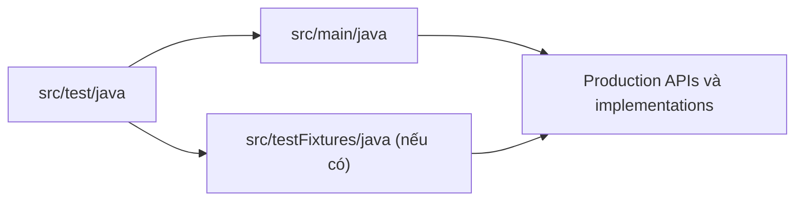
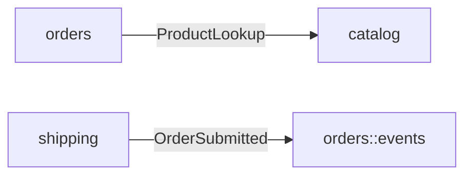
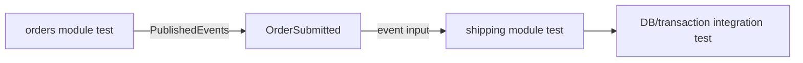
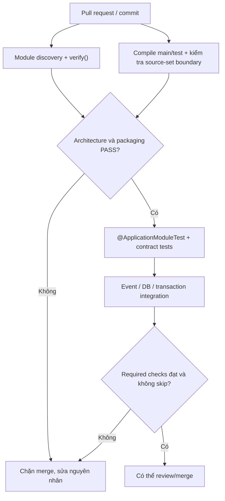

# Ranh giới test fixture và production package

Trong ứng dụng Spring Boot theo kiến trúc Spring Modulith, không phải mọi class phục vụ kiểm thử đều nên trở thành một phần của mã chạy production. **Test fixture** (dữ liệu mẫu, builder, fake, cấu hình test, stub, helper và test-specific adapter) tồn tại để giúp xác minh hành vi. **Production package** chứa hợp đồng và implementation mà ứng dụng thật phải duy trì. Nếu hai lớp này bị trộn lẫn, module dễ công bố nhầm API chỉ dành cho test, fixture phụ thuộc vào implementation nội bộ của module khác, hoặc các test “xanh” vì cấu hình riêng không phản ánh application module thực tế.

Bài **“Ranh giới test fixture và production package”** thuộc chương **Module boundaries** của **SPRING_MODULITH_VERIFICATION_TESTING**. Ta sẽ dùng `ApplicationModules` để kiểm chứng dependency của ứng dụng, dùng `@ApplicationModuleTest` để chọn phạm vi Spring TestContext, làm chủ cách đăng ký mock/fake, kiểm tra producer–consumer event và database, sau đó đưa những phép kiểm tra quan trọng vào **CI quality gate**.

> **Nguyên tắc:** Giữ fixture trong phạm vi test và đặt nó gần module mà nó phục vụ. Không tạo public production API, mở `internal` hay thêm dependency giữa module chỉ để test gọi được một class. Đồng thời, đừng mặc định rằng architecture verification dành cho production sẽ tự động kiểm soát mọi dependency trong `src/test`.

## 1. Mục tiêu học tập

Sau bài này, bạn có thể:

1. Phân biệt **application module boundary**, **Java package boundary**, **source-set/build boundary** và **Spring TestContext boundary**.
2. Chọn đúng nơi đặt fixture: `src/test/java`, `src/test/resources`, source set `testFixtures` hoặc module hỗ trợ test khi có nhu cầu thực sự.
3. Giữ public API production độc lập với fixture, builder và fake dùng riêng trong kiểm thử.
4. Kiểm thử class package-private trong cùng Java package mà không chuyển nó thành `public` cho module khác dùng.
5. Cung cấp collaborator ngoài module bằng `@MockitoBean`, `@TestConfiguration` và `@Import` theo đúng mục tiêu test.
6. Phân biệt kiểm thử `STANDALONE`, `DIRECT_DEPENDENCIES` và `ALL_DEPENDENCIES` của `@ApplicationModuleTest`.
7. Dùng `ApplicationModules.of(...).verify()` bảo vệ ranh giới **production code** và nhận diện khoảng trống về test-source dependencies.
8. Kiểm tra event producer, consumer và dữ liệu mà không làm fixture lộ implementation xuyên module.
9. Thiết kế fixture độc lập theo test, hạn chế trạng thái dùng chung, lỗi transaction và dữ liệu test không ổn định.
10. Xây quality gate bảo vệ cả cấu trúc production, hành vi module và việc đóng gói không mang nhầm fixture vào artifact production.

## 2. Bốn loại ranh giới không được đánh đồng

Khi một class test truy cập một type, ta cần phân biệt nó đang vượt **ranh giới nào**.

| Ranh giới | Đơn vị | Câu hỏi cần kiểm tra | Công cụ/bằng chứng |
|---|---|---|---|
| **Java package** | Package, modifier | Test có truy cập class package-private được không? | Java compiler |
| **Application module** | Module, public/named interface, dependency graph | Module A có được tham chiếu API B không? | `ApplicationModules.verify()` |
| **Build/source set** | `main`, `test`, `testFixtures`, artifacts | Fixture có nằm trên production runtime classpath/artifact không? | Build configuration, dependency graph, artifact inspection |
| **Spring TestContext** | Bean definitions trong bài test | Mock/fake/bean thật nào đang được nạp? | `@ApplicationModuleTest`, Spring Test, assertions |

Ví dụ:

- Class `orders.internal.DefaultOrderPlacement` là **package-private**. Test trong đúng Java package `orders.internal` có thể gọi constructor của nó.
- Code của module `shipping` **không** vì thế được phép dùng `DefaultOrderPlacement`, ngay cả khi developer có thể biến class thành `public`.
- Một fake nằm ở `src/test/java/com/acme/shop/orders/...` chỉ dùng để kiểm thử; nó không nên xuất hiện trong production artifact.
- `@ApplicationModuleTest` có thể đăng ký bean fake trong test context, nhưng không biến fake đó thành public API của module và không thay `allowedDependencies`.

**Kết luận:** “Test nhìn thấy class” không đồng nghĩa “Production module khác được phép dùng class”.

## 3. Test fixture là gì và không phải là gì?

**Test fixture** là điều kiện hoặc công cụ hỗ trợ tạo tình huống kiểm thử có thể lặp lại.

Có thể gồm:

- Object Mother, builder hoặc factory tạo input hợp lệ và không hợp lệ.
- Fake implementation của một public interface.
- Mockito mock/stub và cấu hình phản hồi.
- `@TestConfiguration` cung cấp bean riêng cho test.
- Database seed data, migration bổ sung cho test, container setup và cleanup.
- Event factory tạo payload với ID/metadata nhất quán.
- Helper kiểm tra trạng thái qua public API.

Test fixture **không phải** là:

- Một domain service production được chuyển vào package `test` nhưng vẫn phải chạy thật.
- Repository hoặc API production được mở `public` chỉ để test gọi trực tiếp.
- “Shared utilities” mà mọi module có thể import tùy ý, kể cả implementation của module khác.
- Bằng chứng tự thân rằng behavior, transaction hoặc kiến trúc đã đúng.

### 3.1. Fixture có thể là data hoặc code

| Fixture | Ví dụ | Rủi ro cần kiểm soát |
|---|---|---|
| Data builder | `OrderTestData.validItem()` | Dùng ngầm ID cố định gây trùng khi chạy song song |
| Fake | `FakeProductLookup implements ProductLookup` | Trạng thái rò rỉ giữa test, hành vi không giống hợp đồng thật |
| Mock bean | `@MockitoBean ProductLookup` | Stub sai hoặc mock che wiring của provider |
| Spring test config | `@TestConfiguration` | Bean fake bị scan/được import ngoài ý định |
| SQL fixture | `src/test/resources/sql/orders.sql` | Phụ thuộc schema nội bộ module khác |
| Container fixture | PostgreSQL Testcontainers | Startup xanh nhưng thiếu assertion constraint/commit |
| Event factory | `OrderSubmitted` với ID test | Payload thay đổi ngữ nghĩa mà consumer test không bắt |
| HTTP stub | Stub server cho external client | Contract/network failure thật chưa được kiểm tra |

**Thiết kế tốt:** fixture giúp test rõ ràng và đáng tin hơn, nhưng không tạo ra một API production mới chỉ để thuận tiện.

## 4. Bố trí source set: main, test và test fixtures

Trong một dự án Java phổ biến:

```text
project
├── src
│   ├── main
│   │   ├── java
│   │   │   └── com/acme/shop/...
│   │   └── resources
│   ├── test
│   │   ├── java
│   │   │   └── com/acme/shop/...
│   │   └── resources
│   └── testFixtures
│       └── java            # tùy cấu hình build, không phải mặc định mọi dự án
└── build.gradle / pom.xml
```

### 4.1. Production source set

`src/main/java` và `src/main/resources` dành cho những type/tài nguyên sẽ được biên dịch hoặc đóng gói để ứng dụng hoạt động.

Trong Spring Modulith, các package nghiệp vụ như `com.acme.shop.orders` và `com.acme.shop.catalog` thường được nhận diện làm application module từ code production.

**Không nên** đặt `FakeProductLookup` hoặc `OrderFixtures` dưới `src/main/java` rồi cho chúng `@Component` chỉ để test tìm được bean. Làm vậy có nguy cơ đưa implementation test-only vào artifact và Spring component scan production.

### 4.2. Test source set

`src/test/java` và `src/test/resources` thường chỉ được đưa vào **test compilation/test runtime** theo build convention. Chúng là nơi phù hợp cho JUnit tests, mocks, fixtures và test configuration.

Tuy nhiên, sự tách biệt **phải được xác nhận bằng build thực tế**. Một cấu hình tùy biến có thể vô tình copy test resource vào production artifact hoặc phụ thuộc nhầm test classes từ module khác.

### 4.3. Test-fixtures source set riêng

Với Gradle `java-test-fixtures` plugin, dự án có thể tạo `src/testFixtures/java` và xuất bản **test fixture variant** để các project test khác dùng một cách có kiểm soát. Đây là khái niệm **source set/build artifact**, không phải annotation Spring Modulith.

Ví dụ dependency giữa **Gradle projects** (minh họa):

```groovy
plugins {
    id 'java-library'
    id 'java-test-fixtures'
}

dependencies {
    // Ở project consumer-test, khi cần fixture từ project provider:
    testImplementation(testFixtures(project(':catalog')))
}
```

Đoạn trên chỉ phù hợp với cấu trúc **nhiều Gradle projects** có module `:catalog`. Một ứng dụng Spring Modulith có thể là **một Gradle project duy nhất với nhiều application module theo package**; không nên tự hiểu “application module” và “Gradle project” là một.

Với Maven, có thể có mô hình test JAR/fixture artifact riêng tùy cấu hình plugin, nhưng cách tiêu thụ/phân phối khác Gradle. Chỉ tạo artifact test chung khi có nhu cầu thật và đã xác định dependency nào được công bố cho test.

### 4.4. Không để source set test đảo chiều phụ thuộc production

Quy tắc nên bảo vệ:



Mũi tên là **sử dụng classpath/type** minh họa. Quan hệ **production → test fixtures** là mùi thiết kế: runtime code phụ thuộc vào dữ liệu, class hoặc thư viện chỉ nên có trong test.

## 5. Package path trong test không đồng nghĩa production package

Java cho phép đặt test class và production class vào **cùng tên package** dù chúng nằm ở source set khác nhau.

Ví dụ:

```text
src/main/java/com/acme/shop/orders/internal/DefaultOrderPlacement.java
src/test/java/com/acme/shop/orders/internal/DefaultOrderPlacementTests.java
```

Nếu `DefaultOrderPlacement` là package-private, test trên có thể dùng nó vì **cùng Java package**.

Ngược lại:

```text
src/test/java/com/acme/shop/orders/OrdersModuleTests.java
```

ở package `com.acme.shop.orders` **không** có quyền Java package-private vào package con `orders.internal`. Java coi `orders` và `orders.internal` là hai package khác nhau, không có quan hệ quyền truy cập cha–con đặc biệt.

### 5.1. Package-private là một công cụ bảo vệ implementation

Giữ:

```java
package com.acme.shop.orders.internal;

@Service
class DefaultOrderPlacement implements OrderPlacement {
    // implementation
}
```

thay vì đổi thành `public` chỉ để test class ở package `orders` gọi constructor trực tiếp.

Cách phù hợp:

- **Contract/module test:** đặt test dưới `com.acme.shop.orders` và inject `OrderPlacement` công khai.
- **Unit test nội bộ:** đặt test dưới `com.acme.shop.orders.internal`, dùng constructor package-private khi cần kiểm tra chi tiết.
- **Test integration:** quan sát behavior qua API, event, database hoặc HTTP thay vì import implementation chỉ vì test muốn truy cập.

### 5.2. Test được phép biết implementation trong phạm vi nào?

Một unit test **thuộc chính module orders** có thể kiểm tra thuật toán riêng của `DefaultOrderPlacement`, kể cả khi đó là implementation internal. Điều này không đồng nghĩa **test của module inventory** được khuyến khích import `orders.internal.DefaultOrderPlacement`.

Một quy tắc đánh giá:

> Test của module sở hữu được phép có mức độ hiểu biết nội bộ cần thiết; test của module khác nên tương tác qua **hợp đồng công khai**, trừ trường hợp tooling/test fixture được thiết kế và kiểm soát riêng.

## 6. Ví dụ xuyên suốt: catalog, orders và shipping

Ta dùng ba application module:

- `catalog`: sở hữu nguồn thông tin sản phẩm.
- `orders`: tiếp nhận yêu cầu, kiểm tra sản phẩm qua API catalog và phát event `OrderSubmitted`.
- `shipping`: nhận event và ghi nhận yêu cầu xử lý ở mức demo.

Cấu trúc code:

```text
src/main/java/com/acme/shop
├── ShopApplication.java
├── catalog
│   ├── ProductLookup.java                 # public contract
│   └── internal
│       └── DatabaseProductLookup.java     # implementation giả định
├── orders
│   ├── package-info.java
│   ├── OrderPlacement.java                # public contract
│   ├── events
│   │   ├── package-info.java
│   │   └── OrderSubmitted.java
│   └── internal
│       └── DefaultOrderPlacement.java     # package-private
└── shipping
    ├── package-info.java
    ├── ShippingStatus.java
    └── internal
        ├── ShippingProjection.java
        └── OnOrderSubmitted.java

src/test/java/com/acme/shop
├── ModuleArchitectureTests.java
├── orders
│   ├── OrderFixtures.java                 # fixture test-only
│   ├── OrdersModuleTests.java             # public contract test
│   ├── OrdersWithFakeCatalogTests.java    # test-only bean config
│   └── internal
│       └── DefaultOrderPlacementUnitTests.java
└── shipping
    └── ShippingModuleTests.java
```

Trong ví dụ này, `DatabaseProductLookup` là một **adapter production giả định** chưa cài đặt. Mã runnable tối thiểu của các bài test `orders` dùng `@MockitoBean` hoặc fake test-only, nên không yêu cầu database thật.

### 6.1. Module graph hợp lệ



Event được orders publish lúc runtime cho shipping, nhưng type dependency của consumer đi từ `shipping` tới `orders::events`. Không nên để fixture làm đổi chiều dependency production hoặc mở thêm cạnh chỉ vì test cần dữ liệu.

## 7. Production API của catalog và orders

Public contract của catalog:

```java
package com.acme.shop.catalog;

import java.util.UUID;

public interface ProductLookup {
    boolean exists(UUID productId);
}
```

Public contract của orders:

```java
package com.acme.shop.orders;

import java.util.UUID;

public interface OrderPlacement {
    UUID place(UUID productId, int quantity);
}
```

Sự kiện của orders:

```java
package com.acme.shop.orders.events;

import java.util.UUID;

public record OrderSubmitted(
    UUID orderId,
    UUID productId,
    int quantity
) {}
```

### 7.1. Metadata kiến trúc

File `orders/package-info.java`:

```java
@org.springframework.modulith.ApplicationModule(
    allowedDependencies = "catalog"
)
package com.acme.shop.orders;
```

File `orders/events/package-info.java`:

```java
@org.springframework.modulith.NamedInterface("events")
package com.acme.shop.orders.events;
```

File `shipping/package-info.java`:

```java
@org.springframework.modulith.ApplicationModule(
    allowedDependencies = "orders::events"
)
package com.acme.shop.shipping;
```

`allowedDependencies` kiểm soát **hướng dependency của source module**, còn `@NamedInterface` công bố bề mặt API của module đích. Không có annotation nào biến `src/test` thành public production API.

### 7.2. Implementation orders ở package nội bộ

```java
package com.acme.shop.orders.internal;

import com.acme.shop.catalog.ProductLookup;
import com.acme.shop.orders.OrderPlacement;
import com.acme.shop.orders.events.OrderSubmitted;
import java.util.UUID;
import org.springframework.context.ApplicationEventPublisher;
import org.springframework.stereotype.Service;

@Service
class DefaultOrderPlacement implements OrderPlacement {

    private final ProductLookup products;
    private final ApplicationEventPublisher events;

    DefaultOrderPlacement(
            ProductLookup products,
            ApplicationEventPublisher events) {
        this.products = products;
        this.events = events;
    }

    @Override
    public UUID place(UUID productId, int quantity) {
        if (productId == null || quantity <= 0) {
            throw new IllegalArgumentException("Invalid order item");
        }

        if (!products.exists(productId)) {
            throw new IllegalArgumentException("Unknown product");
        }

        UUID orderId = UUID.randomUUID();
        events.publishEvent(
            new OrderSubmitted(orderId, productId, quantity)
        );
        return orderId;
    }
}
```

`DefaultOrderPlacement` là **package-private implementation**, còn `OrderPlacement` là public contract của orders. Spring component scanning vẫn có thể phát hiện và khởi tạo bean theo cấu hình ứng dụng; consumer và test ở module root chỉ cần interface.

Ví dụ không lưu đơn hàng. `OrderSubmitted` có nghĩa yêu cầu đã vượt kiểm tra trong demo và được publish; nó không chứng minh trạng thái database đã commit hoặc shipping đã xử lý.

## 8. Thiết kế fixture đơn giản, chỉ dùng public contract

File `src/test/java/com/acme/shop/orders/OrderFixtures.java`:

```java
package com.acme.shop.orders;

import java.util.UUID;

// Chỉ dùng trong src/test; không có @Component.
final class OrderFixtures {

    static final int VALID_QUANTITY = 2;

    private OrderFixtures() {}

    static UUID newProductId() {
        return UUID.randomUUID();
    }

    static UUID newCustomerId() {
        return UUID.randomUUID();
    }
}
```

Class này:

- Chỉ nằm ở `src/test`.
- Không có annotation biến nó thành production bean.
- Có package-private visibility; các test cùng package `orders` sử dụng được.
- Không import repository, entity hoặc adapter của catalog.
- Tạo ID mới cho từng case, tránh va chạm khi test chạy song song.

`newCustomerId()` được đưa vào để minh họa khả năng mở rộng fixture, chưa được `OrderPlacement` demo sử dụng. Chỉ giữ helper nào thực sự phục vụ test trong ứng dụng cụ thể; đừng biến một fixture thành “kho hàm hỗ trợ” ngày càng không rõ ownership.

### 8.1. Vì sao fixture nên trả về kiểu public contract?

Nếu fixture của orders trả `catalog.internal.ProductEntity`, test của orders bắt đầu lệ thuộc persistence của catalog. Một refactor entity có thể làm các test không thuộc catalog vỡ, dù `ProductLookup` công khai không đổi.

Tốt hơn:

- Fixture của orders tạo input của orders.
- Fixture của catalog kiểm tra entity/repository **bên trong test của catalog**.
- Test phối hợp giữa module dùng public DTO/record/API, không dùng implementation type của module đối diện.

### 8.2. Không tạo “fixture production package” giả

Tránh đặt:

```text
src/main/java/com/acme/shop/orders/test/OrderFixtures.java
```

chỉ để tất cả test import được.

Nếu thật sự có code dùng chung giữa production và test, hãy hỏi code ấy có phải **domain production value object** hoặc API nghiệp vụ hay không. Nếu có, đặt vào module sở hữu và đặt tên/thiết kế như production code. Nếu không, giữ nó ở source set chỉ dành cho test.

## 9. @ApplicationModuleTest STANDALONE với @MockitoBean

Test module orders có thể dùng mock cho collaborator ngoài module `catalog.ProductLookup`, đồng thời chạy bean thật của orders.

File `src/test/java/com/acme/shop/orders/OrdersModuleTests.java`:

```java
package com.acme.shop.orders;

import static org.assertj.core.api.Assertions.assertThat;
import static org.assertj.core.api.Assertions.assertThatThrownBy;
import static org.mockito.Mockito.verify;
import static org.mockito.Mockito.verifyNoInteractions;
import static org.mockito.Mockito.when;

import com.acme.shop.catalog.ProductLookup;
import com.acme.shop.orders.events.OrderSubmitted;
import java.util.UUID;
import org.junit.jupiter.api.Test;
import org.springframework.beans.factory.annotation.Autowired;
import org.springframework.modulith.test.ApplicationModuleTest;
import org.springframework.modulith.test.PublishedEvents;
import org.springframework.test.context.bean.override.mockito.MockitoBean;

@ApplicationModuleTest
class OrdersModuleTests {

    @Autowired OrderPlacement orders;

    @MockitoBean ProductLookup products;

    @Test
    void publishesEventForKnownProduct(PublishedEvents events) {
        UUID productId = OrderFixtures.newProductId();
        when(products.exists(productId)).thenReturn(true);

        UUID orderId = orders.place(
            productId, OrderFixtures.VALID_QUANTITY
        );

        assertThat(events.ofType(OrderSubmitted.class))
            .singleElement()
            .satisfies(event -> {
                assertThat(event.orderId()).isEqualTo(orderId);
                assertThat(event.productId()).isEqualTo(productId);
                assertThat(event.quantity())
                    .isEqualTo(OrderFixtures.VALID_QUANTITY);
            });

        verify(products).exists(productId);
    }

    @Test
    void rejectsUnknownProductWithoutEvent(
            PublishedEvents events) {
        UUID productId = OrderFixtures.newProductId();
        when(products.exists(productId)).thenReturn(false);

        assertThatThrownBy(() -> orders.place(productId, 2))
            .isInstanceOf(IllegalArgumentException.class)
            .hasMessage("Unknown product");

        assertThat(events.ofType(OrderSubmitted.class)).isEmpty();
        verify(products).exists(productId);
    }

    @Test
    void rejectsInvalidQuantityBeforeCatalogCall(
            PublishedEvents events) {
        assertThatThrownBy(() ->
            orders.place(OrderFixtures.newProductId(), 0)
        ).isInstanceOf(IllegalArgumentException.class)
         .hasMessage("Invalid order item");

        verifyNoInteractions(products);
        assertThat(events.ofType(OrderSubmitted.class)).isEmpty();
    }
}
```

`@ApplicationModuleTest` ở chế độ mặc định `STANDALONE` tập trung vào module `orders`. `@MockitoBean ProductLookup` thay thế/cung cấp **Spring mock bean** cho collaborator ngoài module. Test gọi **`OrderPlacement` công khai** thay vì class `DefaultOrderPlacement` nằm trong `orders.internal`.

### 9.1. Ghi chú về phiên bản

Import `org.springframework.test.context.bean.override.mockito.MockitoBean` yêu cầu Spring Framework có API này (từ 6.2). Một số dự án Spring Boot 3.x cũ dùng `org.springframework.boot.test.mock.mockito.MockBean`. Chọn cơ chế phù hợp dependency management thực tế; không khai báo hai annotation cho cùng type một cách tùy tiện.

### 9.2. Vì sao giữ ApplicationEventPublisher thật?

Vì mục tiêu là kiểm tra event được publish qua Spring TestContext và quan sát bằng `PublishedEvents`. Nếu mock cả publisher, test chỉ có thể xác minh lời gọi mock, không còn chứng minh cơ chế event dispatch như trong context.

### 9.3. Những điều module test này chưa chứng minh

- Catalog thực sự tra database đúng.
- Bean production của catalog được khởi tạo.
- Shipping đã xử lý event.
- Reservation được lưu sau commit.
- Code production không có dependency vòng hoặc import nội bộ ở class khác.

Đó là lý do cần thêm architecture test và integration tests có phạm vi khác, **không** mở fixture/implementation ra ngoài.

## 10. Test implementation package-private trong cùng Java package

Khi một thuật toán nội bộ phức tạp, unit test có thể nằm ngay trong package `orders.internal` để kiểm tra implementation mà không làm nó `public`.

File `src/test/java/com/acme/shop/orders/internal/DefaultOrderPlacementUnitTests.java`:

```java
package com.acme.shop.orders.internal;

import static org.assertj.core.api.Assertions.assertThat;
import static org.mockito.Mockito.mock;
import static org.mockito.Mockito.verify;
import static org.mockito.Mockito.when;

import com.acme.shop.catalog.ProductLookup;
import com.acme.shop.orders.events.OrderSubmitted;
import java.util.UUID;
import org.junit.jupiter.api.Test;
import org.mockito.ArgumentCaptor;
import org.springframework.context.ApplicationEventPublisher;

class DefaultOrderPlacementUnitTests {

    @Test
    void buildsCorrectEventWithoutSpringContext() {
        ProductLookup catalog = mock(ProductLookup.class);
        ApplicationEventPublisher publisher =
            mock(ApplicationEventPublisher.class);

        UUID productId = UUID.randomUUID();
        when(catalog.exists(productId)).thenReturn(true);

        // Test cùng package nên truy cập class/constructor package-private.
        DefaultOrderPlacement subject =
            new DefaultOrderPlacement(catalog, publisher);

        UUID orderId = subject.place(productId, 2);

        ArgumentCaptor<OrderSubmitted> captor =
            ArgumentCaptor.forClass(OrderSubmitted.class);

        verify(publisher).publishEvent(captor.capture());

        OrderSubmitted event = captor.getValue();
        assertThat(event.orderId()).isEqualTo(orderId);
        assertThat(event.productId()).isEqualTo(productId);
        assertThat(event.quantity()).isEqualTo(2);
    }
}
```

Test này có đặc điểm:

- Không cần Spring context.
- Dùng Mockito object thông thường.
- Biết class internal **của chính module sở hữu**, không yêu cầu module khác import implementation.
- Kiểm tra event được truyền tới mock publisher, **không** chứng minh event thực sự được Spring dispatch.

Đây là bằng chứng unit test. `OrdersModuleTests` ở mục 9 mới kiểm tra bean wiring và event publication trong module TestContext.

### 10.1. Khi nào không nên unit test internal class trực tiếp?

Nếu tất cả hành vi có thể kiểm tra rõ ràng qua `OrderPlacement` public contract, test theo hợp đồng thường bền hơn trước refactor. Test nội bộ nên tập trung vào thuật toán khó, invariant hoặc edge case không thuận tiện xác minh qua một module integration test.

**Không chuyển class internal thành public chỉ để test tiện hơn.** Hãy chọn đúng package/source set cho loại test cần viết.

## 11. Fake bean bằng @TestConfiguration và @Import

Đôi khi một fake có trạng thái rõ ràng thuận tiện hơn nhiều Mockito stubs. Ta có thể đăng ký fake **chỉ trong bài test** bằng `@TestConfiguration`, thay vì tạo `@Component` dưới `src/main`.

File test `src/test/java/com/acme/shop/orders/OrdersWithFakeCatalogTests.java`:

```java
package com.acme.shop.orders;

import static org.assertj.core.api.Assertions.assertThat;

import com.acme.shop.catalog.ProductLookup;
import com.acme.shop.orders.events.OrderSubmitted;
import java.util.UUID;
import org.junit.jupiter.api.Test;
import org.springframework.beans.factory.annotation.Autowired;
import org.springframework.boot.test.context.TestConfiguration;
import org.springframework.context.annotation.Bean;
import org.springframework.context.annotation.Import;
import org.springframework.modulith.test.ApplicationModuleTest;
import org.springframework.modulith.test.PublishedEvents;

@ApplicationModuleTest
@Import(OrdersWithFakeCatalogTests.CatalogFixtureConfig.class)
class OrdersWithFakeCatalogTests {

    @Autowired OrderPlacement orders;

    private static final UUID KNOWN_PRODUCT = UUID.fromString(
        "00000000-0000-0000-0000-000000000001"
    );

    @Test
    void usesFakeCatalogThroughPublicInterface(
            PublishedEvents events) {
        UUID orderId = orders.place(KNOWN_PRODUCT, 2);

        assertThat(events.ofType(OrderSubmitted.class))
            .singleElement()
            .satisfies(event ->
                assertThat(event.orderId()).isEqualTo(orderId));
    }

    @TestConfiguration(proxyBeanMethods = false)
    static class CatalogFixtureConfig {

        @Bean
        ProductLookup productLookup() {
            return productId -> KNOWN_PRODUCT.equals(productId);
        }
    }
}
```

Giả định `orders` được bootstrap ở `STANDALONE` và **không có bean `ProductLookup` khác** trong context test. `@Import` công bố rõ fixture configuration nào đang được dùng, tránh phải scan một package helper tùy ý.

### 11.1. So sánh mock và fake

| Tiêu chí | `@MockitoBean` | `@TestConfiguration` + fake |
|---|---|---|
| Định nghĩa phản hồi | `when(...).thenReturn(...)` trong từng test | Logic fake triển khai interface |
| Kiểm tra interaction | Mockito `verify(...)` thuận tiện | Cần ghi nhận trạng thái/counters nếu muốn |
| Chi phí cấu hình | Ít cho case đơn giản | Tăng nếu fake nhiều logic |
| Khả năng dùng lại | Dễ tạo ở class test | Có thể chia sẻ trong test scope có kiểm soát |
| Nguy cơ | Stub không phản ánh hợp đồng thật | Fake phát triển thành implementation production thứ hai |
| Có xác minh database provider? | Không | Không, nếu fake không gọi DB |

Đừng tạo fake quá thông minh rồi tin nó chứng minh behavior của database adapter thật. Fake giúp kiểm tra **consumer logic trước phản hồi có kiểm soát**.

### 11.2. Không trộn nhiều định nghĩa bean không cần thiết

Tránh đưa vào cùng test:

- `@MockitoBean ProductLookup`;
- một `@Bean ProductLookup` từ fake;
- thêm bean thật từ `catalog` do bootstrap mode rộng;

trừ khi bạn **chủ ý và hiểu rõ cách override/qualifier**. Nếu có nhiều candidate hoặc một bean bị override ngoài dự kiến, test có thể chạy với collaborator khác mục tiêu.

## 12. Chọn bootstrap mode mà không kéo fixture sang production

`@ApplicationModuleTest` thường cung cấp ba phạm vi:

| Mode | Application modules trong test | Fixture thường dùng |
|---|---|---|
| `STANDALONE` (mặc định) | Module đang được test | Mock/fake collaborator từ module ngoài |
| `DIRECT_DEPENDENCIES` | Module đang test và dependency trực tiếp | Có thể dùng bean thật, cấu hình DB/fixture cho module liên quan |
| `ALL_DEPENDENCIES` | Module đang test và dependency bắc cầu | Chỉ dùng khi cần chuỗi tích hợp thật nhiều tầng |

Chế độ test **không sửa dependency production** và không tự cấp quyền dùng package `internal` của module khác.

### 12.1. Khi dùng DIRECT_DEPENDENCIES

Ví dụ orders phụ thuộc trực tiếp catalog:

```java
package com.acme.shop.orders;

import org.springframework.modulith.test.ApplicationModuleTest;
import org.springframework.modulith.test.ApplicationModuleTest.BootstrapMode;

@ApplicationModuleTest(
    mode = BootstrapMode.DIRECT_DEPENDENCIES
)
class OrdersWithRealCatalogTests {
    // Cung cấp bean và dữ liệu catalog thật rồi assert behavior.
}
```

Test này có thể nạp bean thật của catalog và cần DataSource, JPA migrations hoặc test environment phù hợp. **Không dùng @MockitoBean cho catalog trong bài này** nếu mục tiêu là kiểm tra chính wiring và behavior của implementation catalog.

### 12.2. Khi dùng ALL_DEPENDENCIES

Nếu `catalog` phụ thuộc một module khác, `ALL_DEPENDENCIES` có thể mở rộng tới dependency bắc cầu. Nhưng một module consumer sự kiện như `shipping` **phụ thuộc vào `orders::events` theo chiều ngược**; nó không tự được bao gồm trong mọi test `orders` chỉ vì tiêu thụ event.

Nên viết test consumer theo module riêng, không mở phạm vi producer một cách tùy tiện.

### 12.3. Fixture không phải thuốc chữa lỗi kiến trúc

Nếu `orders` phụ thuộc `catalog.internal.DatabaseProductLookup`, thêm fake hoặc `@MockitoBean` cho class implementation không làm dependency hợp lệ. Phải sửa mã production về `catalog.ProductLookup` và xác minh lại bằng `ApplicationModules.verify()`.

## 13. Test của module khác không nên import internal fixtures

Giả sử test của `shipping` muốn tạo một đơn hàng để kích hoạt listener. Cách dễ nhưng nguy hiểm:

```java
// Mẫu CẦN TRÁNH ở test module shipping:
import com.acme.shop.orders.internal.OrderRepository;
import com.acme.shop.orders.internal.DefaultOrderPlacement;
```

Trong những trường hợp class Java accessible, test có thể compile. Nhưng nó làm shipping test phụ thuộc implementation của orders, gây hỏng khi orders refactor mà **event contract không đổi**.

### 13.1. Thay bằng event contract factory

File `src/test/java/com/acme/shop/shipping/ShippingEvents.java`:

```java
package com.acme.shop.shipping;

import com.acme.shop.orders.events.OrderSubmitted;
import java.util.UUID;

// Fixture do shipping test sở hữu; chỉ dùng public event contract.
final class ShippingEvents {

    private ShippingEvents() {}

    static OrderSubmitted submitted(UUID orderId) {
        return new OrderSubmitted(
            orderId, UUID.randomUUID(), 2
        );
    }
}
```

Shipping test có thể phát event này trực tiếp. Nó không cần biết orders lưu entity như thế nào.

### 13.2. Khi cần dữ liệu production thật thì sao?

Nếu mục tiêu là test một luồng **integration** từ orders tới shipping với dữ liệu đã commit, test có thể:

- Gọi public use case `OrderPlacement`.
- Chuẩn bị test data qua API/fixture được owner module công bố hợp lệ.
- Dùng database seeding có phạm vi/ownership rõ ràng trong test integration và thực hiện cleanup.
- Đọc trạng thái cuối qua public query API hoặc cơ chế quan sát được có chủ đích.

Đừng tự cho consumer test quyền viết thẳng bảng `orders` rồi diễn giải đó là hợp đồng module. Một integration test có thể cần kiểm tra dữ liệu sâu hơn, nhưng phải ghi rõ vì sao và giới hạn.

### 13.3. Shared fixture không có nghĩa shared implementation

Nếu nhiều test cần factory cho `OrderSubmitted`, có thể tạo một **test-only event contract fixture** có ownership và API rõ. Nhưng tránh export toàn bộ repository/entity nội bộ của orders dưới nhãn “test fixtures”.

Tốt hơn: chia sẻ những builder sinh **public contract value** và giữ helper của implementation ở test scope của module sở hữu.

## 14. Test source cũng có dependency: verify() bảo vệ đến đâu?

Đây là điểm rất dễ bị bỏ sót. Một project có thể có:

```text
src/main/java/com/acme/shop/shipping
    -> chỉ dùng orders::events

src/test/java/com/acme/shop/shipping
    -> import orders.internal.OrderRepository
```

Nếu architecture test chủ yếu phân tích model/production classes, vi phạm trong **test source** có thể không được báo theo cách bạn mong đợi. Phạm vi thực tế phụ thuộc cách Spring Modulith/ArchUnit nhập class và cấu hình test/build classpath.

**Không được khẳng định:** `ApplicationModules.of(...).verify()` mặc nhiên áp quy tắc của production lên **mọi test helper** và mọi `src/test` class.

### 14.1. Cần hai lớp chính sách

**Lớp A: ranh giới production (bắt buộc).**

Dùng `ApplicationModules.verify()` để kiểm tra dependency module trong mô hình ứng dụng, gồm `internal`, `allowedDependencies` và cycle.

**Lớp B: dependency hygiene cho test (theo mục tiêu nhóm).**

Nếu muốn cấm test của module A import `B.internal`, bổ sung một quy tắc rõ ràng áp trên test classes/source sets, hoặc cách kiểm tra package import và build dependencies phù hợp. Có thể dùng ArchUnit rules riêng hay kiểm soát cấu trúc test packages, nhưng phải xác nhận **đúng tập class được phân tích**.

### 14.2. Tại sao không đơn giản “cấm mọi import internal trong test”?

Unit test thuộc **module sở hữu** có thể cần truy cập package-private type `orders.internal` để xác minh thuật toán nội bộ. Cấm tất cả import `internal` sẽ làm mất khả năng test nội bộ hợp lệ.

Chính sách hợp lý hơn:

- Test thuộc **cùng module** có thể kiểm tra internal implementation của chính module đó.
- Test thuộc **module khác** không nên truy cập implementation package bên ngoài.
- Test integration xuyên module ưu tiên API/named interface; ngoại lệ đặc biệt cần được ghi lý do và giữ ở phạm vi test, không mở production API.
- Fixture chia sẻ chỉ chứa contract/data được chủ sở hữu cho phép và có kiểm soát build artifact.

### 14.3. Một kiến trúc test xanh không chứng minh fixture tốt

Ngay cả khi rule mới cấm cross-module internal imports đạt, fixture vẫn có thể:

- Dùng trạng thái static không reset.
- Thao tác DB chung không cleanup.
- Stub phản hồi phi thực tế.
- Cấp Spring bean fake vào context sai.
- Làm test phụ thuộc thứ tự hoặc timezone.
- Chỉ assert context start thay vì kết quả nghiệp vụ.

Do đó cần code review, data isolation và test behavior thực tế.

## 15. Kiểm chứng production boundary bằng ApplicationModules.verify()

Architecture test đặt ở package gốc của ứng dụng:

```java
package com.acme.shop;

import org.junit.jupiter.api.Test;
import org.springframework.modulith.core.ApplicationModules;

class ModuleArchitectureTests {

    @Test
    void verifiesProductionModuleBoundaries() {
        ApplicationModules.of(ShopApplication.class).verify();
    }
}
```

Phép kiểm chứng này nhằm phát hiện các rule cấu trúc Spring Modulith hỗ trợ, điển hình:

- Module dependency cycle.
- Truy cập type thuộc API nội bộ của module khác.
- Cạnh dependency trái `allowedDependencies` đã khai báo.

### 15.1. Xác minh module discovery

Có thể bổ sung:

```java
package com.acme.shop;

import static org.assertj.core.api.Assertions.assertThat;

import org.junit.jupiter.api.Test;
import org.springframework.modulith.core.ApplicationModules;

class ModuleDiscoveryTests {

    @Test
    void discoversExpectedModules() {
        ApplicationModules modules =
            ApplicationModules.of(ShopApplication.class);

        assertThat(modules.getModuleByName("catalog")).isPresent();
        assertThat(modules.getModuleByName("orders")).isPresent();
        assertThat(modules.getModuleByName("shipping")).isPresent();
    }
}
```

Nếu package root/cách nhận diện module tùy biến, phải sửa assertion theo thực tế. Architecture test xanh trong khi module cần bảo vệ không được nhận diện không phải bằng chứng đầy đủ.

### 15.2. Phép thử âm tính về ranh giới

Trên nhánh thực hành:

1. Tạo một Java type `public` trong `catalog.internal`.
2. Trong **production source** `orders`, thêm field hoặc constructor parameter dùng type ấy.
3. Chạy architecture test, kỳ vọng vi phạm nội bộ bị phát hiện.
4. Xóa dependency sai, dùng `catalog.ProductLookup`.
5. Chạy lại architecture test.
6. Kiểm tra rằng fixture của orders **không trở thành lý do** để mở public API mới ở catalog.

Chỉ thêm một dòng `import` không sử dụng có thể không tạo dependency đáng kể trong bytecode, nên phép thử cần tham chiếu type thật.

## 16. Kiểm thử event producer: fixture không được lẫn consumer implementation

`OrdersModuleTests` ở mục 9 dùng `PublishedEvents` để assert producer phát đúng một `OrderSubmitted`. Nó **không cần** đưa listener của shipping vào test context.

Điều này giúp fixture có ranh giới rõ:

- Fixture orders tạo input và stub `ProductLookup`.
- Sự kiện được publish thật qua cơ chế Spring event trong test context.
- Consumer shipping có bài test riêng để kiểm tra logic xử lý event.
- Database/transaction được kiểm tra tại lớp integration tương ứng.



### 16.1. Producer fixture không nên khởi tạo repository shipping

Nếu `OrdersModuleTests` tạo `shipping.internal.ShippingRepository` để assert side effect, test producer đang vượt ranh giới và gắn vào implementation downstream.

Hãy thay bằng:

- Producer test: assert type, số lượng và payload event.
- Consumer test: assert shipping nhận event.
- Integration test: assert trạng thái bền vững sau commit nếu cần.

**Published** khác **Handled**, và **Handled** khác **Committed**.

## 17. Kiểm thử consumer bằng public event contract

API quan sát của shipping:

```java
package com.acme.shop.shipping;

import java.util.UUID;

public interface ShippingStatus {
    boolean received(UUID orderId);
}
```

Implementation in-memory tại `shipping/internal/ShippingProjection.java`:

```java
package com.acme.shop.shipping.internal;

import com.acme.shop.shipping.ShippingStatus;
import java.util.Set;
import java.util.UUID;
import java.util.concurrent.ConcurrentHashMap;
import org.springframework.stereotype.Component;

@Component
class ShippingProjection implements ShippingStatus {

    private final Set<UUID> ids =
        ConcurrentHashMap.newKeySet();

    void record(UUID orderId) {
        ids.add(orderId);
    }

    @Override
    public boolean received(UUID orderId) {
        return ids.contains(orderId);
    }
}
```

Listener tại `shipping/internal/OnOrderSubmitted.java`:

```java
package com.acme.shop.shipping.internal;

import com.acme.shop.orders.events.OrderSubmitted;
import org.springframework.context.event.EventListener;
import org.springframework.stereotype.Component;

@Component
class OnOrderSubmitted {

    private final ShippingProjection projection;

    OnOrderSubmitted(ShippingProjection projection) {
        this.projection = projection;
    }

    @EventListener
    void on(OrderSubmitted event) {
        projection.record(event.orderId());
    }
}
```

File `src/test/java/com/acme/shop/shipping/ShippingModuleTests.java`:

```java
package com.acme.shop.shipping;

import static org.assertj.core.api.Assertions.assertThat;

import java.util.UUID;
import org.junit.jupiter.api.Test;
import org.springframework.beans.factory.annotation.Autowired;
import org.springframework.context.ApplicationEventPublisher;
import org.springframework.modulith.test.ApplicationModuleTest;

@ApplicationModuleTest
class ShippingModuleTests {

    @Autowired ApplicationEventPublisher publisher;
    @Autowired ShippingStatus shipping;

    @Test
    void handlesEventWithoutOrdersImplementation() {
        UUID orderId = UUID.randomUUID();

        publisher.publishEvent(
            ShippingEvents.submitted(orderId)
        );

        assertThat(shipping.received(orderId)).isTrue();
    }
}
```

Consumer test dùng fixture `ShippingEvents` ở mục 13, chỉ import `orders.events.OrderSubmitted` qua public named interface. Nó không gọi hoặc phụ thuộc `orders.internal.DefaultOrderPlacement`.

**Giới hạn:** `@EventListener` trong ví dụ dùng dispatch đồng bộ mặc định và storage in-memory. Đây chưa phải bằng chứng shipping đã tạo shipment thật hoặc lưu DB sau commit.

## 18. Fixture và database: ai được tạo dữ liệu của ai?

Một test tích hợp có thể cần dữ liệu catalog và orders. Nhưng **fixture trực tiếp insert vào bảng của module khác** dễ biến knowledge về schema thành coupling.

### 18.1. Cách ưu tiên tạo dữ liệu

1. Qua **public API** của module sở hữu nếu thao tác là một use case hợp lệ.
2. Qua seed/fixture nội bộ thuộc **test scope của provider module** và được dùng có kiểm soát ở integration setup.
3. Qua test resource hoặc database seeding riêng khi cần kiểm tra tầng persistence, kèm lý do ownership.
4. Qua SQL trực tiếp vào schema module khác **chỉ khi** mục tiêu integration thực sự đòi hỏi và đã kiểm soát chi phí bảo trì.

Nếu producer/consumer của bạn chỉ cần event contract, có thể **publish event đầu vào trực tiếp** trong consumer test thay vì tạo cả một aggregate orders trong DB.

### 18.2. Testcontainers không tự bảo đảm fixture đúng

Testcontainers có thể cấp PostgreSQL/MySQL hoặc dịch vụ tương ứng. Tuy nhiên:

- Container xanh không chứng minh migration đã đúng.
- Fixture insert thành công chưa chứng minh transaction commit.
- Test gọi repository nhưng không assert kết quả chưa chứng minh persistence.
- Dữ liệu dùng chung giữa test có thể khiến duplicate/concurrency case không đáng tin.
- Một test dùng H2 giả lập không thể mặc định thay thế tất cả hành vi của PostgreSQL production.

### 18.3. Cleanup và transaction

Trong Spring Test, `@Transactional` trên test thường chạy trong transaction được rollback cuối bài test. Điều này tiện cho dữ liệu nhưng có thể làm lệch hành vi của `@TransactionalEventListener(AFTER_COMMIT)` hoặc `@ApplicationModuleListener`.

Khi mục tiêu liên quan commit:

- Xác định transaction của producer **và** của test.
- Để đường đi thực sự commit nếu listener cần after-commit.
- Chờ consumer async theo điều kiện quan sát được.
- Kiểm tra dữ liệu sau commit bằng cơ chế phù hợp.
- Dọn dữ liệu test có kiểm soát.
- Chạy thêm rollback/idempotency case khi có rủi ro tương ứng.

Một fixture “tạo đủ dữ liệu để test xanh” chưa phải là **bằng chứng về transaction**.

## 19. Idempotency và trạng thái fixture dùng chung

Các test không nên phụ thuộc vào state sót lại từ bài trước. Với event-based module, một tập ID in-memory có thể khiến test xanh dù listener xử lý trùng nhiều lần.

Ví dụ test sai về sức mạnh assertion:

```java
publisher.publishEvent(event);
publisher.publishEvent(event);

assertThat(shipping.received(orderId)).isTrue();
```

Assertion boolean chỉ chứng minh ID có mặt; nếu mỗi lần publish đã tạo một shipment DB mới, boolean vẫn có thể là `true`.

Muốn chứng minh idempotency:

- Dùng khóa nghiệp vụ như `orderId` hoặc `orderLineId` theo domain.
- Dùng unique constraint/transaction hoặc cơ chế atomic phù hợp.
- Publish cùng event nhiều lần.
- Kiểm tra số bản ghi/tác dụng bền vững **sau commit**.
- Thêm test concurrent race khi có nhiều worker.

### 19.1. Tránh fixture mutable static

`static final UUID` làm test dùng chung một ID qua mọi case; khi các test dùng DB chung, chúng có thể va nhau.

Ưu tiên:

- Factory `newProductId()` hoặc ID test riêng.
- Dữ liệu bất biến khi hợp lý.
- Reset fake hoặc tạo fake mới cho từng test.
- Cleanup database, tránh dựa vào thứ tự JUnit.
- Không chia sẻ một mutable singleton fixture qua nhiều test class trừ khi có kiểm soát lifecycle rõ.

### 19.2. Chú ý test chạy song song

Một fixture fake dùng `HashSet` có thể chưa thread-safe. Đừng mặc định mọi test chạy tuần tự khi CI bật parallel execution.

Dùng concurrent collection khi thực sự cần, hoặc đơn giản hơn là **không chia sẻ state giữa tests**. Thread-safety không thể thay thế data isolation.

## 20. Test resource và profile cũng là một phần ranh giới

Không chỉ Java class, các tài nguyên test cũng cần được cô lập.

```text
src/test/resources/
├── application-test.yml
├── sql/
│   └── catalog-test-data.sql
└── contracts/
    └── order-submitted-example.json
```

Các file có thể phục vụ cấu hình profile, SQL seed hay event contract fixture. Nhưng cần bảo đảm:

- Test profile không bị áp vào production.
- Không có mật khẩu hoặc dữ liệu nhạy cảm thật trong fixture.
- SQL test data thuộc đúng schema/provider owner, có cleanup.
- Event JSON sample được kiểm tra tương thích khi schema thay đổi.
- Build không copy nhầm `src/test/resources` vào production artifact.

### 20.1. @TestConfiguration vs @Configuration

Một class `@Configuration` đặt sai vị trí có thể bị component scanning theo cách không mong muốn trong môi trường test hoặc production nếu nó thuộc source set main. `@TestConfiguration` thuộc Spring Boot Test là cơ chế chuyên biệt cho cấu hình test, nên dùng tại test source và import có chủ đích.

Mẫu phù hợp:

```java
@ApplicationModuleTest
@Import(MyTestConfig.class)
class SomeModuleTests {
    // ...
}

@TestConfiguration(proxyBeanMethods = false)
class MyTestConfig {

    @Bean
    ExternalPort externalPort() {
        return request -> predefinedResponse();
    }
}
```

Đây là **fragment**: `ExternalPort`, `request` và `predefinedResponse()` phải được định nghĩa theo ứng dụng. Không dùng nó như class copy-paste tự chạy.

### 20.2. @TestConfiguration không đồng nghĩa bean chỉ chạy trong một method

Khi Spring TestContext tạo và cache context, bean trong `@TestConfiguration` tồn tại theo **lifecycle của context**, không chỉ mỗi lần gọi method. Mutable fake có thể giữ state giữa test methods nếu không reset/refresh đúng.

Điều này là lý do nên giữ fixture state rõ ràng, ưu tiên immutable input và thiết kế reset/setup khi cần.

## 21. Khi nào chia sẻ test fixture giữa nhiều module?

Không phải mọi duplicate fixture đều là vấn đề. Một số helper có thể ngắn và nên được giữ cục bộ để tránh coupling.

Cân nhắc chia sẻ khi:

- Cùng một **public contract** được nhiều consumer test sử dụng.
- Factory phản ánh quy tắc hợp đồng ổn định.
- Không kéo theo entity/repository/internal adapter của provider.
- Build có cách xuất bản artifact **test-only** rõ ràng.
- Quy trình thay đổi contract và fixture có owner cụ thể.

Không nên chia sẻ khi:

- Fixture chỉ phục vụ một implementation nội bộ.
- Cần import các type `internal` của nhiều module.
- Helper có trạng thái toàn cục hoặc chạm trực tiếp nhiều schema.
- Việc chia sẻ buộc đổi modifier production sang `public`.
- Mỗi consumer có semantics khác nhau nhưng bị ép dùng một “universal builder”.

### 21.1. Mẫu quyết định

| Nhu cầu | Cách xử lý hợp lý |
|---|---|
| Một test orders cần ID và quantity | Fixture nhỏ trong `orders` test |
| Nhiều shipping consumer tests cần `OrderSubmitted` | Event factory test-only của shipping hoặc contract fixture chung có owner |
| Test catalog cần JPA entity | Catalog internal test fixture, không xuất bản cho orders |
| Nhiều Gradle projects cần public DTO builder | `java-test-fixtures` variant với dependency test-only |
| Runtime production cần cùng value object | Đưa **value object production thật** vào API module sở hữu, không “mượn” fixture |
| Integration test cần DB data từ hai modules | Thiết kế integration fixture có ranh giới/ownership và cleanup minh bạch |

Đừng coi “ít file hơn” là mục tiêu tối cao. Một chút trùng lặp fixture cục bộ thường rẻ hơn một dependency test chung quá rộng.

## 22. Sai lầm phổ biến cần tránh

### 22.1. Cho test fixture vào src/main để Spring scan

Hậu quả: production artifact chứa fake/helper, có thể tạo bean mơ hồ hoặc behavior không phù hợp runtime. Hãy giữ fixture ở test source và import có chủ đích.

### 22.2. Biến implementation thành public để test

Việc `DefaultOrderPlacement` là package-private không cản test qua `OrderPlacement`. Unit test cần truy cập trực tiếp có thể nằm cùng Java package. Không mở API chỉ vì cách bố trí test chưa phù hợp.

### 22.3. Cho test module A import nội bộ module B

Dù đôi lúc compile được, test bị coupling vào implementation của B và vỡ khi B refactor. Ưu tiên public API/event contract; thêm test-source hygiene rule nếu tổ chức yêu cầu.

### 22.4. Dùng @Mock thay vì Spring mock bean

`@Mock` của Mockito không tự đăng ký bean vào `@ApplicationModuleTest` context. Muốn constructor injection trong Spring test hoạt động, dùng `@MockitoBean` hoặc API tương thích phiên bản, hoặc `@TestConfiguration` cung cấp fake.

### 22.5. Chọn ALL_DEPENDENCIES chỉ để hết thiếu bean

Mở rộng mode có thể kéo theo nhiều module, DataSource, listener và hạ tầng. Cần xác định hợp đồng test: mock collaborator nếu chỉ kiểm tra logic, hoặc mở mode khi cần collaboration thật.

### 22.6. Tin rằng verify() tự kiểm tất cả test code

Không nên mặc định `ApplicationModules.verify()` bao phủ mọi class trong `src/test`. Nếu test-source dependency boundary là một yêu cầu bắt buộc, phải định nghĩa và xác minh scope rule riêng.

### 22.7. Test producer dùng repository của consumer để assert

Đây là dấu hiệu trộn trách nhiệm và fixture. Tách producer event test, consumer test và integration test cho trạng thái cuối.

### 22.8. Dùng shared fixture singleton có trạng thái

Kết quả có thể phụ thuộc thứ tự/chạy song song và gây flaky test. Dùng test ID riêng, state reset và cleanup khi cần.

### 22.9. Testcontainers xanh nghĩa là dữ liệu đã đúng

Không đúng. Container chỉ là môi trường. Phải assert schema, dữ liệu và transaction boundary theo rủi ro.

### 22.10. Tất cả fixture đều phải trở thành thư viện chung

Không cần. Fixture cục bộ giúp hiểu ownership và tránh phụ thuộc test quá rộng; chỉ chia sẻ nếu thực sự có lợi ích rõ hơn chi phí coupling.

## 23. Ma trận bằng chứng cho ranh giới fixture và production

| ID | Hợp đồng hoặc rủi ro | Phép kiểm chứng | Kết luận hợp lệ |
|---|---|---|---|
| ARCH-01 | Không có dependency vào `catalog.internal` từ orders | `ApplicationModules.verify()` | Production module boundary đạt |
| ARCH-02 | `shipping` chỉ dùng `orders::events` | `allowedDependencies` + `verify()` | Dependency type/module trong model hợp lệ |
| ARCH-03 | Không có module cycle | `verify()` | Graph theo những rule được phân tích không có vòng |
| TEST-01 | Orders test chỉ dùng public catalog API | Code review/test-source dependency rule | Fixture không dựa vào implementation catalog |
| TEST-02 | Test fixtures không đóng gói vào runtime | Build dependency/artifact check | Production artifact không mang test code/resources |
| TEST-03 | Mockito mock/fake chỉ trong context test dự kiến | Test bootstrap/bean assertions | Bean collaborator được cung cấp theo mục tiêu |
| ORD-01 | Input không hợp lệ bị từ chối | Orders module test | Không publish, không gọi catalog |
| ORD-02 | Event đúng số lượng và payload | `PublishedEvents` | Producer đã phát đúng trong test |
| SHIP-01 | Consumer xử lý event input | Shipping module test | Listener làm thay đổi trạng thái observable |
| DB-01 | Dữ liệu sau commit đúng | DB/transaction integration test | Trạng thái bền vững theo hợp đồng |
| DB-02 | Event lặp không tạo side effect sai | Idempotency/concurrency integration | Không có duplicate theo khóa nghiệp vụ |
| CI-01 | Mọi check bắt buộc chạy trên revision mới | CI reports/required checks | Không bỏ sót nhóm kiểm thử trọng yếu |

Bảng là **kế hoạch xây dựng bằng chứng**. Nó chưa phải báo cáo đã chạy suite của một repository cụ thể.

## 24. CI quality gate bảo vệ cả hai chiều ranh giới

Một pipeline nên bảo vệ đồng thời:

1. **Production architecture boundary:** module graph và public/internal API.
2. **Test/source-set boundary:** fixture không rò vào production artifact và các import cross-module test được kiểm soát.
3. **Behavior/integration correctness:** use case, event, database/transaction có assertion cụ thể.



Các job có thể chạy song song nếu phù hợp chi phí CI. Mục tiêu “architecture trước” là **ưu tiên bằng chứng và fail-fast**, không phải dựa vào thứ tự chạy từng JUnit method.

### 24.1. Lệnh build minh họa

```bash
# Maven: architecture test cụ thể nếu dùng JUnit/Surefire đúng cấu hình
./mvnw -Dtest=ModuleArchitectureTests test

# Maven: các phase đến verify, theo plugin/profile của dự án
./mvnw verify

# Gradle: chạy architecture test cụ thể
./gradlew test --tests "com.acme.shop.ModuleArchitectureTests"

# Gradle: chạy những test được task test cấu hình
./gradlew test
```

Các lệnh chỉ minh họa cách bố trí gate. Không suy ra mọi integration test đã chạy; nếu có Maven Failsafe/profile hoặc Gradle `integrationTest` task, CI phải gọi đúng những phần đó.

### 24.2. Kiểm tra không đóng gói fixture vào production

Tùy Maven/Gradle, hãy kiểm tra:

- Source sets và classpaths của main/test/testFixtures.
- Dependency nào chỉ ở testImplementation/test scope.
- JAR/Boot JAR có vô tình chứa `OrderFixtures`, `@TestConfiguration` hoặc SQL test data không.
- Production bean scanning có bị cấu hình mở quá rộng không.
- Có package `src/main/.../test` chứa helper chỉ dành cho test không.

Đây là **artifact/build verification**, không thể thay bằng một lời gọi `ApplicationModules.verify()`.

### 24.3. Gate chống hồi quy phải thật sự bắt được lỗi

Trên nhánh thử nghiệm:

- Thêm field production trong orders dùng `catalog.internal.ProductRepository` → architecture test phải đỏ.
- Chuyển fixture `OrderFixtures` sang `src/main/java` và cấu hình cho nó thành test bean production → packaging/quality policy phải báo lỗi theo rule đã thiết lập.
- Sửa producer event `quantity` sai → `PublishedEvents` assertion phải đỏ.
- Bỏ listener shipping → consumer test phải đỏ.
- Thêm duplicate side effect trên DB → idempotency integration test phải đỏ.

Sau thử âm tính, hoàn nguyên và xác minh các check bắt buộc đạt trên **commit cần merge**. Không lưu code vi phạm thử nghiệm trong production.

## 25. Quy trình review một test fixture mới

Khi một PR thêm fixture, đặt các câu hỏi sau:

**Câu 1 — Nó có thực sự chỉ dành cho test?** Nếu có, tại sao lại nằm ở `src/main`?

**Câu 2 — Ai sở hữu fixture?** Nó phục vụ module nào, hay là một contract factory được owner chia sẻ?

**Câu 3 — Nó import type nào?** Có dùng implementation/internal package của module khác không?

**Câu 4 — Test muốn chứng minh gì?** Public behavior, thuật toán nội bộ, wiring bean thật hay DB transaction?

**Câu 5 — Source set đã đúng chưa?** Nó chỉ xuất hiện ở test compilation/test runtime hay bị đóng gói vào artifact?

**Câu 6 — Có cần public modifier không?** Hay package-private class/helper trong đúng Java package là đủ?

**Câu 7 — Spring bean fake được đăng ký ra sao?** `@MockitoBean`, `@TestConfiguration` và `@Import` có rõ phạm vi không?

**Câu 8 — Fixture có state dùng chung không?** Có reset, unique ID và cleanup không?

**Câu 9 — Test source được áp rule nào?** `verify()` hiện kiểm soát gì, có cần rule khác cho cross-module test imports không?

**Câu 10 — Các lớp bằng chứng có đủ không?** Producer test, consumer test, database/integration có được đặt đúng module và assert hợp đồng liên quan không?

**Câu 11 — CI có chạy test đó không?** Báo cáo revision, số test, skipped, artifact inspection và required checks thế nào?

Nếu chưa trả lời được một câu, ghi rõ giới hạn kiểm chứng trước khi kết luận fixture hoặc module boundary đã ổn định.

## 26. Bài tập thực hành: từ fixture lẫn production đến fixture có ranh giới

**Bối cảnh:** dựng ứng dụng `com.acme.shop` với `catalog`, `orders` và `shipping` như các mục trên. Mục tiêu là thiết kế lại fixture để mỗi module tự kiểm chứng trách nhiệm mà không phơi bày implementation cho module khác.

### Phần A — Thiết lập application module hợp lệ

1. Tạo `ShopApplication` ở package gốc.
2. Tạo `catalog.ProductLookup` public interface.
3. Tạo `orders.OrderPlacement` public interface và `orders.internal.DefaultOrderPlacement` package-private.
4. Tạo `orders.events.OrderSubmitted` và công bố `@NamedInterface("events")`.
5. Định nghĩa `orders` chỉ phụ thuộc `catalog`; `shipping` chỉ phụ thuộc `orders::events`.
6. Vẽ graph và giải thích chiều mỗi cạnh.

### Phần B — Tách fixture khỏi production

1. Tạo `OrderFixtures` dưới `src/test/java/com/acme/shop/orders`.
2. Bảo đảm không có `@Component` hoặc resource test chỉ định cho production.
3. Tạo unit test dưới `src/test/java/com/acme/shop/orders/internal` để gọi constructor package-private.
4. Không đổi `DefaultOrderPlacement` thành public chỉ để JUnit class khác package gọi được.
5. Kiểm tra build artifact sau compile/package để xác nhận fixture không xuất hiện trong runtime JAR.

### Phần C — Module test và fake

1. Viết `@ApplicationModuleTest` STANDALONE cho orders.
2. Dùng `@MockitoBean ProductLookup` hoặc annotation phù hợp phiên bản để mock collaborator ngoài module.
3. Assert event payload bằng `PublishedEvents`; thêm negative tests cho quantity và sản phẩm không tồn tại.
4. Viết một test khác dùng `@TestConfiguration` và `@Import` đăng ký fake theo public interface.
5. Không đăng ký mock và fake trùng nhau trong một context nếu không có mục tiêu rõ.

### Phần D — Cross-module fixture hygiene

1. Viết `ShippingEvents.submitted(orderId)` ở test package shipping, chỉ dùng `orders.events.OrderSubmitted`.
2. Viết shipping module test publish event và assert `ShippingStatus.received(orderId)`.
3. Thử import một type `orders.internal` trong shipping test; giải thích vì sao đây là coupling test không mong muốn dù Java có thể cho phép.
4. Thiết kế quy tắc riêng để kiểm tra dependency của test source nếu đó là tiêu chí nhóm bắt buộc.
5. Đảm bảo không chuyển repository orders thành public để fixture của shipping hoạt động.

### Phần E — Database, transaction và CI

1. Nếu dùng persistence, thêm catalog/orders database integration test có dữ liệu test theo owner.
2. Kiểm tra transaction commit/rollback, migration và unique constraint theo rủi ro thực tế.
3. Với event async/sau commit, chờ điều kiện quan sát được thay vì sleep cố định.
4. Đặt architecture test `ApplicationModules.verify()` vào CI gate.
5. Kiểm tra fixture không được đóng gói vào production artifact.
6. Cố ý tạo internal dependency sai để xác minh architecture gate đỏ; sửa và chạy lại.
7. Ghi báo cáo: revision, package/source set, module nào được nhận diện, mock/fake nào được dùng, test nào chạy/skipped và bằng chứng nào còn thiếu.

**Tiêu chí đạt:** public API production không phải mở rộng chỉ để test; fixture nằm ở test scope và có owner; module test dùng hợp đồng công khai; architecture verification bảo vệ dependency production; event/DB tests quan sát đúng kết quả; CI phát hiện được những lỗi mục tiêu.

## 27. Câu hỏi ôn tập

**1. Test fixture khác production code ở điểm nào?**

Fixture tạo dữ liệu, stub, fake hoặc cấu hình phục vụ kiểm chứng; production code thực hiện các hợp đồng mà ứng dụng phải duy trì khi chạy thật.

**2. Test nằm trong `src/test/java` cùng tên package với một class package-private có thể truy cập class ấy không?**

Có, nếu thực sự cùng Java package và type nằm trên test compile classpath. Source set khác nhau không làm package-private visibility trở thành public API xuyên module.

**3. Vì sao không chuyển `DefaultOrderPlacement` thành `public` chỉ để test?**

Vì test qua `OrderPlacement` public contract hoặc unit test trong cùng package internal đã đủ; mở implementation làm tăng bề mặt phụ thuộc production.

**4. `@ApplicationModuleTest` có tự cho phép code test dùng mọi internal package của module khác không?**

Không. Bootstrap scope và quyền phụ thuộc kiến trúc là những vấn đề khác nhau; test import còn cần chính sách và kiểm soát source riêng.

**5. Vì sao `@Mock` không tự thay thế một Spring bean trong module test?**

`@Mock` tạo Mockito object, không tự đăng ký bean vào Spring TestContext. Cần `@MockitoBean`, `@MockBean` ở phiên bản phù hợp hoặc test configuration cung cấp fake.

**6. Khi nào dùng `@TestConfiguration`?**

Khi cần đăng ký bean giả/cấu hình chỉ dành cho test theo phạm vi rõ, thường kết hợp `@Import` thay vì đưa fake vào production component scan.

**7. Dùng `DIRECT_DEPENDENCIES` có làm dependency vào `catalog.internal` trở thành hợp lệ không?**

Không. Mode chỉ mở rộng những module được nạp trong Spring TestContext; `ApplicationModules.verify()` vẫn kiểm tra ranh giới source/module.

**8. `ApplicationModules.verify()` có mặc nhiên quét mọi class `src/test` không?**

Không nên giả định. Phạm vi phụ thuộc vào model, classpath và cấu hình phân tích; nếu muốn kiểm soát test-source dependencies cần quy tắc/phép kiểm tra rõ ràng.

**9. Vì sao shipping module test nên tạo `OrderSubmitted` trực tiếp qua contract?**

Để kiểm tra consumer độc lập mà không phụ thuộc repository, entity hay implementation của orders.

**10. `PublishedEvents` đã đủ chứng minh shipping ghi database đúng chưa?**

Chưa. Nó chỉ xác minh event đã phát trong test. Consumer handling và persistence sau commit cần test riêng.

**11. Fixture dùng một ID static cố định có nguy cơ gì?**

Khi dùng chung database/state hoặc chạy test song song, các case có thể va nhau và gây flaky test; ưu tiên ID riêng và data isolation.

**12. Vì sao Testcontainers không thay thế assertion transaction?**

Container cung cấp môi trường DB, nhưng test vẫn phải chạy luồng commit/rollback và xác minh constraint/dữ liệu cuối.

**13. Build artifact check bảo vệ điều gì mà `verify()` không trực tiếp bảo vệ?**

Nó giúp phát hiện code/resource test-only bị đóng gói vào production JAR hoặc test dependencies rò vào runtime classpath.

**14. Khi nào nên dùng Gradle `java-test-fixtures`?**

Khi nhiều **Gradle projects** cần chia sẻ test fixture được quản lý qua variant riêng; không phải mọi Spring Modulith application module đều là một Gradle project.

**15. Vì sao một shared fixture có thể làm test kém bền vững?**

Nó có thể kéo dependency tới type nội bộ, sử dụng state toàn cục hoặc ép nhiều consumer phụ thuộc một helper có ownership mơ hồ.

**16. Cần những nhóm bằng chứng nào để bảo vệ ranh giới fixture và production?**

Ít nhất là architecture verification, kiểm tra build/source-set, module behavior tests và integration tests phù hợp, cùng CI required checks trên revision hiện tại.

## Kết luận

**Ranh giới test fixture và production package** cần được bảo vệ ở cả **source-set/build level** lẫn **application module level**. Fixture nên chỉ xuất hiện trong test scope, thuộc module có trách nhiệm rõ và ưu tiên dùng public API/named interface khi tương tác xuyên module. Test của module sở hữu có thể kiểm tra package-private implementation trong đúng Java package mà không phải mở public production API.

Để có bằng chứng đáng tin, dùng `ApplicationModules.verify()` kiểm tra dependency của mô hình production, `@ApplicationModuleTest` và mock/fake được đăng ký có chủ đích để kiểm tra hành vi, producer/consumer tests cho hợp đồng sự kiện, database/transaction integration tests cho trạng thái bền vững, và kiểm tra build artifact nhằm chặn fixture lọt vào production. Khi những phép kiểm tra này được đặt trong **CI quality gate**, cả kiến trúc module lẫn chất lượng test có thể tiến hóa mà không đánh đổi ranh giới chỉ vì sự tiện lợi của fixture.
