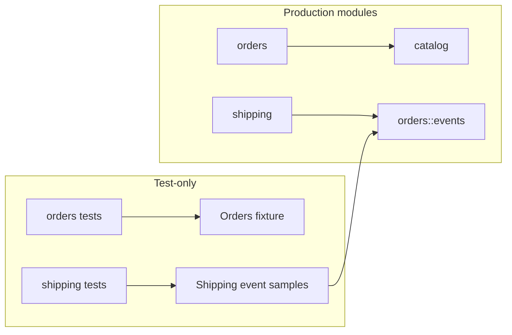
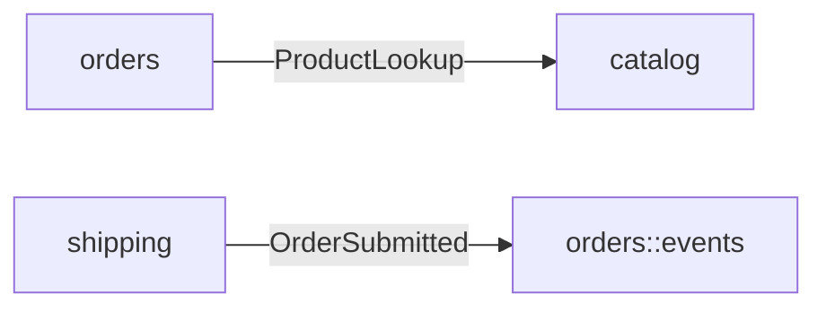
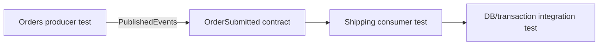
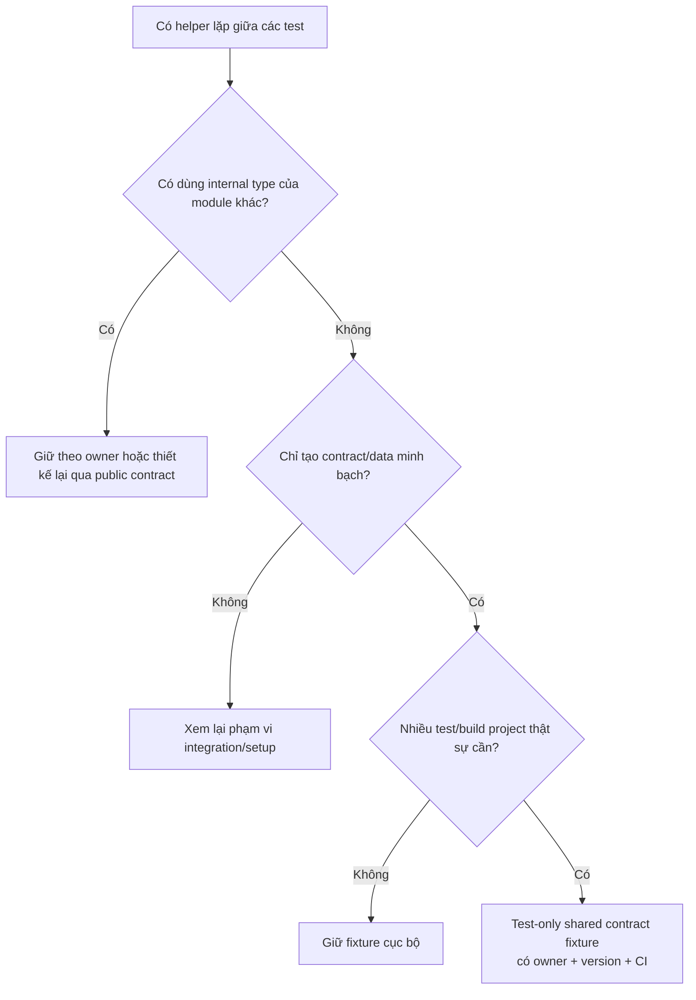
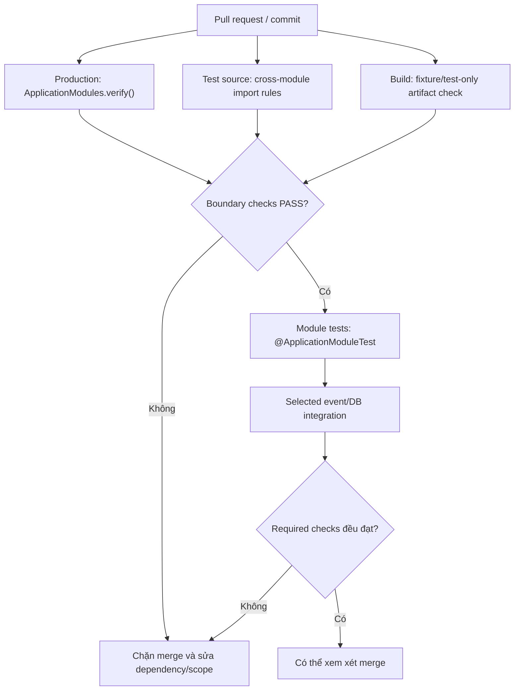

# Test utility dùng chung có làm mờ boundary không?

**Có thể có.** Test utility dùng chung giúp giảm trùng lặp và khiến việc chuẩn bị dữ liệu, sự kiện, mock hoặc container nhất quán hơn. Nhưng nếu một helper “tiện dùng cho mọi nơi” buộc test của `shipping` phải import `orders.internal.OrderRepository`, hoặc nếu fake dành cho test bị đặt trong `src/main` và trở thành Spring bean production, nó đang **làm mờ ranh giới application module** thay vì hỗ trợ kiểm thử.

Câu hỏi quan trọng không phải “có nên dùng shared utility không?”, mà là: **nó chia sẻ hợp đồng nào, ai sở hữu, xuất hiện ở classpath nào, và nó cho test vượt qua ranh giới nào?**

Trong **SPRING_MODULITH_VERIFICATION_TESTING**, chúng ta cần kiểm chứng ranh giới kiến trúc Spring Modulith bằng `ApplicationModules` và dependency rules, kết hợp `@ApplicationModuleTest`, producer–consumer event tests, kiểm thử database/tích hợp và **CI quality gate**. Vì vậy một utility tốt phải làm test dễ viết hơn **mà không tạo bằng chứng sai** về quyền phụ thuộc, wiring hoặc kết quả runtime.

Bài thuộc chương **Module boundaries**, tập trung vào test utility được tái sử dụng giữa nhiều test/module; không coi mọi sự dùng chung là xấu và cũng không hợp thức hóa mọi “test helper” chỉ vì nó nằm dưới `src/test`.

## 1. Mục tiêu học tập

Sau bài này, bạn có thể:

1. Giải thích **khi nào shared test utility giúp ích** và **khi nào nó che coupling xuyên module**.
2. Phân biệt ranh giới **application module**, **Java package**, **source set/build artifact** và **Spring TestContext**.
3. Nhận diện những mẫu nguy hiểm: helper import package `internal` của module khác, base test class khởi động toàn ứng dụng, global mutable fixture và utility được đặt nhầm vào `src/main`.
4. Thiết kế test utility nhỏ, có **owner rõ ràng**, tạo input hoặc event dựa trên **public API/named interface**.
5. Phân biệt utility nội bộ của module sở hữu với **contract fixture được phép chia sẻ**.
6. Viết `@ApplicationModuleTest` dùng `@MockitoBean` hoặc `@TestConfiguration` mà không cần mở production implementation.
7. Kết hợp `ApplicationModules.verify()` với quy tắc bổ sung nếu tổ chức muốn bảo vệ cả dependency trong test source.
8. Kiểm tra producer và consumer độc lập, không cho utility giấu mọi bước điều phối bên trong một method.
9. Quản lý database fixture, transaction, Testcontainers, ID test và trạng thái dùng chung để tránh kiểm thử không ổn định.
10. Thiết kế quality gate kiểm tra architecture, test-source hygiene, artifact packaging và behavior thực tế.

## 2. Trả lời trực tiếp: chia sẻ cái gì mới là vấn đề?

Có ba ví dụ rất khác nhau:

**Chia sẻ an toàn có điều kiện:** một utility nhận `UUID` và trả về `OrderSubmitted` — record nằm trong named interface `orders::events` được công bố. Utility không biết implementation producer và không ghi database.

**Chia sẻ đáng ngờ:** một utility gọi `orders.internal.OrderRepository`, tạo JPA entity rồi trả entity ấy cho shipping tests. Consumer test bị buộc phải hiểu schema và storage của orders.

**Chia sẻ nguy hiểm:** một base class chung gắn `@SpringBootTest`, nạp mọi module và tự đăng ký hàng loạt mock/fake. Một test mang tên `ShippingModuleTests` có thể xanh nhờ các bean ngoài phạm vi mà không ai biết; việc thay đổi module boundary không được phát hiện rõ.

### 2.1. Năm điều kiện cho shared utility tương đối an toàn

| Điều kiện | Câu hỏi kiểm tra | Dấu hiệu tốt |
|---|---|---|
| **Ownership** | Ai duy trì helper khi contract đổi? | Có module/nhóm sở hữu rõ |
| **Surface** | Helper phụ thuộc type nào? | Public API hoặc named interface cần thiết |
| **Scope** | Helper được đóng gói ở đâu? | Test source/test-only artifact |
| **Behavior** | Helper thực hiện gì? | Tạo fixture minh bạch, không che luồng nghiệp vụ |
| **Evidence** | Test thực sự assert gì? | Kết quả/event/trạng thái rõ, không chỉ dùng helper rồi tin mọi thứ đúng |

Nếu không trả lời được một trong năm câu hỏi, utility cần được xem lại trước khi mở rộng cho nhiều module.

### 2.2. Ba cấp tái sử dụng nên ưu tiên

1. **Cục bộ trong một test class/module:** mặc định tốt nhất cho dữ liệu và behavior đặc thù.
2. **Dùng chung theo public contract:** phù hợp nếu nhiều test cần tạo cùng payload/value object ổn định.
3. **Hạ tầng test có chủ đích:** container setup, HTTP stub, dữ liệu tích hợp có version/lifecycle rõ; không tự trở thành domain API.

Một chút trùng lặp fixture đơn giản có thể là **chi phí chấp nhận được** để giữ boundary rõ ràng.

## 3. Bốn ranh giới cần tách bạch

| Ranh giới | Đơn vị | Công cụ hoặc quy tắc | Điều không tự bảo đảm |
|---|---|---|---|
| **Java package** | `public`, package-private | Java compiler | Public module API |
| **Spring Modulith application module** | Module, API, named interface, dependency edge | `ApplicationModules.verify()` | Mọi test-source import đều bị kiểm tra |
| **Build/source set** | `src/main`, `src/test`, `testFixtures` | Maven/Gradle classpath/artifact | Nghiệp vụ hoặc test isolation đúng |
| **Spring TestContext** | Beans được nạp/override | `@ApplicationModuleTest`, `@MockitoBean`, `@Import` | Dependency production tự nhiên hợp lệ |

Ví dụ một test dưới `src/test/java/com/acme/shop/orders/internal` có thể gọi class package-private cùng package của `orders.internal`. Đó là **quyền truy cập Java hợp lệ dành cho test của owner**, không phải lý do để module `shipping` import class ấy.

Còn nếu helper dùng `orders.events.OrderSubmitted` thuộc named interface được công bố, sự phụ thuộc của shipping vào contract đó có thể là hợp lệ về kiến trúc, nhưng test-source/build policy vẫn cần được thiết kế riêng.

### 3.1. Đồ thị có hai tầng



Ta muốn utility **phục vụ** một module test, không vô tình tạo cạnh `shipping → orders.internal` ở test code rồi đòi production mở API để giữ helper hoạt động.

## 4. Ví dụ xuyên suốt: catalog, orders và shipping

Ứng dụng `com.acme.shop` có ba application module:

- `catalog` sở hữu dữ liệu sản phẩm và công bố `ProductLookup`.
- `orders` kiểm tra sản phẩm qua API công khai của catalog và phát `OrderSubmitted`.
- `shipping` nhận event và ghi nhận yêu cầu xử lý.

Cấu trúc production tối giản:

```text
src/main/java/com/acme/shop
├── ShopApplication.java
├── catalog
│   ├── ProductLookup.java
│   └── internal
│       └── JpaProductLookup.java       # implementation giả định
├── orders
│   ├── package-info.java
│   ├── PlaceOrder.java
│   ├── events
│   │   ├── package-info.java
│   │   └── OrderSubmitted.java
│   └── internal
│       ├── DefaultPlaceOrder.java
│       └── OrderRepository.java       # persistence giả định
└── shipping
    ├── package-info.java
    ├── ShippingStatus.java
    └── internal
        ├── OnOrderSubmitted.java
        └── ShippingProjection.java
```

Và một cấu trúc test được tổ chức theo owner:

```text
src/test/java/com/acme/shop
├── ModuleArchitectureTests.java
├── orders
│   ├── OrdersModuleTests.java
│   ├── OrderInputSamples.java
│   └── internal
│       └── DefaultPlaceOrderUnitTests.java
├── shipping
│   ├── ShippingModuleTests.java
│   └── ShippingEventSamples.java
└── testing
    └── Uuids.java                    # chỉ nếu có nhu cầu dùng chung thực tế
```

`JpaProductLookup` và `OrderRepository` chỉ là adapter giả định trong sơ đồ, chưa được cài đặt. Ví dụ mã chạy module test bên dưới dùng mock cho catalog và projection in-memory cho shipping.

### 4.1. Public API và event contract

Cạnh production mong muốn:



Chú ý: `shipping` tiêu thụ event do orders công bố, nhưng orders không import implementation shipping. Đó là lý do shipping test có thể tự tạo event đầu vào **từ contract công khai**, không cần tạo aggregate orders bên trong repository.

## 5. Mẫu xấu: một SharedShopTestUtils biết mọi implementation

Một helper bị lạm dụng thường bắt đầu “vì cho tiện”:

```java
// CỐ TÌNH SAI: helper phụ thuộc implementation của nhiều module.
package com.acme.shop.testing;

import com.acme.shop.catalog.internal.ProductJpaRepository;
import com.acme.shop.orders.internal.OrderRepository;
import com.acme.shop.shipping.internal.ShippingRepository;

public class SharedShopTestUtils {

    // createProductViaRepository(...)
    // createOrderAggregateViaRepository(...)
    // createShipmentViaRepository(...)
    // assertEverythingWasSaved(...)
}
```

Ba repository chỉ là tên giả định để phân tích anti-pattern, không phải các file production cần tạo cho ví dụ chính.

### 5.1. Nó làm mờ boundary thế nào?

- Test shipping biết trực tiếp repository của orders và catalog.
- Một thay đổi implementation trong catalog gây lỗi biên dịch test shipping dù public contract không đổi.
- Fixture có thể ghi dữ liệu mà không đi qua invariant/use case của module sở hữu.
- Ranh giới transaction bị che: helper có thể flush/commit thay cho code production.
- Một test chỉ gọi `setupEverything()` và `assertEverything()` không cho thấy **đường đi thực sự được kiểm chứng**.
- Đội phát triển có xu hướng chuyển repository từ `internal` ra public package để “test code dùng được”.
- Nếu helper nằm dưới `src/main`, nó còn có nguy cơ xuất hiện trong production artifact.

### 5.2. Nếu helper chỉ nằm dưới src/test thì đã an toàn chưa?

**Chưa.** Test code vẫn có type dependency và có thể coupling vào implementation. `ApplicationModules.verify()` thường hướng tới mô hình application module của production; **không nên mặc định** nó kiểm tra mọi class trong `src/test` với cùng phạm vi như code production.

Một dự án có thể pass `verify()` trong khi test shipping import `orders.internal.OrderRepository`. Đó là lý do test-source hygiene có thể cần một rule riêng.

### 5.3. Biện pháp đúng không phải mở rộng API production

Đừng chỉ đổi:

```java
package com.acme.shop.orders;

// Chuyển repository ra API root chỉ để test tiện import: cần tránh.
public interface OrderRepository {
    // ...
}
```

Thay vào đó, xác định mục tiêu của test:

- Muốn tạo input event? **Tạo record từ public event contract.**
- Muốn đặt đơn thật? **Gọi public use case của orders.**
- Muốn test JPA mapping orders? **Đặt integration test trong phạm vi orders.**
- Muốn chuẩn bị nhiều module cùng lúc? **Thiết kế integration fixture có ownership, setup và cleanup tường minh**, không làm nó thành public runtime API.

## 6. Source set: fixture dùng chung phải ở test scope

Trong một project Java thông thường:

```text
src/main/java      # production
src/main/resources # production
src/test/java      # tests và helpers chỉ phục vụ test
src/test/resources # dữ liệu/cấu hình test
src/testFixtures/java  # chỉ nếu build hỗ trợ source set này
```

### 6.1. src/main không phải nơi chứa fake hoặc factory test-only

Không đặt `FakeCatalog` với `@Component` ở `src/main` chỉ vì Spring Boot test không tìm thấy bean. Nó có thể bị component scan production, tạo bean ambiguity hoặc thay đổi hành vi ứng dụng.

Production contract thuộc main:

```java
package com.acme.shop.catalog;

import java.util.UUID;

public interface ProductLookup {
    boolean exists(UUID productId);
}
```

Nhưng fake chỉ cho test thuộc `src/test` hoặc test-fixtures artifact có kiểm soát.

### 6.2. src/test không tự có “quyền kiến trúc đặc biệt”

Java compiler chỉ biết classpath và visibility. Test source có thể truy cập một Java `public` type ở `orders.internal` nếu nó ở trên classpath. **Spring Modulith boundary** không tự biến Java thành cơ chế compile-time access control cho mọi test reference.

Vì thế code review và rule kiểm tra test-source dependencies vẫn quan trọng.

### 6.3. testFixtures có nghĩa ở cấp build

Gradle `java-test-fixtures` hỗ trợ variant riêng để chia sẻ test utility giữa **Gradle projects**. Nó không có nghĩa một Spring Modulith application module theo package cũng mặc nhiên là một project Gradle.

Tách hai khái niệm:

- **Application module:** ranh giới nghiệp vụ mà Spring Modulith nhận diện.
- **Gradle/Maven module/project:** đơn vị build và dependency artifact.

Cấu trúc build và cấu trúc application module có thể trùng nhau, nhưng không nhất thiết.

## 7. Quy tắc ownership: fixture thuộc ai?

Giả sử một helper tạo `OrderSubmitted`. Ta có ba lựa chọn:

1. `shipping` sở hữu helper vì chỉ shipping tests cần đầu vào event đó.
2. `orders` sở hữu **contract samples** nếu nhiều consumer cần cùng payload chuẩn.
3. Một test-contracts artifact riêng sở hữu factory nếu dự án có **nhiều build projects** và một chính sách chia sẻ rõ.

Không nên để một package `testing.shared` tùy ý sở hữu cả event samples, JPA entities, HTTP stubs, DB repositories và utility khởi động Spring context.

### 7.1. Bảng gợi ý ownership

| Utility/fixture | Owner phù hợp | Có nên chia sẻ rộng? |
|---|---|---|
| `OrderInputSamples` tạo UUID/quantity | Orders tests | Thường không |
| `OrderSubmittedSamples` chỉ tạo public event record | Orders contract test hoặc consumer test | Có thể, nếu nhu cầu lặp rõ |
| `ProductEntityFactory` tạo JPA entity nội bộ | Catalog internal tests | Không mặc định |
| `ShippingProjectionFactory` tạo state nội bộ | Shipping tests | Không mặc định |
| PostgreSQL container lifecycle helper | Integration-test infrastructure | Có thể, kèm lifecycle/version |
| Authenticated HTTP test client | API/integration test infrastructure | Có thể, nếu không giấu nghiệp vụ |
| `AllModulesTestBase` với mọi bean và mock | Không khuyến khích dùng mặc định | Rủi ro cao |
| Generic `Uuids.newId()` | Dùng `UUID.randomUUID()` trực tiếp cũng được | Thường không cần library chung |

### 7.2. Đánh giá giá trị tái sử dụng thực tế

Một helper ba dòng chỉ bọc `UUID.randomUUID()` có thể làm code khó truy vết hơn mà không giảm đáng kể chi phí. Đừng tạo abstraction chỉ vì có hai test dùng cùng một constructor.

Một factory chứa **default hợp đồng hợp lệ**, được cập nhật cùng event schema và dùng bởi hàng chục consumer tests có thể có giá trị thật.

## 8. Các file production tối thiểu dùng trong ví dụ

Public API của orders:

```java
package com.acme.shop.orders;

import java.util.UUID;

public interface PlaceOrder {
    UUID place(UUID productId, int quantity);
}
```

Event contract:

```java
package com.acme.shop.orders.events;

import java.util.UUID;

public record OrderSubmitted(
    UUID orderId,
    UUID productId,
    int quantity
) {}
```

Công bố named interface `orders::events`:

```java
@org.springframework.modulith.NamedInterface("events")
package com.acme.shop.orders.events;
```

Cho orders dùng catalog:

```java
@org.springframework.modulith.ApplicationModule(
    allowedDependencies = "catalog"
)
package com.acme.shop.orders;
```

Giới hạn shipping:

```java
@org.springframework.modulith.ApplicationModule(
    allowedDependencies = "orders::events"
)
package com.acme.shop.shipping;
```

### 8.1. Vì sao allowedDependencies không cho phép mọi import?

`allowedDependencies = "catalog"` cho orders dùng public API catalog **nhưng không cho phép** orders dùng `catalog.internal.ProductRepository`.

Tương tự, `shipping` chỉ được phép dùng `orders::events` trong thiết kế ví dụ, không được import `orders.internal.DefaultPlaceOrder`.

**Named interface và dependency policy là hai điều kiện cần kiểm tra độc lập:** package con được công bố hay không; module nguồn có được phép phụ thuộc giao diện ấy hay không.

## 9. Implementation của orders không cần public chỉ vì test

File `orders/internal/DefaultPlaceOrder.java`:

```java
package com.acme.shop.orders.internal;

import com.acme.shop.catalog.ProductLookup;
import com.acme.shop.orders.PlaceOrder;
import com.acme.shop.orders.events.OrderSubmitted;
import java.util.UUID;
import org.springframework.context.ApplicationEventPublisher;
import org.springframework.stereotype.Service;

@Service
class DefaultPlaceOrder implements PlaceOrder {

    private final ProductLookup products;
    private final ApplicationEventPublisher events;

    DefaultPlaceOrder(
            ProductLookup products,
            ApplicationEventPublisher events) {
        this.products = products;
        this.events = events;
    }

    @Override
    public UUID place(UUID productId, int quantity) {
        if (productId == null || quantity <= 0) {
            throw new IllegalArgumentException("Invalid order item");
        }

        if (!products.exists(productId)) {
            throw new IllegalArgumentException("Unknown product");
        }

        UUID orderId = UUID.randomUUID();
        events.publishEvent(
            new OrderSubmitted(orderId, productId, quantity)
        );

        return orderId;
    }
}
```

Implementation là package-private trong `orders.internal`. Test theo hợp đồng nên inject `PlaceOrder` ở package gốc module, còn unit test thuật toán nội bộ có thể nằm **cùng package `orders.internal`**.

Không chuyển class này thành `public` chỉ để một generic shared helper ở package khác có thể gọi constructor.

### 9.1. Demo chưa có persistence

Ví dụ chỉ kiểm tra input, gọi catalog và publish event. `OrderSubmitted` biểu diễn **yêu cầu đã được tiếp nhận trong demo**, không khẳng định order đã lưu hay transaction đã commit. Các test bên dưới phải tuyên bố đúng phạm vi này.

## 10. Utility cục bộ: OrderInputSamples

File dưới `src/test/java/com/acme/shop/orders/OrderInputSamples.java`:

```java
package com.acme.shop.orders;

import java.util.UUID;

final class OrderInputSamples {

    private OrderInputSamples() {}

    static UUID productId() {
        return UUID.randomUUID();
    }

    static int validQuantity() {
        return 2;
    }
}
```

Đặc điểm tốt:

- Package-private, không ép thành `public` để các module khác dùng.
- Chỉ thuộc test source, không phải production component.
- Không import type từ `catalog.internal` hay `shipping.internal`.
- Tạo ID mới để các test độc lập khi dùng dữ liệu.
- Mọi method có ý nghĩa cho **orders tests**, không cố gắng xử lý toàn bộ ứng dụng.

Nếu method quá đơn giản và chỉ một test dùng, inline `UUID.randomUUID()` cũng hoàn toàn hợp lý. Không có yêu cầu phải tạo utility cho mọi fixture.

### 10.1. Một anti-pattern dễ gặp

```java
// Không nên đưa vào helper orders:
static OrderEntity persistedOrder(
        ProductJpaEntity product,
        ShippingProjection projection) {
    // ...
}
```

Helper trên bắt đầu kết hợp type nội bộ từ ba module khác nhau, khiến test code phụ thuộc implementation và ownership dữ liệu. Nên tách từng fixture theo module sở hữu.

## 11. @ApplicationModuleTest với public API và mock collaborator

File `src/test/java/com/acme/shop/orders/OrdersModuleTests.java`:

```java
package com.acme.shop.orders;

import static org.assertj.core.api.Assertions.assertThat;
import static org.assertj.core.api.Assertions.assertThatThrownBy;
import static org.mockito.Mockito.verify;
import static org.mockito.Mockito.verifyNoInteractions;
import static org.mockito.Mockito.when;

import com.acme.shop.catalog.ProductLookup;
import com.acme.shop.orders.events.OrderSubmitted;
import java.util.UUID;
import org.junit.jupiter.api.Test;
import org.springframework.beans.factory.annotation.Autowired;
import org.springframework.modulith.test.ApplicationModuleTest;
import org.springframework.modulith.test.PublishedEvents;
import org.springframework.test.context.bean.override.mockito.MockitoBean;

@ApplicationModuleTest
class OrdersModuleTests {

    @Autowired PlaceOrder orders;

    @MockitoBean ProductLookup catalog;

    @Test
    void publishesEventForKnownProduct(PublishedEvents published) {
        UUID productId = OrderInputSamples.productId();
        when(catalog.exists(productId)).thenReturn(true);

        UUID orderId = orders.place(
            productId,
            OrderInputSamples.validQuantity()
        );

        assertThat(published.ofType(OrderSubmitted.class))
            .singleElement()
            .satisfies(event -> {
                assertThat(event.orderId()).isEqualTo(orderId);
                assertThat(event.productId()).isEqualTo(productId);
                assertThat(event.quantity()).isEqualTo(2);
            });

        verify(catalog).exists(productId);
    }

    @Test
    void rejectsMissingProductWithoutEvent(
            PublishedEvents published) {
        UUID productId = OrderInputSamples.productId();
        when(catalog.exists(productId)).thenReturn(false);

        assertThatThrownBy(() -> orders.place(productId, 2))
            .isInstanceOf(IllegalArgumentException.class)
            .hasMessage("Unknown product");

        assertThat(published.ofType(OrderSubmitted.class)).isEmpty();
        verify(catalog).exists(productId);
    }

    @Test
    void rejectsInvalidInputBeforeCallingCatalog(
            PublishedEvents published) {
        assertThatThrownBy(() ->
            orders.place(OrderInputSamples.productId(), 0)
        ).isInstanceOf(IllegalArgumentException.class)
         .hasMessage("Invalid order item");

        verifyNoInteractions(catalog);
        assertThat(published.ofType(OrderSubmitted.class)).isEmpty();
    }
}
```

Bài test:

- Dùng `@ApplicationModuleTest`, mặc định `STANDALONE`.
- Inject **public contract `PlaceOrder`** thay vì implementation internal.
- Dùng `@MockitoBean` cho **public API `ProductLookup`** của module catalog.
- Giữ Spring `ApplicationEventPublisher` thật để `PublishedEvents` quan sát sự kiện.
- Assert behavior và payload, không chỉ kiểm tra context khởi động.
- Không cần tải shipping hay repository của shipping.

**Điều kiện phiên bản:** `@MockitoBean` ở `org.springframework.test.context.bean.override.mockito` yêu cầu Spring Framework có API này (từ 6.2). Với một số dự án Spring Boot 3.x cũ, cơ chế tương ứng là `@MockBean`. Phải chọn theo version thực tế, không đặt hai annotation chồng nhau cho cùng bean.

### 11.1. Utility đã che điều gì chưa?

`OrderInputSamples.productId()` chỉ tạo ID, không tự gọi catalog, không ghi database và không publish event. Mỗi test hiển thị rõ các bước `when`, `orders.place` và `assertThat`. Đây là cách helper **không che luồng đang kiểm chứng**.

Ngược lại, một helper `ShopTestUtils.placeApprovedOrderAndCheckEverything()` có thể khiến người đọc không biết logic nào được giả lập, bean nào chạy thật, event nào được assert và transaction nào đã commit.

## 12. Unit test internal class thuộc chính module owner

Một test có thể kiểm tra trực tiếp `DefaultPlaceOrder` mà **không** đổi class thành `public` nếu nó nằm cùng Java package.

```text
src/main/java/com/acme/shop/orders/internal/DefaultPlaceOrder.java
src/test/java/com/acme/shop/orders/internal/DefaultPlaceOrderUnitTests.java
```

Ví dụ:

```java
package com.acme.shop.orders.internal;

import static org.assertj.core.api.Assertions.assertThat;
import static org.mockito.Mockito.verify;
import static org.mockito.Mockito.when;

import com.acme.shop.catalog.ProductLookup;
import com.acme.shop.orders.events.OrderSubmitted;
import java.util.UUID;
import org.junit.jupiter.api.Test;
import org.mockito.ArgumentCaptor;
import org.mockito.Mockito;
import org.springframework.context.ApplicationEventPublisher;

class DefaultPlaceOrderUnitTests {

    @Test
    void sendsCorrectEventToPublisher() {
        ProductLookup catalog =
            Mockito.mock(ProductLookup.class);
        ApplicationEventPublisher publisher =
            Mockito.mock(ApplicationEventPublisher.class);

        UUID productId = UUID.randomUUID();
        when(catalog.exists(productId)).thenReturn(true);

        DefaultPlaceOrder subject =
            new DefaultPlaceOrder(catalog, publisher);

        UUID orderId = subject.place(productId, 2);

        ArgumentCaptor<OrderSubmitted> captor =
            ArgumentCaptor.forClass(OrderSubmitted.class);

        verify(publisher).publishEvent(captor.capture());

        assertThat(captor.getValue().orderId()).isEqualTo(orderId);
        assertThat(captor.getValue().quantity()).isEqualTo(2);
    }
}
```

Test này:

- Không khởi động Spring TestContext.
- Chỉ dùng Mockito object thuần Java.
- Kiểm tra **implementation nội bộ của orders**, do orders tự sở hữu.
- Không yêu cầu shipping test import class internal.
- Không chứng minh Spring đã dispatch event thật, vì publisher là mock.

Một test theo public contract và một unit test implementation không nhất thiết trùng mục tiêu; cân nhắc giữ test nào đem lại bằng chứng rõ và tránh test chi tiết không cần thiết.

## 13. Consumer test: utility chỉ tạo event contract

Shipping cần kiểm tra khi nhận `OrderSubmitted` thì module ghi nhận một yêu cầu.

Public query contract:

```java
package com.acme.shop.shipping;

import java.util.UUID;

public interface ShippingStatus {
    boolean received(UUID orderId);
}
```

Implementation demo, file `shipping/internal/ShippingProjection.java`:

```java
package com.acme.shop.shipping.internal;

import com.acme.shop.shipping.ShippingStatus;
import java.util.Set;
import java.util.UUID;
import java.util.concurrent.ConcurrentHashMap;
import org.springframework.stereotype.Component;

@Component
class ShippingProjection implements ShippingStatus {

    private final Set<UUID> ids =
        ConcurrentHashMap.newKeySet();

    void record(UUID orderId) {
        ids.add(orderId);
    }

    @Override
    public boolean received(UUID orderId) {
        return ids.contains(orderId);
    }
}
```

Listener, file `shipping/internal/OnOrderSubmitted.java`:

```java
package com.acme.shop.shipping.internal;

import com.acme.shop.orders.events.OrderSubmitted;
import org.springframework.context.event.EventListener;
import org.springframework.stereotype.Component;

@Component
class OnOrderSubmitted {

    private final ShippingProjection projection;

    OnOrderSubmitted(ShippingProjection projection) {
        this.projection = projection;
    }

    @EventListener
    void on(OrderSubmitted event) {
        projection.record(event.orderId());
    }
}
```

### 13.1. ShippingEventSamples là fixture do consumer test sở hữu

```java
package com.acme.shop.shipping;

import com.acme.shop.orders.events.OrderSubmitted;
import java.util.UUID;

final class ShippingEventSamples {

    private ShippingEventSamples() {}

    static OrderSubmitted submitted(UUID orderId) {
        return new OrderSubmitted(
            orderId, UUID.randomUUID(), 2
        );
    }
}
```

Đây là một utility phù hợp vì chỉ phụ thuộc `orders.events.OrderSubmitted` thuộc named interface công khai, không import `orders.internal`.

### 13.2. Shipping module test

```java
package com.acme.shop.shipping;

import static org.assertj.core.api.Assertions.assertThat;

import java.util.UUID;
import org.junit.jupiter.api.Test;
import org.springframework.beans.factory.annotation.Autowired;
import org.springframework.context.ApplicationEventPublisher;
import org.springframework.modulith.test.ApplicationModuleTest;

@ApplicationModuleTest
class ShippingModuleTests {

    @Autowired ApplicationEventPublisher events;
    @Autowired ShippingStatus status;

    @Test
    void handlesOrderSubmittedContract() {
        UUID orderId = UUID.randomUUID();

        events.publishEvent(
            ShippingEventSamples.submitted(orderId)
        );

        assertThat(status.received(orderId)).isTrue();
    }
}
```

Mục tiêu của test là **consumer behavior**, không phải khởi động producer orders. `@EventListener` với multicaster đồng bộ mặc định cho phép assert ngay sau publish trong demo.

Nó **không** chứng minh shipping đã ghi shipment bền vững: projection chỉ nằm trong JVM. Với `@ApplicationModuleListener` bất đồng bộ/sau commit, cách setup transaction và chờ kết quả phải thay đổi.

## 14. Một event sample có nên dùng chung cho orders và shipping tests?

Có thể, nhưng đừng tự tạo một package `global.helpers` rồi đòi mọi test phụ thuộc vào nó.

### 14.1. Phương án A — Mỗi consumer sở hữu sample riêng

`ShippingEventSamples` sống ở `shipping` test, tạo `OrderSubmitted` hợp lệ. Nó có thể trùng vài dòng với fixture của `notifications` nhưng có ownership và mục tiêu rất rõ.

Ưu điểm:

- Consumer hiểu chính xác điều kiện đầu vào mình cần.
- Ít test build dependencies.
- Dễ thay đổi ví dụ khi mỗi consumer quan tâm trường khác nhau.
- Không cần công bố helper cho cả dự án.

Nhược điểm: nếu nhiều consumer cùng cần xử lý 20 trường event mặc định, trùng lặp có thể lớn.

### 14.2. Phương án B — Owner công bố contract-only test sample

Nếu nhiều consumer cùng dùng một event contract lớn, module `orders` có thể sở hữu helper **test-only**:

```java
package com.acme.shop.orders.testing;

import com.acme.shop.orders.events.OrderSubmitted;
import java.util.UUID;

public final class OrderSubmittedSamples {

    private OrderSubmittedSamples() {}

    public static OrderSubmitted validFor(UUID orderId) {
        return new OrderSubmitted(
            orderId, UUID.randomUUID(), 2
        );
    }
}
```

Lưu ý cực quan trọng:

- Class này phải được đặt trong **test-only source set/artifact**, không phải `src/main`.
- Nó chỉ import **public event contract**, không `orders.internal.*`.
- `public` ở đây để cho phép consumer test dùng **fixture artifact**, **không phải** công bố public **production API** của orders.
- Ownership/version của fixture phải đi theo hợp đồng event; consumer vẫn có các assertion riêng.

Trong một Maven/Gradle **single-project** với nhiều Spring Modulith application modules, một shared utility dưới `src/test/java` có thể được test classes khác thấy trên test classpath. Trong nhiều **build projects**, cần cơ chế test-fixtures dependency được build hỗ trợ.

### 14.3. Không đặt cả nghiệp vụ vào factory

Một sample factory chỉ nên tạo input:

```java
OrderSubmitted event =
    OrderSubmittedSamples.validFor(orderId);
```

Không nên âm thầm:

```java
// Cần tránh:
OrderSubmitted event =
    SharedShopUtils.insertOrderAndShipIt(orderId);
```

Helper thứ hai có thể chạy production use case, chạm DB của nhiều module, publish event và xác nhận side effect; khi test đỏ rất khó biết bước nào sai. Nếu thật sự cần một integration workflow helper, đặt tên rõ mục đích và cấu trúc setup/act/assert riêng.

## 15. Gradle testFixtures chỉ giải quyết chia sẻ ở mức build

Khi `orders` và `shipping` là **hai Gradle projects** thật sự, có thể dùng `java-test-fixtures` để đóng gói helper test-only của provider.

Ở project `:orders`:

```groovy
plugins {
    id 'java-library'
    id 'java-test-fixtures'
}
```

File helper:

```text
orders/src/testFixtures/java/com/acme/shop/orders/testing/
    OrderSubmittedSamples.java
```

Ở project consumer `:shipping`:

```groovy
dependencies {
    // Chỉ dùng khi thực sự có project :orders và plugin test-fixtures.
    testImplementation(testFixtures(project(':orders')))
}
```

Ý nghĩa:

- Shipping tests có thể sử dụng helper được export ở **test fixture variant**.
- Production code shipping không nên dùng variant ấy.
- Đây là quan hệ **Gradle build dependency test-only**, không phải sự cho phép `shipping` import `orders.internal`.
- Nếu helper tham chiếu internal types không được export, dependency có thể lại kéo coupling không mong muốn.

### 15.1. Phân biệt hai loại module

| Khái niệm | Ví dụ | Công cụ |
|---|---|---|
| Spring Modulith application module | `orders` theo package | `ApplicationModules`, `@ApplicationModuleTest` |
| Gradle project | `:orders` | `project(...)`, `java-test-fixtures` |
| Java package | `com.acme.shop.orders.events` | Java visibility |
| Maven module | `orders/pom.xml` nếu là project riêng | Maven reactor/dependencies |

Một modular monolith có thể có hàng chục application modules **trong một build project duy nhất**. Không tạo Gradle subprojects chỉ để có một helper event factory ba dòng.

### 15.2. Với Maven

Một hệ thống Maven nhiều modules có thể tạo test JAR hoặc artifact fixture riêng bằng plugin/cấu hình phù hợp. Nhưng test JAR không mặc định cách ly **mọi** dependency nội bộ; phải kiểm tra scope, nội dung artifact và transitive dependencies.

Hướng dẫn cụ thể phụ thuộc vào build setup; không nên sao chép cấu hình test JAR mà chưa biết Maven compiler/surefire/failsafe và cách publish của dự án.

## 16. @TestConfiguration và fake bean dùng chung: kiểm soát phạm vi

Có trường hợp nhiều module tests cần một fake `ProductLookup` có behavior ổn định. Thay vì đặt `@Component FakeProductLookup` ở `src/main`, có thể dùng test-only Spring configuration.

Ví dụ test `orders`:

```java
package com.acme.shop.orders;

import static org.assertj.core.api.Assertions.assertThat;

import com.acme.shop.catalog.ProductLookup;
import com.acme.shop.orders.events.OrderSubmitted;
import java.util.UUID;
import org.junit.jupiter.api.Test;
import org.springframework.beans.factory.annotation.Autowired;
import org.springframework.boot.test.context.TestConfiguration;
import org.springframework.context.annotation.Bean;
import org.springframework.context.annotation.Import;
import org.springframework.modulith.test.ApplicationModuleTest;
import org.springframework.modulith.test.PublishedEvents;

@ApplicationModuleTest
@Import(OrdersWithFakeCatalogTests.FakeCatalogConfig.class)
class OrdersWithFakeCatalogTests {

    private static final UUID KNOWN_PRODUCT = UUID.fromString(
        "00000000-0000-0000-0000-000000000001"
    );

    @Autowired PlaceOrder orders;

    @Test
    void usesFakeThroughCatalogPublicApi(PublishedEvents events) {
        UUID orderId = orders.place(KNOWN_PRODUCT, 2);

        assertThat(events.ofType(OrderSubmitted.class))
            .singleElement()
            .satisfies(event ->
                assertThat(event.orderId()).isEqualTo(orderId));
    }

    @TestConfiguration(proxyBeanMethods = false)
    static class FakeCatalogConfig {

        @Bean
        ProductLookup productLookup() {
            return KNOWN_PRODUCT::equals;
        }
    }
}
```

Ở đây:

- `@TestConfiguration` chỉ định bean test-only.
- `@Import` làm phạm vi test rõ ràng.
- Fake triển khai **public API `ProductLookup`** của catalog.
- Spring module test không cần nạp production implementation catalog.
- Không có helper “scan hết mọi bean test” và không đưa fake vào runtime production.

### 16.1. Đừng đăng ký chồng mock, fake và real bean vô chủ đích

Trong một context, tránh đồng thời có:

- `@MockitoBean ProductLookup`;
- `@TestConfiguration` cung cấp `ProductLookup` fake;
- bean `JpaProductLookup` từ catalog vì chọn bootstrap mode rộng;

trừ khi bạn thực sự kiểm soát `@Qualifier`/override theo mục tiêu test.

Một test xanh nhờ bean khác với bean mà người viết tưởng đang dùng là một **lỗi bằng chứng**.

### 16.2. @TestConfiguration không phải lifecycle từng test method

Bean fake sống theo lifecycle của Spring TestContext và context cache; nó có thể giữ mutable state qua các test method nếu không reset. Cần tránh global state, dùng immutable fixture hoặc reset/cleanup có chủ đích.

## 17. Shared base test class có thể làm mất ý nghĩa @ApplicationModuleTest

Một pattern phổ biến:

```java
// Mẫu cần xem xét, không khuyến nghị mặc định:
@SpringBootTest
abstract class EverythingIntegrationTest {

    // @MockBean hàng loạt service
    // @Autowired mọi repository
    // seed toàn bộ schema
    // khởi tạo mọi listener
}
```

Rồi mọi module test `extends EverythingIntegrationTest`.

Hệ quả:

- Một `OrdersModuleTests` không còn chứng minh được cấu hình riêng của orders trong phạm vi `STANDALONE`.
- Sai dependency trực tiếp hoặc thiếu bean có thể bị che bởi mock toàn cục.
- Thời gian chạy tăng do context rộng.
- Một fixture lỗi của shipping làm test orders đỏ dù không liên quan.
- Người đọc không biết bean nào là thật, bean nào được override.
- Điều tra failure khó vì setup nằm sâu trong lớp cha.

### 17.1. Thay thế nên ưu tiên

Tách utility theo **vai trò**:

- Dữ liệu mẫu thuần Java: factory nhỏ, không Spring context.
- Collaborator mock/fake: khai báo gần test với `@MockitoBean` hoặc `@Import`.
- Database integration: cấu hình container/data theo suite rõ ràng.
- Contract fixture: helper chỉ dùng type API được công bố.
- System tests: base class rộng có thể hợp lý **nếu tên/phạm vi công khai là end-to-end hoặc integration**, không giả mạo module isolation.

### 17.2. Khi base test class vẫn có giá trị

Một base class **chỉ** thiết lập một Testcontainers lifecycle, clock hoặc security test authentication có thể có giá trị khi nhiều test thật sự chia sẻ cùng nhu cầu. Nhưng cần:

1. Không tự kích hoạt toàn bộ domain modules nếu bài test muốn cô lập.
2. Không override bean nghiệp vụ mà không có khai báo rõ.
3. Không làm test phụ thuộc mutable state của class khác.
4. Có giới hạn/test-specific API và owner duy trì.
5. Được kiểm tra trong CI như một phần hạ tầng test.

## 18. BootstrapMode không hợp thức hóa utility xuyên ranh giới

`@ApplicationModuleTest` có các chế độ thông dụng:

| Mode | Phạm vi Spring application modules | Rủi ro về utility |
|---|---|---|
| `STANDALONE` (mặc định) | Module đang kiểm thử | Utility toàn cục có thể đăng ký mock/bean ngoài mục tiêu |
| `DIRECT_DEPENDENCIES` | Module và dependency trực tiếp | Dễ nhầm real bean với fake được import |
| `ALL_DEPENDENCIES` | Module và dependency bắc cầu | Context rộng che phạm vi của shared setup |

Ví dụ:

```java
package com.acme.shop.orders;

import org.springframework.modulith.test.ApplicationModuleTest;
import org.springframework.modulith.test.ApplicationModuleTest.BootstrapMode;

@ApplicationModuleTest(
    mode = BootstrapMode.DIRECT_DEPENDENCIES
)
class OrdersCatalogCollaborationTests {
    // Dùng bean thật của catalog nếu mục tiêu là collaboration.
}
```

Nếu muốn xác minh wiring giữa orders và catalog, **đừng import shared fake catalog** vào test này. Hãy cung cấp implementation thật và hạ tầng phù hợp.

### 18.1. Không nhầm “thiếu bean” với “vi phạm module”

Ở `STANDALONE`, thiếu bean `ProductLookup` có thể là điều mong đợi vì catalog ngoài phạm vi. Mock/fake public API khi mục tiêu là behavior orders; chọn `DIRECT_DEPENDENCIES` khi cần bean thật. Nhưng dependency vào `catalog.internal.ProductRepository` vẫn sai, bất kể test có tạo được mock hay không.

## 19. Architecture verification bảo vệ production graph

Một architecture test ở package gốc:

```java
package com.acme.shop;

import org.junit.jupiter.api.Test;
import org.springframework.modulith.core.ApplicationModules;

class ModuleArchitectureTests {

    @Test
    void verifiesModuleBoundaries() {
        ApplicationModules.of(ShopApplication.class).verify();
    }
}
```

`verify()` kiểm tra các quy tắc Spring Modulith hỗ trợ trên model application module, thường gồm:

- Module dependency cycle.
- Tham chiếu tới phần API nội bộ của module khác.
- `allowedDependencies` và named interface policies.

Nó giúp ngăn production source của `shipping` gọi `orders.internal.OrderRepository`. **Nó không thay một chính sách build artifact và không nên được coi là phép kiểm tra bao trùm mọi test helper.**

### 19.1. Xác nhận module discovery

```java
package com.acme.shop;

import static org.assertj.core.api.Assertions.assertThat;

import org.junit.jupiter.api.Test;
import org.springframework.modulith.core.ApplicationModules;

class ModuleDiscoveryTests {

    @Test
    void recognizesExpectedModules() {
        ApplicationModules modules =
            ApplicationModules.of(ShopApplication.class);

        assertThat(modules.getModuleByName("catalog")).isPresent();
        assertThat(modules.getModuleByName("orders")).isPresent();
        assertThat(modules.getModuleByName("shipping")).isPresent();
    }
}
```

Nếu root package hoặc cấu hình nhận diện module tùy biến, test phải phản ánh thực tế. Một kết quả verify xanh khi thiếu module mong đợi không đủ để kết luận đã kiểm tra đúng ranh giới.

### 19.2. Một thử nghiệm âm tính về production dependency

Trong nhánh thử nghiệm:

1. Tạo một type Java `public` dưới `catalog.internal`.
2. Cho class ở `orders` dùng type này làm field hoặc constructor parameter.
3. Chạy `ModuleArchitectureTests`; kỳ vọng báo vi phạm.
4. Xóa tham chiếu sai và dùng `catalog.ProductLookup`.
5. Chạy lại test và xác nhận xanh.

Không chỉ thêm import thừa: một import không được sử dụng có thể không tạo type dependency mà công cụ phân tích quan tâm. **Không đưa code cố tình sai vào nhánh chính.**

## 20. Quy tắc riêng cho dependency trong test source

Một tình huống thường bị bỏ sót:

```text
Production:
  shipping -> orders::events  (đúng policy)

Test source:
  shipping tests -> orders.internal.OrderRepository  (coupling)
```

Không nên mặc định `ApplicationModules.verify()` sẽ đọc mọi file test helper với cùng phạm vi như production. Kết quả phụ thuộc cách mô hình được dựng, classpath và tập class do công cụ kiểm tra thực tế nhập vào.

Nếu nhóm muốn **cấm test của module A tham chiếu internal của module B**, có thể bổ sung ArchUnit rule cho **test classes**.

### 20.1. Ví dụ ArchUnit rule hướng tới test source

Một ví dụ với ArchUnit JUnit 5, khi dự án đã cấu hình dependency/plugin phù hợp:

```java
package com.acme.shop;

import static com.tngtech.archunit.lang.syntax.ArchRuleDefinition.noClasses;

import com.tngtech.archunit.core.importer.ImportOption;
import com.tngtech.archunit.junit.AnalyzeClasses;
import com.tngtech.archunit.junit.ArchTest;
import com.tngtech.archunit.lang.ArchRule;

@AnalyzeClasses(
    packages = "com.acme.shop",
    importOptions = ImportOption.OnlyIncludeTests.class
)
class TestSourceBoundaryRules {

    @ArchTest
    static final ArchRule shippingTestsDoNotUseOrdersInternals =
        noClasses()
            .that().resideInAPackage("com.acme.shop.shipping..")
            .should().dependOnClassesThat()
                .resideInAPackage("com.acme.shop.orders.internal..");
}
```

**Điều kiện:** cách phát hiện test class bởi `ImportOption.OnlyIncludeTests`, test classpath, source layout và cú pháp ArchUnit phải được xác nhận theo phiên bản/thiết lập dự án. Không tự suy ra rule trên đã import toàn bộ helper nếu chúng được đóng gói ngoài những đường dẫn test mà importer nhận diện.

### 20.2. Đừng cấm owner tự kiểm thử implementation của mình

Không nên áp quy tắc “mọi test đều không được dùng `..internal..`”. Test thuộc `orders.internal` có thể cần gọi package-private class của **chính orders**.

Rule nên nhắm **cross-module internal dependency**, chẳng hạn shipping test → orders internal, chứ không cấm orders internal unit tests.

### 20.3. Cần đối xứng với production và test artifact

Một bộ kiểm chứng có thể bao gồm:

1. `ApplicationModules.verify()` cho production module boundaries.
2. ArchUnit/test-source rules cho cross-module internal imports trong `src/test`.
3. Build configuration check cho test-only artifacts.
4. Module/event/DB behavior tests cho các hợp đồng runtime.

Bốn phép kiểm chứng xử lý **bốn câu hỏi khác nhau**.

## 21. Khi shared helper dùng reflection hoặc SQL thì sao?

Một utility có thể tránh import type nội bộ nhưng vẫn phá ownership qua cách khác:

```java
// Ví dụ minh họa coupling động trong fixture:
Class.forName("com.acme.shop.orders.internal.OrderEntity");
```

Hoặc:

```sql
-- SQL test setup thuộc shipping nhưng ghi vào bảng sở hữu bởi orders.
INSERT INTO orders_internal_order (id, status)
VALUES ('00000000-0000-0000-0000-000000000001', 'ACCEPTED');
```

Các liên kết qua chuỗi/reflection/SQL không nên mặc định sẽ bị một rule dựa trên Java type dependency phát hiện đầy đủ.

### 21.1. Dùng fixture SQL khi nào vẫn hợp lý?

Trong database integration test, có lúc phải seed nhiều bảng để dựng dữ liệu đầu vào cần thiết. Nhưng cần ghi rõ:

- Ai sở hữu bảng/fixture?
- Đây là setup cho test integration nào?
- Có thể tạo dữ liệu qua public use case không?
- Test có cố ý kiểm tra mapping/schema của provider không?
- Schema thay đổi thì ai chịu trách nhiệm cập nhật?
- Transaction và cleanup được thực hiện thế nào?

Nếu chỉ test shipping listener nhận `OrderSubmitted`, publish event trực tiếp thường ít coupling hơn tạo một order entity qua SQL của module khác.

### 21.2. Không lạm dụng “fixture hạ tầng dùng chung”

Một helper `seedAllTables()` có thể làm integration tests tiện hơn lúc đầu nhưng dần giấu database ownership. Thay bằng những fixture theo domain/provider có tên rõ ràng, ví dụ `catalogSeed.availableProduct(...)` hoặc `ordersSetup.acceptedOrder(...)`, với giới hạn test scope và API được công bố phù hợp.

## 22. Testcontainers và database fixture có nên chia sẻ?

**Có thể**, nếu utility chỉ quản lý **hạ tầng**, không che các quyết định nghiệp vụ.

Ví dụ một container PostgreSQL chung cho integration suite có thể hữu ích để tiết kiệm thời gian khởi tạo. Nhưng các test vẫn cần:

- Migration/schema được áp đúng.
- Dữ liệu riêng theo test hoặc cleanup có kiểm soát.
- Assertion về commit/rollback và constraint.
- Isolation với test chạy song song.
- Testcontainers/Docker availability rõ ràng trong CI.
- Môi trường DB phù hợp với tính năng đang kiểm chứng.

### 22.1. Chia sẻ container khác chia sẻ dữ liệu mutable

```text
Có thể chia sẻ infrastructure lifecycle
       |
       +-- Test A dùng schema/data riêng
       +-- Test B dùng schema/data riêng
       +-- Test C kiểm tra cạnh tranh có chủ đích

Không nên:
       shared database mutable state
       +-- Test A tạo ID cố định
       +-- Test B phụ thuộc ID đó
       +-- Test C chạy trước sẽ làm B fail
```

Một container sống lâu **không tự** làm test cô lập. Unique ID, transaction, truncation, schema isolation hoặc cách setup/teardown khác phải được chọn theo mức độ rủi ro.

### 22.2. Test @Transactional có thể gây hiểu nhầm after-commit

Trong Spring Test, test được đánh dấu `@Transactional` thường có transaction bao ngoài và rollback ở cuối. Với listener `@TransactionalEventListener(AFTER_COMMIT)` hoặc `@ApplicationModuleListener`, việc không đi qua commit thật có thể làm test sai kỳ vọng.

Khi cần bằng chứng after-commit:

1. Xác định producer transaction và test transaction.
2. Bảo đảm có commit khi hợp đồng yêu cầu.
3. Chờ consumer theo điều kiện quan sát được nếu async.
4. Đọc lại dữ liệu sau commit từ context/transaction thích hợp.
5. Test nhánh rollback và xử lý event lặp.

**Container xanh không đồng nghĩa dữ liệu đã commit hoặc event đã hoàn tất.**

## 23. Producer, consumer và trạng thái bền vững cần test riêng

Shared utility dễ khiến một method “gọi tất cả các bước” rồi tạo kết luận quá rộng.



Ba câu hỏi:

- **Published:** producer phát event đúng type, số lượng và payload chưa?
- **Handled:** consumer phản ứng với event đầu vào và tạo outcome quan sát được chưa?
- **Committed:** dữ liệu bền vững đã được ghi đúng sau transaction chưa?

`PublishedEvents` phù hợp cho producer test; `ShippingModuleTests` kiểm tra consumer; DB/transaction integration test kiểm tra persistence. Một shared helper không được làm mất ranh giới giữa các assertion này.

### 23.1. Khi listener bất đồng bộ

Nếu chuyển từ `@EventListener` đồng bộ sang `@ApplicationModuleListener` hoặc listener sau commit/async, test consumer phải dùng transaction và cơ chế chờ phù hợp.

`Scenario` của Spring Modulith Test có thể giúp kích hoạt và chờ event/state. Ví dụ định hướng:

```java
@Autowired Scenario scenario;
@Autowired ApplicationEventPublisher publisher;

@Test
void waitsForProcessingResult() {
    UUID orderId = UUID.randomUUID();

    scenario
        .stimulate(() -> publisher.publishEvent(
            new OrderSubmitted(orderId, UUID.randomUUID(), 2)
        ))
        .andWaitForEventOfType(ShippingRecorded.class)
        .toArriveAndVerify(result ->
            assertThat(result.orderId()).isEqualTo(orderId));
}
```

**Fragment minh họa, chưa copy chạy độc lập:** cần định nghĩa `ShippingRecorded`, listener phát event kết quả, transaction/cấu hình event đúng và API tương thích bản Spring Modulith đang sử dụng. Ý chính là **chờ điều kiện quan sát**, không `Thread.sleep(...)` đoán thời gian.

### 23.2. Idempotency không thể được chứng minh bằng boolean đơn giản

Nếu shipping nhận cùng event hai lần:

```java
events.publishEvent(event);
events.publishEvent(event);

assertThat(status.received(event.orderId())).isTrue();
```

thì boolean chỉ chứng minh ID đã được ghi nhận, không chứng minh không có hai shipment hoặc hai lần trừ tồn kho. Với nghiệp vụ thật, cần assertion về số record, unique constraint, transaction và race condition nếu có concurrency.

Shared test utility nên giúp tạo event **có cùng idempotency key** khi test duplicate, không tự assert “mọi thứ đều idempotent” bằng một boolean.

## 24. Ma trận: shared utility nào chấp nhận được?

| Utility | Ranh giới có thể bị ảnh hưởng | Khuyến nghị |
|---|---|---|
| Helper tạo UUID mới | Gần như không | Giữ cục bộ hoặc inline |
| Builder tạo `OrderSubmitted` theo public contract | Test → named interface | Có thể chia sẻ theo owner/version |
| Builder tạo `orders.internal.OrderEntity` cho shipping | Test → internal implementation | Tránh; dùng contract/use case |
| `ProductLookup` fake chỉ trong orders tests | TestContext + public API | Hợp lý nếu scope rõ |
| Global fake catalog `@Component` dưới `src/main` | Production artifact/bean graph | Không nên |
| Base `@SpringBootTest` cho mọi module test | TestContext boundary | Tránh mặc định; dùng cho integration suite thật |
| Shared PostgreSQL container helper | Hạ tầng test | Có thể, kèm isolation/cleanup |
| Shared seedAllTables SQL | Database ownership | Rủi ro cao, cần tách theo module |
| Helper `assertOrderAndShippingSaved()` | Che producer/consumer/commit evidence | Chỉ dùng nếu assertion bên trong rõ và mục tiêu integration thật |
| Gradle `testFixtures` chỉ xuất contract samples | Build test variant | Có thể nếu nhiều projects cần |
| Tooling kiểm tra import xuyên module | Test-source boundary | Nên dùng khi rủi ro đủ lớn |
| Helper reflection tìm internal class của module khác | Runtime implementation coupling | Tránh |

**Tiêu chí không phải số lượng dòng code tiết kiệm được**, mà là chi phí phụ thuộc, mức minh bạch của test và khả năng thay implementation mà contract vẫn được bảo vệ.

## 25. Quy trình quyết định có nên đưa helper vào shared không

Khi thấy hai test đang dùng chung code, hãy hỏi theo thứ tự:

**Bước 1 — Nó thuộc trách nhiệm nghiệp vụ nào?** Nếu là nội bộ orders, ưu tiên fixture trong orders tests.

**Bước 2 — Nó trả về hoặc import kiểu gì?** Nếu dùng `catalog.internal` hay `orders.internal` từ một consumer khác, dừng lại thiết kế.

**Bước 3 — Nó chỉ tạo dữ liệu hay đang thực hiện hành vi?** Helper tạo record ít rủi ro hơn helper ghi DB và phát event.

**Bước 4 — Nó cần Spring context không?** Nếu không, giữ factory thuần Java; đừng thêm `@SpringBootTest`.

**Bước 5 — Có cần export giữa build projects không?** Single-project test helper khác Gradle test-fixtures variant hoặc Maven test artifact.

**Bước 6 — Ai duy trì khi API/event contract đổi?** Owner phải rõ.

**Bước 7 — Test còn đọc được Arrange–Act–Assert không?** Nếu helper che cả ba pha, cần tách.

**Bước 8 — Runtime artifact có bị nhiễm fixture không?** Kiểm tra source sets và packaging.

**Bước 9 — Có test nào bị đổi phạm vi không?** Module test có vô tình thành all-context integration test?

**Bước 10 — Những gate nào bảo vệ nó?** Architecture verify, test-source import rule, behavior/integration và artifact inspection.



Không có một “số lần sử dụng tối thiểu” bắt buộc. Một factory đơn giản dùng hai nơi có thể vẫn nên để cục bộ; một infrastructure helper quan trọng được một test suite dùng có thể đáng được đầu tư sớm.

## 26. Các lỗi phổ biến và cách sửa

### 26.1. “Đã ở src/test thì mọi import đều được phép”

Sai. Compile-time test dependency vẫn có thể buộc module A biết implementation B. Nếu cần bảo vệ, thêm test-source rules riêng; không lạm dụng kiến trúc test xanh.

### 26.2. “Shared helper giúp test cô lập hơn”

Không nhất thiết. Một helper gắn `@SpringBootTest` hoặc tạo nhiều real beans có thể khiến test rộng hơn. Cô lập phải được đánh giá qua **Spring TestContext và collaborator thật/mock**, không qua tên helper.

### 26.3. “Muốn test internal class thì chuyển nó thành public”

Không cần. Unit test của module owner có thể nằm cùng Java package; module test theo public contract inject interface.

### 26.4. “Named interface dành cho test helper thì vô hại”

Một `@NamedInterface` trên package implementation production có thể mở rộng public module API thật. Không công bố internal package chỉ để dùng fixture. Contract fixture test-only nên được phân phối bằng build/test scope, không bằng cách mở production module API tùy tiện.

### 26.5. “Cứ đặt mọi builder vào common”

Một `common` chứa entity và repository của nhiều module tạo dependency xuyên ownership. Nên chia builder theo module/contract; chỉ chia sẻ utility thực sự chung.

### 26.6. “@MockitoBean giải quyết mọi lỗi thiếu bean”

Nó cung cấp/override bean trong Spring TestContext khi phiên bản hỗ trợ, nhưng không bảo đảm production dependency đúng hoặc implementation thật hoạt động.

### 26.7. “@Mock là Spring bean”

`@Mock` thuần Mockito không tự đăng ký Spring bean. Dùng `@MockitoBean`, `@MockBean` theo phiên bản hoặc `@TestConfiguration` phù hợp nếu bài test bootstrap context.

### 26.8. “Testcontainers chung là dữ liệu chung được”

Chia sẻ container có thể tiết kiệm bootstrap nhưng data isolation vẫn cần. Static IDs, mutable test state và thiếu cleanup dễ gây flaky test.

### 26.9. “PublishedEvents xanh nghĩa là shipping đã commit”

Không. Nó quan sát producer published event; consumer handling và database commit cần bằng chứng riêng.

### 26.10. “ApplicationModules.verify() sẽ bắt mọi vi phạm trong test code”

Không nên giả định. Phải xác minh tập class được phân tích. Nếu muốn cấm cross-module test imports, đặt rule rõ trên test sources.

### 26.11. “Một fixture chung càng nhiều assertion càng tốt”

Một method `assertEverything()` làm bằng chứng mờ đi. Chỉ chia sẻ matcher/assertion có semantics hẹp, giữ assertion quan trọng và business outcome dễ đọc ngay trong test.

### 26.12. “Mọi fixture trùng lặp đều cần refactor”

Không. Sự phụ thuộc giữa nhiều test modules cũng có chi phí. Trùng lặp một vài giá trị mặc định thường rẻ hơn một dependency library chung lớn.

## 27. CI quality gate cho shared test utility

Một suite đáng tin cần ít nhất bốn nhóm kiểm tra:

1. **Production architecture:** `ApplicationModules.verify()` xác nhận module API, `allowedDependencies` và không có cycle.
2. **Test-source hygiene:** rule/scan có phạm vi rõ phát hiện test module A dùng internal type module B.
3. **Build artifact/scope:** test-only classes và dependencies không xuất hiện trong production artifact/runtime classpath.
4. **Behavior/integration:** module producer/consumer, transaction, database và API contract được kiểm chứng bằng assertion.



Không bắt buộc các job chạy tuần tự; chúng có thể chạy song song. Nhưng **merge phải yêu cầu tất cả check bắt buộc PASS trên commit hiện tại**.

### 27.1. Lệnh build minh họa

```bash
# Maven: architecture test nếu được Surefire cấu hình theo tên này
./mvnw -Dtest=ModuleArchitectureTests test

# Maven: chạy các phase đến verify theo cấu hình plugin/profile
./mvnw verify

# Gradle: architecture test khi task test có chứa class này
./gradlew test --tests "com.acme.shop.ModuleArchitectureTests"

# Gradle: chạy task test đã cấu hình
./gradlew test
```

Không coi những lệnh trên đã chạy **mọi integration test**: Maven Failsafe/profile và Gradle `integrationTest` task có thể tách riêng. CI phải gọi đúng các phần phù hợp với build thực tế.

### 27.2. Kiểm tra production artifact

Tùy cách đóng gói, kiểm tra:

- Có file `OrderInputSamples.class` trong JAR/Boot JAR không?
- Có `FakeCatalogConfig.class` hoặc SQL fixture test nào lọt vào artifact không?
- Có testImplementation dependency bị thêm nhầm vào implementation/runtimeOnly không?
- Có profile/test configuration chỉ dành cho test bị scan trong runtime production không?
- Có Gradle test-fixtures variant bị consumer production sử dụng không?

Ví dụ dùng JDK để **kiểm tra thủ công** một JAR đã build:

```bash
# Thay đường dẫn JAR theo output thực tế, không phải lệnh đã chạy ở bài này.
jar tf build/libs/shop.jar
```

Không dựa riêng vào tên `src/test`; build tùy biến có thể thay đổi cách đưa classes/resources vào artifact.

### 27.3. Thử âm tính để chứng minh các gate có ích

Trên nhánh thử nghiệm:

1. Thêm production field từ `orders` tới `catalog.internal.ProductRepository` → architecture test cần báo đỏ.
2. Cho `shipping` test import `orders.internal.OrderRepository` → test-source rule phải báo đỏ **nếu rule được cấu hình để kiểm loại này**.
3. Đưa một fake `@Component` từ test vào `src/main` → packaging/quality policy phải phát hiện theo rule thực tế.
4. Sửa producer publish `quantity + 1` → `PublishedEvents` assertion phải đỏ.
5. Bỏ shipping listener → consumer module test phải đỏ.
6. Làm database consumer tạo hai records cho cùng event → idempotency integration test phải đỏ.
7. Khôi phục tất cả thay đổi, xác nhận required checks xanh.

Không diễn giải “test chưa đỏ” thành “đã an toàn”; cần xem rule có chạy, đúng scope, và assertion có đủ mạnh không.

## 28. Ma trận truy vết rủi ro → bằng chứng

| ID | Rủi ro/hợp đồng | Nhóm test/check | Kết quả kỳ vọng |
|---|---|---|---|
| ARCH-01 | Orders dùng API nội bộ catalog | `ApplicationModules.verify()` | Cạnh sai bị phát hiện |
| ARCH-02 | Shipping chỉ dùng `orders::events` | `allowedDependencies` + `verify()` | Không có production internal access |
| ARCH-03 | Module graph không có cycle | `verify()` | Graph acyclic |
| TEST-01 | Shipping test không import orders internal | Test-source ArchUnit rule | Cross-module internal dependency bị chặn |
| TEST-02 | Internal orders unit test vẫn kiểm được package-private class | JUnit unit test cùng Java package | Không cần mở implementation |
| PACK-01 | Fake/helper không lọt production artifact | Build/artifact inspection | Class/resource test-only vắng mặt |
| ORD-01 | Orders reject input sai | `OrdersModuleTests` | Không publish, không gọi catalog |
| ORD-02 | Event payload đúng | `PublishedEvents` | Một event với ID/quantity đúng |
| SHIP-01 | Consumer nhận public event | `ShippingModuleTests` | State quan sát được đúng |
| DB-01 | Shipping sau commit lưu đúng | DB/transaction integration | Record bền vững phù hợp |
| DB-02 | Event lặp không gây tác dụng trùng | Idempotency/concurrency test | Không có duplicate ngoài hợp đồng |
| CI-01 | Required checks chạy trên revision cần merge | CI report/branch protection | Không skip ngoài kế hoạch |

Đây là **kế hoạch bằng chứng**, không phải tuyên bố rằng những test đó đã được chạy trong repository cụ thể.

## 29. Bài tập thực hành: biến shared helper lớn thành fixture có ranh giới

**Bối cảnh:** ứng dụng Spring Boot gồm `catalog`, `orders`, `shipping`. Nhóm có một `SharedShopTestUtils` đang tạo product entity, lưu order, publish event và kiểm tra shipping bằng repository nội bộ.

### Vòng A — Lập bản đồ dependency

1. Vẽ production module graph `orders → catalog` và `shipping → orders::events`.
2. Kiểm tra package root, named interface và `allowedDependencies`.
3. Liệt kê từng method của `SharedShopTestUtils`, type mà nó import và module sở hữu type.
4. Đánh dấu **Java public nhưng internal module API**, public contract và dữ liệu động SQL/reflection.
5. Xác định những method chỉ dùng một module và những method nhiều consumer thật sự cần.

### Vòng B — Tách utility theo owner

1. Đặt `OrderInputSamples` dưới `src/test/.../orders`.
2. Đặt `ShippingEventSamples` dưới `src/test/.../shipping`.
3. Giữ `ProductEntityFactory` trong test của catalog nếu nó cần JPA entity nội bộ.
4. Loại bỏ các helper chung dùng repository nội bộ nhiều module.
5. Không chuyển class internal thành `public` chỉ để helper gọi được.
6. Xem có cần một `OrderSubmittedSamples` contract-only dùng chung hay không; nếu không, giữ local.

### Vòng C — Viết module tests

1. Tạo `PlaceOrder` public API và `DefaultPlaceOrder` package-private.
2. Viết `OrdersModuleTests` với `@ApplicationModuleTest` và `@MockitoBean ProductLookup` theo version phù hợp.
3. Dùng `PublishedEvents` kiểm tra một `OrderSubmitted` đúng payload.
4. Viết negative cases và assert không publish/không gọi catalog khi input sai.
5. Viết unit test implementation trong `orders.internal` test package, không mở class.
6. Viết `ShippingModuleTests` chỉ dùng public event contract.

### Vòng D — Thử chia sẻ có kiểm soát

1. Cho hai consumer tests cần payload `OrderSubmitted` lớn với default dữ liệu giống nhau.
2. Viết `OrderSubmittedSamples` chỉ import event record.
3. Nếu single build project, giữ helper ở `src/test`; nếu nhiều Gradle projects, cân nhắc `java-test-fixtures` với test-only dependency.
4. Bảo đảm helper không import entity/repository nội bộ.
5. Thay đổi một trường event contract và quan sát test/provider/consumer nào cần cập nhật.
6. Ghi rõ owner của fixture và quy tắc thay đổi.

### Vòng E — Ràng buộc kiến trúc và build

1. Viết `ModuleArchitectureTests` gọi `ApplicationModules.of(ShopApplication.class).verify()`.
2. Xác nhận model nhận diện `catalog`, `orders`, `shipping`.
3. Bổ sung test-source rule cấm shipping test tham chiếu `orders.internal`.
4. Chạy thử âm tính một cross-module import trong test source.
5. Kiểm tra production artifact không chứa fixture/test-only configuration.
6. Đảm bảo build không đưa test-only dependencies vào runtime classpath.

### Vòng F — Dữ liệu, event và CI

1. Nếu có DB thật, tạo fixture theo provider ownership và cleanup rõ.
2. Kiểm tra producer/consumer event riêng; với async listener chờ điều kiện quan sát được.
3. Thử event lặp và assert **tác dụng bền vững** nếu cần idempotency.
4. Đưa architecture, test-source hygiene, packaging và behavior/integration checks vào CI.
5. Tạo lỗi có chủ đích cho mỗi nhóm gate rồi khôi phục.
6. Báo cáo commit, kiểm tra nào đã chạy/skipped, cách fixture được chia sẻ, mock/fake/real bean nào dùng và khoảng trống bằng chứng.

**Tiêu chí hoàn thành:** utility được đặt trong test scope, có owner, không import implementation của module khác ngoài ngoại lệ được giải trình; production API không bị mở vì fixture; module/event/database tests kiểm tra đúng outcome; architecture và CI bảo vệ được các quy tắc cần thiết.

## 30. Câu hỏi ôn tập

**1. Test utility dùng chung có luôn làm mờ boundary không?**

Không. Utility chỉ tạo public contract data và được quản lý trong test scope có thể hữu ích. Vấn đề xuất hiện khi nó che ownership, import internal types hoặc làm test/context quá rộng.

**2. Vì sao một shared helper dùng repository của ba module là dấu hiệu xấu?**

Vì test code phụ thuộc nhiều implementation và schema nội bộ, khiến refactor module này làm vỡ test module khác và có thể bỏ qua public use-case invariant.

**3. Một class Java `public` ở `orders.internal` có tự là public module API không?**

Không. Java visibility và Spring Modulith module API là hai lớp quy tắc khác nhau.

**4. `@NamedInterface("events")` dùng để làm gì?**

Công bố một phần package con của module như hợp đồng có tên, ví dụ `orders::events`, để consumer được phép tham chiếu khi dependency policy phù hợp.

**5. `allowedDependencies = "orders::events"` có cho shipping dùng `orders.internal.OrderRepository` không?**

Không. Nó giới hạn shipping dùng phần event interface được công bố, không phải implementation của orders.

**6. Vì sao đặt fake `@Component` trong `src/main` là rủi ro?**

Nó có thể bị scan/đóng gói trong runtime production và gây bean ambiguity hoặc behavior sai. Fake dành cho test nên sống ở test source/configuration.

**7. `src/test` có miễn trừ mọi dependency rule không?**

Không. Test code vẫn có type dependency; nếu muốn bảo vệ cross-module internal imports cần test-source rule phù hợp, không mặc định `verify()` kiểm hết.

**8. Test thuộc `orders.internal` có được kiểm tra package-private `DefaultPlaceOrder` không?**

Có, khi cùng Java package và class có trên test classpath. Đây là test nội bộ của module owner, không phải sự cho phép các module khác dùng implementation.

**9. Shared event samples nên phụ thuộc vào type nào?**

Public event contract được công bố, không phải aggregate/entity/repository internal của producer.

**10. Gradle testFixtures có đồng nghĩa với Spring Modulith application module không?**

Không. `java-test-fixtures` là cơ chế build/variant của Gradle; application module là cấu trúc nghiệp vụ Spring Modulith nhận diện theo mô hình code.

**11. `@Mock` và `@MockitoBean` khác nhau ở điểm nào?**

`@Mock` là Mockito object không tự đăng ký bean Spring; `@MockitoBean` hỗ trợ cung cấp/override mock bean trong Spring TestContext theo phiên bản hỗ trợ.

**12. Base `@SpringBootTest` cho mọi module có thể gây vấn đề gì?**

Nó nạp context rộng, che dependency thiếu, tăng thời gian test và khiến test mang tên “module test” không còn mô tả đúng phạm vi cô lập.

**13. `ApplicationModules.verify()` có thay artifact inspection không?**

Không. Module verification kiểm dependency theo mô hình; kiểm tra production artifact phải đảm bảo test-only classes/resources không bị đóng gói vào runtime.

**14. `PublishedEvents` xanh có chứng minh shipping đã commit dữ liệu không?**

Không. Nó chứng minh producer publish event theo những assertion trong test. Consumer handling và database commit cần test khác.

**15. Vì sao static mutable fixture gây flaky test?**

Vì dữ liệu có thể rò giữa test methods, test classes hoặc threads, làm kết quả phụ thuộc thứ tự/chạy song song. Cần isolation và reset/cleanup.

**16. Khi nào nên chia sẻ Testcontainers setup?**

Khi nhiều integration tests thật sự cần cùng hạ tầng và có chiến lược lifecycle/data isolation rõ. Chia sẻ container không đồng nghĩa được chia sẻ mutable fixture data.

**17. ArchUnit test-source rule cần phân biệt điều gì?**

Nó nên chặn test module A import internal của module B, nhưng vẫn cho phép test của module owner kiểm tra internal implementation của chính mình.

**18. Vì sao không đưa mọi assertion vào một shared helper?**

Vì nó che output và hợp đồng thực sự được kiểm tra. Assertion kết quả quan trọng nên hiện rõ trong test; shared matcher chỉ nên diễn đạt một contract hẹp.

## Kết luận

**Test utility dùng chung không mặc nhiên làm mờ module boundary**, nhưng sẽ trở thành nguồn coupling khi nó biết repository/entity nội bộ của nhiều application module, khởi tạo Spring context quá rộng, chia sẻ trạng thái không kiểm soát hoặc bị đưa nhầm vào production artifact. Giải pháp là **test scope rõ ràng, owner rõ ràng và contract surface hẹp**: fixture của module sở hữu được phép biết nội bộ của chính nó; fixture dùng chung xuyên module nên ưu tiên public API hoặc named event contract.

Trong **SPRING_MODULITH_VERIFICATION_TESTING**, dùng `ApplicationModules.verify()` kiểm chứng production dependency graph; bổ sung quy tắc test-source nếu muốn chặn cross-module internal imports; dùng `@ApplicationModuleTest` cùng `@MockitoBean`/`@TestConfiguration` để kiểm tra đúng phạm vi bean; dùng `PublishedEvents`, consumer tests và database/transaction integration tests để xác minh hành vi. Kết hợp artifact checks và **CI quality gate** giúp giảm trùng lặp code test **mà không đánh đổi ranh giới kiến trúc hoặc độ tin cậy của bằng chứng kiểm thử**.
