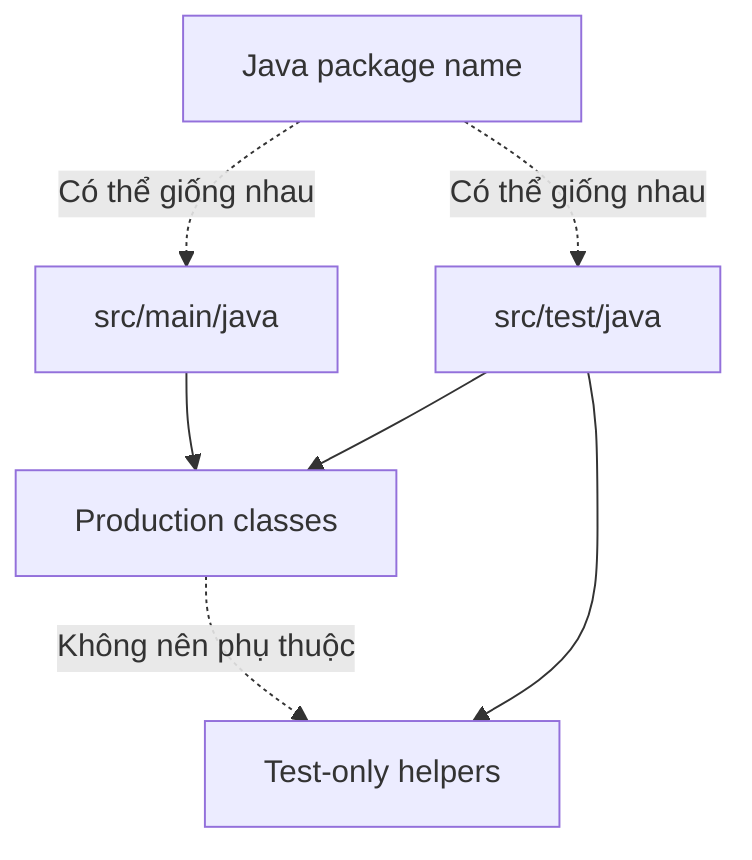
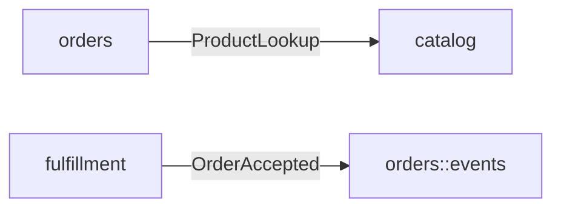
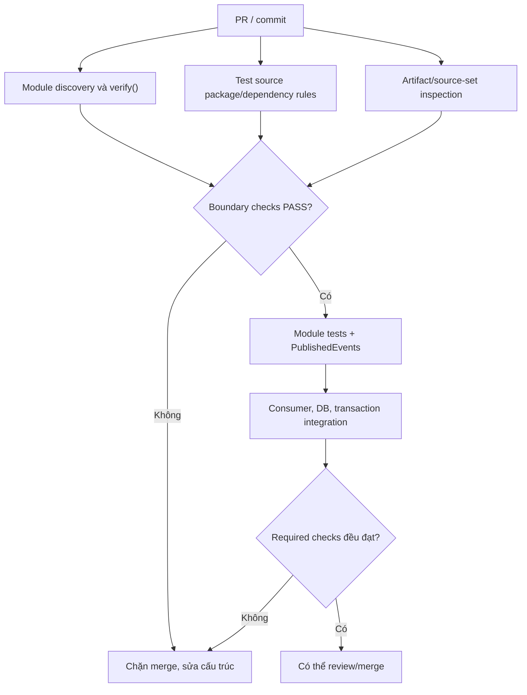

# Package test và package main

Trong Java, một class đặt ở `src/test/java/com/acme/shop/orders/internal` có thể khai báo cùng `package com.acme.shop.orders.internal;` với class production ở `src/main/java/com/acme/shop/orders/internal`. Hai file nằm ở **hai source set khác nhau**, nhưng trong cấu hình classpath Java thông thường, chúng thuộc **cùng Java package**: test có thể kiểm tra một class package-private của chính module mà không cần sửa implementation thành `public`.

Ngược lại, nếu đặt một bài `@ApplicationModuleTest` vào package `com.acme.shop.testing` nằm ngoài module nghiệp vụ, ta có thể làm công cụ khó xác định application module cần bootstrap, hoặc vô tình kiểm tra một Spring context không như dự kiến. **Đường dẫn test, khai báo Java package, ranh giới Spring Modulith và phạm vi Spring TestContext phải được phân biệt.**

Trong **SPRING_MODULITH_VERIFICATION_TESTING**, chúng ta rèn kỹ năng kiểm chứng ranh giới kiến trúc của ứng dụng Spring Boot bằng `ApplicationModules`, các quy tắc dependency, `@ApplicationModuleTest`, kiểm thử sự kiện, cơ sở dữ liệu và tích hợp, cùng **CI quality gate** để ngăn phụ thuộc sai và hồi quy. Bài thuộc chương **Module boundaries** và giải thích cách đặt package cho test/main để những phép kiểm tra đó có đúng ý nghĩa.

**Thông điệp chính:** Có thể dùng **cùng tên Java package** cho test của module sở hữu nhằm kiểm tra implementation package-private. Nhưng **test source không phải production source**, và việc một test truy cập được class **không tự cấp quyền** cho application module khác phụ thuộc vào internal class ấy.

## 1. Mục tiêu học tập

Sau bài này, bạn có thể:

1. Phân biệt **đường dẫn thư mục**, **khai báo `package`**, **Java source set**, **application module** và **Spring test context**.
2. Giải thích vì sao `src/test/java` và `src/main/java` có thể chứa các class **cùng Java package** nhưng có vòng đời build khác nhau.
3. Đặt module integration test tại package phù hợp để `@ApplicationModuleTest` xác định đúng module được kiểm thử.
4. Đặt unit test vào package `internal` cùng implementation khi cần truy cập constructor/class **package-private**.
5. Tránh công bố implementation thành `public` chỉ để test hoặc class thuộc module khác có thể import.
6. Đặt metadata `@ApplicationModule` và `@NamedInterface` đúng phía **production package**.
7. Dùng `ApplicationModules.verify()` để bảo vệ **production module graph** và nhận ra giới hạn khi muốn áp rule cho cả test source.
8. Cung cấp test collaborator bằng `@MockitoBean` hoặc `@TestConfiguration` theo đúng source set/test context.
9. Tách kiểm thử producer, consumer, database và transaction thành các lớp bằng chứng có mục tiêu.
10. Xây quy tắc bố trí package và CI checks ngăn fixture rò vào production hoặc test dùng nhầm internal API của module khác.

## 2. Năm khái niệm khác nhau nhưng thường bị gộp làm một

| Khái niệm | Ví dụ | Ý nghĩa thực tế |
|---|---|---|
| **Source set** | `src/main/java`, `src/test/java` | Bộ mã biên dịch và classpath theo mục đích build |
| **Java package** | `com.acme.shop.orders.internal` | Không gian tên và phạm vi package-private của Java |
| **Application module** | `orders` được Spring Modulith nhận diện | Ranh giới kiến trúc, public/internal API và dependency rules |
| **Spring bean graph** | `OrderPlacement` inject `ProductLookup` | Những bean được tạo trong một ApplicationContext |
| **Test context** | `@ApplicationModuleTest` cho `orders` | Những bean/cấu hình được nạp trong bài test cụ thể |

Một class có thể nằm trong **test source set** và dùng **cùng Java package** với production, nhưng không xuất hiện trong production artifact. Một class ở package `orders.internal` có thể là Java `public` mà vẫn là **internal application-module API**. Một test bootstrap được `ApplicationContext` thành công vẫn có thể không chứng minh kiến trúc module hợp lệ.

### 2.1. Ví dụ đối chiếu

```text
A. src/main/java/com/acme/shop/orders/internal/DefaultPlaceOrder.java
   package com.acme.shop.orders.internal;

B. src/test/java/com/acme/shop/orders/internal/DefaultPlaceOrderUnitTests.java
   package com.acme.shop.orders.internal;

C. src/test/java/com/acme/shop/orders/OrdersModuleTests.java
   package com.acme.shop.orders;

D. src/test/java/com/acme/shop/testing/OrdersModuleTests.java
   package com.acme.shop.testing;
```

- A và B có **cùng Java package**, dù khác source set.
- C nằm ở **package gốc module orders**, phù hợp để test qua public API.
- D nằm ở package testing dùng chung; không nên giả định `@ApplicationModuleTest` sẽ chọn `orders` từ tên class.
- A và B không tự nhiên tạo một public API cho `shipping`.

## 3. Java lấy package từ khai báo package, không lấy trực tiếp từ tên folder

Java xác định package của một compilation unit qua dòng khai báo:

```java
package com.acme.shop.orders.internal;
```

Layout `com/acme/shop/orders/internal` theo thư mục là **quy ước quan trọng của build tooling và IDE**, nhưng về ngữ nghĩa Java, package declaration mới là nơi xác định package. Build tools có thể phát hiện/biên dịch file không đúng cấu trúc thư mục theo những cách khác nhau, nên **vẫn phải giữ hai thứ khớp nhau** để code dễ bảo trì và các công cụ tự nhận diện chính xác.

### 3.1. Hai package có tên gần giống không phải cha-con về quyền truy cập

```text
com.acme.shop.orders
com.acme.shop.orders.internal
```

Đây là **hai Java packages khác nhau**. Package-private member ở `orders.internal` không truy cập được trực tiếp từ class trong `orders`.

Ví dụ:

```java
package com.acme.shop.orders.internal;

class DefaultPlaceOrder {
    DefaultPlaceOrder() {}
}
```

Một test trong `com.acme.shop.orders` không thể dùng `new DefaultPlaceOrder()` nếu class là package-private. Test dưới `com.acme.shop.orders.internal` có thể làm được khi compile theo classpath thông thường.

### 3.2. Vì sao không nên sửa bằng public?

Mở class `DefaultPlaceOrder` thành `public` chỉ để test ở package gốc dùng constructor sẽ:

- Tăng bề mặt type mà mã khác **có thể import ở mức Java**.
- Tăng khả năng module khác phụ thuộc vào implementation.
- Khiến test bị gắn vào class cụ thể thay vì hợp đồng `OrderPlacement`.
- Không giải quyết câu hỏi module boundary mà `ApplicationModules.verify()` cần kiểm tra.

Hướng tốt hơn: **module test inject public interface**, còn **unit test implementation đặt cùng package internal**.

### 3.3. Cẩn trọng với project dùng Java Module System

Trong cấu hình Maven/Gradle classpath thông thường, test classes và main classes thường được biên dịch/nạp theo cách cho phép test cùng package truy cập package-private. Với **JPMS named modules** hoặc build tùy biến, quy tắc readability, module patching và split-package có thể ảnh hưởng khả năng truy cập. Khi dự án dùng `module-info.java`, cần xác nhận test compiler/runtime setup riêng; đừng mặc định kỹ thuật cùng-package luôn hoạt động như unnamed-module classpath.

## 4. Source set main và test: cùng package, khác mục đích

Một cấu trúc Spring Boot thường gặp:

```text
project/
├── src/
│   ├── main/
│   │   ├── java/com/acme/shop/...
│   │   └── resources/...
│   └── test/
│       ├── java/com/acme/shop/...
│       └── resources/...
├── pom.xml           # nếu dùng Maven
└── build.gradle      # hoặc nếu dùng Gradle
```

Trong phần lớn cấu hình:

- **Main compile:** biên dịch production sources và dependencies thuộc compile scope.
- **Test compile:** biên dịch test sources với main classes và test libraries trên classpath.
- **Production packaging:** đóng gói main classes/resources cùng runtime dependencies phù hợp.
- **Test execution:** chạy các test classes với test runtime classpath.

Nhưng chi tiết phụ thuộc vào cấu hình build. Nếu dự án tùy biến source sets, không được tự kết luận fixture chắc chắn bị loại khỏi artifact; cần **kiểm tra output thực**.

### 4.1. Hình dung quan hệ đúng



Quan hệ test → production là bình thường. Quan hệ **production → test-only helper** là dấu hiệu cấu hình hoặc thiết kế sai.

### 4.2. Đừng tạo cùng fully qualified name ở main và test

Ví dụ hai nguồn:

```text
src/main/java/com/acme/shop/orders/OrderPlacement.java
src/test/java/com/acme/shop/orders/OrderPlacement.java
```

đều khai báo `package com.acme.shop.orders; public interface OrderPlacement` sẽ tạo **trùng tên đầy đủ**. Tùy công cụ và classpath, test class có thể che production class, gây biên dịch/lỗi runtime khó hiểu. **Không** dùng duplicate FQCN để “thay thế” một production type khi kiểm thử.

Muốn thay implementation trong Spring context, dùng **mock/fake bean theo interface** hoặc configuration override được hỗ trợ, không shadow cùng tên class.

### 4.3. Không đặt test ở default package

Hạn chế class không khai báo `package`. Spring Boot và Spring Modulith dựa nhiều vào package root để component scan và nhận diện application module. Test ở default package có thể gây hành vi discovery/scan bất ngờ và khó xác định module.

## 5. Spring Modulith nhận diện module theo package như thế nào?

Với cách tổ chức mặc định, package con trực tiếp của package chứa `@SpringBootApplication` thường là ứng viên application module.

Ví dụ:

```text
com.acme.shop                   # root
├── ShopApplication.java
├── catalog                     # application module catalog
│   ├── ProductLookup.java      # public API mặc định
│   └── internal                # implementation package
├── orders                      # application module orders
│   ├── OrderPlacement.java     # public API mặc định
│   ├── events                  # named interface, nếu công bố
│   └── internal                # implementation
└── fulfillment                 # application module fulfillment
    ├── ReceiptQuery.java
    └── internal
```

Nếu dự án sử dụng `@Modulithic`, module detection strategy hoặc metadata tùy biến, danh sách module có thể khác. **Không chỉ đoán từ folder**; phải kiểm tra mô hình Spring Modulith thực sự xây dựng.

### 5.1. Type Java public khác với public API của application module

```java
package com.acme.shop.catalog.internal;

public class JdbcProductAdapter {
    // Public ở mức Java, nhưng vẫn ở internal package của catalog.
}
```

Class này không mặc nhiên là public API của `catalog` chỉ vì có modifier `public`. Trong mô hình module mặc định, `catalog.ProductLookup` ở package gốc là hợp đồng cho module khác sử dụng, còn `catalog.internal` là implementation.

### 5.2. Test cùng package internal không cấp quyền cho module khác

`DefaultPlaceOrderUnitTests` đặt cùng Java package `orders.internal` để test implementation. Điều đó **không** có nghĩa `fulfillment` production được phép import `orders.internal.DefaultPlaceOrder`.

Java access và Spring Modulith architecture rules kiểm soát những câu hỏi khác nhau; việc thuận tiện viết unit test phải được đánh giá trong bối cảnh owner module.

## 6. Ví dụ xuyên suốt: catalog → orders và fulfillment → orders::events

Ta dùng ứng dụng bán hàng:

- `catalog` công bố `ProductLookup` để kiểm tra ID sản phẩm.
- `orders` công bố `OrderPlacement`, sử dụng `ProductLookup` rồi phát `OrderAccepted`.
- `fulfillment` nhận `OrderAccepted` để cập nhật projection demo.
- Một test nội bộ kiểm tra implementation của orders trực tiếp, trong khi module test kiểm tra qua **public API**.

### 6.1. Cấu trúc file main và test

```text
src/main/java/com/acme/shop
├── ShopApplication.java
├── catalog
│   ├── ProductLookup.java
│   └── internal
│       └── SampleCatalogAdapter.java
├── orders
│   ├── package-info.java
│   ├── OrderPlacement.java
│   ├── events
│   │   ├── package-info.java
│   │   └── OrderAccepted.java
│   └── internal
│       └── DefaultOrderPlacement.java
└── fulfillment
    ├── package-info.java
    ├── ReceiptQuery.java
    └── internal
        ├── ReceiptProjection.java
        └── OnOrderAccepted.java

src/test/java/com/acme/shop
├── ModuleArchitectureTests.java
├── orders
│   ├── OrdersModuleTests.java
│   ├── OrdersWithFakeCatalogTests.java
│   ├── OrderTestInputs.java
│   └── internal
│       └── DefaultOrderPlacementUnitTests.java
├── fulfillment
│   ├── FulfillmentModuleTests.java
│   └── AcceptedOrderSamples.java
└── testing
    └── TestSourceBoundaryRules.java   # nếu cần rule test-source riêng
```

Chỉ những file cần thiết cho một đoạn ví dụ đang được minh họa; tên `SampleCatalogAdapter` là implementation mẫu cho app demo, **không phải test fixture cần đưa vào production thật**. Khi triển khai production, phải dùng adapter thực đáp ứng yêu cầu hệ thống.

### 6.2. Đồ thị dependency production



**Đọc mũi tên là module chứa type reference → module sở hữu type.** Khi chạy, orders publish event hướng tới fulfillment, nhưng fulfillment mới là bên import type `orders.events.OrderAccepted`. Không đảo chiều dependency vì nhìn vào chiều dữ liệu runtime.

## 7. Khởi tạo Spring Boot application tại package root

File `src/main/java/com/acme/shop/ShopApplication.java`:

```java
package com.acme.shop;

import org.springframework.boot.SpringApplication;
import org.springframework.boot.autoconfigure.SpringBootApplication;

@SpringBootApplication
public class ShopApplication {

    public static void main(String[] args) {
        SpringApplication.run(ShopApplication.class, args);
    }
}
```

Đặt ứng dụng tại package root giúp component scanning thông thường bao phủ `catalog`, `orders`, `fulfillment` và tạo điểm bắt đầu rõ cho `ApplicationModules.of(ShopApplication.class)`.

Nếu test ở một package không nằm trong cây package của `ShopApplication` hoặc thiếu boot configuration, Spring Boot test configuration lookup có thể không tìm được source như mong muốn. Với `@ApplicationModuleTest`, vị trí test class còn tác động đến việc suy ra module cần bootstrap.

**Không tự tạo một `@SpringBootApplication` trong `src/test` để che vấn đề package placement** nếu làm vậy khiến scope module hoặc component scan thay đổi. Nếu cần bootstrap configuration tùy biến, khai báo tường minh và giải thích mục tiêu test.

## 8. Public API và production implementation

File `catalog/ProductLookup.java`:

```java
package com.acme.shop.catalog;

import java.util.UUID;

public interface ProductLookup {
    boolean exists(UUID productId);
}
```

File `orders/OrderPlacement.java`:

```java
package com.acme.shop.orders;

import java.util.UUID;

public interface OrderPlacement {
    UUID place(UUID productId, int quantity);
}
```

File `orders/events/OrderAccepted.java`:

```java
package com.acme.shop.orders.events;

import java.util.UUID;

public record OrderAccepted(
    UUID orderId,
    UUID productId,
    int quantity
) {}
```

### 8.1. Metadata package-info.java ở phía main

File `orders/package-info.java`:

```java
@org.springframework.modulith.ApplicationModule(
    allowedDependencies = "catalog"
)
package com.acme.shop.orders;
```

File `orders/events/package-info.java`:

```java
@org.springframework.modulith.NamedInterface("events")
package com.acme.shop.orders.events;
```

File `fulfillment/package-info.java`:

```java
@org.springframework.modulith.ApplicationModule(
    allowedDependencies = "orders::events"
)
package com.acme.shop.fulfillment;
```

Các annotation này mô tả **production architecture**. Đừng sao chép một `package-info.java` có metadata mâu thuẫn sang `src/test/java` để “thay rule trong test”: như vậy rất dễ tạo mô hình khó dự đoán hoặc bản test khác production.

### 8.2. allowedDependencies không cho phép mọi type trong module đích

`orders` được phép phụ thuộc `catalog`, nhưng điều đó không cho phép import `catalog.internal.SampleCatalogAdapter`.

`fulfillment` được phép dùng `orders::events`, nhưng không được vì thế truy cập `orders.internal.DefaultOrderPlacement` hoặc repository orders.

Named interface quyết định **phần API đích được công bố**; `allowedDependencies` quyết định **module nguồn được phép dùng giao diện nào**. Một cạnh hợp lệ cần thỏa các quy tắc liên quan và không hình thành vòng module.

## 9. Production implementation ở package internal

File `orders/internal/DefaultOrderPlacement.java`:

```java
package com.acme.shop.orders.internal;

import com.acme.shop.catalog.ProductLookup;
import com.acme.shop.orders.OrderPlacement;
import com.acme.shop.orders.events.OrderAccepted;
import java.util.UUID;
import org.springframework.context.ApplicationEventPublisher;
import org.springframework.stereotype.Service;

@Service
class DefaultOrderPlacement implements OrderPlacement {

    private final ProductLookup products;
    private final ApplicationEventPublisher events;

    DefaultOrderPlacement(
            ProductLookup products,
            ApplicationEventPublisher events) {
        this.products = products;
        this.events = events;
    }

    @Override
    public UUID place(UUID productId, int quantity) {
        if (productId == null || quantity <= 0) {
            throw new IllegalArgumentException("Invalid order input");
        }

        if (!products.exists(productId)) {
            throw new IllegalArgumentException("Unknown product");
        }

        UUID orderId = UUID.randomUUID();

        events.publishEvent(new OrderAccepted(
            orderId, productId, quantity
        ));

        return orderId;
    }
}
```

Điểm cần lưu ý:

- `DefaultOrderPlacement` là **package-private**, không phải public Java API.
- Nó implement `OrderPlacement` công khai của **chính module orders**.
- Nó gọi `catalog.ProductLookup` công khai, không gọi catalog implementation.
- `ApplicationEventPublisher` là Spring API, không tạo dependency Java từ orders tới fulfillment.
- Spring có thể khởi tạo `@Service` package-private theo cơ chế component scanning phù hợp.

Đây là **ứng dụng minh họa**: không có repository lưu đơn và không có transaction. `OrderAccepted` chỉ là tên hợp đồng demo cho trường hợp đầu vào hợp lệ và catalog báo sản phẩm tồn tại; nó **không** chứng minh đơn hàng đã commit hoặc inventory đã đặt giữ. Một dự án thật phải điều chỉnh tên/ngữ nghĩa event nếu “accepted” đòi nghiệp vụ nhiều hơn.

### 9.1. Implementation demo của catalog

Để ứng dụng minh họa có một bean `ProductLookup` khi chạy toàn context, có thể có adapter đơn giản:

```java
package com.acme.shop.catalog.internal;

import com.acme.shop.catalog.ProductLookup;
import java.util.UUID;
import org.springframework.stereotype.Component;

@Component
class SampleCatalogAdapter implements ProductLookup {

    private static final UUID SAMPLE_PRODUCT = UUID.fromString(
        "00000000-0000-0000-0000-000000000001"
    );

    @Override
    public boolean exists(UUID productId) {
        return SAMPLE_PRODUCT.equals(productId);
    }
}
```

Đây là adapter **mẫu của ứng dụng demo**, không phải giải pháp persistence production. Trong dự án thật, catalog có thể dùng repository/database và phải có integration tests riêng.

Bài `@ApplicationModuleTest` STANDALONE của orders dưới đây sẽ dùng mock public API, vì thế không cần nạp `SampleCatalogAdapter`. Một collaboration test với `DIRECT_DEPENDENCIES` có thể nạp bean thật của catalog theo mục tiêu test.

## 10. Vị trí đặt ba nhóm test chính

Từ một module `orders`, có ba nhóm điển hình:

| Nhóm | Test Java package | Cách truy cập production | Mục tiêu |
|---|---|---|---|
| Public module contract | `com.acme.shop.orders` | Inject `OrderPlacement` | Behavior với Spring module TestContext |
| Internal unit test | `com.acme.shop.orders.internal` | Constructor `DefaultOrderPlacement` package-private | Thuật toán/nhánh riêng, không cần Spring |
| Whole-app architecture | `com.acme.shop` | `ApplicationModules.of(ShopApplication.class)` | Đồ thị module, API, allowed dependencies |

Điều này không có nghĩa **mọi JUnit test của một dự án** bắt buộc dùng đúng ba package trên. Nhưng nó tạo convention dễ hiểu:

- Test gần API để phản ánh **hợp đồng**.
- Test gần implementation nếu chủ đích kiểm tra **chi tiết nội bộ**.
- Architecture test tại package root để **phân tích toàn bộ application modules**.

### 10.1. Tại sao không đặt tất cả test trong một package tests?

Một package chung `com.acme.shop.tests` có thể giúp tìm test bằng mắt, nhưng:

- Không biểu đạt test thuộc module nào.
- Có thể khiến `@ApplicationModuleTest` không suy ra module cần test đúng như dự định.
- Dễ dẫn đến base test class toàn cục và shared mocks quá rộng.
- Khi kiểm soát dependency source, khó gán owner cho fixture.

Test infrastructure chung vẫn có thể ở `com.acme.shop.testing`, nhưng **module tests nên nằm dưới package của module liên quan**.

## 11. Unit test cùng package với internal class

File `src/test/java/com/acme/shop/orders/internal/DefaultOrderPlacementUnitTests.java`:

```java
package com.acme.shop.orders.internal;

import static org.assertj.core.api.Assertions.assertThat;
import static org.assertj.core.api.Assertions.assertThatThrownBy;
import static org.mockito.Mockito.mock;
import static org.mockito.Mockito.verify;
import static org.mockito.Mockito.verifyNoInteractions;
import static org.mockito.Mockito.when;

import com.acme.shop.catalog.ProductLookup;
import com.acme.shop.orders.events.OrderAccepted;
import java.util.UUID;
import org.junit.jupiter.api.Test;
import org.mockito.ArgumentCaptor;
import org.springframework.context.ApplicationEventPublisher;

class DefaultOrderPlacementUnitTests {

    @Test
    void createsEventForKnownProduct() {
        ProductLookup products = mock(ProductLookup.class);
        ApplicationEventPublisher publisher =
            mock(ApplicationEventPublisher.class);

        UUID productId = UUID.randomUUID();
        when(products.exists(productId)).thenReturn(true);

        // Test thuộc cùng Java package với implementation.
        DefaultOrderPlacement subject =
            new DefaultOrderPlacement(products, publisher);

        UUID orderId = subject.place(productId, 2);

        ArgumentCaptor<OrderAccepted> captor =
            ArgumentCaptor.forClass(OrderAccepted.class);

        verify(publisher).publishEvent(captor.capture());

        OrderAccepted event = captor.getValue();
        assertThat(event.orderId()).isEqualTo(orderId);
        assertThat(event.productId()).isEqualTo(productId);
        assertThat(event.quantity()).isEqualTo(2);
    }

    @Test
    void rejectsInvalidQuantityBeforeCatalogCall() {
        ProductLookup products = mock(ProductLookup.class);
        ApplicationEventPublisher publisher =
            mock(ApplicationEventPublisher.class);

        DefaultOrderPlacement subject =
            new DefaultOrderPlacement(products, publisher);

        assertThatThrownBy(() ->
            subject.place(UUID.randomUUID(), 0)
        ).isInstanceOf(IllegalArgumentException.class);

        verifyNoInteractions(products, publisher);
    }
}
```

### 11.1. Bằng chứng thu được

- Có thể gọi constructor class package-private **mà không sửa visibility production**.
- Kiểm tra nhánh logic trực tiếp, nhanh, không tạo Spring context.
- Mockito `verify(publisher).publishEvent(...)` chỉ chứng minh **method trên mock được gọi** với event mong đợi.

### 11.2. Những điều unit test chưa chứng minh

- Spring `@Service` đã được scan và inject đúng.
- Event được dispatch qua ApplicationEventPublisher thật.
- Consumer nhận được event.
- Database/transaction đã commit.
- Mọi module dependency hợp lệ.

Đó là lý do cần module test và architecture test riêng. Không đổi tên unit test thành “module integration” chỉ vì nó nằm trong package thuộc module.

## 12. @ApplicationModuleTest nên đặt tại package module phù hợp

File `src/test/java/com/acme/shop/orders/OrdersModuleTests.java` khai báo:

```java
package com.acme.shop.orders;
```

Dùng `@ApplicationModuleTest` giúp test bootstrap **application module gắn với package của test** theo cơ chế xác định module của Spring Modulith Test. Vì vậy đặt test ở **package gốc của module** là quy ước dễ đọc và ít nhầm lẫn.

Nếu đặt class dưới `com.acme.shop.testing` hoặc một package không thuộc module được nhận diện, đừng giả định tên class `OrdersModuleTests` khiến framework tự chọn orders. Hãy đặt test trong namespace module đúng hoặc dùng cấu hình bootstrap được framework hỗ trợ rõ ràng theo phiên bản.

### 12.1. Module test qua public interface với Spring mock bean

```java
package com.acme.shop.orders;

import static org.assertj.core.api.Assertions.assertThat;
import static org.assertj.core.api.Assertions.assertThatThrownBy;
import static org.mockito.Mockito.verify;
import static org.mockito.Mockito.verifyNoInteractions;
import static org.mockito.Mockito.when;

import com.acme.shop.catalog.ProductLookup;
import com.acme.shop.orders.events.OrderAccepted;
import java.util.UUID;
import org.junit.jupiter.api.Test;
import org.springframework.beans.factory.annotation.Autowired;
import org.springframework.modulith.test.ApplicationModuleTest;
import org.springframework.modulith.test.PublishedEvents;
import org.springframework.test.context.bean.override.mockito.MockitoBean;

@ApplicationModuleTest
class OrdersModuleTests {

    @Autowired OrderPlacement orders;

    @MockitoBean ProductLookup products;

    @Test
    void publishesOrderAccepted(PublishedEvents events) {
        UUID productId = UUID.randomUUID();
        when(products.exists(productId)).thenReturn(true);

        UUID orderId = orders.place(productId, 2);

        assertThat(events.ofType(OrderAccepted.class))
            .singleElement()
            .satisfies(event -> {
                assertThat(event.orderId()).isEqualTo(orderId);
                assertThat(event.productId()).isEqualTo(productId);
                assertThat(event.quantity()).isEqualTo(2);
            });

        verify(products).exists(productId);
    }

    @Test
    void missingProductIsRejectedWithoutEvent(
            PublishedEvents events) {
        UUID productId = UUID.randomUUID();
        when(products.exists(productId)).thenReturn(false);

        assertThatThrownBy(() ->
            orders.place(productId, 2)
        ).isInstanceOf(IllegalArgumentException.class)
         .hasMessage("Unknown product");

        assertThat(events.ofType(OrderAccepted.class)).isEmpty();
        verify(products).exists(productId);
    }

    @Test
    void invalidQuantitySkipsCatalogAndEvent(
            PublishedEvents events) {
        assertThatThrownBy(() ->
            orders.place(UUID.randomUUID(), 0)
        ).isInstanceOf(IllegalArgumentException.class)
         .hasMessage("Invalid order input");

        verifyNoInteractions(products);
        assertThat(events.ofType(OrderAccepted.class)).isEmpty();
    }
}
```

Test sử dụng:

- `@Autowired OrderPlacement`: **public API của orders**.
- `@MockitoBean ProductLookup`: public collaborator thuộc **catalog**, module khác.
- Bean thật của module orders là `DefaultOrderPlacement` package-private, được Spring quản lý.
- `PublishedEvents` để quan sát type, số lượng và payload event được publish trong test context.
- Negative tests đảm bảo nhánh thất bại **không** publish event.

### 12.2. @MockitoBean và @Mock khác nhau

`@MockitoBean` thuộc Spring TestContext (từ Spring Framework 6.2) hỗ trợ tạo/override **bean trong Spring context**. Với Spring Boot cũ, dự án có thể dùng `@MockBean` của Spring Boot Test. Chọn annotation theo phiên bản dependency quản lý; không trộn hai cơ chế cho cùng bean.

`@Mock` là object Mockito thường; nó **không tự đăng ký** một Spring bean. Nếu `DefaultOrderPlacement` cần `ProductLookup` để khởi tạo trong `@ApplicationModuleTest`, một `@Mock ProductLookup` bình thường không giải quyết constructor injection trừ khi được đăng ký qua cấu hình khác.

### 12.3. Vì sao PublishedEvents tốt hơn chỉ mock publisher?

Nếu mục tiêu là chứng minh event được publish trong Spring TestContext, giữ `ApplicationEventPublisher` thật và dùng `PublishedEvents`. Nếu mock publisher, assertion chỉ chứng minh lời gọi trên mock, phù hợp unit test nhưng không tương đương module event test.

### 12.4. Điều kiện phạm vi

`STANDALONE` thường không nạp toàn bộ bean của catalog/fulfillment. Khi một module khác không có bean trong context, đó có thể là **hệ quả cố ý của bootstrap mode**, không tự động là lỗi dependency production.

## 13. Có thể đặt @ApplicationModuleTest dưới orders.internal không?

Về Java package, test ở `orders.internal` vẫn thuộc nhánh namespace của orders. Tuy nhiên, lựa chọn module mà Spring Modulith Test xác định **phụ thuộc mô hình module và cách framework suy ra module từ test class**. Đặt class ngay tại package gốc `orders` làm ý định rõ hơn và giảm nhầm lẫn giữa “test toàn module” với “test implementation”.

Quy tắc thực hành:

- **Unit test class cụ thể:** `orders.internal.DefaultOrderPlacementUnitTests`, constructor trực tiếp, không cần `@ApplicationModuleTest`.
- **Module behavior test:** `orders.OrdersModuleTests`, inject public `OrderPlacement`.
- **Integration test xuyên modules:** package chủ sở hữu use case/điểm vào với bootstrap mode được khai báo; bổ sung system test riêng khi cần.
- **Architecture test:** package gốc ứng dụng, dùng `ApplicationModules`.

Nếu dự án có cấu hình nhận diện modules tùy biến hoặc dùng nested modules, phải kiểm tra cách `@ApplicationModuleTest` giải quyết module trên phiên bản đó và ghi phạm vi test mong đợi trong assertion/log.

## 14. @ApplicationModuleTest và ba bootstrap mode

Đặt package test đúng mới là một phần; **mode** xác định những module nào được nạp.

| Mode | Phạm vi dự kiến | Khi nào phù hợp |
|---|---|---|
| `STANDALONE` (mặc định) | Module được kiểm thử | Logic, public API, published events của một module |
| `DIRECT_DEPENDENCIES` | Module đó và dependency trực tiếp | Kiểm tra collaboration với bean thật của module liền kề |
| `ALL_DEPENDENCIES` | Module đó và dependency bắc cầu | Kiểm tra đường đi nhiều tầng cần bean thật |

Ví dụ:

```java
package com.acme.shop.orders;

import org.springframework.modulith.test.ApplicationModuleTest;
import org.springframework.modulith.test.ApplicationModuleTest.BootstrapMode;

@ApplicationModuleTest(
    mode = BootstrapMode.DIRECT_DEPENDENCIES
)
class OrdersWithCatalogTests {
    // Test cần implementation catalog thật và fixture/hạ tầng tương ứng.
}
```

Với ví dụ `orders → catalog`, `DIRECT_DEPENDENCIES` có thể nạp bean `SampleCatalogAdapter` của catalog. Nó phù hợp nếu mục tiêu test **wiring giữa hai module**, khác với test STANDALONE đang mock ProductLookup.

### 14.1. Chọn mode không thay cấu trúc production

Một class orders import `catalog.internal.SampleCatalogAdapter` là vi phạm module API dù test ở mode `ALL_DEPENDENCIES` và Spring khởi động đủ bean. **Phạm vi runtime test không cấp quyền dependency mới**.

Cần chạy `ApplicationModules.verify()` độc lập với mọi mode.

### 14.2. Consumer ở chiều ngược không tự được nạp

`fulfillment` phụ thuộc `orders::events`; orders không phụ thuộc fulfillment. Vì vậy không nên giả định `ALL_DEPENDENCIES` của orders sẽ nạp tất cả consumer event. Muốn kiểm tra fulfillment listener, viết **module test của fulfillment** hoặc integration/system test cố ý nạp cả hai.

## 15. @TestConfiguration ở src/test thay vì tạo bean giả trong main

Có khi Mockito mock không phù hợp, vì test muốn một fake nhỏ với behavior dễ hiểu. Dùng `@TestConfiguration` và `@Import` trong test source:

```java
package com.acme.shop.orders;

import static org.assertj.core.api.Assertions.assertThat;

import com.acme.shop.catalog.ProductLookup;
import com.acme.shop.orders.events.OrderAccepted;
import java.util.UUID;
import org.junit.jupiter.api.Test;
import org.springframework.beans.factory.annotation.Autowired;
import org.springframework.boot.test.context.TestConfiguration;
import org.springframework.context.annotation.Bean;
import org.springframework.context.annotation.Import;
import org.springframework.modulith.test.ApplicationModuleTest;
import org.springframework.modulith.test.PublishedEvents;

@ApplicationModuleTest
@Import(OrdersWithFakeCatalogTests.FakeCatalogConfig.class)
class OrdersWithFakeCatalogTests {

    private static final UUID KNOWN = UUID.fromString(
        "00000000-0000-0000-0000-000000000001"
    );

    @Autowired OrderPlacement orders;

    @Test
    void usesOnlyTestConfiguration(PublishedEvents events) {
        UUID orderId = orders.place(KNOWN, 2);

        assertThat(events.ofType(OrderAccepted.class))
            .singleElement()
            .satisfies(event ->
                assertThat(event.orderId()).isEqualTo(orderId));
    }

    @TestConfiguration(proxyBeanMethods = false)
    static class FakeCatalogConfig {

        @Bean
        ProductLookup productLookup() {
            return KNOWN::equals;
        }
    }
}
```

Đặc điểm:

- Fake chỉ nằm trong `src/test`; không phải production component.
- `@Import` làm rõ test configuration nào được dùng.
- Fake triển khai **public contract `ProductLookup`**, không import implementation catalog.
- Trong context STANDALONE, cần bảo đảm không có bean `ProductLookup` khác gây ambiguity.
- Không khai báo đồng thời `@MockitoBean ProductLookup` và một `@Bean ProductLookup` nếu không chủ đích override.

### 15.1. Spring context cache và trạng thái test

Bean được tạo từ `@TestConfiguration` có vòng đời Spring TestContext, không được mặc định tạo mới ở **mỗi test method**. Nếu fake giữ mutable state, các test trong cùng cached context có thể ảnh hưởng nhau.

Ưu tiên fake bất biến và data factory tạo ID riêng. Nếu cần mutable fake, có setup/reset/cleanup được kiểm chứng, không phụ thuộc thứ tự JUnit.

### 15.2. Không dùng @SpringBootApplication riêng trong src/test để “quét tiện hơn”

Một boot configuration bổ sung không có chủ đích có thể:

- Thay đổi component scan.
- Nạp fake/mocks ngoài phạm vi.
- Làm Spring Boot phát hiện sai configuration root.
- Khiến test module mất ý nghĩa cô lập.
- Che một dependency production bị thiếu.

Test-specific configuration nên hẹp và được import tường minh, tránh biến `src/test` thành một application thay thế khó kiểm soát.

## 16. Test helper dùng cùng package: tốt trong phạm vi nào?

Một helper dùng riêng cho orders tests có thể nằm trong:

```text
src/test/java/com/acme/shop/orders/OrderTestInputs.java
```

và khai báo:

```java
package com.acme.shop.orders;

import java.util.UUID;

final class OrderTestInputs {

    private OrderTestInputs() {}

    static UUID newProduct() {
        return UUID.randomUUID();
    }

    static int validQuantity() {
        return 2;
    }
}
```

Helper này:

- Package-private, dễ đọc và có owner rõ.
- Không phải Spring bean.
- Không phụ thuộc catalog internal hoặc fulfillment internal.
- Giúp các test dùng dữ liệu hợp lệ mà không cần xuất bản API chung.

Một unit test tại `orders.internal` nếu muốn dùng helper package-private ở `orders` sẽ không thấy nó, vì **Java package khác nhau**. Có thể dùng input trực tiếp hoặc đặt helper riêng phù hợp; không nhất thiết sửa helper thành public chỉ để tái sử dụng ba dòng.

### 16.1. Fixture ở test root không phải public production API

`OrderTestInputs` ở `src/test/java/com.acme.shop.orders` không có mặt trong production artifact theo cấu hình build thông thường. Ngay cả khi fixture có modifier `public` vì chia sẻ cho một test artifact, nó **không vì thế trở thành API production** của orders.

Tuy nhiên, nếu helper được chuyển sang `src/main` hoặc test classes bị đóng gói nhầm, ranh giới source set bị phá. Cần kiểm tra artifact/build để xác nhận.

## 17. Unit test package main và package test: hai pattern quan trọng

### 17.1. Pattern A — Tên package trùng nhau để kiểm tra internal

```text
MAIN:
  src/main/java/com/acme/shop/orders/internal/DefaultOrderPlacement.java
  package com.acme.shop.orders.internal;

TEST:
  src/test/java/com/acme/shop/orders/internal/DefaultOrderPlacementUnitTests.java
  package com.acme.shop.orders.internal;
```

Dùng cho unit test thuật toán/constructor package-private thuộc module sở hữu.

### 17.2. Pattern B — Test nằm tại public module API package

```text
MAIN:
  src/main/java/com/acme/shop/orders/OrderPlacement.java
  package com.acme.shop.orders;

  src/main/java/com/acme/shop/orders/internal/DefaultOrderPlacement.java
  package com.acme.shop.orders.internal;

TEST:
  src/test/java/com/acme/shop/orders/OrdersModuleTests.java
  package com.acme.shop.orders;
```

Dùng cho module behavior test với Spring context, tập trung vào **hợp đồng công khai**, thay vì chi tiết implementation.

### 17.3. Pattern C — Test consumer chỉ dùng named interface của producer

```text
MAIN:
  src/main/java/com/acme/shop/orders/events/OrderAccepted.java
  package com.acme.shop.orders.events;

TEST:
  src/test/java/com/acme/shop/fulfillment/FulfillmentModuleTests.java
  package com.acme.shop.fulfillment;
```

Consumer test import `orders.events.OrderAccepted` vì named interface đó được công bố. Không import `orders.internal.DefaultOrderPlacement` chỉ để kích hoạt consumer.

## 18. Module architecture test nên nằm ở đâu?

Đặt test dưới package gốc ứng dụng, ví dụ:

```text
src/test/java/com/acme/shop/ModuleArchitectureTests.java
```

Mã:

```java
package com.acme.shop;

import org.junit.jupiter.api.Test;
import org.springframework.modulith.core.ApplicationModules;

class ModuleArchitectureTests {

    @Test
    void verifiesModuleBoundaries() {
        ApplicationModules.of(ShopApplication.class).verify();
    }
}
```

`ApplicationModules.of(ShopApplication.class)` tạo mô hình dựa trên ứng dụng. `verify()` kiểm tra những quy tắc Spring Modulith hỗ trợ, điển hình:

- Không có vòng dependency giữa application modules.
- Không dùng type nội bộ của module khác.
- Tuân thủ `allowedDependencies`, bao gồm giới hạn named interface được khai báo.

### 18.1. Kiểm tra module discovery, đừng chỉ thấy verify() xanh

```java
package com.acme.shop;

import static org.assertj.core.api.Assertions.assertThat;

import org.junit.jupiter.api.Test;
import org.springframework.modulith.core.ApplicationModules;

class ModuleDiscoveryTests {

    @Test
    void findsExpectedModules() {
        ApplicationModules modules =
            ApplicationModules.of(ShopApplication.class);

        assertThat(modules.getModuleByName("catalog")).isPresent();
        assertThat(modules.getModuleByName("orders")).isPresent();
        assertThat(modules.getModuleByName("fulfillment")).isPresent();
    }
}
```

Nếu dự án có tên module khác mặc định, sửa assertions cho đúng. **Verify PASS chỉ có ý nghĩa khi model đã bao phủ những module cần kiểm chứng.**

### 18.2. Đừng dùng @ApplicationModuleTest thay verify()

Một `@ApplicationModuleTest` với mock các collaborator có thể xanh dù một class production khác import `catalog.internal.JdbcProductAdapter`. Lý do: behavior test chỉ kích hoạt một luồng có phạm vi nhất định. **Architecture rules phải có bài kiểm chứng riêng**.

## 19. Test package cùng tên không làm module dependency trở nên hợp lệ

Giả sử source production của `fulfillment` thêm:

```java
// MÃ CỐ TÌNH SAI: fulfillment import implementation orders.
import com.acme.shop.orders.internal.OrderRepository;
```

Nếu `OrderRepository` là Java `public` và có mặt trên compile classpath, import đó có thể biên dịch. Nhưng vì `fulfillment` chỉ được phép dùng `orders::events`, đây là **dependency trái policy** và có thể xâm phạm phần internal của orders.

Đặt test ở:

```text
src/test/java/com/acme/shop/orders/internal/...
```

không làm `fulfillment` được quyền dùng implementation đó. **Quyền của test module owner và quyền production dependency xuyên module là những chuyện khác nhau.**

### 19.1. Thử âm tính để bảo đảm verify có hiệu lực

Trên nhánh thực hành:

1. Tạo một Java type `public` bên trong `catalog.internal`.
2. Cho **production class** của orders dùng type đó trong field, constructor parameter hoặc method signature.
3. Chạy `ModuleArchitectureTests` và mong đợi vi phạm internal API.
4. Xóa tham chiếu nội bộ; thay bằng `catalog.ProductLookup`.
5. Chạy lại architecture test.

Chỉ thêm import không sử dụng có thể không tạo dependency trong bytecode đủ cho bộ phân tích. Giữ thử nghiệm âm tính **ngoài main branch**, không commit vi phạm có chủ đích.

## 20. Test-source dependency cũng có thể vượt boundary

Ví dụ production hợp lệ:

```text
fulfillment -> orders::events
```

Nhưng một test fulfillment lại làm:

```java
// Test package fulfillment, nhưng import internal production type của orders.
import com.acme.shop.orders.internal.OrderRepository;
```

Một Java `public` repository có thể được import trong test theo classpath, dù về mặt thiết kế nó là internal của module orders.

### 20.1. verify() có bắt mọi import trong src/test không?

**Không nên mặc định.** `ApplicationModules.verify()` làm việc trên mô hình application modules được dựng theo cấu hình/class importer thực tế. Nếu muốn áp rule lên **toàn bộ test source**, phải kiểm tra scope mà công cụ đang phân tích và bổ sung rule riêng khi cần.

Một architecture test xanh dành cho production graph **không tự chứng minh** test của fulfillment không biết implementation orders.

### 20.2. Chủ trương kiểm soát test source hợp lý

- **Cho phép** unit tests của `orders` kiểm tra `orders.internal` của chính owner.
- **Hạn chế** tests của `fulfillment` import `orders.internal`.
- **Cho phép** tests fulfillment import `orders.events.OrderAccepted` nếu đó là public named interface.
- Nếu cần setup dữ liệu xuyên module, ưu tiên public use case hoặc integration fixture có ownership và cleanup rõ.
- Kiểm tra package và classpath thực tế, không chỉ tên file.

### 20.3. Một ArchUnit rule bổ sung

Ví dụ test-only architecture rule:

```java
package com.acme.shop.testing;

import static com.tngtech.archunit.lang.syntax.ArchRuleDefinition.noClasses;

import com.tngtech.archunit.core.importer.ImportOption;
import com.tngtech.archunit.junit.AnalyzeClasses;
import com.tngtech.archunit.junit.ArchTest;
import com.tngtech.archunit.lang.ArchRule;

@AnalyzeClasses(
    packages = "com.acme.shop",
    importOptions = ImportOption.OnlyIncludeTests.class
)
class TestSourceBoundaryRules {

    @ArchTest
    static final ArchRule fulfillmentTestsAvoidOrdersInternals =
        noClasses()
            .that().resideInAPackage("com.acme.shop.fulfillment..")
            .should().dependOnClassesThat()
                .resideInAPackage("com.acme.shop.orders.internal..");
}
```

Đây là **cách tiếp cận cần xác minh với version/layout thực**: `OnlyIncludeTests` nhận diện đường dẫn test theo cách ArchUnit nhập classes; trong build tùy biến, cần xác nhận rule thật sự quét đúng test classes và helper cần bảo vệ. Rule nên **chặn cross-module internal access**, không chặn unit tests của owner kiểm tra implementation của mình.

Nếu không dùng ArchUnit JUnit runner, có thể import test classes và chạy rule bằng JUnit thích hợp. Quan trọng là **scope và điều kiện được chứng minh bằng thử âm tính**.

## 21. Đặt test factory ở đâu để không làm mờ ranh giới?

Giả sử cả orders và fulfillment cần tạo `OrderAccepted` test data.

Có thể:

- Đặt `OrdersEventSamples` ở `orders` test source khi chỉ orders dùng.
- Đặt `AcceptedOrderSamples` ở `fulfillment` test source khi chỉ fulfillment cần event đầu vào.
- Khi nhiều consumer cần shared contract fixture thực sự, dùng **test-only artifact/source set** có owner, chỉ trả public event record.

### 21.1. Ví dụ fixture của consumer

File `src/test/java/com/acme/shop/fulfillment/AcceptedOrderSamples.java`:

```java
package com.acme.shop.fulfillment;

import com.acme.shop.orders.events.OrderAccepted;
import java.util.UUID;

final class AcceptedOrderSamples {

    private AcceptedOrderSamples() {}

    static OrderAccepted withOrderId(UUID orderId) {
        return new OrderAccepted(
            orderId,
            UUID.randomUUID(),
            2
        );
    }
}
```

Đây là test fixture nhỏ và có owner; nó không chạm `orders.internal` hoặc repository orders.

### 21.2. Khi nào cần testFixtures source set?

Trong các dự án chia thành nhiều **Gradle projects**, plugin `java-test-fixtures` cho phép chia sẻ fixture qua test-only variant:

```groovy
plugins {
    id 'java-library'
    id 'java-test-fixtures'
}
```

Consumer test project có thể khai báo:

```groovy
dependencies {
    testImplementation(testFixtures(project(':orders')))
}
```

Đây là ví dụ **chỉ khi có Gradle project `:orders` thật**. Nhiều Spring Modulith application modules có thể cùng nằm trong **một build project**; không nên nhầm Spring application module với Gradle/Maven module.

Ngay cả khi dùng test-fixtures artifact, chỉ chia sẻ contract data/utility cần thiết, không export repository/entity/internal implementation vô hạn định.

## 22. Consumer fulfillment test tại package gốc module

Để kiểm tra listener, tạo public query API cho kết quả demo:

```java
package com.acme.shop.fulfillment;

import java.util.UUID;

public interface ReceiptQuery {
    boolean received(UUID orderId);
}
```

Implementation in-memory, file `fulfillment/internal/ReceiptProjection.java`:

```java
package com.acme.shop.fulfillment.internal;

import com.acme.shop.fulfillment.ReceiptQuery;
import java.util.Set;
import java.util.UUID;
import java.util.concurrent.ConcurrentHashMap;
import org.springframework.stereotype.Component;

@Component
class ReceiptProjection implements ReceiptQuery {

    private final Set<UUID> receivedIds =
        ConcurrentHashMap.newKeySet();

    void record(UUID orderId) {
        receivedIds.add(orderId);
    }

    @Override
    public boolean received(UUID orderId) {
        return receivedIds.contains(orderId);
    }
}
```

Listener, file `fulfillment/internal/OnOrderAccepted.java`:

```java
package com.acme.shop.fulfillment.internal;

import com.acme.shop.orders.events.OrderAccepted;
import org.springframework.context.event.EventListener;
import org.springframework.stereotype.Component;

@Component
class OnOrderAccepted {

    private final ReceiptProjection receipts;

    OnOrderAccepted(ReceiptProjection receipts) {
        this.receipts = receipts;
    }

    @EventListener
    void on(OrderAccepted event) {
        receipts.record(event.orderId());
    }
}
```

Module test, file `src/test/java/com/acme/shop/fulfillment/FulfillmentModuleTests.java`:

```java
package com.acme.shop.fulfillment;

import static org.assertj.core.api.Assertions.assertThat;

import java.util.UUID;
import org.junit.jupiter.api.Test;
import org.springframework.beans.factory.annotation.Autowired;
import org.springframework.context.ApplicationEventPublisher;
import org.springframework.modulith.test.ApplicationModuleTest;

@ApplicationModuleTest
class FulfillmentModuleTests {

    @Autowired ApplicationEventPublisher publisher;
    @Autowired ReceiptQuery receipts;

    @Test
    void reactsToPublicEventContract() {
        UUID orderId = UUID.randomUUID();

        publisher.publishEvent(
            AcceptedOrderSamples.withOrderId(orderId)
        );

        assertThat(receipts.received(orderId)).isTrue();
    }
}
```

### 22.1. Vì sao test này không gọi orders implementation?

Fulfillment có contract đầu vào `OrderAccepted` do `orders::events` công bố. Để chứng minh **consumer behavior**, test chỉ cần publish event type hợp lệ và kiểm tra outcome của fulfillment. Nó không cần inject `DefaultOrderPlacement` hoặc tạo entity orders.

### 22.2. Bằng chứng và giới hạn

Trong ví dụ, `@EventListener` dùng dispatch đồng bộ mặc định và `ReceiptProjection` lưu ID trong JVM. Test chứng minh listener phản ứng với event type phù hợp và cập nhật projection.

Nó **không** chứng minh một shipment đã được lưu database, consumer chạy after-commit hay producer orders đã publish đúng trong production. Những điều đó phải được kiểm thử bằng các lớp riêng.

## 23. Published, handled và committed không phải một


| Cấp bằng chứng | Test điển hình | Có thể kết luận | Không tự kết luận |
|---|---|---|---|
| **Published** | `OrdersModuleTests` + `PublishedEvents` | Producer publish đúng type/payload theo assertion | Consumer đã chạy |
| **Handled** | `FulfillmentModuleTests` | Listener xử lý event đầu vào và thay trạng thái observable | DB đã commit |
| **Committed** | DB/transaction integration | Dữ liệu sau commit đúng | Mọi retry/concurrency đều đúng nếu chưa test |

### 23.1. Package test giúp định danh trách nhiệm

- `orders.OrdersModuleTests` bảo vệ producer.
- `fulfillment.FulfillmentModuleTests` bảo vệ consumer.
- Một integration test có tên và phạm vi riêng bảo vệ **luồng xuyên module**.
- `com.acme.shop.ModuleArchitectureTests` bảo vệ dependency graph.

Đặt test đúng owner module làm **dễ phát hiện lỗ hổng bằng chứng** hơn so với một `AllApplicationTests` chứa hàng trăm helper không rõ phạm vi.

## 24. @EventListener, @TransactionalEventListener và @ApplicationModuleListener

Sự khác nhau không nằm ở package test, mà ở **ngữ nghĩa dispatch và transaction**.

| Cơ chế | Đặc điểm thường gặp | Test cần chú ý |
|---|---|---|
| `@EventListener` với multicaster đồng bộ mặc định | Được gọi khi publish trong call chain | Có thể assert ngay sau publish trong demo |
| `@EventListener` với cấu hình async | Có thể xử lý trên thread khác | Chờ kết quả quan sát được |
| `@TransactionalEventListener(AFTER_COMMIT)` | Chỉ chạy sau commit của transaction liên quan theo cấu hình | Test phải đi qua commit thích hợp |
| `@ApplicationModuleListener` | Spring Modulith listener hướng tới xử lý after-commit/async, transaction riêng tùy cơ chế hỗ trợ | Setup transaction, recovery, idempotency và chờ async |

Không xem mọi annotation event là tương đương. Nếu chuyển listener demo sang `@ApplicationModuleListener` nhưng producer không có transaction, test có thể không chạy như kỳ vọng; khi đó phải điều chỉnh use case và test setup theo ngữ nghĩa after-commit.

### 24.1. Fragment minh họa producer có transaction

```java
@Service
class TransactionalOrderPlacement {

    private final OrderRepository repository;
    private final ApplicationEventPublisher publisher;

    TransactionalOrderPlacement(
            OrderRepository repository,
            ApplicationEventPublisher publisher) {
        this.repository = repository;
        this.publisher = publisher;
    }

    @Transactional
    public UUID place(UUID productId, int quantity) {
        Order order = Order.create(productId, quantity);
        repository.save(order);

        publisher.publishEvent(new OrderAccepted(
            order.id(), productId, quantity
        ));

        return order.id();
    }
}
```

**Đây là fragment định hướng, không phải class tự chạy:** cần tạo `Order`, `OrderRepository`, imports, schema/adapter và định nghĩa chính xác `OrderAccepted` trong domain thật. Nếu “accepted” chỉ có nghĩa sau commit, event contract và thời điểm phản ứng phải được thiết kế tương ứng.

### 24.2. Test transaction có thể làm sai kỳ vọng after-commit

Một test `@Transactional` trong Spring Test thường được rollback sau method. Listener `AFTER_COMMIT` có thể không được kích hoạt như luồng production commit.

Khi kiểm thử:

1. Xác định transaction của use case và transaction test.
2. Tạo commit thật nếu hợp đồng yêu cầu.
3. Chờ listener theo trạng thái/event kết quả nếu async.
4. Đọc lại dữ liệu trong context/transaction thích hợp.
5. Test rollback không gây side effect sai.
6. Kiểm tra idempotency khi event được replay hoặc retry.

**Không** kết luận dữ liệu đã commit chỉ vì entity hiện diện trong persistence context chưa commit.

## 25. Database integration test và fixture package

Khi các module có repository riêng, fixture database cũng cần ownership:

- Data factory kiểm tra catalog repository → test của `catalog`.
- SQL/data setup của orders entity → test của `orders`.
- Fulfillment receipt persistence → test của `fulfillment`.
- Luồng xuyên hai module → integration fixture có mục tiêu rõ, không chuyển thành public production API.

### 25.1. Không ghi thẳng bảng module khác chỉ để tạo input đơn giản

Nếu chỉ kiểm tra listener fulfillment, dùng `OrderAccepted` contract như mục 22. Không cần insert trực tiếp vào bảng orders để tạo một event đầu vào.

Nếu integration test yêu cầu order đã commit, có thể gọi **public use case** của orders rồi quan sát kết quả downstream, hoặc dùng setup DB được kiểm soát và giải thích lý do. Tránh để fulfillment tests phụ thuộc schema nội bộ orders một cách vô thức.

### 25.2. Testcontainers giải quyết hạ tầng, không giải quyết boundary

Testcontainers có thể cung cấp PostgreSQL/MySQL hoặc dịch vụ phụ thuộc. Nhưng:

- Container start thành công không chứng minh schema đúng.
- Fixture SQL insert thành công không chứng minh nghiệp vụ đúng.
- In-memory H2 không tự đại diện cho PostgreSQL constraints/locking.
- Test rollback mặc định không chứng minh after-commit listener đã chạy.
- Dữ liệu dùng chung có thể gây flaky test.

Chỉ dùng kết quả container như **một phần** của bằng chứng. Phải assert trạng thái và transaction thực sự.

### 25.3. Một bảng idempotency minh họa

```sql
CREATE TABLE fulfillment_receipt (
    receipt_id UUID PRIMARY KEY,
    order_id UUID NOT NULL,
    state VARCHAR(30) NOT NULL,
    CONSTRAINT uq_fulfillment_receipt_order UNIQUE (order_id)
);
```

Schema demo giả định **một receipt trên mỗi order**. Nếu nghiệp vụ nhiều dòng hàng hoặc nhiều fulfillment operations, cần key khác. Integration test nên thử **cùng event nhiều lần** và assert chỉ một tác dụng bền vững theo khóa nghiệp vụ, bao gồm concurrency nếu quan trọng.

Một `ReceiptQuery.received(orderId) == true` sau hai lần publish **không đủ** chứng minh idempotency, vì hệ thống có thể đã thực hiện hai side effect nhưng boolean vẫn true.

## 26. Package main/test khi tách thành nhiều build modules

Trong một modular monolith **một Gradle/Maven project**, `src/main` và `src/test` dùng chung module source set theo quy ước đã mô tả.

Trong dự án chia thành nhiều build projects, chẳng hạn:

```text
shop-root
├── catalog
│   ├── src/main/java/...
│   └── src/test/java/...
├── orders
│   ├── src/main/java/...
│   └── src/test/java/...
└── fulfillment
    ├── src/main/java/...
    └── src/test/java/...
```

mỗi project còn có **compile/test classpath riêng**. Một class test có cùng Java `package` với class ở project khác **không tự động nhìn thấy class ấy** nếu không có dependency cần thiết. Với JPMS, named modules còn có quy tắc truy cập khác.

### 26.1. Phân biệt ba chữ “module”

| Thuật ngữ | Ý nghĩa | Công cụ |
|---|---|---|
| **Spring Modulith application module** | Ranh giới nghiệp vụ được nhận diện từ package/metadata | `ApplicationModules`, `@ApplicationModuleTest` |
| **Gradle/Maven module/project** | Đơn vị build, dependency classpath và artifact | `build.gradle`, `pom.xml` |
| **Java module (JPMS)** | `module-info.java` với `requires/exports` | Java compiler/module path |

Ba cấp có thể thẳng hàng nhưng không mặc nhiên trùng nhau.

### 26.2. Test-fixtures source set dùng để làm gì?

Gradle plugin `java-test-fixtures` có thể xuất bản test utility trong **test-only variant** cho project khác sử dụng. Ví dụ:

```groovy
// Project cung cấp fixtures.
plugins {
    id 'java-library'
    id 'java-test-fixtures'
}
```

```groovy
// Project dùng fixture đã được export cho test.
dependencies {
    testImplementation(testFixtures(project(':orders')))
}
```

Đây là cơ chế **build-level sharing** và chỉ hợp lệ nếu có project `:orders` tương ứng. Nó không cấp quyền cho production fulfillment import `orders.internal` theo chính sách Spring Modulith.

Nếu dùng Maven test JAR hoặc artifact riêng, cần xác định đúng dependency scope và nội dung được xuất bản. Không coi việc class nằm trong “test JAR” là đủ để nó không làm lộ implementation.

## 27. Những lỗi thường gặp khi bố trí package test

### 27.1. Đặt mọi test ở package com.acme.shop.test

Một số pure JUnit tests vẫn chạy, nhưng module scope khó xác định hơn. Với `@ApplicationModuleTest`, nên đặt test trong package module phù hợp thay vì suy ra từ tên class.

### 27.2. Đặt module test ở package internal rồi inject class concrete

Test có thể chạy nhưng ràng buộc vào implementation. Dùng package gốc module và public interface khi mục tiêu là kiểm tra hợp đồng; giữ internal unit tests riêng.

### 27.3. Đổi implementation thành public để test dễ gọi

Không cần nếu unit test đặt cùng package internal hoặc module test inject public API. Việc đổi visibility có thể mở cơ hội cross-module coupling.

### 27.4. Sao chép package-info.java vào src/test

Có thể gây metadata mâu thuẫn hoặc test model khác với production. Metadata mô tả ranh giới ứng dụng nên đặt ở production package; test kiểm tra nó.

### 27.5. Dùng cùng FQCN ở test và main

Có thể gây shadowing/classpath bất ngờ. Dùng fake/mock bean khác class, cùng public interface, không nhân đôi tên type.

### 27.6. @Mock không được Spring inject

`@Mock` thuần Mockito không thay Spring bean. Dùng `@MockitoBean` hoặc fake `@TestConfiguration` khi test cần Spring context.

### 27.7. @SpringBootTest trên mọi bài test

Nạp toàn ứng dụng làm mờ module scope, có thể che thiếu bean/dependency và tăng thời gian. Dùng `@ApplicationModuleTest` cho test theo module, `@SpringBootTest` cho những integration/system test thực sự cần toàn context.

### 27.8. Test của fulfillment import orders.internal

Test có thể compile nếu type public và có classpath, nhưng làm test coupling vào implementation. Dùng public event contract và bổ sung test-source rule nếu muốn enforce.

### 27.9. Tin verify() kiểm mọi source set

`verify()` không được mặc định xem là rule áp dụng lên tất cả test helper. Kiểm tra scope thực tế của importer hoặc bổ sung ArchUnit/test-source rule.

### 27.10. Trộn fixture Spring với production scanning

Fake `@Component` dưới `src/main` có thể xuất hiện production. Đặt `@TestConfiguration` trong test source và import có chủ đích.

### 27.11. Dùng state static chung giữa các test

Gây phụ thuộc thứ tự và flaky tests, đặc biệt khi song song hoặc dùng shared DB. Dùng ID mới, fake state reset và cleanup.

### 27.12. Producer test đòi consumer đã commit

`PublishedEvents` chỉ chứng minh event được publish. Consumer và database integration tests cần xử lý các mức bằng chứng khác.

## 28. CI quality gate: kiểm tra source set, module và runtime

Một bộ gate tốt bảo vệ ba khía cạnh:

1. **Production architecture:** module discovery, `ApplicationModules.verify()`.
2. **Test/build hygiene:** test-source dependency, fixture leak vào artifact, test configuration nằm đúng source set.
3. **Behavior/integration:** `@ApplicationModuleTest`, producer–consumer tests, database/transaction/system tests.



Các job có thể chạy song song hoặc theo thứ tự fail-fast tùy nhu cầu. Điều quan trọng là **mọi required check đều đạt trên revision cần merge**, không dựa vào thứ tự chạy các JUnit methods.

### 28.1. Lệnh ví dụ với Maven

```bash
# Chỉ chạy architecture test nếu test plugin được cấu hình tương ứng.
./mvnw -Dtest=ModuleArchitectureTests test

# Chạy đến lifecycle verify theo plugin/profile hiện tại.
./mvnw verify
```

Nếu dự án tách integration tests qua Maven Failsafe hoặc profile, CI phải bảo đảm những bài test cần thiết **thực sự được chạy**.

### 28.2. Lệnh ví dụ với Gradle

```bash
# Chọn architecture test theo FQCN.
./gradlew test --tests "com.acme.shop.ModuleArchitectureTests"

# Test task theo cấu hình của dự án.
./gradlew test
```

Nếu có task `integrationTest`, phải gọi thêm khi yêu cầu. Không coi `test` xanh mặc định là mọi integration tests xanh.

### 28.3. Kiểm tra artifact production

Khi build đã tạo JAR/Boot JAR:

```bash
# Thay đúng tên artifact của dự án trước khi dùng.
jar tf build/libs/shop.jar
```

Dùng danh sách nội dung để kiểm tra:

- `OrdersModuleTests.class` có lọt vào production artifact không?
- `OrderTestInputs.class` hoặc `FakeCatalogConfig.class` có xuất hiện không?
- `application-test.yml` và SQL test fixture có bị copy nhầm không?
- Dependencies test-only có bị khai báo ở production runtime scope không?
- Production bootstrap có scan những test-only bean không?

`ApplicationModules.verify()` không thay thế kiểm tra build artifact.

## 29. Ma trận bằng chứng theo package test/main

| ID | Hợp đồng/rủi ro | Phép kiểm tra | Bằng chứng |
|---|---|---|---|
| PKG-01 | Test cùng package internal truy cập package-private | Java/JUnit unit test | Không cần mở implementation |
| PKG-02 | Public module test gọi `OrderPlacement` | `@ApplicationModuleTest` | Behavior qua hợp đồng |
| PKG-03 | Test ở đúng module package | Test bootstrap + module discovery | Phạm vi đúng dự kiến |
| SRC-01 | Main không phụ thuộc test helpers | Build/source-set inspection | Test-only code không vào main |
| SRC-02 | Không có duplicate FQCN | Compile/classpath hygiene | Tránh shadowing |
| ARCH-01 | Orders chỉ dùng public catalog API | `ApplicationModules.verify()` | Không truy cập catalog internal |
| ARCH-02 | Fulfillment chỉ dùng `orders::events` | `verify()` + `allowedDependencies` | Consumer không phụ thuộc orders internal |
| ARCH-03 | Graph không có module cycle | `verify()` | Không có vòng |
| TEST-01 | Fulfillment test không import orders internal | Test-source ArchUnit rule | Không làm mờ boundary trong test |
| EVT-01 | Producer publish đúng event | `PublishedEvents` | Đúng type, số lượng, payload |
| EVT-02 | Consumer xử lý event | `FulfillmentModuleTests` | Receipt projection được cập nhật |
| DB-01 | Consumer lưu đúng sau commit | DB/transaction integration | Trạng thái bền vững |
| DB-02 | Event lặp không tạo tác dụng sai | Idempotency/concurrency test | Unique business effect |
| CI-01 | Check bắt buộc chạy trên commit hiện tại | CI reports/branch protection | Không skip ngoài kế hoạch |

Đây là **ma trận thiết kế bằng chứng**, không phải báo cáo rằng các test đã được thực thi trên repository. Khi áp dụng, điền tên test, commit, môi trường, số test chạy và kết quả thực.

## 30. Bài tập thực hành: đặt lại package test cho đúng boundary

**Bối cảnh:** một dự án Spring Boot dùng Spring Modulith có `catalog`, `orders` và `fulfillment`. Nhóm đang đặt tất cả tests ở `com.acme.shop.test`, phải đổi `DefaultOrderPlacement` thành `public` để test constructor và đang dùng `@SpringBootTest` toàn ứng dụng cho mọi case.

### Vòng A — Khảo sát cấu trúc

1. Vẽ cấu trúc `src/main/java` và `src/test/java` hiện tại.
2. Liệt kê **package declaration** của từng class, không chỉ thư mục chứa nó.
3. Xác định các module ứng dụng từ `ShopApplication` và `ApplicationModules`.
4. Phân loại tests: unit class, module behavior, architecture, consumer event, DB integration.
5. Ghi lại test nào đang inject class internal và test nào có thể dùng public API.

### Vòng B — Đặt đúng package

1. Chuyển unit test implementation vào `com.acme.shop.orders.internal`.
2. Đặt module test `OrdersModuleTests` tại `com.acme.shop.orders`.
3. Đặt consumer test `FulfillmentModuleTests` tại `com.acme.shop.fulfillment`.
4. Đặt architecture test ở `com.acme.shop`.
5. Giữ `DefaultOrderPlacement` package-private, không mở visibility chỉ vì test.
6. Không tạo duplicate FQCN ở main và test.

### Vòng C — Thực hành Spring Modulith

1. Công bố `orders::events` qua `@NamedInterface("events")` trong `src/main`.
2. Thiết lập `allowedDependencies = "catalog"` cho orders, `"orders::events"` cho fulfillment.
3. Viết architecture test `ApplicationModules.of(ShopApplication.class).verify()`.
4. Viết module discovery tests xác nhận ba module mong đợi được phát hiện.
5. Dùng `@ApplicationModuleTest` STANDALONE và `@MockitoBean ProductLookup`.
6. Assert `PublishedEvents` đúng `OrderAccepted` và không có event khi input sai.

### Vòng D — Unit test và fake test configuration

1. Viết unit test tạo trực tiếp `DefaultOrderPlacement` tại package `orders.internal`.
2. Dùng Mockito mock `ProductLookup` và `ApplicationEventPublisher` thuần Java.
3. So sánh bằng chứng unit test với module test.
4. Viết một `@TestConfiguration` nested trong class module test khác, dùng `@Import` để cấp fake `ProductLookup`.
5. Không để fake vào `src/main` hoặc đăng ký cùng mock/fake trùng type trong một context.

### Vòng E — Consumer và database

1. Tạo `ReceiptQuery`, `ReceiptProjection` và listener trong fulfillment.
2. Dùng `AcceptedOrderSamples` fixture trong `fulfillment` test để tạo event hợp lệ.
3. Viết `FulfillmentModuleTests` quan sát kết quả in-memory.
4. Nếu production dùng DB, bổ sung integration test cho schema, commit, rollback và idempotency.
5. Khi listener sau commit/async, dùng điều kiện chờ và transaction setup đúng; không `Thread.sleep` cố định.
6. Ghi rõ test nào chỉ chứng minh “published”, test nào “handled” và test nào “committed”.

### Vòng F — Gate kiểm tra package/main/test

1. Thêm `verify()` và test discovery vào CI.
2. Thêm test-source rule chặn fulfillment test import `orders.internal` nếu nhóm chọn chính sách này.
3. Kiểm tra artifact production không chứa test classes, fake hoặc test resources.
4. Cố ý tạo internal dependency trong production và xác nhận architecture gate đỏ.
5. Cố ý thêm cross-module internal import trong test và xác nhận test-source rule đỏ.
6. Cố ý làm sai event payload và xác nhận `PublishedEvents` test đỏ.
7. Khôi phục các thay đổi, chạy toàn bộ required checks trên commit mới nhất.
8. Lưu báo cáo về package placement, mode, bean thật/mock/fake, tests chạy/skipped và giới hạn chưa được kiểm chứng.

**Tiêu chí đạt:** bạn giải thích được **vì sao** một test nằm ở package gốc hay package internal, giữ implementation không bị mở public vô cớ, bảo vệ production graph bằng `verify()`, dùng test-source rule khi cần và có bằng chứng hành vi/event/database phù hợp.

## 31. Câu hỏi ôn tập

**1. `src/test/java` có phải là một Java package không?**

Không. Nó là **source directory/source set**. Java package được xác định bởi khai báo `package ...;` trong file.

**2. Hai class ở src/main và src/test có thể cùng Java package không?**

Có, trong cấu hình classpath Java thông thường. Điều đó cho phép unit test cùng package truy cập package-private members khi classpath/module rules cho phép.

**3. `com.acme.shop.orders` có phải package cha với quyền truy cập package-private tới `com.acme.shop.orders.internal` không?**

Không. Hai tên package khác nhau là hai Java packages khác nhau, không có đặc quyền cha–con.

**4. Vì sao nên đặt `@ApplicationModuleTest` của orders ở `com.acme.shop.orders`?**

Để thể hiện rõ application module đang test và giúp cơ chế xác định module theo package của Spring Modulith Test hoạt động đúng dự kiến.

**5. Khi nào test nên nằm ở `orders.internal`?**

Khi là unit test của **implementation do orders sở hữu**, cần kiểm tra class/constructor package-private trong đúng Java package.

**6. Vì sao không đổi DefaultOrderPlacement thành public chỉ để test?**

Vì module test có thể inject `OrderPlacement` công khai; unit test nội bộ có thể ở cùng package. Việc mở implementation tăng coupling và không cần thiết.

**7. Test cùng tên package ở project khác có tự nhìn thấy main class không?**

Không. Còn phụ thuộc build classpath/project dependency; nếu dùng JPMS, module accessibility có thêm quy tắc.

**8. `@MockitoBean` có vai trò gì trong `@ApplicationModuleTest`?**

Nó cung cấp/override mock **Spring bean** cho collaborator theo cơ chế Spring TestContext ở phiên bản hỗ trợ.

**9. `@Mock` thuần Mockito có tự thay Spring bean không?**

Không. Nó tạo Mockito object, không tự đăng ký trong TestContext.

**10. `package-info.java` chứa `@NamedInterface` nên đặt ở src/main hay src/test?**

Thông thường đặt ở **production package** sở hữu contract, ví dụ `src/main/java/.../orders/events/package-info.java`.

**11. Một consumer test có nên import `orders.internal.OrderRepository` chỉ vì type là public?**

Không nên. Nó làm consumer test coupling vào implementation; ưu tiên public/named event contract hoặc integration fixture có ownership rõ.

**12. `ApplicationModules.verify()` kiểm tra được điều gì?**

Các quy tắc kiến trúc Spring Modulith hỗ trợ trên module model, thường gồm dependency cycle, internal API access và `allowedDependencies`.

**13. `verify()` xanh có tự chứng minh mọi test source imports hợp lệ không?**

Không nên giả định. Cần xác định scope importer/rules và bổ sung test-source checks khi muốn enforce cross-module test boundaries.

**14. `PublishedEvents` chứng minh consumer đã commit chưa?**

Không. Nó chứng minh producer đã publish event được assert; consumer handling và data commit cần test riêng.

**15. Khi nào dùng `DIRECT_DEPENDENCIES`?**

Khi mục tiêu cần **bean thật của module phụ thuộc trực tiếp**; không chỉ vì muốn khắc phục thiếu bean trong một test logic.

**16. Vì sao không tạo class cùng FQCN ở main và test để mock?**

Vì có thể gây duplicate/shadowing class khó dự đoán. Dùng mock/fake implementation theo interface và Spring test override phù hợp.

**17. Một `@TestConfiguration` trong src/test có chắc bean được tạo mới cho mỗi test method không?**

Không. Bean sống theo lifecycle/caching của Spring TestContext; mutable fixture cần isolation/reset.

**18. Testcontainers có thay được kiểm thử transaction không?**

Không. Container tạo môi trường, còn test phải đi qua commit/rollback và assert trạng thái dữ liệu phù hợp.

**19. Vì sao test producer và consumer nên nằm ở package hai module khác nhau?**

Để rạch ròi ownership và bằng chứng: producer phát event, consumer xử lý input contract. Integration test bảo vệ luồng xuyên cả hai khi cần.

**20. CI cần bảo vệ những loại ranh giới nào?**

Ít nhất production module graph, source set/artifact packaging, test-source cross-module dependency theo policy và behavior/integration correctness.

## Kết luận

**Package test và package main có thể trùng tên Java package mà vẫn thuộc hai source set khác nhau.** Đây là một kỹ thuật hữu ích: unit test của module owner nằm cùng package với implementation package-private, trong khi module behavior test đặt ở package gốc để kiểm tra qua **public API** và `@ApplicationModuleTest`. Nhưng không vì thế mà test source biến thành production API, hay module khác được quyền phụ thuộc vào package `internal`.

Trong **SPRING_MODULITH_VERIFICATION_TESTING**, cần phối hợp **`ApplicationModules.verify()`** để bảo vệ production dependency graph, `@ApplicationModuleTest` và `PublishedEvents` cho hành vi/event producer, consumer tests cho phía nhận, database/transaction integration tests cho kết quả bền vững, cùng kiểm tra test-source dependencies và build artifact trong **CI quality gate**. Khi đặt đúng package, chọn đúng bootstrap scope và diễn giải đúng bằng chứng, mỗi bài test sẽ bảo vệ ranh giới module thay vì vô tình làm mờ nó.
