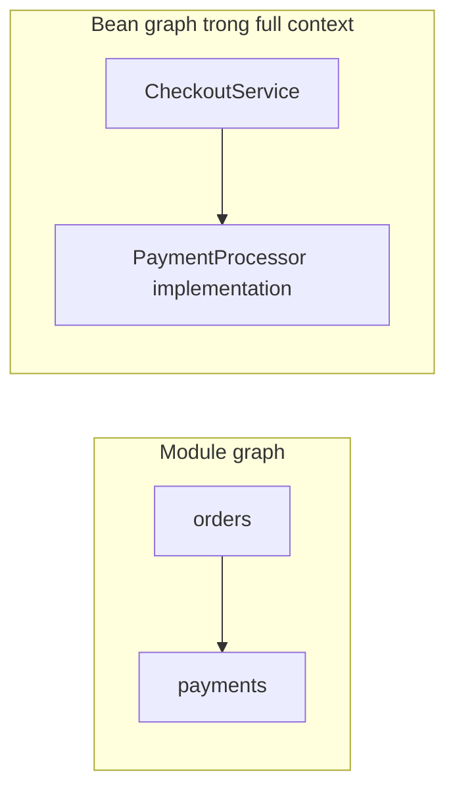
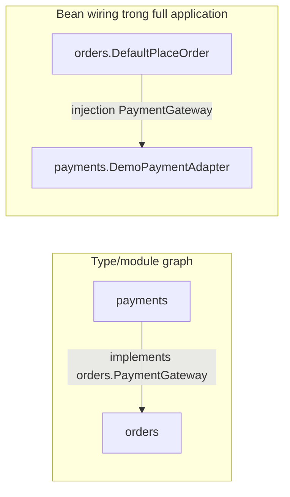
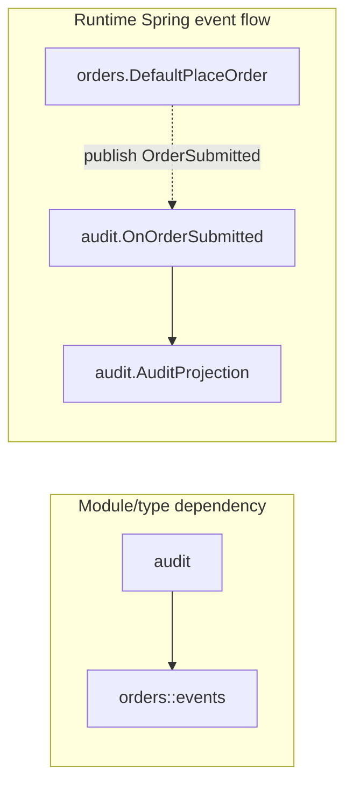
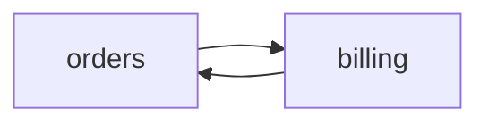
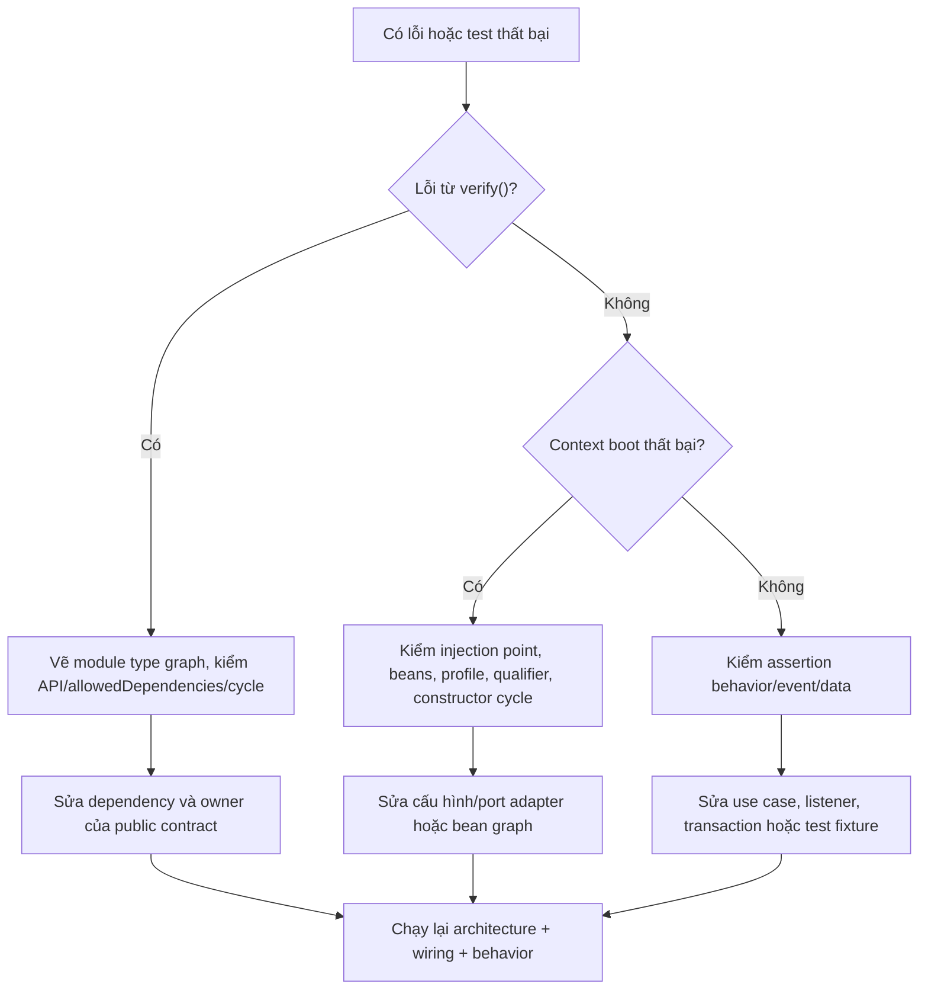
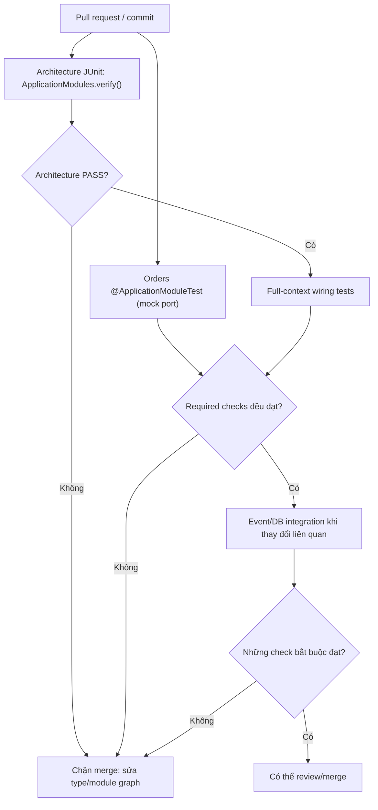

# Sự khác biệt giữa module dependency và bean dependency

Một câu hỏi quan trọng khi kiểm chứng Spring Modulith là: **“Module `orders` không có dependency đến `payments` thì tại sao bean trong `orders` lại được Spring inject bằng một bean thuộc `payments`?”**

Điều này **hoàn toàn có thể hợp lệ**. Có hai đồ thị khác nhau:

- **Module dependency graph**: các module có quan hệ phụ thuộc theo **type/reference trong mã nguồn đã biên dịch**, được Spring Modulith mô hình hóa và kiểm chứng.
- **Bean dependency graph**: những bean nào được Spring **thực sự nối với nhau trong một `ApplicationContext` cụ thể** thông qua constructor, injection point, factory method hoặc cơ chế cấu hình tương ứng.

Hai đồ thị có thể cùng chiều, ngược chiều, chỉ xuất hiện ở một bên, hoặc có vòng ở một bên mà bên còn lại không có. Vì vậy **`ApplicationModules.verify()` đạt không chứng minh context bootstrap thành công**, và **`@SpringBootTest` xanh không chứng minh module graph không có dependency cycle**.

Bài thuộc chương **Module boundaries** của **SPRING_MODULITH_VERIFICATION_TESTING**. Trọng tâm là cách phân biệt, suy luận và kiểm chứng chính xác hai đồ thị; các ví dụ Java/JUnit, `@ApplicationModuleTest`, event và CI chỉ được dùng để giải quyết trực tiếp vấn đề đó.

## 1. Hai định nghĩa cần ghi nhớ

### 1.1. Module dependency: một quan hệ tĩnh giữa các module

Gọi `owner(T)` là application module sở hữu type `T` theo mô hình Spring Modulith.

Nếu code của một type thuộc module A **tham chiếu** đến type thuộc module B, mô hình kiến trúc có thể ghi nhận cạnh:

```text
A --> B
```

Ví dụ các tham chiếu tạo quan hệ type cần kiểm tra:

- Field hoặc constructor parameter có kiểu của module khác.
- Class triển khai một interface do module khác công bố.
- Tham số/kiểu trả về của method, supertype, annotation hoặc type được sử dụng trong mã.
- Listener sử dụng một event record do module khác sở hữu.
- Class gọi method/constructor hoặc truy cập thành viên của type module khác.

Cách phát hiện cụ thể phụ thuộc phiên bản/cấu hình bộ phân tích class, nhưng **nó không đòi type được tham chiếu phải là Spring bean**.

### 1.2. Bean dependency: một quan hệ lúc tạo và sử dụng context

Trong một `ApplicationContext`, bean X có thể cần bean Y:

```text
Bean X --(constructor/injection)--> Bean Y
```

Ví dụ:

```java
@Service
class CheckoutService {

    CheckoutService(PaymentGateway paymentGateway) {
        // Spring cần tìm một bean phù hợp injection point này.
    }
}
```

Bean được chọn phụ thuộc vào **tập bean thực tế** trong context, `@Primary`, `@Qualifier`, profile, conditional configuration, test overrides và những quy tắc autowiring khác.

Quan trọng: constructor chỉ đề cập **type `PaymentGateway`**, chưa xác định rằng bean Y phải nằm ở module nào. Việc Spring tìm thấy implementation ở module khác là kết quả **runtime wiring**.

### 1.3. Công thức phân biệt

```text
Module graph:
  G_module = (application modules, static inter-module type dependencies)

Bean graph:
  G_bean(context) = (beans present in that context, runtime wiring relations)
```

`G_module` chủ yếu dựa vào code/model của ứng dụng. `G_bean(context)` phụ thuộc vào context đang được bootstrap. Thay profile hoặc mode của `@ApplicationModuleTest` có thể làm **bean graph đổi** trong khi **module graph không đổi**.

## 2. Bảng so sánh theo đúng loại bằng chứng

| Câu hỏi | Module dependency | Bean dependency |
|---|---|---|
| Đơn vị của đồ thị | Application module | Spring bean |
| Điều gì tạo cạnh? | Type/reference từ module nguồn đến module sở hữu type đích | Bean nguồn được nối đến bean đích trong context |
| Cần `@Component` hay `@Bean`? | Không | Cần có bean definitions liên quan |
| Cần bootstrap Spring context? | Không để phân tích kiến trúc tĩnh thông thường | Có, hoặc phải phân tích cấu hình/wiring thay cho bootstrap |
| Có phụ thuộc active profile? | Thường không, khi code/model không đổi | Có thể thay đổi mạnh |
| Test cốt lõi | `ApplicationModules.of(...).verify()` | `@ApplicationModuleTest`, `@SpringBootTest`, context assertions |
| Lỗi thường gặp | Module cycle, dùng `internal` của module khác, ngoài `allowedDependencies` | Missing bean, nhiều candidate, circular constructor injection |
| Có chứng minh nghiệp vụ đúng? | Không | Context bootstrap riêng cũng chưa đủ |
| Quan hệ event | Consumer import event type tạo type dependency | Không nhất thiết có bean injection producer → consumer |

**Cảnh báo:** Bean dependency không chỉ là constructor-injection trực tiếp; một số mối quan hệ được giải quyết qua `@Bean` methods, collection/provider injection hoặc cấu hình động. Khi chẩn đoán, hãy tách **bean definition**, **candidate resolution** và **thời điểm khởi tạo bean** thay vì chỉ đếm constructor parameters.

## 3. Bốn tình huống cho thấy hai đồ thị không đồng nhất

| Tình huống | Module graph | Bean graph | Ví dụ |
|---|---|---|---|
| **A. Cùng chiều** | `orders → payments` | `OrderService → PaymentService bean` | Orders inject public interface do payments sở hữu |
| **B. Có module edge, không cần bean edge** | `reporting → orders` | Không có injection giữa hai module | Reporting tham chiếu record `OrderSubmitted` |
| **C. Chiều runtime ngược chiều type** | `payments → orders` | `OrderService → PaymentAdapter bean` | Orders sở hữu port `PaymentGateway`, payments triển khai |
| **D. Có bean edge, không có inter-module edge** | Không có cạnh giữa hai module | Bean A → bean B trong cùng module | Hai service nội bộ của orders inject nhau |

Một tình huống khác thường gặp là **producer phát event và consumer nhận qua listener**. Runtime event truyền từ producer tới consumer, nhưng type dependency có thể đi **consumer → module công bố event**; đó **không phải constructor-injection từ producer sang consumer**.

Hãy đọc đồ thị dựa trên **quy tắc tạo cạnh** của từng hệ thống, không đoán theo luồng nghiệp vụ.

## 4. Tình huống A: module và bean dependencies cùng chiều

Giả sử interface payment được **module payments sở hữu**:

File `payments/PaymentProcessor.java`:

```java
package com.acme.shop.payments;

import java.math.BigDecimal;
import java.util.UUID;

public interface PaymentProcessor {
    boolean authorize(UUID orderId, BigDecimal amount);
}
```

File `orders/internal/CheckoutService.java`:

```java
package com.acme.shop.orders.internal;

import com.acme.shop.payments.PaymentProcessor;
import java.math.BigDecimal;
import java.util.UUID;
import org.springframework.stereotype.Service;

@Service
class CheckoutService {

    private final PaymentProcessor payments;

    CheckoutService(PaymentProcessor payments) {
        this.payments = payments;
    }

    boolean submit(UUID orderId, BigDecimal amount) {
        return payments.authorize(orderId, amount);
    }
}
```

Nếu payments cung cấp một bean triển khai `PaymentProcessor`, hai quan hệ thường cùng hướng:



Lý do:

- `orders.internal.CheckoutService` có một type reference tới `payments.PaymentProcessor`: **orders → payments**.
- Spring inject bean triển khai interface đó vào `CheckoutService`: **checkout bean → payment bean**.

`@ApplicationModuleTest(mode = DIRECT_DEPENDENCIES)` ở orders có thể nạp payments vì **payments là dependency module trực tiếp của orders**. Nhưng để test chạy, bean payments phải thực sự được tạo được với những dependency/configuration phù hợp.

**Tình huống A và C dưới đây là hai lựa chọn kiến trúc thay thế**, không phải các lớp cần được ghép chung vào cùng ứng dụng mẫu.

## 5. Tình huống B: có module dependency nhưng không có bean injection

Giả sử `reporting` chỉ sử dụng **event DTO** do `orders` công bố:

```java
package com.acme.shop.reporting;

import com.acme.shop.orders.events.OrderSubmitted;

// Data model thuần Java; không phải Spring bean.
public record ReportEntry(
    OrderSubmitted sourceEvent,
    String category
) {}
```

`reporting.ReportEntry` tham chiếu `orders.events.OrderSubmitted`, nên có thể tạo **reporting → orders::events** trong module graph.

Nhưng đoạn code **không định nghĩa bất kỳ `@Component` hoặc injection point nào**. Do đó không có căn cứ kết luận đã xuất hiện bean dependency tương ứng.

Tương tự:

- Một enum/value object của module khác được dùng làm field.
- Một static utility type được gọi từ code.
- Một method dùng DTO của module khác trong signature.
- Một interface được `implements` bởi class không phải Spring bean.

**Đừng xóa module edge khỏi sơ đồ chỉ vì “không có `@Autowired`”.** `ApplicationModules.verify()` quan tâm quan hệ type, kể cả những quan hệ không đi qua Spring DI.

## 6. Tình huống C: Dependency Inversion khiến hai đồ thị ngược chiều

Đây là trường hợp quan trọng nhất của bài.

Ta chọn mô hình:

- `orders` **sở hữu port `PaymentGateway`** mà use case đặt hàng cần.
- `payments` **triển khai** port đó bằng một adapter.
- Spring full context nối bean orders tới adapter payments.
- Type dependency **payments → orders**, không phải orders → payments.

### 6.1. Đồ thị phải đọc theo hai quy tắc khác nhau



**Vì sao không mâu thuẫn?** Khi biên dịch, `DefaultPlaceOrder` chỉ biết interface `orders.PaymentGateway` **thuộc chính module orders**. Adapter ở payments mới phải import interface orders để `implements`. Nhưng tại runtime, Spring chọn bean của adapter và inject vào handler.

### 6.2. Bố trí package theo mô hình port–adapter

```text
com.acme.shop
├── ShopApplication.java
├── orders
│   ├── PlaceOrder.java
│   ├── PaymentGateway.java
│   ├── events
│   │   ├── package-info.java
│   │   └── OrderSubmitted.java
│   └── internal
│       └── DefaultPlaceOrder.java
├── payments
│   ├── package-info.java
│   └── internal
│       └── DemoPaymentAdapter.java
└── audit
    ├── package-info.java
    ├── AuditQueries.java
    └── internal
        ├── AuditProjection.java
        └── OnOrderSubmitted.java
```

Đây là application mẫu được dùng xuyên suốt **các mục tiếp theo**. Adapter in-memory chỉ phục vụ bài học; nó chưa là payment integration production.

## 7. Code hoàn chỉnh cho port nằm trong orders

File `orders/PaymentGateway.java`:

```java
package com.acme.shop.orders;

import java.math.BigDecimal;
import java.util.UUID;

public interface PaymentGateway {

    boolean authorize(UUID orderId, BigDecimal amount);
}
```

File `orders/PlaceOrder.java`:

```java
package com.acme.shop.orders;

import java.math.BigDecimal;
import java.util.UUID;

public interface PlaceOrder {

    UUID submit(BigDecimal amount);
}
```

Event contract tại `orders/events/OrderSubmitted.java`:

```java
package com.acme.shop.orders.events;

import java.math.BigDecimal;
import java.util.UUID;

public record OrderSubmitted(
    UUID orderId,
    BigDecimal amount
) {}
```

Giao diện event nằm trong package con, công bố bằng `orders/events/package-info.java`:

```java
@org.springframework.modulith.NamedInterface("events")
package com.acme.shop.orders.events;
```

### 7.1. Implementation orders chỉ phụ thuộc type do orders sở hữu

File `orders/internal/DefaultPlaceOrder.java`:

```java
package com.acme.shop.orders.internal;

import com.acme.shop.orders.PaymentGateway;
import com.acme.shop.orders.PlaceOrder;
import com.acme.shop.orders.events.OrderSubmitted;
import java.math.BigDecimal;
import java.util.UUID;
import org.springframework.context.ApplicationEventPublisher;
import org.springframework.stereotype.Service;

@Service
class DefaultPlaceOrder implements PlaceOrder {

    private final PaymentGateway payments;
    private final ApplicationEventPublisher events;

    DefaultPlaceOrder(
            PaymentGateway payments,
            ApplicationEventPublisher events) {
        this.payments = payments;
        this.events = events;
    }

    @Override
    public UUID submit(BigDecimal amount) {
        if (amount == null || amount.signum() <= 0) {
            throw new IllegalArgumentException("Invalid amount");
        }

        UUID orderId = UUID.randomUUID();

        if (!payments.authorize(orderId, amount)) {
            throw new IllegalStateException("Payment rejected");
        }

        events.publishEvent(new OrderSubmitted(orderId, amount));
        return orderId;
    }
}
```

Hãy liệt kê import của `DefaultPlaceOrder`:

- `orders.PaymentGateway`: **nội bộ cùng application module**.
- `orders.PlaceOrder`: API công khai cùng module.
- `orders.events.OrderSubmitted`: event contract cùng module.
- JDK và Spring Framework APIs.
- **Không có** `payments.*`.

Vì vậy **không có static type dependency orders → payments** được tạo bởi class này.

### 7.2. Adapter thuộc payments triển khai interface của orders

File `payments/internal/DemoPaymentAdapter.java`:

```java
package com.acme.shop.payments.internal;

import com.acme.shop.orders.PaymentGateway;
import java.math.BigDecimal;
import java.util.UUID;
import org.springframework.stereotype.Component;

@Component
class DemoPaymentAdapter implements PaymentGateway {

    @Override
    public boolean authorize(UUID orderId, BigDecimal amount) {
        // Demo: luôn chấp nhận giao dịch có số tiền hợp lệ.
        return orderId != null
            && amount != null
            && amount.signum() > 0;
    }
}
```

File `payments/package-info.java`:

```java
@org.springframework.modulith.ApplicationModule(
    allowedDependencies = "orders"
)
package com.acme.shop.payments;
```

`payments` import `orders.PaymentGateway` rồi `implements` nó, tạo type dependency **payments → orders**. Chiều này được cho phép vì `PaymentGateway` ở public API root của orders.

Đây là adapter **chạy trong Spring context** khi toàn ứng dụng được scan. Nó không gọi payment provider, không ghi database và không chứng minh giao dịch thật đã được ủy quyền.

### 7.3. Spring Boot application root

```java
package com.acme.shop;

import org.springframework.boot.SpringApplication;
import org.springframework.boot.autoconfigure.SpringBootApplication;

@SpringBootApplication
public class ShopApplication {

    public static void main(String[] args) {
        SpringApplication.run(ShopApplication.class, args);
    }
}
```

Với cấu hình component scan thông thường, Spring có thể tìm `DefaultPlaceOrder` và `DemoPaymentAdapter`, tạo một bean adapter phù hợp `PaymentGateway` và inject nó vào handler.

**Kết quả wiring** là một quan hệ ở bean graph. Nó **không thay đổi** chiều type dependency đã có trong Java code.

## 8. Cách suy luận chính xác qua từng dòng code

Xét hai câu lệnh:

```java
// orders/internal/DefaultPlaceOrder.java
private final PaymentGateway payments;
```

```java
// payments/internal/DemoPaymentAdapter.java
class DemoPaymentAdapter implements PaymentGateway { /* ... */ }
```

Diễn giải đúng:

| Quan sát | Kết luận |
|---|---|
| `PaymentGateway` thuộc `orders` | Handler của orders chỉ dùng type trong chính module |
| `DemoPaymentAdapter implements PaymentGateway` | Payments có type dependency tới orders |
| Spring chọn `DemoPaymentAdapter` cho injection point | Bean ở orders cần bean ở payments trong full context |
| Chuyển adapter sang provider khác nhưng vẫn implement port | Module graph có thể giữ nguyên |
| Đổi active profile khiến không còn adapter | Bean graph/context có thể lỗi trong khi `verify()` vẫn xanh |

### 8.1. Dependency Inversion không làm các module hoàn toàn độc lập

Module payments vẫn phải biết và tuân thủ **port contract** của orders. Đổi chữ ký `PaymentGateway.authorize(...)` có thể buộc adapter sửa.

Điểm được cải thiện là **module use case không tham chiếu implementation adapter**, nên thay đổi kỹ thuật thanh toán có thể diễn ra mà không sửa `DefaultPlaceOrder` nếu contract giữ nguyên.

### 8.2. Runtime wiring không đồng nghĩa runtime business coupling được loại bỏ

Mặc dù type dependency orders → payments không tồn tại, method `submit(...)` vẫn **đợi** `payments.authorize(...)` trả kết quả qua port, bởi đây là lời gọi đồng bộ.

Nếu payment provider chậm hoặc lỗi, request đặt hàng vẫn có thể bị ảnh hưởng. **Dependency Inversion thay đổi hướng phụ thuộc mã nguồn, không tự chuyển một lời gọi đồng bộ thành bất đồng bộ.**

## 9. Architecture test: kiểm chứng graph tĩnh mà không boot Spring context

Tại `src/test/java/com/acme/shop/ModuleArchitectureTests.java`:

```java
package com.acme.shop;

import org.junit.jupiter.api.Test;
import org.springframework.modulith.core.ApplicationModules;

class ModuleArchitectureTests {

    @Test
    void verifiesTypeDependenciesBetweenModules() {
        ApplicationModules.of(ShopApplication.class).verify();
    }
}
```

Với cấu trúc ở mục 6–7, kỳ vọng:

- `payments → orders` là dependency cho phép vì payments thực hiện port public của orders.
- Không có cạnh `orders → payments` từ handler trong ví dụ.
- Không có dependency cycle giữa orders và payments.
- Không có import vào implementation package của module khác.
- Nếu audit tiêu thụ `orders::events`, dependency của audit cũng phải phù hợp metadata.

`ApplicationModules.verify()` thông thường kiểm tra **no cycles**, **encapsulation/internal API** và **`allowedDependencies`** theo mô hình Spring Modulith. Nó **không** chạy `PaymentGateway.authorize(...)` hoặc thực hiện constructor injection trong Spring context.

### 9.1. Kiểm tra mô hình chứa đủ module

```java
package com.acme.shop;

import static org.assertj.core.api.Assertions.assertThat;

import org.junit.jupiter.api.Test;
import org.springframework.modulith.core.ApplicationModules;

class ModuleDiscoveryTests {

    @Test
    void discoversTheExpectedModules() {
        ApplicationModules modules =
            ApplicationModules.of(ShopApplication.class);

        assertThat(modules.getModuleByName("orders")).isPresent();
        assertThat(modules.getModuleByName("payments")).isPresent();
        assertThat(modules.getModuleByName("audit")).isPresent();
    }
}
```

Nếu bạn chỉ triển khai orders/payments và chưa tạo audit, bỏ assertion audit. Với module detection/naming tùy biến, sửa test theo mô hình thực tế.

**Một test `verify()` xanh trên model thiếu module cần kiểm tra không phải bằng chứng đầy đủ về ranh giới.**

## 10. @ApplicationModuleTest STANDALONE: module hợp lệ nhưng có thể thiếu bean

Đặt test tại `com.acme.shop.orders`:

```java
package com.acme.shop.orders;

import static org.assertj.core.api.Assertions.assertThat;
import static org.assertj.core.api.Assertions.assertThatThrownBy;
import static org.mockito.ArgumentMatchers.any;
import static org.mockito.ArgumentMatchers.eq;
import static org.mockito.Mockito.verify;
import static org.mockito.Mockito.when;

import com.acme.shop.orders.events.OrderSubmitted;
import java.math.BigDecimal;
import java.util.UUID;
import org.junit.jupiter.api.Test;
import org.springframework.beans.factory.annotation.Autowired;
import org.springframework.modulith.test.ApplicationModuleTest;
import org.springframework.modulith.test.PublishedEvents;
import org.springframework.test.context.bean.override.mockito.MockitoBean;

@ApplicationModuleTest
class OrdersModuleTests {

    @Autowired PlaceOrder orders;

    @MockitoBean PaymentGateway paymentGateway;

    @Test
    void publishesEventAfterAuthorization(
            PublishedEvents events) {

        BigDecimal amount = new BigDecimal("20.00");

        when(paymentGateway.authorize(
            any(UUID.class), eq(amount)
        )).thenReturn(true);

        UUID orderId = orders.submit(amount);

        assertThat(events.ofType(OrderSubmitted.class))
            .singleElement()
            .satisfies(event -> {
                assertThat(event.orderId()).isEqualTo(orderId);
                assertThat(event.amount())
                    .isEqualByComparingTo(amount);
            });

        verify(paymentGateway).authorize(
            eq(orderId), eq(amount)
        );
    }

    @Test
    void rejectedPaymentDoesNotPublish(
            PublishedEvents events) {

        BigDecimal amount = new BigDecimal("5.00");

        when(paymentGateway.authorize(
            any(UUID.class), eq(amount)
        )).thenReturn(false);

        assertThatThrownBy(() -> orders.submit(amount))
            .isInstanceOf(IllegalStateException.class)
            .hasMessage("Payment rejected");

        assertThat(events.ofType(OrderSubmitted.class)).isEmpty();
    }

    @Test
    void invalidAmountDoesNotCallPayment(
            PublishedEvents events) {

        assertThatThrownBy(() ->
            orders.submit(BigDecimal.ZERO)
        ).isInstanceOf(IllegalArgumentException.class)
         .hasMessage("Invalid amount");

        org.mockito.Mockito.verifyNoInteractions(paymentGateway);

        assertThat(events.ofType(OrderSubmitted.class)).isEmpty();
    }
}
```

### 10.1. Vì sao cần @MockitoBean dù không có module edge orders → payments?

`@ApplicationModuleTest` ở `STANDALONE` chỉ đưa **module orders** vào phạm vi kiểm thử theo cơ chế Spring Modulith Test. Adapter `DemoPaymentAdapter` thuộc **payments**, nên không được nạp chỉ vì nó implement interface `PaymentGateway` của orders.

Trong orders có injection point `PaymentGateway` nhưng **không có bean implementation** được tạo trong phạm vi đó. `@MockitoBean` cung cấp một mock Spring bean cho port:

- Giải quyết yêu cầu bean của `DefaultPlaceOrder`.
- Giữ test tập trung vào behavior orders.
- Không cần import `payments.internal.DemoPaymentAdapter`.
- Không tạo static dependency orders → payments.
- Không tuyên bố adapter production thật đã hoạt động.

Nếu bỏ mock mà không có bean/test config thay thế, **module test có thể thất bại khi tạo context** dù `ApplicationModules.verify()` đã đạt. Đây không phải mâu thuẫn.

### 10.2. Chú ý phiên bản mock annotation

`@MockitoBean` từ `org.springframework.test.context.bean.override.mockito` được Spring Framework hỗ trợ từ 6.2. Với Spring Boot cũ có thể dùng `@MockBean`. Chọn theo phiên bản dependency thực tế và **không** đăng ký cả hai cho một bean chỉ để sửa lỗi import.

`@Mock` thuần Mockito không tự đăng ký Spring bean trong `@ApplicationModuleTest`.

### 10.3. Kết luận đúng từ test này

Test chứng minh: với phản hồi port được giả lập, use case orders kiểm tra input, gọi port, phát hoặc không phát event đúng assertion.

Nó **không** chứng minh:

- `payments.DemoPaymentAdapter` đang được Spring inject trong full application.
- Thanh toán thật xảy ra.
- Database đã commit.
- Consumer downstream đã xử lý `OrderSubmitted`.
- Module graph hợp lệ nếu chưa chạy architecture test độc lập.

## 11. DIRECT_DEPENDENCIES không có nghĩa “nạp mọi implementation được inject”

Đây là ngộ nhận đặc biệt quan trọng với mô hình Dependency Inversion.

`@ApplicationModuleTest` có ba bootstrap mode chính:

| Mode | Module nằm trong context | Điều cần chú ý |
|---|---|---|
| `STANDALONE` | Module đang test | Thường cần mock/fake port được implement ngoài module |
| `DIRECT_DEPENDENCIES` | Module đang test và module nó **phụ thuộc trực tiếp** | Không tự bao gồm module chỉ có cạnh đi vào module đang test |
| `ALL_DEPENDENCIES` | Module đang test và dependencies bắc cầu | Không tự nạp mọi module tiêu thụ API của module đang test |

Ở ví dụ port–adapter:

```text
Static module graph:
  payments -> orders

Runtime bean wiring in full application:
  DefaultPlaceOrder -> DemoPaymentAdapter
```

Vì `orders` **không có outgoing module dependency tới payments**, mở rộng `OrdersModuleTests` sang `DIRECT_DEPENDENCIES` hay `ALL_DEPENDENCIES` **không tự làm payments trở thành dependency của orders**.

### 11.1. Ví dụ chọn mode không đúng để sửa Missing Bean

```java
package com.acme.shop.orders;

import org.springframework.modulith.test.ApplicationModuleTest;
import org.springframework.modulith.test.ApplicationModuleTest.BootstrapMode;

// Không có @MockitoBean hoặc fake PaymentGateway.
// Với cấu trúc port–adapter đang xét, test có thể thiếu bean.
@ApplicationModuleTest(
    mode = BootstrapMode.DIRECT_DEPENDENCIES
)
class OrdersDependencyModeDemoTests {
    // ...
}
```

Chọn mode này không làm một **incoming dependency `payments → orders`** biến thành **outgoing dependency `orders → payments`**.

Cách xử lý:

1. Với test hành vi cô lập, dùng `@MockitoBean PaymentGateway` hoặc fake test-only.
2. Với test tích hợp adapter thật, dùng **full application context** hoặc một test configuration/import có chủ đích phù hợp quyền truy cập và scope.
3. Không thêm static import `payments.internal.DemoPaymentAdapter` vào production orders chỉ để `DIRECT_DEPENDENCIES` nạp adapter.
4. Nếu muốn chọn mô hình `orders → payments` thay vì Dependency Inversion, đó là **quyết định kiến trúc khác**, không phải cách chữa tạm một test.

### 11.2. Khi DIRECT_DEPENDENCIES có ích?

Ở tình huống A, orders inject interface `payments.PaymentProcessor` do payments sở hữu. Khi đó static edge `orders → payments` có thật, nên `DIRECT_DEPENDENCIES` của orders có cơ sở để nạp payments.

**Quy tắc:** Bootstrap mode dựa trên module dependency model, không suy từ **“bean runtime có thể do module nào cung cấp”**.

## 12. Full-context test: chứng minh Spring nối port vào adapter thật

Sau khi architecture test đạt, cần thêm một kiểm tra runtime nếu contract yêu cầu adapter hiện diện trong ứng dụng thực.

File `src/test/java/com/acme/shop/RealWiringTests.java`:

```java
package com.acme.shop;

import static org.assertj.core.api.Assertions.assertThat;

import com.acme.shop.orders.PaymentGateway;
import com.acme.shop.orders.PlaceOrder;
import java.math.BigDecimal;
import org.junit.jupiter.api.Test;
import org.springframework.beans.factory.annotation.Autowired;
import org.springframework.boot.test.context.SpringBootTest;
import org.springframework.context.ApplicationContext;

@SpringBootTest
class RealWiringTests {

    @Autowired ApplicationContext context;
    @Autowired PlaceOrder orders;

    @Test
    void resolvesOnePaymentGatewayAndCallsIt() {
        assertThat(context.getBeansOfType(PaymentGateway.class))
            .hasSize(1);

        var orderId = orders.submit(new BigDecimal("9.99"));

        assertThat(orderId).isNotNull();
    }
}
```

Với demo adapter ở mục 7:

- Full context có thể tạo `DemoPaymentAdapter`.
- Spring có một candidate `PaymentGateway`, inject nó vào `DefaultPlaceOrder`.
- `submit(...)` chạy được với adapter demo.
- Module dependency **payments → orders** vẫn giữ nguyên.

### 12.1. Giới hạn của wiring test

Test này không thực hiện giao dịch thanh toán thật. Nó chưa chứng minh behavior với các profile khác, credential, network failure, database hoặc timeout. Để chứng minh provider thật, phải thay adapter demo bằng integration test phù hợp với port và dependency sản xuất.

### 12.2. Nếu có nhiều adapter PaymentGateway

Ví dụ dự án đăng ký `StripePaymentAdapter` và `MockPaymentAdapter` cùng lúc, Spring có thể báo nhiều candidate cho một injection point.

Cách giải quyết runtime có thể gồm `@Primary`, `@Qualifier`, profile hoặc conditional bean registration — nhưng **không có cách nào trong số đó tự thay đổi chiều module type dependency**.

Mọi adapter vẫn phải tuân thủ public API và dependency policy của Spring Modulith.

## 13. Event: giao tiếp runtime không phải bean injection từ producer đến consumer

Thêm module `audit` ghi nhận event `OrderSubmitted`.

File `audit/package-info.java`:

```java
@org.springframework.modulith.ApplicationModule(
    allowedDependencies = "orders::events"
)
package com.acme.shop.audit;
```

File `audit/AuditQueries.java`:

```java
package com.acme.shop.audit;

import java.util.UUID;

public interface AuditQueries {
    boolean hasSeen(UUID orderId);
}
```

Implementation in-memory tại `audit/internal/AuditProjection.java`:

```java
package com.acme.shop.audit.internal;

import com.acme.shop.audit.AuditQueries;
import java.util.Set;
import java.util.UUID;
import java.util.concurrent.ConcurrentHashMap;
import org.springframework.stereotype.Component;

@Component
class AuditProjection implements AuditQueries {

    private final Set<UUID> seenIds =
        ConcurrentHashMap.newKeySet();

    void record(UUID orderId) {
        seenIds.add(orderId);
    }

    @Override
    public boolean hasSeen(UUID orderId) {
        return seenIds.contains(orderId);
    }
}
```

Listener tại `audit/internal/OnOrderSubmitted.java`:

```java
package com.acme.shop.audit.internal;

import com.acme.shop.orders.events.OrderSubmitted;
import org.springframework.context.event.EventListener;
import org.springframework.stereotype.Component;

@Component
class OnOrderSubmitted {

    private final AuditProjection projection;

    OnOrderSubmitted(AuditProjection projection) {
        this.projection = projection;
    }

    @EventListener
    void on(OrderSubmitted event) {
        projection.record(event.orderId());
    }
}
```

### 13.1. Phân loại hai cạnh trong ví dụ audit

1. `audit.internal.OnOrderSubmitted` có signature nhận `orders.events.OrderSubmitted`, vì vậy type graph có cạnh **audit → orders::events**.
2. `OnOrderSubmitted` inject `AuditProjection`, tạo **bean dependency bên trong audit**.
3. `DefaultPlaceOrder` của orders publish `OrderSubmitted` qua `ApplicationEventPublisher`, nhưng **không inject bean audit listener**.
4. Trong full Spring context, event được dispatch từ orders tới audit listener theo cấu hình Spring Events. Đây là **runtime event delivery**, không phải một constructor injection edge orders → audit.



Không nên đồng nhất mũi tên sự kiện runtime với mũi tên module dependency.

### 13.2. Consumer module test không cần producer bean

```java
package com.acme.shop.audit;

import static org.assertj.core.api.Assertions.assertThat;

import com.acme.shop.orders.events.OrderSubmitted;
import java.math.BigDecimal;
import java.util.UUID;
import org.junit.jupiter.api.Test;
import org.springframework.beans.factory.annotation.Autowired;
import org.springframework.context.ApplicationEventPublisher;
import org.springframework.modulith.test.ApplicationModuleTest;

@ApplicationModuleTest
class AuditModuleTests {

    @Autowired ApplicationEventPublisher publisher;
    @Autowired AuditQueries audit;

    @Test
    void handlesPublishedContract() {
        UUID orderId = UUID.randomUUID();

        publisher.publishEvent(new OrderSubmitted(
            orderId, new BigDecimal("9.99")
        ));

        assertThat(audit.hasSeen(orderId)).isTrue();
    }
}
```

Ở ví dụ dùng `@EventListener` và Spring multicaster đồng bộ mặc định, test có thể kiểm tra projection ngay sau `publishEvent`.

Test này chứng minh **consumer behavior** với event đầu vào, nhưng không chứng minh provider payment thật đã được gọi, orders đã commit hoặc database audit đã lưu bền vững.

## 14. Một cycle module có thể tồn tại mà không có bean cycle

Lấy một ví dụ **độc lập** với ứng dụng port–adapter ở trên. Hai module có các records thuần Java.

```java
// orders/OrderKey.java
package com.acme.shop.orders;

import java.util.UUID;

public record OrderKey(UUID id) {}
```

```java
// billing/PaymentReceipt.java
package com.acme.shop.billing;

import com.acme.shop.orders.OrderKey;

public record PaymentReceipt(OrderKey orderKey, boolean paid) {}
```

```java
// orders/internal/ReceiptView.java
package com.acme.shop.orders.internal;

import com.acme.shop.billing.PaymentReceipt;

record ReceiptView(PaymentReceipt receipt) {}
```

Quan hệ:

- `billing.PaymentReceipt` dùng `orders.OrderKey`: **billing → orders**.
- `orders.internal.ReceiptView` dùng `billing.PaymentReceipt`: **orders → billing**.



**Không class nào trong ba class cần là Spring bean**. Tuy vậy `ApplicationModules.verify()` phải phát hiện module dependency cycle nếu mô hình mặc định nhận diện đúng hai module và references được phân tích.

Một `@SpringBootTest` có thể khởi động thành công vì không có circular constructor injection nào từ ba records này.

**Bài học:** Không được kết luận “không có module cycle” chỉ vì context load xanh. Và việc tất cả referenced types là `public` không hợp thức hóa vòng module.

## 15. Một bean cycle có thể tồn tại mà module graph không có cycle

Quay về mô hình port `PaymentGateway` thuộc orders. Giả sử ta thêm một **public port query** do orders sở hữu:

```java
package com.acme.shop.orders;

public interface OrderStatus {
    boolean ready();
}
```

Một bean mới của orders cần `PaymentGateway`:

```java
package com.acme.shop.orders.internal;

import com.acme.shop.orders.OrderStatus;
import com.acme.shop.orders.PaymentGateway;
import org.springframework.stereotype.Service;

@Service
class StatusService implements OrderStatus {

    private final PaymentGateway gateway;

    StatusService(PaymentGateway gateway) {
        this.gateway = gateway;
    }

    @Override
    public boolean ready() {
        return gateway != null;
    }
}
```

Giả sử **thay** `DemoPaymentAdapter` bằng adapter mới thuộc payments:

```java
package com.acme.shop.payments.internal;

import com.acme.shop.orders.OrderStatus;
import com.acme.shop.orders.PaymentGateway;
import java.math.BigDecimal;
import java.util.UUID;
import org.springframework.stereotype.Component;

@Component
class CircularPaymentAdapter implements PaymentGateway {

    private final OrderStatus orderStatus;

    CircularPaymentAdapter(OrderStatus orderStatus) {
        this.orderStatus = orderStatus;
    }

    @Override
    public boolean authorize(UUID orderId, BigDecimal amount) {
        return orderStatus.ready();
    }
}
```

**Đây là thí nghiệm tạo lỗi, không để cùng lúc cả hai adapter.** Với một candidate PaymentGateway là `CircularPaymentAdapter`, chu trình constructor injection xuất hiện:

```text
StatusService bean
    -> PaymentGateway bean (CircularPaymentAdapter)
        -> OrderStatus bean (StatusService)
```

Spring Boot có thể không tạo được context vì circular bean reference trong constructor chain. Nhưng static type graph chỉ gồm:

```text
payments -> orders

# StatusService dùng PaymentGateway và OrderStatus,
# cả hai interface đều thuộc orders.
# Không có static type reference orders -> payments.
```

Vì vậy **module graph không có orders ↔ payments cycle**, và `ApplicationModules.verify()` có thể đạt trong khi `@SpringBootTest` thất bại do bean cycle.

### 15.1. Vì sao không dùng @Lazy để coi như đã sửa kiến trúc?

`@Lazy` hoặc provider injection có thể trì hoãn tạo bean trong một số trường hợp, nhưng không đảm bảo bỏ được logic runtime loop hoặc tạo ra thiết kế đúng. Nếu `authorize(...)` gọi `ready()`, và `ready()` gọi lại `authorize(...)`, ứng dụng còn có nguy cơ vòng gọi runtime.

Cần xem lại trách nhiệm của port/provider, loại bỏ yêu cầu phụ thuộc vòng thật sự và test luồng xử lý.

### 15.2. Không thêm module edge để giải quyết bean cycle

Thêm `orders → payments` bằng cách cho orders import implementation adapter là cách sửa sai: nó làm tăng type coupling và có thể tạo **module cycle** mới, trong khi constructor-injection cycle vẫn không được giải quyết.

**Sửa bean graph tại đúng tầng**, không làm hỏng module graph để che lỗi context.

## 16. Hai đồ thị thay đổi theo những nguyên nhân khác nhau

| Thay đổi | Module graph có thể đổi? | Bean graph có thể đổi? |
|---|---|---|
| Import/type reference tới module mới trong production | Có | Chưa chắc |
| Đổi `implements` từ port A sang port B thuộc module khác | Có | Có thể |
| Bật/tắt `@Profile` của adapter hiện có | Thường không | Có |
| Thêm `@Primary` cho một bean | Thường không | Có, thay candidate được chọn |
| Thêm `@Qualifier` tại injection point | Có thể thêm type/annotation reference, nhưng không tự đổi module ownership | Có, thay cách resolve |
| Thay `@MockitoBean` trong bài test | Không sửa production graph | Có, trong test context |
| Chuyển test từ STANDALONE sang DIRECT_DEPENDENCIES | Không | Có, thay tập bean đang nạp |
| Thay synchronous method call bằng event type của module khác | Có thể đổi chiều type dependency | Thay runtime interaction, không nhất thiết thêm injection |
| Đổi implementation adapter mà giữ port | Có thể giữ nguyên nếu ownership/type references không đổi | Có thể đổi bean/provider |
| Thêm Spring `@Bean` trong auto-configuration | Phụ thuộc type references được thêm trong code | Thường có, nếu điều kiện kích hoạt |

**Kết luận:** Một sự thay đổi chỉ có ở bean configuration có thể làm runtime fail mà architecture test vẫn xanh. Một tham chiếu DTO mới có thể tạo module edge/cycle dù Spring wiring vẫn xanh.

## 17. Trường hợp Bean wiring không có candidate hoặc có nhiều candidate

Khi test gặp lỗi, cần phân loại trước khi sửa.

### 17.1. Không có PaymentGateway bean

Trong `OrdersModuleTests` STANDALONE:

```text
DefaultPlaceOrder cần PaymentGateway
PaymentGateway là interface trong orders
Implementation thực tế thuộc payments, không được nạp
=> Spring thiếu bean ứng viên
```

**Cách sửa phù hợp:** `@MockitoBean PaymentGateway` hoặc `@TestConfiguration` cung cấp fake theo mục tiêu test. Không thêm import payments internal vào orders production.

### 17.2. Nhiều PaymentGateway beans

Trong full context:

```text
StripeAdapter implements PaymentGateway
SandboxAdapter implements PaymentGateway
=> Có thể nhiều ứng viên cho một injection point
```

**Cách sửa:** chọn bean rõ bằng profile/condition/qualifier hoặc cấu hình `@Primary` có chủ đích, kiểm tra behavior theo profile thực. Không nới `allowedDependencies` vì đây không phải lỗi module policy.

### 17.3. Constructor dependency cycle

Spring có thể nêu tên bean nằm trong vòng constructor injection. Cần vẽ cạnh **bean X → bean Y** từ từng constructor được tạo và xem việc tách trách nhiệm có loại bỏ chu trình không.

Không tự kết luận **module graph** cũng có cycle. Hãy chạy architecture test độc lập và phân tích cả hai.

### 17.4. Vi phạm module API

Nếu `ApplicationModules.verify()` báo `orders` tham chiếu `payments.internal.*`, đây là **lỗi architecture**, ngay cả khi `@SpringBootTest` có thể khởi động và inject bình thường.

Cách sửa: dùng public API, đảo chiều phụ thuộc bằng port, hoặc tái thiết kế ownership; không tạo thêm mock để che static dependency.

## 18. ObjectProvider, @Lazy và event không có nghĩa loại bỏ dependency

Ba kỹ thuật này dễ dẫn tới kết luận quá mức.

### 18.1. ObjectProvider<T>

```java
package com.acme.shop.orders.internal;

import com.acme.shop.orders.PaymentGateway;
import org.springframework.beans.factory.ObjectProvider;
import org.springframework.stereotype.Service;

@Service
class DeferredPaymentLookup {

    private final ObjectProvider<PaymentGateway> gateways;

    DeferredPaymentLookup(
            ObjectProvider<PaymentGateway> gateways) {
        this.gateways = gateways;
    }

    boolean hasGateway() {
        return gateways.getIfAvailable() != null;
    }
}
```

Đoạn code vẫn có dependency **type tới `PaymentGateway`**, nhưng type này do orders sở hữu, nên không tạo orders → payments. Ở runtime, provider có thể trì hoãn việc resolve bean cho đến lúc gọi `getIfAvailable()`. Vì vậy không nên coi “constructor có `ObjectProvider`” là bằng chứng provider đích đã được tạo ngay lúc bootstrap.

Nếu `PaymentGateway` thuộc payments trong một phương án thiết kế khác, dùng `ObjectProvider<PaymentGateway>` **vẫn tạo static type reference** orders → payments. Nó không làm biến mất module dependency.

### 18.2. @Lazy

`@Lazy` có thể ảnh hưởng thời điểm bean/proxy được tạo nhưng không làm compiler quên type ở injection point. Nó không phải phương pháp sửa dependency policy.

### 18.3. ApplicationEventPublisher

`ApplicationEventPublisher` cho phép producer phát event mà không inject trực tiếp consumer bean. Nhưng listener ở module khác thường **tham chiếu event type** của producer, nên module dependency vẫn có thể tồn tại theo chiều **consumer → event owner**.

Tách **dependency tĩnh**, **wiring**, và **event dispatch** trước khi gọi một quan hệ là “loose coupling”.

## 19. Kiểm thử cả hai đồ thị bằng các phép thử âm tính khác nhau

Một bộ test đáng tin phải chứng minh phép kiểm tra thực sự nhạy với **đúng loại lỗi**.

### 19.1. Thử âm tính architecture

Trên nhánh thử nghiệm, thêm field production vào orders:

```java
// CỐ TÌNH VI PHẠM — chỉ dùng ở nhánh thử.
private com.acme.shop.payments.internal.SomePaymentRepository repo;
```

Giả định `SomePaymentRepository` là Java `public` tồn tại trong payments internal để ví dụ biên dịch. Đây là tham chiếu type thực sự tới implementation module khác.

Kỳ vọng:

1. Java có thể compile.
2. `ApplicationModules.verify()` báo vi phạm public/internal boundary.
3. `@SpringBootTest` vẫn có thể thành công nếu field không được inject hoặc tạo bean dependency tương ứng.
4. Gỡ field, dùng `orders.PaymentGateway`, rồi xác nhận architecture test đạt.

**Không chỉ thêm import thừa** vì có thể không tạo bytecode dependency mà bộ phân tích nhận diện. Không giữ code cố tình sai trên main branch.

### 19.2. Thử âm tính runtime wiring

Trên nhánh thử nghiệm:

1. Bỏ `DemoPaymentAdapter` khỏi Spring component scan hoặc chỉ kích hoạt nó ở profile không được test dùng.
2. Giữ source port–adapter và module metadata không đổi.
3. Chạy `ModuleArchitectureTests`: có thể vẫn đạt.
4. Chạy `RealWiringTests`: context phải thất bại nếu không còn candidate `PaymentGateway`.
5. Khôi phục cấu hình provider đúng và chạy lại.

Điều này chứng minh **architecture verification không thay Spring bean wiring verification**.

### 19.3. Thử âm tính bean cycle

Thay adapter demo bằng `CircularPaymentAdapter` và thêm `StatusService` ở mục 15:

- `verify()` có thể đạt vì chỉ có module edge payments → orders.
- Full-context bootstrap thất bại vì circular constructor injection.
- Xóa vòng Bean DI, không nới module dependency.

### 19.4. Thử âm tính module cycle không có bean cycle

Dùng records ở mục 14 để tạo orders ↔ billing:

- Architecture test phải đỏ.
- Context test không nhất thiết thất bại, vì không có bean cycle.
- Sửa type ownership/dependency, không chỉnh Spring `@Lazy` hay `@Primary`.

## 20. Ma trận kiểm chứng tối thiểu

| Kiểm chứng | Test/công cụ | Phát hiện | Không chứng minh |
|---|---|---|---|
| Module discovery | `ApplicationModules.getModuleByName(...)` | Những module mong đợi được nhận diện | Bean wiring đúng |
| Module graph | `ApplicationModules.verify()` | Cycle/type dependency/internal API/allowedDependencies theo model | Active-profile bean creation |
| Orders isolated behavior | `@ApplicationModuleTest` + `@MockitoBean PaymentGateway` | Logic orders với port mock | Adapter payments thật được tạo |
| Full app wiring | `@SpringBootTest` | Bean port được resolve trong context được kiểm tra | Mọi profile hoặc external payment thành công |
| Bean constructor-cycle | Context bootstrap test | Context không tạo được vì circular references | Module graph nhất thiết có cycle |
| Event producer | `PublishedEvents` | Type/count/payload event orders đã publish | Audit đã xử lý |
| Event consumer | `AuditModuleTests` | Listener audit xử lý input event trong test context | Database đã commit |
| Database/transaction | Integration test với DB thật/Testcontainers | Ghi/đọc sau commit, constraint, idempotency | Tất cả execution paths nếu chưa test |
| End-to-end | System/API tests | Luồng qua app theo môi trường test | Rule dependency nếu không chạy verify |

**Không một hàng đơn lẻ** đại diện cho “module đã được kiểm chứng đầy đủ”. Mỗi loại kiểm tra trả lời một câu hỏi riêng về cấu trúc, wiring hoặc behavior.

## 21. Database và transaction không thay đổi định nghĩa của hai đồ thị

Một module có thể có bean JPA repository và `DataSource` trong Spring context. Chúng tạo các dependency runtime/hạ tầng nhưng không đồng nghĩa có static dependency tới application module sở hữu bảng khác.

Ví dụ:

- `orders` inject `OrderRepository` trong chính module orders: có bean dependency nội bộ.
- `payments` query SQL trực tiếp vào bảng do orders sở hữu: có **coupling dữ liệu** dù không nhất thiết có Java type reference tới orders.
- `audit` nhận `OrderSubmitted` qua `@EventListener`: có module type dependency audit → orders::events nhưng không phải orders inject audit bean.

### 21.1. Khi dùng after-commit listener

`@EventListener` đồng bộ mặc định thường xử lý ngay khi publish; `@TransactionalEventListener(AFTER_COMMIT)` và `@ApplicationModuleListener` có ngữ nghĩa sau commit/bất đồng bộ theo cấu hình phù hợp.

Vì vậy:

- Producer `PublishedEvents` test chỉ chứng minh **đã publish**.
- Consumer test chứng minh **đã xử lý input** theo mode listener được test.
- Database integration test chứng minh **trạng thái sau commit**.

Thay listener annotation có thể làm **runtime behavior/transaction graph** thay đổi mà không tạo module type dependency mới. Điều đó càng cho thấy không được dùng `verify()` như một kiểm chứng runtime toàn diện.

### 21.2. Những rủi ro chỉ xuất hiện lúc runtime

- Producer rollback sau khi publish.
- Listener async chưa hoàn tất khi test assert.
- Consumer fail rồi retry/replay event.
- Same event gây double side effect.
- DataSource thiếu migration, unique constraint hoặc transaction isolation.
- HTTP/payment provider timeout, từ chối hoặc trả dữ liệu không hợp lệ.

Dùng integration tests với cơ sở dữ liệu phù hợp, chẳng hạn Testcontainers, khi cần. **Container khởi động thành công không tự chứng minh commit và idempotency.**

## 22. Quy trình chẩn đoán có thứ tự khi test đỏ



### 22.1. Checklist thực hành

1. **Ghi lỗi đầu tiên thật sự**: violation architecture, NoSuchBeanDefinition/NoUniqueBeanDefinition, circular dependency, hay assertion fail?
2. **Xác định type owner** ở module graph: interface/record/implementation thuộc module nào?
3. **Vẽ cạnh module** bằng các tham chiếu production, không chỉ các bean đang hoạt động.
4. **Vẽ injection points** của bean context test: constructor của ai yêu cầu type nào?
5. **Xác định candidate** theo `@Component`/`@Bean`, profile, condition, qualifier, test override.
6. **Kiểm tra bootstrap mode**: STANDALONE, DIRECT_DEPENDENCIES hay ALL_DEPENDENCIES?
7. **Xác định chiều dependency**: port bên A nhưng adapter ở B thường có type edge B → A.
8. **Chạy đúng test**: verify cho structure; module test cho isolated behavior; full-context test cho real wiring.
9. **Nếu event**: tách producer published, consumer handled, database committed.
10. **Kiểm tra CI**: test bắt buộc có chạy, có bị skip hoặc thay bằng mock làm mất mục tiêu không?

### 22.2. Hai câu hỏi ngăn sửa sai tầng

Khi gặp Missing Bean, hỏi: “**Đây là bean cần có trong context hiện tại hay là module dependency cần được thêm vào code?**” Thường thiếu bean không buộc ta thêm type dependency.

Khi gặp `verify()` violation, hỏi: “**Có reference Java nào trái ranh giới hay không?**” Mock thêm bean không xóa được static reference.

## 23. CI quality gate: giữ hai phép kiểm chứng độc lập

Cách tổ chức CI nên thể hiện rõ sự khác nhau giữa hai đồ thị.



Những jobs có thể chạy song song nếu phù hợp. Điều quan trọng không phải JUnit method order mà là **các required checks đều được thực thi và đạt trên commit cần merge**.

### 23.1. Maven hoặc Gradle: ví dụ bước kiểm tra

```bash
# Maven: architecture test riêng (khi Surefire/JUnit được cấu hình tương ứng)
./mvnw -Dtest=ModuleArchitectureTests test

# Maven: chạy lifecycle đến verify theo plugins/profiles đã cấu hình
./mvnw verify

# Gradle: architecture test riêng
./gradlew test --tests "com.acme.shop.ModuleArchitectureTests"

# Gradle: các tests thuộc task test
./gradlew test
```

Không tự kết luận các lệnh này đã chạy toàn bộ integration tests; dự án có thể có Maven Failsafe, profile, hoặc Gradle `integrationTest` task riêng.

### 23.2. Một lỗi CI thường gặp

Nếu chỉ chạy `OrdersModuleTests` với `@MockitoBean PaymentGateway`:

- Test có thể xanh **ngay cả khi** implementation thật ở payments không được Spring scan.
- Test cũng có thể xanh **ngay cả khi** production source ở một nơi khác tạo dependency trái ranh giới.
- Không thể dùng kết quả đó thay cho cả `ModuleArchitectureTests` lẫn `RealWiringTests`.

Ngược lại, nếu chỉ chạy full-context test:

- Có thể khởi tạo được mọi bean nhưng module graph đã có cycle qua DTO/value references.
- Không thể xem Spring context boot thành công như bằng chứng `allowedDependencies` được tuân thủ.

### 23.3. Bằng chứng cần lưu

- Commit/revision đã chạy.
- Danh sách module mà `ApplicationModules` nhận diện.
- Architecture violations hoặc xác nhận PASS.
- Tên và số lượng module tests/full-context tests thực sự chạy.
- Active profiles, mock/fake overrides và candidate beans quan trọng.
- Tests bị skipped, hạ tầng database và điều kiện event listener.
- Giới hạn chưa được kiểm chứng: ví dụ chưa chạy payment provider thật hoặc chưa thử rollback.

## 24. Bài tập red–green: chứng minh hai đồ thị là khác nhau

**Mục tiêu:** trên cùng ứng dụng demo, tạo các thay đổi kiểm soát để thấy architecture và bean tests có thể đưa ra kết quả khác nhau.

### Phần A — Mô hình port thuộc orders

1. Tạo `PaymentGateway` và `PlaceOrder` ở package gốc `orders`.
2. Tạo `DefaultPlaceOrder` ở `orders.internal` inject `PaymentGateway`.
3. Tạo `DemoPaymentAdapter` trong `payments.internal` implement port.
4. Cho `payments` có `allowedDependencies = "orders"`.
5. Vẽ graph: **payments → orders**.
6. Vẽ full-context bean edge: **DefaultPlaceOrder → DemoPaymentAdapter**.
7. Giải thích vì sao hai mũi tên có thể ngược chiều.

### Phần B — Kiểm chứng kiến trúc

1. Viết `ApplicationModules.of(ShopApplication.class).verify()`.
2. Kiểm tra orders và payments được nhận diện.
3. Chạy verify với cấu trúc port–adapter hợp lệ.
4. Thêm tham chiếu production từ orders tới `payments.internal.*` và quan sát architecture fail.
5. Gỡ tham chiếu, không thêm mock để “sửa” lỗi này.

### Phần C — Kiểm chứng Spring wiring

1. Viết `@ApplicationModuleTest` STANDALONE cho orders.
2. Bỏ `@MockitoBean PaymentGateway`, quan sát nguy cơ Missing Bean.
3. Khôi phục `@MockitoBean` và assert business behavior bằng `PublishedEvents`.
4. Thử `DIRECT_DEPENDENCIES` rồi xác định vì sao nó không tự nạp payments khi graph chỉ có **payments → orders**.
5. Viết `@SpringBootTest` và assert có một provider `PaymentGateway` trong full context.
6. Thay bean registration bằng profile không active, xác minh full-context test có thể lỗi trong khi `verify()` vẫn đạt.

### Phần D — Hai loại cycle

1. Tạo module graph vòng bằng records thuần Java như `orders.OrderKey` và `billing.PaymentReceipt`.
2. Xác minh architecture test đỏ dù Spring có thể boot.
3. Bỏ records/cạnh thử nghiệm sai.
4. Thay adapter bằng `CircularPaymentAdapter` và thêm `StatusService` như mục 15.
5. Xác minh Spring bootstrap đỏ do bean cycle dù module graph không có vòng.
6. Khôi phục adapter hợp lệ.

### Phần E — Event và CI

1. Tạo `orders::events` với `OrderSubmitted` và `@NamedInterface`.
2. Tạo `audit` consumer với `allowedDependencies = "orders::events"`.
3. Viết producer test với `PublishedEvents` và consumer `@ApplicationModuleTest` riêng.
4. Ghi rõ đây là **event delivery**, không phải constructor injection orders → audit.
5. Đưa architecture test, isolated module tests và full-context wiring test vào required checks.
6. Thử lỗi architecture và lỗi bean theo hai nhánh khác nhau, xác minh đúng gate báo đỏ.
7. Nếu thêm DB/after-commit listener, bổ sung integration test có commit/rollback và idempotency phù hợp.

**Tiêu chí hoàn thành:** người học có thể chỉ ra từng cạnh với **type owner**, **bean owner** và **context**; biết phép kiểm chứng nào phát hiện đúng loại lỗi; không chữa missing bean bằng static dependency sai hoặc chữa module violation bằng mock.

## 25. Câu hỏi ôn tập có giải thích ngắn

**1. `orders` inject `orders.PaymentGateway`, payments implement interface đó. Module dependency đi chiều nào?**

Trong mô hình port–adapter này, `payments → orders` do payments import/implements interface của orders. Orders chỉ tham chiếu type thuộc chính module.

**2. Bean dependency trong full context đi chiều nào?**

Bean `DefaultPlaceOrder` dùng bean `DemoPaymentAdapter` được Spring chọn cho injection point `PaymentGateway`, tức orders bean → payments bean.

**3. `ApplicationModules.verify()` có tự biết bean nào active theo profile không?**

Không phải mục đích của phép kiểm chứng tĩnh thông thường. Bean resolution cần test context/configuration tương ứng.

**4. Dùng một event DTO từ module B có tạo module dependency dù không inject bean không?**

Có thể có. Static type reference giữa modules không phụ thuộc việc type ấy là Spring bean.

**5. `@SpringBootTest` xanh có loại trừ được module cycle không?**

Không. Một module cycle có thể được tạo chỉ bằng DTO/interface references, không gây constructor bean cycle.

**6. `verify()` xanh có loại trừ được constructor bean cycle không?**

Không. Bean dependency graph có thể có cycle trong khi module type graph là DAG.

**7. Vì sao STANDALONE orders thiếu `PaymentGateway` implementation?**

Vì port ở orders nhưng implementation bean ở payments. Module test chỉ nạp orders; nó không tự kéo mọi inbound implementor.

**8. Vì sao DIRECT_DEPENDENCIES không tự nạp payments trong ví dụ port–adapter?**

Vì module graph có edge payments → orders, không phải orders → payments. Mode dựa trên outgoing dependencies từ module đang test.

**9. Khi nào dùng `@MockitoBean PaymentGateway`?**

Khi muốn test orders cô lập với phản hồi port được giả lập, không kiểm tra adapter payments thật.

**10. Khi nào dùng `@SpringBootTest`?**

Khi cần xác minh full application context giải quyết port thành provider bean đúng theo configuration/profile đang dùng.

**11. `@Primary` có sửa dependency cycle ở cấp module không?**

Không. Nó tác động tới candidate selection của Spring, không xóa static type references tạo vòng module.

**12. `@Lazy` có làm mất module dependency không?**

Không. Nó thay đổi thời điểm tạo/resolve bean trong một số trường hợp, không thay đổi type references đã biên dịch.

**13. Event orders phát cho audit có tạo bean injection orders → audit không?**

Không bắt buộc. Orders có thể publish bằng Spring publisher; audit listener tham chiếu `orders::events` nhưng orders không inject listener.

**14. Kiểm thử producer bằng `PublishedEvents` có chứng minh audit đã commit DB không?**

Không. Published, handled và committed là ba bằng chứng riêng; cần consumer/integration tests tương ứng.

**15. Vì sao một module dependency và một bean dependency có thể có chiều ngược nhau?**

Vì mã của adapter implement **port do consumer sở hữu**, tạo static dependency adapter module → port owner; Spring runtime lại inject adapter bean vào consumer bean.

## Kết luận

**Module dependency là quan hệ kiến trúc của các type giữa application module; bean dependency là quan hệ nối các bean trong một Spring context cụ thể.** Chúng có thể trùng chiều, ngược chiều hoặc tồn tại độc lập. Trường hợp `orders.PaymentGateway` được `payments.DemoPaymentAdapter` triển khai cho thấy rõ điều này: **type graph payments → orders**, nhưng **runtime bean graph orders service → payments adapter**.

Để kiểm chứng đúng, hãy dùng **`ApplicationModules.verify()`** và module discovery cho cấu trúc, **`@ApplicationModuleTest`** với mock/fake port cho hành vi cô lập, **`@SpringBootTest`** cho real bean wiring, producer/consumer tests cho event và database/transaction integration tests khi có trạng thái bền vững. CI phải giữ các bằng chứng **độc lập và bắt buộc**: một đồ thị đạt không làm đồ thị kia tự động đúng, và cả hai đồ thị đúng cũng chưa thay thế việc kiểm chứng nghiệp vụ.
