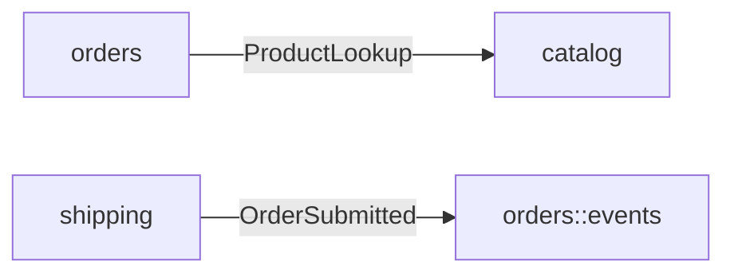
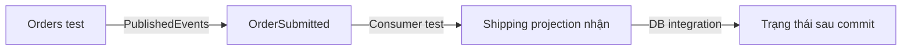
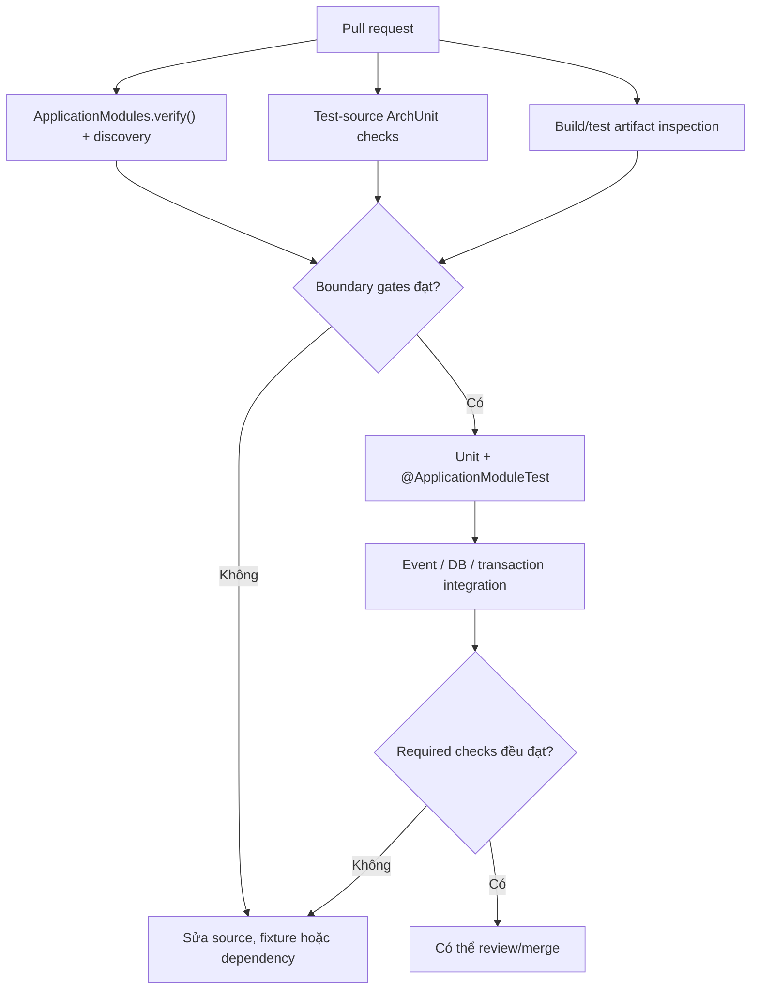

# Giữ test không tạo đường tắt kiến trúc

**Test không được trở thành một “cửa sau” làm mất ý nghĩa của ranh giới module.** Một test có thể rất nhanh và luôn xanh vì nó tạo trực tiếp entity của module khác, import repository nội bộ, kéo bean ngoài module bằng `@Import` hoặc giả lập toàn bộ những bước đáng lẽ cần tích hợp thật. Những kỹ thuật đó đôi khi giúp viết assertion thuận tiện hơn, nhưng có thể khiến **mô hình module được kiểm chứng khác với đường đi mà test thực sự sử dụng**.

Trong chương **Module boundaries** của **SPRING_MODULITH_VERIFICATION_TESTING**, mục tiêu không phải cấm mock, fake, SQL fixture hay unit test nội bộ. Mục tiêu là **chọn đúng đường đi** cho mỗi loại kiểm thử, giữ module owner và public API rõ ràng, rồi có phép kiểm tra chứng minh những ranh giới đó chưa bị vô tình vượt qua.

Trả lời trực tiếp cho câu hỏi “làm sao giữ test không tạo đường tắt kiến trúc?”:

1. **Test module khác qua hợp đồng được công bố**, không qua repository/entity/implementation `internal`.
2. **Giữ fixture và fake ở test scope**, không thay đổi public API production cho tiện test.
3. **Cho phép test của chính module sở hữu biết nội bộ của nó**, nhưng không mở quyền ấy cho test của module khác.
4. **Không để mock hoặc cấu hình test thay thế bằng chứng tích hợp** khi mục tiêu đòi bean thật, database, event handling hay commit.
5. **Bảo vệ hai phía bằng phép kiểm tra độc lập**: `ApplicationModules.verify()` cho module graph production; rule test-source, artifact check và integration tests cho các đường tắt mà `verify()` không nhất thiết phát hiện.

## 1. Một “đường tắt” trong test được hiểu chính xác là gì?

Một test tạo đường tắt khi nó **đi vòng qua giao diện hoặc điều kiện quan trọng của hệ thống** mà vẫn đưa ra kết luận rằng giao diện/điều kiện ấy hoạt động.

Ví dụ, bài test shipping muốn chứng minh có thể xử lý sự kiện đặt hàng nhưng lại tự tạo `orders.internal.OrderEntity` và ghi `orders.internal.OrderRepository`. Test đã biết cấu trúc lưu trữ nội bộ của orders dù chỉ cần event contract.

Hoặc bài test integration muốn chứng minh “orders phối hợp với catalog thật”, nhưng dùng `@MockitoBean ProductLookup`, rồi khẳng định cả tích hợp catalog đã được kiểm tra. Khi đó mock hợp lệ về mặt kỹ thuật, **nhưng kết luận sai về phạm vi**.

### 1.1. Ma trận phát hiện đường tắt

| Mẫu trong test | Vì sao dễ sai? | Hướng sửa và bằng chứng |
|---|---|---|
| Module A test import `B.internal.*` | Coupling với implementation B | Dùng public API/event; thêm test-source dependency rule |
| `@Import(BInternalService.class)` vào A module test | Kéo bean ngoài phạm vi bằng tay | Mock public port hoặc test collaboration có phạm vi minh bạch |
| Test fake `@Component` dưới `src/main` | Fake có thể lọt runtime production | Dùng `@TestConfiguration`/test source; kiểm artifact |
| Ghi thẳng bảng do module khác sở hữu | Bỏ qua invariant và public use case | Seed theo owner, dùng use case hoặc ghi rõ ngoại lệ integration |
| Mock repository trong bài test tuyên bố “DB đã commit” | Chưa đi qua database/transaction thật | DB integration với commit và assertion cuối |
| Mock event publisher rồi khẳng định listener đã chạy | Chỉ chứng minh lời gọi mock | `PublishedEvents` và consumer test riêng |
| Dùng `@SpringBootTest` cho mọi module test | Che ranh giới context và dependency thiếu | `@ApplicationModuleTest` đúng module/mode |
| `@ApplicationModuleTest(ALL_DEPENDENCIES)` để “hết lỗi” | Context phình to, có thể che mục tiêu | Xác định dependency/fixture đúng, giữ test cô lập khi cần |
| Dùng reflection gọi class nội bộ B | Tránh import nhưng vẫn phá ownership | Public API/contract hoặc test riêng của B |
| Shared helper `createEverything()` | Che setup, side effect và transaction | Tách Arrange–Act–Assert, đặt helper theo owner |

Không phải mọi dòng ở cột đầu đều bị cấm trong mọi tình huống. **Khi kiểm thử implementation của chính module sở hữu**, truy cập internal là bình thường. Điểm cần xét là **owner, mục tiêu test và bằng chứng được tuyên bố**.

## 2. Tiêu chí quyết định: test đang bảo vệ hợp đồng của ai?

Trước khi viết test, xác định **module subject under test** và collaborator.

Giả sử modular monolith có ba module:

- `catalog`: quản lý dữ liệu sản phẩm, công bố `ProductLookup`.
- `orders`: tiếp nhận đơn qua `PlaceOrder`, gọi `catalog.ProductLookup`, phát `OrderSubmitted`.
- `shipping`: tiêu thụ `OrderSubmitted` và duy trì trạng thái riêng.

Đồ thị type dependency dự kiến:



**Không** có cạnh `shipping → orders.internal` và **không** có cạnh `orders → shipping`.

Khi review bài test, hãy hỏi:

- Nếu test của **orders** chỉ cần xác minh đơn được tiếp nhận, có cần hiểu bảng sản phẩm của catalog không? **Không**: có thể stub `ProductLookup`.
- Nếu test của **shipping** chỉ cần xác minh nhận event, có cần chạy `PlaceOrder` hoặc repository orders không? **Không**: có thể publish public event contract.
- Nếu test **collaboration** phải chứng minh catalog adapter thật, có thể mock `ProductLookup` không? **Không**, vì mock sẽ loại bỏ đúng thành phần phải kiểm tra.
- Nếu test **database integration** phải chứng minh commit và unique constraint, có thể dùng projection in-memory không? **Không**.

Đường đi đúng phụ thuộc vào **hợp đồng được kiểm chứng**, không chỉ vào việc test có thể compile và pass.

## 3. Production API tối thiểu để tránh đường tắt

Các đoạn Java bên dưới là một mẫu nhất quán: Java 17+ để dùng `record`, Spring Boot và Spring Modulith phù hợp, JUnit 5 và AssertJ. Ví dụ không lưu đơn vào DB; phần database integration sẽ được phân biệt riêng.

### 3.1. Catalog công bố một hợp đồng đọc

File `src/main/java/com/acme/shop/catalog/ProductLookup.java`:

```java
package com.acme.shop.catalog;

import java.util.UUID;

public interface ProductLookup {
    boolean exists(UUID productId);
}
```

Một implementation JDBC/JPA thuộc `catalog.internal` có thể được tạo riêng trong dự án thật. Test orders **không nên** import implementation ấy chỉ vì muốn chuẩn bị một sản phẩm.

### 3.2. Orders công bố use case và sự kiện

File `orders/PlaceOrder.java`:

```java
package com.acme.shop.orders;

import java.util.UUID;

public interface PlaceOrder {
    UUID place(UUID productId, int quantity);
}
```

File `orders/events/OrderSubmitted.java`:

```java
package com.acme.shop.orders.events;

import java.util.UUID;

public record OrderSubmitted(
    UUID orderId,
    UUID productId,
    int quantity
) {}
```

File `orders/events/package-info.java`:

```java
@org.springframework.modulith.NamedInterface("events")
package com.acme.shop.orders.events;
```

Hợp đồng `OrderSubmitted` có nghĩa **yêu cầu đã vượt validation trong ví dụ**. Nó không mặc định chứng minh đơn đã commit, hàng đã giữ hoặc đã giao.

### 3.3. Quy tắc phụ thuộc của hai module

File `orders/package-info.java`:

```java
@org.springframework.modulith.ApplicationModule(
    allowedDependencies = "catalog"
)
package com.acme.shop.orders;
```

File `shipping/package-info.java`:

```java
@org.springframework.modulith.ApplicationModule(
    allowedDependencies = "orders::events"
)
package com.acme.shop.shipping;
```

Hai annotation xác định **những giao diện được phép dùng**. Không được biến `orders.internal` thành public named interface chỉ để shipping tests thuận tiện.

### 3.4. Implementation thật của orders nằm trong internal

File `orders/internal/DefaultPlaceOrder.java`:

```java
package com.acme.shop.orders.internal;

import com.acme.shop.catalog.ProductLookup;
import com.acme.shop.orders.PlaceOrder;
import com.acme.shop.orders.events.OrderSubmitted;
import java.util.UUID;
import org.springframework.context.ApplicationEventPublisher;
import org.springframework.stereotype.Service;

@Service
class DefaultPlaceOrder implements PlaceOrder {

    private final ProductLookup catalog;
    private final ApplicationEventPublisher publisher;

    DefaultPlaceOrder(
            ProductLookup catalog,
            ApplicationEventPublisher publisher) {
        this.catalog = catalog;
        this.publisher = publisher;
    }

    @Override
    public UUID place(UUID productId, int quantity) {
        if (productId == null || quantity <= 0) {
            throw new IllegalArgumentException("Invalid order item");
        }

        if (!catalog.exists(productId)) {
            throw new IllegalArgumentException("Unknown product");
        }

        UUID orderId = UUID.randomUUID();
        publisher.publishEvent(new OrderSubmitted(
            orderId, productId, quantity
        ));

        return orderId;
    }
}
```

`DefaultPlaceOrder` là **package-private**. Nó dùng public `catalog.ProductLookup`; không cần import `catalog.internal.*` hoặc `shipping.internal.*`.

### 3.5. Layout phân biệt ownership

```text
src/main/java/com/acme/shop
├── ShopApplication.java
├── catalog
│   ├── ProductLookup.java
│   └── internal
│       └── ...                # provider thật của catalog nếu cần
├── orders
│   ├── package-info.java
│   ├── PlaceOrder.java
│   ├── events
│   │   ├── package-info.java
│   │   └── OrderSubmitted.java
│   └── internal
│       └── DefaultPlaceOrder.java
└── shipping
    ├── package-info.java
    ├── ShippingStatus.java
    └── internal
        ├── ShippingProjection.java
        └── OnOrderSubmitted.java

src/test/java/com/acme/shop
├── ModuleArchitectureTests.java
├── ModuleDiscoveryTests.java
├── orders
│   ├── OrdersModuleTests.java
│   └── internal
│       └── DefaultPlaceOrderUnitTests.java
├── shipping
│   └── ShippingModuleTests.java
└── testing
    └── TestSourceBoundaryRules.java
```

Đường dẫn `src/test` khác `src/main` ở **build source set**, nhưng Java package của test có thể tương ứng với package production mà nó kiểm tra.

## 4. Đường tắt 1: test import repository nội bộ module khác

Một mẫu cần tránh ở `shipping` tests:

```java
package com.acme.shop.shipping;

// MÃ MINH HỌA SAI VỀ KIẾN TRÚC.
// Giả định các type nội bộ này có Java public visibility.
import com.acme.shop.orders.internal.OrderEntity;
import com.acme.shop.orders.internal.OrderRepository;

class ShippingSetup {

    // createOrderByWritingOrdersRepository(...)
}
```

Ngay cả khi `OrderEntity` và `OrderRepository` là Java `public`, trong Spring Modulith chúng vẫn có thể là **implementation API của orders**. Test shipping bỗng biết schema và repository mà `shipping` production không được phép sử dụng.

### 4.1. Sửa bằng input contract của shipping

File `src/test/java/com/acme/shop/shipping/ShippingEvents.java`:

```java
package com.acme.shop.shipping;

import com.acme.shop.orders.events.OrderSubmitted;
import java.util.UUID;

// Test-only: tạo public event contract, không truy cập orders.internal.
final class ShippingEvents {

    private ShippingEvents() {}

    static OrderSubmitted submitted(UUID orderId) {
        return new OrderSubmitted(
            orderId,
            UUID.randomUUID(),
            2
        );
    }
}
```

Khi mục tiêu chỉ là **consumer phản ứng với event**, event contract là input đủ. Không phải khởi tạo entity/repository của orders rồi hi vọng event xuất hiện.

### 4.2. Nếu thực sự cần dữ liệu đã commit?

Đó là một **integration test khác**. Khi ấy, hãy gọi public use case của orders và cho transaction commit, hoặc tạo dữ liệu bằng một fixture thuộc owner orders được kiểm soát rõ, rồi quan sát kết quả xuyên module. Đừng đổi tên một test dùng SQL nội bộ thành “module boundary test” chỉ vì nó tạo ra outcome mong muốn.

## 5. Đường tắt 2: @Import kéo internal bean ngoài phạm vi

Giả sử bài test `orders` muốn có dữ liệu catalog thật, nhưng thay vì dùng collaboration test, nó tự import adapter:

```java
package com.acme.shop.orders;

import com.acme.shop.catalog.internal.JdbcProductLookup;
import org.springframework.context.annotation.Import;
import org.springframework.modulith.test.ApplicationModuleTest;

// CỐ TÌNH SAI VỀ Ý ĐỊNH.
// Chỉ compile nếu JdbcProductLookup là Java public.
@ApplicationModuleTest
@Import(JdbcProductLookup.class)
class OrdersWithHiddenCatalogAdapterTests {}
```

Vấn đề:

- Test orders biết implementation nội bộ catalog.
- `@Import` có thể khiến bean ngoài phạm vi xuất hiện mà **module graph production không được sửa đúng cách**.
- Test `STANDALONE` không còn cô lập theo kỳ vọng.
- Khi adapter thêm DataSource/transaction dependency, test phải kéo thêm hạ tầng và khó biết mục tiêu.

### 5.1. Cách đúng nếu chỉ test logic orders

Giữ `@ApplicationModuleTest` STANDALONE và cấp **mock public interface** `ProductLookup`. Test không biết JDBC/JPA adapter.

### 5.2. Cách đúng nếu test collaboration thật

Dùng `DIRECT_DEPENDENCIES` cho orders khi module graph có `orders → catalog`, nạp bean thật theo cơ chế của Spring Modulith Test, cung cấp DB/test infrastructure phù hợp và **không mock đúng collaborator cần kiểm chứng**.

### 5.3. Điểm phân biệt

Cả hai cách đều có giá trị, nhưng phải được đặt tên/báo cáo đúng:

| Test | Collaborator catalog | Có kết luận catalog adapter thật đúng được không? |
|---|---|---|
| Orders isolated module test | `@MockitoBean ProductLookup` | Không |
| Orders with direct dependencies | Bean thật catalog | Có thể, nếu test kích hoạt và assert đủ behavior |
| Orders full system/API test | App và hạ tầng thật cần thiết | Có thể theo phạm vi môi trường/test |
| Orders test tự `@Import` internal adapter | Bean kéo thủ công | Có thể chạy, nhưng test đang che ranh giới/ownership |

## 6. Test module orders không được nới public API vì thiếu bean

Một `@ApplicationModuleTest` STANDALONE có thể thiếu `ProductLookup` vì catalog không được nạp. **Thiếu bean là vấn đề setup TestContext**, không phải lý do để đặt `JdbcProductLookup` ở package root hoặc làm `orders` phụ thuộc `catalog.internal`.

Ví dụ hợp lệ, file `src/test/java/com/acme/shop/orders/OrdersModuleTests.java`:

```java
package com.acme.shop.orders;

import static org.assertj.core.api.Assertions.assertThat;
import static org.assertj.core.api.Assertions.assertThatThrownBy;
import static org.mockito.Mockito.verify;
import static org.mockito.Mockito.verifyNoInteractions;
import static org.mockito.Mockito.when;

import com.acme.shop.catalog.ProductLookup;
import com.acme.shop.orders.events.OrderSubmitted;
import java.util.UUID;
import org.junit.jupiter.api.Test;
import org.springframework.beans.factory.annotation.Autowired;
import org.springframework.modulith.test.ApplicationModuleTest;
import org.springframework.modulith.test.PublishedEvents;
import org.springframework.test.context.bean.override.mockito.MockitoBean;

@ApplicationModuleTest
class OrdersModuleTests {

    @Autowired PlaceOrder orders;

    @MockitoBean ProductLookup catalog;

    @Test
    void acceptsKnownProductAndPublishesEvent(
            PublishedEvents events) {
        UUID productId = UUID.randomUUID();
        when(catalog.exists(productId)).thenReturn(true);

        UUID orderId = orders.place(productId, 2);

        assertThat(events.ofType(OrderSubmitted.class))
            .singleElement()
            .satisfies(event -> {
                assertThat(event.orderId()).isEqualTo(orderId);
                assertThat(event.productId()).isEqualTo(productId);
                assertThat(event.quantity()).isEqualTo(2);
            });

        verify(catalog).exists(productId);
    }

    @Test
    void rejectsUnknownProductWithoutPublishing(
            PublishedEvents events) {
        UUID productId = UUID.randomUUID();
        when(catalog.exists(productId)).thenReturn(false);

        assertThatThrownBy(() -> orders.place(productId, 2))
            .isInstanceOf(IllegalArgumentException.class)
            .hasMessage("Unknown product");

        assertThat(events.ofType(OrderSubmitted.class)).isEmpty();
        verify(catalog).exists(productId);
    }

    @Test
    void invalidQuantityDoesNotTouchCatalog(
            PublishedEvents events) {
        assertThatThrownBy(() ->
            orders.place(UUID.randomUUID(), 0)
        ).isInstanceOf(IllegalArgumentException.class)
         .hasMessage("Invalid order item");

        verifyNoInteractions(catalog);
        assertThat(events.ofType(OrderSubmitted.class)).isEmpty();
    }
}
```

### 6.1. Vì sao test này không đi đường tắt?

- Test gọi **`orders.PlaceOrder` public API**, không instantiate implementation internal.
- Mock nằm ở **`catalog.ProductLookup` public contract**, không mock repository nội bộ.
- Spring khởi tạo bean `DefaultPlaceOrder` thật của orders.
- `PublishedEvents` quan sát event được publish trong context.
- Các assertion khẳng định **behavior orders** với collaborator giả lập, không nói quá thành “catalog tích hợp thành công”.

`@MockitoBean` là API của Spring Framework 6.2+; với tổ hợp Spring Boot cũ cần dùng annotation mock bean được hỗ trợ ở phiên bản đó. `@Mock` thuần Mockito không tự trở thành bean Spring.

### 6.2. Cách test bị mất giá trị

Nếu thay cả `@Autowired PlaceOrder` bằng một Mockito mock rồi stub:

```java
// Test vô ích nếu mục tiêu là chứng minh logic PlaceOrder thật.
@MockitoBean PlaceOrder orders;
```

bài test có thể chỉ xác minh **những gì chính test đã stub**, không còn đi qua implementation cần kiểm tra.

**Chỉ mock ranh giới bên ngoài subject**, không mock chính subject cần bảo vệ.

## 7. Đường tắt 3: chuyển fixture vào src/main để Spring scan

Một class test-only như:

```java
// KHÔNG NÊN đặt trong src/main/java
package com.acme.shop.catalog;

import java.util.UUID;
import org.springframework.stereotype.Component;

@Component
class AlwaysTrueProductLookup implements ProductLookup {

    @Override
    public boolean exists(UUID productId) {
        return true;
    }
}
```

có thể vô tình được Spring scan trong production. Khi có adapter thật, ứng dụng có thể có **hai candidate `ProductLookup`** hoặc tệ hơn, dùng fake trong runtime không mong muốn.

### 7.1. Test-specific bean đúng phạm vi

Thay bằng `@TestConfiguration` nằm ở `src/test` và `@Import` rõ ràng:

```java
package com.acme.shop.orders;

import static org.assertj.core.api.Assertions.assertThat;

import com.acme.shop.catalog.ProductLookup;
import com.acme.shop.orders.events.OrderSubmitted;
import java.util.UUID;
import org.junit.jupiter.api.Test;
import org.springframework.beans.factory.annotation.Autowired;
import org.springframework.boot.test.context.TestConfiguration;
import org.springframework.context.annotation.Bean;
import org.springframework.context.annotation.Import;
import org.springframework.modulith.test.ApplicationModuleTest;
import org.springframework.modulith.test.PublishedEvents;

@ApplicationModuleTest
@Import(OrdersWithFakeCatalogTests.FakeCatalogConfig.class)
class OrdersWithFakeCatalogTests {

    static final UUID KNOWN = UUID.fromString(
        "00000000-0000-0000-0000-000000000001"
    );

    @Autowired PlaceOrder orders;

    @Test
    void publishesUsingTestOnlyCatalog(PublishedEvents events) {
        UUID orderId = orders.place(KNOWN, 2);

        assertThat(events.ofType(OrderSubmitted.class))
            .singleElement()
            .satisfies(event ->
                assertThat(event.orderId()).isEqualTo(orderId));
    }

    @TestConfiguration(proxyBeanMethods = false)
    static class FakeCatalogConfig {

        @Bean
        ProductLookup productLookup() {
            return KNOWN::equals;
        }
    }
}
```

Giới hạn của test này giống test dùng mock: nó **không** kiểm tra catalog adapter thật. Nhưng nó không làm fake rò vào production và không yêu cầu production module công bố thêm API.

### 7.2. Tránh đăng ký cùng lúc nhiều provider không chủ đích

Một context có thể đồng thời có `@MockitoBean ProductLookup`, `@Bean ProductLookup` từ fake và bean catalog thật nếu mode được mở rộng. Điều này dễ gây nhầm override/qualifier hoặc bean ambiguity.

Một bài test nên chủ đích chọn **một chiến lược**: mock/fake để cô lập, hoặc real adapter để tích hợp.

## 8. Đường tắt 4: @SpringBootTest cho mọi module test

`@SpringBootTest` tạo full application context theo cấu hình test. Nó rất hữu ích cho **full-context wiring** và các bài integration, nhưng không phải lựa chọn mặc định nếu mục tiêu là giữ test module cô lập.

Một test:

```java
@SpringBootTest
class OrdersModuleTests {
    // Test sử dụng toàn bộ bean của ứng dụng.
}
```

không tự chứng minh `orders` có thể hoạt động trong phạm vi `STANDALONE` với các contract được kiểm soát. Nó có thể xanh vì provider của catalog, shipping và nhiều module khác đều đang hiện diện.

### 8.1. Chọn phạm vi theo điều phải chứng minh

| Mục tiêu | Chọn phạm vi ban đầu | Lý do |
|---|---|---|
| Logic orders, public contract | `@ApplicationModuleTest` STANDALONE | Dễ thấy collaborator ngoài module |
| Orders với catalog implementation thật | `DIRECT_DEPENDENCIES` | Đúng outgoing dependency orders → catalog |
| Orders với chuỗi dependencies bắc cầu | `ALL_DEPENDENCIES` khi cần | Phạm vi lớn hơn, phải giải thích |
| Wiring Spring toàn ứng dụng | `@SpringBootTest` | Kiểm tra provider và cấu hình thực |
| Transaction/database/event sau commit | Integration test có transaction hạ tầng phù hợp | Context rộng không thay commit assertion |

### 8.2. Bootstrap mode không sửa architecture graph

`ALL_DEPENDENCIES` không làm một import `orders → catalog.internal` trở thành hợp lệ. Nó chỉ chọn module cần nạp vào TestContext. Nếu `ApplicationModules.verify()` báo dependency trái policy, phải sửa **type reference production**, không chuyển mode test để “cho chạy”.

### 8.3. Đừng đánh đồng Spring context xanh với module graph xanh

Một `@SpringBootTest` có thể khởi động bình thường dù production modules tạo **type dependency cycle** chỉ qua DTO/records không phải beans. Cần `verify()` độc lập.

## 9. Test của chính module sở hữu được kiểm tra internal đến đâu?

Không có lý do cấm `orders` kiểm tra implementation của chính nó. Ví dụ `DefaultPlaceOrder` là package-private:

```text
src/main/java/com/acme/shop/orders/internal/DefaultPlaceOrder.java
src/test/java/com/acme/shop/orders/internal/DefaultPlaceOrderUnitTests.java
```

Unit test ở **cùng Java package** có thể gọi constructor package-private mà không cần sửa production visibility:

```java
package com.acme.shop.orders.internal;

import static org.assertj.core.api.Assertions.assertThat;
import static org.mockito.Mockito.mock;
import static org.mockito.Mockito.verify;
import static org.mockito.Mockito.when;

import com.acme.shop.catalog.ProductLookup;
import com.acme.shop.orders.events.OrderSubmitted;
import java.util.UUID;
import org.junit.jupiter.api.Test;
import org.mockito.ArgumentCaptor;
import org.springframework.context.ApplicationEventPublisher;

class DefaultPlaceOrderUnitTests {

    @Test
    void publishesTheExpectedEventToThePublisher() {
        ProductLookup catalog = mock(ProductLookup.class);
        ApplicationEventPublisher publisher =
            mock(ApplicationEventPublisher.class);

        UUID productId = UUID.randomUUID();
        when(catalog.exists(productId)).thenReturn(true);

        DefaultPlaceOrder subject =
            new DefaultPlaceOrder(catalog, publisher);

        UUID orderId = subject.place(productId, 2);

        ArgumentCaptor<OrderSubmitted> captured =
            ArgumentCaptor.forClass(OrderSubmitted.class);
        verify(publisher).publishEvent(captured.capture());

        assertThat(captured.getValue().orderId())
            .isEqualTo(orderId);
        assertThat(captured.getValue().quantity())
            .isEqualTo(2);
    }
}
```

### 9.1. Điểm khác giữa unit test và module test

Unit test này biết internal class **của orders**, không tạo ranh giới xuyên module; nó xác minh lời gọi lên **mock publisher**.

`OrdersModuleTests` ở mục 6 gọi public interface với Spring-managed bean thật và dùng `PublishedEvents`. Hai bài có **mục tiêu khác nhau**.

Đừng mở `DefaultPlaceOrder` thành `public` chỉ vì muốn đặt unit test ở package `com.acme.shop.tests`. Đặt test gần implementation là một lựa chọn ít gây rò rỉ API hơn.

## 10. Test consumer shipping không cần vòng qua orders implementation

Public API quan sát của shipping:

```java
package com.acme.shop.shipping;

import java.util.UUID;

public interface ShippingStatus {
    boolean hasReceived(UUID orderId);
}
```

Projection demo, file `shipping/internal/ShippingProjection.java`:

```java
package com.acme.shop.shipping.internal;

import com.acme.shop.shipping.ShippingStatus;
import java.util.Set;
import java.util.UUID;
import java.util.concurrent.ConcurrentHashMap;
import org.springframework.stereotype.Component;

@Component
class ShippingProjection implements ShippingStatus {

    private final Set<UUID> ids =
        ConcurrentHashMap.newKeySet();

    void record(UUID orderId) {
        ids.add(orderId);
    }

    @Override
    public boolean hasReceived(UUID orderId) {
        return ids.contains(orderId);
    }
}
```

Listener, file `shipping/internal/OnOrderSubmitted.java`:

```java
package com.acme.shop.shipping.internal;

import com.acme.shop.orders.events.OrderSubmitted;
import org.springframework.context.event.EventListener;
import org.springframework.stereotype.Component;

@Component
class OnOrderSubmitted {

    private final ShippingProjection projection;

    OnOrderSubmitted(ShippingProjection projection) {
        this.projection = projection;
    }

    @EventListener
    void on(OrderSubmitted event) {
        projection.record(event.orderId());
    }
}
```

Consumer test thuộc package `shipping`:

```java
package com.acme.shop.shipping;

import static org.assertj.core.api.Assertions.assertThat;

import com.acme.shop.orders.events.OrderSubmitted;
import java.util.UUID;
import org.junit.jupiter.api.Test;
import org.springframework.beans.factory.annotation.Autowired;
import org.springframework.context.ApplicationEventPublisher;
import org.springframework.modulith.test.ApplicationModuleTest;

@ApplicationModuleTest
class ShippingModuleTests {

    @Autowired ApplicationEventPublisher publisher;
    @Autowired ShippingStatus status;

    @Test
    void handlesPublicOrderEventWithoutOrdersRepository() {
        UUID orderId = UUID.randomUUID();

        publisher.publishEvent(new OrderSubmitted(
            orderId, UUID.randomUUID(), 2
        ));

        assertThat(status.hasReceived(orderId)).isTrue();
    }
}
```

Bài test này không import `orders.internal.*` và không inject `PlaceOrder`. Nó kiểm tra **consumer behavior với input contract**.

Điều kiện: `@EventListener` đang được dispatch đồng bộ theo cấu hình Spring mặc định và projection chỉ lưu ID trong memory. Nếu chuyển sang after-commit/async listener, phải thay cách trigger transaction và chờ result.

### 10.1. Tách ba cấp bằng chứng



**Published** không tự chứng minh **Handled**. **Handled in-memory** không chứng minh **Committed**.

Một helper `submitAndAssertShipping()` chạy nhiều bước rồi trả một boolean không nên được dùng để tuyên bố cả ba mức đã được xác minh nếu không có những assertions và transaction boundary rõ ràng.

## 11. Đường tắt 5: thay persistence bằng mock rồi kết luận đã kiểm tra DB

Nếu code production dùng `OrderRepository` của orders, unit/module test có thể mock repository để kiểm tra điều kiện gọi `save(...)`. Nhưng assertion:

```java
verify(repository).save(any());
```

chỉ chứng minh **method trên mock được gọi**, không chứng minh:

- Row được ghi vào database.
- Transaction đã commit.
- Constraint/foreign key/unique index hoạt động.
- Dữ liệu có thể đọc lại từ transaction khác.
- JPA mapping, migration hoặc database-specific behavior đúng.

### 11.1. Khi nào mock repository là hợp lý?

Khi subject là một domain service/branch logic, và lưu dữ liệu là collaborator ngoài phạm vi. Khi ấy đặt tên test theo behavior đang xác minh, ví dụ `callsRepositoryForValidOrder`.

### 11.2. Khi nào mock là đường tắt nguy hiểm?

Khi test/công bố chất lượng ghi “đã kiểm tra order persists sau commit”, “đã bảo vệ duplicate” hay “transaction rollback đúng” chỉ dựa trên Mockito interaction. Cần một bài database integration thực tế.

### 11.3. Testcontainers giúp gì?

Testcontainers cho phép chạy database engine phù hợp hơn với môi trường sản xuất, nhưng container chạy không đủ. Test phải thực hiện use case, đi qua commit và assert trạng thái lưu trữ/constraint.

Đừng lấy `@SpringBootTest` hoặc `@DataJpaTest` tự thân làm bằng chứng. Assertion và transaction setup mới quyết định test chứng minh gì.

## 12. Đường tắt 6: fixture ghi thẳng database của module khác

Một test shipping làm:

```sql
-- MẪU DỮ LIỆU MINH HỌA, không phải đề xuất setup mặc định.
INSERT INTO orders_internal_order (id, status)
VALUES ('00000000-0000-0000-0000-000000000001', 'ACCEPTED');
```

dễ đi qua schema/invariant của orders mà không sử dụng public use case. Bản ghi có thể tồn tại nhưng chưa qua validation, event publication hoặc transaction semantics của orders.

### 12.1. Phân biệt ba cấp test data

| Mục tiêu | Cách chuẩn bị phù hợp hơn | Khi nào SQL trực tiếp có thể cần |
|---|---|---|
| Consumer nhận event | Publish public `OrderSubmitted` trực tiếp | Thường không cần |
| Collaboration orders–catalog | Gọi public use case/fixture provider có owner | Khi cần DB trạng thái đặc thù, ghi rõ |
| Persistence/migration/constraint | Tạo dữ liệu trong test thuộc module sở hữu và assert DB | Có thể hợp lý |
| System workflow xuyên modules | Gọi entrypoint/API như production | Có thể seed nền nếu có cleanup và justification |

**Không cấm SQL trong mọi test.** Nhưng SQL xuyên schema/module là một dependency ngoài type graph; nó có thể không bị `ApplicationModules.verify()` phát hiện. Cần review ownership, migration contract và tác động khi schema thay đổi.

### 12.2. Ngoại lệ phải ghi rõ

Nếu một integration test thực sự cần seeding database của nhiều module, hãy ghi:

- Vì sao public API không đủ.
- Bảng nào thuộc module nào.
- Dữ liệu seed có tôn trọng invariant tối thiểu không.
- Transaction/commit/cleanup xử lý thế nào.
- Ai cập nhật fixture khi schema của provider thay đổi.
- Test không được dùng để chứng minh những behavior đã bị seed bỏ qua.

## 13. Đường tắt 7: reflection, string bean lookup và component scan

Không chỉ import Java trực tiếp mới tạo coupling.

Ví dụ:

```java
// MÃ CẦN XEM XÉT: tránh type import nhưng vẫn biết tên nội bộ.
Class<?> type = Class.forName(
    "com.acme.shop.orders.internal.DefaultPlaceOrder"
);
```

Hoặc:

```java
Object bean = context.getBean("defaultPlaceOrder");
```

Một test shipping làm như vậy vẫn phụ thuộc implementation orders, dù rule static type dependency có thể không nhìn thấy quan hệ chuỗi/reflection ấy.

Tương tự, một `@ComponentScan("com.acme.shop")` hay `@Import` quá rộng trong test module có thể kéo vào context những bean không thuộc phạm vi mong muốn.

### 13.1. Khi nào dùng reflection vẫn hợp lý?

Framework/library tests, serialization compatibility, migration hoặc các bài kiểm tra vận hành đặc biệt có thể dùng reflection có chủ đích. Nhưng phải ghi rõ **mục tiêu**, **scope** và **owner**, không dùng nó như cách thông thường để vượt public API module khác.

### 13.2. Quy tắc review thực tế

Tìm các dấu hiệu:

- `Class.forName("...internal...")`.
- `getBean("name")` theo tên implementation của module khác.
- `@Import` nội bộ module khác.
- `@ComponentScan` trong test khiến phạm vi nạp rộng bất ngờ.
- Test helper gọi phương thức reflection `setAccessible(true)` để sửa state module khác.
- SQL đụng bảng do module khác sở hữu.

Không chỉ dựa vào `verify()` cho các liên kết động này.

## 14. Architecture test bảo vệ code production

File `src/test/java/com/acme/shop/ModuleArchitectureTests.java`:

```java
package com.acme.shop;

import org.junit.jupiter.api.Test;
import org.springframework.modulith.core.ApplicationModules;

class ModuleArchitectureTests {

    @Test
    void verifiesProductionModuleBoundaries() {
        ApplicationModules.of(ShopApplication.class).verify();
    }
}
```

App root:

```java
package com.acme.shop;

import org.springframework.boot.SpringApplication;
import org.springframework.boot.autoconfigure.SpringBootApplication;

@SpringBootApplication
public class ShopApplication {

    public static void main(String[] args) {
        SpringApplication.run(ShopApplication.class, args);
    }
}
```

`verify()` kiểm tra những quy tắc Spring Modulith hỗ trợ trên application module model, thường gồm module cycles, truy cập implementation/internal API và `allowedDependencies`.

### 14.1. Kiểm tra model scope để tránh “PASS giả”

```java
package com.acme.shop;

import static org.assertj.core.api.Assertions.assertThat;

import org.junit.jupiter.api.Test;
import org.springframework.modulith.core.ApplicationModules;

class ModuleDiscoveryTests {

    @Test
    void discoversAllExpectedModules() {
        ApplicationModules modules =
            ApplicationModules.of(ShopApplication.class);

        assertThat(modules.getModuleByName("catalog")).isPresent();
        assertThat(modules.getModuleByName("orders")).isPresent();
        assertThat(modules.getModuleByName("shipping")).isPresent();
    }
}
```

Nếu `ShopApplication` đặt sai package hay module detection đã tùy biến, `verify()` trên mô hình thiếu module cần bảo vệ không đủ bằng chứng. Test discovery giúp nhận ra rủi ro đó.

### 14.2. Phép thử âm tính phát hiện internal production dependency

Trên nhánh thử:

1. Tạo Java `public` type trong `catalog.internal`.
2. Cho class **production** của `orders` dùng type đó ở field/constructor/method signature.
3. Chạy `ModuleArchitectureTests`, kỳ vọng bị báo vi phạm.
4. Bỏ dependency trái policy và dùng `catalog.ProductLookup`.
5. Chạy lại `verify()`.

Chỉ thêm import không sử dụng có thể không tạo dependency mà class-file analysis nhận diện. Cần một tham chiếu type thực sự, và **không giữ mã vi phạm** ở nhánh chính.

## 15. Vì sao verify() không đủ để kiểm tra đường tắt trong test source?

Trong một ứng dụng có:

```text
src/main/java:
  shipping --> orders::events

src/test/java:
  ShippingTest --> orders.internal.OrderEntity
```

`ApplicationModules.verify()` thường hướng vào module model/production type dependencies. **Không nên mặc định** mọi class trong `src/test` và mọi reflective/SQL dependency đều được phân tích với cùng chính sách.

Để ngăn cross-module internal imports ở test source, hãy bổ sung **test-only architecture rule** có phạm vi được xác minh.

### 15.1. Một ArchUnit rule dành riêng cho test classes

Ví dụ dùng ArchUnit core, chạy từ JUnit 5:

```java
package com.acme.shop.testing;

import static com.tngtech.archunit.lang.syntax.ArchRuleDefinition.noClasses;

import com.tngtech.archunit.core.domain.JavaClasses;
import com.tngtech.archunit.core.importer.ClassFileImporter;
import com.tngtech.archunit.core.importer.ImportOption;
import org.junit.jupiter.api.Test;

class TestSourceBoundaryRules {

    @Test
    void shippingTestsMustNotDependOnOrdersInternals() {
        JavaClasses testClasses = new ClassFileImporter()
            .withImportOption(new ImportOption.OnlyIncludeTests())
            .importPackages("com.acme.shop");

        noClasses()
            .that().resideInAPackage("com.acme.shop.shipping..")
            .should().dependOnClassesThat()
                .resideInAPackage("com.acme.shop.orders.internal..")
            .check(testClasses);
    }
}
```

**Điểm cần xác nhận:** `OnlyIncludeTests` nhận diện vị trí class file theo convention của ArchUnit; với source layout/classpath tùy biến, phải kiểm tra rằng importer thật sự nhập đúng test classes và helpers. Thử âm tính ở mục 15.2 quan trọng hơn việc chỉ thấy JUnit test xanh.

### 15.2. Thử âm tính cho test-source rule

1. Thêm một **type reference thực sự** từ shipping test tới `orders.internal.SomePublicInternalType`, với type giả định có Java public visibility để test có thể compile.
2. Chạy riêng `TestSourceBoundaryRules`.
3. Xác nhận rule đỏ và chỉ ra cạnh trái policy.
4. Gỡ reference, chạy lại rule xanh.

Nếu importer không đọc lớp test mới, rule có thể “xanh giả”. Phải kiểm tra điều kiện nhập classes; có thể thêm assertion số classes hoặc một canary cụ thể phù hợp build.

### 15.3. Đừng áp rule quá rộng

Một unit test `orders.internal.DefaultPlaceOrderUnitTests` **được phép** truy cập class internal của **chính orders**. Rule cần phân biệt **cross-module violation**, không cấm mọi package có tên `internal`.

### 15.4. ArchUnit cũng không phát hiện hết coupling động

SQL, reflection và chuỗi bean name cần review/test hoặc rule khác. Đừng ghi “test-source boundary đã được bảo vệ toàn diện” chỉ vì ArchUnit compile thành công.

## 16. Đường tắt 8: shared test utility che quyền sở hữu

Một helper chung như:

```text
src/test/java/com/acme/shop/testing/ShopTestUtils.java

createProduct()
saveOrderByRepository()
createShipment()
publishEvent()
waitForProcessing()
assertAllDatabaseRows()
```

có thể làm mọi test tiện, nhưng cũng khiến test của mỗi module không còn phân biệt rõ:

- Dữ liệu được tạo qua public API hay repository nội bộ?
- Transaction của use case có được commit không?
- Event được publish thật hay mock?
- Consumer chạy thật hay helper tự ghi trực tiếp kết quả?
- Assertion nào thuộc producer, consumer hay DB?

### 16.1. Tách utility theo owner và contract

| Nhu cầu | Nơi đặt nên ưu tiên | Public surface |
|---|---|---|
| Sample input của orders | `orders` test source | `UUID`, quantity và public request types |
| Sample `OrderSubmitted` cho shipping | `shipping` test source | `orders::events` |
| Factory cho JPA entity catalog | `catalog.internal` test source | Internal của chính owner |
| PostgreSQL Testcontainers config | Integration-test infrastructure | Chỉ quản lý hạ tầng |
| Data setup xuyên modules | Integration test riêng có owner | Ghi rõ public API/ngoại lệ DB |
| Assertions cho HTTP flow | System/API test helpers | Kết quả quan sát qua public endpoint |

Không nhất thiết phải chia sẻ factory chỉ vì hai tests lặp vài dòng `new OrderSubmitted(...)`. Một abstraction chung có chi phí coupling và ownership.

### 16.2. Test-only artifact không phải public production module API

Nếu nhiều Gradle projects thực sự cần shared contract fixture, `java-test-fixtures` có thể xuất bản test variant riêng; nhưng đó là **build-level sharing**, không tự cho phép test của module khác import implementation production.

Với một Gradle project duy nhất chứa nhiều Spring Modulith application modules, dùng `src/test` cục bộ có thể đủ.

## 17. Đường tắt 9: test cô lập nhưng báo cáo như integration test

Đây không phải lỗi cú pháp, mà là lỗi **kết luận chất lượng**.

| Test được chạy | Bằng chứng đạt | Kết luận không được viết |
|---|---|---|
| Mockito unit test | Method gọi mock đúng | “Persistence đã commit” |
| Orders `@ApplicationModuleTest` với `@MockitoBean ProductLookup` | Logic orders và published event | “Catalog adapter tích hợp thật” |
| Shipping module test với projection in-memory | Listener xử lý event input | “Shipment được lưu DB” |
| `@SpringBootTest` contextLoads | Cấu hình đủ để boot context đó | “Module dependency graph không có cycle” |
| `ApplicationModules.verify()` | Những rule kiến trúc được phân tích đạt | “Event và DB behavior đúng” |
| Testcontainers container-start test | Hạ tầng container sẵn sàng | “Migration, constraint, transaction đều đúng” |

### 17.1. Viết tên test thể hiện đúng hợp đồng

Tên rõ:

- `publishesOrderSubmittedForKnownProduct`.
- `doesNotPublishForUnknownProduct`.
- `shippingHandlesOrderSubmitted`.
- `reservationIsUniqueAfterDuplicateDelivery`.
- `orderWriteCommitsBeforeAfterCommitListenerProcesses`.

Tên mơ hồ:

- `works`.
- `endToEndSuccess` khi tất cả downstream đều mock.
- `savesOrder` khi chỉ `verify(repository).save(...)`.
- `allModulesValid` khi chỉ có `@SpringBootTest`.

Mỗi tên tốt cho thấy **đường đi và kết quả** được kiểm tra.

## 18. Đường tắt 10: @Transactional test che ranh giới commit

Trong Spring Test, một method test có `@Transactional` thường chạy trong transaction test được rollback sau method. Nếu production listener dùng `@TransactionalEventListener(AFTER_COMMIT)` hoặc `@ApplicationModuleListener`, nó có thể không chạy như kỳ vọng vì **producer/test chưa đi qua commit phù hợp**.

Test có thể sai ở hai hướng:

- **Xanh giả:** assert entity còn trong persistence context rồi khẳng định đã commit.
- **Đỏ giả:** mong after-commit listener chạy dù test transaction không commit.

### 18.1. Checklist khi test sau commit

1. Xác định transaction của **use case production** và transaction do **test** tạo.
2. Dùng dữ liệu riêng và cho đường đi **commit thật** khi hợp đồng yêu cầu.
3. Với listener async, chờ **điều kiện quan sát** thay vì ngủ cố định.
4. Đọc dữ liệu từ transaction/context thích hợp sau commit.
5. Test rollback không sinh side effect trái hợp đồng.
6. Khi retry/replay, assert idempotency bằng **kết quả bền vững**, không chỉ boolean.
7. Nếu dùng event publication registry, kiểm tra chính sách xử lý publication chưa hoàn tất theo phiên bản/cấu hình cụ thể.

### 18.2. Không gọi mọi event listener là bất đồng bộ

`@EventListener` với Spring event multicaster mặc định thường đồng bộ khi publish. `@TransactionalEventListener(AFTER_COMMIT)` và `@ApplicationModuleListener` có ngữ nghĩa transaction/async khác.

Đổi annotation có thể giữ nguyên **module dependency graph** nhưng làm runtime behavior thay đổi. Vì vậy `verify()` không thể thay thế event/transaction integration tests.

## 19. Mẫu kiểm thử idempotency không đi đường tắt

Một event có thể được xử lý nhiều lần. Không được kết luận “idempotent” chỉ vì projection dùng `Set` và `hasReceived(orderId)` trả `true` sau hai lần publish.

Giả sử một reservation/shipment cần chỉ tạo **một record** cho mỗi order:

```sql
CREATE TABLE shipping_request (
    request_id UUID PRIMARY KEY,
    order_id UUID NOT NULL,
    status VARCHAR(30) NOT NULL,
    CONSTRAINT uq_shipping_request_order UNIQUE (order_id)
);
```

Đây là **schema minh họa**, giả định một shipping request cho mỗi order. Một domain có nhiều gói hàng/shipments cần khóa khác.

### 19.1. Một integration test hợp lệ phải có gì?

- Gửi cùng event với một `orderId` nhiều lần, đúng cơ chế listener cần test.
- Chờ xử lý nếu async.
- Đảm bảo các transaction liên quan đã hoàn tất.
- Đọc lại bảng từ một context phù hợp.
- Assert số record và trạng thái nghiệp vụ, không chỉ `boolean seen`.
- Test race/concurrency nếu có nhiều worker.
- Dọn dữ liệu, không dựa vào test order.

Nếu chỉ mock repository và verify `save` một lần, bạn mới kiểm tra **lời gọi trong một execution path được mock**, không chứng minh atomicity/unique constraint trước các lần delivery trùng.

## 20. Bảng quyết định: khi nào được mock, khi nào phải dùng thật?

| Thành phần | Unit test nội bộ | Module test STANDALONE | Collaboration/integration |
|---|---|---|---|
| Subject logic chính | Thật | Thật | Thật |
| Public port của module ngoài | Mock/fake thường hợp lý | `@MockitoBean`/fake hợp lý | Bean thật nếu đang kiểm tra tích hợp |
| Implementation internal của module ngoài | Không nên import | Không nên `@Import` | Chỉ dùng gián tiếp qua public API/config hợp lệ |
| ApplicationEventPublisher | Mock nếu kiểm lời gọi | Thật khi dùng `PublishedEvents` | Thật |
| Database repository | Có thể mock | Tùy mục tiêu | Thật nếu kiểm DB semantics |
| Transaction/commit | Không áp dụng cho logic thuần | Chưa chắc được kiểm | Phải đi qua commit khi hợp đồng yêu cầu |
| Async listener | Có thể test handler logic trực tiếp | Test module với setup tương ứng | Chờ kết quả quan sát được |
| Consumer downstream | Không cần | Không mặc định nạp | Có khi cần theo luồng |

Đây là một **ma trận lựa chọn theo mục tiêu**, không phải bảng xếp hạng test tốt/xấu. Một test dùng nhiều mock vẫn có giá trị nếu báo cáo đúng điều nó kiểm.

## 21. CI quality gate ngăn đường tắt tái xuất hiện

Đừng chỉ dừng ở code review: nhiều đường tắt có thể được chặn bằng quy tắc tự động.



**Ba kiểu gate khác nhau:**

- **Module architecture gate:** chặn vi phạm code production: cycle, `internal`, `allowedDependencies`.
- **Test/source-set hygiene gate:** chặn fixture test cross-module internal imports, fake lọt production artifact, hoặc config test rò vào runtime.
- **Behavior/integration gate:** chặn mock/fixture làm test mất bằng chứng cần có, dựa trên các assertion/coverage test cụ thể.

### 21.1. Lệnh kiểm tra thường gặp

```bash
# Chạy architecture test riêng nếu build dùng Surefire/JUnit theo cấu hình này.
./mvnw -Dtest=ModuleArchitectureTests test

# Chạy toàn bộ lifecycle tới verify theo cấu hình Maven hiện tại.
./mvnw verify

# Gradle: chọn riêng architecture test.
./gradlew test --tests "com.acme.shop.ModuleArchitectureTests"

# Gradle: chạy task test được cấu hình.
./gradlew test
```

Những lệnh trên **không phải kết quả đã chạy** cho bài này. Build thực có thể có profile/Failsafe, Gradle `integrationTest` task và container service riêng. CI cần kiểm tra chính xác nhóm test bắt buộc có thực sự được chạy và không bị skip.

### 21.2. Artifact/source-set check

Sau khi build production artifact, kiểm:

- Có `OrdersModuleTests.class` hay `ShippingEvents.class` trong JAR không?
- Có `FakeCatalogConfig.class` hoặc SQL test data bị copy vào runtime artifact không?
- Dependencies test-only có bị khai báo nhầm `implementation`/runtime scope không?
- Production có `@Component` fake nào được tạo chỉ để test pass không?
- Test source có dùng `B.internal` xuyên module, và rule đã quét đúng lớp đó chưa?

Ví dụ kiểm tra thủ công một JAR đã có:

```bash
# Thay đường dẫn theo output build của dự án thực.
jar tf build/libs/shop.jar
```

`ApplicationModules.verify()` không tự chứng minh test class không bị đóng gói vào production. Đây là một câu hỏi khác.

## 22. Thử âm tính: làm test đỏ đúng nguyên nhân

Một quality gate chỉ đáng tin khi biết **nó thật sự bắt được lỗi mục tiêu**.

| Thử nghiệm trên nhánh tạm | Gate phải đỏ | Điều cần xác nhận |
|---|---|---|
| Production orders import `catalog.internal` type dùng thật | `verify()` | Bộ phân tích thấy dependency |
| Shipping test tham chiếu `orders.internal` type | Test-source ArchUnit rule | Importer đã nhập đúng test classes |
| Fake test bean bị chuyển vào `src/main` | Build/artifact policy | Có rule/kiểm artifact thực |
| `DefaultPlaceOrder` publish quantity sai | `PublishedEvents` test | Test assert payload chứ không chỉ event tồn tại |
| Bỏ `OnOrderSubmitted` listener | Shipping module test | Test assert consumer effect |
| Thay bean catalog thật bằng mock trong collaboration test | Collaboration test review/gate | Contract thực có còn được kiểm không |
| Producer rollback nhưng consumer sau commit vẫn tạo side effect | Transaction/event integration | Test quan sát dữ liệu sau rollback |
| Duplicate event tạo hai shipping rows | DB idempotency test | Constraint/assertion nhận ra tác dụng trùng |

**Không duy trì những vi phạm này trong main branch.** Sau khi chứng minh gate đỏ, hoàn nguyên, chạy lại và ghi kết quả cho commit cần merge.

### 22.1. Một lỗi phổ biến: test bị skip vẫn làm pipeline xanh

Nếu test-source rule hoặc DB integration test đã bị `@Disabled`, exclude khỏi Maven/Gradle task hoặc không có required check, pipeline xanh **không** có nghĩa đường tắt đã được chặn.

Báo cáo chất lượng cần ghi **test count, failed, skipped, commit SHA và phạm vi môi trường**.

## 23. Checklist review một PR có thêm test hoặc fixture

Dùng bảng này trực tiếp trong code review. Cột “bằng chứng” yêu cầu người viết chỉ ra test hoặc kiểm tra thực tế, không chỉ trả lời “đã xem”.

| # | Câu hỏi | Bằng chứng mong đợi |
|---|---|---|
| 1 | Test đang kiểm tra module nào và hợp đồng gì? | Tên test, public API hoặc internal owner |
| 2 | Có import `<module-khác>.internal` không? | Diff và test-source rule |
| 3 | Test có dùng reflection/bean name để gọi internal class không? | Review chuỗi, `@Import`, component scans |
| 4 | `@ApplicationModuleTest` có đặt trong package module phù hợp không? | Package declaration, bootstrap scope |
| 5 | Mode STANDALONE/DIRECT/ALL được chọn vì mục tiêu gì? | Lý do collaborator thật/mock |
| 6 | `@MockitoBean` có mock đúng collaborator, không mock subject không? | Bean wiring trong test |
| 7 | Fake/fixture có nằm ở test scope không? | Source set/build/artifact |
| 8 | Có class/entity/repository bị chuyển sang public chỉ để test không? | Diff production API |
| 9 | Event test assert số lượng, type và payload không? | `PublishedEvents` assertions |
| 10 | Consumer test có đi qua public event contract không? | Import và input path |
| 11 | Test tuyên bố database đã commit có DB thật/commit assertion không? | Integration test + dữ liệu cuối |
| 12 | Retry/idempotency có kiểm bằng business effect không? | Constraint, row count, state sau xử lý |
| 13 | `ApplicationModules.verify()` và discovery đã chạy không? | CI test report |
| 14 | Test source và artifact boundary checks đã chạy không? | Rule result, JAR inspection |
| 15 | Có thử âm tính phù hợp với gate mới không? | Kết quả đỏ–xanh trên nhánh thử |
| 16 | Có test nào bị skip hoặc chạy khác commit không? | Required checks trên revision hiện tại |

**Tiêu chí review:** không nhất thiết có mọi loại test cho mọi thay đổi. Nhưng mọi kết luận quan trọng trong PR phải có **đường đi và phép đo tương ứng**, không đi vòng qua chính hợp đồng nó tuyên bố kiểm tra.

## 24. Một quy trình sửa test “đi tắt” không mất coverage

Khi phát hiện test đang import internal module khác, đừng xóa ngay toàn bộ test hoặc thay mọi thứ bằng mock. Làm theo thứ tự:

1. **Ghi lại behavior gốc**: test hiện đang chứng minh gì? Assertion nào thực sự đáng giữ?
2. **Xác định owner** của mỗi type/repository/data fixture.
3. **Vẽ đường đi production hợp lệ** từ input đến outcome.
4. **Tách test theo mục tiêu** nếu bài cũ vừa kiểm producer, consumer vừa đọc DB.
5. **Đổi setup** sang public API, event contract hoặc fixture của module owner.
6. **Giữ unit test nội bộ** ở test source của module sở hữu nếu cần kiểm chi tiết.
7. **Viết module test** dùng `@MockitoBean`/fake cho collaborator ngoài phạm vi.
8. **Bổ sung collaboration test thật** nếu hợp đồng cần provider thật hoặc database.
9. **Đặt rule chặn đường tắt**: `verify()` cho main, test-source rule cho tests, artifact check cho packaging.
10. **Thử red–green**, khôi phục code đúng và kiểm đủ required checks.

Đây là refactor **đường đi kiểm chứng**, không phải chỉ đổi import để bộ linter xanh. Nếu test không còn kích hoạt behavior cần thiết sau khi sửa, phải thêm test thay thế.

## 25. Bài tập thực hành: chặn đường tắt xuyên module

**Bối cảnh:** nhóm có Spring Boot application gồm `catalog`, `orders` và `shipping`. Test shipping đang dùng `orders.internal.OrderRepository` để dựng đơn hàng; test orders tự import `catalog.internal.JdbcProductLookup`; một `FakeCatalog` được đặt trong production main source.

### Phần A — Chỉ ra từng đường tắt

1. Viết graph production dự kiến `orders → catalog` và `shipping → orders::events`.
2. Liệt kê những import nội bộ trong test.
3. Phân loại helper theo owner module và source set.
4. Đánh dấu các class production bị chuyển thành `public` chỉ để test gọi được.
5. Xác định kết luận nào chỉ dựa vào mock nhưng lại được mô tả như integration.

### Phần B — Tạo hợp đồng đúng

1. Tạo `catalog.ProductLookup` ở API root.
2. Tạo `orders.PlaceOrder` và implementation package-private `DefaultPlaceOrder`.
3. Tạo `orders.events.OrderSubmitted` và `@NamedInterface("events")`.
4. Khai báo `orders` được phép dùng `catalog` và `shipping` chỉ được dùng `orders::events`.
5. Viết `ModuleArchitectureTests` và `ModuleDiscoveryTests`.

### Phần C — Sửa module tests

1. Viết `OrdersModuleTests` ở `com.acme.shop.orders` với `@MockitoBean ProductLookup`.
2. Assert `PublishedEvents` có đúng một `OrderSubmitted` và payload đúng.
3. Viết negative tests cho product không tồn tại, quantity bằng 0.
4. Viết unit test nội bộ ở `orders.internal` gọi package-private implementation.
5. Không đưa `JdbcProductLookup` vào context qua `@Import` nếu mục tiêu là isolated logic.
6. Nếu muốn test provider thật, tạo collaboration test có mode/hạ tầng riêng.

### Phần D — Sửa consumer và fixture

1. Viết `ShippingEvents.submitted(orderId)` trong shipping test source.
2. Viết `ShippingModuleTests` phát event đầu vào và assert `ShippingStatus`.
3. Bỏ mọi import `orders.internal` khỏi shipping tests.
4. Nếu test DB thật, tạo integration test riêng và assert trạng thái sau commit.
5. Không coi boolean projection in-memory là bằng chứng idempotency bền vững.

### Phần E — Bảo vệ ranh giới bằng gate

1. Chạy `ApplicationModules.verify()` trên production modules.
2. Thêm ArchUnit test-source rule chặn shipping tests → orders internal.
3. Thử một type reference cố tình sai trong shipping test để kiểm importer/rule báo đỏ.
4. Đưa `FakeCatalog` ra khỏi production main source; dùng `@TestConfiguration` hoặc mock.
5. Kiểm production artifact không chứa fake/test config.
6. Gây lỗi event payload để producer test đỏ; bỏ listener để consumer test đỏ.
7. Hoàn nguyên các lỗi, chạy required checks trên commit cần merge.
8. Báo cáo bằng chứng: từng rule/test, số đã chạy/skipped, môi trường và các giới hạn.

**Kết quả mong đợi:** không có cross-module internal access trong production hoặc test theo policy, fixture không rò vào runtime, module tests chỉ mock collaborator thật sự ở ngoài scope, integration tests giữ được bằng chứng của provider/DB và CI bắt được hồi quy.

## 26. Câu hỏi ôn tập

**1. Test của `shipping` import Java `public` class trong `orders.internal` có hợp lệ vì Java compiler cho phép không?**

Không thể kết luận chỉ từ Java visibility. Test đang phụ thuộc implementation của module khác; cần tuân thủ boundary policy và nên dùng public/named interface.

**2. Khi nào unit test được dùng implementation internal?**

Khi đó là implementation **do chính module được kiểm tra sở hữu**, thường test nằm cùng Java package để truy cập package-private constructor/class.

**3. Vì sao `@Import(catalog.internal.JdbcProductLookup.class)` có thể là đường tắt?**

Vì kéo implementation module ngoài vào test context và làm test phụ thuộc chi tiết catalog thay vì hợp đồng `ProductLookup`.

**4. `@MockitoBean ProductLookup` trong orders STANDALONE có hợp lệ không?**

Có khi mục tiêu là kiểm tra logic orders với catalog collaborator giả lập. Nhưng không được tuyên bố đã kiểm tra catalog implementation thật.

**5. Vì sao không mock chính `PlaceOrder` trong module test của orders?**

Vì như vậy không còn chạy implementation cần kiểm tra; assertion có thể chỉ kiểm lại những gì test đã stub.

**6. `@TestConfiguration` có tác dụng gì?**

Nó cho phép đăng ký bean test-only có chủ đích, không buộc đưa fake `@Component` vào `src/main`.

**7. `@SpringBootTest` xanh có chứng minh module graph tuân thủ `allowedDependencies` không?**

Không. Cần `ApplicationModules.verify()` độc lập.

**8. `verify()` có mặc nhiên kiểm mọi class thuộc `src/test` không?**

Không nên giả định. Phải kiểm scope và bổ sung test-source rule nếu muốn chặn cross-module internal imports.

**9. Vì sao không nên dùng reflection để gọi bean nội bộ module khác?**

Nó vẫn tạo coupling với implementation, chỉ chuyển từ dependency type rõ ràng sang dependency động khó phát hiện.

**10. `PublishedEvents` chứng minh được gì?**

Producer đã publish event được assert về type, số lượng và payload trong test context; nó không tự chứng minh consumer đã xử lý hay database commit.

**11. Khi nào dùng `DIRECT_DEPENDENCIES`?**

Khi cần bean thật của dependency module trực tiếp và muốn kiểm collaboration; không dùng như cách che một dependency production trái policy.

**12. Vì sao hai lần publish và một boolean `hasReceived` không đủ chứng minh idempotency?**

Vì hai side effects sai vẫn có thể cùng dẫn đến boolean `true`; cần assert dữ liệu/tác dụng bền vững và constraint.

**13. Testcontainers giúp chặn đường tắt gì?**

Nó giúp cung cấp hạ tầng DB thật hơn khi cần kiểm persistence/constraint; nhưng test vẫn phải đi qua commit và assert kết quả.

**14. Test-source ArchUnit rule có nên cấm mọi package `internal` không?**

Không. Test của module owner có thể kiểm implementation nội bộ của chính mình; nên chặn **cross-module internal dependencies**.

**15. Vì sao quality gate cần thử âm tính?**

Để chắc chắn rule/test thật sự phát hiện lỗi mong muốn, không chỉ PASS vì importer không thấy class hoặc test bị skip.

## Kết luận

**Giữ test không tạo đường tắt kiến trúc** là giữ **đường kiểm chứng khớp với hợp đồng thật**. Test của module sở hữu có thể biết implementation nội bộ của chính nó; nhưng test của module khác cần ưu tiên public API hoặc named event interface. Mock/fake hợp lệ khi kiểm behavior cô lập, không phải cách thay thế integration evidence. Fixture thuộc test scope, không phải lý do mở public production API hoặc kéo implementation vào TestContext tùy tiện.

Trong **SPRING_MODULITH_VERIFICATION_TESTING**, cách bảo vệ bền vững là kết hợp **`ApplicationModules.verify()`** cho production module graph, **test-source rule** cho dependency xuyên module trong tests, **artifact check** để ngăn fixture rò vào production, **`@ApplicationModuleTest`/`PublishedEvents`** cho behavior và **DB/transaction integration tests** cho kết quả bền vững. Đặt các phép kiểm tra thành **CI quality gate**, thử âm tính cho những đường tắt quan trọng và luôn báo cáo đúng điều mỗi test thực sự chứng minh.
