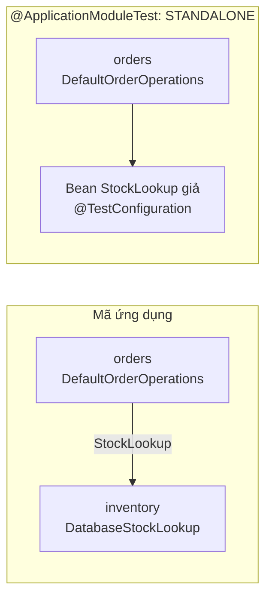
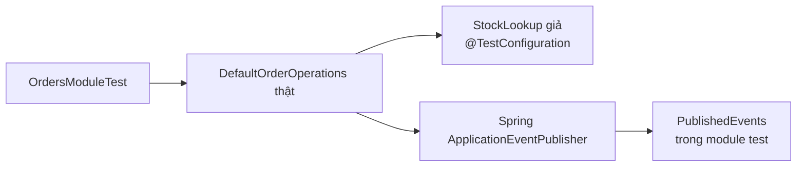
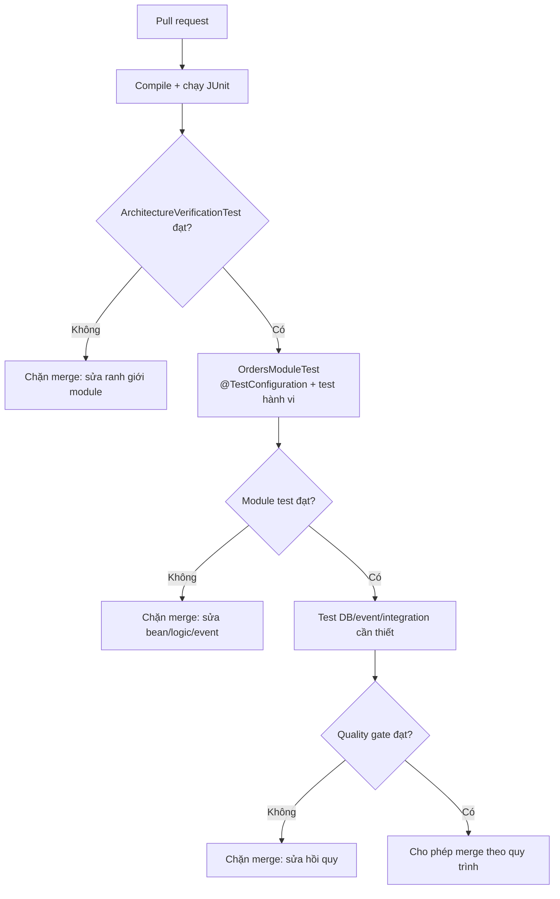

# @TestConfiguration trong module test

Khi kiểm thử một application module bằng Spring Modulith, không phải lúc nào cũng nên khởi động toàn bộ ứng dụng. Ví dụ module `orders` cần một cổng truy vấn tồn kho do module `inventory` cung cấp. Để kiểm thử logic đặt hàng, ta có thể **khởi động riêng `orders`** và cung cấp một triển khai tồn kho giả, có hành vi xác định, chỉ dành cho bài kiểm thử. Spring Boot cung cấp `@TestConfiguration` để đăng ký các bean và tùy chỉnh như vậy trong **test ApplicationContext**, kết hợp thuận tiện với `@ApplicationModuleTest` của Spring Modulith.

Đây là bài đầu tiên trong chương **Test configuration** của **SPRING_MODULITH_VERIFICATION_TESTING**. Bài tập trung vào cách sử dụng `@TestConfiguration` đúng phạm vi, phân biệt với mock và cấu hình production, liên hệ đến `ApplicationModules.verify()`, kiểm thử sự kiện, database, tích hợp và cách đưa các bài test vào quality gate CI.

## 1. Mục tiêu học tập

Hoàn thành bài này, bạn có thể:

1. Giải thích `@TestConfiguration` là gì và vì sao nó phù hợp với **module integration test**.
2. Phân biệt cấu hình test lồng trong class test với cấu hình top-level được đưa vào bằng `@Import`.
3. Viết `@Bean` giả lập cổng phụ thuộc từ module khác để `@ApplicationModuleTest` chạy ở chế độ `STANDALONE`.
4. Lựa chọn đúng giữa `@TestConfiguration`, `@MockitoBean` và tăng phạm vi bootstrap module.
5. Tránh lỗi bean trùng tên/trùng kiểu, cấu hình test rò sang production và test xanh giả.
6. Dùng `PublishedEvents` kiểm tra sự kiện trong module mà không cần listener ở module tiêu thụ.
7. Xác định phần nào cần database thật, test fixture hoặc Testcontainers thay vì stub tùy tiện.
8. Kết hợp test cấu trúc `ApplicationModules.verify()` và test hành vi trong CI.

## 2. Ba phạm vi khác nhau: module, bean và kiểm thử

Giả sử ứng dụng bán hàng có cấu trúc:

```text
src/main/java/
└── com/acme/shop/
    ├── ShopApplication.java
    ├── inventory/
    │   ├── StockLookup.java
    │   └── internal/
    │       └── DatabaseStockLookup.java
    ├── orders/
    │   ├── OrderOperations.java
    │   ├── OrderId.java
    │   ├── events/
    │   │   ├── package-info.java
    │   │   └── OrderPlaced.java
    │   └── internal/
    │       └── DefaultOrderOperations.java
    └── notifications/
        └── internal/
            └── OrderPlacedListener.java

src/test/java/
└── com/acme/shop/orders/
    ├── OrdersModuleTest.java
    ├── OrdersWithImportedConfigTest.java
    └── testsupport/
        └── OrderTestBeans.java
```

Theo phát hiện module mặc định, `inventory`, `orders` và `notifications` là ba application module. `DefaultOrderOperations` thuộc module `orders` dù nằm dưới `orders.internal`. `StockLookup` thuộc API mặc định của `inventory` do được đặt ở base package.

Trong mã sản xuất, module `orders` cần hợp đồng `StockLookup`. Điều này tạo cạnh **`orders → inventory`** trên đồ thị phụ thuộc. Tuy nhiên, **để kiểm thử riêng module `orders`**, ta không nhất thiết phải nạp implementation và database của `inventory`.



**Đồ thị phụ thuộc Java không đổi:** `orders` vẫn phụ thuộc vào interface của `inventory`. Chỉ có **bean thực thi hợp đồng được đưa vào context kiểm thử** thay đổi.

| Câu hỏi | Cơ chế trả lời |
| --- | --- |
| Lớp nào thuộc module nào? | `ApplicationModules`, module base package |
| `orders` có được dùng API `StockLookup` không? | `verify()`, public API, `allowedDependencies` |
| Khi chạy test `orders`, lấy bean `StockLookup` từ đâu? | `@TestConfiguration`, `@MockitoBean` hoặc bootstrap thêm module |
| Kiểm thử đã phát sự kiện và lưu dữ liệu đúng chưa? | `@ApplicationModuleTest` và kiểm thử event/DB phù hợp |

## 3. @TestConfiguration thực sự làm gì?

`@TestConfiguration` thuộc **Spring Boot**, tại package:

```java
import org.springframework.boot.test.context.TestConfiguration;
```

Nó là một dạng `@Configuration` dành cho test: chứa `@Bean` hoặc tùy chỉnh `ApplicationContext` mà bài test cần. Những bean đó được tạo khi **test context tương ứng** khởi động; không được xem là bean production mặc định chỉ vì test đã dùng chúng.

Ví dụ một cấu hình test nhỏ:

```java
import org.springframework.boot.test.context.TestConfiguration;
import org.springframework.context.annotation.Bean;
import java.time.Clock;
import java.time.Instant;
import java.time.ZoneOffset;

@TestConfiguration(proxyBeanMethods = false)
class FixedClockTestConfiguration {

    @Bean
    Clock clock() {
        return Clock.fixed(
                Instant.parse("2026-01-01T00:00:00Z"),
                ZoneOffset.UTC
        );
    }
}
```

Đây là ví dụ **bean có giá trị ổn định**. Nó chỉ có ích nếu một bean của ứng dụng thật sự inject `Clock` và chưa có một bean `Clock` khác gây xung đột. `proxyBeanMethods = false` phù hợp khi các phương thức `@Bean` không gọi qua lại để dựa vào proxy bảo đảm singleton.

### @TestConfiguration khác @Configuration như thế nào?

| Tiêu chí | `@Configuration` | `@TestConfiguration` |
| --- | --- | --- |
| Mục đích chính | Cấu hình ứng dụng | Cấu hình bổ sung cho bài kiểm thử |
| Tìm bằng component scan mặc định của Spring Boot | Có thể được tìm như configuration thông thường | Top-level test configuration được loại khỏi quét tự động thông thường |
| Dùng trong test class dưới dạng nested | Có thể thay thế cách xác định cấu hình chính trong cơ chế tìm kiếm test configuration | Bổ sung vào cấu hình chính được tìm tự động |
| Dùng top-level từ `src/test/java` | Có nguy cơ lan sang nhiều test nếu được scan | Nên `@Import` tường minh tại test cần dùng |
| Có tự override bean production cùng tên? | Không mặc định | **Không mặc định** |

**Chú ý:** `@TestConfiguration` không phải annotation của Spring Modulith, không đánh dấu application module mới, không sửa `allowedDependencies` và không làm một interface nội bộ trở thành public API.

## 4. Vì sao nên kết hợp với @ApplicationModuleTest?

`@ApplicationModuleTest` thuộc `org.springframework.modulith.test`. Bài test đặt trong package của module cần kiểm thử (hoặc package con của nó). Spring Modulith sẽ giới hạn bootstrap theo ranh giới module, thay vì luôn nạp mọi module của ứng dụng như test `@SpringBootTest` thông thường.

Ba chế độ bootstrap:

| Chế độ | Module được bootstrap | Khi nào dùng |
| --- | --- | --- |
| `STANDALONE` (mặc định) | Chỉ module đặt test | Cô lập logic module; mock/stub các cổng ra ngoài |
| `DIRECT_DEPENDENCIES` | Module đang test và những module phụ thuộc **trực tiếp** | Test phối hợp với dependency trực tiếp |
| `ALL_DEPENDENCIES` | Module đang test và toàn bộ cây module phụ thuộc | Test luồng tích hợp rộng hơn theo dependency graph |

Ví dụ cú pháp:

```java
import org.springframework.modulith.test.ApplicationModuleTest;
import org.springframework.modulith.test.ApplicationModuleTest.BootstrapMode;

@ApplicationModuleTest(mode = BootstrapMode.DIRECT_DEPENDENCIES)
class OrdersWithInventoryIntegrationTest {
    // Test phải bảo đảm các bean/dữ liệu module phụ thuộc thực sự sẵn sàng.
}
```

Khi `STANDALONE`, nếu `DefaultOrderOperations` inject `StockLookup` nhưng module `inventory` không được nạp, context thiếu một bean tương ứng. `@TestConfiguration` là một lựa chọn để **cung cấp bean giả đúng hợp đồng** mà không mở rộng toàn bộ phạm vi test.

### Điều gì không thay đổi khi dùng test stub?

- Mã `orders` vẫn import `inventory.StockLookup`: phụ thuộc **`orders → inventory`** vẫn hiện hữu khi phân tích cấu trúc.
- Kiểu `StockLookup` vẫn phải được `inventory` công khai hợp lệ trong kiến trúc.
- `@TestConfiguration` không che một chu trình hoặc truy cập `inventory.internal` trái quy tắc.
- Bài kiểm thử `verify()` vẫn cần chạy, bởi test stub có thể khiến context khởi động thành công dù **mã production có quan hệ module không hợp lệ**.

## 5. Xây dựng ví dụ nghiệp vụ tối thiểu

Để bài test có ý nghĩa, ta định nghĩa các hợp đồng và một triển khai thật ở module `orders`.

### 5.1. API của module inventory

```java
// inventory/StockLookup.java
package com.acme.shop.inventory;

public interface StockLookup {
    boolean available(String sku, int quantity);
}
```

`StockLookup` là interface thuộc base package của module `inventory`, nên có thể là API mặc định cho module `orders` sử dụng. Triển khai production `DatabaseStockLookup` trong `inventory.internal` sẽ cần repository thật, nhưng **không cần xuất hiện trong test `orders` ở chế độ STANDALONE**.

### 5.2. Public API của orders

```java
// orders/OrderId.java
package com.acme.shop.orders;

import java.util.UUID;

public record OrderId(UUID value) {
}
```

```java
// orders/OrderOperations.java
package com.acme.shop.orders;

public interface OrderOperations {
    OrderId place(String sku, int quantity);
}
```

### 5.3. Sự kiện thuộc module orders

```java
// orders/events/OrderPlaced.java
package com.acme.shop.orders.events;

import com.acme.shop.orders.OrderId;

public record OrderPlaced(OrderId orderId, String sku) {
}
```

Nếu module `notifications` muốn lắng nghe sự kiện bằng kiểu `OrderPlaced`, công khai package qua named interface:

```java
// orders/events/package-info.java
@org.springframework.modulith.NamedInterface("events")
package com.acme.shop.orders.events;
```

Named interface giải quyết **quyền tham chiếu kiểu Java xuyên module**; nó không tự động đăng ký listener hay bảo đảm sự kiện được nhận.

### 5.4. Triển khai nội bộ của orders

```java
// orders/internal/DefaultOrderOperations.java
package com.acme.shop.orders.internal;

import com.acme.shop.inventory.StockLookup;
import com.acme.shop.orders.OrderId;
import com.acme.shop.orders.OrderOperations;
import com.acme.shop.orders.events.OrderPlaced;
import org.springframework.context.ApplicationEventPublisher;
import org.springframework.stereotype.Service;

import java.util.UUID;

@Service
class DefaultOrderOperations implements OrderOperations {

    private final StockLookup stock;
    private final ApplicationEventPublisher events;

    DefaultOrderOperations(
            StockLookup stock,
            ApplicationEventPublisher events
    ) {
        this.stock = stock;
        this.events = events;
    }

    @Override
    public OrderId place(String sku, int quantity) {
        if (quantity <= 0) {
            throw new IllegalArgumentException("Số lượng phải dương");
        }
        if (!stock.available(sku, quantity)) {
            throw new IllegalStateException("Không đủ tồn kho");
        }

        OrderId id = new OrderId(UUID.randomUUID());
        events.publishEvent(new OrderPlaced(id, sku));
        return id;
    }
}
```

Ví dụ cố ý lược bỏ transaction và database để làm rõ cấu hình test. Trong hệ thống thật, việc tạo đơn, ghi dữ liệu và phát sự kiện cần được kiểm tra với cơ chế giao dịch phù hợp; không nên suy ra tính nhất quán dữ liệu chỉ từ method minh họa.

## 6. Cách 1 — Nested @TestConfiguration trong module test

Đặt bài test trong package `com.acme.shop.orders` thuộc module `orders`. Cấu hình test là **nested static class** trong chính test:

```java
// src/test/java/com/acme/shop/orders/OrdersModuleTest.java
package com.acme.shop.orders;

import com.acme.shop.inventory.StockLookup;
import com.acme.shop.orders.events.OrderPlaced;
import org.junit.jupiter.api.Test;
import org.springframework.beans.factory.annotation.Autowired;
import org.springframework.boot.test.context.TestConfiguration;
import org.springframework.context.annotation.Bean;
import org.springframework.modulith.test.ApplicationModuleTest;
import org.springframework.modulith.test.PublishedEvents;

import static org.assertj.core.api.Assertions.assertThat;
import static org.junit.jupiter.api.Assertions.assertThrows;

@ApplicationModuleTest
class OrdersModuleTest {

    @Autowired
    OrderOperations orders;

    @TestConfiguration(proxyBeanMethods = false)
    static class TestBeans {

        @Bean
        StockLookup stockLookup() {
            // Luôn cho phép tối đa 3 đơn vị, không cần database inventory.
            return (sku, quantity) -> !sku.isBlank() && quantity <= 3;
        }
    }

    @Test
    void placesOrderWhenEnoughStock(PublishedEvents publishedEvents) {
        OrderId id = orders.place("SKU-1", 2);

        assertThat(id).isNotNull();
        assertThat(publishedEvents.ofType(OrderPlaced.class)
                .matching(OrderPlaced::orderId, id)).hasSize(1);
    }

    @Test
    void rejectsOrderWhenStockIsInsufficient() {
        assertThrows(IllegalStateException.class,
                () -> orders.place("SKU-1", 7));
    }
}
```

### Giải thích từng bước

1. `@ApplicationModuleTest` bootstrap module chứa package của `OrdersModuleTest`, tức `orders`.
2. Chế độ mặc định `STANDALONE` không yêu cầu module `inventory` có mặt trong test context.
3. `static class TestBeans` được đánh dấu `@TestConfiguration`; Spring Boot phát hiện nó như **cấu hình bổ sung** cho test class.
4. Method `@Bean StockLookup stockLookup()` tạo một triển khai interface có thể dự đoán.
5. Spring inject bean này vào `DefaultOrderOperations` để module `orders` khởi động.
6. Test gọi **service thật** của `orders`, không mock `OrderOperations`.
7. `PublishedEvents` kiểm tra event đã được module phát; không cần listener thật của `notifications`.

**Kết quả kỳ vọng:** `place("SKU-1", 2)` được chấp nhận và phát đúng một `OrderPlaced` phù hợp, còn `place("SKU-1", 7)` ném lỗi thiếu tồn kho.

Lưu ý: `PublishedEvents` được Spring Modulith hỗ trợ trong `@ApplicationModuleTest`. Trong một bài test Spring Boot thông thường không có tích hợp tương ứng, không thể mặc định yêu cầu tham số này luôn được resolve.

### Ưu điểm và giới hạn của nested configuration

**Ưu điểm:** bean giả nằm ngay cạnh scenario, dễ hiểu, ít lan sang test khác. Test đọc được mà không phải tìm một class fixture bên ngoài.

**Giới hạn:** nếu nhiều test cùng cần một fixture phức tạp, lặp nhiều nested class sẽ khó bảo trì. Khi đó có thể chuyển sang **top-level `@TestConfiguration`** và import có chủ đích.

## 7. Cách 2 — Top-level @TestConfiguration + @Import

Khi nhiều test cần dùng cùng một fake, định nghĩa nó trong `src/test/java` dưới dạng class riêng:

```java
// src/test/java/com/acme/shop/orders/testsupport/OrderTestBeans.java
package com.acme.shop.orders.testsupport;

import com.acme.shop.inventory.StockLookup;
import org.springframework.boot.test.context.TestConfiguration;
import org.springframework.context.annotation.Bean;

@TestConfiguration(proxyBeanMethods = false)
public class OrderTestBeans {

    @Bean
    StockLookup stockLookup() {
        return (sku, quantity) -> quantity > 0 && quantity <= 3;
    }
}
```

Import **tường minh** tại bài test cần sử dụng:

```java
// src/test/java/com/acme/shop/orders/OrdersWithImportedConfigTest.java
package com.acme.shop.orders;

import com.acme.shop.orders.testsupport.OrderTestBeans;
import org.junit.jupiter.api.Test;
import org.springframework.beans.factory.annotation.Autowired;
import org.springframework.context.annotation.Import;
import org.springframework.modulith.test.ApplicationModuleTest;

import static org.junit.jupiter.api.Assertions.assertNotNull;

@ApplicationModuleTest
@Import(OrderTestBeans.class)
class OrdersWithImportedConfigTest {

    @Autowired
    OrderOperations orders;

    @Test
    void createsAnOrderWithImportedTestBean() {
        assertNotNull(orders.place("SKU-2", 1));
    }
}
```

**Tại sao phải có `@Import`?** Theo cơ chế của Spring Boot, top-level `@TestConfiguration` được loại khỏi việc component-scan tự động thông thường, nhằm tránh một fixture dành cho test A vô tình xuất hiện trong test B. `@Import(OrderTestBeans.class)` xác định rõ test nào sử dụng cấu hình đó.

**Hai cách ở mục 6 và 7 là các lựa chọn thay thế.** Không nên đồng thời import `OrderTestBeans` và giữ nested `TestBeans` cùng cung cấp `StockLookup` trong một test, trừ khi đã cấu hình qualifier/ưu tiên rõ ràng.

## 8. Khi nào dùng @MockitoBean thay vì @TestConfiguration?

`@TestConfiguration` phù hợp khi muốn **một fake có quy tắc ổn định** hoặc một nhóm bean hỗ trợ test. Nếu chỉ cần quy định một vài kết quả và xác minh lời gọi của một dependency, `@MockitoBean` thường ngắn hơn.

Ví dụ cùng module `orders` nhưng **không có nested `@TestConfiguration` và không import fixture**:

```java
package com.acme.shop.orders;

import com.acme.shop.inventory.StockLookup;
import org.junit.jupiter.api.Test;
import org.springframework.beans.factory.annotation.Autowired;
import org.springframework.modulith.test.ApplicationModuleTest;
import org.springframework.test.context.bean.override.mockito.MockitoBean;

import static org.junit.jupiter.api.Assertions.assertNotNull;
import static org.mockito.Mockito.verify;
import static org.mockito.Mockito.when;

@ApplicationModuleTest
class OrdersWithMockDependencyTest {

    @Autowired
    OrderOperations orders;

    @MockitoBean
    StockLookup stock;

    @Test
    void callsInventoryContract() {
        when(stock.available("SKU-3", 2)).thenReturn(true);

        assertNotNull(orders.place("SKU-3", 2));

        verify(stock).available("SKU-3", 2);
    }
}
```

Trên các phiên bản Spring Framework/Boot hiện đại, `@MockitoBean` có thể **thay thế bean đang tồn tại hoặc tạo mock bean khi chưa có bean đó** trong test context. Đây là cơ chế thay thế bean chuyên dụng, khác với việc định nghĩa thêm `@Bean` qua `@TestConfiguration`. Với dự án dùng Spring Boot/Spring Modulith cũ, API mock có thể khác; cần kiểm tra version đang dùng.

| Nhu cầu | Lựa chọn thường hợp lý |
| --- | --- |
| Một fake nhỏ, hành vi nhất quán qua nhiều tình huống | `@TestConfiguration` + `@Bean` |
| Tạo vài kết quả trả về, xác minh method call | `@MockitoBean` |
| Cần chạy logic thật của module phụ thuộc | `@ApplicationModuleTest(mode = DIRECT_DEPENDENCIES)` |
| Kiểm tra chuỗi phụ thuộc nhiều module | `ALL_DEPENDENCIES` hoặc integration test rộng hơn |
| Thay bean cụ thể trong context đã có bean thật | `@MockitoBean` hoặc chiến lược override có chủ đích |
| Cung cấp helper, clock, serializer, publisher giả, adapter in-memory | `@TestConfiguration` |

**Nguyên tắc:** giả lập **cổng ra ngoài** của module `orders` thay vì mock chính `OrderOperations`. Nếu mock toàn bộ service đang cần kiểm thử, bài test chỉ xác nhận cấu hình mock chứ chưa kiểm tra hành vi thật của module.

## 9. Bẫy quan trọng: @TestConfiguration không tự override bean thật

Xét trường hợp test ở chế độ `DIRECT_DEPENDENCIES`, có thể nạp cả `orders` lẫn `inventory`. Khi đó context có thể chứa:

- Bean production `DatabaseStockLookup` triển khai `StockLookup`.
- Bean test `stockLookup()` cũng triển khai `StockLookup`.

Spring cần biết bean nào được inject. Nếu cùng kiểu mà không có cách phân giải, context có thể lỗi **NoUniqueBeanDefinitionException**. Nếu test bean cố dùng cùng tên với bean thật, Spring Boot thường **không cho phép overriding bean definition mặc định**.

### Cách xử lý phù hợp

1. **Ưu tiên STANDALONE** khi cần stub dependency nằm ở module khác; lúc này production bean của module ngoài không được bootstrap.
2. **Dùng `@MockitoBean`** nếu mục tiêu thực sự là thay thế một bean đã tồn tại và kiểm tra tương tác.
3. **Dùng `@Primary` hoặc `@Qualifier`** khi chủ đích là để nhiều bean cùng tồn tại và muốn chọn bean cụ thể.
4. **Không bật `spring.main.allow-bean-definition-overriding=true` chỉ để che lỗi cấu hình** nếu có cách tường minh và an toàn hơn.

Ví dụ `@Primary`:

```java
@TestConfiguration(proxyBeanMethods = false)
class PreferredTestClock {

    @Bean
    @org.springframework.context.annotation.Primary
    java.time.Clock testClock() {
        return java.time.Clock.fixed(
                java.time.Instant.parse("2026-01-01T00:00:00Z"),
                java.time.ZoneOffset.UTC
        );
    }
}
```

Đoạn này chỉ minh họa cách chọn bean `Clock` ưu tiên nếu có nhiều bean cùng kiểu. `@Primary` **không xóa bean thật** và không ngăn việc tạo bean production. Khi đưa vào bài test thực tế, cần đăng ký cấu hình bằng nested `@TestConfiguration` hoặc `@Import`, bảo đảm service đang test thật sự inject `Clock`.

## 10. @TestConfiguration và kiểm thử sự kiện

Module `orders` phát `OrderPlaced`. Với `@ApplicationModuleTest` mặc định, ta có thể kiểm tra việc publish bằng `PublishedEvents` như mục 6, không cần nạp `notifications`.



Mô hình này tách hai hợp đồng:

1. **Hợp đồng phía module phát:** khi đặt đơn thành công, `orders` publish `OrderPlaced` với `orderId` phù hợp.
2. **Hợp đồng phía module nhận:** khi sự kiện xảy ra, `notifications` xử lý thông báo theo yêu cầu nghiệp vụ.

`@TestConfiguration` ở `orders` nên chỉ cung cấp các dependency tối thiểu như `StockLookup`. **Không nên thay luôn `ApplicationEventPublisher` bằng một fake** trong test có mục tiêu kiểm tra `PublishedEvents`, vì có thể làm sai đường đi sự kiện mà test cần quan sát.

### Kiểm tra listener ở module khác

Test riêng của `notifications` có thể dùng `@ApplicationModuleTest` và, nếu cần xử lý bất đồng bộ hoặc transaction, dùng các tiện ích `Scenario` của Spring Modulith. Khi test consumer, phải quyết định có nạp producer thật hay chủ động publish một sự kiện test theo API đã công khai.

**Phân biệt:**

| Thứ cần xác nhận | Test phù hợp |
| --- | --- |
| `orders` có publish `OrderPlaced` không? | `@ApplicationModuleTest` tại `orders` với `PublishedEvents` |
| `notifications` có xử lý event đúng không? | Test module `notifications` với scenario hoặc event kích hoạt thích hợp |
| Toàn bộ quá trình phát, nhận, giao dịch và retry hoạt động đúng? | Test tích hợp đa module, dữ liệu và chính sách retry thực tế |

Một event test chỉ đo **sự kiện đã được publish**, không tự bảo đảm listener ở một module khác đã chạy thành công.

## 11. @TestConfiguration và kiểm thử database

Database là một trong những nơi dễ tạo test xanh giả nếu dùng bean giả sai mục đích.

Ví dụ module `orders` có `OrderRepository` trong `orders.internal.persistence`. Nếu mục tiêu chỉ là kiểm tra **quy tắc nghiệp vụ** của service, một repository in-memory từ `@TestConfiguration` có thể hữu ích. Nhưng nếu mục tiêu là kiểm tra **JPA mapping, transaction, unique constraint, locking hoặc migration**, thay repository thật bằng fake sẽ bỏ qua đúng những yếu tố cần kiểm thử.

| Mục tiêu | Đề xuất |
| --- | --- |
| Logic service không phụ thuộc persistence | Fake repository/in-memory adapter trong `@TestConfiguration`, nếu hợp đồng cho phép |
| JPA entity mapping và SQL query | Repository thật, test database phù hợp |
| Hành vi tương đồng production database | Testcontainers với hệ quản trị DB phù hợp |
| Transaction và event xử lý sau commit | Integration test có transaction thật, quan sát kết quả commit |
| Kiểm thử riêng module `orders` nhưng cần tồn kho từ `inventory` | Stub `StockLookup`; vẫn giữ repository thật của `orders` nếu cần kiểm tra dữ liệu đơn hàng |

### Cẩn trọng với rollback trong test

Nếu dùng `@Transactional` tại phương thức test, thay đổi dữ liệu có thể bị rollback ở cuối test. Điều này rất hữu ích để cô lập dữ liệu, nhưng có thể khiến event listener chạy **sau commit** không được kích hoạt như production. Không nên kết luận một listener sau commit hỏng nếu test chưa có transaction commit thực sự.

`@TestConfiguration` chỉ tùy chỉnh **bean và cấu hình context**; nó không tự giải quyết các vấn đề về rollback, isolation, migration hay event publication registry. Các bài kiểm thử đó cần thiết kế riêng.

## 12. Giữ test fixture trong đúng phạm vi

### Vì sao nên đặt fixture trong src/test/java?

Một `@TestConfiguration` dùng cho JUnit thường phải ở:

```text
src/test/java/com/acme/shop/orders/testsupport/OrderTestBeans.java
```

và chỉ được chọn ở test cần dùng qua `@Import` (hoặc là nested configuration của test). Không nên đặt fake trả lời “luôn còn hàng” trong `src/main/java` chỉ để test khởi động được: nó có nguy cơ đi vào runtime hoặc được autowire trong môi trường production.

Mặc dù `@TestConfiguration` top-level được loại khỏi component scan mặc định của Spring Boot, việc dùng cấu hình quét thủ công quá rộng có thể làm thay đổi filter mặc định. Vì vậy **nguồn test riêng + import tường minh** vẫn là quy tắc dễ kiểm soát nhất.

### Context cache và việc chia sẻ fixture

Spring Test có cơ chế cache `ApplicationContext` theo cấu hình kiểm thử. Hai class test dùng cấu hình khác nhau (nested `@TestConfiguration` khác nhau, `@Import` khác nhau, mock bean khác nhau hoặc property khác nhau) có thể tạo hai cache key và buộc context khởi động lại.

Không nên gom mọi fake của toàn ứng dụng vào một cấu hình khổng lồ chỉ để dùng lại, bởi như vậy dễ:

- Tạo bean thừa ngoài mục tiêu của module test.
- Che giấu một dependency xuyên module lẽ ra phải được mock hoặc khai báo rõ.
- Tăng chi phí bootstrap và khó lần ra vì sao một test có bean mà test khác không có.

Ưu tiên fixture nhỏ, đặt tên rõ mục đích, dùng lại khi thật sự có cùng phạm vi. Nếu test thay đổi trạng thái singleton trong context, cần reset trạng thái giữa các test hoặc chủ động xử lý việc cache; đừng để thứ tự thực thi quyết định kết quả.

## 13. @TestConfiguration không thay thế kiểm chứng kiến trúc

Hãy xét một lỗi: `DefaultOrderOperations` import `com.acme.shop.inventory.internal.InventoryRepository`, giả sử interface được Java khai báo `public`. Một bean `InventoryRepository` giả cung cấp qua `@TestConfiguration` có thể giúp test context khởi động, nhưng **code production vẫn đang tham chiếu kiểu nội bộ của module khác**.

Bởi vậy nên có bài JUnit **không phụ thuộc vào fixture context**:

```java
// src/test/java/com/acme/shop/ArchitectureVerificationTest.java
package com.acme.shop;

import org.junit.jupiter.api.Test;
import org.springframework.modulith.core.ApplicationModules;

class ArchitectureVerificationTest {

    @Test
    void modulesRespectArchitecturalBoundaries() {
        ApplicationModules.of(ShopApplication.class).verify();
    }
}
```

Trong mô hình module đóng mặc định, `verify()` có thể kiểm tra các nhóm vấn đề:

- **Phụ thuộc vòng** giữa application module.
- **Truy cập kiểu nội bộ** của module đích.
- **Phụ thuộc ngoài `allowedDependencies`** đã khai báo.

Nó không chạy code nghiệp vụ để biết service đã publish đúng sự kiện, mapping DB hoạt động hay test stub phản ánh đúng business rule. Ngược lại, `@ApplicationModuleTest` có thể chạy xanh với fixture mà không chứng minh mọi dependency Java của ứng dụng đều phù hợp thiết kế.

### Giới hạn trong bài kiểm thử module

`@ApplicationModuleTest` hỗ trợ kiểm chứng cấu trúc tự động theo phiên bản Spring Modulith; tuy nhiên, một bài test `ApplicationModules.of(...).verify()` riêng vẫn hữu ích để bảo đảm **toàn bộ mô hình** được đưa vào quality gate, kể cả khi một số module không có bài integration test riêng.

Nếu muốn bảo vệ **tập module mong đợi**, nên có thêm assertion kiểm tra `getModuleByName(...)`. Chỉ gọi `verify()` trên một mô hình thiếu module do package gốc bị cấu hình sai có thể cho cảm giác an toàn không đầy đủ.

## 14. Các lỗi thường gặp và cách xử lý

| Triệu chứng | Nguyên nhân có thể | Cách xử lý |
| --- | --- | --- |
| `NoSuchBeanDefinitionException` cho `StockLookup` | `STANDALONE` không nạp inventory và test chưa cấp stub/mock | Thêm nested `@TestConfiguration`, `@Import` hoặc `@MockitoBean` |
| Đã khai báo top-level `@TestConfiguration` nhưng bean không có | Class không được tự scan theo cách mặc định | Thêm `@Import(TestBeans.class)` |
| Có hai bean `StockLookup` cùng kiểu | Vừa nạp inventory thật vừa định nghĩa fake | Chọn STANDALONE, `@MockitoBean` hoặc qualifier có chủ đích |
| Bean trùng tên không đăng ký được | Cố override bean definition bằng `@Bean` mới | Tránh bean overriding ngầm; dùng công cụ override hoặc thay mô hình test |
| Test event không thấy `OrderPlaced` | Fake publisher, service chưa chạy hoặc event chưa được phát | Giữ publisher thật, kích hoạt use case và kiểm tra `PublishedEvents` |
| Test trên máy chạy nhưng CI fail vì database | Fixture chưa có DB tương ứng hoặc khác transaction behavior | Cấu hình test DB/Testcontainers và dữ liệu khởi tạo |
| Bean test bất ngờ xuất hiện trong test khác | Fixture quá rộng hoặc import chung không chủ đích | Thu hẹp `@Import` và phạm vi cấu hình |
| Test context khởi động nhưng `verify()` fail | Mã production đang phụ thuộc kiểu nội bộ hoặc tạo vòng | Sửa ranh giới module; không chỉ thêm fake bean |
| Test chạy chậm bất thường | Quá nhiều biến thể `ApplicationContext` hoặc bootstrap quá rộng | Giữ fixture nhỏ, cân nhắc cache và scope |

### Quy trình chẩn đoán khi test module không khởi động

1. Xác định test class có nằm trong package của **module muốn kiểm thử** không.
2. Kiểm tra `@ApplicationModuleTest` đang dùng chế độ `STANDALONE`, `DIRECT_DEPENDENCIES` hay `ALL_DEPENDENCIES`.
3. Đọc bean đầu tiên không được tạo hoặc bị trùng và xác định **module sở hữu interface**.
4. Quyết định cần **stub**, **mock** hay nạp **module dependency thật**.
5. Nếu dùng top-level `@TestConfiguration`, kiểm tra `@Import` và đường dẫn `src/test/java`.
6. Chạy lại test và xác nhận **hành vi**, không chỉ kiểm tra context khởi động.
7. Chạy `ApplicationModules.verify()` để loại trừ lỗi kiến trúc.

## 15. Đưa test configuration vào quality gate CI

Một pipeline nên có cả **kiểm chứng cấu trúc** và **kiểm thử module/integration**:



Ví dụ thực thi ở dự án có cấu hình build đầy đủ:

```bash
# Maven Wrapper:
./mvnw test

# Hoặc Gradle Wrapper:
./gradlew test
```

Các lệnh này chỉ mang tính minh họa; nếu project đặt integration test trong task riêng, pipeline cần chạy những task đó. Cần đảm bảo test dependencies có **Spring Boot test**, **JUnit** và **Spring Modulith test starter** phù hợp với version đang sử dụng.

Ví dụ Maven dependency cho Spring Modulith test:

```xml
<dependency>
    <groupId>org.springframework.modulith</groupId>
    <artifactId>spring-modulith-starter-test</artifactId>
    <scope>test</scope>
</dependency>
```

Phiên bản Spring Modulith cần được quản lý nhất quán với Spring Boot qua BOM/dependency management của dự án. **Bước viết tài liệu này không thực thi build hoặc integration test**; mục tiêu ở đây là mô tả cách tổ chức và kiểm tra.

## 16. Bài thực hành: chọn đúng cách cấp bean cho module test

Cho ứng dụng:

```text
com.example.booking
├── BookingApplication.java
├── booking/
│   ├── BookingOperations.java
│   ├── events/BookingConfirmed.java
│   └── internal/DefaultBookingOperations.java
├── payment/
│   ├── PaymentGateway.java
│   └── internal/RealPaymentGateway.java
└── notifications/
    └── internal/BookingConfirmedListener.java
```

Giả sử:

- `DefaultBookingOperations` ở module `booking` inject interface `payment.PaymentGateway`.
- Test cần xác nhận khi thanh toán thành công, `booking` publish `BookingConfirmed`.
- `payment.internal.RealPaymentGateway` gọi hệ thống thanh toán thật.
- `@ApplicationModuleTest` đặt tại package `com.example.booking.booking` và chạy ở chế độ mặc định `STANDALONE`.

**Câu hỏi**

1. Vì sao test có thể fail khi khởi động dù ứng dụng production có `RealPaymentGateway`?
2. Một nested `@TestConfiguration` có thể giải quyết bằng cách nào?
3. Nếu `PaymentGateway` chỉ cần trả về success/failure theo từng test, nên cân nhắc annotation nào?
4. Vì sao đặt cấu hình fake ở top-level `src/test/java` mà không `@Import` có thể không có tác dụng?
5. Nếu chọn `DIRECT_DEPENDENCIES`, việc import thêm fake `PaymentGateway` có thể gây vấn đề gì?
6. `@TestConfiguration` có làm biến mất cạnh dependency `booking → payment` không?
7. Bài test `PublishedEvents` ở `booking` có chứng minh `notifications` gửi thông báo thành công không?
8. Một quality gate tối thiểu cần những loại bài test nào?

### Đáp án gợi ý

1. `STANDALONE` chỉ nạp module `booking`, trong khi bean `PaymentGateway` production nằm ở module `payment` chưa được bootstrap.
2. Dùng `@TestConfiguration` nested static để khai báo `@Bean PaymentGateway` fake có hành vi thanh toán giả và trả về kết quả có thể dự đoán.
3. Dùng `@MockitoBean` nếu chỉ cần stub giá trị và kiểm chứng lời gọi. Nếu fake có nhiều trạng thái nghiệp vụ dùng chung, `@TestConfiguration` có thể phù hợp hơn.
4. Spring Boot loại trừ top-level `@TestConfiguration` khỏi component scan tự động thông thường; phải import tường minh để dùng.
5. Context có thể đã chứa `RealPaymentGateway`; thêm fake tạo hai bean cùng kiểu hoặc xung đột tên. Nên chọn phạm vi test hoặc cơ chế bean override rõ ràng.
6. **Không.** Mã `booking` vẫn tham chiếu kiểu `payment.PaymentGateway`; fake chỉ thay cách cung cấp bean trong context test.
7. **Không.** Nó xác nhận sự kiện đã được publish; xử lý ở consumer và giao dịch cần test riêng.
8. Test `ApplicationModules.verify()`, module test của `booking` với fake/mock có chủ đích, và các integration test event/DB cần thiết.

### Bài mở rộng

Hãy viết hai test `BookingModuleTest` sử dụng cùng một interface `PaymentGateway`: một test dùng nested `@TestConfiguration` với fake cố định, test còn lại dùng `@MockitoBean` để mô phỏng gateway thất bại. So sánh độ dễ đọc, khả năng tái sử dụng, việc reset trạng thái và các điều kiện có thể gây xung đột bean.

## 17. Checklist trước khi merge test có @TestConfiguration

- [ ] Test class nằm trong đúng package module được `@ApplicationModuleTest` chọn.
- [ ] Đã quyết định rõ phạm vi bootstrap: `STANDALONE`, `DIRECT_DEPENDENCIES` hay `ALL_DEPENDENCIES`.
- [ ] `@TestConfiguration` chỉ cung cấp dependency/fixture cần thiết cho bài test.
- [ ] Nested configuration là `static`; top-level configuration được `@Import` khi cần.
- [ ] Test fixture ở `src/test/java`, không nằm trong runtime artifact production.
- [ ] Không có bean cùng kiểu/cùng tên gây xung đột hoặc override không chủ đích.
- [ ] Stub/mock không thay thế chính logic của module cần kiểm thử.
- [ ] Test event giữ publisher thật nếu đang kiểm tra `PublishedEvents`.
- [ ] Test database/transaction dùng backend phù hợp thay vì fake những thành phần cần kiểm chứng thật.
- [ ] Bài `ApplicationModules.of(...).verify()` chạy trong CI cùng test hành vi.
- [ ] Test không chỉ kiểm tra context load mà có assertion nghiệp vụ và tình huống lỗi.
- [ ] Các nguồn Spring Boot/Spring Modulith/Mockito tương thích với version dự án.

**Ghi nhớ:** `@TestConfiguration` là công cụ Spring Boot để **bổ sung bean dành riêng cho test**, đặc biệt hữu ích khi `@ApplicationModuleTest` cô lập một module và cần cung cấp fake cho cổng phụ thuộc sang module khác. Nó **không thay đổi kiến trúc production**, không tự override bean thật và không thay thế `ApplicationModules.verify()`. Chọn fixture nhỏ, phạm vi rõ, kết hợp kiểm thử sự kiện, database và tích hợp để vừa giữ đúng ranh giới module vừa ngăn hồi quy hành vi.

## Tài liệu tham khảo

- [Spring Boot Reference — Testing Spring Boot Applications, Test Configuration](https://docs.spring.io/spring-boot/reference/testing/spring-boot-applications.html)
- [Spring Boot API — TestConfiguration](https://docs.spring.io/spring-boot/api/java/org/springframework/boot/test/context/TestConfiguration.html)
- [Spring Modulith Reference — Integration Testing Application Modules](https://docs.spring.io/spring-modulith/reference/testing.html)
- [Spring Modulith Reference — Working with Application Events](https://docs.spring.io/spring-modulith/reference/events.html)
- [Spring Modulith Reference — Verifying Application Module Structure](https://docs.spring.io/spring-modulith/reference/verification.html)
- [Spring Framework Reference — @MockitoBean and @MockitoSpyBean](https://docs.spring.io/spring-framework/reference/testing/annotations/integration-spring/annotation-mockitobean.html)
