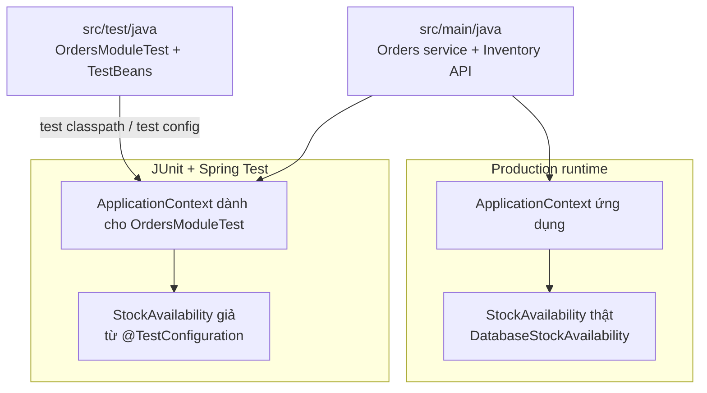
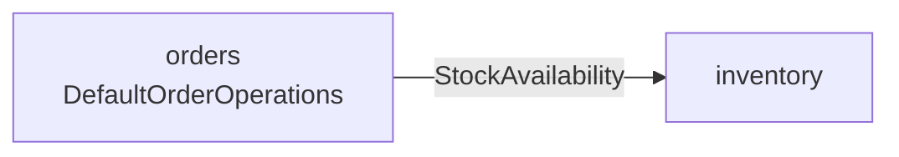
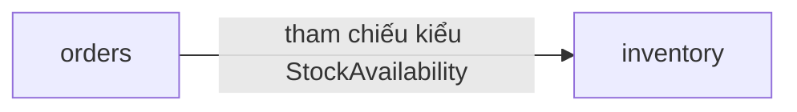
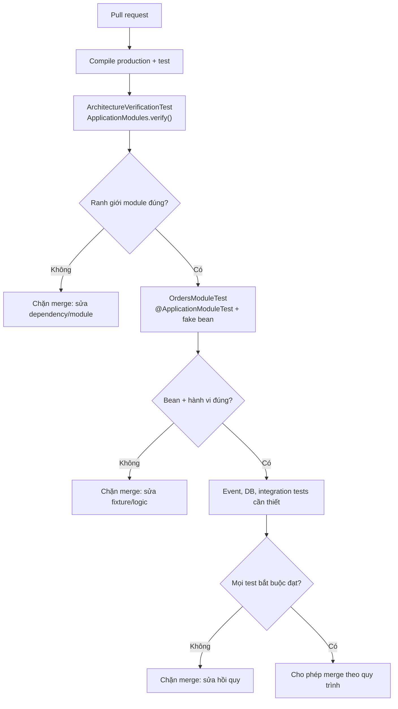

# Bean test chỉ tồn tại trong ApplicationContext kiểm thử

Trong một ứng dụng Spring Modulith, module `orders` có thể phụ thuộc vào hợp đồng `StockAvailability` của module `inventory`. Khi chạy production, Spring Boot có thể inject một triển khai truy vấn tồn kho thật. Nhưng khi kiểm thử **riêng module `orders`**, chúng ta thường chỉ cần một bean giả trả về số lượng tồn kho có thể dự đoán để kiểm tra hành vi của đơn hàng.

Điểm quan trọng không chỉ là “tạo được fake bean”, mà là **fake bean chỉ xuất hiện trong `ApplicationContext` của bài kiểm thử cần nó, không vô tình tham gia vào ứng dụng production hoặc những bài test khác**. Đó là lý do phải hiểu đúng `src/test/java`, `@TestConfiguration`, `@Import`, các chế độ `@ApplicationModuleTest` và cơ chế cache context của Spring Test.

Bài thuộc chương **Test configuration** của **SPRING_MODULITH_VERIFICATION_TESTING**. Mục tiêu là cấu hình bean kiểm thử an toàn, đồng thời dùng `ApplicationModules.verify()` để giữ ranh giới kiến trúc, `@ApplicationModuleTest` để xác nhận hành vi module, cùng kiểm thử sự kiện, dữ liệu, tích hợp và quality gate CI để ngăn hồi quy.

## 1. Mục tiêu học tập

Sau bài này, bạn có thể:

1. Giải thích chính xác “bean chỉ tồn tại trong `ApplicationContext` kiểm thử” có nghĩa gì và **không** có nghĩa gì.
2. Phân biệt **classpath test**, **đăng ký bean vào context** và **vòng đời của context**.
3. Tạo một fake `@Bean` bằng nested `@TestConfiguration` trong `@ApplicationModuleTest`.
4. Dùng top-level `@TestConfiguration` và `@Import` để chia sẻ fixture mà không khiến mọi test tự động nhận bean.
5. So sánh `@TestConfiguration`, `@MockitoBean` và `@Profile("test")` theo mức độ cô lập.
6. Xử lý lỗi bean trùng kiểu/trùng tên, context cache và trạng thái fixture rò giữa các test.
7. Chọn đúng phần nên fake và phần phải dùng database, event publisher hoặc listener thật.
8. Thiết lập kiểm thử kiến trúc và kiểm thử runtime trong CI.

## 2. Hiểu đúng ba tầng cô lập của một test bean

Khẳng định “`StockAvailability` giả chỉ tồn tại trong test” cần được xem trên ba tầng:

| Tầng | Câu hỏi | Cách bảo vệ |
| --- | --- | --- |
| **Artifact/classpath** | Lớp tạo bean giả có được đóng gói vào ứng dụng production không? | Đặt trong `src/test/java` hoặc test source set |
| **Bean registration** | Spring Test `ApplicationContext` nào thực sự có bean đó? | Nested `@TestConfiguration` hoặc `@Import` tường minh |
| **Vòng đời và trạng thái** | Bean được tạo mới mỗi method hay được tái sử dụng? | Hiểu singleton/context cache, reset fixture nếu có trạng thái |

Hai khái niệm rất dễ nhầm:

- **Một class có trên test classpath** chưa chắc đã được Spring đăng ký làm bean. Phải có cơ chế cấu hình phù hợp.
- **Một bean được tạo trong test context** không có nghĩa nó chỉ tồn tại trong đúng một method `@Test`. Spring Test có thể cache và tái sử dụng `ApplicationContext`; singleton bean thường sống trong suốt vòng đời context ấy.

**Kết luận thực hành:** test-only không phải một bean scope mới của Spring. Đây là cách **giới hạn nơi class được đóng gói và nơi bean được đăng ký**.

### Sơ đồ phạm vi



Sơ đồ thể hiện ý tưởng cấu hình; một ứng dụng thực tế có thể có nhiều test context được cache với các bộ cấu hình khác nhau.

## 3. Ví dụ xuyên suốt: module orders cần một cổng inventory

Giả sử mã Java:

```text
src/main/java/
└── com/acme/shop/
    ├── ShopApplication.java
    ├── inventory/
    │   ├── StockAvailability.java
    │   └── internal/
    │       └── DatabaseStockAvailability.java
    └── orders/
        ├── OrderId.java
        ├── OrderOperations.java
        ├── events/
        │   ├── package-info.java
        │   └── OrderPlaced.java
        └── internal/
            └── DefaultOrderOperations.java

src/test/java/
└── com/acme/shop/
    ├── ArchitectureVerificationTest.java
    └── orders/
        ├── OrdersModuleTest.java
        ├── OrdersImportedFixtureTest.java
        └── testsupport/
            └── StockTestConfiguration.java
```

Module `inventory` sở hữu interface `StockAvailability`. Module `orders` phụ thuộc vào interface đó, nhưng sở hữu riêng service tạo đơn và event `OrderPlaced`. Với cách phát hiện module mặc định, gốc ứng dụng là `com.acme.shop`:

```java
// com/acme/shop/ShopApplication.java
package com.acme.shop;

import org.springframework.boot.autoconfigure.SpringBootApplication;

@SpringBootApplication
public class ShopApplication {
}
```

Đồ thị phụ thuộc **production**:



**Mục đích test:** khởi chạy `orders` thật, cho interface `StockAvailability` trả về kết quả kiểm soát được, xác nhận tạo đơn và publish event, nhưng **không** chạy database hoặc triển khai thật của module `inventory`.

## 4. Các kiểu production dùng để kiểm thử

### 4.1. API do inventory cung cấp

```java
// com/acme/shop/inventory/StockAvailability.java
package com.acme.shop.inventory;

public interface StockAvailability {
    boolean canReserve(String sku, int quantity);
}
```

Interface ở base package là API mặc định của module `inventory`. Triển khai thật `DatabaseStockAvailability` sẽ ở `inventory.internal` và có thể kết nối repository/database. Trong test module `orders` độc lập, ta **không muốn nạp** triển khai đó.

### 4.2. API đơn hàng

```java
// com/acme/shop/orders/OrderId.java
package com.acme.shop.orders;

import java.util.UUID;

public record OrderId(UUID value) {
}
```

```java
// com/acme/shop/orders/OrderOperations.java
package com.acme.shop.orders;

public interface OrderOperations {
    OrderId place(String sku, int quantity);
}
```

### 4.3. Sự kiện đặt hàng

```java
// com/acme/shop/orders/events/OrderPlaced.java
package com.acme.shop.orders.events;

import com.acme.shop.orders.OrderId;

public record OrderPlaced(OrderId orderId, String sku) {
}
```

Nếu một module khác cần import `OrderPlaced`, có thể công khai nhóm sự kiện:

```java
// com/acme/shop/orders/events/package-info.java
@org.springframework.modulith.NamedInterface("events")
package com.acme.shop.orders.events;
```

Lưu ý: `@NamedInterface` quyết định **API được chia sẻ giữa các module**, còn `@TestConfiguration` quyết định **bean nào được bổ sung vào Spring Test context**. Hai annotation xử lý hai vấn đề hoàn toàn khác nhau.

### 4.4. Service production của orders

```java
// com/acme/shop/orders/internal/DefaultOrderOperations.java
package com.acme.shop.orders.internal;

import com.acme.shop.inventory.StockAvailability;
import com.acme.shop.orders.OrderId;
import com.acme.shop.orders.OrderOperations;
import com.acme.shop.orders.events.OrderPlaced;
import java.util.UUID;
import org.springframework.context.ApplicationEventPublisher;
import org.springframework.stereotype.Service;

@Service
class DefaultOrderOperations implements OrderOperations {

    private final StockAvailability stock;
    private final ApplicationEventPublisher publisher;

    DefaultOrderOperations(StockAvailability stock,
                           ApplicationEventPublisher publisher) {
        this.stock = stock;
        this.publisher = publisher;
    }

    @Override
    public OrderId place(String sku, int quantity) {
        if (quantity <= 0) {
            throw new IllegalArgumentException("Số lượng phải dương");
        }
        if (!stock.canReserve(sku, quantity)) {
            throw new IllegalStateException("Không đủ tồn kho");
        }

        OrderId id = new OrderId(UUID.randomUUID());
        publisher.publishEvent(new OrderPlaced(id, sku));
        return id;
    }
}
```

Đây là ví dụ tối thiểu để minh họa test configuration. Hệ thống thật còn phải lưu đơn, giữ nhất quán tồn kho, kiểm soát transaction và xử lý retry. Không suy ra những bảo đảm đó từ service rút gọn này.

## 5. Tạo bean test bằng nested @TestConfiguration

`@ApplicationModuleTest` nằm ở `com.acme.shop.orders`, module cần kiểm thử. Chế độ bootstrap mặc định là `STANDALONE`: module `orders` được nạp, nhưng module phụ thuộc `inventory` không tự động được nạp toàn bộ.

Do đó service cần một bean `StockAvailability` **do test cung cấp**:

```java
// src/test/java/com/acme/shop/orders/OrdersModuleTest.java
package com.acme.shop.orders;

import com.acme.shop.inventory.StockAvailability;
import com.acme.shop.orders.events.OrderPlaced;
import org.junit.jupiter.api.Test;
import org.springframework.beans.factory.annotation.Autowired;
import org.springframework.boot.test.context.TestConfiguration;
import org.springframework.context.ApplicationContext;
import org.springframework.context.annotation.Bean;
import org.springframework.modulith.test.ApplicationModuleTest;
import org.springframework.modulith.test.PublishedEvents;

import static org.assertj.core.api.Assertions.assertThat;
import static org.junit.jupiter.api.Assertions.assertThrows;

@ApplicationModuleTest
class OrdersModuleTest {

    @Autowired
    OrderOperations orders;

    @Autowired
    StockAvailability stock;

    @Autowired
    ApplicationContext context;

    @TestConfiguration(proxyBeanMethods = false)
    static class TestBeans {

        @Bean
        StockAvailability availableStock() {
            // Bean này chỉ được khai báo trong cấu hình test.
            return (sku, quantity) ->
                    "SKU-42".equals(sku) && quantity <= 5;
        }
    }

    @Test
    void testContextContainsItsOwnStockBean() {
        assertThat(context.getBean(StockAvailability.class))
                .isSameAs(stock);
        assertThat(stock.canReserve("SKU-42", 3)).isTrue();
    }

    @Test
    void placesOrderAndPublishesEvent(PublishedEvents events) {
        OrderId id = orders.place("SKU-42", 3);

        assertThat(events.ofType(OrderPlaced.class)
                .matching(OrderPlaced::orderId, id)).hasSize(1);
    }

    @Test
    void rejectsUnavailableStock() {
        assertThrows(IllegalStateException.class,
                () -> orders.place("SKU-99", 1));
    }
}
```

### Diễn giải cơ chế

1. `OrdersModuleTest` nằm trong package `orders` nên Spring Modulith xác định module cần bootstrap là `orders`.
2. `@ApplicationModuleTest` tạo một **Spring Test `ApplicationContext`**, không khởi chạy quy trình deploy ứng dụng production.
3. Nested class `static TestBeans` được đánh dấu `@TestConfiguration`, trở thành cấu hình **bổ sung** cho test.
4. Method `@Bean availableStock()` đăng ký một bean `StockAvailability`. Nó không truy vấn database.
5. Spring inject bean giả vào `DefaultOrderOperations` **thật**, để test hành vi đặt hàng.
6. `PublishedEvents` ghi nhận sự kiện mà service phát, cho phép kiểm tra event contract tại phía producer.

Nếu dùng đúng phạm vi `STANDALONE`, `DatabaseStockAvailability` của module `inventory` không cần có trong test context. Nhờ vậy test không phụ thuộc dữ liệu tồn kho production.

**Giới hạn quan trọng:** bài test trên chứng minh fake bean **được đăng ký trong context của `OrdersModuleTest`**. Bằng chứng nó **không được đóng vào production artifact** đến từ cấu trúc source set (`src/test/java`) và quy trình build; chỉ kiểm tra `context.getBean(...)` không tự chứng minh điều đó.

## 6. Bean test không tự xuất hiện trong mọi ApplicationContext

Giả sử có ba context:

| Context | Cách khởi tạo | Có `availableStock` của `OrdersModuleTest`? |
| --- | --- | --- |
| Production `ApplicationContext` của `ShopApplication` | Chạy ứng dụng từ classpath production thông thường | **Không**, vì nested `TestBeans` thuộc `src/test/java` |
| Test context của `OrdersModuleTest` | `@ApplicationModuleTest` và nested `@TestConfiguration` | **Có** |
| Test context của một test khác không import cấu hình này | Test bootstrap bằng cấu hình khác | **Không mặc định** |

Không nên diễn giải hàng cuối thành “mỗi test class luôn có một context hoàn toàn mới”. Spring Test có cache `ApplicationContext`. Những test class có cấu hình context tương đương có thể chia sẻ cache, còn test class dùng cấu hình khác có thể khởi động context khác.

**Scope của bean là theo `ApplicationContext` nơi nó được tạo**, không gắn trực tiếp với một tên method `@Test`.

### Vì sao static nested class?

Nested `@TestConfiguration` được dùng dưới dạng `static class` trong test. Nó không cần một instance của test class để Spring tạo configuration. Nếu viết inner class không `static`, quá trình bootstrap có thể không sử dụng được cấu hình như mong đợi.

Đây cũng là cách đặt fixture gần các scenario cần dùng nhất. Với một fake đơn giản, không phải tạo thêm class `testsupport` dùng toàn cục.

## 7. Top-level @TestConfiguration cần được @Import tường minh

Khi nhiều bài kiểm thử module dùng chung fake tồn kho, có thể tách cấu hình:

```java
// src/test/java/com/acme/shop/orders/testsupport/StockTestConfiguration.java
package com.acme.shop.orders.testsupport;

import com.acme.shop.inventory.StockAvailability;
import org.springframework.boot.test.context.TestConfiguration;
import org.springframework.context.annotation.Bean;

@TestConfiguration(proxyBeanMethods = false)
public class StockTestConfiguration {

    @Bean
    StockAvailability availableStock() {
        return (sku, quantity) ->
                !sku.isBlank() && quantity > 0 && quantity <= 5;
    }
}
```

Test nào muốn dùng cấu hình này phải import:

```java
// src/test/java/com/acme/shop/orders/OrdersImportedFixtureTest.java
package com.acme.shop.orders;

import com.acme.shop.orders.testsupport.StockTestConfiguration;
import org.junit.jupiter.api.Test;
import org.springframework.beans.factory.annotation.Autowired;
import org.springframework.context.annotation.Import;
import org.springframework.modulith.test.ApplicationModuleTest;

import static org.junit.jupiter.api.Assertions.assertNotNull;

@ApplicationModuleTest
@Import(StockTestConfiguration.class)
class OrdersImportedFixtureTest {

    @Autowired
    OrderOperations orders;

    @Test
    void importsStockFixtureOnlyForThisTestContext() {
        assertNotNull(orders.place("SKU-42", 2));
    }
}
```

Spring Boot loại trừ **top-level `@TestConfiguration`** khỏi component scanning tự động thông thường. Vì vậy một class như `StockTestConfiguration` **không tự động được nạp** chỉ vì nó nằm dưới một package có tên `testsupport`.

Đây là chủ ý bảo vệ test: **test nào cần fixture, test đó chọn rõ `@Import(...)`**. Những bài kiểm thử còn lại không nhận bean giả do vô tình có class trong test classpath.

### Nested hay top-level?

| Đặc điểm | Nested `@TestConfiguration` | Top-level `@TestConfiguration` |
| --- | --- | --- |
| Vị trí | Trong class test | Class riêng, thường dưới `src/test/java/.../testsupport` |
| Đăng ký thường dùng | Được test bootstrap phát hiện như cấu hình lồng bổ sung | `@Import(MyTestConfiguration.class)` |
| Tái sử dụng | Hợp một hoặc vài scenario gần nhau | Hợp nhiều test cần cùng fixture |
| Nguy cơ lan rộng | Thấp khi gắn với test cụ thể | Thấp nếu import tường minh và giữ class trong test source |
| Điều cần tránh | Nested không `static`; tạo nhiều bean trùng kiểu | Quên `@Import`; import fixture quá rộng |

Hai ví dụ mục 5 và 7 là **hai lựa chọn khác nhau**, không phải những bean nên cùng đăng ký vào một context. Nếu test vừa có nested `TestBeans` vừa `@Import(StockTestConfiguration.class)`, có thể có hai bean `StockAvailability` và gặp lỗi autowire.

## 8. Vì sao @Profile("test") chưa đủ để bảo đảm test-only?

Một cách khác là viết bean ngay trong production source:

```java
// VÍ DỤ KHÔNG KHUYẾN KHÍCH chỉ để dựng fixture
package com.acme.shop.inventory.internal;

import com.acme.shop.inventory.StockAvailability;
import org.springframework.context.annotation.Profile;
import org.springframework.stereotype.Component;

@Component
@Profile("test")
class AlwaysAvailableStock implements StockAvailability {

    @Override
    public boolean canReserve(String sku, int quantity) {
        return true;
    }
}
```

`@Profile("test")` chỉ điều khiển **điều kiện đăng ký bean** dựa trên profile đang bật. Lớp đó vẫn nằm trong `src/main/java` và có thể đi vào artifact production. Nếu profile `test` vô tình được bật ngoài dự kiến, bean giả có thể tham gia runtime.

So sánh:

| Giải pháp | Class có thể nằm trong production artifact? | Cơ chế kích hoạt | Khuyến nghị |
| --- | --- | --- | --- |
| `@TestConfiguration` trong `src/test/java` | Không trong bản đóng gói production thông thường | Test context sử dụng nested config hoặc `@Import` | **Ưu tiên cho test fixture** |
| `@Component @Profile("test")` trong `src/main/java` | Có | Profile `test` được bật | Cẩn trọng; không phù hợp để bảo đảm lớp chỉ thuộc test |
| `@Configuration` production | Có | Quét hoặc import cấu hình | Dành cho cấu hình ứng dụng thật |
| `@MockitoBean` tại test | Mock được đăng ký vào test context | Spring Test bean override mechanism | Phù hợp khi muốn stub/verify nhanh |

`@ActiveProfiles("test")` có thể được dùng trong JUnit để bật một profile, nhưng nó **không biến một class production thành class test-only**. Nơi đặt class và cách đóng gói là hai điều độc lập với profile.

### Test source set là một lớp bảo vệ khác

Với cấu trúc build thông thường:

```text
src/main/java       -> compile runtime / production
src/main/resources  -> production resources
src/test/java       -> compile test / test runtime
src/test/resources  -> test resources
```

Lớp `StockTestConfiguration` nằm trong `src/test/java` không có mặt trong JAR chạy production nếu sử dụng quy trình đóng gói thông thường. Nhưng hãy thận trọng với những dự án có **custom source set**, đóng gói test classes thành test JAR, hoặc xuất bản test fixtures: các cấu hình build đó có thể tạo artifact riêng chứa class test. Điều quan trọng là **artifact triển khai production** không phụ thuộc vào những artifact đó.

## 9. So sánh @TestConfiguration và @MockitoBean

Một fake in-memory thường hợp lý khi nhiều scenario cần một quy tắc giản lược, có thể lặp lại. Khi chỉ cần quy định return value và xác nhận method đã được gọi, `@MockitoBean` thường ít mã hơn.

```java
// src/test/java/com/acme/shop/orders/OrdersWithMockTest.java
package com.acme.shop.orders;

import com.acme.shop.inventory.StockAvailability;
import org.junit.jupiter.api.Test;
import org.springframework.beans.factory.annotation.Autowired;
import org.springframework.modulith.test.ApplicationModuleTest;
import org.springframework.test.context.bean.override.mockito.MockitoBean;

import static org.junit.jupiter.api.Assertions.assertNotNull;
import static org.mockito.Mockito.verify;
import static org.mockito.Mockito.when;

@ApplicationModuleTest
class OrdersWithMockTest {

    @Autowired
    OrderOperations orders;

    @MockitoBean
    StockAvailability stock;

    @Test
    void callsStockPort() {
        when(stock.canReserve("SKU-42", 2)).thenReturn(true);

        assertNotNull(orders.place("SKU-42", 2));

        verify(stock).canReserve("SKU-42", 2);
    }
}
```

`@MockitoBean` thuộc Spring Framework TestContext hiện đại (từ Spring Framework 6.2; tương ứng các thế hệ Spring Boot mới). Nó tạo hoặc thay bean trong test context theo cơ chế bean override; với các dự án cũ, hãy đối chiếu cách mock bean mà stack Spring Boot hiện tại hỗ trợ.

| Tiêu chí | `@TestConfiguration` + fake | `@MockitoBean` |
| --- | --- | --- |
| Cách tạo bean | `@Bean` đăng ký implementation test | Cơ chế test bean override với Mockito |
| Kiểm tra gọi method | Tự ghi nhận hoặc quan sát kết quả | `verify(mock)...` tiện dụng |
| Hành vi phức tạp/tái sử dụng | Fake có thể triển khai quy tắc nghiệp vụ nhỏ | Stub nhiều lời gọi có thể khó theo dõi |
| Có tự thay bean production trùng tên? | Không | Có cơ chế override chuyên dụng theo cách resolve bean |
| Tình trạng giữa các test | Fake state cần quản lý rõ | Mock có cơ chế reset theo Spring TestContext, tùy cấu hình |
| Rủi ro | Fake khác behavior thực, bean trùng kiểu | Test quá phụ thuộc chi tiết gọi method |

**Không nên mock chính `OrderOperations` khi mục tiêu là kiểm thử logic `DefaultOrderOperations`.** Hãy fake/mock **cổng phụ thuộc ngoài module** và giữ service của module được kiểm thử là bean thật.

## 10. Bean trùng kiểu hoặc trùng tên: lỗi cấu hình thường gặp

Với `@ApplicationModuleTest` mặc định `STANDALONE`, bean thật của `inventory` thường chưa được bootstrap. Một fake `StockAvailability` trong `@TestConfiguration` giúp lấp chỗ trống.

Nhưng nếu đổi test sang:

```java
import org.springframework.modulith.test.ApplicationModuleTest;
import org.springframework.modulith.test.ApplicationModuleTest.BootstrapMode;

@ApplicationModuleTest(mode = BootstrapMode.DIRECT_DEPENDENCIES)
class OrdersWithRealInventoryTest {
    // Có thể nạp thêm module inventory.
}
```

thì context có thể chứa `DatabaseStockAvailability` từ `inventory`. Nếu vẫn đăng ký fake `StockAvailability`, sẽ có nguy cơ:

- **Hai bean cùng kiểu**, không có `@Primary` hoặc `@Qualifier` để chọn, dẫn đến `NoUniqueBeanDefinitionException`.
- **Hai bean cùng tên**, dẫn đến xung đột bean definition nếu overriding bị chặn.
- Test chạy bằng fake trong khi người viết tưởng đang tích hợp database thật.

### Cách xử lý

1. Nếu chỉ kiểm thử `orders`, **giữ `STANDALONE`** và fake cổng `StockAvailability`.
2. Nếu cần test `orders + inventory` thật, bỏ fake và cấu hình database/fixture cho `inventory`.
3. Nếu cần chủ động thay một bean cụ thể, cân nhắc `@MockitoBean` với tên/qualifier đúng.
4. Nếu cố tình giữ nhiều bean cùng interface, dùng `@Qualifier` hoặc `@Primary` có chủ đích.
5. Không bật bean-definition overriding toàn cục chỉ để che đi mâu thuẫn bootstrap.

**Quan trọng:** `@TestConfiguration` bổ sung bean, nhưng **không tự thay thế** một bean đã tồn tại. Vì thế “bean test chỉ có ở test context” khác với “bean test luôn có quyền ưu tiên hơn production bean”.

## 11. Vòng đời bean test: đừng nhầm với mỗi method @Test

Giả sử `StockAvailability` fake giữ một biến trạng thái `blocked`. Nếu singleton bean tồn tại trong `ApplicationContext` được tái sử dụng, trạng thái từ test A có thể ảnh hưởng test B.

Ví dụ một fake có trạng thái:

```java
// Chỉ là implementation trong test source.
package com.acme.shop.orders.testsupport;

import com.acme.shop.inventory.StockAvailability;

public final class ControllableStock implements StockAvailability {

    private boolean blocked;

    public void setBlocked(boolean blocked) {
        this.blocked = blocked;
    }

    public void reset() {
        this.blocked = false;
    }

    @Override
    public boolean canReserve(String sku, int quantity) {
        return !blocked && quantity > 0 && quantity <= 5;
    }
}
```

Khi muốn test inject đúng fake này, có thể đăng ký **cùng một instance** dưới cả interface và concrete type thông qua một `@Bean` trả concrete type:

```java
@TestConfiguration(proxyBeanMethods = false)
static class TestBeans {

    @Bean
    ControllableStock stockAvailability() {
        return new ControllableStock();
    }
}
```

Vì `ControllableStock implements StockAvailability`, Spring có thể inject bean vào production service qua interface và vào test qua concrete type.

Đặt reset trong test:

```java
@Autowired
ControllableStock stock;

@BeforeEach
void resetStock() {
    stock.reset();
}
```

Các đoạn cấu hình và `@BeforeEach` ở trên là **mảnh minh họa để thêm vào một test class**, cần các import tương ứng `TestConfiguration`, `Bean`, `Autowired`, `BeforeEach` và `ControllableStock`. Không dùng đồng thời bean này với `availableStock()` ở mục 5 trong cùng context.

### Vì sao context cache quan trọng?

Spring TestContext có thể cache `ApplicationContext` giữa các test method và thậm chí giữa những test class có cấu hình tương đương. Vì thế:

- `@Bean` mặc định singleton được tạo **mỗi `ApplicationContext`**, không phải mỗi method.
- Một fake **stateless** thường an toàn và dễ hiểu hơn fake có state.
- Nếu fake có state, reset trong `@BeforeEach` hoặc dùng fixture riêng cho từng test khi thực sự cần.
- `@DirtiesContext` có thể buộc Spring làm mới context nhưng làm test chậm; đừng dùng nó như phương án reset mặc định.
- Nếu test chạy song song và dùng chung singleton có thể thay đổi, phải thiết kế cách ly state hoặc cấu hình concurrency phù hợp.

Một bean test có thể **không tồn tại trong production** nhưng vẫn **rò trạng thái giữa các test**. Đó là hai vấn đề cô lập khác nhau.

## 12. Test bean và ranh giới kiến trúc Spring Modulith

Sử dụng một fake implementation của `StockAvailability` trong module test `orders` **không biến `inventory` thành một phần của `orders`** về mặt mô hình production.

Mã production vẫn có cạnh:



Ranh giới này phải được xác minh độc lập:

```java
// src/test/java/com/acme/shop/ArchitectureVerificationTest.java
package com.acme.shop;

import org.junit.jupiter.api.Test;
import org.springframework.modulith.core.ApplicationModules;

import static org.junit.jupiter.api.Assertions.assertTrue;

class ArchitectureVerificationTest {

    @Test
    void expectedModulesArePresent() {
        ApplicationModules modules =
                ApplicationModules.of(ShopApplication.class);

        assertTrue(modules.getModuleByName("orders").isPresent());
        assertTrue(modules.getModuleByName("inventory").isPresent());
    }

    @Test
    void moduleDependenciesFollowRules() {
        ApplicationModules.of(ShopApplication.class).verify();
    }
}
```

Nếu muốn giới hạn `orders` chỉ phụ thuộc vào API mặc định của `inventory`, có thể đặt:

```java
// com/acme/shop/orders/package-info.java
@org.springframework.modulith.ApplicationModule(
        allowedDependencies = "inventory"
)
package com.acme.shop.orders;
```

Một test-only bean có thể làm Spring context khởi động dù source production vẫn import sai một kiểu trong `inventory.internal`. `ApplicationModules.verify()` giúp phát hiện:

1. Tham chiếu vào **kiểu nội bộ** của application module khác.
2. Phụ thuộc ngoài `allowedDependencies` đã khai báo.
3. Chu trình phụ thuộc giữa các application module.

**Test context bootstrap thành công không chứng minh kiến trúc production hợp lệ.** Hai nhóm test nên cùng có trong CI, thay vì lấy sự thành công của test này thay cho test kia.

## 13. Test bean và kiểm thử sự kiện

`@TestConfiguration` thường tạo fake cho **cổng ra ngoài** như `StockAvailability`. Trong khi đó, nếu mục tiêu là kiểm tra sự kiện được publish thật, không nên thay `ApplicationEventPublisher` bằng một fake chỉ ghi log riêng rồi mong `PublishedEvents` quan sát được.

Với ví dụ mục 5:

```java
@Test
void publishesAnOrderPlacedEvent(PublishedEvents publishedEvents) {
    OrderId id = orders.place("SKU-42", 1);

    assertThat(publishedEvents.ofType(OrderPlaced.class)
            .matching(OrderPlaced::orderId, id)).hasSize(1);
}
```

Đây là **method minh họa thêm vào `OrdersModuleTest`**, với các field và import `orders`, `OrderId`, `PublishedEvents`, `OrderPlaced`, `assertThat` sẵn có ở mục 5. Nó xác nhận producer phát sự kiện trong test context có publisher thật.

**Không thể suy ra** rằng listener ở module `notifications` đã xử lý event: ở `STANDALONE`, module đó không nhất thiết được bootstrap. Cần một test riêng cho `notifications` hoặc integration test đa module có listener thật.

Nếu listener sử dụng `@TransactionalEventListener`, cơ chế xử lý sau commit hoặc module event publication registry, phải kiểm tra hành vi **transaction/commit**, không chỉ số event được publish.

## 14. Test bean và kiểm thử cơ sở dữ liệu

Một fake `StockAvailability` giúp cô lập phần đơn hàng khỏi database tồn kho. Nhưng muốn kiểm tra đúng persistence của `orders`, hãy **giữ repository của `orders` thật** và dùng test database phù hợp.

| Mục tiêu test | Nên fake? | Lý do |
| --- | --- | --- |
| Quy tắc đặt hàng khi tồn kho đủ/thiếu | Có thể fake `StockAvailability` | Cần kết quả tồn kho dễ dự đoán |
| Query và constraint của inventory database | **Không fake** repository inventory | Cần database/SQL thật để phát hiện sai |
| Ghi đơn hàng và transaction ở orders | Không fake repository orders nếu đây là nội dung cần kiểm tra | Fake sẽ bỏ qua mapping, constraint, transaction |
| Event được xử lý sau commit | Không giả lập toàn bộ transaction nếu đang kiểm chứng commit | Cần quan sát luồng runtime |
| Test chỉ kiểm tra component wiring của orders | Có thể fake cổng inventory | Tránh kéo cả module khác vào context |

### Khi test có @Transactional

Một số test Spring dùng transaction test và rollback tự động sau mỗi method. Điều này giúp làm sạch dữ liệu, nhưng **không tương đương với một transaction thực sự được commit**. Nếu listener đợi `AFTER_COMMIT`, test rollback có thể không kích hoạt listener như hệ thống chạy thật.

Vì vậy:

- Chỉ dùng fake cho **thành phần nằm ngoài mục tiêu test**.
- Với database, lựa chọn test DB/H2/Testcontainers phù hợp với mức tương đồng cần có.
- Với event sau commit, tạo tình huống có commit thật và kiểm chứng side effect đúng cách.
- Không xem việc đăng ký fake bean trong `@TestConfiguration` như bằng chứng về tính nhất quán dữ liệu.

## 15. Thu hẹp cấu hình, tránh fake bean toàn cục

Một số cách tổ chức có thể khiến test bean xuất hiện ở phạm vi rộng hơn mong muốn:

| Cách làm | Rủi ro |
| --- | --- |
| Đặt fake `@Component` trong `src/main/java` | Production có thể scan và sử dụng fake |
| Đặt fake trong `@Configuration` được component scan rộng | Nhiều context ngoài ý định có bean test |
| Import chung một fixture khổng lồ cho mọi test | Bean thừa, test xanh dù dependency thực chưa được xét |
| Bật `test` profile trong production và có fake `@Profile("test")` | Fake production-source có thể hoạt động ngoài test |
| Đăng ký fake cùng kiểu với bean production | Ambiguous injection hoặc shadow bean thật |
| Dùng singleton fake có state mà không reset | Test phụ thuộc thứ tự chạy |
| Fake repository trong bài kiểm thử JPA mapping | Che giấu đúng lỗi SQL/entity cần phát hiện |

### Quy tắc giữ test fixture gọn

Nên:

- Đặt test configuration trong `src/test/java`.
- Dùng nested `@TestConfiguration` khi fixture chỉ phục vụ một test class.
- Dùng top-level `@TestConfiguration` + `@Import` khi có nhiều test thật sự dùng chung.
- Dùng `@MockitoBean` thay thế bean chủ đích khi phải kiểm soát interaction.
- Giữ fake **stateless** nếu có thể; reset state nếu không thể.
- Chạy ít nhất một test tích hợp với dependency thật ở cấp phù hợp.
- Giữ bài `verify()` độc lập với fake/bean test.

## 16. Quy trình chẩn đoán khi bean test không đúng phạm vi

Khi gặp lỗi, bắt đầu bằng câu hỏi: **“Bean này được đăng ký từ đâu, vào context nào, và context đó bootstrap những module nào?”**

| Triệu chứng | Nguyên nhân có thể | Cách xử lý |
| --- | --- | --- |
| `NoSuchBeanDefinitionException` cho `StockAvailability` | `STANDALONE` không có inventory và test chưa import fake | Thêm nested `@TestConfiguration`, `@Import` hoặc `@MockitoBean` |
| Top-level test config đã viết nhưng bean không xuất hiện | Bị loại khỏi component scanning tự động thông thường | `@Import(StockTestConfiguration.class)` |
| Test khác bất ngờ thấy fake | Fixture được import chung hoặc custom scan quá rộng | Thu hẹp import và kiểm tra context config |
| `NoUniqueBeanDefinitionException` | Có cả fake và implementation thật | Dùng STANDALONE, qualifier/primary hoặc thay bean chủ đích |
| Test A làm test B thất bại | Fake singleton có state, context cache tái sử dụng | Reset trước test, tránh state chia sẻ |
| Event test không thấy event | Producer không publish, publisher bị thay hoặc use case không chạy | Giữ publisher thật và kiểm tra `PublishedEvents` |
| Production dùng nhầm fake | Fake đặt trong production source hay profile bị bật | Di chuyển fixture về test source và kiểm tra packaging |
| Test kiến trúc fail dù module test xanh | Mã dùng API nội bộ hoặc dependency ngoài danh sách | Sửa thiết kế production, không chỉ thêm test bean |
| Test JPA xanh dù entity mapping sai | Repository đã bị fake | Chạy test database thật |

### Trình tự điều tra

1. Kiểm tra **file path**: fixture ở `src/test/java` hay `src/main/java`?
2. Kiểm tra **annotation**: `@TestConfiguration`, `@Bean`, `@Import`, `@MockitoBean` hay `@Profile`?
3. Kiểm tra `@ApplicationModuleTest` đang bootstrap `STANDALONE` hay dependency modules.
4. Kiểm tra **tên và kiểu bean**; dùng `ApplicationContext.getBeanNamesForType(...)` khi cần.
5. Xem bean có mutable state và bị cache giữa các test không.
6. Chạy assertion hành vi thật, không dừng ở việc context khởi động.
7. Chạy `ApplicationModules.verify()` và các integration test liên quan.

## 17. Quality gate CI: kiểm tra đúng cả kiến trúc và test context

Để ngăn hồi quy cấu trúc và runtime, pipeline nên chạy:



Ví dụ lệnh test trên project đã cấu hình:

```bash
# Maven Wrapper
./mvnw test

# Hoặc Gradle Wrapper
./gradlew test
```

Nếu integration test, Testcontainers hoặc migration test chạy trong task khác, CI phải chạy thêm các task bắt buộc tương ứng. Lệnh trên là **minh họa**; bước biên soạn bài học này không thực thi Maven/Gradle.

Để tránh “test xanh giả”, có thể kết hợp hai quy tắc review:

1. Fake/test config mới phải có lý do rõ **module nào bị cô lập** và **hợp đồng nào được giả lập**.
2. Một thay đổi tác động đến persistence/event/transaction phải có test dùng thành phần thật ở cấp thích hợp, không chỉ test dựa trên fake.

## 18. Bài thực hành: chọn đúng phạm vi test bean

Cho ứng dụng đặt vé:

```text
com.example.ticket
├── TicketApplication.java
├── booking/
│   ├── BookingOperations.java
│   ├── events/BookingConfirmed.java
│   └── internal/DefaultBookingOperations.java
├── payment/
│   ├── PaymentGateway.java
│   └── internal/HttpPaymentGateway.java
└── notification/
    └── internal/BookingConfirmedListener.java
```

Giả sử:

- `booking` gọi interface `payment.PaymentGateway`.
- `BookingModuleTest` đặt trong package `com.example.ticket.booking` và dùng `@ApplicationModuleTest` mặc định.
- `HttpPaymentGateway` kết nối cổng thanh toán thật và chỉ nên chạy trong test tích hợp payment phù hợp.
- Test cần kiểm tra booking thành công phát `BookingConfirmed`, booking thất bại không tạo vé.

### Câu hỏi

1. Vì sao `BookingModuleTest` có thể thiếu bean `PaymentGateway` dù production có `HttpPaymentGateway`?
2. Nêu hai cách cấp một fake `PaymentGateway` mà không khởi động cả module `payment`.
3. Vì sao nên đặt fake trong `src/test/java` thay vì `src/main/java` với `@Profile("test")`?
4. Nếu top-level `@TestConfiguration` không có `@Import`, test có chắc tìm thấy bean đó không?
5. Nếu một fake bean giữ biến `paymentRejected`, test A gán `true` và test B mong `false`, lỗi nào có thể xảy ra?
6. Khi chuyển sang `DIRECT_DEPENDENCIES`, fake và `HttpPaymentGateway` cùng được đăng ký sẽ tạo rủi ro nào?
7. `PublishedEvents` ở module booking chứng minh listener `notification` đã gửi email chưa?
8. `ApplicationModules.verify()` bảo vệ loại lỗi nào mà việc đăng ký fake bean không giải quyết được?
9. Muốn kiểm chứng transaction lưu booking và cơ chế gửi event sau commit, nên fake hoàn toàn database hay chạy kiểm thử tích hợp?

### Đáp án gợi ý

1. `STANDALONE` mặc định chỉ bootstrap module `booking`, không tự nạp implementation trong `payment`.
2. Nested `@TestConfiguration` có `@Bean PaymentGateway` hoặc top-level `@TestConfiguration` được `@Import`; cũng có thể dùng `@MockitoBean` nếu phù hợp.
3. Class ở test source không được đưa vào production artifact theo build thông thường; `@Profile("test")` trong main source chỉ là điều kiện runtime và vẫn có khả năng bị kích hoạt ngoài test.
4. Không. Top-level `@TestConfiguration` thường bị loại khỏi quét tự động, nên phải import có chủ đích.
5. Test phụ thuộc **trạng thái singleton được cache**, dẫn đến thất bại theo thứ tự/chạy song song. Cần reset state hoặc dùng fixture stateless.
6. **Hai bean cùng kiểu** hoặc trùng tên, gây injection ambiguous, lỗi override hoặc sử dụng nhầm bean; cần chọn đúng chế độ bootstrap và cơ chế thay bean.
7. Chưa. Nó chứng minh producer publish event trong test context; consumer ở module khác cần bài test riêng.
8. Truy cập kiểu nội bộ của module khác, phụ thuộc không được phép và phụ thuộc vòng.
9. Dùng **integration test với database và giao dịch thật** ở phạm vi phù hợp; fake DB sẽ che giấu điều cần kiểm chứng.

### Thử mở rộng

Viết hai test khác nhau cho `BookingOperations`:

- Test A dùng nested `@TestConfiguration` với fake `PaymentGateway` không có state, luôn phê duyệt giao dịch hợp lệ.
- Test B dùng `@MockitoBean` để trả kết quả từ chối và xác nhận method gateway được gọi đúng một lần.

Sau đó viết test thứ ba với `DIRECT_DEPENDENCIES`, bỏ fake và kết nối hệ thống thanh toán giả lập ở cấp HTTP. Giải thích vì sao **ba bài test có các mức bảo đảm khác nhau**, dù tất cả đều là test module.

## 19. Checklist trước khi merge

- [ ] Test configuration nằm trong test source set; không được đóng vào runtime artifact production.
- [ ] Nested `@TestConfiguration` là `static` và chỉ chứa những bean test cần thiết.
- [ ] Top-level `@TestConfiguration` được `@Import` tường minh tại test sử dụng.
- [ ] Đã chọn `@ApplicationModuleTest` bootstrap mode hợp lý.
- [ ] Fake chỉ thay cổng phụ thuộc, không thay logic của module đang kiểm thử.
- [ ] Không có bean trùng kiểu/trùng tên làm test dùng sai implementation.
- [ ] Không dùng `@Profile("test")` trong production source làm bảo đảm duy nhất cho test-only.
- [ ] Fake có state được reset hoặc được thay bằng fixture stateless.
- [ ] Event tests giữ publisher thật nếu muốn kiểm tra `PublishedEvents`.
- [ ] Database/transaction tests dùng hạ tầng đủ thực để kiểm chứng mapping, commit và constraints.
- [ ] Bài `ApplicationModules.of(...).verify()` có trong quality gate CI.
- [ ] CI chạy module test và integration tests cần thiết, có assertion hành vi thực sự.

**Ghi nhớ:** Một **test-only bean** là bean được tạo bởi **cấu hình dành cho test trong một Spring Test `ApplicationContext` cụ thể**. `src/test/java` giúp tránh đưa fixture vào production artifact; nested `@TestConfiguration` hoặc `@Import` quyết định nơi bean được đăng ký; context cache và bean scope quyết định thời gian sống của bean trong các test. Kết hợp đúng các yếu tố đó với `@ApplicationModuleTest` giúp cô lập module mà vẫn giữ kiến trúc production được bảo vệ bởi `ApplicationModules.verify()` và các kiểm thử tích hợp cần thiết.

## Tài liệu tham khảo

- [Spring Boot Reference — Testing Spring Boot Applications](https://docs.spring.io/spring-boot/reference/testing/spring-boot-applications.html)
- [Spring Boot API — TestConfiguration](https://docs.spring.io/spring-boot/api/java/org/springframework/boot/test/context/TestConfiguration.html)
- [Spring Framework Reference — Context Caching](https://docs.spring.io/spring-framework/reference/testing/testcontext-framework/ctx-management/caching.html)
- [Spring Framework Reference — @MockitoBean and @MockitoSpyBean](https://docs.spring.io/spring-framework/reference/testing/annotations/integration-spring/annotation-mockitobean.html)
- [Spring Modulith Reference — Testing Application Modules](https://docs.spring.io/spring-modulith/reference/testing.html)
- [Spring Modulith Reference — Verifying Application Module Structure](https://docs.spring.io/spring-modulith/reference/verification.html)
- [Spring Modulith Reference — Application Events](https://docs.spring.io/spring-modulith/reference/events.html)
