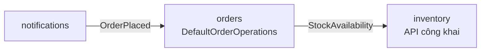
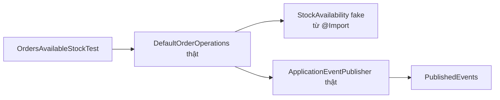
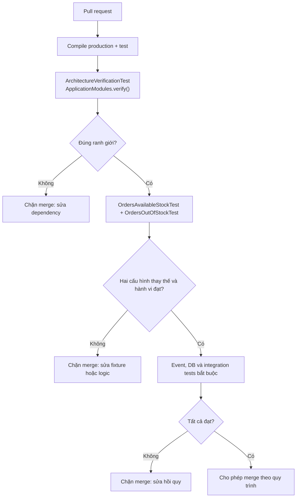

# @Import và cấu hình thay thế

Khi viết `@ApplicationModuleTest` cho một module Spring Modulith, chúng ta thường phải quyết định **bean nào được phép hiện diện trong ApplicationContext kiểm thử**. Nếu module `orders` sử dụng cổng `StockAvailability` do `inventory` cung cấp, test có thể cần một triển khai giả để tạo tình huống “còn hàng” hoặc “hết hàng” mà không kết nối cơ sở dữ liệu tồn kho. Một lựa chọn là khai báo cấu hình kiểm thử riêng rồi **`@Import` cấu hình đó vào đúng test cần sử dụng**.

Tuy nhiên, `@Import` chủ yếu là cơ chế **đưa bean definition hoặc cấu hình vào context**. Nó không đồng nghĩa với “thay thế mọi bean cùng kiểu đã tồn tại”. Hiểu sai điểm này sẽ gây ra test khởi động thất bại do trùng bean, test vô tình dùng implementation production, hoặc test xanh nhưng không kiểm tra được hành vi mà nhóm mong muốn.

Bài thuộc chương **Test configuration** của **SPRING_MODULITH_VERIFICATION_TESTING**. Ta sẽ thực hành cấu hình thay thế có kiểm soát, xác minh ranh giới kiến trúc qua `ApplicationModules.verify()`, kiểm thử hành vi bằng `@ApplicationModuleTest`, đồng thời liên hệ kiểm thử sự kiện, database, tích hợp và quality gate CI.

## 1. Mục tiêu học tập

Sau bài này, bạn có thể:

1. Giải thích ý nghĩa của `@Import` trong Spring Test context và phân biệt nó với cơ chế **bean override**.
2. Tạo top-level `@TestConfiguration` trong `src/test/java` rồi `@Import` vào `@ApplicationModuleTest`.
3. Dùng các cấu hình thay thế **khác nhau cho các test class khác nhau**, tránh chia sẻ fixture không chủ đích.
4. Phân biệt `STANDALONE`, `DIRECT_DEPENDENCIES` và `ALL_DEPENDENCIES` về khả năng xuất hiện bean thật của module phụ thuộc.
5. Chọn giữa **fake/stub**, `@Primary`, `@Qualifier`, `@MockitoBean` và việc nạp dependency thật.
6. Chẩn đoán lỗi thiếu bean, trùng bean, xung đột tên và cache context.
7. Thiết kế kiểm thử sự kiện bằng `PublishedEvents` và nhận ra khi nào cần database/transaction thật.
8. Đặt kiểm chứng cấu trúc `verify()` cùng kiểm thử module vào CI để ngăn phụ thuộc sai và hồi quy.

## 2. @Import tác động lên điều gì?

Annotation `@Import` thuộc Spring Framework:

```java
import org.springframework.context.annotation.Import;
```

Về cơ bản, nó cho Spring biết **những class cấu hình hoặc thành phần cần được đưa vào quá trình đăng ký bean** của `ApplicationContext` đang được tạo. Trong Spring, `@Import` có thể xử lý nhiều dạng thành phần, chẳng hạn `@Configuration`, một số component, `ImportSelector` hay `ImportBeanDefinitionRegistrar`. Trong bài này, ta tập trung vào trường hợp phổ biến nhất cho JUnit: **import một class `@TestConfiguration` có các method `@Bean`**.

Ví dụ:

```java
@ApplicationModuleTest
@Import(AvailableStockTestConfiguration.class)
class OrdersAvailableStockTest {
    // Spring Test context nhận các bean khai báo
    // trong AvailableStockTestConfiguration.
}
```

Hãy đọc đoạn trên theo hai ý độc lập:

- `@ApplicationModuleTest` quyết định **mô hình module và phạm vi bootstrap** của Spring Test context.
- `@Import` đóng góp **cấu hình bổ sung** vào context đó.

**`@Import` không tự tạo application module, không đổi package sở hữu kiểu Java, không cấp quyền truy cập vào API nội bộ và không tự xóa một bean production đang tồn tại.**

### Ba thao tác cần phân biệt

| Thao tác | Ý nghĩa | Cơ chế ví dụ |
| --- | --- | --- |
| **Bổ sung bean** | Đăng ký thêm một implementation vào test context | `@Import(MyTestConfiguration.class)` chứa `@Bean` |
| **Ưu tiên một bean** | Giữ nhiều candidate nhưng chọn một candidate khi inject theo kiểu | `@Primary` hoặc `@Qualifier` |
| **Thay thế bean** | Dùng cơ chế override để thay bean hiện có bằng mock/test bean | `@MockitoBean` hoặc API bean override phù hợp |

Ba thao tác này **không tương đương**. Đặc biệt, `@Primary` thường chỉ ảnh hưởng đến **lựa chọn dependency khi autowire**, chứ không ngăn bean còn lại được khởi tạo.

## 3. Ví dụ xuyên suốt: orders phụ thuộc inventory

Giả sử ứng dụng tổ chức các module:

```text
src/main/java/
└── com/acme/shop/
    ├── ShopApplication.java
    ├── inventory/
    │   ├── StockAvailability.java
    │   └── internal/
    │       └── DatabaseStockAvailability.java
    ├── orders/
    │   ├── OrderId.java
    │   ├── OrderOperations.java
    │   ├── events/
    │   │   ├── package-info.java
    │   │   └── OrderPlaced.java
    │   └── internal/
    │       └── DefaultOrderOperations.java
    └── notifications/
        └── internal/
            └── OrderPlacedListener.java

src/test/java/
└── com/acme/shop/
    ├── ArchitectureVerificationTest.java
    └── orders/
        ├── OrdersAvailableStockTest.java
        ├── OrdersOutOfStockTest.java
        ├── OrdersWithRealInventoryTest.java
        └── testsupport/
            ├── AvailableStockTestConfiguration.java
            └── OutOfStockTestConfiguration.java
```

Lớp khởi động Spring Boot nằm ở package gốc:

```java
// src/main/java/com/acme/shop/ShopApplication.java
package com.acme.shop;

import org.springframework.boot.autoconfigure.SpringBootApplication;

@SpringBootApplication
public class ShopApplication {
}
```

Với chiến lược phát hiện module mặc định, ba package con trực tiếp `inventory`, `orders` và `notifications` là ba application module. `orders.internal` chỉ là package con của `orders`, không tự tạo module mới.

### Hai góc nhìn vào hệ thống



Trên đây là **đồ thị phụ thuộc kiểu Java**. Khi đặt đơn ở runtime, `orders` có thể publish sự kiện để `notifications` xử lý; luồng sự kiện có thể chạy ngược chiều cạnh `notifications → orders`. Test configuration chỉ thay **cách cấp bean vào context**, không đổi đồ thị dependency mã production.

## 4. Định nghĩa hợp đồng production trước khi viết fake

### 4.1. Hợp đồng truy vấn tồn kho

```java
// src/main/java/com/acme/shop/inventory/StockAvailability.java
package com.acme.shop.inventory;

public interface StockAvailability {
    boolean available(String sku, int quantity);
}
```

Interface này được đặt tại base package `inventory`, vì vậy là API công khai mặc định của module đóng. Triển khai production `inventory.internal.DatabaseStockAvailability` có thể dùng repository, transaction và database; đó là chi tiết của `inventory` mà `orders` **không nên import trực tiếp**.

### 4.2. API đơn hàng

```java
// src/main/java/com/acme/shop/orders/OrderId.java
package com.acme.shop.orders;

import java.util.UUID;

public record OrderId(UUID value) {
}
```

```java
// src/main/java/com/acme/shop/orders/OrderOperations.java
package com.acme.shop.orders;

public interface OrderOperations {
    OrderId place(String sku, int quantity);
}
```

### 4.3. Hợp đồng sự kiện

```java
// src/main/java/com/acme/shop/orders/events/OrderPlaced.java
package com.acme.shop.orders.events;

import com.acme.shop.orders.OrderId;

public record OrderPlaced(OrderId orderId, String sku) {
}
```

Nếu `notifications` cần dùng kiểu `OrderPlaced`, module `orders` công khai package con này bằng named interface:

```java
// src/main/java/com/acme/shop/orders/events/package-info.java
@org.springframework.modulith.NamedInterface("events")
package com.acme.shop.orders.events;
```

### 4.4. Implementation thật của module orders

```java
// src/main/java/com/acme/shop/orders/internal/DefaultOrderOperations.java
package com.acme.shop.orders.internal;

import com.acme.shop.inventory.StockAvailability;
import com.acme.shop.orders.OrderId;
import com.acme.shop.orders.OrderOperations;
import com.acme.shop.orders.events.OrderPlaced;
import java.util.UUID;
import org.springframework.context.ApplicationEventPublisher;
import org.springframework.stereotype.Service;

@Service
class DefaultOrderOperations implements OrderOperations {

    private final StockAvailability stock;
    private final ApplicationEventPublisher publisher;

    DefaultOrderOperations(
            StockAvailability stock,
            ApplicationEventPublisher publisher
    ) {
        this.stock = stock;
        this.publisher = publisher;
    }

    @Override
    public OrderId place(String sku, int quantity) {
        if (quantity <= 0) {
            throw new IllegalArgumentException("Số lượng phải dương");
        }
        if (!stock.available(sku, quantity)) {
            throw new IllegalStateException("Không đủ tồn kho");
        }

        OrderId id = new OrderId(UUID.randomUUID());
        publisher.publishEvent(new OrderPlaced(id, sku));
        return id;
    }
}
```

Ví dụ này cố ý **chưa lưu đơn vào database và chưa trừ tồn kho** để tập trung vào cấu hình test. Trong hệ thống thật, các transaction, event sau commit và dữ liệu nhất quán cần được kiểm thử riêng.

## 5. Tạo cấu hình thay thế ở src/test/java

Ta muốn tạo hai tình huống:

- **Còn hàng:** `StockAvailability.available(...)` trả `true` cho một số SKU hợp lệ.
- **Hết hàng:** trả `false` cho mọi yêu cầu hợp lệ.

Hai tình huống có thể dùng **hai class `@TestConfiguration` khác nhau** ở `src/test/java`, rồi mỗi bài test import **một** class. Điều này tránh phải thay đổi code production hoặc sử dụng database tồn kho thật.

### 5.1. Cấu hình còn hàng

```java
// src/test/java/com/acme/shop/orders/testsupport/AvailableStockTestConfiguration.java
package com.acme.shop.orders.testsupport;

import com.acme.shop.inventory.StockAvailability;
import org.springframework.boot.test.context.TestConfiguration;
import org.springframework.context.annotation.Bean;

@TestConfiguration(proxyBeanMethods = false)
public class AvailableStockTestConfiguration {

    @Bean
    StockAvailability availableStockForTest() {
        return (sku, quantity) ->
                "SKU-42".equals(sku) && quantity > 0 && quantity <= 5;
    }
}
```

Với `proxyBeanMethods = false`, các method `@Bean` không dùng proxy để chặn những lời gọi qua lại trực tiếp giữa các method. Cách này hợp lý cho cấu hình đơn giản mà mỗi bean được định nghĩa độc lập như ví dụ. Nó **không phải cơ chế** quyết định bean được thay thế hay tồn tại ở production.

### 5.2. Cấu hình hết hàng

```java
// src/test/java/com/acme/shop/orders/testsupport/OutOfStockTestConfiguration.java
package com.acme.shop.orders.testsupport;

import com.acme.shop.inventory.StockAvailability;
import org.springframework.boot.test.context.TestConfiguration;
import org.springframework.context.annotation.Bean;

@TestConfiguration(proxyBeanMethods = false)
public class OutOfStockTestConfiguration {

    @Bean
    StockAvailability outOfStockForTest() {
        return (sku, quantity) -> false;
    }
}
```

Hai configuration đều khai báo bean kiểu `StockAvailability`, nhưng **mỗi test class bên dưới chỉ import một configuration**. Đây là phương án dễ hiểu khi muốn cấu hình test khác nhau mà không dùng singleton fake có mutable state.

> Lưu ý: class `@TestConfiguration` top-level trong `src/test/java` không tự được component scan trong cơ chế Spring Boot thông thường. Test cần `@Import` để đưa class ấy vào đúng context.

## 6. @ApplicationModuleTest + @Import: trường hợp còn hàng

Đặt test trong package của module `orders`:

```java
// src/test/java/com/acme/shop/orders/OrdersAvailableStockTest.java
package com.acme.shop.orders;

import com.acme.shop.orders.events.OrderPlaced;
import com.acme.shop.orders.testsupport.AvailableStockTestConfiguration;
import org.junit.jupiter.api.Test;
import org.springframework.beans.factory.annotation.Autowired;
import org.springframework.context.annotation.Import;
import org.springframework.modulith.test.ApplicationModuleTest;
import org.springframework.modulith.test.PublishedEvents;

import static org.assertj.core.api.Assertions.assertThat;

@ApplicationModuleTest
@Import(AvailableStockTestConfiguration.class)
class OrdersAvailableStockTest {

    @Autowired
    OrderOperations orders;

    @Test
    void placesOrderAndPublishesEvent(PublishedEvents publishedEvents) {
        OrderId id = orders.place("SKU-42", 2);

        assertThat(id).isNotNull();
        assertThat(publishedEvents.ofType(OrderPlaced.class)
                .matching(OrderPlaced::orderId, id)).hasSize(1);
    }
}
```

Luồng hoạt động:

1. `@ApplicationModuleTest` nhận diện module `orders` từ package của class test.
2. Chế độ bootstrap mặc định `STANDALONE` giới hạn context ở module `orders`; implementation `DatabaseStockAvailability` trong `inventory` không được nạp chỉ vì `orders` phụ thuộc interface `StockAvailability`.
3. `@Import(AvailableStockTestConfiguration.class)` đưa cấu hình fixture vào test context.
4. Method `@Bean availableStockForTest()` tạo bean implement `StockAvailability`.
5. Spring inject bean fixture vào **service thật** `DefaultOrderOperations`.
6. Test gọi `place(...)` và dùng `PublishedEvents` xác nhận sự kiện được publish.

Lời gọi `@Import` **bổ sung dependency cần thiết**, không sửa class `DefaultOrderOperations` và không thay đổi quan hệ mã `orders → inventory`.

### Vì sao PublishedEvents có ích?

`PublishedEvents` là tiện ích kiểm thử của Spring Modulith, có thể nhận qua tham số test trong `@ApplicationModuleTest`. Test kiểm chứng phía **producer** đã phát `OrderPlaced`; không cần khởi động listener thật trong `notifications`.

Điều đó **không chứng minh** module `notifications` đã gửi thông báo hoặc xử lý thành công event. Với consumer, cần một bài test module/tích hợp riêng.

## 7. Một @Import khác: trường hợp hết hàng

Test thứ hai nằm cùng module `orders` nhưng import configuration khác:

```java
// src/test/java/com/acme/shop/orders/OrdersOutOfStockTest.java
package com.acme.shop.orders;

import com.acme.shop.orders.testsupport.OutOfStockTestConfiguration;
import org.junit.jupiter.api.Test;
import org.springframework.beans.factory.annotation.Autowired;
import org.springframework.context.annotation.Import;
import org.springframework.modulith.test.ApplicationModuleTest;

import static org.junit.jupiter.api.Assertions.assertThrows;

@ApplicationModuleTest
@Import(OutOfStockTestConfiguration.class)
class OrdersOutOfStockTest {

    @Autowired
    OrderOperations orders;

    @Test
    void rejectsOrderWhenStockIsUnavailable() {
        assertThrows(IllegalStateException.class,
                () -> orders.place("SKU-42", 2));
    }
}
```

Trong ví dụ này, test không cần thay đổi `StockAvailability` ở production. Đơn giản là `OrdersOutOfStockTest` import một configuration cung cấp bean với hành vi khác. Trong một test class không nên import cả hai configuration này vì chúng cùng đóng góp `StockAvailability`, dễ dẫn đến lỗi **không phân giải được bean duy nhất**.

### Hai test class có dùng chung một ApplicationContext không?

Spring TestContext cache `ApplicationContext` theo cấu hình kiểm thử. Trong ví dụ:

| Test class | `@Import` | Hợp đồng `StockAvailability` | Kỳ vọng |
| --- | --- | --- | --- |
| `OrdersAvailableStockTest` | `AvailableStockTestConfiguration` | Cho phép tối đa 5 đơn vị của `SKU-42` | Đặt đơn thành công, có event |
| `OrdersOutOfStockTest` | `OutOfStockTestConfiguration` | Từ chối mọi yêu cầu | Ném lỗi thiếu tồn kho |

Do cấu hình import khác nhau, **thông tin cấu hình context khác nhau**, nên Spring Test thường tạo các cache entry khác nhau. Đây là cách cô lập fixture giữa hai nhóm test bằng **khác biệt về cấu hình**, không phải giả định cứ mỗi `@Test` là có context mới.

Không nên khẳng định các context luôn là những object khác nhau trong mọi cách tổ chức test, vì cache key còn phụ thuộc các thuộc tính context, môi trường, profile và cơ chế test khác.

## 8. Những ranh giới của @Import: thêm khác với thay thế

Trong mô hình `STANDALONE`, module `inventory` không được bootstrap đầy đủ nên test fixture `StockAvailability` thường là candidate duy nhất cho constructor `DefaultOrderOperations`.

Nhưng khi test chạy với module phụ thuộc thực:

```java
import org.springframework.modulith.test.ApplicationModuleTest;
import org.springframework.modulith.test.ApplicationModuleTest.BootstrapMode;

@ApplicationModuleTest(mode = BootstrapMode.DIRECT_DEPENDENCIES)
class OrdersWithRealInventoryTest {
    // Cần test database và các dependency thật của inventory.
}
```

Spring Modulith có thể nạp cả module `orders` và `inventory`. Khi `inventory` cung cấp `DatabaseStockAvailability`, nếu vẫn `@Import(AvailableStockTestConfiguration.class)` thì context có thể chứa **hai bean cùng triển khai `StockAvailability`**.

```text
Test context:
  DatabaseStockAvailability : StockAvailability   [production]
  availableStockForTest     : StockAvailability   [test fake]

Injection:
  DefaultOrderOperations(StockAvailability stock, ...)
                                  |
                                  +-- chọn bean nào?
```

Nếu Spring không có đủ thông tin để chọn, việc autowire có thể thất bại với `NoUniqueBeanDefinitionException`. Điều này cho thấy **`@Import` không mặc định thay thế bean production**.

### Hai dạng xung đột cần phân biệt

| Tình huống | Dấu hiệu có thể gặp | Điều nên làm |
| --- | --- | --- |
| Hai bean **khác tên, cùng kiểu** | Nhiều candidate `StockAvailability` | Chọn bootstrap mode hợp lý; nếu cần giữ cả hai, dùng `@Primary`/`@Qualifier` |
| Hai bean **cùng tên** | Trùng bean definition; Boot thường chặn overriding mặc định | Đổi chiến lược cấu hình hoặc dùng công cụ thay thế tường minh |
| Import fake nhưng production bean vẫn có | Test có thể tạo kết nối database ngoài ý định | Đừng dùng `@Primary` để giả định production bean không khởi tạo |
| Một bean production dùng tên qualifier riêng | `@MockitoBean`/injection chưa trúng bean mong muốn | Xác định bean name/qualifier chính xác |

**Không nên bật `spring.main.allow-bean-definition-overriding=true` trên toàn bộ test suite chỉ để bỏ qua mọi xung đột.** Điều đó dễ che lỗi cấu hình; thay vào đó nên chọn phương án phù hợp với mục tiêu test.

## 9. Phương án A — @Primary chỉ giúp chọn bean

Nếu có chủ đích giữ cả hai implementation trong cùng context, có thể gắn `@Primary` lên bean fixture:

```java
package com.acme.shop.orders.testsupport;

import com.acme.shop.inventory.StockAvailability;
import org.springframework.boot.test.context.TestConfiguration;
import org.springframework.context.annotation.Bean;
import org.springframework.context.annotation.Primary;

@TestConfiguration(proxyBeanMethods = false)
public class PreferredStockTestConfiguration {

    @Bean
    @Primary
    StockAvailability preferredStockForTest() {
        return (sku, quantity) -> true;
    }
}
```

Khi constructor injection theo **kiểu `StockAvailability`** không có qualifier khác, Spring thường ưu tiên candidate `@Primary`. Tuy nhiên:

- Bean `DatabaseStockAvailability` vẫn là bean của context và có thể được khởi tạo.
- Những dependency của bean production (như datasource, repository) vẫn có thể gây lỗi khi context bootstrap.
- `@Primary` **không thay thế** bean cùng tên hoặc xóa bean khác.
- Nếu bean khác được yêu cầu bằng `@Qualifier` hoặc tên riêng, việc gắn `@Primary` không bảo đảm nó được chọn.

Vì vậy `@Primary` phù hợp khi **cần cả hai bean tồn tại** nhưng có một lựa chọn mặc định lúc inject; **không** phải công cụ cô lập module hoặc thay thế production bean tốt nhất.

## 10. Phương án B — @MockitoBean để thay bean có chủ đích

Nếu muốn test module `orders` cùng dependency thật nhưng cần kiểm soát một bean cụ thể, Spring Framework hiện đại hỗ trợ `@MockitoBean`:

```java
// src/test/java/com/acme/shop/orders/OrdersWithMockedInventoryTest.java
package com.acme.shop.orders;

import com.acme.shop.inventory.StockAvailability;
import org.junit.jupiter.api.Test;
import org.springframework.beans.factory.annotation.Autowired;
import org.springframework.modulith.test.ApplicationModuleTest;
import org.springframework.modulith.test.ApplicationModuleTest.BootstrapMode;
import org.springframework.test.context.bean.override.mockito.MockitoBean;

import static org.junit.jupiter.api.Assertions.assertNotNull;
import static org.mockito.Mockito.verify;
import static org.mockito.Mockito.when;

@ApplicationModuleTest(mode = BootstrapMode.DIRECT_DEPENDENCIES)
class OrdersWithMockedInventoryTest {

    @Autowired
    OrderOperations orders;

    @MockitoBean
    StockAvailability stock;

    @Test
    void usesMockedStockContract() {
        when(stock.available("SKU-42", 2)).thenReturn(true);

        assertNotNull(orders.place("SKU-42", 2));

        verify(stock).available("SKU-42", 2);
    }
}
```

`@MockitoBean` sử dụng cơ chế **bean override của Spring TestContext**, theo mặc định có thể thay thế một bean phù hợp đã tồn tại hoặc tạo bean mock nếu chưa có candidate; khi có nhiều bean cùng kiểu, cần chỉ rõ name/qualifier tương ứng. Với các phiên bản Spring Framework/Boot cũ hơn, API mock bean có thể khác. Không tự áp dụng ví dụ này cho stack chưa hỗ trợ `@MockitoBean`.

Phân biệt:

- `@Import(AvailableStockTestConfiguration.class)`: đăng ký **một bean fake mới**.
- `@MockitoBean StockAvailability stock`: yêu cầu Spring Test thiết lập **mock bean** theo cơ chế override/test registration.

Một `@MockitoBean` vẫn không có nghĩa mọi thành phần phụ thuộc module `inventory` đều bị loại khỏi context. Nếu test nạp `DIRECT_DEPENDENCIES`, những bean production khác vẫn có thể được tạo; để cô lập thực sự, hãy chọn **phạm vi bootstrap phù hợp**.

### Khi nào dùng lựa chọn nào?

| Mục tiêu | Lựa chọn ưu tiên | Vì sao |
| --- | --- | --- |
| Kiểm thử service thật của `orders`, không cần database inventory | `STANDALONE` + `@Import` fake | Module nhỏ, fixture xác định |
| Nhiều test cùng sử dụng quy tắc fake ổn định | Top-level `@TestConfiguration` + `@Import` | Dễ tái sử dụng, có thể đặt tên rõ |
| Chỉ muốn stub một kết quả và xác nhận lời gọi | `@MockitoBean` | Ngắn gọn, có Mockito verification |
| Test integration của cả `orders` và `inventory` | `DIRECT_DEPENDENCIES`, dùng implementation thật | Kiểm tra sự phối hợp thực tế |
| Có hai bean cùng kiểu đều cần hoạt động | `@Primary` hoặc `@Qualifier` | Điều khiển injection mà không xóa bean |
| Muốn kiểm tra JPA mapping/transaction | Database và repository thật | Fake không kiểm tra persistence |

## 11. @Import không có quyền thay đổi ranh giới kiến trúc

Giả sử lập trình viên viết:

```java
// VÍ DỤ CỐ TÌNH SAI KIẾN TRÚC.
package com.acme.shop.orders.internal;

import com.acme.shop.inventory.internal.DatabaseStockAvailability;

class BadOrderAdapter {
    private final DatabaseStockAvailability stock;

    BadOrderAdapter(DatabaseStockAvailability stock) {
        this.stock = stock;
    }
}
```

Nếu kiểu `DatabaseStockAvailability` là `public`, Java có thể cho phép import. Nhưng kiểu này nằm trong package con **nội bộ của module `inventory`**; trong mô hình module đóng mặc định, một lớp thuộc `orders` không được tham chiếu nó trực tiếp.

Kể cả khi `@Import` một cấu hình test có bean `DatabaseStockAvailability` giúp Spring context khởi động, mã production vẫn có **phụ thuộc kiến trúc sai**.

Đặt bài test kiểm chứng:

```java
// src/test/java/com/acme/shop/ArchitectureVerificationTest.java
package com.acme.shop;

import org.junit.jupiter.api.Test;
import org.springframework.modulith.core.ApplicationModules;

import static org.junit.jupiter.api.Assertions.assertTrue;

class ArchitectureVerificationTest {

    @Test
    void expectedModulesExist() {
        ApplicationModules modules =
                ApplicationModules.of(ShopApplication.class);

        assertTrue(modules.getModuleByName("orders").isPresent());
        assertTrue(modules.getModuleByName("inventory").isPresent());
    }

    @Test
    void dependenciesRespectModuleBoundaries() {
        ApplicationModules.of(ShopApplication.class).verify();
    }
}
```

`ApplicationModules.verify()` phân tích quan hệ cấu trúc giữa application module, bao gồm:

1. Phát hiện **phụ thuộc vòng** giữa module.
2. Phát hiện việc tham chiếu tới **kiểu nội bộ của module khác** theo quy tắc module đóng.
3. Kiểm tra **`allowedDependencies`** nếu module nguồn khai báo giới hạn đó.

Nếu dự án muốn `orders` chỉ được phụ thuộc vào API mặc định của `inventory`:

```java
// src/main/java/com/acme/shop/orders/package-info.java
@org.springframework.modulith.ApplicationModule(
    allowedDependencies = "inventory"
)
package com.acme.shop.orders;
```

**Không nên dùng `@Import` để “hợp thức hóa” một dependency production vốn đã sai.** Test configuration phục vụ test runtime; ranh giới API và chiều phụ thuộc cần được thiết kế và kiểm chứng độc lập.

## 12. @Import và kiểm thử sự kiện

Trong ví dụ trên, module `orders` publish sự kiện `OrderPlaced` bằng `ApplicationEventPublisher` thật của Spring. Test có thể sử dụng `PublishedEvents` để kiểm chứng sự kiện đã được phát.



Nếu mục tiêu là quan sát event bằng `PublishedEvents`:

- Giữ publisher thật để cơ chế quan sát sự kiện hoạt động.
- Không dùng `@Import` để vô tình thay thế hoặc che đường đi của `ApplicationEventPublisher`.
- Kiểm tra payload sự kiện `OrderPlaced`, không chỉ “service không ném exception”.
- Kiểm thử listener của `notifications` riêng, vì `@ApplicationModuleTest` của `orders` ở chế độ `STANDALONE` không chứng minh consumer đã xử lý event.

### Khi nào cần test đa module?

Nếu muốn xác nhận `notifications` nhận `OrderPlaced` và thực hiện thao tác gửi thông báo, có thể tạo test module `notifications` hoặc integration test có cả module phát và module nhận. Với cơ chế event bất đồng bộ hoặc `@TransactionalEventListener`, cần xử lý thời điểm event được giao, transaction commit và cách chờ kết quả phù hợp.

**`@Import` fake cổng tồn kho** có thể giúp producer tạo tình huống phát event ổn định, nhưng không thay kiểm thử delivery, retry hoặc xử lý lỗi của consumer.

## 13. @Import, repository và cơ sở dữ liệu

Nơi cần cẩn trọng nhất khi đưa cấu hình thay thế là database:

| Test muốn kiểm chứng | Có nên dùng fake từ `@Import`? | Giải thích |
| --- | --- | --- |
| Quy tắc đặt hàng khi tồn kho đủ/thiếu | **Có thể** fake `StockAvailability` | Tập trung vào logic `orders` |
| Repository và JPA mapping của `inventory` | **Không** fake repository đang được kiểm tra | Fake sẽ bỏ qua SQL, mapping, constraint |
| Transaction ghi đơn hàng của `orders` | Dùng repository/database thật của `orders` | Cần kiểm chứng commit/rollback và dữ liệu |
| Event xử lý **sau commit** | Dùng transaction thật và xác minh callback tương ứng | Test rollback có thể không kích hoạt `AFTER_COMMIT` |
| Kết nối hệ thống ngoài (payment, shipping API) | Fake hoặc mock ở test module riêng; integration test cấp cao hơn | Tránh network thật trong test đơn vị/module hẹp |

Nếu `orders` sau này có `orders.internal.OrderRepository`, có thể **giữ repository của `orders` thật** nhưng fake `StockAvailability` từ `inventory`. Khi ấy test vẫn cô lập hợp đồng giữa các module mà **không fake phần persistence của module đang kiểm thử**.

### @Import có thể vô tình kéo hạ tầng ngoài vào context

Nếu một class `@TestConfiguration` mới có `@Bean` yêu cầu `DataSource` hoặc import thêm một `@Configuration` production phức tạp, Spring có thể phải tạo bean và dependency mà test vốn muốn tránh. Vì vậy:

1. Giữ test configuration **nhỏ và trực tiếp**.
2. Xem từng method `@Bean` cần những dependency nào.
3. Không import một package/module production rộng chỉ để dùng một utility nhỏ.
4. Nếu thật sự kiểm tra database, chuẩn bị test DB/Testcontainers và dữ liệu khởi tạo có chủ đích.
5. Đối với giao dịch sau commit, không chỉ dựa vào test `@Transactional` mặc định rollback rồi suy ra consumer luôn chạy đúng.

## 14. Context cache: chọn configuration theo test, không thay giữa chừng

Spring Test có cơ chế cache `ApplicationContext`. Đối với các test dùng `@Import`:

```text
OrdersAvailableStockTest
   @Import(AvailableStockTestConfiguration)
        |
        +--> Context A: StockAvailability cho phép SKU-42

OrdersOutOfStockTest
   @Import(OutOfStockTestConfiguration)
        |
        +--> Context B: StockAvailability từ chối yêu cầu
```

Đây là **hai cấu hình context khác nhau**, giúp mỗi nhóm scenario có fixture ổn định. Nếu thay vì tách class, ta dùng một singleton fake có biến trạng thái và test A sửa giá trị, test B có thể bị ảnh hưởng nếu context được cache.

### Nếu thật sự phải dùng fake có trạng thái

Ví dụ fake cho phép thay kết quả:

```java
// src/test/java/com/acme/shop/orders/testsupport/ControllableStock.java
package com.acme.shop.orders.testsupport;

import com.acme.shop.inventory.StockAvailability;

public final class ControllableStock implements StockAvailability {

    private boolean available = true;

    public void setAvailable(boolean available) {
        this.available = available;
    }

    public void reset() {
        available = true;
    }

    @Override
    public boolean available(String sku, int quantity) {
        return available && quantity > 0;
    }
}
```

Test configuration có thể đăng ký `@Bean ControllableStock` để Spring inject cùng một instance qua interface `StockAvailability`. Nếu test thay đổi `setAvailable(...)`, nên gọi `reset()` trong `@BeforeEach` và xử lý các test chạy song song phù hợp.

Tuy nhiên, khi hai trạng thái **hằng và đơn giản**, dùng hai `@Import` riêng như ví dụ chính thường rõ ràng hơn. Không nên dùng `@DirtiesContext` vô điều kiện cho mọi method chỉ để tránh reset state; việc làm mới context tốn thời gian.

## 15. Cách tổ chức cấu hình thay thế trong test source set

Một quy ước dễ bảo trì:

```text
src/test/java/com/acme/shop/orders/
├── OrdersAvailableStockTest.java
├── OrdersOutOfStockTest.java
└── testsupport/
    ├── AvailableStockTestConfiguration.java
    ├── OutOfStockTestConfiguration.java
    └── ControllableStock.java
```

Với quy trình build thông thường, `src/test/java` được compile cho test runtime, **không đóng vào artifact triển khai production**. Top-level `@TestConfiguration` thường bị loại khỏi component scan tự động của Spring Boot; test muốn dùng phải import tường minh.

Không nên:

- Đặt fake `@Component` trong `src/main/java` chỉ để JUnit có bean.
- Dựa duy nhất vào `@Profile("test")` trên class production rồi coi class đó đã biến mất khỏi artifact.
- Đưa một class `@TestConfiguration` quá rộng chứa tất cả fake cho mọi module.
- Import cùng lúc nhiều cấu hình cùng cung cấp một interface mà không có kế hoạch giải quyết injection.
- Bật bean override toàn cục mà không kiểm tra bean thật nào đang bị thay.

Nếu một số test phải chia sẻ configuration, hãy viết nó thành fixture có trách nhiệm rõ, dễ tìm kiếm và chỉ import khi cần.

## 16. Chẩn đoán lỗi khi dùng @Import

| Triệu chứng | Nguyên nhân thường gặp | Hướng xử lý |
| --- | --- | --- |
| `NoSuchBeanDefinitionException` cho `StockAvailability` | Quên `@Import` hoặc test class ngoài module mong muốn | Kiểm tra annotation import, package của test và bootstrap mode |
| Class `@TestConfiguration` top-level không được nạp | Spring Boot không tự scan top-level test configuration theo mặc định | `@Import(MyTestConfiguration.class)` |
| `NoUniqueBeanDefinitionException` | Fake và implementation thật cùng có mặt hoặc import hai fake | Thu hẹp bootstrap, giữ một fixture, hoặc dùng `@Primary`/`@Qualifier` nếu cố ý giữ nhiều bean |
| Bean definition name conflict | Bean test trùng tên bean thật, overriding mặc định bị chặn | Dùng cơ chế override phù hợp, không thêm bean cùng tên mù quáng |
| `@Primary` nhưng test vẫn kết nối database | Bean production vẫn được tạo | Dùng `STANDALONE` hoặc loại dependency thật bằng chiến lược test phù hợp |
| `@MockitoBean` không biết thay bean nào | Có nhiều candidate cùng kiểu | Chỉ rõ bean name/qualifier và kiểm tra test context |
| Test A làm test B fail | Fixture singleton có state và context cache tái sử dụng | Reset fake hoặc tách configuration/test context |
| `PublishedEvents` không thấy event | Publisher bị thay hoặc service không publish | Giữ publisher thật, gọi đúng use case, kiểm tra event |
| Test module chạy xanh nhưng `verify()` fail | Dependency production đang vi phạm kiến trúc | Sửa import/API/chiều dependency, không chỉ chỉnh test config |
| Test DB chạy xanh nhưng migration sai | Repository/database đã bị fake | Chạy bài tích hợp với database thật |

### Một quy trình điều tra có thứ tự

1. Xác định test chạy với `@ApplicationModuleTest` và bootstrap mode nào.
2. Xác nhận test class ở package của **module cần kiểm thử**.
3. Kiểm tra `@Import` đang chỉ tới đúng `@TestConfiguration` trên test classpath.
4. Liệt kê bean theo kiểu/tên trong context nếu có lỗi autowire.
5. Xác định đang **thêm bean**, **ưu tiên bean** hay **thay bean**; chọn công cụ đúng.
6. Kiểm tra fixture có state hoặc dependency kéo theo database/network ngoài ý định không.
7. Chạy assertion nghiệp vụ, `PublishedEvents`, database/integration test theo mục tiêu.
8. Chạy `ApplicationModules.verify()` để xác nhận ranh giới mã production vẫn hợp lệ.

## 17. Quality gate CI: không lấy test config làm bằng chứng kiến trúc

Một pipeline kiểm thử có thể gồm:



Ví dụ lệnh chạy test khi dự án đã cấu hình build:

```bash
# Maven Wrapper
./mvnw test

# Hoặc Gradle Wrapper
./gradlew test
```

Trong dự án có task riêng cho integration test hoặc Testcontainers, CI phải gọi thêm những task bắt buộc. Test configuration chỉ là **công cụ làm cho test có thể chạy trong phạm vi phù hợp**, không phải bằng chứng rằng event, database hoặc dependency graph của production đều đúng.

### Bốn câu hỏi review trước khi merge

1. Vì sao bài test phải `@Import` configuration này thay vì dùng bean thật?
2. Configuration mới **thêm bean**, **ưu tiên bean** hay muốn **thay bean**? Đã dùng công cụ tương ứng chưa?
3. Fixture có khiến test bỏ qua đúng behavior cần kiểm tra (như transaction/database) không?
4. Bài test kiến trúc `verify()` và test hành vi bắt buộc có chạy trong CI không?

## 18. Bài thực hành: dự đoán cách Spring chọn bean

Giả sử ứng dụng đặt vé:

```text
com.example.ticket
├── TicketApplication.java
├── booking/
│   ├── BookingOperations.java
│   └── internal/BookingService.java
├── payment/
│   ├── PaymentGateway.java
│   └── internal/HttpPaymentGateway.java
└── notification/
    └── internal/BookingConfirmedListener.java
```

`BookingService` inject interface `PaymentGateway` từ module `payment`. Test `BookingModuleTest` được đặt trong package `com.example.ticket.booking`.

Hai configuration trong `src/test/java`:

```java
@TestConfiguration(proxyBeanMethods = false)
class ApprovePaymentTestConfiguration {
    @Bean
    PaymentGateway approvedPayment() {
        return request -> PaymentResult.approved();
    }
}

@TestConfiguration(proxyBeanMethods = false)
class RejectPaymentTestConfiguration {
    @Bean
    PaymentGateway rejectedPayment() {
        return request -> PaymentResult.declined();
    }
}
```

Các đoạn trên là **mảnh cấu hình minh họa**, giả định `PaymentGateway` là functional interface với một method nhận `request` và trả `PaymentResult`, hai phương thức factory `approved()`/`declined()` do ứng dụng định nghĩa. Trong project thật, phải đặt class đúng package, import `@TestConfiguration`, `@Bean`, `PaymentGateway` và `PaymentResult` phù hợp.

### Câu hỏi

1. Nếu `BookingModuleTest` chạy `STANDALONE` và `@Import(ApprovePaymentTestConfiguration.class)`, bean `HttpPaymentGateway` có nhất thiết được bootstrap không?
2. Nếu một test class khác import `RejectPaymentTestConfiguration`, điều gì giúp hai kịch bản không dùng nhầm fixture của nhau?
3. Nếu một test import **cả hai** configuration, nguy cơ nào xuất hiện?
4. Nếu đổi test sang `DIRECT_DEPENDENCIES` và `payment` có bean thật, `@Import(ApprovePaymentTestConfiguration.class)` có tự thay bean thật không?
5. `@Primary` giải quyết điều gì và **không** giải quyết điều gì trong bối cảnh câu 4?
6. Khi muốn thay `HttpPaymentGateway` bằng mock để xác minh lời gọi, nên cân nhắc cơ chế gì?
7. Nếu một fake có biến `approved` bị test trước đặt `false`, vì sao test sau có thể bị ảnh hưởng?
8. Một test chỉ xác nhận `BookingConfirmed` đã được publish có chứng minh module `notification` đã xử lý sự kiện không?
9. Vì sao vẫn cần `ApplicationModules.of(TicketApplication.class).verify()` dù module test đã khởi động?
10. Nếu mục tiêu kiểm chứng transaction và giao tiếp HTTP thật, nên dùng `@Import` fake ở mức nào và cần bổ sung test gì?

### Đáp án gợi ý

1. **Không.** `STANDALONE` chỉ bootstrap `booking`; configuration test cung cấp cổng `PaymentGateway` mà không cần nạp toàn bộ `payment`.
2. `@Import` khác nhau tạo **cấu hình test context khác nhau**; không phải một fake toàn cục tự đổi trạng thái.
3. Có thể có **hai bean cùng kiểu `PaymentGateway`**, khiến việc inject không xác định hoặc gây lỗi; nên import một configuration phù hợp.
4. **Không.** `@Import` thêm bean vào context; implementation thật có thể vẫn tồn tại.
5. `@Primary` chọn candidate ưu tiên khi inject theo kiểu nhưng **không loại hoặc ngăn khởi tạo** bean còn lại.
6. `@MockitoBean` của Spring TestContext hiện đại, với qualifier/name phù hợp khi có nhiều bean, hoặc cơ chế thay bean tương thích phiên bản dự án.
7. Vì singleton fake có thể sống trong context được cache, trạng thái giữa test method có thể bị chia sẻ. Reset trong `@BeforeEach` hoặc dùng fake stateless.
8. **Không.** `PublishedEvents` ở module phát kiểm tra publication; consumer cần event/integration test riêng.
9. Test runtime có thể xanh nhờ fixture ngay cả khi mã production tham chiếu API nội bộ hoặc tạo chu trình; `verify()` bảo vệ ranh giới kiến trúc.
10. Chỉ fake những cổng **ngoài phạm vi cần kiểm tra**. Để kiểm tra transaction, repository, giao tiếp HTTP và retry, cần test tích hợp với hệ thống giả lập ở cấp phù hợp hoặc môi trường test chuyên dụng.

### Thử mở rộng

Thực hành ba phương án cho cùng một bài `booking`:

1. `STANDALONE` + `@Import(ApprovePaymentTestConfiguration.class)`, kiểm tra luồng thành công.
2. `STANDALONE` + `@MockitoBean PaymentGateway`, stub thất bại và kiểm chứng số lần gọi.
3. `DIRECT_DEPENDENCIES` không import fake, dùng implementation `payment` thật và server thanh toán mô phỏng ở cấp HTTP.

Hãy giải thích **vì sao ba test cung cấp mức độ bảo đảm khác nhau**, dù đều sử dụng `@ApplicationModuleTest`.

## 19. Checklist trước khi merge cấu hình thay thế

- [ ] Class `@TestConfiguration` nằm trong test source set, không bị đưa vào artifact production.
- [ ] Top-level configuration được `@Import` **tường minh** tại test cần dùng.
- [ ] Biết rõ test đang `STANDALONE`, `DIRECT_DEPENDENCIES` hay `ALL_DEPENDENCIES`.
- [ ] Mỗi context có đúng số bean của interface được test mong đợi.
- [ ] Không nhầm `@Import` với cơ chế bean override.
- [ ] `@Primary` hoặc `@Qualifier` chỉ được dùng khi có chủ đích giữ nhiều bean.
- [ ] Khi phải thay bean, chọn `@MockitoBean` hoặc cơ chế test override phù hợp phiên bản.
- [ ] Không bật bean-definition overriding toàn cục chỉ để làm test xanh.
- [ ] Fake không có mutable state, hoặc có reset/cô lập state giữa các test.
- [ ] Không mock chính service nghiệp vụ thuộc module cần kiểm thử.
- [ ] Producer event test giữ publisher thật nếu kiểm tra `PublishedEvents`.
- [ ] Database/transaction test không fake repository cần kiểm chứng.
- [ ] `ApplicationModules.verify()` và các module/integration tests bắt buộc được CI chạy.

**Ghi nhớ:** `@Import` là cách **đưa một cấu hình được chọn vào đúng Spring Test `ApplicationContext`**. Nó rất hữu ích để cung cấp implementation thay thế **về hành vi** khi test `@ApplicationModuleTest` ở chế độ `STANDALONE`, nhưng **không tự thay thế một bean production đã tồn tại**. Muốn chọn một bean trong nhiều candidate, dùng `@Primary`/`@Qualifier`; muốn override có chủ đích, dùng công cụ test bean override tương thích. Hãy kiểm chứng kiến trúc bằng `ApplicationModules.verify()` độc lập với fake, và dùng test event/database/integration cho các yêu cầu runtime.

## Tài liệu tham khảo

- [Spring Boot Reference — Testing Spring Boot Applications](https://docs.spring.io/spring-boot/reference/testing/spring-boot-applications.html)
- [Spring Boot API — TestConfiguration](https://docs.spring.io/spring-boot/api/java/org/springframework/boot/test/context/TestConfiguration.html)
- [Spring Framework API — Import](https://docs.spring.io/spring-framework/docs/current/javadoc-api/org/springframework/context/annotation/Import.html)
- [Spring Framework Reference — @MockitoBean and @MockitoSpyBean](https://docs.spring.io/spring-framework/reference/testing/annotations/integration-spring/annotation-mockitobean.html)
- [Spring Framework Reference — Context Caching](https://docs.spring.io/spring-framework/reference/testing/testcontext-framework/ctx-management/caching.html)
- [Spring Modulith Reference — Testing Application Modules](https://docs.spring.io/spring-modulith/reference/testing.html)
- [Spring Modulith Reference — Verifying Application Module Structure](https://docs.spring.io/spring-modulith/reference/verification.html)
- [Spring Modulith Reference — Application Events](https://docs.spring.io/spring-modulith/reference/events.html)
