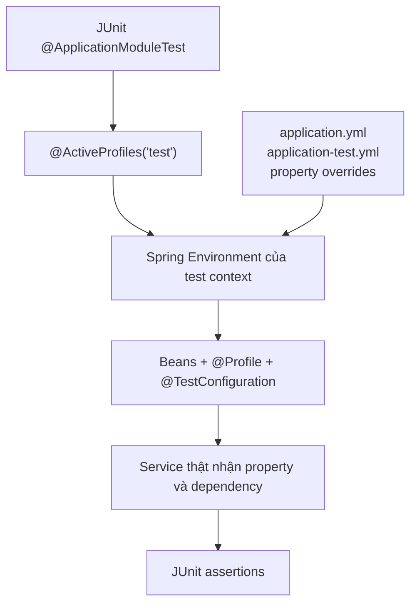
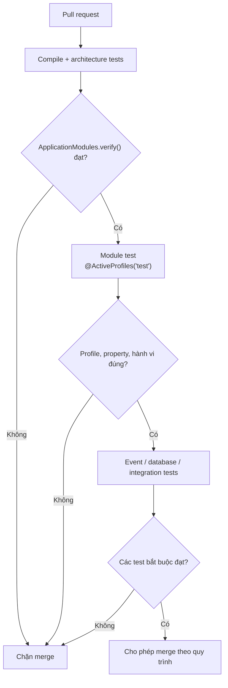

# @ActiveProfiles và dữ liệu cấu hình

Một bài `@ApplicationModuleTest` có thể khởi động đúng module và có đủ Spring bean nhưng vẫn kiểm thử **sai tình huống** vì dữ liệu cấu hình không đúng. Chẳng hạn module `orders` ở production cho phép đặt tối đa 20 sản phẩm, còn bài test muốn giới hạn 3 sản phẩm để kiểm tra nhánh từ chối. Nếu test vô tình đọc cấu hình production, một kết quả xanh chưa chắc xác nhận được yêu cầu mong muốn.

`@ActiveProfiles` của Spring TestContext chỉ định **profile được kích hoạt khi nạp Spring `ApplicationContext` dành cho test**. Khi kết hợp với Spring Boot Config Data (`application-test.yml`), `@TestPropertySource`, `@DynamicPropertySource` và `@TestConfiguration`, nó giúp tạo môi trường kiểm thử có thể dự đoán được, không phải thay đổi mã hoặc cấu hình triển khai production.

Bài học thuộc chương **Test configuration** của **SPRING_MODULITH_VERIFICATION_TESTING**. Nội dung tập trung vào cách cấp dữ liệu cho `@ApplicationModuleTest`, kiểm tra sự kiện, database, tích hợp và đưa `ApplicationModules.verify()` cùng các test runtime vào quality gate CI nhằm ngăn phụ thuộc sai và hồi quy.

## 1. Mục tiêu

Sau bài này, bạn có thể:

1. Phân biệt `@ActiveProfiles`, `@Profile`, `@TestConfiguration` và nguồn property.
2. Tổ chức `application.yml` cùng `application-test.yml` để một property có giá trị test/production khác nhau.
3. Viết `@ApplicationModuleTest` có `@ActiveProfiles("test")`, bean giả cho dependency ngoài module và assertion về cấu hình.
4. Ghi đè một property cho test class bằng `@TestPropertySource` mà không sửa file dùng chung.
5. Dùng `@DynamicPropertySource` khi JDBC URL hoặc cổng dịch vụ chỉ được biết tại runtime.
6. Giải thích profile được kế thừa, multiple profiles, thứ tự ưu tiên property và cache context.
7. Phân định kiểm thử module, sự kiện, persistence và tích hợp có hạ tầng thật.
8. Kết hợp kiểm chứng kiến trúc bằng `ApplicationModules.verify()` với test cấu hình/hành vi trong CI.

## 2. Ba câu hỏi phải tách riêng

| Khái niệm | Câu hỏi | Công cụ |
| --- | --- | --- |
| **Profile active** | “Những profile nào đang bật khi test context được khởi tạo?” | `@ActiveProfiles("test")` |
| **Giá trị property** | “`shop.orders.max-quantity` lấy giá trị từ nguồn nào?” | `application.yml`, `application-test.yml`, `@TestPropertySource`, `@DynamicPropertySource` |
| **Đăng ký bean** | “Bean triển khai `StockAvailability` nào có mặt?” | `@Profile`, `@Configuration`, `@TestConfiguration`, `@MockitoBean` |

Các khái niệm liên quan nhưng không thay thế nhau:

- `@ActiveProfiles("test")` **kích hoạt profile test** trong Spring TestContext; bản thân nó không tạo giá trị `max-quantity = 3`.
- `application-test.yml` **cung cấp giá trị khi profile `test` active**; việc có file không tự kích hoạt profile.
- `@Profile("test")` là điều kiện để Spring đăng ký bean, không bảo đảm bean đó chỉ tồn tại trên test classpath.
- `@TestConfiguration` đưa **bean phục vụ test** vào context nếu được phát hiện hoặc import đúng cách; nó không đổi module ownership.



**Điểm quan trọng:** dữ liệu cấu hình là một phần của *test fixture*. Để test chạy lặp lại được, phải kiểm soát **cả nguồn property và bean được tạo**.

## 3. Cấu trúc mẫu: orders, inventory, notifications

```text
src/main/java/com/acme/shop/
├── ShopApplication.java
├── inventory/
│   ├── StockAvailability.java
│   └── internal/DatabaseStockAvailability.java
├── orders/
│   ├── OrderId.java
│   ├── OrderOperations.java
│   ├── events/
│   │   ├── package-info.java
│   │   └── OrderPlaced.java
│   └── internal/DefaultOrderOperations.java
└── notifications/
    └── internal/OrderPlacedListener.java

src/main/resources/application.yml

src/test/java/com/acme/shop/
├── ArchitectureVerificationTest.java
└── orders/
    ├── OrdersWithTestProfileTest.java
    └── OrdersWithOverrideTest.java

src/test/resources/application-test.yml
```

Lớp ứng dụng được đặt tại gốc chung:

```java
// src/main/java/com/acme/shop/ShopApplication.java
package com.acme.shop;

import org.springframework.boot.autoconfigure.SpringBootApplication;

@SpringBootApplication
public class ShopApplication {
}
```

Theo phát hiện mặc định, `inventory`, `orders` và `notifications` là ba application module. Service của `orders` tham chiếu interface `inventory.StockAvailability`, tạo cạnh phụ thuộc **`orders → inventory`**. Listener của `notifications` tham chiếu event từ `orders`, tạo cạnh **`notifications → orders`**.


**Mục tiêu test:** giữ service `orders` thật, fake cổng tồn kho ngoài module, đọc hạn mức bằng profile `test` và kiểm tra validation cùng việc publish `OrderPlaced`.

## 4. Dữ liệu mặc định và dữ liệu theo profile

Cấu hình cho ứng dụng production:

```yaml
# src/main/resources/application.yml
shop:
  orders:
    max-quantity: 20
    publish-events: true
```

Cấu hình chỉ phục vụ test:

```yaml
# src/test/resources/application-test.yml
shop:
  orders:
    max-quantity: 3
    publish-events: true
```

Giả sử không có nguồn property khác ghi đè:

| Property | Không bật profile `test` | Bật `@ActiveProfiles("test")` |
| --- | --- | --- |
| `shop.orders.max-quantity` | `20` | `3` |
| `shop.orders.publish-events` | `true` | `true` |

Spring Boot hỗ trợ file theo quy ước `application-{profile}.properties` hoặc `application-{profile}.yml`. Khi profile được kích hoạt, các file tương ứng được xét cùng nguồn mặc định trong hệ thống Config Data. File profile-specific thường ghi đè giá trị cùng key trong file không gắn profile theo quy tắc của cùng nhóm location.

Đặt `application-test.yml` ở **`src/test/resources`** giúp file có mặt trong test classpath và không nằm trong artifact production theo quy trình build thông thường. Điều đó không thay thế việc bảo vệ secrets: **đừng commit mật khẩu production vào bất kỳ file test nào**.

### Tránh tự kích hoạt profile trong file profile-specific

Ví dụ sau **không phù hợp**:

```yaml
# KHÔNG đặt trong application-test.yml:
spring:
  profiles:
    active: test
```

Trong Config Data hiện đại của Spring Boot, `spring.profiles.active` và `spring.profiles.default` chỉ hợp lệ ở tài liệu cấu hình **không phải profile-specific** và không được khai báo trong tài liệu được kích hoạt bằng `spring.config.activate.on-profile`. Với JUnit, dùng `@ActiveProfiles("test")` để xác định profile.

## 5. Các kiểu production chịu tác động của cấu hình

### 5.1. Interface của module inventory

```java
// src/main/java/com/acme/shop/inventory/StockAvailability.java
package com.acme.shop.inventory;

public interface StockAvailability {
    boolean available(String sku, int quantity);
}
```

Interface ở base package `inventory` là API công khai mặc định của module đóng. Implementation `inventory.internal.DatabaseStockAvailability` không phải kiểu mà `orders` nên import trực tiếp.

### 5.2. API của module orders

```java
// src/main/java/com/acme/shop/orders/OrderId.java
package com.acme.shop.orders;

import java.util.UUID;

public record OrderId(UUID value) {
}
```

```java
// src/main/java/com/acme/shop/orders/OrderOperations.java
package com.acme.shop.orders;

public interface OrderOperations {
    OrderId place(String sku, int quantity);
}
```

### 5.3. Event từ module orders

```java
// src/main/java/com/acme/shop/orders/events/OrderPlaced.java
package com.acme.shop.orders.events;

import com.acme.shop.orders.OrderId;

public record OrderPlaced(OrderId orderId, String sku) {
}
```

Nếu module `notifications` tham chiếu event, công khai package qua named interface:

```java
// src/main/java/com/acme/shop/orders/events/package-info.java
@org.springframework.modulith.NamedInterface("events")
package com.acme.shop.orders.events;
```

### 5.4. Service nhận giá trị qua @Value

```java
// src/main/java/com/acme/shop/orders/internal/DefaultOrderOperations.java
package com.acme.shop.orders.internal;

import com.acme.shop.inventory.StockAvailability;
import com.acme.shop.orders.OrderId;
import com.acme.shop.orders.OrderOperations;
import com.acme.shop.orders.events.OrderPlaced;
import java.util.UUID;
import org.springframework.beans.factory.annotation.Value;
import org.springframework.context.ApplicationEventPublisher;
import org.springframework.stereotype.Service;

@Service
class DefaultOrderOperations implements OrderOperations {

    private final StockAvailability stock;
    private final ApplicationEventPublisher publisher;
    private final int maxQuantity;
    private final boolean publishEvents;

    DefaultOrderOperations(
            StockAvailability stock,
            ApplicationEventPublisher publisher,
            @Value("${shop.orders.max-quantity}") int maxQuantity,
            @Value("${shop.orders.publish-events:true}") boolean publishEvents
    ) {
        this.stock = stock;
        this.publisher = publisher;
        this.maxQuantity = maxQuantity;
        this.publishEvents = publishEvents;
    }

    @Override
    public OrderId place(String sku, int quantity) {
        if (sku == null || sku.isBlank() || quantity <= 0) {
            throw new IllegalArgumentException("Đơn hàng không hợp lệ");
        }
        if (quantity > maxQuantity) {
            throw new IllegalArgumentException("Vượt hạn mức");
        }
        if (!stock.available(sku, quantity)) {
            throw new IllegalStateException("Không đủ tồn kho");
        }

        OrderId id = new OrderId(UUID.randomUUID());
        if (publishEvents) {
            publisher.publishEvent(new OrderPlaced(id, sku));
        }
        return id;
    }
}
```

Với property `max-quantity = 3`, đặt 4 sản phẩm sẽ bị từ chối do hạn mức. Với `20`, riêng điều kiện hạn mức này không từ chối số lượng 4. Đó là khác biệt **do cấu hình context**, không phải do mã Java thay đổi.

`@Value` được dùng để giữ ví dụ ngắn. Với nhiều property và yêu cầu validation, nên cân nhắc `@ConfigurationProperties` và kiểm thử binding rõ ràng.

## 6. Bài test @ApplicationModuleTest với @ActiveProfiles("test")

`@ApplicationModuleTest` mặc định bootstrap chế độ `STANDALONE`, tức chỉ module chứa package test. Module `inventory` chưa cần được nạp, nên ta cung cấp bean giả `StockAvailability` bằng nested `@TestConfiguration`.

```java
// src/test/java/com/acme/shop/orders/OrdersWithTestProfileTest.java
package com.acme.shop.orders;

import com.acme.shop.inventory.StockAvailability;
import com.acme.shop.orders.events.OrderPlaced;
import org.junit.jupiter.api.Test;
import org.springframework.beans.factory.annotation.Autowired;
import org.springframework.boot.test.context.TestConfiguration;
import org.springframework.context.annotation.Bean;
import org.springframework.core.env.Environment;
import org.springframework.core.env.Profiles;
import org.springframework.modulith.test.ApplicationModuleTest;
import org.springframework.modulith.test.PublishedEvents;
import org.springframework.test.context.ActiveProfiles;

import static org.assertj.core.api.Assertions.assertThat;
import static org.junit.jupiter.api.Assertions.assertThrows;

@ApplicationModuleTest
@ActiveProfiles("test")
class OrdersWithTestProfileTest {

    @Autowired
    OrderOperations orders;

    @Autowired
    Environment environment;

    @TestConfiguration(proxyBeanMethods = false)
    static class StockFixture {
        @Bean
        StockAvailability stockAvailability() {
            return (sku, quantity) ->
                    "SKU-1".equals(sku) && quantity <= 100;
        }
    }

    @Test
    void readsTestProfileValues() {
        assertThat(environment.acceptsProfiles(Profiles.of("test")))
                .isTrue();
        assertThat(environment.getProperty(
                "shop.orders.max-quantity", Integer.class))
                .isEqualTo(3);
    }

    @Test
    void placesOrderAndPublishesEvent(PublishedEvents events) {
        OrderId id = orders.place("SKU-1", 2);
        assertThat(events.ofType(OrderPlaced.class)
                .matching(OrderPlaced::orderId, id)).hasSize(1);
    }

    @Test
    void rejectsQuantityAboveTestLimit() {
        assertThrows(IllegalArgumentException.class,
                () -> orders.place("SKU-1", 4));
    }
}
```

Đọc từng bước:

1. `@ApplicationModuleTest` xác định module `orders` từ package của test.
2. `@ActiveProfiles("test")` yêu cầu TestContext nạp context với profile `test`.
3. Spring Boot xét `application.yml` và `application-test.yml`; theo giả thiết, `max-quantity` có giá trị **3**.
4. Nested `@TestConfiguration` tạo bean fake `StockAvailability` để service `orders` **thật** được khởi tạo.
5. Test kiểm tra **profile, property, kết quả nghiệp vụ và event** – không chỉ `contextLoads()`.

**Đừng nhầm:** `@ActiveProfiles` không tự tạo bean `StockAvailability`. Nếu bỏ `StockFixture` mà không mock hoặc nạp module phụ thuộc, context có thể thiếu bean và fail.

## 7. @TestPropertySource: override trong một test class

Giả sử vẫn muốn profile `test` nhưng chỉ cho phép tối đa **1** sản phẩm trong một bài test khác. Không cần sửa `application-test.yml` dùng chung:

```java
// src/test/java/com/acme/shop/orders/OrdersWithOverrideTest.java
package com.acme.shop.orders;

import com.acme.shop.inventory.StockAvailability;
import org.junit.jupiter.api.Test;
import org.springframework.beans.factory.annotation.Autowired;
import org.springframework.boot.test.context.TestConfiguration;
import org.springframework.context.annotation.Bean;
import org.springframework.core.env.Environment;
import org.springframework.modulith.test.ApplicationModuleTest;
import org.springframework.test.context.ActiveProfiles;
import org.springframework.test.context.TestPropertySource;

import static org.assertj.core.api.Assertions.assertThat;
import static org.junit.jupiter.api.Assertions.assertThrows;

@ApplicationModuleTest
@ActiveProfiles("test")
@TestPropertySource(properties = "shop.orders.max-quantity=1")
class OrdersWithOverrideTest {

    @Autowired
    OrderOperations orders;

    @Autowired
    Environment environment;

    @TestConfiguration(proxyBeanMethods = false)
    static class StockFixture {
        @Bean
        StockAvailability stockAvailability() {
            return (sku, quantity) -> true;
        }
    }

    @Test
    void appliesInlineOverride() {
        assertThat(environment.getProperty(
                "shop.orders.max-quantity", Integer.class))
                .isEqualTo(1);
        assertThrows(IllegalArgumentException.class,
                () -> orders.place("SKU-1", 2));
    }
}
```

Ở đây `@ActiveProfiles("test")` chọn profile và `@TestPropertySource(properties = ...)` đưa **property inline** ưu tiên cao hơn dữ liệu ứng dụng thông thường. Do đó chỉ context của bài test này dùng giá trị 1 theo cấu hình đã chỉ định.

Một lựa chọn khác là dùng file chuyên dụng:

```java
@TestPropertySource(locations = "classpath:orders-overrides.properties")
```

Phương án này đòi hỏi `orders-overrides.properties` có mặt trên test classpath. **Không dùng trực tiếp đường dẫn `.yml` ở `@TestPropertySource(locations=...)` và giả định parser mặc định hỗ trợ YAML**; nếu muốn YAML, dùng Spring Boot Config Data hoặc custom `PropertySourceFactory` tương thích.

### Phạm vi thay đổi là context, không phải một method

`@TestPropertySource` điều chỉnh nguồn property khi **test context được dựng**. Nó không bảo đảm mỗi method `@Test` tự có context hoặc bean mới. Các test method trong cùng class có thể chia sẻ singleton đã được khởi tạo bằng property đó.

## 8. Thứ tự ưu tiên nguồn dữ liệu cấu hình

Spring Boot có nhiều nguồn property: Config Data, environment variables, system properties, test annotations, dynamic properties, tham số khởi chạy... Không nên ghi nhớ một bảng xếp hạng rút gọn như thể nó mô tả toàn bộ luật precedence, vì kết quả còn phụ thuộc **location groups** và các nguồn bổ sung.

| Nguồn | Ý nghĩa đối với bài này |
| --- | --- |
| `application.yml` | Giá trị ứng dụng mặc định |
| `application-test.yml` | Giá trị profile-specific khi `test` active; thường ghi đè key của file mặc định trong cùng nhóm Config Data |
| `@TestPropertySource(locations = "...properties")` | Cấp property từ tài nguyên test với ưu tiên cao hơn property ứng dụng thường |
| `@TestPropertySource(properties = "...")` | Property inline, ưu tiên cao hơn location-based `@TestPropertySource` |
| `@DynamicPropertySource` | Property runtime, **ưu tiên cao hơn `@TestPropertySource`** |

Ví dụ nếu `application-test.yml` nói `max-quantity = 3` nhưng test đọc `10`, cần kiểm tra **nguồn đang thắng** trong `Environment` thay vì sửa ngẫu nhiên file YAML:

1. Có `@TestPropertySource` ở test class hoặc superclass không?
2. Có `@DynamicPropertySource` đang đăng ký cùng key không?
3. Có test bootstrap properties, biến môi trường hoặc cấu hình Config Data bên ngoài không?
4. Có `spring.config.location`, `spring.config.import` hoặc các property trùng tên trong nhiều file không?
5. Sau cùng, giá trị thực của `Environment.getProperty(...)` là gì?

## 9. @Profile điều khiển việc tạo bean

`@ActiveProfiles` chọn profile; `@Profile` sử dụng profile đó để **điều kiện hóa bean definition**. Ví dụ một test configuration chỉ nên đăng ký clock khi profile `test` active:

```java
// src/test/java/com/acme/shop/orders/testsupport/FixedClockTestConfiguration.java
package com.acme.shop.orders.testsupport;

import java.time.Clock;
import java.time.Instant;
import java.time.ZoneOffset;
import org.springframework.boot.test.context.TestConfiguration;
import org.springframework.context.annotation.Bean;
import org.springframework.context.annotation.Profile;

@TestConfiguration(proxyBeanMethods = false)
@Profile("test")
public class FixedClockTestConfiguration {

    @Bean
    Clock testClock() {
        return Clock.fixed(
                Instant.parse("2026-01-01T00:00:00Z"),
                ZoneOffset.UTC);
    }
}
```

Cấu hình test có thể import class này:

```java
@ApplicationModuleTest
@ActiveProfiles("test")
@Import(FixedClockTestConfiguration.class)
class OrdersClockTest {
    // Có ích nếu một bean thật sự inject Clock.
}
```

Đoạn minh họa giả định các import đã được bổ sung và không có bean `Clock` thứ hai gây xung đột. `@Import` đưa configuration vào phạm vi xem xét; `@Profile("test")` xác định có đăng ký bean của cấu hình ấy không.

**Không coi `@Profile("test")` là bảo vệ artifact production.** Nếu fake `@Component @Profile("test")` nằm trong `src/main/java`, nó vẫn được đóng gói theo build production thông thường và có thể chạy nếu profile `test` bị bật ngoài ý định. Fake thuần JUnit nên ở `src/test/java`.

## 10. Kế thừa @ActiveProfiles và nhiều profile

Khi nhiều test cần cùng profile, có thể khai báo ở base class:

```java
package com.acme.shop.testsupport;

import org.springframework.test.context.ActiveProfiles;

@ActiveProfiles("test")
public abstract class AbstractShopTest {
}
```

Test con:

```java
package com.acme.shop.orders;

import com.acme.shop.testsupport.AbstractShopTest;
import org.springframework.modulith.test.ApplicationModuleTest;

@ApplicationModuleTest
class OrdersInheritedProfileTest extends AbstractShopTest {
    // Kế thừa profile "test" theo mặc định.
}
```

Nếu lớp con khai báo thêm:

```java
@ActiveProfiles("integration")
class OrdersIntegrationTest extends AbstractShopTest {
}
```

thì `integration` có thể được **kết hợp với** `test` kế thừa; annotation mới không mặc nhiên xóa giá trị ở superclass. Khi cần thay thế:

```java
@ActiveProfiles(profiles = "integration", inheritProfiles = false)
class OrdersIntegrationTest extends AbstractShopTest {
}
```

Đây là các đoạn minh họa cách cấu hình lớp test, cần thêm annotation bootstrap và import theo cấu trúc dự án khi dùng thật.

### Hai profile cùng active

```java
@ActiveProfiles({"test", "postgres"})
```

Khi dùng nhiều profile, các file `application-test.yml` và `application-postgres.yml` có thể cùng được xét. Spring Boot có luật ghi đè theo thứ tự và location group, nhưng **không nên giả định một profile luôn thắng mọi property source**. Assert những giá trị quan trọng để loại bỏ sự mơ hồ.

### @ActiveProfiles có giống SPRING_PROFILES_ACTIVE không?

Không hoàn toàn. Spring TestContext dùng `@ActiveProfiles` để xác định profile active khi test class khai báo annotation này, thay vì đơn giản lấy `spring.profiles.active` từ system/environment. Muốn môi trường CI quyết định profile thay cho annotation cần cơ chế tùy biến rõ ràng, như `ActiveProfilesResolver`, và kiểm thử hành vi đó.

## 11. @DynamicPropertySource cho giá trị runtime

Địa chỉ database do Testcontainers chạy, cổng HTTP ngẫu nhiên hoặc URL message broker có thể chỉ xác định **khi integration test bắt đầu**. Đây không phải trường hợp nên hard-code vào `application-test.yml`.

Ví dụ kiểm thử module với PostgreSQL Testcontainers:

```java
// Ví dụ khung: cần hạ tầng, schema và test dependencies đầy đủ.
package com.acme.shop.orders;

import org.junit.jupiter.api.Test;
import org.springframework.modulith.test.ApplicationModuleTest;
import org.springframework.modulith.test.ApplicationModuleTest.BootstrapMode;
import org.springframework.test.context.ActiveProfiles;
import org.springframework.test.context.DynamicPropertyRegistry;
import org.springframework.test.context.DynamicPropertySource;
import org.testcontainers.containers.PostgreSQLContainer;
import org.testcontainers.junit.jupiter.Container;
import org.testcontainers.junit.jupiter.Testcontainers;

@Testcontainers
@ApplicationModuleTest(mode = BootstrapMode.DIRECT_DEPENDENCIES)
@ActiveProfiles("integration")
class OrdersWithPostgresIntegrationTest {

    @Container
    static PostgreSQLContainer<?> postgres =
            new PostgreSQLContainer<>("postgres:16-alpine");

    @DynamicPropertySource
    static void databaseProperties(DynamicPropertyRegistry registry) {
        registry.add("spring.datasource.url", postgres::getJdbcUrl);
        registry.add("spring.datasource.username", postgres::getUsername);
        registry.add("spring.datasource.password", postgres::getPassword);
    }

    @Test
    void moduleContextLoadsWithDatabase() {
        // Thêm assertion cho repository/transaction thực tế.
    }
}
```

**Đây là skeleton, chưa phải test chạy độc lập.** Dự án cần PostgreSQL JDBC driver, Testcontainers/JUnit, runtime container, dependencies JPA/DataSource, schema/migration và các bean production phù hợp. `DIRECT_DEPENDENCIES` có thể nạp cả `inventory` nếu đó là phụ thuộc trực tiếp của `orders`.

`@ActiveProfiles("integration")` chỉ chọn profile; nó **không biết port ngẫu nhiên** của container. `@DynamicPropertySource` đăng ký supplier cung cấp URL, username và password tại runtime và có precedence cao hơn `@TestPropertySource`.

Nếu chia sẻ `@DynamicPropertySource` từ superclass nhưng container/endpoint khác giữa các subclass, cần chú ý context cache. Có thể phải điều chỉnh thiết kế hoặc dùng `@DirtiesContext` có chọn lọc để tránh dùng lại context với nguồn dữ liệu không còn đúng.

## 12. Kiểm thử database theo mục tiêu

Nhiều dự án đặt tên profile `test` cho module tests nhanh và `integration` cho test cơ sở dữ liệu hoặc dịch vụ bên ngoài. **Tên gọi này là quy ước của dự án**, không phải tính năng tự động của Spring.

| Mục tiêu | Fixture phù hợp | Không nên kết luận |
| --- | --- | --- |
| Validation và hạn mức của `orders` | `test` + fake `StockAvailability` | Đã kiểm tra JPA inventory |
| Repository và constraint của `orders` | Test database thật, schema/migration phù hợp | Fake repository chứng minh SQL đúng |
| Tích hợp `orders → inventory` | `DIRECT_DEPENDENCIES` và backend test thích hợp | Chỉ dựa vào mock đã kiểm tra integration thật |
| Event listener sau commit | Transaction commit thật và quan sát side effect | Test rollback cũng chạy đủ `AFTER_COMMIT` |
| Ranh giới package và chu trình | `ApplicationModules.verify()` | Profile database ảnh hưởng kết quả phân tích tĩnh |

Một bài test có `@Transactional` thường rollback khi kết thúc method. `@TransactionalEventListener(phase = AFTER_COMMIT)` có thể không chạy nếu không có commit thực sự. Để kiểm tra xử lý sau commit, cần thiết kế integration test tạo tình huống commit và xác nhận event/side effect.

## 13. Kiểm thử sự kiện và property flags

Property `shop.orders.publish-events` trong ví dụ quyết định service có publish `OrderPlaced` hay không. Ở `application-test.yml`, ta đặt `publish-events: true` và kiểm tra:

```java
@Test
void publishesAnEventWithTheTestProfile(PublishedEvents publishedEvents) {
    OrderId id = orders.place("SKU-1", 1);

    assertThat(publishedEvents.ofType(OrderPlaced.class)
            .matching(OrderPlaced::orderId, id)).hasSize(1);
}
```

Đây là **method bổ sung** cho `OrdersWithTestProfileTest` ở mục 6. `PublishedEvents` xác nhận producer `orders` đã publish sự kiện trong test context; nó **không chứng minh** module `notifications` đã nhận và xử lý. Với consumer hoặc event bất đồng bộ, nên có test module riêng, `Scenario` hoặc integration test thích hợp.

Nếu property `publish-events` bị tắt trong môi trường kiểm thử mà test không assert, bài test có thể bỏ qua đúng nhánh nghiệp vụ cần bảo vệ. Vì vậy:

1. Xác nhận profile đang active.
2. Xác nhận giá trị property liên quan.
3. Gọi use case thật và assert payload event.
4. Với listener, kiểm tra event delivery, commit và kết quả xử lý ở cấp tích hợp phù hợp.

## 14. Profile không làm thay đổi kiến trúc Spring Modulith

Trong code Java, `orders` vẫn import `inventory.StockAvailability`. Việc dùng bean fake với profile `test` **không xóa cạnh `orders → inventory`** trên đồ thị module.

`@ActiveProfiles` không cấp quyền dùng kiểu `inventory.internal`, không giải quyết phụ thuộc vòng và không thay `allowedDependencies`.

```java
// src/test/java/com/acme/shop/ArchitectureVerificationTest.java
package com.acme.shop;

import org.junit.jupiter.api.Test;
import org.springframework.modulith.core.ApplicationModules;

import static org.junit.jupiter.api.Assertions.assertTrue;

class ArchitectureVerificationTest {

    @Test
    void findsTheRequiredModules() {
        ApplicationModules modules =
                ApplicationModules.of(ShopApplication.class);

        assertTrue(modules.getModuleByName("orders").isPresent());
        assertTrue(modules.getModuleByName("inventory").isPresent());
        assertTrue(modules.getModuleByName("notifications").isPresent());
    }

    @Test
    void verifiesArchitecturalRules() {
        ApplicationModules.of(ShopApplication.class).verify();
    }
}
```

Giới hạn phụ thuộc ở module `orders`:

```java
// src/main/java/com/acme/shop/orders/package-info.java
@org.springframework.modulith.ApplicationModule(
        allowedDependencies = "inventory"
)
package com.acme.shop.orders;
```

`verify()` kiểm tra các quy tắc cấu trúc cốt lõi: không có phụ thuộc vòng, không truy cập API nội bộ của module khác trong mô hình đóng và tuân thủ `allowedDependencies` nếu được khai báo.

**Phân biệt hai bảo đảm:** `verify()` không kiểm tra hạn mức đặt hàng hay connection string; test có profile `test` chạy xanh không chứng minh mọi import production đều hợp lệ. Nên có cả hai nhóm test trong CI.

## 15. Context cache và cấu hình không thay đổi giữa test methods

Spring TestContext cache `ApplicationContext` theo cấu hình. Các yếu tố như active profiles, `@TestPropertySource`, class cấu hình hoặc bean override góp phần quyết định khả năng dùng lại context.

```text
OrdersWithTestProfileTest
  @ActiveProfiles("test")
  --> Context A: maxQuantity = 3

OrdersWithOverrideTest
  @ActiveProfiles("test")
  @TestPropertySource(maxQuantity = 1)
  --> Context B: maxQuantity = 1
```

Do cấu hình khác nhau, hai test thường dùng cache entry khác nhau. Tuy nhiên **các method cùng test class có thể dùng chung singleton và context**. Không nên sửa `Environment` giữa các method rồi mong `@Value` trong bean đã tạo tự cập nhật giá trị mới.

Để test lặp lại được:

- Khai báo property cố định theo test class.
- Dùng fake stateless, hoặc reset state trong `@BeforeEach`.
- Không dựa vào profile ngẫu nhiên từ IDE của từng developer.
- Với thông số động, kiểm soát vòng đời hạ tầng và `@DynamicPropertySource`.
- Tránh thay global system properties giữa các test chạy song song.
- Chỉ dùng `@DirtiesContext` khi thực sự phải tạo context khác; việc này tốn chi phí.

## 16. Cấu hình nhạy cảm và CI

Một số giá trị **không nên nằm trong Git** dù file tên có chữ `test`:

| Dữ liệu | Hướng xử lý |
| --- | --- |
| Password/credentials production | Không đưa vào test resources; dùng môi trường test cô lập và secrets có quyền phù hợp |
| JDBC URL/port của container | Dùng `@DynamicPropertySource` hoặc cơ chế integration tương thích |
| API token hệ thống thứ ba | Fake endpoint/mock server; test thật chỉ khi có credentials kiểm soát được |
| Dữ liệu khách hàng thực | Dùng dữ liệu tổng hợp |
| Hạn mức và feature flags để test logic | Có thể đặt trong `application-test.yml` và assert rõ giá trị |

Không được xem `@ActiveProfiles("test")` như lớp bảo mật. Nó không ngăn kết nối tới production nếu datasource URL bị cấu hình sai; test cần xác nhận backend thực sự được sử dụng.

## 17. Lỗi thường gặp

| Triệu chứng | Nguyên nhân khả dĩ | Hướng xử lý |
| --- | --- | --- |
| `application-test.yml` không tác dụng | `test` chưa active hoặc file không ở classpath | Kiểm tra `@ActiveProfiles`, `src/test/resources` |
| Hạn mức đọc thành 20 thay vì 3 | Profile không active hoặc có property source ghi đè | Assert `Environment` và truy dấu precedence |
| `@TestPropertySource` không ghi đè như tưởng | Key sai hoặc `@DynamicPropertySource` có giá trị ưu tiên cao hơn | Kiểm tra key/nguồn dynamic |
| Không đọc được file YAML ở `@TestPropertySource(locations=...)` | Parser mặc định không hỗ trợ YAML trực tiếp | Dùng Config Data hoặc custom factory |
| Test active cả `test` và `integration` | Kế thừa profile từ superclass | Xem `inheritProfiles` và danh sách active |
| Thiếu bean `StockAvailability` | Profile cung cấp dữ liệu nhưng không tạo bean | Dùng `@TestConfiguration`, `@MockitoBean` hoặc bootstrap module phụ thuộc |
| Test vô tình chạm database thật | Profile/config URL sai hoặc bootstrap quá rộng | Assert datasource backend và chọn scope đúng |
| Test A ảnh hưởng test B | Cache singleton/fake mutable hoặc global properties | Reset state, cấu hình theo class |
| Listener sau commit không chạy | Test rollback hoặc transaction khác production | Tạo test commit phù hợp |
| Test runtime xanh nhưng `verify()` fail | Quan hệ production vi phạm module API/allowedDependencies | Sửa import/hợp đồng, không chỉ chỉnh profile |

### Quy trình chẩn đoán

1. Kiểm tra package của test và mode `@ApplicationModuleTest`.
2. Kiểm tra `Environment.getActiveProfiles()` và giá trị property đang nhận.
3. Xem file Config Data, `@TestPropertySource` và các nguồn ghi đè.
4. Kiểm tra bean dùng `@Profile`, `@TestConfiguration` hoặc mock override nào.
5. Xác minh test chạy với đúng database, broker, event publisher và transaction.
6. Xem profile kế thừa và context cache có gây tương tác ngoài ý định không.
7. Chạy test nghiệp vụ cùng `ApplicationModules.verify()`.

## 18. Quality gate CI

Một pipeline tối thiểu nên giữ cả test cấu trúc lẫn test runtime:



Lệnh minh họa với project đã cấu hình build:

```bash
# Maven Wrapper:
./mvnw test

# Hoặc Gradle Wrapper:
./gradlew test
```

Nếu integration tests, Testcontainers hoặc migration tests chạy trong task riêng, CI phải bao gồm những task bắt buộc đó. Các lệnh trên chỉ là **ví dụ hướng dẫn**, không được chạy trong bước biên soạn bài.

| Điều kiện muốn bảo vệ | Assertion nên có |
| --- | --- |
| Profile `test` được chọn | `environment.acceptsProfiles(Profiles.of("test"))` |
| Property đến từ dữ liệu test | `max-quantity == 3` |
| Nhánh từ chối hoạt động | Đặt 4 sản phẩm ném exception theo thiết kế |
| Event được publish | `PublishedEvents` có đúng `OrderPlaced` |
| Repository thực sự lưu đúng | Integration test với DB và transaction phù hợp |
| Ranh giới module hợp lệ | `ApplicationModules.of(...).verify()` |

## 19. Bài thực hành: dự đoán nguồn property đang thắng

Giả sử hệ thống đặt vé có module `booking`, `payment` và `notifications`. `booking` đọc `ticket.booking.max-seats` và `ticket.booking.publish-events`.

```yaml
# src/main/resources/application.yml
ticket:
  booking:
    max-seats: 8
    publish-events: true
```

```yaml
# src/test/resources/application-test.yml
ticket:
  booking:
    max-seats: 2
    publish-events: true
```

Test nằm trong package `booking`:

```java
@ApplicationModuleTest
@ActiveProfiles("test")
@TestPropertySource(properties = "ticket.booking.max-seats=1")
class BookingLimitTest {
    // Giả định có bean PaymentGateway giả
    // và service thật đọc ticket.booking.max-seats.
}
```

### Câu hỏi

1. Nếu không có nguồn ưu tiên cao hơn, test này đọc `max-seats` bằng bao nhiêu? Vì sao?
2. Nếu xóa `@TestPropertySource` nhưng giữ `@ActiveProfiles("test")`, giá trị là bao nhiêu?
3. Nếu không kích hoạt profile `test`, chỉ có file `application-test.yml` thì file có tự được nạp không?
4. `@ActiveProfiles("test")` có tự cung cấp bean `payment.PaymentGateway` trong test `STANDALONE` không?
5. Base class khai báo `@ActiveProfiles("integration")`, class con khai báo `@ActiveProfiles("test")`. Mặc định những profile nào có thể active?
6. Muốn dùng riêng `test` mà không kế thừa `integration`, cần annotation gì?
7. Nếu `@DynamicPropertySource` đăng ký `ticket.booking.max-seats=4`, giá trị nào thắng so với `@TestPropertySource`?
8. Một test `PublishedEvents` thành công chứng minh module `notifications` đã xử lý đúng chưa?
9. Nếu `booking` import `payment.internal.HttpPaymentGateway`, profile `test` có làm import đó hợp lệ không?
10. Nêu quality gate CI để bắt lỗi cấu hình, ranh giới kiến trúc và hồi quy dữ liệu/sự kiện.

### Đáp án

1. **1**, do property inline của `@TestPropertySource` có ưu tiên cao hơn Config Data thông thường.
2. **2**, vì profile `test` đưa `application-test.yml` vào cấu hình.
3. **Không**, file theo tên profile cần profile tương ứng active (theo cơ chế load thông thường).
4. **Không**. Profile chọn dữ liệu/điều kiện bean, còn phạm vi `STANDALONE` không nạp module `payment`; cần fake/mock hoặc mode phù hợp.
5. `integration` và `test` đều có thể active do cơ chế kế thừa profile.
6. `@ActiveProfiles(profiles = "test", inheritProfiles = false)` ở class con.
7. **4**, vì `@DynamicPropertySource` có precedence cao hơn `@TestPropertySource`.
8. **Chưa**. Nó chỉ chứng minh producer publish; consumer cần test riêng.
9. **Không**. Import internal vẫn vi phạm module boundary trong mô hình đóng; cần sửa code và chạy `verify()`.
10. Kết hợp `ApplicationModules.verify()` + assertion module hiện diện, `@ApplicationModuleTest` kiểm tra profile/property/hành vi và integration tests event, DB, transaction với hạ tầng test thích hợp.

### Thực hành nâng cao

Tạo ba test class độc lập: (A) `@ActiveProfiles("test")` dùng hạn mức 2; (B) cùng profile và `@TestPropertySource` dùng hạn mức 1; (C) `@ActiveProfiles("integration")` + `@DynamicPropertySource` lấy URL PostgreSQL container. So sánh lý do không nên thay `Environment` giữa những method của cùng một context sau khi service đã được tạo.

## 20. Checklist

- [ ] Test class nằm trong package của module cần kiểm thử.
- [ ] `@ActiveProfiles` đặt rõ profile cho test cần độ ổn định.
- [ ] `application-test.yml` có trên test classpath và không chứa production secrets.
- [ ] Không đặt `spring.profiles.active` trong file profile-specific.
- [ ] Assert giá trị property quan trọng và hành vi tương ứng.
- [ ] Dùng `@TestPropertySource` cho override test-scoped; không giả định parser mặc định đọc YAML.
- [ ] Dùng `@DynamicPropertySource` cho giá trị runtime của container/hạ tầng.
- [ ] Xem xét profile kế thừa, multiple profiles và Config Data precedence.
- [ ] Bean giả của module phụ thuộc được cung cấp đúng, không xung đột với bean thật.
- [ ] Giữ publisher thật khi kiểm tra `PublishedEvents`.
- [ ] Test database và transaction không fake mất đúng phần cần kiểm chứng.
- [ ] `ApplicationModules.verify()` cùng test module/integration bắt buộc chạy trong CI.
- [ ] Cấu hình test không phụ thuộc vào profile/secret ngẫu nhiên trên máy developer hoặc CI.

**Ghi nhớ:** `@ActiveProfiles` xác định **profile của Spring Test `ApplicationContext`**; `application-test.yml`, `@TestPropertySource` và `@DynamicPropertySource` xác định **dữ liệu cấu hình**; `@Profile` và `@TestConfiguration` quyết định **bean được tạo**. Tất cả đều phục vụ runtime test, **không thay đổi ranh giới kiến trúc Spring Modulith**. Luôn kết hợp `@ApplicationModuleTest` và test event/database với `ApplicationModules.verify()` trong CI.

## Tài liệu tham khảo

- [Spring Framework — Environment Profiles trong TestContext](https://docs.spring.io/spring-framework/reference/testing/testcontext-framework/ctx-management/env-profiles.html)
- [Spring Framework — @ActiveProfiles](https://docs.spring.io/spring-framework/reference/testing/annotations/integration-spring/annotation-activeprofiles.html)
- [Spring Framework — Test Property Sources](https://docs.spring.io/spring-framework/reference/testing/testcontext-framework/ctx-management/property-sources.html)
- [Spring Framework — Dynamic Property Sources](https://docs.spring.io/spring-framework/reference/testing/testcontext-framework/ctx-management/dynamic-property-sources.html)
- [Spring Boot — Profiles](https://docs.spring.io/spring-boot/reference/features/profiles.html)
- [Spring Boot — Externalized Configuration](https://docs.spring.io/spring-boot/reference/features/external-config.html)
- [Spring Modulith — Integration Testing Application Modules](https://docs.spring.io/spring-modulith/reference/testing.html)
- [Spring Modulith — Verifying Application Module Structure](https://docs.spring.io/spring-modulith/reference/verification.html)
- [Spring Modulith — Working with Application Events](https://docs.spring.io/spring-modulith/reference/events.html)
