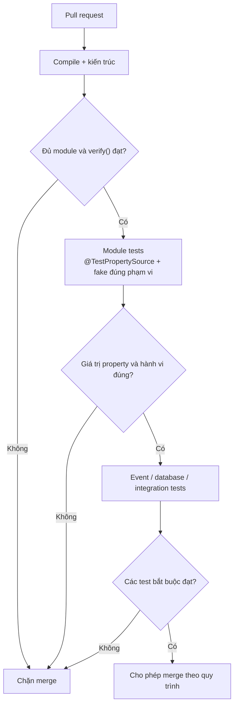

# @TestPropertySource và thuộc tính test

Trong ứng dụng Spring Modulith, một bài `@ApplicationModuleTest` có thể khởi động đúng module, inject đủ Spring bean nhưng vẫn kiểm thử **không đúng điều kiện** nếu thuộc tính cấu hình khác dự kiến. Chẳng hạn module `orders` chỉ được cho phép đặt tối đa hai sản phẩm trong bài test biên, trong khi cấu hình mặc định của ứng dụng đặt giới hạn mười sản phẩm. Nếu không kiểm soát được `shop.orders.limit`, một test “đặt ba sản phẩm phải bị từ chối” có thể cho kết quả sai hoặc vô tình phụ thuộc vào cấu hình của máy chạy CI.

`@TestPropertySource` của **Spring Framework TestContext** cho phép khai báo **property inline hoặc file `.properties` dành riêng cho một test class**. Những giá trị ấy được đưa vào `Environment` của **`ApplicationContext` kiểm thử**, thường với độ ưu tiên cao hơn cấu hình ứng dụng thông thường. Nó phối hợp được với `@ActiveProfiles`, `@TestConfiguration` và `@ApplicationModuleTest`, nhưng **không thay thế** cơ chế chọn module, không thay đổi kiến trúc production và không tự kiểm thử database hay sự kiện.

Bài học thuộc chương **Test configuration** của **SPRING_MODULITH_VERIFICATION_TESTING**. Mục tiêu là kiểm soát dữ liệu test để có thể kiểm tra module ở những tình huống xác định, dùng `ApplicationModules.verify()` giữ đúng quy tắc phụ thuộc, và kết hợp module test, event test, kiểm thử cơ sở dữ liệu/tích hợp với quality gate CI để ngăn hồi quy.

## 1. Mục tiêu học tập

Sau bài này, bạn có thể:

1. Nói rõ `@TestPropertySource` thêm thông tin gì vào Spring Test `Environment` và phạm vi tác dụng của nó.
2. Viết property trực tiếp qua `properties = {...}` và đọc giá trị bằng `@Value` hoặc `Environment`.
3. Nạp dữ liệu từ `src/test/resources/*.properties` qua `locations` hoặc alias `value`.
4. Giải thích thứ tự ưu tiên giữa file ứng dụng, file profile, `@TestPropertySource(locations)`, `@TestPropertySource(properties)` và `@DynamicPropertySource`.
5. Nhận ra việc để `@TestPropertySource` **không có thuộc tính** sẽ kích hoạt cơ chế tìm file mặc định.
6. Kiểm soát kế thừa `inheritLocations`, `inheritProperties` và các khai báo annotation lặp lại khi test có superclass.
7. Phân biệt `@TestPropertySource` với `@ActiveProfiles`, `@TestConfiguration`, `@Profile` và cấu hình động của Testcontainers.
8. Tạo bài `@ApplicationModuleTest` dùng cấu hình test nhưng vẫn kiểm chứng event, database và ranh giới kiến trúc độc lập.

## 2. @TestPropertySource giải quyết việc gì?

Annotation cần import:

```java
import org.springframework.test.context.TestPropertySource;
```

Hai cách dùng cơ bản:

```java
// Cách A: cung cấp giá trị inline ngay trên test class.
@TestPropertySource(properties = {
    "shop.orders.limit=2",
    "shop.orders.publish-events=true"
})
class OrdersInlinePropertiesTest {
}

// Cách B: đọc giá trị từ file .properties trên test classpath.
@TestPropertySource(
    locations = "classpath:/orders-strict.properties"
)
class OrdersFilePropertiesTest {
}
```

Đây là **hai mảnh khai báo annotation**; trong project thực tế, mỗi class còn cần `@ApplicationModuleTest` hoặc một cấu hình Spring Test tương ứng. `@TestPropertySource` được Spring TestContext xử lý thông qua `SmartContextLoader` tương thích; `@ApplicationModuleTest` của Spring Modulith dùng cơ sở hạ tầng Spring Test thích hợp cho những bài module integration test này.

| Ý muốn của người viết test | Cơ chế phù hợp |
| --- | --- |
| Một test cụ thể cần hạn mức bằng 2 | `@TestPropertySource(properties = "shop.orders.limit=2")` |
| Nhiều key thuộc cùng một kịch bản test | `@TestPropertySource(locations = "classpath:/orders-strict.properties")` |
| Một bộ giá trị chung cho mọi test có profile `test` | `@ActiveProfiles("test")` + `application-test.yml` |
| Đăng ký một fake `StockAvailability` | `@TestConfiguration` + `@Bean` |
| Đăng ký JDBC URL được cấp khi container khởi động | `@DynamicPropertySource` |
| Kiểm tra các package/module và quan hệ phụ thuộc | `ApplicationModules.of(...).verify()` |

**Một property là dữ liệu; một bean là object; một application module là ranh giới kiến trúc.** Dùng `@TestPropertySource` không tự tạo bean, không thay bean và không tạo application module.

## 3. Ví dụ xuyên suốt: orders phụ thuộc inventory

Ứng dụng bán hàng có ba module:

```text
src/main/java/com/acme/shop/
├── ShopApplication.java
├── inventory/
│   ├── StockAvailability.java
│   └── internal/
│       └── DatabaseStockAvailability.java
├── orders/
│   ├── OrderOperations.java
│   ├── OrderId.java
│   ├── events/
│   │   ├── package-info.java
│   │   └── OrderPlaced.java
│   └── internal/
│       └── DefaultOrderOperations.java
└── notifications/
    └── internal/
        └── OrderPlacedListener.java

src/main/resources/
└── application.yml

src/test/java/com/acme/shop/
├── ArchitectureVerificationTest.java
└── orders/
    ├── OrdersInlinePropertiesTest.java
    ├── OrdersFilePropertiesTest.java
    ├── OrdersCombinedPropertiesTest.java
    └── OrdersDynamicDatabaseTest.java

src/test/resources/
├── application-test.yml
├── orders-strict.properties
└── orders-standard.properties
```

Lớp ứng dụng:

```java
// src/main/java/com/acme/shop/ShopApplication.java
package com.acme.shop;

import org.springframework.boot.autoconfigure.SpringBootApplication;

@SpringBootApplication
public class ShopApplication {
}
```

Theo phát hiện mặc định, các package con trực tiếp dưới `com.acme.shop` trở thành ba application module: `orders`, `inventory`, `notifications`.


Mã `orders` tham chiếu interface `inventory.StockAvailability` nên có cạnh phụ thuộc **`orders → inventory`**. Listener thuộc `notifications` tham chiếu event `OrderPlaced` của `orders` nên có cạnh **`notifications → orders`**. Các property trong test **không thay đổi những cạnh này**; chúng chỉ thay đổi dữ liệu mà các Spring bean sử dụng.

## 4. Cấu hình mặc định và theo profile của ứng dụng

File cấu hình mặc định:

```yaml
# src/main/resources/application.yml
shop:
  orders:
    limit: 10
    publish-events: true
```

File theo profile `test`:

```yaml
# src/test/resources/application-test.yml
shop:
  orders:
    limit: 4
    publish-events: true
```

Theo cấu hình trên, nếu không có nguồn ưu tiên cao hơn:

| Trường hợp | `shop.orders.limit` |
| --- | ---: |
| Cấu hình ứng dụng mặc định | 10 |
| Spring Test context có `@ActiveProfiles("test")` | 4 |
| Test có thêm `@TestPropertySource(properties = "shop.orders.limit=2")` | 2 |

**`@ActiveProfiles` lựa chọn profile**; `application-test.yml` cung cấp giá trị thuộc profile; `@TestPropertySource` khai báo một nguồn test-scoped ưu tiên cao hơn các file cấu hình ứng dụng thông thường.

Không cần sửa `application-test.yml` mỗi khi một bài test muốn kiểm tra hạn mức khác. Nếu thay giá trị dùng chung liên tục, những test khác cũng bị ảnh hưởng và khó biết kịch bản nào đang được bảo vệ.

## 5. Các class production của ví dụ

### 5.1. Cổng tồn kho thuộc module inventory

```java
// src/main/java/com/acme/shop/inventory/StockAvailability.java
package com.acme.shop.inventory;

public interface StockAvailability {
    boolean available(String sku, int quantity);
}
```

Interface này nằm ở **base package** của `inventory`, là API công khai mặc định của module đóng. Triển khai `inventory.internal.DatabaseStockAvailability` có thể truy cập database, nhưng `orders` chỉ nên dùng interface công khai.

### 5.2. API của orders

```java
// src/main/java/com/acme/shop/orders/OrderId.java
package com.acme.shop.orders;

import java.util.UUID;

public record OrderId(UUID value) {
}
```

```java
// src/main/java/com/acme/shop/orders/OrderOperations.java
package com.acme.shop.orders;

public interface OrderOperations {
    OrderId place(String sku, int quantity);
}
```

### 5.3. Sự kiện nghiệp vụ

```java
// src/main/java/com/acme/shop/orders/events/OrderPlaced.java
package com.acme.shop.orders.events;

import com.acme.shop.orders.OrderId;

public record OrderPlaced(OrderId orderId, String sku, int quantity) {
}
```

Nếu `notifications` tham chiếu sự kiện, công khai package con:

```java
// src/main/java/com/acme/shop/orders/events/package-info.java
@org.springframework.modulith.NamedInterface("events")
package com.acme.shop.orders.events;
```

### 5.4. Service thật đọc thuộc tính từ Environment

```java
// src/main/java/com/acme/shop/orders/internal/DefaultOrderOperations.java
package com.acme.shop.orders.internal;

import com.acme.shop.inventory.StockAvailability;
import com.acme.shop.orders.OrderId;
import com.acme.shop.orders.OrderOperations;
import com.acme.shop.orders.events.OrderPlaced;
import java.util.UUID;
import org.springframework.beans.factory.annotation.Value;
import org.springframework.context.ApplicationEventPublisher;
import org.springframework.stereotype.Service;

@Service
class DefaultOrderOperations implements OrderOperations {

    private final StockAvailability stock;
    private final ApplicationEventPublisher publisher;
    private final int limit;
    private final boolean publishEvents;

    DefaultOrderOperations(
            StockAvailability stock,
            ApplicationEventPublisher publisher,
            @Value("${shop.orders.limit}") int limit,
            @Value("${shop.orders.publish-events:true}") boolean publishEvents
    ) {
        this.stock = stock;
        this.publisher = publisher;
        this.limit = limit;
        this.publishEvents = publishEvents;
    }

    @Override
    public OrderId place(String sku, int quantity) {
        if (sku == null || sku.isBlank() || quantity <= 0) {
            throw new IllegalArgumentException("Dữ liệu đơn hàng không hợp lệ");
        }
        if (quantity > limit) {
            throw new IllegalArgumentException("Vượt số lượng tối đa");
        }
        if (!stock.available(sku, quantity)) {
            throw new IllegalStateException("Không đủ tồn kho");
        }

        OrderId id = new OrderId(UUID.randomUUID());
        if (publishEvents) {
            publisher.publishEvent(new OrderPlaced(id, sku, quantity));
        }
        return id;
    }
}
```

Đây là implementation rút gọn, chưa lưu đơn và chưa xử lý transaction. Vì vậy các test tiếp theo chứng minh **hạn mức, điều kiện tồn kho và publication sự kiện**, **không** chứng minh JPA mapping, tồn kho đã được trừ hoặc transaction đã commit.

Với `limit=2`, yêu cầu đặt 3 sản phẩm bị từ chối ngay ở validation; với `limit=10`, yêu cầu đó vượt qua riêng điều kiện hạn mức. Điều này cho thấy property là **đầu vào thật** của logic production, không chỉ là một chuỗi để test assert.

## 6. @TestPropertySource(properties = ...): giá trị inline

Đặt test trong package `com.acme.shop.orders` để `@ApplicationModuleTest` chọn module `orders`. Chế độ mặc định `STANDALONE` không bootstrap toàn bộ module `inventory`, nên ta cung cấp fake `StockAvailability` bằng nested `@TestConfiguration`.

```java
// src/test/java/com/acme/shop/orders/OrdersInlinePropertiesTest.java
package com.acme.shop.orders;

import com.acme.shop.inventory.StockAvailability;
import com.acme.shop.orders.events.OrderPlaced;
import org.junit.jupiter.api.Test;
import org.springframework.beans.factory.annotation.Autowired;
import org.springframework.boot.test.context.TestConfiguration;
import org.springframework.context.annotation.Bean;
import org.springframework.core.env.Environment;
import org.springframework.modulith.test.ApplicationModuleTest;
import org.springframework.modulith.test.PublishedEvents;
import org.springframework.test.context.ActiveProfiles;
import org.springframework.test.context.TestPropertySource;

import static org.assertj.core.api.Assertions.assertThat;
import static org.junit.jupiter.api.Assertions.assertThrows;

@ApplicationModuleTest
@ActiveProfiles("test")
@TestPropertySource(properties = {
    "shop.orders.limit=2",
    "shop.orders.publish-events=true"
})
class OrdersInlinePropertiesTest {

    @Autowired
    OrderOperations orders;

    @Autowired
    Environment environment;

    @TestConfiguration(proxyBeanMethods = false)
    static class StockFixture {
        @Bean
        StockAvailability stockAvailability() {
            return (sku, quantity) ->
                    "SKU-1".equals(sku) && quantity <= 100;
        }
    }

    @Test
    void usesInlinePropertyInsteadOfProfileDefault() {
        assertThat(environment.getProperty(
                "shop.orders.limit", Integer.class))
                .isEqualTo(2);
    }

    @Test
    void placesTwoProductsAndPublishesEvent(
            PublishedEvents publishedEvents) {
        OrderId id = orders.place("SKU-1", 2);

        assertThat(publishedEvents.ofType(OrderPlaced.class)
                .matching(OrderPlaced::orderId, id)).hasSize(1);
    }

    @Test
    void rejectsThreeProducts() {
        assertThrows(IllegalArgumentException.class,
                () -> orders.place("SKU-1", 3));
    }
}
```

### Tại sao test đọc giá trị 2?

1. `@ActiveProfiles("test")` bật profile `test`, nên file `application-test.yml` đặt `limit=4`.
2. `@TestPropertySource(properties = ...)` cấp `limit=2` dưới dạng **inline test property**.
3. Spring TestContext đưa nguồn property inline vào `Environment` với ưu tiên cao hơn các property từ Config Data thông thường.
4. `DefaultOrderOperations` thật nhận `limit=2` trong constructor thông qua `@Value`.
5. Assert trên `Environment` và assert nghiệp vụ cùng xác nhận test đang chạy đúng dữ liệu.

**Không nên chỉ assert `Environment`.** Nếu service vô tình không còn dùng `shop.orders.limit`, việc property bằng 2 vẫn đúng nhưng business rule đã hỏng. Cần cả **assertion trên property và assertion trên hành vi**.

### Cú pháp inline có gì cần lưu ý?

Spring Framework hỗ trợ các dạng tương ứng Java `.properties`, ví dụ:

```java
@TestPropertySource(properties = {
    "shop.orders.limit=2",
    "shop.orders.publish-events:true",
    "shop.orders.channel email"
})
```

Trong thực tế, nên **thống nhất một quy tắc**, ví dụ chỉ dùng `key=value`, để dễ review và giữ cache key ổn định. Thay đổi cách viết khoảng trắng một cách không nhất quán có thể tạo metadata test khác nhau dù giá trị cuối cùng giống nhau.

Với nhiều property, hãy để các chuỗi là các phần tử của mảng như ví dụ. Các phiên bản Spring Framework hiện đại còn cho phép text block, nhưng cú pháp mảng chuỗi hoạt động rộng rãi trên nhiều baseline Java.

## 7. @TestPropertySource(locations = ...): đọc file .properties

Khi kịch bản test có nhiều thông số, file riêng thường dễ bảo trì hơn một annotation dài.

Tạo:

```properties
# src/test/resources/orders-strict.properties
shop.orders.limit=1
shop.orders.publish-events=true
```

Sau đó sử dụng:

```java
// src/test/java/com/acme/shop/orders/OrdersFilePropertiesTest.java
package com.acme.shop.orders;

import com.acme.shop.inventory.StockAvailability;
import org.junit.jupiter.api.Test;
import org.springframework.beans.factory.annotation.Autowired;
import org.springframework.boot.test.context.TestConfiguration;
import org.springframework.context.annotation.Bean;
import org.springframework.core.env.Environment;
import org.springframework.modulith.test.ApplicationModuleTest;
import org.springframework.test.context.ActiveProfiles;
import org.springframework.test.context.TestPropertySource;

import static org.assertj.core.api.Assertions.assertThat;
import static org.junit.jupiter.api.Assertions.assertThrows;

@ApplicationModuleTest
@ActiveProfiles("test")
@TestPropertySource(
    locations = "classpath:/orders-strict.properties"
)
class OrdersFilePropertiesTest {

    @Autowired
    OrderOperations orders;

    @Autowired
    Environment environment;

    @TestConfiguration(proxyBeanMethods = false)
    static class StockFixture {
        @Bean
        StockAvailability stockAvailability() {
            return (sku, quantity) -> true;
        }
    }

    @Test
    void usesPropertiesFile() {
        assertThat(environment.getProperty(
                "shop.orders.limit", Integer.class))
                .isEqualTo(1);

        assertThrows(IllegalArgumentException.class,
                () -> orders.place("SKU-1", 2));
    }
}
```

Đây là cách tạo **một test-scoped property source** được khai báo bằng location. Với cơ chế của Spring Framework, `locations` hỗ trợ file dạng `.properties` và `.xml` theo `java.util.Properties` mặc định, đồng thời có thể dùng custom factory cho định dạng khác trong các phiên bản phù hợp.

### Đường dẫn classpath: và đường dẫn tương đối

| Cú pháp | Ý nghĩa |
| --- | --- |
| `classpath:/orders-strict.properties` | Từ gốc classpath test |
| `classpath:/com/acme/shop/orders/orders-strict.properties` | Vị trí cụ thể bên dưới một package trên classpath |
| `orders-strict.properties` | Đường dẫn có thể được diễn giải **tương đối với package của test class** khi là resource path tương đối |
| `value = "classpath:/orders-strict.properties"` | Alias của `locations` |

Nếu dùng `locations = "classpath:/orders-strict.properties"`, file tại `src/test/resources/orders-strict.properties` là vị trí rõ ràng và ít gây nhầm lẫn. Đừng dựa vào đường dẫn tương đối mà không biết nó được resolve từ package nào.

### Có thể dùng nhiều file

```java
@TestPropertySource(locations = {
    "classpath:/orders-standard.properties",
    "classpath:/orders-strict.properties"
})
```

Các file được đăng ký theo thứ tự khai báo và nguồn thêm sau có thể ghi đè key trùng của nguồn trước. Để tránh bất ngờ, hãy giữ những file rõ trách nhiệm (ví dụ defaults và strict override), đồng thời assert giá trị hiệu lực của key quan trọng.

## 8. Kết hợp locations và properties trong cùng annotation

`@TestPropertySource` hỗ trợ dùng `locations` và `properties` **đồng thời**:

```properties
# src/test/resources/orders-standard.properties
shop.orders.limit=5
shop.orders.publish-events=true
shop.orders.channel=email
```

Test muốn giữ channel, event policy từ file nhưng thay hạn mức thành 3:

```java
// Mảnh annotation trên một @ApplicationModuleTest class.
@TestPropertySource(
    locations = "classpath:/orders-standard.properties",
    properties = "shop.orders.limit=3"
)
```

Khi không có `@DynamicPropertySource` đăng ký cùng key, giá trị hạn mức là **3**, không phải 5. **Inline `properties` có ưu tiên cao hơn property từ `locations`**. Điều này giúp dùng một file base cho nhiều kịch bản nhưng override rất ít key riêng.

| Nguồn | Giá trị `shop.orders.limit` | Kết quả được sử dụng |
| --- | ---: | --- |
| `application.yml` | 10 | Bị ghi đè |
| `application-test.yml` | 4 | Bị ghi đè |
| `orders-standard.properties` qua `locations` | 5 | Bị ghi đè |
| `@TestPropertySource(properties = "...=3")` | 3 | **Được chọn** |

**Lưu ý:** khác biệt precedence ở đây là quy tắc dành cho `@TestPropertySource`. Khi thêm nhiều nguồn Config Data hoặc property động, phải xem lại thứ tự thực tế thay vì coi bảng này là danh sách mọi `PropertySource` của Spring.

## 9. Không khai báo locations/properties: tự tìm file mặc định

Một hành vi dễ gây ngạc nhiên:

```java
@ApplicationModuleTest
@TestPropertySource
class OrdersDefaultFileTest {
}
```

Khi annotation **hoàn toàn rỗng**, Spring TestContext cố gắng tìm file `.properties` mặc định theo tên test class và package. Với class:

```text
com.acme.shop.orders.OrdersDefaultFileTest
```

đường dẫn mặc định dự kiến là:

```text
classpath:com/acme/shop/orders/OrdersDefaultFileTest.properties
```

Nghĩa là cần file:

```text
src/test/resources/com/acme/shop/orders/OrdersDefaultFileTest.properties
```

Nếu file mặc định không tồn tại, quá trình tải context có thể ném **`IllegalStateException`** do không tìm thấy nguồn property mặc định.

**`@TestPropertySource` rỗng không có nghĩa “không override gì và bỏ qua”.** Nếu bạn không cần file/default property, hãy **bỏ annotation** thay vì viết một annotation rỗng vô tình.

Hành vi này khác `@ActiveProfiles("test")`: việc có `application-test.yml` không liên quan đến đường dẫn tên class mà `@TestPropertySource` rỗng sẽ dò.

## 10. @TestPropertySource có kế thừa cấu hình của superclass không?

Có. Theo Spring TestContext, hai nhóm khai báo có cờ kế thừa riêng:

- `inheritLocations`: kế thừa **các file location** của superclass/enclosing test.
- `inheritProperties`: kế thừa **các chuỗi property inline** của superclass/enclosing test.

Mặc định **cả hai là `true`**. Ví dụ:

```java
// Ví dụ minh họa cấu trúc lớp test.
@TestPropertySource(
    locations = "classpath:/orders-standard.properties",
    properties = "shop.orders.publish-events=true"
)
abstract class BaseOrdersTest {
}
```

Lớp con:

```java
@ApplicationModuleTest
@TestPropertySource(properties = "shop.orders.limit=1")
class OrdersStrictSubclassTest extends BaseOrdersTest {
}
```

Mô hình cấu hình kỳ vọng:

- Kế thừa file `orders-standard.properties` từ base class.
- Kế thừa property inline `publish-events=true`.
- Bổ sung property inline `limit=1` từ subclass.
- Nếu trùng key, khai báo ở subclass có thể override giá trị được kế thừa.

### Chỉ muốn thay các inline properties từ base class

```java
@TestPropertySource(
    properties = "shop.orders.limit=2",
    inheritProperties = false
)
class OrdersNoInheritedInlineTest extends BaseOrdersTest {
}
```

Lúc này `locations` vẫn được kế thừa, nhưng **các property inline từ superclass không được kế thừa** qua cấu hình mới.

### Muốn thay cả file và inline properties được kế thừa

```java
@TestPropertySource(
    locations = "classpath:/orders-strict.properties",
    properties = "shop.orders.publish-events=false",
    inheritLocations = false,
    inheritProperties = false
)
class OrdersIndependentPropertiesTest extends BaseOrdersTest {
}
```

Hai cờ này giúp tránh một lớp con vô tình dùng chung file hoặc property của bài test gốc. Những đoạn class ở mục này là **minh họa annotation**, chưa cung cấp bean phụ thuộc `StockAvailability` hay các test method; khi triển khai cần ghép với module bootstrap và fixture đúng.

**Không dùng `inheritLocations=false` rồi nghĩ đã tắt luôn `inheritProperties`**: chúng là hai cơ chế độc lập.

## 11. Annotation lặp lại và composed annotation

`@TestPropertySource` là **repeatable annotation**, có thể xuất hiện nhiều lần trên một test class. Các nguồn từ khai báo xuất hiện sau có thể override key cùng tên từ khai báo trước theo quy tắc TestContext.

```java
@TestPropertySource(
    locations = "classpath:/orders-standard.properties"
)
@TestPropertySource(
    properties = "shop.orders.limit=2"
)
class OrdersRepeatedPropertySourceTest {
}
```

Spring Test cũng cho phép tạo **composed annotation**, ví dụ một annotation nội bộ của đội phát triển mang `@TestPropertySource` để tái sử dụng quy ước test. Trong trường hợp có nhiều nguồn được khai báo trực tiếp và qua meta-annotation, **khai báo trực tiếp trên class test được ưu tiên hơn meta-annotation** cho những giá trị trùng nhau.

Tuy nhiên, khi số lớp kế thừa và meta-annotation tăng lên, việc xác định nguồn thắng trở nên khó đọc. **Không nên xây “mê cung” annotation chỉ để chia sẻ một property.** Một số file `.properties` hoặc một annotation test có tên rõ nghĩa thường dễ bảo trì hơn.

### Tại sao không tùy tiện thay đổi cách viết một property?

```java
@TestPropertySource(properties = "shop.orders.limit=2")

// Ý nghĩa property có thể tương tự:
@TestPropertySource(properties = "shop.orders.limit = 2")
```

Dù giá trị sau khi parse có thể tương đương, **chuỗi metadata cấu hình test khác nhau** có thể làm Spring TestContext dùng cache key khác. Thống nhất kiểu viết giúp tối ưu cache và giảm những khác biệt khó giải thích giữa các class test.

## 12. File YAML với @TestPropertySource: không giống Config Data

Một lỗi thường gặp:

```java
// Không nên mặc định giả định YAML được đọc bằng factory mặc định.
@TestPropertySource(locations = "classpath:/orders-case.yml")
```

Factory mặc định của `@TestPropertySource` hỗ trợ resource theo định dạng `java.util.Properties` thông thường, gồm `.properties` và `.xml`. Nó **không tự diễn giải YAML** theo cùng cơ chế `application-test.yml` của Spring Boot.

Có hai hướng:

1. **Ưu tiên đơn giản:** dùng `application-test.yml` với `@ActiveProfiles("test")` khi muốn cấu hình profile-based bằng YAML.
2. **Khi thật sự cần `@TestPropertySource` đọc YAML:** Spring Framework từ **6.1** hỗ trợ thuộc tính `factory` để chỉ định một `PropertySourceFactory` tùy biến.

Ví dụ YAML:

```yaml
# src/test/resources/orders-case.yml
shop:
  orders:
    limit: 2
    publish-events: true
```

Ví dụ factory riêng dành cho test:

```java
// src/test/java/com/acme/shop/testsupport/YamlTestPropertySourceFactory.java
package com.acme.shop.testsupport;

import java.io.IOException;
import java.util.Objects;
import java.util.Properties;
import org.springframework.beans.factory.config.YamlPropertiesFactoryBean;
import org.springframework.core.env.PropertiesPropertySource;
import org.springframework.core.env.PropertySource;
import org.springframework.core.io.support.EncodedResource;
import org.springframework.core.io.support.PropertySourceFactory;

public final class YamlTestPropertySourceFactory
        implements PropertySourceFactory {

    @Override
    public PropertySource<?> createPropertySource(
            String name,
            EncodedResource resource
    ) throws IOException {
        YamlPropertiesFactoryBean yaml = new YamlPropertiesFactoryBean();
        yaml.setResources(resource.getResource());

        Properties properties =
                Objects.requireNonNull(yaml.getObject());

        String sourceName = name != null
                ? name
                : "orders-test-yaml";

        return new PropertiesPropertySource(sourceName, properties);
    }
}
```

Khai báo ở test:

```java
@TestPropertySource(
    locations = "classpath:/orders-case.yml",
    factory = YamlTestPropertySourceFactory.class
)
```

Ví dụ cần import class factory và các test annotations thích hợp khi dùng thật. API `factory` có từ Spring Framework 6.1; hãy đối chiếu phiên bản Spring Boot/Framework của dự án. Nếu chỉ có vài key và không cần YAML, **file `.properties` hoặc inline `properties` sẽ đơn giản hơn**.

## 13. So sánh @TestPropertySource, @ActiveProfiles và @DynamicPropertySource

| Công cụ | Chọn profile? | Đưa giá trị vào Environment? | Phù hợp nhất |
| --- | --- | --- | --- |
| `@ActiveProfiles("test")` | **Có** | Không trực tiếp; kích hoạt việc xét Config Data/điều kiện profile | Chọn chế độ test chung |
| `application-test.yml` | Không | Có khi profile `test` active | Bộ cấu hình mặc định dùng chung |
| `@TestPropertySource(locations=...)` | Không | **Có** từ file property | Kịch bản có nhiều key tĩnh |
| `@TestPropertySource(properties=...)` | Không | **Có** từ chuỗi inline | Một vài override cụ thể |
| `@DynamicPropertySource` | Không | **Có** từ supplier runtime | JDBC URL/cổng ngẫu nhiên/container |
| `@TestConfiguration` | Không | Có thể cấu hình bean, nhưng bản chất là thêm bean definition | Fake dependency hoặc fixture |

**Thứ tự ưu tiên quan trọng:**

1. `application.yml` và `application-test.yml` thuộc Spring Boot Config Data, với luật profile/location cụ thể.
2. File được nạp từ `@TestPropertySource(locations)` có ưu tiên cao hơn những property source ứng dụng thông thường.
3. `@TestPropertySource(properties)` có ưu tiên cao hơn `locations`.
4. `@DynamicPropertySource` có ưu tiên cao hơn `@TestPropertySource`.

Đây là **quan hệ ưu tiên giữa các nguồn liên quan tới bài**, không phải toàn bộ danh mục thứ tự property của Spring Boot. Khi nghi ngờ, dùng `Environment.getProperty(...)` kiểm tra giá trị hiệu lực trong bài test.

### Dữ liệu động từ Testcontainers

Ví dụ module integration test với PostgreSQL Testcontainers (khung minh họa):

```java
package com.acme.shop.orders;

import org.junit.jupiter.api.Test;
import org.springframework.modulith.test.ApplicationModuleTest;
import org.springframework.modulith.test.ApplicationModuleTest.BootstrapMode;
import org.springframework.test.context.ActiveProfiles;
import org.springframework.test.context.DynamicPropertyRegistry;
import org.springframework.test.context.DynamicPropertySource;
import org.testcontainers.containers.PostgreSQLContainer;
import org.testcontainers.junit.jupiter.Container;
import org.testcontainers.junit.jupiter.Testcontainers;

@Testcontainers
@ApplicationModuleTest(mode = BootstrapMode.DIRECT_DEPENDENCIES)
@ActiveProfiles("integration")
class OrdersDynamicDatabaseTest {

    @Container
    static PostgreSQLContainer<?> postgres =
            new PostgreSQLContainer<>("postgres:16-alpine");

    @DynamicPropertySource
    static void databaseProperties(DynamicPropertyRegistry registry) {
        registry.add("spring.datasource.url", postgres::getJdbcUrl);
        registry.add("spring.datasource.username", postgres::getUsername);
        registry.add("spring.datasource.password", postgres::getPassword);
    }

    @Test
    void testsRealRepositoryAndTransaction() {
        // Thêm assertion repository/schema/transaction thực tế.
    }
}
```

**Đây là skeleton**, chưa phải chương trình chạy được nếu thiếu JDBC driver, Testcontainers integration, Spring Data/JPA, Docker runtime, migrations, schema và fixture. `DIRECT_DEPENDENCIES` mở thêm module phụ thuộc trực tiếp; cần đảm bảo test có các bean và hạ tầng thật tương ứng.

`@TestPropertySource` phù hợp với giá trị **tĩnh**. `@DynamicPropertySource` phù hợp khi property chỉ có thể biết **sau khi container hoặc mock server bắt đầu**, và có thể override test property cùng key.

## 14. Context cache: property test ảnh hưởng thời gian sống của bean

Spring TestContext cache `ApplicationContext` dựa trên cấu hình. Hai test class có `@TestPropertySource` khác nhau có thể tạo **hai cache key khác nhau**, giúp tránh reuse một context đã bind giá trị khác.

```text
OrdersInlinePropertiesTest
    @TestPropertySource(limit=2)
       -> Context A: DefaultOrderOperations(limit=2)

OrdersFilePropertiesTest
    @TestPropertySource(orders-strict.properties)
       -> Context B: DefaultOrderOperations(limit=1)
```

**`@TestPropertySource` được áp dụng khi tạo context**, không phải một “property tạm thời” cho từng method. Nếu bạn sửa `System.setProperty(...)` giữa hai method, bean đã bind bằng `@Value` trong constructor sẽ **không tự động nhận giá trị mới**.

Vì vậy:

- Tách các kịch bản cần cấu hình khác biệt thành **test class** riêng.
- Dùng `@TestPropertySource` nhất quán về đường dẫn và cách viết property để Spring cache hiệu quả.
- Ưu tiên fake stateless; reset trạng thái fixture nếu singleton được reuse trong nhiều test.
- Tránh thay system properties/global environment trong các test song song.
- Dùng `@DirtiesContext` có chọn lọc khi thật sự phải khởi tạo lại context; đừng dùng như giải pháp mặc định.

### Nhớ rằng cache không phải bảo đảm cô lập data

Ngay cả khi hai test có context khác nhau, chúng có thể dùng **cùng database**, broker hay filesystem. Nếu dùng chung state bên ngoài, cần database cleanup, transaction rollback/commit phù hợp, test container isolation hoặc dữ liệu ngẫu nhiên có kiểm soát. `@TestPropertySource` **không tự tạo database riêng**.

## 15. @ConfigurationProperties, validation và property test

Khi số property tăng lên, rải nhiều biểu thức `@Value` có thể khó bảo trì. Có thể gom cấu hình bằng `@ConfigurationProperties`:

```java
// src/main/java/com/acme/shop/orders/internal/OrderPolicyProperties.java
package com.acme.shop.orders.internal;

import org.springframework.boot.context.properties.ConfigurationProperties;

@ConfigurationProperties(prefix = "shop.orders")
public record OrderPolicyProperties(
        int limit,
        boolean publishEvents
) {
}
```

Để bean record này được đăng ký, ứng dụng cần cơ chế `@ConfigurationPropertiesScan` hoặc `@EnableConfigurationProperties(OrderPolicyProperties.class)` tương ứng. Không phải chỉ khai báo record là Spring tự tạo bean trong mọi cấu hình.

Ví dụ một test có thể inject và assert:

```java
@Autowired
OrderPolicyProperties policy;

@Test
void bindsTestProperties() {
    assertThat(policy.limit()).isEqualTo(2);
    assertThat(policy.publishEvents()).isTrue();
}
```

Đoạn trên là **method/field minh họa** cần đặt trong test class có cấu hình binding phù hợp. Nếu giới hạn phải dương, dự án nên bổ sung Bean Validation và một bài test chứng minh cấu hình không hợp lệ bị từ chối ở thời điểm bootstrap.

**Đừng dùng `@TestPropertySource` để che một cấu hình bị thiếu trong production.** Cấu hình mặc định/production phải được kiểm tra bằng cách phù hợp; test dùng override chỉ chứng minh behavior trong điều kiện đã được cấp.

## 16. Liên hệ kiểm thử sự kiện

Trong ví dụ `orders`, property `shop.orders.publish-events` quyết định có publish sự kiện `OrderPlaced`.

Một test có thể vô tình dùng `publish-events=false` nhưng vẫn chỉ assert `orders.place(...)` trả `OrderId`, khiến **hồi quy event bị bỏ sót**. Bài test `PublishedEvents` ở mục 6 khắc phục bằng cách kiểm tra payload event.

```java
@TestPropertySource(properties = {
    "shop.orders.limit=2",
    "shop.orders.publish-events=true"
})
```

**Cần phân biệt hai hợp đồng:**

| Hợp đồng | Cách kiểm tra |
| --- | --- |
| `orders` đã publish đúng `OrderPlaced`? | `PublishedEvents` trong `@ApplicationModuleTest` tại module phát |
| `notifications` đã nhận và gửi thông báo? | Module test của consumer hoặc integration test đa module |

Trong chế độ `STANDALONE`, việc `PublishedEvents` thu được sự kiện **không đồng nghĩa listener của `notifications` đã chạy**. Với event sau commit hoặc xử lý bất đồng bộ, cần kiểm tra transaction, delivery, retry và kết quả bằng test phù hợp.

Không nên fake `ApplicationEventPublisher` nếu mục tiêu là quan sát event thật bằng `PublishedEvents`; test property dùng để đặt điều kiện business, không phải thay cơ chế phát sự kiện đang được kiểm tra.

## 17. Liên hệ kiểm thử database và tích hợp

Với module `orders`, có thể muốn fake cổng `StockAvailability` để test validation trong khi giữ `OrderRepository` thật để kiểm tra ghi đơn. Hãy xác định rõ **điều gì là mục tiêu test**:

| Mục tiêu | Dữ liệu cấu hình/fixture nên dùng | Rủi ro nếu chọn sai |
| --- | --- | --- |
| Kiểm tra hạn mức và validation | `@TestPropertySource(properties = "shop.orders.limit=2")` + fake stock | Chỉ assert property mà không assert behavior |
| Kiểm tra JPA mapping của `orders` | Test DB thật, datasource/schema/migration phù hợp | Fake repository che SQL/constraint lỗi |
| Tích hợp `orders` với `inventory` | Bootstrap đúng dependency modules, database fixture cần thiết | `STANDALONE` + fake không chứng minh tích hợp thật |
| Event xử lý sau commit | Transaction commit thật và consumer phù hợp | Test rollback khiến listener `AFTER_COMMIT` không được gọi |
| Kiểm tra HTTP/broker adapter | Mock server hoặc hạ tầng thử nghiệm | Trỏ nhầm tới endpoint production |

### Chú ý đặc biệt với transaction

Một test method có `@Transactional` thường rollback ở cuối test. Việc rollback này có ích để dọn dữ liệu, nhưng **không tương đương với commit production**. Nếu consumer dùng `@TransactionalEventListener(phase = AFTER_COMMIT)`, hãy tạo test có commit thực sự và kiểm tra side effect phù hợp; không kết luận sai rằng listener không hoạt động chỉ vì một test rollback.

`@TestPropertySource` chỉ thay **dữ liệu đưa vào context**. Nó không tự cấu hình rollback, không đảm bảo database isolation và không thực hiện event retry.

## 18. @TestPropertySource không thay ranh giới Spring Modulith

Ở tầng kiến trúc, service `DefaultOrderOperations` vẫn phụ thuộc interface `inventory.StockAvailability`. Một fake `StockAvailability` trong test context không làm module `inventory` biến mất khỏi dependency graph.

Có thể giới hạn chiều phụ thuộc:

```java
// src/main/java/com/acme/shop/orders/package-info.java
@org.springframework.modulith.ApplicationModule(
    allowedDependencies = "inventory"
)
package com.acme.shop.orders;
```

Và kiểm chứng độc lập với dữ liệu test:

```java
// src/test/java/com/acme/shop/ArchitectureVerificationTest.java
package com.acme.shop;

import org.junit.jupiter.api.Test;
import org.springframework.modulith.core.ApplicationModules;

import static org.junit.jupiter.api.Assertions.assertTrue;

class ArchitectureVerificationTest {

    @Test
    void expectedModulesAreDiscovered() {
        ApplicationModules modules =
                ApplicationModules.of(ShopApplication.class);

        assertTrue(modules.getModuleByName("orders").isPresent());
        assertTrue(modules.getModuleByName("inventory").isPresent());
        assertTrue(modules.getModuleByName("notifications").isPresent());
    }

    @Test
    void productionDependenciesRespectModuleBoundaries() {
        ApplicationModules.of(ShopApplication.class).verify();
    }
}
```

`verify()` bảo vệ các quy tắc quan trọng của mô hình module:

- Không có phụ thuộc vòng giữa application module.
- Không dùng kiểu nội bộ của module khác trong mô hình module đóng.
- Tuân thủ `allowedDependencies` khi đã giới hạn module nguồn.

**Phân biệt:** `verify()` không biết hạn mức test phải là 2 hay 4; `@TestPropertySource` không kiểm tra import vào `inventory.internal` có hợp lệ hay không. Cần **cả kiểm thử cấu trúc và kiểm thử runtime** để chất lượng được bảo vệ hai chiều.

## 19. Lỗi thường gặp và cách chẩn đoán

| Triệu chứng | Nguyên nhân khả dĩ | Cách xử lý |
| --- | --- | --- |
| Test đọc `limit=10` thay vì 2 | Annotation không có hiệu lực hoặc property source khác thắng | Kiểm tra `Environment`, import annotation, context loader |
| `@TestPropertySource` rỗng làm context fail | Không có file `TestClassName.properties` mặc định | Chỉ rõ `locations/properties` hoặc bỏ annotation |
| File `orders-strict.properties` không được tìm thấy | Đường dẫn `classpath:` sai hoặc file không trên test classpath | Kiểm tra `src/test/resources` và path |
| Test dùng `.yml` ở `locations` nhưng không parse đúng | Default factory không hỗ trợ YAML | Dùng Config Data hoặc custom factory (Framework 6.1+) |
| Property inline không ghi đè file trong kỳ vọng | Key không trùng, typo, có `@DynamicPropertySource` cùng key | Kiểm tra key và precedence |
| Giá trị từ base test class còn hiệu lực | `inheritLocations/inheritProperties` mặc định `true` | Kiểm tra flags độc lập |
| Nhiều test có context không reuse | Chuỗi inline, location hoặc cấu hình test khác nhau | Chuẩn hóa metadata property và fixture |
| Test module thiếu bean `StockAvailability` | `STANDALONE` không nạp inventory; property không tạo bean | Cung cấp `@TestConfiguration`/`@MockitoBean` hoặc nạp dependency |
| Test với profile `test` vẫn truy cập database thật | Datasource URL/property source sai hoặc phạm vi bootstrap quá rộng | Assert datasource backend, dùng Testcontainers/fake đúng mục tiêu |
| `PublishedEvents` có event nhưng consumer không chạy | `STANDALONE` không nạp consumer | Viết test consumer/integration |
| `verify()` fail dù JUnit module test xanh | Mã production phụ thuộc API nội bộ hoặc có vòng | Sửa ranh giới production, không chỉ chỉnh fixture |
| Test sau commit không chạy | Transaction test rollback | Tạo tình huống commit thật, xem event phase |

### Quy trình điều tra có thứ tự

1. Xem test dùng `@ApplicationModuleTest` mode nào và thuộc package của module nào.
2. In/kiểm tra `Environment.getActiveProfiles()`.
3. Assert giá trị property quan trọng thông qua `Environment.getProperty(...)` hoặc `@ConfigurationProperties`.
4. Kiểm tra `@TestPropertySource`: `locations`, `properties`, dấu gạch, classpath và các cờ kế thừa.
5. Kiểm tra `@DynamicPropertySource` hoặc Config Data/biến môi trường có ghi đè không.
6. Kiểm tra bean được tạo từ `@TestConfiguration` và module dependency nào được bootstrap.
7. Chạy assertion nghiệp vụ, event, DB/integration theo đúng mục tiêu.
8. Chạy `ApplicationModules.verify()` để tách lỗi cấu hình test khỏi lỗi kiến trúc.

## 20. Quality gate CI: giá trị test và kiến trúc đều phải đúng

Một pipeline nên có ít nhất ba nhóm kiểm tra:



Lệnh minh họa khi dự án đã cấu hình wrapper và test tasks:

```bash
# Maven Wrapper
./mvnw test

# Hoặc Gradle Wrapper
./gradlew test
```

Nếu Testcontainers, migration hoặc integration test được chạy trong task khác, CI cần thêm các bước bắt buộc tương ứng. Các lệnh trên chỉ để tham khảo, **không được chạy trong bước biên soạn bài học**.

**Gợi ý assertion cho quality gate:**

| Mối nguy | Assertion / kiểm thử |
| --- | --- |
| Property bị ghi đè ngoài ý muốn | `environment.getProperty("shop.orders.limit", Integer.class) == 2` |
| Validation sai ngưỡng | Đặt 2 hợp lệ, đặt 3 bị từ chối |
| Event bị tắt hoặc payload sai | `PublishedEvents` chứa đúng `OrderPlaced` |
| Consumer xử lý sai hoặc transaction lỗi | Module consumer/integration test |
| DB schema/constraint lỗi | Test repository với DB và migration thật |
| Module bị bỏ khỏi mô hình | Assertion `getModuleByName(...)` |
| API nội bộ bị dùng hoặc phụ thuộc vòng | `ApplicationModules.verify()` |

**Đừng tự cập nhật expected property bằng chính actual value đang đọc.** Một test như `assertEquals(actualLimit, actualLimit)` không bảo vệ được hợp đồng nào.

## 21. Bài thực hành: xác định giá trị nào được sử dụng

Cho ứng dụng đặt vé với các module `booking`, `payment`, `notifications`. Module `booking` đọc:

```text
ticket.booking.max-seats
ticket.booking.publish-events
ticket.booking.channel
```

Các file:

```yaml
# src/main/resources/application.yml
ticket:
  booking:
    max-seats: 8
    publish-events: true
    channel: email
```

```yaml
# src/test/resources/application-test.yml
ticket:
  booking:
    max-seats: 4
    publish-events: true
    channel: fake-email
```

```properties
# src/test/resources/booking-strict.properties
ticket.booking.max-seats=2
ticket.booking.channel=sandbox
```

Test:

```java
@ApplicationModuleTest
@ActiveProfiles("test")
@TestPropertySource(
    locations = "classpath:/booking-strict.properties",
    properties = "ticket.booking.max-seats=1"
)
class BookingStrictTest {
    // Giả sử đã cung cấp PaymentGateway fake
    // và service booking thật nhận các property trên.
}
```

### Câu hỏi

1. `ticket.booking.max-seats` có giá trị bao nhiêu trong context của `BookingStrictTest`? Vì sao?
2. `ticket.booking.channel` có giá trị nào nếu không có nguồn ưu tiên cao hơn?
3. `ticket.booking.publish-events` đọc giá trị nào?
4. Nếu bỏ `properties = "ticket.booking.max-seats=1"` nhưng giữ file `booking-strict.properties`, hạn mức sẽ là bao nhiêu?
5. Nếu bỏ cả `@TestPropertySource` nhưng giữ `@ActiveProfiles("test")`, hạn mức là bao nhiêu?
6. Nếu annotation trở thành `@TestPropertySource` không có tham số, framework cố tìm file nào?
7. Nếu superclass có `@TestPropertySource(properties = "ticket.booking.channel=base")`, subclass dùng `inheritProperties=false` thì giá trị base còn được kế thừa không?
8. Nếu có thêm `@DynamicPropertySource` đăng ký `ticket.booking.max-seats=6`, giá trị nào thắng?
9. Vì sao đặt `booking-strict.yml` trực tiếp trong `locations` có thể không hoạt động như mong đợi?
10. Nếu `booking` phụ thuộc trực tiếp `payment.internal.HttpPaymentGateway`, các test property có hợp thức hóa import đó không?
11. Nếu `booking` publish `BookingConfirmed` nhưng `notifications` không nhận được, nên bổ sung kiểm thử gì?
12. Vì sao CI phải có cả test property/hành vi và `ApplicationModules.verify()`?

### Đáp án và giải thích

1. **1**, vì `properties` inline của `@TestPropertySource` ưu tiên cao hơn `locations` và Config Data.
2. **sandbox**, vì file `booking-strict.properties` ghi đè giá trị từ `application-test.yml`.
3. **true**, do file theo profile `test` hoặc file mặc định cung cấp; không có override khác trong đề.
4. **2**, lấy từ `booking-strict.properties`.
5. **4**, lấy từ `application-test.yml` khi profile `test` được bật.
6. Spring tìm file mặc định theo tên test class, ví dụ `classpath:com/example/ticket/booking/BookingStrictTest.properties` nếu class nằm ở package `com.example.ticket.booking`. Không có file có thể gây `IllegalStateException`.
7. **Không**, cờ `inheritProperties=false` tắt kế thừa property inline từ superclass; nó **không mặc nhiên tắt `inheritLocations`**.
8. **6**, vì dynamic property có ưu tiên cao hơn `@TestPropertySource`.
9. Factory mặc định không đọc YAML; có thể dùng Spring Boot Config Data hoặc `factory` tùy biến với Spring Framework 6.1+.
10. **Không**. `payment.internal` vẫn là nội bộ của module `payment` theo mô hình đóng; cần refactor dùng API công khai và `verify()`.
11. Test module `notifications` hoặc integration test event với listener thật, transaction và cơ chế delivery/retry phù hợp.
12. Test property xác nhận **dữ liệu và hành vi**; `verify()` xác nhận **cấu trúc phụ thuộc giữa các module**. Mỗi nhóm bảo vệ rủi ro khác nhau.

### Bài mở rộng

Tạo ba bài test độc lập:

- `BookingDefaultProfileTest` chỉ dùng `@ActiveProfiles("test")`, kiểm tra hạn mức 4.
- `BookingStrictPropertiesTest` dùng `@ActiveProfiles("test")` và `@TestPropertySource(locations = "classpath:/booking-strict.properties")`, kiểm tra hạn mức 2.
- `BookingOverrideTest` dùng file strict cộng `properties = "ticket.booking.max-seats=1"`, kiểm tra hạn mức 1.

Nếu muốn kiểm thử DB thực, tạo test thứ tư với `@DynamicPropertySource` lấy JDBC URL từ container và kiểm tra repository/transaction. So sánh vì sao việc **tách context theo test class** đáng tin cậy hơn sửa một singleton `Environment` ở giữa các method.

## 22. Checklist trước khi merge

- [ ] Test class nằm trong package application module cần kiểm thử.
- [ ] `@TestPropertySource` có `properties` hoặc `locations` rõ, không vô tình để rỗng.
- [ ] File `.properties` ở test classpath và đường dẫn được chỉ đúng.
- [ ] Inline property dùng quy ước nhất quán, ví dụ `key=value`.
- [ ] Đã kiểm tra precedence của `properties` với `locations` và `@DynamicPropertySource`.
- [ ] `@ActiveProfiles` và file theo profile không bị nhầm với `@TestPropertySource`.
- [ ] Không giả định `@TestPropertySource` tự hiểu YAML khi không có custom factory.
- [ ] Test có superclass/nested class đã kiểm tra `inheritLocations` và `inheritProperties`.
- [ ] Test assert property thật và hành vi ở ranh giới giá trị, không chỉ `contextLoads()`.
- [ ] `@ApplicationModuleTest` dùng bootstrap mode thích hợp; bean từ module khác được fake hoặc nạp có chủ đích.
- [ ] Fake không thay thế chính logic của module cần kiểm thử.
- [ ] Event publisher, DB, transaction và consumer được test với hạ tầng phù hợp mục tiêu.
- [ ] Không có secret production hoặc dữ liệu nhạy cảm trong test resources.
- [ ] `ApplicationModules.verify()` và assertion tập module luôn chạy trong CI.
- [ ] Các test integration/task bổ sung cũng là quality gate bắt buộc khi có rủi ro tương ứng.

**Ghi nhớ:** `@TestPropertySource` là công cụ của **Spring TestContext để cấp property vào `ApplicationContext` kiểm thử**, qua `properties` inline hoặc `locations` từ file test. Nó có luật precedence, kế thừa và cache riêng; nó **không chọn module, không tạo bean và không cấp quyền truy cập vào API nội bộ**. Kết hợp `@ApplicationModuleTest` với property assertions và kiểm thử sự kiện/database, đồng thời giữ `ApplicationModules.verify()` trong CI, để bảo vệ cả dữ liệu cấu hình lẫn ranh giới kiến trúc.

## Tài liệu tham khảo

- [Spring Framework Reference — Context Configuration with Test Property Sources](https://docs.spring.io/spring-framework/reference/testing/testcontext-framework/ctx-management/property-sources.html)
- [Spring Framework API — TestPropertySource](https://docs.spring.io/spring-framework/docs/current/javadoc-api/org/springframework/test/context/TestPropertySource.html)
- [Spring Framework Reference — Context Configuration with Dynamic Property Sources](https://docs.spring.io/spring-framework/reference/testing/testcontext-framework/ctx-management/dynamic-property-sources.html)
- [Spring Framework Reference — Context Caching](https://docs.spring.io/spring-framework/reference/testing/testcontext-framework/ctx-management/caching.html)
- [Spring Boot Reference — Externalized Configuration](https://docs.spring.io/spring-boot/reference/features/external-config.html)
- [Spring Boot Reference — Profiles](https://docs.spring.io/spring-boot/reference/features/profiles.html)
- [Spring Modulith Reference — Testing Application Modules](https://docs.spring.io/spring-modulith/reference/testing.html)
- [Spring Modulith Reference — Verifying Application Module Structure](https://docs.spring.io/spring-modulith/reference/verification.html)
- [Spring Modulith Reference — Working with Application Events](https://docs.spring.io/spring-modulith/reference/events.html)
