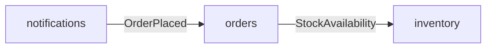
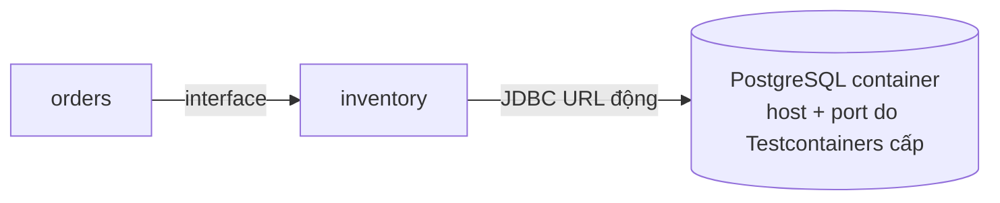
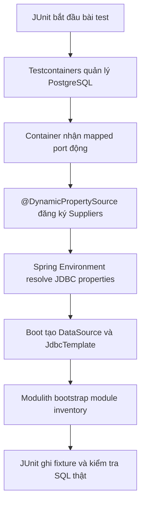
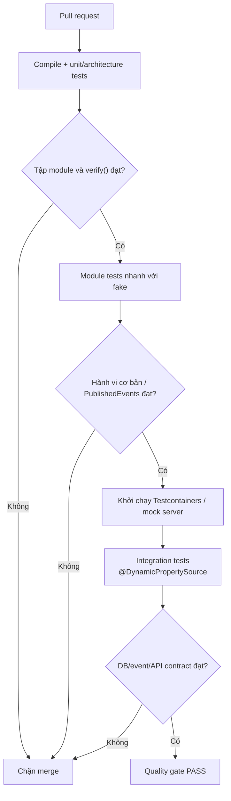

# DynamicPropertySource cho dependency chạy động

Trong một bài kiểm thử tích hợp Spring Modulith, không phải dependency nào cũng có địa chỉ cố định. PostgreSQL chạy bằng Testcontainers có thể được gán một cổng ngẫu nhiên; Redis, Kafka hay một mock HTTP server cũng có thể chỉ biết địa chỉ sau khi khởi động. Nếu hard-code `localhost:5432` hoặc dùng URL từ máy lập trình viên, test dễ thất bại trên CI, kết nối nhầm môi trường, hoặc chạy xanh với một dịch vụ không thuộc bài test.

Spring Framework cung cấp `@DynamicPropertySource` cùng `DynamicPropertyRegistry` để **đưa các giá trị được tạo trong lúc chạy test vào Spring `Environment`**. Khi một Spring bean cần JDBC URL, hostname hoặc port, nó đọc property được cung cấp bởi tài nguyên test đang hoạt động thay vì dựa vào một địa chỉ cố định.

Bài học thuộc chương **Test configuration** của **SPRING_MODULITH_VERIFICATION_TESTING**. Mục tiêu là kiểm chứng ranh giới kiến trúc bằng `ApplicationModules`, thực hành `@ApplicationModuleTest` với dependency ngoài chạy động, kiểm tra sự kiện/database/tích hợp và đặt các phép kiểm tra vào quality gate CI để hạn chế phụ thuộc sai và hồi quy.

> **Phân biệt ngay từ đầu:** “dependency chạy động” ở đây là **hạ tầng hoặc dịch vụ bên ngoài được khởi động trong test** (database, broker, mock server), **không phải** cơ chế phát hiện hoặc cho phép một application module mới. `@DynamicPropertySource` không thay đổi đồ thị module mà `ApplicationModules.verify()` phân tích.

## 1. Mục tiêu học tập

Sau bài này, bạn có thể:

1. Giải thích tại sao test với database/container/HTTP server có cổng động cần `@DynamicPropertySource`.
2. Viết method `static` nhận một `DynamicPropertyRegistry` và đăng ký property bằng `Supplier`.
3. Hiểu cơ chế **giá trị được lấy khi property được resolve**, không phải tất cả đều được chụp ngay lúc đăng ký.
4. Kết hợp `@ApplicationModuleTest` và Testcontainers để kiểm tra **repository/JDBC thật** trong một module.
5. Biết khi nào dùng `@DynamicPropertySource`, `@TestPropertySource`, `@ActiveProfiles`, `@TestConfiguration` và `@ServiceConnection`.
6. Tránh lỗi do **container chưa chạy**, đọc mapped port quá sớm, context cache dùng lại endpoint cũ hoặc nguồn property ghi đè không mong đợi.
7. Phân biệt test producer event, consumer event và kiểm thử transaction sau commit.
8. Tạo quality gate CI kiểm tra kiến trúc module lẫn dependency runtime và dữ liệu.

## 2. Dependency tĩnh và dependency chạy động là hai lớp khác nhau

Giả sử ứng dụng bán hàng có ba application module:

```text
com.acme.shop
├── ShopApplication
├── inventory/
│   ├── StockAvailability
│   └── internal/
│       └── JdbcStockAvailability
├── orders/
│   ├── OrderOperations
│   ├── events/
│   │   ├── package-info.java
│   │   └── OrderPlaced.java
│   └── internal/
│       └── DefaultOrderOperations
└── notifications/
    └── internal/
        └── OrderPlacedListener
```

Mã của `orders` tham chiếu interface `inventory.StockAvailability`, nên đồ thị kiến trúc có cạnh **`orders → inventory`**. Listener của `notifications` tham chiếu `orders.events.OrderPlaced`, nên có cạnh **`notifications → orders`**. Đây là **dependency tĩnh giữa các kiểu Java**, được Spring Modulith dùng để kiểm chứng ranh giới module.



Trong khi đó, `JdbcStockAvailability` của module `inventory` kết nối tới PostgreSQL. PostgreSQL là **dịch vụ runtime bên ngoài**, không phải application module thứ tư:



| Câu hỏi | Công cụ trả lời |
| --- | --- |
| `orders` có được tham chiếu API `inventory` không? | `ApplicationModules.verify()`, `allowedDependencies`, public API |
| Trong test chỉ chạy `inventory` hay nạp thêm `orders`? | `@ApplicationModuleTest` và bootstrap mode |
| PostgreSQL đang ở host/cổng nào? | Testcontainers hoặc công cụ quản lý hạ tầng test |
| Đưa JDBC URL đó vào Spring như thế nào? | `@DynamicPropertySource` / `DynamicPropertyRegistry` |
| Query, transaction hoặc schema có chạy thật không? | Database/integration test với assertion dữ liệu |

**Đừng nhầm:** đưa `spring.datasource.url` vào test context **không có nghĩa** test đã kiểm tra ranh giới application module; và `verify()` đạt **không có nghĩa** database sẵn sàng để kết nối.

## 3. Cơ chế của @DynamicPropertySource

Annotation và registry cần dùng:

```java
import org.springframework.test.context.DynamicPropertyRegistry;
import org.springframework.test.context.DynamicPropertySource;
```

Hình dạng method chuẩn:

```java
@DynamicPropertySource
static void registerDynamicValues(DynamicPropertyRegistry registry) {
    registry.add("external.api.base-url", () -> "http://localhost:12345");
}
```

Ví dụ trên chỉ giải thích **cú pháp**; URL cố định không phải lý do chính để dùng `@DynamicPropertySource`. Với dịch vụ chạy động, supplier sẽ lấy host/port thật tại runtime.

### Các yêu cầu quan trọng

1. Method được đánh dấu `@DynamicPropertySource` phải là **`static`**.
2. Method nhận **đúng một tham số** `DynamicPropertyRegistry`.
3. `registry.add(name, supplier)` cần một **`Supplier`**, không phải giá trị string/int được tính sẵn.
4. Khi tạo test `ApplicationContext`, Spring TestContext đăng ký các dynamic properties vào `Environment`.
5. Supplier được gọi **khi property được resolve**; không nên giả định chỉ được gọi một lần.
6. `@DynamicPropertySource` không tự tạo container, không chờ một dịch vụ bất kỳ sẵn sàng và không tự đăng ký bean ứng dụng.

Ví dụ với một container đã khai báo:

```java
@DynamicPropertySource
static void postgresProperties(DynamicPropertyRegistry registry) {
    registry.add("spring.datasource.url", postgres::getJdbcUrl);
    registry.add("spring.datasource.username", postgres::getUsername);
    registry.add("spring.datasource.password", postgres::getPassword);
}
```

Ở đây `postgres` là field `static PostgreSQLContainer<?>` được quản lý bởi Testcontainers. `postgres::getJdbcUrl` là một **method reference**, tương đương supplier `() -> postgres.getJdbcUrl()`.

### Supplier khác giá trị eager

```java
// ĐÚNG: truyền hàm lấy giá trị khi Spring resolve property.
registry.add("spring.datasource.url", postgres::getJdbcUrl);

// ĐÚNG: lambda cũng là Supplier.
registry.add("spring.datasource.url", () -> postgres.getJdbcUrl());

// SAI: kết quả String không phải Supplier.
// registry.add("spring.datasource.url", postgres.getJdbcUrl());
```

**Một chi tiết thực tế:** lazy supplier không bảo đảm container sẽ tự khởi động đúng lúc. Nếu Spring resolve property trước khi dịch vụ sẵn sàng, supplier vẫn có thể ném lỗi hoặc trả endpoint không còn dùng được. Lifecycle của hạ tầng phải được quản lý **riêng** và phối hợp với test bootstrap.

## 4. @DynamicPropertySource tham gia thứ tự ưu tiên property như thế nào?

Trong Spring TestContext, các property đăng ký qua `@DynamicPropertySource` có **độ ưu tiên cao hơn** những giá trị đến từ `@TestPropertySource`, system properties, biến môi trường và nhiều nguồn ứng dụng thông thường.

Ví dụ:

```yaml
# src/test/resources/application-integration.yml
spring:
  datasource:
    url: jdbc:postgresql://localhost:5432/fallback
```

```java
@TestPropertySource(properties = {
    "spring.datasource.url=jdbc:postgresql://localhost:5433/test"
})
```

```java
@DynamicPropertySource
static void databaseProperties(DynamicPropertyRegistry registry) {
    registry.add("spring.datasource.url", postgres::getJdbcUrl);
}
```

Nếu cả ba nguồn cùng có hiệu lực, **giá trị trả về từ container qua dynamic property** sẽ thắng hai URL được khai báo cố định.

| Nguồn | Ví dụ | Kết quả khi cùng key |
| --- | --- | --- |
| Config Data theo profile | `application-integration.yml` | Nguồn cấu hình thông thường |
| Test property inline | `@TestPropertySource(properties = "...")` | Ưu tiên cao hơn Config Data |
| Dynamic property | `registry.add("spring.datasource.url", postgres::getJdbcUrl)` | **Ưu tiên cao hơn `@TestPropertySource`** |

Đây là quan hệ ưu tiên của những nguồn **liên quan bài học**, không phải bảng tổng hợp toàn bộ nguồn cấu hình của Spring Boot. Các cơ chế như `ConnectionDetails` do `@ServiceConnection` tạo có cách chọn kết nối riêng; không nên suy chúng thành một hàng đơn giản trong bảng `PropertySource`.

### Assert giá trị thực thay vì đoán

```java
@Autowired
Environment environment;

@Test
void datasourceUrlComesFromThisContainer() {
    assertThat(environment.getProperty("spring.datasource.url"))
            .isEqualTo(postgres.getJdbcUrl());
}
```

Đoạn trên là method/field để đặt **trong class test đã khai báo container và dynamic property**, với import `Environment` và AssertJ phù hợp. Với JDBC URL có username/password, **không nên log toàn bộ credentials** ra CI; chỉ so sánh những giá trị cần thiết và tránh đưa secrets vào failure message.

## 5. Ví dụ production: module inventory dùng JDBC thật

Để minh họa hạ tầng chạy động một cách có ý nghĩa, ta dùng PostgreSQL thật trong Testcontainers. Mã production không biết container; nó chỉ phụ thuộc vào Spring `JdbcTemplate` và `DataSource` được cấu hình cho môi trường tương ứng.

Lớp ứng dụng:

```java
// src/main/java/com/acme/shop/ShopApplication.java
package com.acme.shop;

import org.springframework.boot.autoconfigure.SpringBootApplication;

@SpringBootApplication
public class ShopApplication {
}
```

### 5.1. API công khai của inventory

```java
// src/main/java/com/acme/shop/inventory/StockAvailability.java
package com.acme.shop.inventory;

public interface StockAvailability {
    boolean available(String sku, int quantity);
}
```

Do interface nằm ở base package `inventory`, module `orders` có thể sử dụng nó như API công khai mặc định. Các truy vấn SQL và repository/adapter vẫn nằm trong `inventory.internal`.

### 5.2. Triển khai JDBC thuộc nội bộ inventory

```java
// src/main/java/com/acme/shop/inventory/internal/JdbcStockAvailability.java
package com.acme.shop.inventory.internal;

import com.acme.shop.inventory.StockAvailability;
import java.util.List;
import org.springframework.jdbc.core.JdbcTemplate;
import org.springframework.stereotype.Service;

@Service
class JdbcStockAvailability implements StockAvailability {

    private final JdbcTemplate jdbc;

    JdbcStockAvailability(JdbcTemplate jdbc) {
        this.jdbc = jdbc;
    }

    @Override
    public boolean available(String sku, int quantity) {
        if (sku == null || sku.isBlank() || quantity <= 0) {
            return false;
        }

        List<Integer> quantities = jdbc.query(
                "SELECT available_quantity FROM inventory_stock WHERE sku = ?",
                (rs, rowNum) -> rs.getInt("available_quantity"),
                sku
        );

        return !quantities.isEmpty() && quantities.get(0) >= quantity;
    }
}
```

Đây là một triển khai JDBC tối giản. Bảng `inventory_stock` cần được tạo bằng migration/schema của dự án hoặc bởi fixture test. Trong môi trường production thực, có thể cần transaction, concurrency control, kiểm tra số lượng âm, locking và quy trình giữ hàng – những hành vi đó **chưa được kiểm chứng** chỉ bởi phương thức `available(...)`.

## 6. Bài @ApplicationModuleTest dùng PostgreSQL container

Đặt test trong package của `inventory` để Spring Modulith chỉ bootstrap module đó theo chế độ `STANDALONE` mặc định:

```java
// src/test/java/com/acme/shop/inventory/InventoryPostgresModuleTest.java
package com.acme.shop.inventory;

import org.junit.jupiter.api.BeforeEach;
import org.junit.jupiter.api.Test;
import org.springframework.beans.factory.annotation.Autowired;
import org.springframework.jdbc.core.JdbcTemplate;
import org.springframework.modulith.test.ApplicationModuleTest;
import org.springframework.test.context.ActiveProfiles;
import org.springframework.test.context.DynamicPropertyRegistry;
import org.springframework.test.context.DynamicPropertySource;
import org.testcontainers.containers.PostgreSQLContainer;
import org.testcontainers.junit.jupiter.Container;
import org.testcontainers.junit.jupiter.Testcontainers;

import static org.assertj.core.api.Assertions.assertThat;

@Testcontainers
@ApplicationModuleTest
@ActiveProfiles("integration")
class InventoryPostgresModuleTest {

    @Container
    static PostgreSQLContainer<?> postgres =
            new PostgreSQLContainer<>("postgres:16-alpine");

    @DynamicPropertySource
    static void databaseProperties(DynamicPropertyRegistry registry) {
        registry.add("spring.datasource.url", postgres::getJdbcUrl);
        registry.add("spring.datasource.username", postgres::getUsername);
        registry.add("spring.datasource.password", postgres::getPassword);
    }

    @Autowired
    JdbcTemplate jdbc;

    @Autowired
    StockAvailability inventory;

    @BeforeEach
    void prepareData() {
        jdbc.execute("""
                CREATE TABLE IF NOT EXISTS inventory_stock (
                    sku VARCHAR(64) PRIMARY KEY,
                    available_quantity INTEGER NOT NULL
                )
                """);

        jdbc.update("DELETE FROM inventory_stock");
        jdbc.update(
                "INSERT INTO inventory_stock (sku, available_quantity) " +
                "VALUES (?, ?)",
                "SKU-42", 5
        );
    }

    @Test
    void readsStockFromRealPostgres() {
        assertThat(inventory.available("SKU-42", 3)).isTrue();
        assertThat(inventory.available("SKU-42", 6)).isFalse();
        assertThat(inventory.available("SKU-UNKNOWN", 1)).isFalse();
    }
}
```

### Bài test này bảo đảm điều gì?

1. `@Testcontainers` và `@Container` phối hợp để quản lý vòng đời PostgreSQL container dành cho test class.
2. Docker có thể ánh xạ cổng PostgreSQL bên trong container sang một **cổng host không cố định**.
3. `@DynamicPropertySource` đăng ký **JDBC URL, username, password thực tế** mà container cung cấp.
4. Spring Boot auto-configuration tạo `DataSource`/`JdbcTemplate` theo thông tin kết nối đó, khi test classpath có các JDBC dependency cần thiết.
5. `@ApplicationModuleTest` chọn module `inventory`; Spring tạo `JdbcStockAvailability` thật thay vì fake.
6. `@BeforeEach` tạo bảng tối thiểu và nạp dữ liệu cho từng test method.
7. Assert xác nhận **truy vấn thật qua PostgreSQL** trả kết quả phù hợp với fixture.

**Ranh giới:** bài test này không kiểm tra cả quy trình `orders → inventory`, không xác nhận giao dịch giữ hàng hoặc event consumer. Nó chỉ kiểm chứng module `inventory` với database thật ở phạm vi được minh họa.

### Các điều kiện để mã chạy được

Ví dụ giả định project dùng Java hỗ trợ text blocks và có các thành phần sau:

- Spring Boot JDBC starter hoặc cấu hình cung cấp `JdbcTemplate`, `DataSource`.
- PostgreSQL JDBC driver.
- Spring Boot test và Spring Modulith test starter.
- Testcontainers `postgresql` cùng `junit-jupiter`.
- Docker/container runtime dùng được ở máy local và CI.
- Không có schema initializer/migration khác xung đột với bảng `inventory_stock` của bài minh họa.

**Trong công việc viết bài này không chạy Gradle, Maven, Docker hay test thật.** Các đoạn code cần được đối chiếu với build, phiên bản Java/Spring và database schema của dự án khi áp dụng.

## 7. Quy trình khởi động: container → property → bean → assertion



Sơ đồ thể hiện **trình tự logic cần được bảo đảm**, không khẳng định mọi callback của JUnit, Spring TestContext và Testcontainers đều chạy theo một thứ tự tuyến tính duy nhất trong tất cả phiên bản. Điểm bắt buộc là: **khi `DataSource` resolve JDBC URL và kết nối, container phải đã sẵn sàng**. Dùng `@Container` static theo mẫu được Testcontainers/Spring hỗ trợ giúp phối hợp lifecycle mà không phải tự hard-code port.

### Vì sao không dùng cổng 5432 cố định?

```properties
# Ví dụ dễ sai trên CI nếu không chủ động cố định port:
spring.datasource.url=jdbc:postgresql://localhost:5432/shop
```

Rủi ro:

- Máy developer đã có PostgreSQL chiếm cổng 5432.
- Runner CI không có dịch vụ tại địa chỉ đó.
- Hai job chạy song song tranh chấp một cổng.
- Test có thể kết nối nhầm database không do test khởi tạo.

Với container dùng mapped port ngẫu nhiên, test độc lập hơn với môi trường máy chạy và dễ thực thi song song khi quản lý data/isolation hợp lý.

## 8. Đăng ký nhiều property động, không chỉ JDBC URL

Không có giới hạn chỉ dùng `@DynamicPropertySource` cho database. Những trường hợp phổ biến:

| Hạ tầng | Property có thể đăng ký | Supplier điển hình |
| --- | --- | --- |
| PostgreSQL | `spring.datasource.url`, `username`, `password` | `postgres::getJdbcUrl`, `getUsername`, `getPassword` |
| Redis | `spring.data.redis.host`, `spring.data.redis.port` (tùy version Boot) | `redis::getHost`, `redis::getFirstMappedPort` |
| Kafka | `spring.kafka.bootstrap-servers` | `kafka::getBootstrapServers` |
| HTTP mock server | `shop.payment.base-url` | Lambda lấy host/cổng ngẫu nhiên |
| Message broker khác | Host/port/credentials test | Supplier từ container hoặc server đang chạy |

**Kiểm tra property key theo phiên bản Spring Boot và client thực tế của dự án.** Một key sai chính tả có thể được đăng ký mà không bị lỗi ngay, nhưng bean sẽ không đọc nó.

### Ví dụ Redis với mapped host và port

```java
@Container
static GenericContainer<?> redis =
        new GenericContainer<>("redis:7-alpine")
                .withExposedPorts(6379);

@DynamicPropertySource
static void redisProperties(DynamicPropertyRegistry registry) {
    registry.add("spring.data.redis.host", redis::getHost);
    registry.add("spring.data.redis.port",
            () -> redis.getMappedPort(6379));
}
```

Đoạn trên là **mảnh ghép vào một test có `@Testcontainers`**, cần import `GenericContainer`, `Container`, `DynamicPropertySource` và `DynamicPropertyRegistry`. Ví dụ sử dụng khóa cấu hình của dòng Spring Boot hiện đại; với version cũ hơn, khóa Redis có thể khác.

**Đừng gọi `redis.getMappedPort(6379)` quá sớm**, trước khi container khởi động. Supplier lambda giúp trì hoãn việc lấy port đến lúc Spring resolve property.

## 9. Dependency HTTP với endpoint ngẫu nhiên

Khi test một adapter gọi HTTP, ta thường khởi động mock server trên port `0` (hệ điều hành tự cấp port) hoặc chạy một container có mapped port ngẫu nhiên.

Giả sử mã production đọc:

```java
@Value("${shop.payment.base-url}")
String paymentBaseUrl;
```

Một test sử dụng container mô phỏng HTTP có thể đăng ký:

```java
@DynamicPropertySource
static void paymentEndpoint(DynamicPropertyRegistry registry) {
    registry.add("shop.payment.base-url", () ->
            "http://" + paymentServer.getHost()
            + ":" + paymentServer.getMappedPort(8080)
    );
}
```

Đây là **mảnh cấu hình minh họa**, giả định `paymentServer` là một Testcontainers-managed container đã khai báo `static` với cổng 8080 được expose. Image, HTTP route, status code và dữ liệu response phải được cấu hình riêng theo giao thức thật của adapter.

### Chọn mức mock phù hợp

| Mục tiêu | Hướng test |
| --- | --- |
| Logic `orders` khi payment thành công/thất bại | Mock hoặc fake interface payment ở module test |
| JSON request/response, timeout, HTTP status của adapter | Mock HTTP server chạy động và property base URL |
| Kết nối với payment thật ở môi trường staging | Integration/contract test có credentials và endpoint riêng được cấp phép |
| Phụ thuộc kiến trúc của module `orders` với `payment` | `ApplicationModules.verify()` và `allowedDependencies` |

`@DynamicPropertySource` **chỉ cấp URL**; nó không giả lập response HTTP, không cấu hình stub và không xác nhận adapter đã gửi request. Những phần đó thuộc mock server và assertion của bài integration test.

## 10. @DynamicPropertySource so với @ActiveProfiles và @TestPropertySource

| Cơ chế | Tác dụng | Có tự tạo dịch vụ/bean? | Khi nào chọn? |
| --- | --- | --- | --- |
| `@ActiveProfiles("integration")` | Bật profile cho Spring Test context | Không | Chọn nhóm cấu hình integration |
| `application-integration.yml` | Cấp giá trị tĩnh theo profile | Không | Defaults, timeout, flags |
| `@TestPropertySource(properties=...)` | Override property tĩnh cho test class | Không | Một kịch bản cố định |
| `@DynamicPropertySource` | Đăng ký supplier trả giá trị runtime | Không | Host, port, URL do container/server cấp |
| `@TestConfiguration` + `@Bean` | Tạo bean chỉ cho context test được chọn | Có, đối với bean khai báo | Fake port hoặc test helper |
| `@MockitoBean` | Dùng cơ chế override/mock bean của Spring Test | Có, theo mock/override | Thay dependency bằng Mockito |
| `@ApplicationModuleTest` | Chọn phạm vi Spring Modulith bootstrap | Không tạo external service | Module integration test |

**Một mẫu dễ bảo trì:**

- `@ActiveProfiles("integration")` đặt các flags chung và cấu hình không nhạy cảm.
- `@DynamicPropertySource` chỉ cấp **giá trị thực sự biến động** khi dependency chạy.
- `@TestConfiguration`/`@MockitoBean` chỉ dùng cho những cổng ngoài phạm vi cần kiểm tra.
- `@ApplicationModuleTest` xác định phần code của module được bootstrap.

Không nên thêm cả chục dynamic properties cho những giá trị cố định như `shop.orders.max-quantity=2`; `@TestPropertySource` hoặc file profile phù hợp hơn và dễ đọc hơn.

## 11. Đối chiếu với @ServiceConnection của Spring Boot

Spring Boot hỗ trợ **service connections** khi tích hợp Testcontainers. Với những loại dịch vụ được Boot hỗ trợ, có thể khai báo `@ServiceConnection` trực tiếp trên container để Boot tạo `ConnectionDetails` tương ứng.

Ví dụ khái niệm cho PostgreSQL:

```java
@Testcontainers
@ApplicationModuleTest
class InventoryWithServiceConnectionTest {

    @Container
    @ServiceConnection
    static PostgreSQLContainer<?> postgres =
            new PostgreSQLContainer<>("postgres:16-alpine");

    // Inject JdbcTemplate và kiểm tra database như ví dụ chính.
}
```

Mảnh trên cần import `org.springframework.boot.testcontainers.service.connection.ServiceConnection` và test dependency `spring-boot-testcontainers`; phiên bản Boot và loại container phải được hỗ trợ. Không cần giữ cùng lúc `@ServiceConnection` **và** đăng ký `spring.datasource.url` bằng `@DynamicPropertySource` cho một test nếu không có lý do rõ ràng.

| Tiêu chí | `@DynamicPropertySource` | `@ServiceConnection` |
| --- | --- | --- |
| Cách cung cấp kết nối | Thêm property vào `Environment` | Tạo `ConnectionDetails` cho auto-configuration tương thích |
| Điều kiện | Biết tên property mà bean đọc | Loại container/service có factory hỗ trợ |
| Mức linh hoạt | Rất cao, phù hợp custom HTTP endpoint và property riêng | Gọn cho database, Redis, broker được Boot hỗ trợ |
| Điều cần chú ý | Khóa cấu hình, supplier, precedence, cache | Dependency `spring-boot-testcontainers` và ConnectionDetails precedence |

**ConnectionDetails do service connection cung cấp có thể được auto-configuration ưu tiên hơn các connection-related properties**. Vì vậy nếu test dùng `@ServiceConnection`, đừng chỉ nhìn `Environment.getProperty("spring.datasource.url")` rồi kết luận đó là kết nối được lựa chọn.

Đối với **custom endpoint ứng dụng** như `shop.payment.base-url`, `@DynamicPropertySource` vẫn là công cụ trực tiếp, dễ hiểu và linh hoạt.

## 12. Khi external dependency do Spring bean quản lý: DynamicPropertyRegistrar

`@DynamicPropertySource` thích hợp khi nguồn dữ liệu có thể truy cập từ **static test field/method**. Một trường hợp khác là server hỗ trợ test được tạo như một **Spring bean** và cần đăng ký URL sau khi bean được tạo.

Từ các dòng Spring Framework hiện đại hỗ trợ `DynamicPropertyRegistrar` (Spring Framework 6.2+), có thể đăng ký một bean callback như sau:

```java
@TestConfiguration(proxyBeanMethods = false)
class HttpTestInfrastructure {

    @Bean
    TestApiServer testApiServer() {
        return new TestApiServer();
    }

    @Bean
    DynamicPropertyRegistrar apiUrlRegistrar(TestApiServer apiServer) {
        return registry ->
                registry.add("shop.payment.base-url",
                        apiServer::getBaseUrl);
    }
}
```

Đây là **mảnh cấu hình minh họa**: `TestApiServer` là một abstraction do dự án định nghĩa, phải thực sự khởi chạy server và cung cấp `getBaseUrl()`. Các import cần thiết gồm `TestConfiguration`, `Bean` và `org.springframework.test.context.DynamicPropertyRegistrar`.

`DynamicPropertyRegistrar` là một bean được Spring TestContext nhận diện và khởi tạo **sớm trước giai đoạn pre-instantiation của các singleton**. Nó có thể truy cập bean khác, nhưng cũng có thể kéo việc khởi tạo dependency sớm hơn dự kiến.

**Không nhầm hai lựa chọn:** `@DynamicPropertySource` là **static method trên test class**; `DynamicPropertyRegistrar` là **bean tích hợp vào test context**. Nếu dự án đang dùng Spring Framework trước phiên bản có `DynamicPropertyRegistrar`, tiếp tục dùng `@DynamicPropertySource` hoặc một giải pháp test infrastructure tương thích.

## 13. Context cache, inheritance và endpoint đã hết hạn

Spring TestContext cache `ApplicationContext` theo tổ hợp cấu hình, bao gồm các context customizers liên quan tới `@DynamicPropertySource`. Cache giúp giảm chi phí bootstrap, nhưng cũng gây một lỗi khó chẩn đoán: **context được reuse trong khi container hoặc mock server ban đầu đã bị dừng**.

Xét tình huống:

```text
Test A tạo PostgreSQL container tại mapped port 49152
    |
    +--> ApplicationContext A tạo DataSource(URL port 49152)

Test A kết thúc, container dừng

Test B dùng lại cấu hình/context cũ
    |
    +--> DataSource vẫn trỏ tới port 49152
          nhưng container B chạy tại port 49201
```

Đây là sơ đồ rủi ro, không phải khẳng định mọi `@Testcontainers` đều gây ra lỗi này. Lỗi xuất hiện khi **lifecycle hạ tầng** và **lifecycle/cache của Spring context** không được phối hợp.

### Khi dùng base test class

`@DynamicPropertySource` có thể được **kế thừa** từ superclass, test interface hoặc class chứa theo cơ chế Spring TestContext. Nếu nhiều subclass dùng chung method đăng ký dynamic property nhưng lại sử dụng **container khác nhau**, context cache có thể giữ binding không phù hợp.

Một số cách xử lý:

1. Dùng **một container ổn định** cho nhóm test có cùng context và lifecycle đã được kiểm soát.
2. Nếu mỗi subclass cần backend khác, **tách cấu hình context** rõ ràng.
3. Dùng `@DirtiesContext` có chọn lọc khi cần buộc tạo lại context sau khi endpoint thay đổi.
4. Không dừng container hoặc mock server sớm hơn các context còn sử dụng nó.
5. Tránh tạo/tắt container mới trong **mỗi test method** trong khi vẫn giữ singleton `DataSource` của context trước.

**Lưu ý về cache key:** dynamic property supplier thường được xét qua thông tin method/configuration, **không tự bảo đảm giá trị URL mà supplier trả về tại mỗi thời điểm trở thành một cache key mới**.

### Supplier không phải cơ chế refresh bean

Giả sử `DataSource` đọc `spring.datasource.url` khi khởi tạo. Sau đó container đổi port và supplier trả một URL khác. `DataSource` đã được tạo **không tự cập nhật cấu hình kết nối** chỉ vì supplier có thể trả giá trị mới.

Vì thế `@DynamicPropertySource` không phải cơ chế “đổi database nóng” cho một Spring singleton đã tồn tại. Khi endpoint đổi thực sự, test phải phối hợp **context/bean lifecycle** phù hợp.

## 14. Vì sao @BeforeAll đôi khi quá muộn?

Một mẫu dễ viết nhưng khó bảo đảm đúng:

```java
// MẪU DỄ GÂY RACE; không dùng khi chưa bảo đảm thứ tự lifecycle.
static MockHttpServer server = new MockHttpServer();

@BeforeAll
static void startServer() {
    server.start();
}

@DynamicPropertySource
static void properties(DynamicPropertyRegistry registry) {
    registry.add("shop.payment.base-url", server::getBaseUrl);
}
```

Đây là pseudocode minh họa; `MockHttpServer` không phải một class Spring chuẩn. Vấn đề là Spring TestContext có thể tạo context và resolve `shop.payment.base-url` **trước khi callback `@BeforeAll` của bạn đã khởi chạy server**, tùy extension, lifecycle và cấu hình test.

Do đó:

- Ưu tiên mẫu Testcontainers `@Testcontainers` + `@Container static` đã được tích hợp với Spring Test.
- Nếu tự quản lý server, bảo đảm nó **khởi động trước khi context resolve property**, bằng lifecycle phù hợp và có quy trình shutdown.
- Tránh gọi các getter như `getMappedPort(...)` trước khi service đã start.
- Không che race bằng `Thread.sleep(...)` hay retry vô hạn; phải giải quyết đúng thứ tự bootstrap/readiness.

**Tách hai mốc:** đăng ký supplier có thể xảy ra trước, nhưng khi supplier **được gọi thực sự** thì server phải đã sẵn sàng.

## 15. Test dữ liệu, transaction và event sau commit

Một test sử dụng PostgreSQL thật chưa chứng minh mọi giao dịch và sự kiện chạy đúng. Hãy chọn assertion theo mục tiêu:

| Mục tiêu | Phạm vi test nên có | Sai lầm thường gặp |
| --- | --- | --- |
| Kiểm tra `JdbcStockAvailability` truy vấn tồn kho | `@ApplicationModuleTest` của `inventory` + PostgreSQL thật | Fake repository khiến test không chạy SQL |
| Kiểm tra tạo đơn và kiểm tra tồn kho | `@ApplicationModuleTest` của `orders` + fake `StockAvailability` | Dùng DB thật khi chỉ cần logic hẹp, khiến test chậm |
| Kiểm tra `orders` phối hợp `inventory` thật | `DIRECT_DEPENDENCIES` + database fixture | Chỉ test riêng hai module rồi suy ra interaction |
| Kiểm tra `OrderPlaced` được publish | `PublishedEvents` trong module test `orders` | Chỉ assert method trả ID |
| Kiểm tra `notifications` xử lý `OrderPlaced` | Module consumer test hoặc integration test | Suy từ PublishedEvents phía producer |
| Kiểm tra event sau commit và retry | Test transaction/commit và event infrastructure thật | `@Transactional` test rollback rồi chờ `AFTER_COMMIT` |

Ví dụ code module `orders` phát sự kiện:

```java
// src/main/java/com/acme/shop/orders/OrderOperations.java
package com.acme.shop.orders;

public interface OrderOperations {
    OrderId place(String sku, int quantity);
}
```

```java
// src/main/java/com/acme/shop/orders/OrderId.java
package com.acme.shop.orders;

import java.util.UUID;

public record OrderId(UUID value) {
}
```

```java
// src/main/java/com/acme/shop/orders/events/OrderPlaced.java
package com.acme.shop.orders.events;

import com.acme.shop.orders.OrderId;

public record OrderPlaced(OrderId orderId, String sku) {
}
```

```java
// src/main/java/com/acme/shop/orders/events/package-info.java
@org.springframework.modulith.NamedInterface("events")
package com.acme.shop.orders.events;
```

```java
// src/main/java/com/acme/shop/orders/internal/DefaultOrderOperations.java
package com.acme.shop.orders.internal;

import com.acme.shop.inventory.StockAvailability;
import com.acme.shop.orders.OrderId;
import com.acme.shop.orders.OrderOperations;
import com.acme.shop.orders.events.OrderPlaced;
import java.util.UUID;
import org.springframework.context.ApplicationEventPublisher;
import org.springframework.stereotype.Service;

@Service
class DefaultOrderOperations implements OrderOperations {

    private final StockAvailability stock;
    private final ApplicationEventPublisher publisher;

    DefaultOrderOperations(StockAvailability stock,
                           ApplicationEventPublisher publisher) {
        this.stock = stock;
        this.publisher = publisher;
    }

    @Override
    public OrderId place(String sku, int quantity) {
        if (!stock.available(sku, quantity)) {
            throw new IllegalStateException("Không đủ tồn kho");
        }
        OrderId id = new OrderId(UUID.randomUUID());
        publisher.publishEvent(new OrderPlaced(id, sku));
        return id;
    }
}
```

### Test producer với fake dependency

Không phải bài test nào cũng cần PostgreSQL:

```java
// src/test/java/com/acme/shop/orders/OrdersEventModuleTest.java
package com.acme.shop.orders;

import com.acme.shop.inventory.StockAvailability;
import com.acme.shop.orders.events.OrderPlaced;
import org.junit.jupiter.api.Test;
import org.springframework.beans.factory.annotation.Autowired;
import org.springframework.boot.test.context.TestConfiguration;
import org.springframework.context.annotation.Bean;
import org.springframework.modulith.test.ApplicationModuleTest;
import org.springframework.modulith.test.PublishedEvents;

import static org.assertj.core.api.Assertions.assertThat;

@ApplicationModuleTest
class OrdersEventModuleTest {

    @Autowired
    OrderOperations orders;

    @TestConfiguration(proxyBeanMethods = false)
    static class InventoryFixture {
        @Bean
        StockAvailability stockAvailability() {
            return (sku, quantity) -> quantity > 0 && quantity <= 5;
        }
    }

    @Test
    void publishesOrderPlaced(PublishedEvents events) {
        OrderId id = orders.place("SKU-42", 2);

        assertThat(events.ofType(OrderPlaced.class)
                .matching(OrderPlaced::orderId, id)).hasSize(1);
    }
}
```

Test này **không cần `@DynamicPropertySource`**, vì `StockAvailability` được fake trong `STANDALONE` và không có external endpoint nào cần cấp động. Việc **không dùng dynamic property khi không cần** cũng là một quyết định thiết kế test tốt.

Để kiểm tra event consumer hoặc `@TransactionalEventListener(phase = AFTER_COMMIT)`, cần test khác với transaction thực sự commit và listener được bootstrap. `PublishedEvents` chỉ chứng minh sự kiện **đã được publish** trong context của producer, không đảm bảo consumer đã xử lý.

## 16. Kiểm chứng ranh giới kiến trúc độc lập với hạ tầng chạy động

Một test với PostgreSQL có thể chạy xanh dù code của `orders` import `inventory.internal.JdbcStockAvailability`, nếu Java kiểu đó được khai báo `public` và classpath cho phép. Trong khi đó, Spring Modulith coi package con `inventory.internal` là phần triển khai riêng của `inventory`, không phải API công khai mặc định.

Giới hạn module `orders`:

```java
// src/main/java/com/acme/shop/orders/package-info.java
@org.springframework.modulith.ApplicationModule(
        allowedDependencies = "inventory"
)
package com.acme.shop.orders;
```

Nếu `notifications` chỉ được dùng sự kiện của `orders`:

```java
// src/main/java/com/acme/shop/notifications/package-info.java
@org.springframework.modulith.ApplicationModule(
        allowedDependencies = "orders :: events"
)
package com.acme.shop.notifications;
```

Bài JUnit kiến trúc **không cần Docker**:

```java
// src/test/java/com/acme/shop/ArchitectureVerificationTest.java
package com.acme.shop;

import org.junit.jupiter.api.Test;
import org.springframework.modulith.core.ApplicationModules;

import static org.junit.jupiter.api.Assertions.assertTrue;

class ArchitectureVerificationTest {

    @Test
    void discoversExpectedModules() {
        ApplicationModules modules =
                ApplicationModules.of(ShopApplication.class);

        assertTrue(modules.getModuleByName("inventory").isPresent());
        assertTrue(modules.getModuleByName("orders").isPresent());
        assertTrue(modules.getModuleByName("notifications").isPresent());
    }

    @Test
    void respectsModuleBoundaries() {
        ApplicationModules.of(ShopApplication.class).verify();
    }
}
```

`ApplicationModules.verify()` kiểm tra các nhóm quy tắc chính:

1. **Không có phụ thuộc vòng** giữa các application module.
2. **Không tham chiếu kiểu nội bộ** của module khác theo mô hình module đóng.
3. **Tuân thủ `allowedDependencies`** khi module nguồn khai báo danh sách.

**Vai trò tách biệt:** `@DynamicPropertySource` truyền URL/port vào test `Environment`, nhưng không sửa dependency graph. Ngược lại, `verify()` không test query SQL, kết nối database hay readiness của một broker.

## 17. Khi dữ liệu động không khớp với bean

Một số lỗi thường gặp và cách chẩn đoán:

| Triệu chứng | Nguyên nhân có thể | Hướng xử lý |
| --- | --- | --- |
| `IllegalArgumentException` hoặc mapped port chưa có | Getter cổng được gọi trước khi container start | Dùng supplier; kiểm tra lifecycle `@Container`/readiness |
| `Connection refused` dù registry có URL | Container đã dừng hoặc server chưa sẵn sàng | Kiểm tra mapped host/port và thời gian sống của service |
| Test vẫn dùng `localhost:5432` | Sai property key, property không được resolve hoặc connection details khác thắng | Inspect `Environment` và DataSource/ConnectionDetails thực tế |
| `@DynamicPropertySource` không được gọi | Method không `static`, sai signature hoặc class không dùng Spring TestContext | Đảm bảo method `static void` nhận `DynamicPropertyRegistry` |
| `DataSource` thiếu driver | Chưa có PostgreSQL driver/JDBC starter trên test classpath | Bổ sung dependency build theo dự án |
| Context cache dùng endpoint của test trước | Reuse context trong khi container cũ đã dừng | Điều chỉnh lifecycle, cấu hình cache, `@DirtiesContext` khi cần |
| `@ActiveProfiles("integration")` nhưng không có database | Profile không tự khởi chạy Testcontainers | Dùng `@Container` hoặc cơ chế hạ tầng tương ứng |
| Test chỉ kiểm tra API nhưng lại cần Docker | Đang dùng DB thật không cần thiết cho kịch bản hẹp | Chuyển sang `STANDALONE` và fake external port |
| SQL báo bảng không tồn tại | Không chạy schema/migration hoặc `@BeforeEach` fixture sai | Tạo schema, kiểm tra datasource thật và migration |
| Query chạy nhưng dữ liệu sai | Test dùng nhầm DB, seed data không được cleanup hoặc isolation chưa đúng | Kiểm tra JDBC URL, dataset, transaction |
| `PublishedEvents` có sự kiện nhưng notification không chạy | Producer test ở `STANDALONE` không nạp consumer | Thêm test consumer/integration |
| `ApplicationModules.verify()` fail dù DB test xanh | Mã production có internal access/chu trình/phụ thuộc sai | Sửa module boundary, không chỉnh URL để né lỗi |

### Quy trình điều tra

1. Xác nhận **test class thuộc application module nào** và dùng `@ApplicationModuleTest` mode gì.
2. Kiểm tra container/service được khai báo và **đã thực sự chạy** chưa.
3. Xác nhận `@DynamicPropertySource` có chữ ký đúng và những key được đăng ký đúng.
4. Kiểm tra mapped host/port hoặc JDBC URL thực tế, **không in password vào log**.
5. Xác nhận Spring bean (`DataSource`, HTTP client, Redis client, Kafka client) đang **đọc đúng key**.
6. Kiểm tra `@ServiceConnection` có đang cung cấp `ConnectionDetails` ghi đè connection-related properties không.
7. Nếu lỗi xuất hiện khi chạy cả suite, xem **context caching và lifecycle của container**.
8. Kiểm tra schema/fixture, transaction và mục tiêu integration.
9. Chạy `ApplicationModules.verify()` để tách lỗi hạ tầng test khỏi lỗi kiến trúc.

## 18. Quality gate CI cho dynamic dependencies

CI nên có hai nhóm bảo đảm **độc lập**, sau đó có thể chạy nối tiếp để tiết kiệm tài nguyên:



### Điều kiện hạ tầng CI

- Runner có Docker/container runtime hoặc dịch vụ test tương thích.
- Image/container và version database được chọn rõ, hạn chế tag biến động ngoài ý muốn.
- Các test có timeout/retry có kiểm soát, không chỉ `Thread.sleep` tùy tiện.
- Không hard-code host port của container.
- Không dùng credentials production; fake tokens và secrets dành riêng cho integration test được quản lý an toàn.
- Schema migration và seed/cleanup data phải có đường chạy xác định.
- Test cases có thể chạy song song nếu container/database/ports được cách ly phù hợp.
- Job CI kiểm tra cả `verify()` lẫn các integration test bắt buộc trước khi merge.

Lệnh minh họa tùy build:

```bash
# Maven Wrapper (khi integration test nằm trong lifecycle được cấu hình):
./mvnw verify

# Gradle Wrapper (nếu integration test được gắn vào check):
./gradlew check
```

**Không mặc định** `verify` của Maven hay `check` của Gradle sẽ chạy mọi integration test trong mọi dự án: nhóm phát triển phải cấu hình Failsafe/test suites/tasks cho phù hợp. Trong bước viết tài liệu này **không thực thi Gradle, Maven, Python hay Docker**.

### Vì sao nên giữ bước kiến trúc chạy nhanh?

Một lỗi `orders` import repository nội bộ của `inventory` có thể được phát hiện bằng `ApplicationModules.verify()` **không cần kết nối PostgreSQL**. Fail sớm giảm chi phí chạy containers và làm nguyên nhân lỗi rõ ràng hơn. Nhưng khi `verify()` đạt, vẫn cần DB/integration tests để phát hiện sai SQL, mapping, transaction và network behavior.

## 19. Bài thực hành: tìm đúng nguồn property và lỗi lifecycle

Cho ứng dụng gồm module `booking`, `payment` và `notifications`. Module `payment` dùng PostgreSQL và một mock HTTP server để xác nhận thanh toán; hai dependency được khởi động riêng trong bài test.

Giả sử file test có:

```properties
# src/test/resources/payment-test.properties
spring.datasource.url=jdbc:postgresql://localhost:5432/old_db
payment.gateway.base-url=http://localhost:8080
payment.retry-count=2
```

Trong test class:

```java
@TestPropertySource(
    locations = "classpath:/payment-test.properties"
)
@DynamicPropertySource
static void externalServices(DynamicPropertyRegistry registry) {
    registry.add("spring.datasource.url", postgres::getJdbcUrl);
    registry.add("spring.datasource.username", postgres::getUsername);
    registry.add("spring.datasource.password", postgres::getPassword);
    registry.add("payment.gateway.base-url",
            () -> mockGateway.getBaseUrl());
}
```

**Giả thiết:** `postgres` và `mockGateway` là những test resources được khởi động và quản lý lifecycle phù hợp. `mockGateway.getBaseUrl()` trả URL thật sau khi server sẵn sàng. Đoạn trên là **mảnh annotation/method trong một test class**, không phải chương trình độc lập.

### Câu hỏi

1. `spring.datasource.url` nào thắng: URL trong `payment-test.properties` hay `postgres.getJdbcUrl()`?
2. `payment.gateway.base-url` trong Spring `Environment` được lấy từ đâu?
3. `payment.retry-count` được lấy từ nguồn nào nếu không có property source khác override?
4. Vì sao `registry.add("spring.datasource.url", postgres.getJdbcUrl())` không đúng chữ ký API?
5. Method `@DynamicPropertySource` có thể là instance method không? Nó nhận tham số gì?
6. Nếu gọi `postgres.getMappedPort(5432)` trước khi container start, nguy cơ là gì?
7. Nếu Spring context đã tạo `DataSource`, sau đó container đổi port, supplier mới trả giá trị khác thì `DataSource` tự cập nhật không?
8. Nếu dùng cùng `@DynamicPropertySource` từ superclass nhưng mỗi subclass chạy container khác, cần chú ý điều gì?
9. `@ActiveProfiles("integration")` có tự khởi động PostgreSQL không?
10. Nếu dùng `@ServiceConnection` cho PostgreSQL, vì sao đọc mỗi `spring.datasource.url` có thể chưa đủ để biết kết nối nào đang được dùng?
11. `@ApplicationModuleTest` ở `booking` có tự nạp `notifications` chỉ vì `booking` publish `BookingConfirmed` không?
12. Nếu DB integration test xanh nhưng `booking` import `payment.internal.HttpPaymentGateway`, cần kiểm tra gì?
13. Vì sao bài test kiểm tra event producer và bài test kiểm tra consumer là hai nghĩa vụ khác nhau?
14. Hãy thiết kế một quality gate tối thiểu cho cả mã kiến trúc, database, HTTP và event handling.

### Đáp án gợi ý

1. **Dynamic property từ `postgres::getJdbcUrl` thắng**, do precedence cao hơn `@TestPropertySource`.
2. Từ supplier `() -> mockGateway.getBaseUrl()`, khi key được Spring resolve.
3. **`2`** từ `payment-test.properties` nếu không bị nguồn ưu tiên cao hơn ghi đè.
4. `registry.add` nhận một **`Supplier<?>`**, không phải chuỗi String tính sẵn; dùng method reference hoặc lambda.
5. **Không.** Method phải `static` và nhận đúng một `DynamicPropertyRegistry`.
6. Port mapping chưa tồn tại hoặc getter có thể ném lỗi; phải phối hợp container lifecycle và truy xuất sau khi start.
7. **Không tự động.** Bean đã đọc URL khi khởi tạo có thể giữ kết nối tới endpoint cũ; cần quản lý lại context/bean lifecycle.
8. Spring TestContext có thể reuse context cache theo cấu hình method, trong khi endpoint runtime thay đổi. Cân nhắc container dùng chung ổn định hoặc `@DirtiesContext` khi phù hợp.
9. **Không.** Profile chọn cấu hình; container cần Testcontainers/JUnit hoặc cơ chế quản lý riêng.
10. `@ServiceConnection` có thể cung cấp `ConnectionDetails` được auto-configuration ưu tiên hơn connection-related properties.
11. **Không.** `STANDALONE` chỉ bootstrap module đang test; producer test không tự chứng minh listener thuộc module khác đã chạy.
12. Chạy `ApplicationModules.of(...).verify()` và sửa import đi qua API công khai của `payment`; dynamic database URL không hợp thức hóa internal access.
13. Producer test chỉ xác nhận publish; consumer test kiểm tra xử lý, side effect, transaction/async/retry theo nhu cầu.
14. Bài test phát hiện module + `verify()`, module tests nhanh với fake, integration tests với dynamic PostgreSQL/HTTP, test event consumer/after-commit và CI không cho merge khi bất kỳ quality gate bắt buộc nào thất bại.

### Bài nâng cao

Tạo hai class test:

- `PaymentDatabaseIntegrationTest` chạy PostgreSQL Testcontainers, dùng `@DynamicPropertySource` cung cấp JDBC URL và kiểm tra repository thật.
- `PaymentGatewayContractTest` chạy mock HTTP server có port động, dùng `@DynamicPropertySource` cấp `payment.gateway.base-url` rồi kiểm tra request/response và lỗi timeout.

Sau đó chạy cả hai test trong một suite, thử đổi cách chia sẻ container qua superclass và giải thích vì sao **endpoint có thể hết hạn khi context còn được cache**. Đề xuất cách tổ chức lifecycle sao cho test chạy độc lập và ổn định trong CI.

## 20. Checklist trước khi merge

- [ ] Đã xác định dependency chạy động là database, broker, mock HTTP server hay dịch vụ khác; không nhầm với application module.
- [ ] Test class nằm trong package của module `@ApplicationModuleTest` cần kiểm thử.
- [ ] `@DynamicPropertySource` đặt trên method `static` nhận duy nhất `DynamicPropertyRegistry`.
- [ ] `registry.add(...)` dùng supplier/method reference, không dùng kết quả getter trực tiếp.
- [ ] Container/server được start và sẵn sàng trước khi property được resolve.
- [ ] Host, mapped port, JDBC URL và tên property khớp framework/client thực tế.
- [ ] Không hard-code cổng host của Testcontainers trong test.
- [ ] Property dynamic có precedence đúng; nếu dùng `@ServiceConnection` đã kiểm tra `ConnectionDetails` thực tế.
- [ ] Không đưa database password/token thực lên log hoặc test resources commit vào Git.
- [ ] Container lifecycle tương thích Spring TestContext cache; tránh endpoint stale giữa class/subclass.
- [ ] Có assertion về query hoặc hành vi thật, không chỉ `contextLoads()`.
- [ ] Event producer dùng `PublishedEvents` đúng phạm vi; consumer/after-commit có test riêng khi cần.
- [ ] Database/transaction tests không fake mất chính thành phần đang cần kiểm chứng.
- [ ] `ApplicationModules.verify()` và assertion module hiện diện nằm trong CI.
- [ ] Runner CI có hạ tầng container, schema/migration, dữ liệu test và timeout phù hợp.

**Ghi nhớ:** `@DynamicPropertySource` đưa **giá trị runtime từ dependency test đang chạy** vào Spring `Environment` thông qua **`Supplier`**, rất phù hợp với URL, host và mapped port của Testcontainers hoặc mock server. Nó **không khởi động dependency, không làm mới bean đã tạo và không sửa ranh giới Spring Modulith**. Dùng `@ApplicationModuleTest` để chọn phạm vi module, test database/event/tích hợp để xác minh hành vi thực, và `ApplicationModules.verify()` để giữ dependency graph hợp lệ trong quality gate CI.

## Tài liệu tham khảo

- [Spring Framework — Context Configuration with Dynamic Property Sources](https://docs.spring.io/spring-framework/reference/testing/testcontext-framework/ctx-management/dynamic-property-sources.html)
- [Spring Framework — Context Caching](https://docs.spring.io/spring-framework/reference/testing/testcontext-framework/ctx-management/caching.html)
- [Spring Framework — Test Property Sources](https://docs.spring.io/spring-framework/reference/testing/testcontext-framework/ctx-management/property-sources.html)
- [Spring Boot — Testcontainers and Service Connections](https://docs.spring.io/spring-boot/reference/testing/testcontainers.html)
- [Spring Boot — Externalized Configuration](https://docs.spring.io/spring-boot/reference/features/external-config.html)
- [Spring Modulith — Testing Application Modules](https://docs.spring.io/spring-modulith/reference/testing.html)
- [Spring Modulith — Working with Application Events](https://docs.spring.io/spring-modulith/reference/events.html)
- [Spring Modulith — Verifying Application Module Structure](https://docs.spring.io/spring-modulith/reference/verification.html)
- [Testcontainers for Java — JUnit 5 Quickstart](https://java.testcontainers.org/test_framework_integration/junit_5/)
