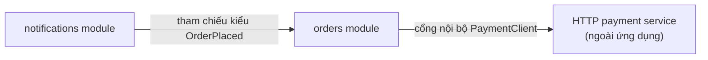
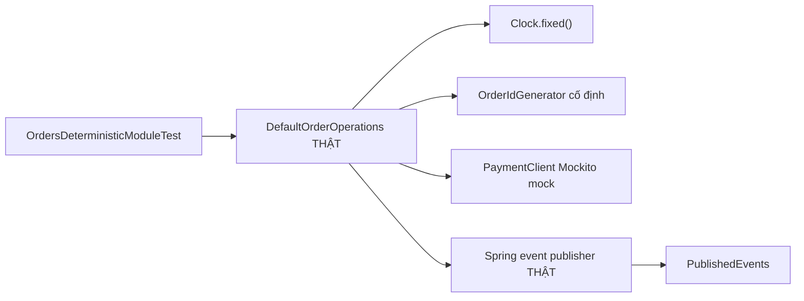
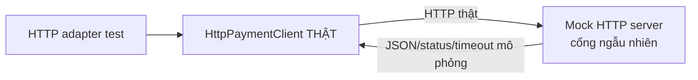
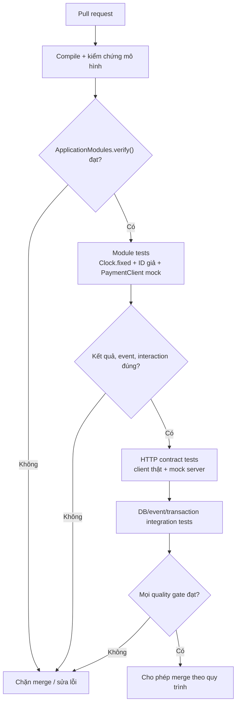

# Thay thế clock, ID generator và external client

Trong kiểm thử một application module, ba nguồn khiến cùng một kịch bản cho kết quả khác nhau qua mỗi lần chạy là **thời gian hiện tại**, **định danh được sinh ngẫu nhiên** và **phản hồi từ hệ thống bên ngoài**. Ví dụ, khi module `orders` tạo đơn, nó cần biết thời điểm tạo đơn, cấp một ID và gọi dịch vụ thanh toán. Nếu dùng trực tiếp `Instant.now()`, `UUID.randomUUID()` và HTTP client thật ở mọi test, assertion trở nên mong manh, chạy chậm hoặc phụ thuộc vào mạng và môi trường.

Để kiểm thử ổn định, nên thiết kế các điểm phụ thuộc ấy thành **cổng có thể inject**: `java.time.Clock` cho thời gian; `OrderIdGenerator` cho ID; `PaymentClient` cho dịch vụ ngoài. Spring Test cho phép thay những bean production bằng **fixed implementation** hoặc **Mockito mock** ở đúng `ApplicationContext` kiểm thử. Spring Modulith giúp nạp riêng module bằng `@ApplicationModuleTest`, trong khi `ApplicationModules.verify()` bảo vệ ranh giới kiến trúc độc lập với các bean giả.

Bài học thuộc chương **Test configuration** của **SPRING_MODULITH_VERIFICATION_TESTING**: rèn kiểm chứng dependency và module boundary, kiểm thử event, database, integration, kết hợp quality gate CI để ngăn phụ thuộc sai và hồi quy.

## 1. Mục tiêu học tập

Sau bài này, bạn có thể:

1. Giải thích vì sao **clock**, **ID generator** và **external client** nên được inject thay vì gọi trực tiếp từ logic nghiệp vụ.
2. Phân biệt **giá trị cố định**, **fake có trạng thái**, **mock** và **HTTP stub server** trong các loại test khác nhau.
3. Dùng `Clock.fixed(...)` để kiểm tra timestamp chính xác và các điều kiện ở ranh giới thời gian.
4. Dùng một `OrderIdGenerator` có thể thay bằng fake để kiểm soát ID mà không phải mock static `UUID.randomUUID()`.
5. Thay bean có chủ đích bằng `@TestBean` và `@MockitoBean` trong `@ApplicationModuleTest`.
6. Phân biệt **thêm bean bằng `@TestConfiguration`/`@Import`** với **thay bean đang tồn tại**; nhận diện xung đột tên và kiểu.
7. Kiểm tra `PublishedEvents`, HTTP adapter, database/transaction và tính duy nhất của ID ở đúng mức tích hợp.
8. Đưa cả `ApplicationModules.verify()` và các bài test runtime vào quality gate CI.

## 2. Chỗ nào làm test mất tính xác định?

Xét một phương thức tạo đơn đơn giản:

```java
// Minh họa cách viết khó kiểm thử, KHÔNG khuyến nghị cho logic nghiệp vụ.
OrderId placeOrder() {
    Instant createdAt = Instant.now();
    UUID id = UUID.randomUUID();
    PaymentResult payment = paymentHttpClient.authorize(id);
    // Lưu đơn, phát sự kiện, trả kết quả...
}
```

Ba lời gọi đem lại ba dạng bất định:

| Phụ thuộc | Rủi ro trong test | Hướng cải thiện |
| --- | --- | --- |
| `Instant.now()` | Mỗi lần chạy timestamp khác nhau; test ở ranh giới hết hạn dễ flaky | Inject `Clock`, dùng `Clock.fixed(...)` trong test |
| `UUID.randomUUID()` | ID không biết trước; khó khẳng định payload/event/database | Inject `OrderIdGenerator`, dùng ID định trước hoặc chuỗi có quy tắc |
| HTTP client trực tiếp | Network, timeout, credential, response thay đổi | Inject `PaymentClient`, mock/fake trong test hẹp; HTTP stub server khi test adapter |

**Mục đích không phải xóa tính ngẫu nhiên hoặc loại bỏ kết nối thật trong production**. Mục đích là **đặt những phụ thuộc có thể thay đổi phía sau các hợp đồng rõ ràng**, rồi chọn implementation đúng với mức bảo đảm cần kiểm thử.

### Một điểm dễ nhầm

`@ApplicationModuleTest` giới hạn **các application module được bootstrap**, nhưng **không tự đóng băng thời gian, ID hoặc network**. Nếu những bean production của chính module `orders` vẫn được tạo, test có thể tiếp tục dùng đồng hồ thật, generator ngẫu nhiên và HTTP adapter thật trừ khi ta cấu hình thay thế có chủ đích.

## 3. Kiến trúc ví dụ: orders và notifications

Một ứng dụng Spring Boot:

```text
src/main/java/com/acme/shop/
├── ShopApplication.java
├── orders/
│   ├── OrderId.java
│   ├── OrderReceipt.java
│   ├── OrderOperations.java
│   ├── events/
│   │   ├── package-info.java
│   │   └── OrderPlaced.java
│   └── internal/
│       ├── OrderIdGenerator.java
│       ├── PaymentClient.java
│       ├── OrderInfrastructureConfiguration.java
│       ├── HttpPaymentClient.java
│       └── DefaultOrderOperations.java
└── notifications/
    └── internal/
        └── OrderPlacedListener.java

src/main/resources/application.yml

src/test/java/com/acme/shop/
├── ArchitectureVerificationTest.java
└── orders/
    ├── OrdersDeterministicModuleTest.java
    └── OrdersHttpContractTest.java
```

`orders` là application module sở hữu thao tác đặt hàng, clock, ID generator và cổng payment. `notifications` sử dụng sự kiện công khai `OrderPlaced`. Dịch vụ thanh toán từ xa **không phải** một application module của cùng codebase: nó là hệ thống ngoài được truy cập qua `PaymentClient`.



**Hai ranh giới khác nhau:** Spring Modulith xác minh **dependency giữa những module trong mã Java**. HTTP stub hoặc mock payment client xác minh **cách code tương tác với dịch vụ ngoài**. Test HTTP thành công không tự chứng minh mô hình module đúng; `verify()` đạt không chứng minh HTTP request đúng.

## 4. Mã production: public API của orders

### 4.1. Lớp khởi động

```java
// src/main/java/com/acme/shop/ShopApplication.java
package com.acme.shop;

import org.springframework.boot.autoconfigure.SpringBootApplication;

@SpringBootApplication
public class ShopApplication {
}
```

### 4.2. ID và kết quả tạo đơn

```java
// src/main/java/com/acme/shop/orders/OrderId.java
package com.acme.shop.orders;

import java.util.UUID;

public record OrderId(UUID value) {
}
```

```java
// src/main/java/com/acme/shop/orders/OrderReceipt.java
package com.acme.shop.orders;

import java.time.Instant;

public record OrderReceipt(
        OrderId orderId,
        Instant createdAt,
        String paymentReference
) {
}
```

```java
// src/main/java/com/acme/shop/orders/OrderOperations.java
package com.acme.shop.orders;

public interface OrderOperations {
    OrderReceipt place(String sku, int quantity);
}
```

Các kiểu đặt ở base package `orders` là phần API mặc định của module đóng. Phần cài đặt, generator và HTTP adapter nằm trong `orders.internal`, không phải giao diện mà các module khác cần import.

### 4.3. Sự kiện công khai

```java
// src/main/java/com/acme/shop/orders/events/OrderPlaced.java
package com.acme.shop.orders.events;

import com.acme.shop.orders.OrderId;
import java.time.Instant;

public record OrderPlaced(
        OrderId orderId,
        Instant createdAt,
        String paymentReference
) {
}
```

```java
// src/main/java/com/acme/shop/orders/events/package-info.java
@org.springframework.modulith.NamedInterface("events")
package com.acme.shop.orders.events;
```

Nếu `notifications` cần nhận sự kiện, module đó có thể giới hạn phụ thuộc tới `orders :: events`. `@NamedInterface` công khai **nhóm kiểu trong package con**, không tạo bean clock hoặc mở rộng hạ tầng test.

## 5. Mã production: ba dependency phải có thể inject

### 5.1. Clock: sử dụng java.time.Clock

Thay vì mỗi service tự gọi `Instant.now()`, inject `Clock` và gọi:

```java
Instant createdAt = clock.instant();
// Hoặc: Instant.now(clock)
```

`Clock` thuộc Java standard library, hỗ trợ `Clock.systemUTC()`, `Clock.fixed(...)` và `Clock.offset(...)`. Không cần định nghĩa một interface `CurrentTimeProvider` riêng chỉ để đọc thời gian nếu `Clock` đã đáp ứng nhu cầu. Một abstraction tùy biến vẫn hợp lý khi nghiệp vụ cần khái niệm thời gian đặc thù hơn.

### 5.2. ID generator: định nghĩa hợp đồng

```java
// src/main/java/com/acme/shop/orders/internal/OrderIdGenerator.java
package com.acme.shop.orders.internal;

import java.util.UUID;

public interface OrderIdGenerator {
    UUID nextId();
}
```

Việc đặt interface tại `orders.internal` giúp giữ nó là **chi tiết tổ chức nội bộ của module `orders`**. Interface được khai báo `public` để các test class trong package con khác có thể import, nhưng điều đó **không tự biến nó thành public API xuyên module theo Spring Modulith**.

Triển khai production có thể là method reference `UUID::randomUUID`. Sau này nếu ID đến từ snowflake/ULID/database sequence, có thể thay adapter mà không đổi logic tạo đơn.

### 5.3. External client: hợp đồng thay vì HTTP trong domain service

```java
// src/main/java/com/acme/shop/orders/internal/PaymentClient.java
package com.acme.shop.orders.internal;

import java.util.UUID;

public interface PaymentClient {

    Authorization authorize(UUID orderId, String sku, int quantity);

    record Authorization(boolean approved, String reference) {
    }
}
```

Service nghiệp vụ chỉ phụ thuộc vào `PaymentClient`, không phụ thuộc vào `RestClient`, URL, JSON DTO hoặc HTTP status. Điều này giúp:

- Mock phản hồi thanh toán khi kiểm tra logic đặt đơn.
- Test adapter HTTP riêng bằng mock server.
- Thay giao thức hoặc provider thanh toán mà giảm tác động tới nghiệp vụ.
- Giữ ranh giới code dễ đọc và dễ kiểm chứng.

## 6. Cấu hình bean thật trong production

Đặt hai bean mặc định trong package nội bộ của `orders`:

```java
// src/main/java/com/acme/shop/orders/internal/OrderInfrastructureConfiguration.java
package com.acme.shop.orders.internal;

import java.time.Clock;
import java.util.UUID;
import org.springframework.context.annotation.Bean;
import org.springframework.context.annotation.Configuration;

@Configuration(proxyBeanMethods = false)
class OrderInfrastructureConfiguration {

    @Bean
    Clock clock() {
        return Clock.systemUTC();
    }

    @Bean
    OrderIdGenerator orderIdGenerator() {
        return UUID::randomUUID;
    }
}
```

Với cách tổ chức này:

- Production có `Clock` thời gian thật và `OrderIdGenerator` ngẫu nhiên.
- Test có thể override các **bean đã tồn tại** để chứng minh phép thay thế diễn ra đúng.
- `@Bean` mặc định dùng tên method làm bean name: `clock` và `orderIdGenerator`.

### HTTP adapter production

```java
// src/main/java/com/acme/shop/orders/internal/HttpPaymentClient.java
package com.acme.shop.orders.internal;

import java.util.UUID;
import org.springframework.beans.factory.annotation.Value;
import org.springframework.stereotype.Component;
import org.springframework.web.client.RestClient;

@Component
class HttpPaymentClient implements PaymentClient {

    private final RestClient restClient;

    HttpPaymentClient(
            RestClient.Builder builder,
            @Value("${shop.payment.base-url}") String baseUrl
    ) {
        this.restClient = builder.baseUrl(baseUrl).build();
    }

    @Override
    public Authorization authorize(
            UUID orderId, String sku, int quantity
    ) {
        Authorization response = restClient.post()
                .uri("/authorizations")
                .body(new AuthorizationRequest(orderId, sku, quantity))
                .retrieve()
                .body(Authorization.class);

        if (response == null) {
            throw new IllegalStateException(
                    "Payment service returned an empty response");
        }
        return response;
    }

    private record AuthorizationRequest(
            UUID orderId, String sku, int quantity
    ) {
    }
}
```

Ví dụ dùng Spring `RestClient` (Spring Framework 6.1+) và giả định provider trả JSON ánh xạ được vào record `Authorization`, chẳng hạn `{"approved":true,"reference":"PAY-42"}`. Dự án thật cần xử lý HTTP errors, timeout, retry/idempotency và logging an toàn; đoạn code chủ ý tối giản để tập trung vào **cổng có thể thay thế trong test**.

File cấu hình tối thiểu cho triển khai thật:

```yaml
# src/main/resources/application.yml
shop:
  payment:
    base-url: https://payments.example.invalid
```

Domain `example.invalid` là địa chỉ **minh họa không dùng để kết nối thực tế**. Khi triển khai, cấu hình phải được cấp từ môi trường/provider phù hợp. Trong bài test module, HTTP adapter được thay bằng mock, không cần gửi request đến URL này.

## 7. Service nghiệp vụ thực sự sử dụng ba dependency

```java
// src/main/java/com/acme/shop/orders/internal/DefaultOrderOperations.java
package com.acme.shop.orders.internal;

import com.acme.shop.orders.OrderId;
import com.acme.shop.orders.OrderOperations;
import com.acme.shop.orders.OrderReceipt;
import com.acme.shop.orders.events.OrderPlaced;
import java.time.Clock;
import java.time.Instant;
import java.util.UUID;
import org.springframework.context.ApplicationEventPublisher;
import org.springframework.stereotype.Service;

@Service
class DefaultOrderOperations implements OrderOperations {

    private final Clock clock;
    private final OrderIdGenerator ids;
    private final PaymentClient payments;
    private final ApplicationEventPublisher publisher;

    DefaultOrderOperations(
            Clock clock,
            OrderIdGenerator ids,
            PaymentClient payments,
            ApplicationEventPublisher publisher
    ) {
        this.clock = clock;
        this.ids = ids;
        this.payments = payments;
        this.publisher = publisher;
    }

    @Override
    public OrderReceipt place(String sku, int quantity) {
        if (sku == null || sku.isBlank() || quantity <= 0) {
            throw new IllegalArgumentException("Đơn hàng không hợp lệ");
        }

        UUID generated = ids.nextId();
        Instant now = clock.instant();

        PaymentClient.Authorization authorization =
                payments.authorize(generated, sku, quantity);

        if (!authorization.approved()) {
            throw new IllegalStateException("Thanh toán bị từ chối");
        }

        OrderId orderId = new OrderId(generated);
        OrderReceipt result = new OrderReceipt(
                orderId, now, authorization.reference());

        publisher.publishEvent(new OrderPlaced(
                orderId, now, authorization.reference()));

        return result;
    }
}
```

Đây là **service nghiệp vụ thật**, không phải mock. Logic chính gồm validation, tạo ID, chụp timestamp, xác nhận thanh toán, tạo kết quả và publish sự kiện.

**Phạm vi ví dụ:** service chưa lưu đơn vào database, chưa tạo transaction, và chưa xử lý trường hợp thanh toán đã được chấp thuận nhưng việc lưu đơn thất bại. Trong ứng dụng thực, những vấn đề nhất quán dữ liệu, idempotency và event sau commit phải được kiểm tra ở cấp tích hợp.

## 8. Chiến lược kiểm thử: thứ gì giữ thật, thứ gì thay thế?

Với `@ApplicationModuleTest` ở package `com.acme.shop.orders`, chế độ `STANDALONE` mặc định bootstrap **module `orders`**. Cả `OrderInfrastructureConfiguration` và `HttpPaymentClient` đều thuộc module này, nên việc chạy test hẹp **không tự loại bỏ chúng**.

Ta muốn:

| Thành phần | Trong production | Trong module test | Lý do |
| --- | --- | --- | --- |
| `DefaultOrderOperations` | Bean thật | **Giữ thật** | Đang kiểm tra logic của module |
| `Clock` | `Clock.systemUTC()` | **Thay bằng `Clock.fixed(...)`** | Timestamp xác định |
| `OrderIdGenerator` | `UUID::randomUUID` | **Thay bằng generator trả ID định trước** | Assert ID và event chính xác |
| `PaymentClient` | `HttpPaymentClient` gọi HTTP | **Thay bằng Mockito mock** | Không truy cập network khi test logic |
| `ApplicationEventPublisher` | Publisher của Spring | **Giữ thật** | Cho `PublishedEvents` quan sát |
| Repository/database (nếu sau này có) | Hạ tầng thật | Tùy mục tiêu test | Không fake phần persistence cần kiểm chứng |



**Khái niệm “thay thế” ở đây là thay bean trong `ApplicationContext` kiểm thử**, không phải sửa `src/main/java` hoặc cấu hình production. Để thay thật sự, chọn cơ chế **bean override** phù hợp; `@Import` một configuration mới chưa đủ nếu bean cũ vẫn tồn tại.

## 9. @TestBean: thay Clock bằng một thời điểm cố định

Spring Framework TestContext hiện đại (Spring Framework 6.2+) hỗ trợ annotation:

```java
import org.springframework.test.context.bean.override.convention.TestBean;
```

`@TestBean` đặt trên **field không static trong test class** và dùng một **static factory method không tham số** để tạo bean thay thế. Đặc biệt, `enforceOverride = true` yêu cầu **phải có một bean tương ứng đang tồn tại**; nếu không có, test fail thay vì âm thầm tạo mới.

Đoạn sử dụng:

```java
@TestBean(
    name = "clock",
    methodName = "fixedClock",
    enforceOverride = true
)
Clock clock;

static Clock fixedClock() {
    return Clock.fixed(
            Instant.parse("2026-05-06T07:08:09Z"),
            ZoneOffset.UTC);
}
```

Trong ví dụ production, `@Bean Clock clock()` có tên `clock`, nên ta override **đúng bean đó**.

### Vì sao Clock.fixed tốt hơn Thread.sleep?

Nếu test muốn kiểm tra thời điểm tạo đơn:

```java
Instant expected = Instant.parse("2026-05-06T07:08:09Z");
assertThat(receipt.createdAt()).isEqualTo(expected);
```

Không cần đợi đồng hồ hệ thống, làm tròn đến giây hoặc chấp nhận một khoảng dung sai chỉ vì test chạy nhanh/chậm. Một thời điểm cố định cho phép kiểm tra **giá trị chính xác**.

### Clock.instant(), múi giờ và ranh giới ngày

`Clock.fixed(instant, zone)` giữ **instant** không đổi. Khi nghiệp vụ xử lý ngày theo múi giờ, cần chọn `ZoneId` theo yêu cầu nghiệp vụ thay vì luôn lấy default timezone của máy:

```java
Clock fixedInTokyo = Clock.fixed(
        Instant.parse("2026-12-31T15:30:00Z"),
        ZoneId.of("Asia/Tokyo"));

LocalDate businessDate =
        LocalDate.now(fixedInTokyo);
// Ngày theo Asia/Tokyo, không phụ thuộc timezone của CI.
```

Đoạn này minh họa cách test ngày nghiệp vụ, giả định đã import `Clock`, `Instant`, `ZoneId` và `LocalDate`.

**Đừng thay `TimeZone.setDefault(...)` hoặc `System.setProperty("user.timezone", ...)` cho cả JVM chỉ để test một service**: đó là trạng thái toàn cục có thể ảnh hưởng các test khác, đặc biệt khi chạy song song.

## 10. @TestBean: thay ID generator bằng generator xác định

Đối với một kịch bản chỉ tạo **một** đơn hàng, có thể dùng generator trả ID định trước:

```java
private static final UUID FIXED_ID =
        UUID.fromString("00000000-0000-0000-0000-000000000042");

@TestBean(
    name = "orderIdGenerator",
    methodName = "fixedIds",
    enforceOverride = true
)
OrderIdGenerator orderIdGenerator;

static OrderIdGenerator fixedIds() {
    return () -> FIXED_ID;
}
```

Khi đó bài test có thể kiểm tra:

```java
assertThat(receipt.orderId().value()).isEqualTo(FIXED_ID);
```

**Cảnh báo:** generator luôn trả cùng ID không phù hợp để test tạo nhiều đơn hàng cùng lưu vào database, vì có thể tạo collision giả. Cần phân biệt:

- **Test logic một đơn:** ID cố định giúp assertion dễ hiểu.
- **Test nhiều đơn:** generator có chuỗi ID xác định nhưng **khác nhau**.
- **Test uniqueness/concurrency của hệ thống:** phải kiểm tra generator production và database constraint ở cấp thích hợp; fake không chứng minh production ID duy nhất.

### Generator theo chuỗi có thể dự đoán

```java
final class SequentialOrderIdGenerator implements OrderIdGenerator {

    private final AtomicLong sequence = new AtomicLong();

    @Override
    public UUID nextId() {
        return new UUID(0L, sequence.incrementAndGet());
    }

    void reset() {
        sequence.set(0L);
    }
}
```

Đây là **mảnh class test** cần import `java.util.UUID` và `java.util.concurrent.atomic.AtomicLong`. Việc `AtomicLong` tăng được an toàn ở thao tác đơn lẻ không tự bảo đảm **thứ tự gọi giữa các thread** là như nhau. Nếu cùng generator được dùng bởi các test song song, đừng viết assertion phụ thuộc vào thứ tự thread.

Với Spring TestContext cache, fake singleton có trạng thái có thể sống qua nhiều test method. Hãy reset trong `@BeforeEach`, thiết kế fixture riêng theo test class hoặc tránh shared mutable state nếu không cần.

## 11. @MockitoBean: thay external client bằng mock

Với external client, test logic nghiệp vụ thường cần chủ động đặt kết quả thành công hoặc từ chối và xác minh service đã gọi đúng tham số. `@MockitoBean` thích hợp:

```java
import org.springframework.test.context.bean.override.mockito.MockitoBean;

@MockitoBean(enforceOverride = true)
PaymentClient paymentClient;
```

Theo mặc định, `@MockitoBean` có chiến lược **replace-or-create**; ở đây `enforceOverride = true` khiến test **thất bại nếu không có bean phù hợp để thay**, giảm nguy cơ test khởi động với một mock được thêm mới nhưng production adapter không hề được đăng ký.

Trong ví dụ production, `HttpPaymentClient` là `@Component` duy nhất triển khai `PaymentClient`, nên Spring Test có thể tìm theo kiểu để thay. Nếu có nhiều bean `PaymentClient`, cần chỉ rõ **tên bean hoặc `@Qualifier`**; không nên dựa vào hành vi chọn ngẫu nhiên.

Stubbing một phản hồi thành công:

```java
when(paymentClient.authorize(FIXED_ID, "SKU-42", 2))
        .thenReturn(new PaymentClient.Authorization(
                true, "PAY-100"));
```

Kiểm tra lời gọi:

```java
verify(paymentClient).authorize(FIXED_ID, "SKU-42", 2);
```

**Một giới hạn cần nhớ:** mock không chạy HTTP client thật, không serialize JSON, không xử lý HTTP status/timeout và không kiểm tra TLS. Nếu muốn kiểm chứng adapter, phải có một **HTTP contract/integration test** riêng dùng mock server hoặc server test trên cổng động.

## 12. Bài kiểm thử hoàn chỉnh: thay cả ba bean

Ví dụ sau giả định Spring Framework 6.2+, Spring Boot và Spring Modulith test starter tương thích. Test nằm trong package `orders`, nơi `@ApplicationModuleTest` xác định application module cần bootstrap.

```java
// src/test/java/com/acme/shop/orders/OrdersDeterministicModuleTest.java
package com.acme.shop.orders;

import com.acme.shop.orders.events.OrderPlaced;
import com.acme.shop.orders.internal.OrderIdGenerator;
import com.acme.shop.orders.internal.PaymentClient;
import java.time.Clock;
import java.time.Instant;
import java.time.ZoneOffset;
import java.util.UUID;
import org.junit.jupiter.api.Test;
import org.springframework.beans.factory.annotation.Autowired;
import org.springframework.modulith.test.ApplicationModuleTest;
import org.springframework.modulith.test.PublishedEvents;
import org.springframework.test.context.bean.override.convention.TestBean;
import org.springframework.test.context.bean.override.mockito.MockitoBean;

import static org.assertj.core.api.Assertions.assertThat;
import static org.junit.jupiter.api.Assertions.assertThrows;
import static org.mockito.Mockito.verify;
import static org.mockito.Mockito.when;

@ApplicationModuleTest
class OrdersDeterministicModuleTest {

    private static final UUID FIXED_ID = UUID.fromString(
            "00000000-0000-0000-0000-000000000042");

    private static final Instant FIXED_TIME =
            Instant.parse("2026-05-06T07:08:09Z");

    @Autowired
    OrderOperations orders;

    @TestBean(
        name = "clock",
        methodName = "fixedClock",
        enforceOverride = true
    )
    Clock clock;

    @TestBean(
        name = "orderIdGenerator",
        methodName = "fixedIds",
        enforceOverride = true
    )
    OrderIdGenerator orderIdGenerator;

    @MockitoBean(enforceOverride = true)
    PaymentClient paymentClient;

    static Clock fixedClock() {
        return Clock.fixed(FIXED_TIME, ZoneOffset.UTC);
    }

    static OrderIdGenerator fixedIds() {
        return () -> FIXED_ID;
    }

    @Test
    void createsPredictableReceiptAndEvent(
            PublishedEvents events) {

        when(paymentClient.authorize(FIXED_ID, "SKU-42", 2))
                .thenReturn(new PaymentClient.Authorization(
                        true, "PAY-100"));

        OrderReceipt receipt = orders.place("SKU-42", 2);

        assertThat(receipt.orderId().value()).isEqualTo(FIXED_ID);
        assertThat(receipt.createdAt()).isEqualTo(FIXED_TIME);
        assertThat(receipt.paymentReference()).isEqualTo("PAY-100");

        verify(paymentClient).authorize(FIXED_ID, "SKU-42", 2);

        assertThat(events.ofType(OrderPlaced.class)
                .matching(OrderPlaced::orderId, receipt.orderId()))
                .hasSize(1);

        assertThat(events.ofType(OrderPlaced.class)
                .matching(OrderPlaced::createdAt, FIXED_TIME))
                .hasSize(1);
    }

    @Test
    void doesNotPublishOrderPlacedWhenPaymentRejected(
            PublishedEvents events) {

        when(paymentClient.authorize(FIXED_ID, "SKU-42", 2))
                .thenReturn(new PaymentClient.Authorization(
                        false, "PAY-REJECTED"));

        assertThrows(IllegalStateException.class,
                () -> orders.place("SKU-42", 2));

        assertThat(events.ofType(OrderPlaced.class)).isEmpty();
    }
}
```

### Đọc bài test từng bước

1. `@ApplicationModuleTest` bootstrap module `orders` ở chế độ `STANDALONE` mặc định.
2. `@TestBean(name = "clock", ...)` thay **bean clock production** bằng `Clock.fixed`.
3. `@TestBean(name = "orderIdGenerator", ...)` thay generator production bằng generator trả `FIXED_ID`.
4. `@MockitoBean(enforceOverride = true)` thay bean `HttpPaymentClient` bằng mock theo interface `PaymentClient`.
5. `DefaultOrderOperations` vẫn là **bean thật** nên test thực sự chạy logic validation, gọi payment, tạo receipt và publish sự kiện.
6. `PublishedEvents` của Spring Modulith quan sát event được phát qua publisher thật của Spring.
7. Hai test method có cùng fixed clock/ID, nhưng Mockito stubbing của mỗi method được quản lý riêng theo vòng đời mock của Spring TestContext; không phải đổi global clock hoặc gọi mạng.

**Kết quả mong muốn:** một đơn hợp lệ tạo receipt với **ID và timestamp chính xác**, gọi payment đúng tham số và phát một `OrderPlaced`; thanh toán bị từ chối thì ném exception và **không publish** sự kiện đặt hàng.

### Ranh giới của ví dụ

Ví dụ không kiểm tra adapter HTTP, persistence, transaction hoặc khả năng ID generator production tránh collision. Các nghĩa vụ đó thuộc những bài test khác. Việc dùng ID cố định là **lựa chọn có chủ đích cho test một use case**, không phải đề xuất thiết kế generator production.

## 13. Tại sao @Import(@TestConfiguration) không luôn là thay bean?

Giả sử test khai báo:

```java
@TestConfiguration(proxyBeanMethods = false)
class FixedClockFixture {

    @Bean
    Clock fixedClock() {
        return Clock.fixed(
                Instant.parse("2026-05-06T07:08:09Z"),
                ZoneOffset.UTC);
    }
}
```

Rồi import:

```java
@ApplicationModuleTest
@Import(FixedClockFixture.class)
class OrdersClockOnlyTest {
}
```

Nếu production đã có `@Bean Clock clock()`, context có thể chứa **hai bean kiểu `Clock`**: `clock` và `fixedClock`. Khi inject một `Clock` không qualifier, Spring có thể ném `NoUniqueBeanDefinitionException`.

| Cơ chế | Bổ sung bean | Thay bean hiện có | Cần lưu ý |
| --- | --- | --- | --- |
| `@TestConfiguration` + `@Import` + `@Bean` | **Có** | Không mặc định | Dễ tạo hai candidate cùng kiểu |
| `@Primary` | Bean vẫn cùng tồn tại | **Không** | Chỉ ưu tiên lúc chọn injection |
| `@Qualifier` | Không thay đổi bean | **Không** | Chỉ rõ candidate cần inject |
| `@TestBean` | Có thể tạo nếu thiếu khi mặc định | **Có**, qua bean override | Có thể dùng `enforceOverride = true` |
| `@MockitoBean` | Có thể tạo nếu thiếu khi mặc định | **Có**, bằng Mockito mock | Không chạy implementation thật |
| `@MockitoSpyBean` | Không phải bean giả mới thuần túy | **Bọc** bean thật bằng spy | Vẫn thực thi code thật nếu không stub |

### Có thể dùng @Primary thay cho @TestBean không?

Có thể dùng `@Primary` khi **cố tình giữ hai Clock bean** và muốn một bean được chọn làm mặc định. Nhưng bean production vẫn có mặt, có thể được tạo, và những dependency/transformation khác của nó vẫn có thể xảy ra. Đây không phải phép thay thế tương đương.

Đặc biệt với **HTTP client production**, chỉ gắn `@Primary` lên fake mà không ngăn adapter production khởi tạo có thể vẫn khiến test cần cấu hình URL, TLS, credentials hoặc một số bean hạ tầng khác. Trong module test cô lập, chọn một **override tường minh** thường rõ ràng hơn.

### Dùng @TestConfiguration khi nào vẫn hợp lý?

`@TestConfiguration` rất phù hợp khi:

- Production **không có bean** cùng loại trong phạm vi test, chẳng hạn `STANDALONE` không nạp module cung cấp API ngoài.
- Muốn bổ sung **test helper**, fake clock hoặc fixture mới một cách có kiểm soát.
- Muốn dùng `@Bean` chứa logic xây dựng fixture phức tạp, kết hợp `@Import` với test class riêng.
- Có chủ đích cấu hình bean theo `@ConditionalOnMissingBean` hoặc theo profile **và hiểu thứ tự/điều kiện đăng ký**.

Nếu yêu cầu là **chắc chắn thay bean đang tồn tại**, `@TestBean` hoặc `@MockitoBean` với `enforceOverride=true` diễn đạt rõ kỳ vọng hơn.

## 14. Phiên bản framework và cách chọn công cụ

Ví dụ chính dùng **Spring Framework 6.2+** cho `@TestBean` và `@MockitoBean`. Dự án Spring Boot 3.4+ tương ứng thường có các API này, nhưng phải kiểm tra chính xác dependency management của project.

| Dòng môi trường | Công cụ nên kiểm tra |
| --- | --- |
| Spring Framework 6.2+ | `@TestBean`, `@MockitoBean`, `@MockitoSpyBean` |
| Spring Boot đời cũ với `@MockBean` | Có thể có annotation Boot `@MockBean`; API này đã được deprecate trong dòng Boot mới |
| Dự án chỉ muốn fake với Spring Boot test config | Nested/top-level `@TestConfiguration` + `@Import`, phối hợp xử lý bean conflict phù hợp |
| Không có Spring context trong test | Tạo service bằng constructor thủ công, truyền `Clock.fixed`, generator và mock – đơn vị test thuần không cần annotation |

**Không trộn import sai:** `@MockitoBean` dùng package `org.springframework.test.context.bean.override.mockito`, còn `@TestBean` dùng `org.springframework.test.context.bean.override.convention`. Với project cũ hơn, phải đối chiếu annotation và hành vi tương đương thực sự được hỗ trợ.

### Bean override và AOP proxy

`@TestBean` và `@MockitoBean` dùng cơ chế bean override. Instance thay thế được đăng ký trực tiếp, nên **không mặc nhiên giữ Spring AOP advice** như `@Transactional`, `@Cacheable` hoặc `@Retryable` vốn bọc bean production.

Do đó **không nên thay chính service có `@Transactional`** nếu bài test muốn kiểm tra transaction. Hãy giữ service thật và chỉ thay những cổng phù hợp như clock, generator hoặc external client.

`@MockitoSpyBean` là một lựa chọn khác để quan sát bean thật, nhưng cần hiểu cách nó tương tác với AOP proxy, self-invocation và side effects; không dùng spy như cách mặc định để tránh viết một test đúng mục tiêu.

## 15. Test một Clock bằng những điều kiện ranh giới

Một clock cố định còn quan trọng hơn khi nghiệp vụ có hạn xử lý đơn, hết hạn thanh toán, khóa khuyến mãi hoặc SLA.

### Kiểm tra hạn đúng tại một thời điểm

Giả sử:

```java
static boolean expired(Instant deadline, Clock clock) {
    return !clock.instant().isBefore(deadline);
}
```

Với định nghĩa trên:

- Trước deadline: chưa hết hạn.
- **Đúng deadline:** đã hết hạn.
- Sau deadline: đã hết hạn.

Test chính xác:

```java
Instant deadline = Instant.parse("2026-05-06T07:10:00Z");

Clock before = Clock.fixed(
        deadline.minusNanos(1), ZoneOffset.UTC);
Clock exact = Clock.fixed(
        deadline, ZoneOffset.UTC);
Clock after = Clock.fixed(
        deadline.plusNanos(1), ZoneOffset.UTC);

assertThat(expired(deadline, before)).isFalse();
assertThat(expired(deadline, exact)).isTrue();
assertThat(expired(deadline, after)).isTrue();
```

Đây là **mảnh test logic** giả định đã import `Clock`, `Instant`, `ZoneOffset` và AssertJ. Nó minh họa chính xác cách test **ranh giới**, không phụ thuộc vào tốc độ CPU hoặc scheduler.

### Clock.offset và clock có thể điều chỉnh

`Clock.offset(baseClock, Duration.ofMinutes(5))` biểu diễn một đồng hồ có offset, nhưng nếu `baseClock` là system clock, thời gian vẫn thay đổi liên tục. Không nên dùng offset trên system clock rồi coi nó là clock fixed.

Nếu cần mô phỏng thời gian tiến qua nhiều trạng thái, dùng một **MutableClock test-only** hoặc inject lại một clock cố định ở mỗi test class. Với mutable clock, phải reset state và kiểm soát chạy song song; không thay `Clock.systemDefaultZone()` toàn JVM.

## 16. Test ID generator đúng cấp độ

ID là **giá trị nghiệp vụ quan sát được**: dùng trong record, event, log, correlation ID và database key. Generator cố định giúp kiểm tra liệu cùng ID có được truyền nhất quán qua các bước:

```text
OrderIdGenerator.nextId() -> FIXED_ID
                  |
                  +--> PaymentClient.authorize(FIXED_ID, ...)
                  |
                  +--> OrderReceipt(OrderId(FIXED_ID), ...)
                  |
                  +--> OrderPlaced(OrderId(FIXED_ID), ...)
```

Nhờ vậy test bắt được lỗi **service sinh ID hai lần** hoặc dùng một ID khác khi publish event, thay vì chỉ assert “ID khác null”.

Nhưng cần có bài test production riêng cho:

1. Định dạng ID có đúng quy ước API/database không.
2. Có nguy cơ collision trong lượng dữ liệu và concurrency thực tế không.
3. Database có constraint/unique key bảo vệ tính duy nhất không.
4. Nếu dùng sequence phân tán, cơ chế phục hồi/clock skew/node ID có đáp ứng yêu cầu không.

**Một fake trả UUID cố định không chứng minh generator production có tính duy nhất.** Đây là hai mục tiêu kiểm thử khác nhau.

## 17. External client: mock interface hay chạy HTTP stub?

Trong test ở mục 12, `@MockitoBean PaymentClient` chỉ kiểm tra **hợp đồng giữa service và client interface**. Không có HTTP request thực.

Khi cần kiểm tra adapter `HttpPaymentClient`, dùng một bài **HTTP contract/integration test** với mock server có thể nhận request thật:



Ví dụ với WireMock hoặc server mock tương đương, hãy:

1. Khởi động server test trên **cổng động**.
2. Stub endpoint `POST /authorizations` với request/response JSON phù hợp.
3. Cấp `shop.payment.base-url` từ server đang chạy.
4. Gọi `PaymentClient.authorize(...)` thật.
5. Xác minh HTTP method, path, body, timeout/error mapping và số lần gọi.
6. Dừng server đúng lifecycle để không ảnh hưởng bài test khác.

### Sử dụng @DynamicPropertySource cho base URL động

```java
// Mảnh minh họa nếu mockServer là tài nguyên test đã khởi chạy.
@DynamicPropertySource
static void paymentEndpoint(DynamicPropertyRegistry registry) {
    registry.add("shop.payment.base-url",
            () -> mockServer.baseUrl());
}
```

Test class cần import `DynamicPropertySource` và `DynamicPropertyRegistry`. `mockServer` là abstraction ví dụ, phải có implementation/lifecycle thật từ thư viện mock server được chọn. `@DynamicPropertySource` **chỉ đăng ký property**, không tự khởi động hoặc stub server.

### Lựa chọn theo mục tiêu

| Mục tiêu | Nên thay bằng | Bảo đảm có được |
| --- | --- | --- |
| `orders` phản ứng khi thanh toán được chấp thuận | `@MockitoBean PaymentClient` | Logic và lời gọi interface đúng |
| `orders` phản ứng khi thanh toán bị từ chối | Stub mock trả `approved=false` | Không tạo đơn/event thành công giả |
| Adapter serialize JSON đúng | HTTP mock server, adapter thật | HTTP method/body/JSON/response mapping |
| Adapter xử lý 4xx/5xx/timeout đúng | HTTP mock server có các tình huống lỗi | Error mapping/retry theo cấu hình |
| Hệ thống thanh toán thật hoạt động tương thích | Contract/staging integration test có kiểm soát | Phụ thuộc môi trường ngoài thật |
| Ranh giới application module không bị vi phạm | `ApplicationModules.verify()` | Phụ thuộc code hợp lệ, không xác nhận HTTP |

### Idempotency khi retry

Khi HTTP request timeout, hệ thống thanh toán có thể **đã xử lý giao dịch** dù client chưa nhận response. Nếu retry, cần chính sách idempotency rõ: ví dụ gửi `orderId` như idempotency key và kiểm tra provider xử lý trùng lặp. Một mock chỉ trả thành công lần đầu **không chứng minh** tính an toàn của retry; cần test adapter và integration có kịch bản mất response.

## 18. Kiểm thử sự kiện: giữ publisher thật

Ở test chính, `DefaultOrderOperations` sử dụng `ApplicationEventPublisher` thật của Spring. `PublishedEvents` do `@ApplicationModuleTest` hỗ trợ có thể xác nhận sự kiện được publish và đối chiếu ID/time với kết quả service.

```java
assertThat(events.ofType(OrderPlaced.class)
        .matching(OrderPlaced::orderId, receipt.orderId()))
        .hasSize(1);

assertThat(events.ofType(OrderPlaced.class)
        .matching(OrderPlaced::createdAt, FIXED_TIME))
        .hasSize(1);
```

Điều này đảm bảo **producer** đã phát payload đúng trong context test. Nhưng:

- Ở `STANDALONE`, `notifications` không nhất thiết được bootstrap.
- `PublishedEvents` không chứng minh consumer gửi thông báo thành công.
- Nếu consumer dùng `@ApplicationModuleListener` hoặc `@TransactionalEventListener` với transaction/async, phải test **lifecycle và side effects** riêng.
- Không nên mock luôn `ApplicationEventPublisher` trong bài test mà mục tiêu là quan sát publication qua `PublishedEvents`.

### Hai loại test sự kiện

| Kiểm tra | Bài test phù hợp |
| --- | --- |
| `orders` phát đúng `OrderPlaced` với ID/time cố định | `@ApplicationModuleTest` module `orders` + `PublishedEvents` |
| `notifications` nhận event, xử lý và phát sinh side effect | Module test `notifications` hoặc integration test có listener thật |
| Consumer chỉ chạy sau commit | Transaction/integration test có **commit thật** |
| Retry sau lỗi listener | Integration/Scenario test có chờ và assertion theo cơ chế async |

Clock cố định giúp xác định timestamp trong payload nhưng **không biến event bất đồng bộ thành đồng bộ**.

## 19. Database: cố định ID chưa đủ để kiểm tra transaction

Giả sử sau này `orders` có `OrderRepository` và persist `OrderEntity`. Dùng ID cố định giúp dễ assert bản ghi được ghi với ID dự kiến, nhưng cần thận trọng:

| Mục tiêu | Phương án |
| --- | --- |
| Logic tạo OrderReceipt và publish event | Test ở mục 12, có thể không cần DB |
| JPA mapping, schema, unique constraint | Repository + database thật/Testcontainers |
| ID từ generator được lưu đúng | Integration test với ID xác định và DB thật |
| Generator production tránh collision | Test generator và unique constraint; không dùng fake luôn một ID |
| Event chỉ phát/được xử lý sau commit | Transaction thật, commit và quan sát side effect |
| Tạo nhiều đơn trong một test | ID generator có chuỗi khác nhau hoặc fixture reset |

### Cảnh báo về @Transactional trong test

Một test method có `@Transactional` thường được framework rollback ở cuối test. Nếu listener dùng `@TransactionalEventListener(phase = AFTER_COMMIT)`, rollback có thể khiến listener không chạy như luồng commit thật. Để kiểm tra nghĩa vụ sau commit, thiết kế test tạo **commit thực sự** (hoặc kiểm soát transaction test theo API phù hợp) và assert side effect.

**Không** dùng Mockito mock cho chính repository/database đang cần kiểm tra, vì khi đó không có query, mapping, locking hay transaction thật nào được thực thi.

### External client và transaction ngoài hệ thống

Một lời gọi payment HTTP không nằm trong ACID transaction cục bộ của database. Nếu payment thành công nhưng lưu đơn thất bại, cần thiết kế quy trình bù trừ, outbox hoặc workflow thích hợp. Việc replace client bằng mock chỉ kiểm tra nhánh use case hẹp; **không chứng minh tính nhất quán phân tán**.

## 20. ApplicationModules.verify(): test cấu trúc phải tách khỏi fake

Spring Modulith suy ra application module từ cấu trúc package và các quy tắc đã khai báo. Thay `Clock`, `OrderIdGenerator` và `PaymentClient` trong **test context** không thay đổi package sở hữu những kiểu production.

Nếu module `notifications` chỉ được phụ thuộc vào nhóm sự kiện của `orders`:

```java
// src/main/java/com/acme/shop/notifications/package-info.java
@org.springframework.modulith.ApplicationModule(
        allowedDependencies = "orders :: events"
)
package com.acme.shop.notifications;
```

JUnit kiểm chứng mô hình độc lập với HTTP/server/database:

```java
// src/test/java/com/acme/shop/ArchitectureVerificationTest.java
package com.acme.shop;

import org.junit.jupiter.api.Test;
import org.springframework.modulith.core.ApplicationModules;

import static org.junit.jupiter.api.Assertions.assertTrue;

class ArchitectureVerificationTest {

    @Test
    void discoversExpectedModules() {
        ApplicationModules modules =
                ApplicationModules.of(ShopApplication.class);

        assertTrue(modules.getModuleByName("orders").isPresent());
        assertTrue(modules.getModuleByName("notifications").isPresent());
    }

    @Test
    void verifiesModuleDependencies() {
        ApplicationModules.of(ShopApplication.class).verify();
    }
}
```

`verify()` giúp kiểm tra:

1. **Phụ thuộc vòng** giữa các application module.
2. **Truy cập kiểu nội bộ** của module khác theo mô hình module đóng.
3. **Giới hạn `allowedDependencies`** nếu module nguồn đã khai báo.

Nếu sau này `orders` dùng một application module `payments` riêng thay vì tự sở hữu HTTP adapter, hãy định nghĩa **API công khai đúng** cho `payments` rồi kiểm tra cạnh `orders → payments`. Test mock một interface không hợp thức hóa việc import trực tiếp `payments.internal.HttpPaymentClient`.

**Phân biệt:** test với clock/ID/client giả chứng minh **hành vi ở điều kiện kiểm soát được**; test kiến trúc chứng minh **quan hệ module hợp lệ**. Hai loại không thay thế nhau.

## 21. Context cache và cô lập dữ liệu giữa các test

Spring TestContext có thể cache `ApplicationContext` và tái sử dụng singleton bean. Điều này quan trọng khi fixture không stateless:

- `Clock.fixed(...)` là nguồn thời gian không thay đổi, an toàn hơn mutable clock.
- Generator `() -> FIXED_ID` stateless nhưng **không phù hợp nếu tạo nhiều entity cùng lưu DB**.
- Generator dựa vào `AtomicLong` có state; cùng context có thể giữ counter qua nhiều test method.
- Mockito mock có cơ chế reset theo Spring TestContext; khi thay đổi cấu hình/reset policy phải hiểu phiên bản và lifecycle thực tế.
- Một fake HTTP server có state (request journal, queue response) cần reset giữa test hoặc tách server/context.

### Vì sao field name/qualifier quan trọng?

Với cơ chế bean override, field name có thể tham gia chọn bean khi có nhiều candidate. Nó cũng có thể góp phần vào **context cache key**. Nếu nhiều test muốn share context, nên dùng tên field và qualifier nhất quán, thay vì mỗi test gọi cùng bean bằng một tên khác bất chợt.

### Khi nào dùng @DirtiesContext?

`@DirtiesContext` có thể buộc Spring làm mới context, nhưng làm test chậm. Ưu tiên:

1. Fake stateless.
2. Reset state trong `@BeforeEach`.
3. Tách test class theo cấu hình/loại fixture khác nhau.
4. Chỉ làm bẩn context khi không thể khôi phục trạng thái an toàn bằng cách đơn giản.

Nếu test chạy song song, cần đặc biệt tránh singleton mutable clock/generator giả dùng chung mà không có thiết kế concurrency rõ ràng.

## 22. Những lỗi thường gặp

| Triệu chứng | Nguyên nhân có thể | Cách xử lý |
| --- | --- | --- |
| Test phải so sánh timestamp với khoảng dung sai | Service dùng `Instant.now()` trực tiếp | Inject `Clock`, test bằng `Clock.fixed(...)` |
| Test fail ngẫu nhiên tại ranh giới ngày/hạn | Dùng timezone/JVM clock thật | Inject `Clock` và `ZoneId` đúng nghiệp vụ |
| ID trong receipt khác ID trong event | Service gọi generator nhiều lần | Fake ID xác định và assert cùng ID xuyên luồng |
| Test nhiều đơn bị unique-key violation | Generator fake luôn trả một ID | Dùng sequence có ID khác nhau; test constraint riêng |
| `NoUniqueBeanDefinitionException` cho `Clock` | `@Import` thêm Clock thứ hai nhưng không override | Dùng `@TestBean`, hoặc qualifier/primary có chủ đích |
| `@TestBean(enforceOverride=true)` không tìm thấy bean | Bean production không được đăng ký ở test scope hoặc sai tên | Kiểm tra `@Bean`, component scan và bean name |
| `@MockitoBean(enforceOverride=true)` fail | Không có bean `PaymentClient` để thay | Kiểm tra adapter, bootstrap mode và type/qualifier |
| `@MockitoBean` không biết chọn bean nào | Có nhiều implementation cùng kiểu | Chỉ định bean name/`@Qualifier` |
| Test vô tình gọi network thật | Test mock sai interface/bean hoặc test nạp adapter thật | Xác nhận bean thực được inject, mock đúng cổng |
| Mock test xanh nhưng JSON mapping sai | Không chạy adapter HTTP thật | Viết HTTP contract test với stub server |
| `PublishedEvents` không thấy event | Service không publish, payment bị từ chối hoặc publisher bị thay | Giữ publisher thật, stub nhánh thành công |
| Consumer không phản hồi dù event đã publish | `STANDALONE` không nạp consumer hoặc async/transaction khác | Test consumer/Scenario và commit phù hợp |
| DB test fail khi dùng fixed ID lần thứ hai | Dữ liệu test chưa cleanup hoặc ID trùng | Reset fixture, tách data, dùng ID sequence |
| Test dùng mock nhưng `verify()` báo lỗi | Mã production vi phạm public API/module dependency | Sửa code architecture, không chỉ test config |
| Test A ảnh hưởng test B | Shared singleton fixture/mock state, context cache | Reset state, giữ test độc lập |

### Trình tự điều tra

1. Xác định **test đang nạp module nào**, `STANDALONE` hay mở rộng dependency.
2. Kiểm tra **bean production có tồn tại** trước khi override; xem tên và kiểu.
3. Phân biệt **thêm `@Bean`** với **bean override `@TestBean`/`@MockitoBean`**.
4. Xem service thật có **inject Clock/generator/client** hay vẫn gọi static API trực tiếp.
5. Kiểm tra time zone, fixed instant, ID giả và tình huống Mockito stubbing.
6. Chạy assertion **kết quả, event payload và interaction**, không chỉ `contextLoads()`.
7. Nếu cần HTTP/DB thật, chuyển sang test adapter/integration với hạ tầng test thích hợp.
8. Kiểm tra context cache hoặc mutable fixture gây ảnh hưởng giữa các test.
9. Chạy `ApplicationModules.verify()` để tách lỗi kiến trúc khỏi lỗi runtime test.

## 23. Quality gate CI: tách test nhanh và test có hạ tầng

Một pipeline nên có nhiều tầng, không bắt mọi use case test phải dùng network:



| Nhóm test | Phụ thuộc bên ngoài | Phát hiện vấn đề |
| --- | --- | --- |
| Architecture test | Không cần Docker/network | Import nội bộ, vòng, dependency ngoài allowlist |
| Module test deterministic | Clock fixed, fake ID, Mockito client | Logic, payload event, lời gọi client |
| HTTP contract test | Mock HTTP server, cổng test động | Serialization, HTTP status, request format, timeout |
| Repository/transaction test | Test database/Testcontainers | SQL, schema, locking, unique constraint, commit |
| Consumer/event integration | Listener và hạ tầng transaction/event phù hợp | Event delivery, side effect, retry |

### Ví dụ lệnh CI

```bash
# Dự án Maven đã cấu hình test/integration tasks:
./mvnw verify

# Hoặc Gradle đã gắn integration suites vào check:
./gradlew check
```

Lệnh chỉ mang tính minh họa: Maven `verify` không tự chạy integration tests nếu thiếu plugin/phân loại test tương ứng; Gradle `check` cũng phải được cấu hình để phụ thuộc những test suites bắt buộc. **Trong bước biên soạn tài liệu này không thực thi Gradle, Maven, Python hoặc Docker.**

### Các nguyên tắc review nên áp dụng

- Test logic không dùng system clock, random ID hoặc HTTP network ngoài ý định.
- Test đã chứng minh **bean replacement thực sự diễn ra**, không chỉ thêm candidate thứ hai.
- Mock/fake nằm trong test source set; không làm thay đổi artifact production.
- `@ApplicationModuleTest` giữ service nghiệp vụ thật.
- Test assertion bao gồm ID, timestamp, event và nhánh lỗi.
- HTTP/DB integration tests vẫn được chạy khi thay adapter hoặc schema.
- Quality gate có `ApplicationModules.verify()` độc lập với test runtime.

## 24. Bài thực hành: thiết kế ba điểm thay thế

Ứng dụng đặt vé có:

```text
com.example.ticket
├── TicketApplication.java
├── booking/
│   ├── BookingOperations.java
│   ├── BookingReceipt.java
│   └── internal/
│       ├── BookingService.java
│       ├── BookingIdGenerator.java
│       └── PaymentGateway.java
└── notifications/
    └── internal/BookingConfirmedListener.java
```

`BookingService` sử dụng:

```java
Clock clock;
BookingIdGenerator idGenerator;
PaymentGateway paymentGateway;
```

Production cấp `Clock.systemUTC()`, generator tạo UUID ngẫu nhiên và HTTP payment gateway thật. Nhóm muốn kiểm thử một vé đặt lúc `2026-11-26T08:00:00Z`, ID `00000000-0000-0000-0000-000000000123`, payment trả `APPROVED`.

### Câu hỏi

1. Vì sao không nên kiểm tra timestamp với `Instant.now()` ngay trong assertion?
2. Lợi ích của việc inject `Clock` thay vì dùng `Instant.now()` trong `BookingService` là gì?
3. Tại sao `BookingIdGenerator` nên là một dependency có thể inject?
4. Nếu test chỉ đặt **một** vé, generator trả UUID cố định có hợp lý không? Khi nào không hợp lý?
5. Nếu production đã có `@Bean Clock clock()` và test `@Import` thêm `@Bean Clock fixedClock()`, nguy cơ gì xảy ra?
6. Dùng `@TestBean(enforceOverride = true)` mang thêm bảo đảm gì so với mặc định?
7. Với `PaymentGateway`, khi nào nên chọn `@MockitoBean` thay vì fake có trạng thái?
8. Mock `PaymentGateway` có chứng minh adapter gọi đúng HTTP endpoint và deserialize JSON không?
9. Nếu muốn kiểm tra adapter thật, cần thêm thành phần test nào và cách cấp URL động ra sao?
10. Nếu `PublishedEvents` ghi nhận `BookingConfirmed`, có thể kết luận `notifications` đã gửi email không?
11. Nếu test cần kiểm tra unique constraint của database, có nên dùng generator luôn trả một ID và repository mock không?
12. Test service dùng `@Transactional` nhưng ta thay chính service bằng `@TestBean` – điều gì có thể bị mất?
13. Nếu `booking` import kiểu `notifications.internal.EmailSender`, fake clock và mock payment có làm dependency hợp lệ không?
14. Đề xuất ba hoặc bốn tầng quality gate cho pull request sửa code booking.

### Đáp án và giải thích

1. `Instant.now()` thay đổi theo thời điểm test chạy; so sánh chính xác sẽ flaky, còn dung sai lớn che lỗi. Dùng fixed clock.
2. Kiểm soát thời gian, múi giờ và boundary logic; assertion chạy ổn định không cần sleep.
3. Có thể trả ID biết trước để kiểm tra đồng bộ giữa receipt, payment request, event và database; production vẫn dùng generator thật.
4. **Có** cho một use case. **Không** khi tạo nhiều bản ghi cùng DB hoặc kiểm tra uniqueness; lúc đó dùng sequence ID khác nhau hoặc generator production.
5. Hai bean cùng kiểu `Clock` có thể khiến injection ambiguous; `@Import` không tự override bean production.
6. Test fail nếu không có bean mục tiêu thực sự tồn tại, tránh việc thêm bean mới âm thầm.
7. Khi chỉ cần stub kết quả success/failure và verify lời gọi; fake có trạng thái phù hợp nếu cần mô phỏng nhiều bước và phải reset state rõ.
8. **Không.** Mock ở interface không gửi request HTTP. Cần HTTP contract test với adapter thật.
9. Dùng mock HTTP server/WireMock có cổng động; cấp base URL qua `@DynamicPropertySource` hoặc test property phù hợp, assert HTTP request/response.
10. **Không.** `PublishedEvents` kiểm tra producer; consumer cần module/integration test riêng, kể cả transaction/async khi áp dụng.
11. Không nên mock repository khi mục tiêu là unique constraint. Dùng DB thật, seed/cleanup rõ, và generator có dữ liệu thích hợp để kiểm tra collision.
12. Bean bị thay bằng instance test có thể không mang Spring AOP advice như `@Transactional`; test không còn chạy service thật.
13. **Không.** Internal API vẫn bị ràng buộc bởi Spring Modulith; cần sửa thiết kế và chạy `ApplicationModules.verify()`.
14. Architecture `verify()`; module tests deterministic; HTTP contract tests; DB/event/integration tests phù hợp, đều là quality gate trước merge.

### Bài nâng cao

Hãy viết hai bài `@ApplicationModuleTest`:

1. `BookingApprovedTest` dùng fixed clock + ID cố định + payment mock trả thành công; assert receipt, event payload và gọi payment đúng một lần.
2. `BookingRejectedTest` dùng cùng kiểu clock/ID nhưng payment mock từ chối; assert không phát `BookingConfirmed`.

Sau đó thiết kế một **HTTP adapter test** với mock server có mapped port động và một **database integration test** để kiểm chứng unique constraint của booking. Giải thích vì sao việc chia bốn bài test này thường rõ mục tiêu hơn một bài `@SpringBootTest` khởi động toàn hệ thống với nhiều fake không kiểm soát.

## 25. Checklist trước khi merge

- [ ] Mã nghiệp vụ dùng `Clock` inject, không lấy thời gian trực tiếp ở những nơi cần test deterministic.
- [ ] ID generator được tách thành interface hoặc một dependency inject tương đương.
- [ ] External client nằm sau hợp đồng, HTTP chi tiết không tràn vào domain service.
- [ ] `@ApplicationModuleTest` đặt trong package của module cần kiểm thử và chọn bootstrap mode phù hợp.
- [ ] Bean cần thay được override **đúng tên/kiểu**, không chỉ thêm bean cạnh tranh.
- [ ] Với Spring Framework 6.2+, `@TestBean` factory là `static` không tham số và `@MockitoBean` chọn đúng candidate.
- [ ] `enforceOverride=true` được dùng ở những vị trí test phải chứng minh bean production tồn tại.
- [ ] Fixed clock chọn rõ instant và zone; không sửa global timezone.
- [ ] Fixed ID chỉ dùng khi phù hợp số lượng entity trong test; tránh DB collision giả.
- [ ] Mockito stubs và fake state được cô lập/reset giữa test methods.
- [ ] Không thay service nghiệp vụ thật bằng mock nếu đang kiểm tra logic hoặc AOP/transaction của service.
- [ ] Giữ `ApplicationEventPublisher` thật khi kiểm tra `PublishedEvents`.
- [ ] HTTP client được kiểm tra bằng adapter/contract test riêng khi yêu cầu.
- [ ] Database/transaction và event consumer được kiểm tra bằng hạ tầng thật ở cấp thích hợp.
- [ ] `ApplicationModules.of(...).verify()` và assertion về tập module chạy trong CI.
- [ ] CI phân tầng test nhanh và integration tests, không phụ thuộc network production hoặc secrets thật.

**Ghi nhớ:** Thay `Clock`, `OrderIdGenerator` và `PaymentClient` giúp **cố định đầu vào không ổn định** của module test. Dùng `Clock.fixed(...)` và generator có ID xác định cho assertion, `@MockitoBean` để kiểm soát external client, và `@TestBean` để override bean production với implementation test khi stack Spring hỗ trợ. **Không nhầm việc thêm bean với thay bean, không mock mất logic nghiệp vụ cần kiểm thử, và không dùng test xanh làm bằng chứng duy nhất cho kiến trúc.** `ApplicationModules.verify()` bảo vệ module boundary; module/event/HTTP/DB tests kiểm tra hành vi trên những ranh giới runtime tương ứng.

## Tài liệu tham khảo

- [Spring Framework Reference — @TestBean](https://docs.spring.io/spring-framework/reference/testing/annotations/integration-spring/annotation-testbean.html)
- [Spring Framework Reference — @MockitoBean và @MockitoSpyBean](https://docs.spring.io/spring-framework/reference/testing/annotations/integration-spring/annotation-mockitobean.html)
- [Spring Framework Reference — Bean Overriding in Tests](https://docs.spring.io/spring-framework/reference/testing/testcontext-framework/bean-overriding.html)
- [Spring Framework Reference — Context Caching](https://docs.spring.io/spring-framework/reference/testing/testcontext-framework/ctx-management/caching.html)
- [Spring Boot Reference — Testing Spring Boot Applications](https://docs.spring.io/spring-boot/reference/testing/spring-boot-applications.html)
- [Spring Boot Reference — Externalized Configuration](https://docs.spring.io/spring-boot/reference/features/external-config.html)
- [Spring Modulith Reference — Testing Application Modules](https://docs.spring.io/spring-modulith/reference/testing.html)
- [Spring Modulith Reference — Verifying Application Module Structure](https://docs.spring.io/spring-modulith/reference/verification.html)
- [Spring Modulith Reference — Working with Application Events](https://docs.spring.io/spring-modulith/reference/events.html)
- [Java SE API — java.time.Clock](https://docs.oracle.com/en/java/javase/21/docs/api/java.base/java/time/Clock.html)
